# Java 并发
<!-- GFM-TOC -->
* [Java 并发](#java-并发)
    * [一、使用线程](#一使用线程)
        * [实现 Runnable 接口](#实现-runnable-接口)
        * [实现 Callable 接口](#实现-callable-接口)
        * [继承 Thread 类](#继承-thread-类)
        * [实现接口 VS 继承 Thread](#实现接口-vs-继承-thread)
    * [二、基础线程机制](#二基础线程机制)
        * [Executor](#executor)
        * [ThreadPoolExecutor](#threadpoolexecutor)
        * [Daemon](#daemon)
        * [sleep()](#sleep)
        * [yield()](#yield)
    * [三、中断](#三中断)
        * [InterruptedException](#interruptedexception)
        * [interrupted()](#interrupted)
        * [Executor 的中断操作](#executor-的中断操作)
    * [四、互斥同步](#四互斥同步)
        * [synchronized](#synchronized)
        * [ReentrantLock](#reentrantlock)
        * [比较](#比较)
        * [使用选择](#使用选择)
        * [Java 中的锁](#java-中的锁)
    * [五、线程之间的协作](#五线程之间的协作)
        * [join()](#join)
        * [wait() notify() notifyAll()](#wait-notify-notifyall)
        * [await() signal() signalAll()](#await-signal-signalall)
        * [交替打印](#交替打印)
    * [六、线程状态](#六线程状态)
        * [新建（NEW）](#新建new)
        * [可运行（RUNNABLE）](#可运行runnable)
        * [阻塞（BLOCKED）](#阻塞blocked)
        * [无限期等待（WAITING）](#无限期等待waiting)
        * [限期等待（TIMED_WAITING）](#限期等待timed_waiting)
        * [死亡（TERMINATED）](#死亡terminated)
    * [七、J.U.C - AQS](#七juc---aqs)
        * [CountDownLatch](#countdownlatch)
        * [CyclicBarrier](#cyclicbarrier)
        * [Semaphore](#semaphore)
    * [八、J.U.C - 其它组件](#八juc---其它组件)
        * [FutureTask](#futuretask)
        * [CompletableFuture](#completablefuture)
        * [BlockingQueue](#blockingqueue)
        * [ForkJoin](#forkjoin)
    * [九、线程不安全示例](#九线程不安全示例)
    * [十、Java 内存模型](#十java-内存模型)
        * [主内存与工作内存](#主内存与工作内存)
        * [内存间交互操作](#内存间交互操作)
        * [内存模型三大特性](#内存模型三大特性)
        * [先行发生原则](#先行发生原则)
    * [十一、线程安全](#十一线程安全)
        * [不可变](#不可变)
        * [互斥同步](#互斥同步)
        * [非阻塞同步](#非阻塞同步)
        * [无同步方案](#无同步方案)
    * [十二、锁优化](#十二锁优化)
        * [自旋锁](#自旋锁)
        * [锁消除](#锁消除)
        * [锁粗化](#锁粗化)
        * [轻量级锁](#轻量级锁)
        * [偏向锁](#偏向锁)
    * [十三、多线程开发良好的实践](#十三多线程开发良好的实践)
    * [附录：实测](#附录实测)
        * [A1 三种锁在读多写少时的耗时](#a1-三种锁在读多写少时的耗时)
        * [A2 公平锁与非公平锁](#a2-公平锁与非公平锁)
        * [A3 volatile 与循环条件](#a3-volatile-与循环条件)
        * [A4 AtomicLong 与 LongAdder](#a4-atomiclong-与-longadder)
        * [A5 InheritableThreadLocal 与线程池](#a5-inheritablethreadlocal-与线程池)
    * [参考资料](#参考资料)
<!-- GFM-TOC -->


## 一、使用线程

有三种使用线程的方法：

- 实现 Runnable 接口；
- 实现 Callable 接口；
- 继承 Thread 类。

实现 Runnable 和 Callable 接口的类只能当做一个可以在线程中运行的任务，不是真正意义上的线程，因此最后还需要通过 Thread 来调用。可以理解为任务是通过线程驱动从而执行的。

### 实现 Runnable 接口

需要实现接口中的 run() 方法。

```java
public class MyRunnable implements Runnable {
    @Override
    public void run() {
        // ...
    }
}
```

使用 Runnable 实例再创建一个 Thread 实例，然后调用 Thread 实例的 start() 方法来启动线程。

```java
public static void main(String[] args) {
    MyRunnable instance = new MyRunnable();
    Thread thread = new Thread(instance);
    thread.start();
}
```

### 实现 Callable 接口

与 Runnable 相比，Callable 可以有返回值，返回值通过 FutureTask 进行封装。

```java
public class MyCallable implements Callable<Integer> {
    public Integer call() {
        return 123;
    }
}
```

```java
public static void main(String[] args) throws ExecutionException, InterruptedException {
    MyCallable mc = new MyCallable();
    FutureTask<Integer> ft = new FutureTask<>(mc);
    Thread thread = new Thread(ft);
    thread.start();
    System.out.println(ft.get());
}
```

### 继承 Thread 类

同样也是需要实现 run() 方法，因为 Thread 类也实现了 Runnable 接口。

当调用 start() 方法启动一个线程时，虚拟机会将该线程放入就绪队列中等待被调度，当一个线程被调度时会执行该线程的 run() 方法。

```java
public class MyThread extends Thread {
    public void run() {
        // ...
    }
}
```

```java
public static void main(String[] args) {
    MyThread mt = new MyThread();
    mt.start();
}
```

### 实现接口 VS 继承 Thread

实现接口会更好一些，因为：

- Java 不支持多重继承，因此继承了 Thread 类就无法继承其它类，但是可以实现多个接口；
- 类可能只要求可执行就行，继承整个 Thread 类开销过大。

## 二、基础线程机制

### Executor

Executor 管理多个异步任务的执行，而无需程序员显式地管理线程的生命周期。这里的异步是指多个任务的执行互不干扰，不需要进行同步操作。

主要有三种 Executor：

- CachedThreadPool：有空闲线程时复用，没有时为任务新建一个线程，线程空闲 60 秒后被回收；
- FixedThreadPool：所有任务只能使用固定大小的线程；
- SingleThreadExecutor：相当于大小为 1 的 FixedThreadPool。

```java
public static void main(String[] args) {
    ExecutorService executorService = Executors.newCachedThreadPool();
    for (int i = 0; i < 5; i++) {
        executorService.execute(new MyRunnable());
    }
    executorService.shutdown();
}
```

### ThreadPoolExecutor

上面的三种 Executor 都是通过 ThreadPoolExecutor 创建的，它的构造函数有以下参数：

- corePoolSize：核心线程数，核心线程空闲时也不会被回收，除非调用了 allowCoreThreadTimeOut(true)；
- maximumPoolSize：最大线程数；
- keepAliveTime 和 unit：线程数超过核心线程数时，多出的线程空闲超过这个时间就会被回收；
- workQueue：保存等待执行的任务的阻塞队列；
- threadFactory：创建线程的工厂，常用来给线程起有意义的名字，方便排查问题；
- handler：拒绝策略，线程数达到最大并且队列已满时，用来处理新提交的任务。

提交一个任务时，线程池按以下顺序处理：

1. 线程数小于核心线程数时，新建线程执行任务，即使其它线程是空闲的；
2. 否则把任务放入队列；
3. 队列已满时，如果线程数小于最大线程数，新建线程执行这个任务；
4. 否则执行拒绝策略。

例如核心线程数为 2、最大线程数为 4、队列容量为 2，依次提交 7 个各执行 1 秒的任务：

<div align="center"> 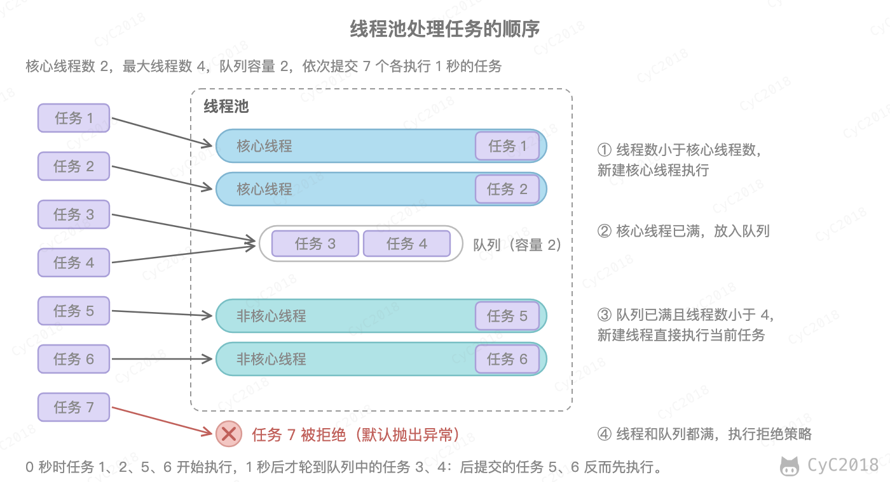 </div><br>

```java
ThreadPoolExecutor pool = new ThreadPoolExecutor(2, 4, 60, TimeUnit.SECONDS,
        new ArrayBlockingQueue<>(2), new ThreadPoolExecutor.AbortPolicy());
for (int i = 1; i <= 7; i++) {
    try {
        pool.execute(() -> {
            try {
                Thread.sleep(1000);
            } catch (InterruptedException ignored) {
            }
        });
        System.out.println("提交任务 " + i + "：线程数 " + pool.getPoolSize()
                + "，队列中 " + pool.getQueue().size() + " 个");
    } catch (RejectedExecutionException e) {
        System.out.println("提交任务 " + i + "：被拒绝");
    }
}
```

```text
提交任务 1：线程数 1，队列中 0 个
提交任务 2：线程数 2，队列中 0 个
提交任务 3：线程数 2，队列中 1 个
提交任务 4：线程数 2，队列中 2 个
提交任务 5：线程数 3，队列中 2 个
提交任务 6：线程数 4，队列中 2 个
提交任务 7：被拒绝
```

需要注意的是，任务 5、6 比先提交的任务 3、4 更早执行：队列满后新建的线程直接执行当前提交的任务，队列中的任务要等有线程空闲后才会被取出。

拒绝策略：

- AbortPolicy：默认策略，抛出 RejectedExecutionException；
- CallerRunsPolicy：由提交任务的线程自己执行这个任务，提交方被拖慢，从而降低了提交速度；
- DiscardPolicy：直接丢弃任务；
- DiscardOldestPolicy：丢弃队列中最早的任务，再重新提交当前任务。

不建议用 Executors 创建线程池，而是直接创建 ThreadPoolExecutor 并使用有界队列：

- newFixedThreadPool() 和 newSingleThreadExecutor() 使用没有容量限制的 LinkedBlockingQueue，任务堆积时可能耗尽内存，最大线程数也不再起作用；
- newCachedThreadPool() 的最大线程数为 Integer.MAX_VALUE，任务多时会创建大量线程。

线程数可以按任务类型估算：

- CPU 密集型：取 CPU 核数 + 1，多出的一个线程用于在某个线程因缺页等原因暂停时继续使用 CPU；
- I/O 密集型：线程等待 I/O 时不占用 CPU，可以按 核数 × (1 + 等待时间 / 计算时间) 估算。例如 8 核 CPU，每个任务计算 10 ms、等待数据库 90 ms，约为 8 × (1 + 90 / 10) = 80 个线程。

估算值只是起点，最终要通过压测确定。上线后监控活跃线程数、队列长度和拒绝次数，必要时调用 setCorePoolSize()、setMaximumPoolSize() 在运行时调整。

### Daemon

守护线程是程序运行时在后台提供服务的线程，不属于程序中不可或缺的部分。

当所有非守护线程结束时，程序也就终止，同时会杀死所有守护线程。

main() 属于非守护线程。

在线程启动之前使用 setDaemon() 方法可以将一个线程设置为守护线程。

```java
public static void main(String[] args) {
    Thread thread = new Thread(new MyRunnable());
    thread.setDaemon(true);
}
```

### sleep()

Thread.sleep(millisec) 方法会休眠当前正在执行的线程，millisec 单位为毫秒。

sleep() 可能会抛出 InterruptedException，因为异常不能跨线程传播回 main() 中，因此必须在本地进行处理。线程中抛出的其它异常也同样需要在本地进行处理。

```java
public void run() {
    try {
        Thread.sleep(3000);
    } catch (InterruptedException e) {
        e.printStackTrace();
    }
}
```

### yield()

对静态方法 Thread.yield() 的调用表示当前线程愿意让出 CPU，可以切换给其它线程来执行。该方法只是对线程调度器的一个提示，调度器可以忽略它，Javadoc 也说明很少有适合使用它的场合，主要用于调试和测试。

```java
public void run() {
    Thread.yield();
}
```

## 三、中断

一个线程执行完毕之后会自动结束，如果在运行过程中发生异常也会提前结束。

### InterruptedException

通过调用一个线程的 interrupt() 来中断该线程，如果该线程正在 sleep()、wait()、join() 等方法中处于限期等待或者无限期等待状态，那么就会抛出 InterruptedException，从而提前结束该线程。但是不能中断传统 I/O 的阻塞和等待 synchronized 锁的阻塞（BLOCKED）。

对于以下代码，在 main() 中启动一个线程之后再中断它，由于线程中调用了 Thread.sleep() 方法，因此会抛出一个 InterruptedException，从而提前结束线程，不执行之后的语句。

```java
public class InterruptExample {

    private static class MyThread1 extends Thread {
        @Override
        public void run() {
            try {
                Thread.sleep(2000);
                System.out.println("Thread run");
            } catch (InterruptedException e) {
                e.printStackTrace();
            }
        }
    }
}
```

```java
public static void main(String[] args) throws InterruptedException {
    Thread thread1 = new MyThread1();
    thread1.start();
    thread1.interrupt();
    System.out.println("Main run");
}
```

```text
Main run
java.lang.InterruptedException: sleep interrupted
    at java.lang.Thread.sleep(Native Method)
    at InterruptExample.lambda$main$0(InterruptExample.java:5)
    at InterruptExample$$Lambda$1/713338599.run(Unknown Source)
    at java.lang.Thread.run(Thread.java:745)
```

### interrupted()

如果一个线程的 run() 方法执行一个无限循环，并且没有执行 sleep() 等会抛出 InterruptedException 的操作，那么调用线程的 interrupt() 方法就无法使线程提前结束。

但是调用 interrupt() 方法会设置线程的中断标记，此时调用 interrupted() 方法会返回 true。因此可以在循环体中使用 interrupted() 方法来判断线程是否处于中断状态，从而提前结束线程。

```java
public class InterruptExample {

    private static class MyThread2 extends Thread {
        @Override
        public void run() {
            while (!interrupted()) {
                // ..
            }
            System.out.println("Thread end");
        }
    }
}
```

```java
public static void main(String[] args) throws InterruptedException {
    Thread thread2 = new MyThread2();
    thread2.start();
    thread2.interrupt();
}
```

```text
Thread end
```

### Executor 的中断操作

调用 Executor 的 shutdown() 方法后，线程池不再接受新任务，已经提交的任务会继续执行完，它本身不会阻塞等待，需要等待时调用 awaitTermination()；如果调用的是 shutdownNow() 方法，则相当于调用每个线程的 interrupt() 方法，并返回队列中还没有执行的任务。

以下使用 Lambda 创建线程，相当于创建了一个匿名内部线程。

```java
public static void main(String[] args) {
    ExecutorService executorService = Executors.newCachedThreadPool();
    executorService.execute(() -> {
        try {
            Thread.sleep(2000);
            System.out.println("Thread run");
        } catch (InterruptedException e) {
            e.printStackTrace();
        }
    });
    executorService.shutdownNow();
    System.out.println("Main run");
}
```

```text
Main run
java.lang.InterruptedException: sleep interrupted
    at java.lang.Thread.sleep(Native Method)
    at ExecutorInterruptExample.lambda$main$0(ExecutorInterruptExample.java:9)
    at ExecutorInterruptExample$$Lambda$1/1160460865.run(Unknown Source)
    at java.util.concurrent.ThreadPoolExecutor.runWorker(ThreadPoolExecutor.java:1142)
    at java.util.concurrent.ThreadPoolExecutor$Worker.run(ThreadPoolExecutor.java:617)
    at java.lang.Thread.run(Thread.java:745)
```

如果只想中断 Executor 中的一个线程，可以通过使用 submit() 方法来提交一个线程，它会返回一个 Future\<?\> 对象，通过调用该对象的 cancel(true) 方法就可以中断线程。

```java
Future<?> future = executorService.submit(() -> {
    // ..
});
future.cancel(true);
```

## 四、互斥同步

Java 提供了两种锁机制来控制多个线程对共享资源的互斥访问，第一个是 JVM 实现的 synchronized，而另一个是 JDK 实现的 ReentrantLock。

### synchronized

#### 1. 同步一个代码块

```java
public void func() {
    synchronized (this) {
        // ...
    }
}
```

它只作用于同一个对象，如果调用两个对象上的同步代码块，就不会进行同步。

对于以下代码，使用 ExecutorService 执行了两个线程，由于调用的是同一个对象的同步代码块，因此这两个线程会进行同步，当一个线程进入同步语句块时，另一个线程就必须等待。

```java
public class SynchronizedExample {

    public void func1() {
        synchronized (this) {
            for (int i = 0; i < 10; i++) {
                System.out.print(i + " ");
            }
        }
    }
}
```

```java
public static void main(String[] args) {
    SynchronizedExample e1 = new SynchronizedExample();
    ExecutorService executorService = Executors.newCachedThreadPool();
    executorService.execute(() -> e1.func1());
    executorService.execute(() -> e1.func1());
}
```

```text
0 1 2 3 4 5 6 7 8 9 0 1 2 3 4 5 6 7 8 9
```

对于以下代码，两个线程调用了不同对象的同步代码块，因此这两个线程就不需要同步。从输出结果可以看出，两个线程交叉执行。

```java
public static void main(String[] args) {
    SynchronizedExample e1 = new SynchronizedExample();
    SynchronizedExample e2 = new SynchronizedExample();
    ExecutorService executorService = Executors.newCachedThreadPool();
    executorService.execute(() -> e1.func1());
    executorService.execute(() -> e2.func1());
}
```

```text
0 0 1 1 2 2 3 3 4 4 5 5 6 6 7 7 8 8 9 9
```


#### 2. 同步一个方法

```java
public synchronized void func () {
    // ...
}
```

它和同步代码块一样，作用于同一个对象。

#### 3. 同步一个类

```java
public void func() {
    synchronized (SynchronizedExample.class) {
        // ...
    }
}
```

作用于整个类，也就是说两个线程调用同一个类的不同对象上的这种同步语句，也会进行同步。

```java
public class SynchronizedExample {

    public void func2() {
        synchronized (SynchronizedExample.class) {
            for (int i = 0; i < 10; i++) {
                System.out.print(i + " ");
            }
        }
    }
}
```

```java
public static void main(String[] args) {
    SynchronizedExample e1 = new SynchronizedExample();
    SynchronizedExample e2 = new SynchronizedExample();
    ExecutorService executorService = Executors.newCachedThreadPool();
    executorService.execute(() -> e1.func2());
    executorService.execute(() -> e2.func2());
}
```

```text
0 1 2 3 4 5 6 7 8 9 0 1 2 3 4 5 6 7 8 9
```

#### 4. 同步一个静态方法

```java
public synchronized static void fun() {
    // ...
}
```

作用于整个类。

### ReentrantLock

ReentrantLock 是 java.util.concurrent（J.U.C）包中的锁。

```java
public class LockExample {

    private Lock lock = new ReentrantLock();

    public void func() {
        lock.lock();
        try {
            for (int i = 0; i < 10; i++) {
                System.out.print(i + " ");
            }
        } finally {
            lock.unlock(); // 确保释放锁，从而避免发生死锁。
        }
    }
}
```

```java
public static void main(String[] args) {
    LockExample lockExample = new LockExample();
    ExecutorService executorService = Executors.newCachedThreadPool();
    executorService.execute(() -> lockExample.func());
    executorService.execute(() -> lockExample.func());
}
```

```text
0 1 2 3 4 5 6 7 8 9 0 1 2 3 4 5 6 7 8 9
```


### 比较

#### 1. 锁的实现

synchronized 是 JVM 实现的，而 ReentrantLock 是 JDK 实现的。

synchronized 代码块编译后是一对 monitorenter 和 monitorexit 指令，编译器还会生成一个异常处理器，抛出异常时也执行 monitorexit，保证锁一定会被释放；synchronized 方法没有这两条指令，而是在方法的访问标志中设置 ACC_SYNCHRONIZED，由 JVM 在调用和返回时加锁和解锁。下面是 JDK 21 的 javap 输出（有删节）：

```text
public void inc();                 // synchronized (this) { count++; }
     3: monitorenter
    ...                            // count++
    15: monitorexit
    16: goto          24
    19: astore_2                   // 异常处理器：出现异常时也释放锁
    20: aload_1
    21: monitorexit
    23: athrow

public synchronized void dec();
  flags: (0x0021) ACC_PUBLIC, ACC_SYNCHRONIZED
```

发生竞争、锁膨胀为重量级锁之后，HotSpot 用 ObjectMonitor 管理这把锁：_owner 指向持有锁的线程，_recursions 记录重入的次数；抢不到锁的线程进入 _cxq、_EntryList 队列并阻塞，调用 wait() 的线程进入 _WaitSet，被 notify() 之后再回到队列中重新竞争锁。ReentrantLock 则是用 Java 代码基于 AQS 实现的，见 [七、J.U.C - AQS](#七juc---aqs)。

#### 2. 性能

新版本 Java 对 synchronized 进行了很多优化，例如自旋锁等，synchronized 与 ReentrantLock 大致相同。

#### 3. 等待可中断

当持有锁的线程长期不释放锁的时候，正在等待的线程可以选择放弃等待，改为处理其他事情。

ReentrantLock 可中断，而 synchronized 不行。

#### 4. 公平锁

公平锁是指多个线程在等待同一个锁时，必须按照申请锁的时间顺序来依次获得锁。

synchronized 中的锁是非公平的，ReentrantLock 默认情况下也是非公平的，但是也可以是公平的。

#### 5. 锁绑定多个条件

一个 ReentrantLock 可以同时绑定多个 Condition 对象。

### 使用选择

除非需要使用 ReentrantLock 的高级功能，否则优先使用 synchronized。这是因为 synchronized 是 JVM 实现的一种锁机制，JVM 原生地支持它，并且使用 synchronized 不用担心没有释放锁而导致死锁问题，因为 JVM 会确保锁的释放；ReentrantLock 则必须在 finally 中调用 unlock()。

### Java 中的锁

Java 中的锁可以从几个角度分类，同一把锁会同时属于多类，例如 ReentrantLock 默认是悲观、独占、可重入的非公平锁：

| 分类 | 区别 | 例子 |
| --- | --- | --- |
| [悲观锁与乐观锁](#4-乐观锁与悲观锁) | 先加锁再访问；或者先访问，提交时再检查有没有冲突 | synchronized、ReentrantLock；AtomicInteger 的 CAS、StampedLock 的乐观读 |
| 独占锁与共享锁 | 同一时刻只能有一个线程持有；或者可以有多个 | ReentrantLock、写锁；读锁、Semaphore |
| [公平锁与非公平锁](#七juc---aqs) | 按申请的顺序获得锁；或者允许新来的线程插队 | new ReentrantLock(true)；synchronized、ReentrantLock 默认 |
| 可重入锁 | 持有锁的线程可以再次获得同一把锁，不会被自己阻塞 | synchronized、ReentrantLock、ReentrantReadWriteLock |
| [自旋锁](#自旋锁) | 获取失败时循环重试，而不是挂起线程 | synchronized 的自适应自旋、CAS 循环 |
| [偏向锁、轻量级锁、重量级锁](#十二锁优化) | synchronized 在不同竞争程度下的实现 | synchronized |

读多写少时，读和读之间不需要互斥，可以使用读写锁 ReentrantReadWriteLock：读锁是共享锁，多个线程可以同时持有；写锁是独占锁，持有写锁时其它线程既不能读也不能写。JDK 8 的 StampedLock 还提供乐观读，读之前不加锁，只记下一个版本号，读完再检查期间有没有写入，有写入才加读锁重读：

```java
long stamp = lock.tryOptimisticRead();
long sum = readWork();
if (!lock.validate(stamp)) {                // 读的过程中有写入
    stamp = lock.readLock();
    try { sum = readWork(); } finally { lock.unlockRead(stamp); }
}
```

例如 8 个线程访问同一个保存了 1000 个商品价格的 HashMap，99% 的操作是遍历求总价，1% 是修改价格，每个线程 2 万次，三种锁的耗时如下（JDK 21 实测，见[附录 A1](#a1-三种锁在读多写少时的耗时)）：

- ReentrantLock：370～440 ms，读也互斥，与单线程不加锁执行同样多次读的 331 ms 差不多，8 个线程实际上是排队执行的；
- ReentrantReadWriteLock：140～170 ms，读可以并行，但每次加读锁都要用 CAS 修改锁中的读线程计数，多个线程争抢同一个变量，不能做到 8 倍；
- StampedLock 乐观读：50～70 ms，读的时候不修改任何共享变量，只有极少数读取需要重试。

需要注意的是：

- 读锁不能升级为写锁：持有读锁时再获取写锁，要等所有读锁释放，而自己的读锁不会释放，tryLock(1, TimeUnit.SECONDS) 等待 1 秒后返回 false，用 lock() 就会永远阻塞；
- 写锁可以降级为读锁：先获取写锁，再获取读锁，然后释放写锁，这样修改之后的数据可以继续读，期间不会被其它线程修改；
- StampedLock 不可重入，也不支持 Condition，乐观读期间读到的数据可能是不一致的，只能在 validate 成功之后使用。

## 五、线程之间的协作

当多个线程可以一起工作去解决某个问题时，如果某些部分必须在其它部分之前完成，那么就需要对线程进行协调。

### join()

在线程中调用另一个线程的 join() 方法，会将当前线程挂起，而不是忙等待，直到目标线程结束。

对于以下代码，b 线程在 run() 中调用了 a 线程的 join() 方法，会等待 a 线程结束才继续执行，因此能够保证 a 线程的输出先于 b 线程的输出。需要注意的是，join() 只对已经启动的线程有效，如果调用 a.join() 时 a 线程还未启动，join() 会立即返回。

```java
public class JoinExample {

    private class A extends Thread {
        @Override
        public void run() {
            System.out.println("A");
        }
    }

    private class B extends Thread {

        private A a;

        B(A a) {
            this.a = a;
        }

        @Override
        public void run() {
            try {
                a.join();
            } catch (InterruptedException e) {
                e.printStackTrace();
            }
            System.out.println("B");
        }
    }

    public void test() {
        A a = new A();
        B b = new B(a);
        a.start();
        b.start();
    }
}
```

```java
public static void main(String[] args) {
    JoinExample example = new JoinExample();
    example.test();
}
```

```text
A
B
```

### wait() notify() notifyAll()

调用 wait() 使得线程等待某个条件满足，线程在等待时会被挂起，当其他线程的运行使得这个条件满足时，其它线程会调用 notify() 或者 notifyAll() 来唤醒挂起的线程。

它们都属于 Object 的一部分，而不属于 Thread。

只能用在同步方法或者同步控制块中使用，否则会在运行时抛出 IllegalMonitorStateException。

使用 wait() 挂起期间，线程会释放锁。这是因为，如果没有释放锁，那么其它线程就无法进入对象的同步方法或者同步控制块中，那么就无法执行 notify() 或者 notifyAll() 来唤醒挂起的线程，造成死锁。

```java
public class WaitNotifyExample {

    public synchronized void before() {
        System.out.println("before");
        notifyAll();
    }

    public synchronized void after() {
        try {
            wait();
        } catch (InterruptedException e) {
            e.printStackTrace();
        }
        System.out.println("after");
    }
}
```

```java
public static void main(String[] args) {
    ExecutorService executorService = Executors.newCachedThreadPool();
    WaitNotifyExample example = new WaitNotifyExample();
    executorService.execute(() -> example.after());
    executorService.execute(() -> example.before());
}
```

```text
before
after
```

wait() 和 sleep() 的区别：

- wait() 是 Object 的方法，而 sleep() 是 Thread 的静态方法；
- wait() 会释放锁，sleep() 不会。

### await() signal() signalAll()

java.util.concurrent 类库中提供了 Condition 类来实现线程之间的协调，可以在 Condition 上调用 await() 方法使线程等待，其它线程调用 signal() 或 signalAll() 方法唤醒等待的线程。

相比于 wait() 这种等待方式，await() 可以指定等待的条件，因此更加灵活。

使用 Lock 来获取一个 Condition 对象。

```java
public class AwaitSignalExample {

    private Lock lock = new ReentrantLock();
    private Condition condition = lock.newCondition();

    public void before() {
        lock.lock();
        try {
            System.out.println("before");
            condition.signalAll();
        } finally {
            lock.unlock();
        }
    }

    public void after() {
        lock.lock();
        try {
            condition.await();
            System.out.println("after");
        } catch (InterruptedException e) {
            e.printStackTrace();
        } finally {
            lock.unlock();
        }
    }
}
```

```java
public static void main(String[] args) {
    ExecutorService executorService = Executors.newCachedThreadPool();
    AwaitSignalExample example = new AwaitSignalExample();
    executorService.execute(() -> example.after());
    executorService.execute(() -> example.before());
}
```

```text
before
after
```

### 交替打印

多个线程按固定顺序轮流执行是常见的手写题，例如三个线程依次打印 A、B、C，共打印 10 轮。思路是用一个共享变量记录轮到哪个线程：没轮到的线程等待，轮到的线程打印后把轮次交给下一个线程，并唤醒等待的线程。

```java
public class PrintABC {
    private final Object lock = new Object();
    private int turn = 0;    // 轮到第几个线程：0、1、2

    public void print(int id, char c, int times) throws InterruptedException {
        for (int i = 0; i < times; i++) {
            synchronized (lock) {
                while (turn != id) {
                    lock.wait();
                }
                System.out.print(c);
                turn = (turn + 1) % 3;
                lock.notifyAll();
            }
        }
    }

    public static void main(String[] args) {
        PrintABC p = new PrintABC();
        for (int i = 0; i < 3; i++) {
            int id = i;
            new Thread(() -> {
                try {
                    p.print(id, (char) ('A' + id), 10);
                } catch (InterruptedException ignored) {
                }
            }).start();
        }
    }
}
```

```text
ABCABCABCABCABCABCABCABCABCABC
```

有两处容易写错：

- 等待条件要用 while 而不是 if：线程被唤醒时不一定轮到了自己，例如和其它线程一起被 notifyAll() 唤醒，或者发生了虚假唤醒，醒来后必须重新检查条件；
- 要用 notifyAll() 而不是 notify()：notify() 只唤醒任意一个等待的线程，例如 B 打印完后唤醒的是 A，A 发现没轮到自己又继续等待，C 就再也不会被唤醒，三个线程都在等待。

把上面代码中的 notifyAll() 改成 notify() 后运行 100 次，每次都在打印出几个字母后卡住；把 while 改成 if 后，100 次中有 94 次打印出 ABAABAAB 这样的乱序后卡住，其余 6 次乱序打印完（JDK 21 实测）。

用 Semaphore 实现更直观：每个线程对应一个信号量，只有第一个线程的许可为 1。线程打印前获取自己的许可，打印后释放下一个线程的许可，就像传递接力棒：

```java
Semaphore[] s = {new Semaphore(1), new Semaphore(0), new Semaphore(0)};
for (int i = 0; i < 3; i++) {
    int id = i;
    new Thread(() -> {
        for (int k = 0; k < 10; k++) {
            try {
                s[id].acquire();
            } catch (InterruptedException e) {
                return;
            }
            System.out.print((char) ('A' + id));
            s[(id + 1) % 3].release();
        }
    }).start();
}
```

两个线程交替打印奇偶数也是同样的做法，把轮次改为两个即可。使用 ReentrantLock 时，可以为每个线程创建一个 Condition，打印后只唤醒下一个线程。

## 六、线程状态

一个线程只能处于一种状态，并且这里的线程状态特指 Java 虚拟机的线程状态，不能反映线程在特定操作系统下的状态。

### 新建（NEW）

创建后尚未启动。

### 可运行（RUNNABLE）

正在 Java 虚拟机中运行。但是在操作系统层面，它可能处于运行状态，也可能等待资源调度（例如处理器资源），资源调度完成就进入运行状态。所以该状态的可运行是指可以被运行，具体有没有运行要看底层操作系统的资源调度。

### 阻塞（BLOCKED）

请求获取 monitor lock 从而进入 synchronized 函数或者代码块，但是其它线程已经占用了该 monitor lock，所以处于阻塞状态。要结束该状态从而进入 RUNNABLE 需要其他线程释放 monitor lock。

### 无限期等待（WAITING）

等待其它线程显式地唤醒。

阻塞和等待的区别在于，阻塞是被动的，它是在等待获取 monitor lock。而等待是主动的，通过调用  Object.wait() 等方法进入。

需要注意的是，只有等待 synchronized 的线程才处于 BLOCKED 状态。ReentrantLock 基于 AQS，抢不到锁的线程通过 LockSupport.park() 挂起，状态是 WAITING：让一个线程等待 synchronized、另一个线程等待 ReentrantLock，在 JDK 21 上打印两者的 getState()，分别是 BLOCKED 和 WAITING。

| 进入方法 | 退出方法 |
| --- | --- |
| 没有设置 Timeout 参数的 Object.wait() 方法 | Object.notify() / Object.notifyAll() |
| 没有设置 Timeout 参数的 Thread.join() 方法 | 被调用的线程执行完毕 |
| LockSupport.park() 方法 | LockSupport.unpark(Thread) |

### 限期等待（TIMED_WAITING）

无需等待其它线程显式地唤醒，在一定时间之后会被系统自动唤醒。

| 进入方法 | 退出方法 |
| --- | --- |
| Thread.sleep() 方法 | 时间结束 |
| 设置了 Timeout 参数的 Object.wait() 方法 | 时间结束 / Object.notify() / Object.notifyAll()  |
| 设置了 Timeout 参数的 Thread.join() 方法 | 时间结束 / 被调用的线程执行完毕 |
| LockSupport.parkNanos() 方法 | LockSupport.unpark(Thread) |
| LockSupport.parkUntil() 方法 | LockSupport.unpark(Thread) |

调用 Thread.sleep() 方法使线程进入限期等待状态时，常常用“使一个线程睡眠”进行描述。调用 Object.wait() 方法使线程进入限期等待或者无限期等待时，常常用“挂起一个线程”进行描述。睡眠和挂起是用来描述行为，而阻塞和等待用来描述状态。

### 死亡（TERMINATED）

可以是线程结束任务之后自己结束，或者产生了异常而结束。

## 七、J.U.C - AQS

java.util.concurrent（J.U.C）大大提高了并发性能，AQS 被认为是 J.U.C 的核心。

AbstractQueuedSynchronizer（AQS）用两样东西实现了各种同步器：

- 一个 int 类型的 state，含义由具体的同步器决定，修改时使用 CAS；
- 一个等待队列，获取失败的线程包装成节点加入队尾，并通过 LockSupport.park() 挂起，释放时唤醒队头的线程。

以 ReentrantLock 为例，state 表示锁被重入的次数：0 表示没有被持有，加锁时用 CAS 把 0 改为 1，同一个线程再次加锁时直接加 1，解锁时减 1，减到 0 才真正释放。下面的代码中，main 线程加锁两次后，t1、t2 都进入了等待队列：

```java
ReentrantLock lock = new ReentrantLock();
lock.lock();
lock.lock();
System.out.println(lock.getHoldCount());     // 2
Thread t1 = new Thread(lock::lock), t2 = new Thread(lock::lock);
t1.start(); t2.start();
Thread.sleep(200);
System.out.println(lock.getQueueLength());   // 2，t1、t2 的状态都是 WAITING
lock.unlock();
lock.unlock();                               // state 减到 0，唤醒等待队列中最先入队的线程
```

公平锁与非公平锁的区别只在加锁的第一步：非公平锁不管队列里有没有线程在等，先尝试 CAS 抢一次；公平锁先检查队列（hasQueuedPredecessors），有线程在等就直接排到队尾。非公平锁的好处是刚释放锁的线程可以立即再次获得锁，省去了唤醒另一个线程的开销。例如 8 个线程各加锁、解锁 20 万次，非公平锁约 55 ms，公平锁约 3 秒，相差几十倍（JDK 21 实测，见[附录 A2](#a2-公平锁与非公平锁)），所以 ReentrantLock 默认是非公平的，只有严格要求先来先得时才使用公平锁。

CountDownLatch、Semaphore 等也基于 AQS，只是对 state 的解释不同：CountDownLatch 的 state 是剩余的计数，Semaphore 的 state 是剩余的许可数。

### CountDownLatch

用来控制一个或者多个线程等待多个线程。

维护了一个计数器 cnt，每次调用 countDown() 方法会让计数器的值减 1，减到 0 的时候，那些因为调用 await() 方法而在等待的线程就会被唤醒。

<div align="center"> 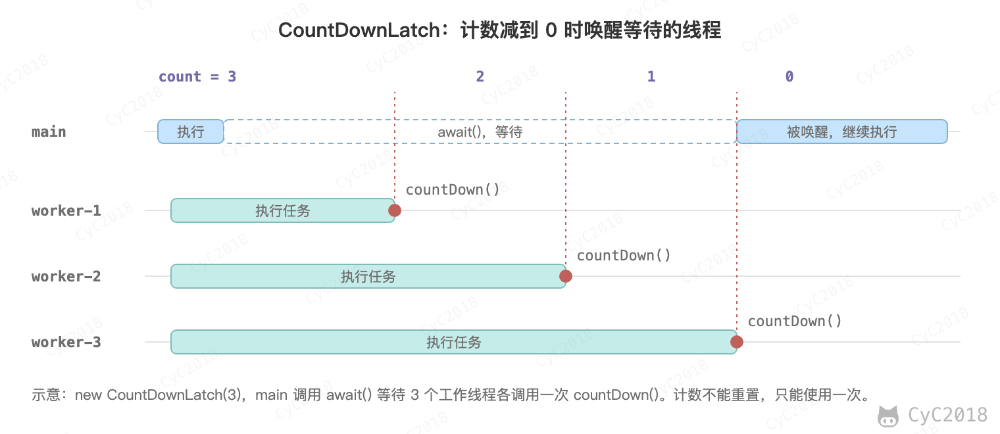 </div><br>

```java
public class CountdownLatchExample {

    public static void main(String[] args) throws InterruptedException {
        final int totalThread = 10;
        CountDownLatch countDownLatch = new CountDownLatch(totalThread);
        ExecutorService executorService = Executors.newCachedThreadPool();
        for (int i = 0; i < totalThread; i++) {
            executorService.execute(() -> {
                System.out.print("run..");
                countDownLatch.countDown();
            });
        }
        countDownLatch.await();
        System.out.println("end");
        executorService.shutdown();
    }
}
```

```text
run..run..run..run..run..run..run..run..run..run..end
```

### CyclicBarrier

用来控制多个线程互相等待，只有当多个线程都到达时，这些线程才会继续执行。

和 CountDownLatch 相似，都是通过维护计数器来实现的。线程执行 await() 方法之后计数器会减 1，并进行等待，直到计数器为 0，所有调用 await() 方法而在等待的线程才能继续执行。

CyclicBarrier 和 CountDownLatch 的一个区别是，所有线程到达、屏障打开之后，CyclicBarrier 的计数器会自动恢复为初始值，可以用于下一轮，所以它才叫做循环屏障；CountDownLatch 的计数减到 0 之后不能再重置。reset() 用于强制重置屏障，正在等待的线程会抛出 BrokenBarrierException。

CyclicBarrier 有两个构造函数，其中 parties 指示计数器的初始值，barrierAction 在所有线程都到达屏障的时候会执行一次。

```java
public CyclicBarrier(int parties, Runnable barrierAction) {
    if (parties <= 0) throw new IllegalArgumentException();
    this.parties = parties;
    this.count = parties;
    this.barrierCommand = barrierAction;
}

public CyclicBarrier(int parties) {
    this(parties, null);
}
```

<div align="center"> 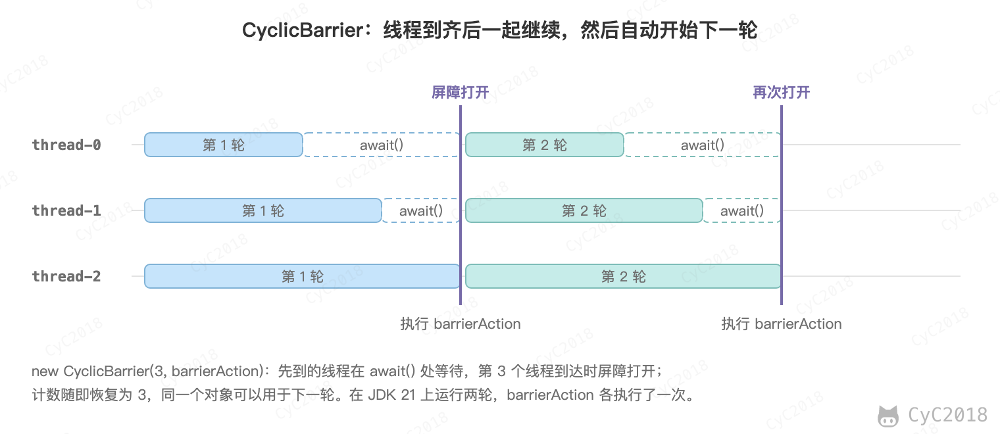 </div><br>

```java
public class CyclicBarrierExample {

    public static void main(String[] args) {
        final int totalThread = 10;
        CyclicBarrier cyclicBarrier = new CyclicBarrier(totalThread);
        ExecutorService executorService = Executors.newCachedThreadPool();
        for (int i = 0; i < totalThread; i++) {
            executorService.execute(() -> {
                System.out.print("before..");
                try {
                    cyclicBarrier.await();
                } catch (InterruptedException | BrokenBarrierException e) {
                    e.printStackTrace();
                }
                System.out.print("after..");
            });
        }
        executorService.shutdown();
    }
}
```

```text
before..before..before..before..before..before..before..before..before..before..after..after..after..after..after..after..after..after..after..after..
```

### Semaphore

Semaphore 类似于操作系统中的信号量，可以控制对互斥资源的访问线程数。

以下代码模拟了对某个服务的并发请求，每次只能有 3 个客户端同时访问，请求总数为 10。

```java
public class SemaphoreExample {

    public static void main(String[] args) {
        final int clientCount = 3;
        final int totalRequestCount = 10;
        Semaphore semaphore = new Semaphore(clientCount);
        ExecutorService executorService = Executors.newCachedThreadPool();
        for (int i = 0; i < totalRequestCount; i++) {
            executorService.execute(()->{
                try {
                    semaphore.acquire();
                    System.out.print(semaphore.availablePermits() + " ");
                } catch (InterruptedException e) {
                    e.printStackTrace();
                } finally {
                    semaphore.release();
                }
            });
        }
        executorService.shutdown();
    }
}
```

```text
2 1 2 2 2 2 2 1 2 2
```

## 八、J.U.C - 其它组件

### FutureTask

Callable 可以有返回值，返回值通过 Future\<V\> 进行封装。FutureTask 实现了 RunnableFuture 接口，该接口继承自 Runnable 和 Future\<V\> 接口，这使得 FutureTask 既可以当做一个任务执行，也可以有返回值。

```java
public class FutureTask<V> implements RunnableFuture<V>
```

```java
public interface RunnableFuture<V> extends Runnable, Future<V>
```

FutureTask 可用于异步获取执行结果或取消执行任务的场景。当一个计算任务需要执行很长时间，那么就可以用 FutureTask 来封装这个任务，主线程在完成自己的任务之后再去获取结果。

```java
public class FutureTaskExample {

    public static void main(String[] args) throws ExecutionException, InterruptedException {
        FutureTask<Integer> futureTask = new FutureTask<Integer>(new Callable<Integer>() {
            @Override
            public Integer call() throws Exception {
                int result = 0;
                for (int i = 0; i < 100; i++) {
                    Thread.sleep(10);
                    result += i;
                }
                return result;
            }
        });

        Thread computeThread = new Thread(futureTask);
        computeThread.start();

        Thread otherThread = new Thread(() -> {
            System.out.println("other task is running...");
            try {
                Thread.sleep(1000);
            } catch (InterruptedException e) {
                e.printStackTrace();
            }
        });
        otherThread.start();
        System.out.println(futureTask.get());
    }
}
```

```text
other task is running...
4950
```

### CompletableFuture

Future 只能调用 get() 阻塞等待结果，多个异步任务之间有依赖时（A 完成后做 B，A 和 B 都完成后合并结果），需要自己写等待的逻辑。JDK 8 的 CompletableFuture 可以给任务注册回调，把多个异步任务组合起来。

例如订单详情页要依次查询订单和物流（查物流要用到订单中的运单号），同时还要查询优惠券，每次调用约 200 ms。下面的 call() 模拟一次远程调用，其中优惠券服务会抛出异常：

```java
ExecutorService pool = Executors.newFixedThreadPool(8);
CompletableFuture<String> order = CompletableFuture.supplyAsync(() -> call("订单 1024", 200), pool);
CompletableFuture<String> logistics = order.thenApplyAsync(o -> call("物流 SF1234567", 200), pool);  // 依赖订单的结果
CompletableFuture<String> coupon = CompletableFuture.supplyAsync(() -> call("优惠券 2 张", 200), pool)
        .exceptionally(e -> "优惠券暂不可用");                                                      // 失败时降级
String page = logistics.thenCombine(coupon, (l, c) -> l + "，" + c).join();
```

```text
串行：640 ms
物流 SF1234567，优惠券暂不可用，耗时 425 ms
```

需要注意的是：

- 不传入线程池时，任务在 ForkJoinPool.commonPool() 中执行，它的线程数默认为 CPU 核数 − 1（10 核的机器上为 9），并且被并行流等代码共用，阻塞的 I/O 任务应该使用自己的线程池；
- 异常不会自动抛出，要用 exceptionally、handle 处理，否则只有调用 join() 时才会得到包装后的 CompletionException；
- thenApply 的函数返回普通的值，thenCompose 的函数返回另一个 CompletableFuture，用来串联两个异步调用，避免得到 CompletableFuture&lt;CompletableFuture&lt;T&gt;&gt;。

### BlockingQueue

java.util.concurrent.BlockingQueue 接口有以下阻塞队列的实现：

- FIFO 队列：LinkedBlockingQueue、ArrayBlockingQueue（固定长度）；
- 优先级队列：PriorityBlockingQueue。

提供了阻塞的 take() 和 put() 方法：如果队列为空 take() 将阻塞，直到队列中有内容；如果队列为满 put() 将阻塞，直到队列有空闲位置。

使用 BlockingQueue 实现生产者消费者问题：

```java
public class ProducerConsumer {

    private static BlockingQueue<String> queue = new ArrayBlockingQueue<>(5);

    private static class Producer extends Thread {
        @Override
        public void run() {
            try {
                queue.put("product");
            } catch (InterruptedException e) {
                e.printStackTrace();
            }
            System.out.print("produce..");
        }
    }

    private static class Consumer extends Thread {

        @Override
        public void run() {
            try {
                String product = queue.take();
            } catch (InterruptedException e) {
                e.printStackTrace();
            }
            System.out.print("consume..");
        }
    }
}
```

```java
public static void main(String[] args) {
    for (int i = 0; i < 2; i++) {
        Producer producer = new Producer();
        producer.start();
    }
    for (int i = 0; i < 5; i++) {
        Consumer consumer = new Consumer();
        consumer.start();
    }
    for (int i = 0; i < 3; i++) {
        Producer producer = new Producer();
        producer.start();
    }
}
```

```text
produce..produce..consume..consume..produce..consume..produce..consume..produce..consume..
```

### ForkJoin

主要用于并行计算中，和 MapReduce 原理类似，都是把大的计算任务拆分成多个小任务并行计算。

```java
public class ForkJoinExample extends RecursiveTask<Integer> {

    private final int threshold = 5;
    private int first;
    private int last;

    public ForkJoinExample(int first, int last) {
        this.first = first;
        this.last = last;
    }

    @Override
    protected Integer compute() {
        int result = 0;
        if (last - first <= threshold) {
            // 任务足够小则直接计算
            for (int i = first; i <= last; i++) {
                result += i;
            }
        } else {
            // 拆分成小任务
            int middle = first + (last - first) / 2;
            ForkJoinExample leftTask = new ForkJoinExample(first, middle);
            ForkJoinExample rightTask = new ForkJoinExample(middle + 1, last);
            leftTask.fork();
            rightTask.fork();
            result = leftTask.join() + rightTask.join();
        }
        return result;
    }
}
```

```java
public static void main(String[] args) throws ExecutionException, InterruptedException {
    ForkJoinExample example = new ForkJoinExample(1, 10000);
    ForkJoinPool forkJoinPool = new ForkJoinPool();
    Future result = forkJoinPool.submit(example);
    System.out.println(result.get());
}
```

ForkJoin 使用 ForkJoinPool 来启动，它是一个特殊的线程池，线程数量取决于 CPU 核数。

```java
public class ForkJoinPool extends AbstractExecutorService
```

ForkJoinPool 实现了工作窃取算法来提高 CPU 的利用率。每个线程都维护了一个双端队列，用来存储需要执行的任务。工作窃取算法允许空闲的线程从其它线程的双端队列中窃取一个任务来执行。线程从自己队列的一端取最新放入的任务，窃取者从另一端取最早放入的任务，两者分别在队列的两端操作，避免发生竞争。例如下图中，Thread2 从 Thread1 的队列中窃取最早的 Task1，Thread1 自己取出 Task3 执行。但是如果队列中只有一个任务时还是会发生竞争。

<div align="center"> 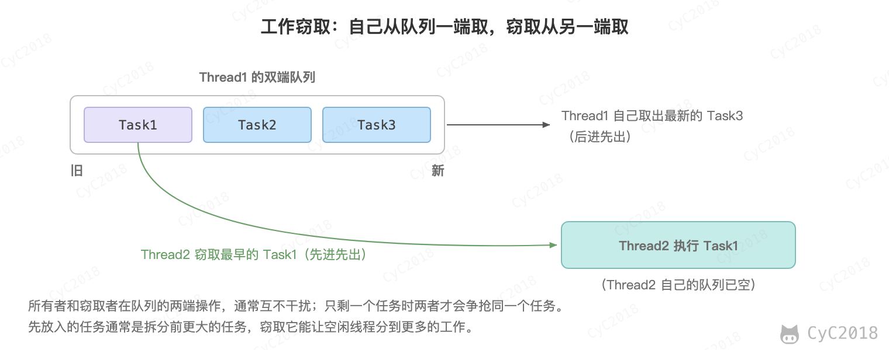 </div><br>

## 九、线程不安全示例

如果多个线程对同一个共享数据进行访问而不采取同步操作的话，那么操作的结果是不一致的。

以下代码演示了 1000 个线程同时对 cnt 执行自增操作，操作结束之后它的值有可能小于 1000。

```java
public class ThreadUnsafeExample {

    private int cnt = 0;

    public void add() {
        cnt++;
    }

    public int get() {
        return cnt;
    }
}
```

```java
public static void main(String[] args) throws InterruptedException {
    final int threadSize = 1000;
    ThreadUnsafeExample example = new ThreadUnsafeExample();
    final CountDownLatch countDownLatch = new CountDownLatch(threadSize);
    ExecutorService executorService = Executors.newCachedThreadPool();
    for (int i = 0; i < threadSize; i++) {
        executorService.execute(() -> {
            example.add();
            countDownLatch.countDown();
        });
    }
    countDownLatch.await();
    executorService.shutdown();
    System.out.println(example.get());
}
```

```text
997
```

## 十、Java 内存模型

Java 内存模型试图屏蔽各种硬件和操作系统的内存访问差异，以实现让 Java 程序在各种平台下都能达到一致的内存访问效果。

### 主内存与工作内存

处理器上的寄存器的读写的速度比内存快几个数量级，为了解决这种速度矛盾，在它们之间加入了高速缓存。

加入高速缓存带来了一个新的问题：缓存一致性。如果多个缓存共享同一块主内存区域，那么多个缓存的数据可能会不一致，需要一些协议来解决这个问题。

<div align="center"> 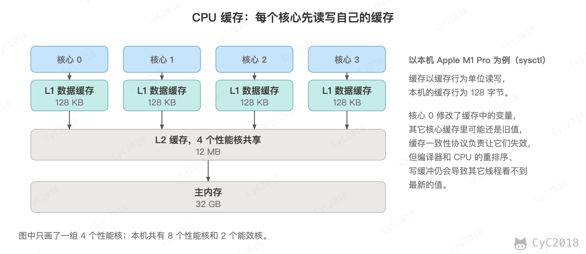 </div><br>

所有的变量都存储在主内存中，每个线程还有自己的工作内存，工作内存存储在高速缓存或者寄存器中，保存了该线程使用的变量的主内存副本拷贝。

线程只能直接操作工作内存中的变量，不同线程之间的变量值传递需要通过主内存来完成。

<div align="center"> 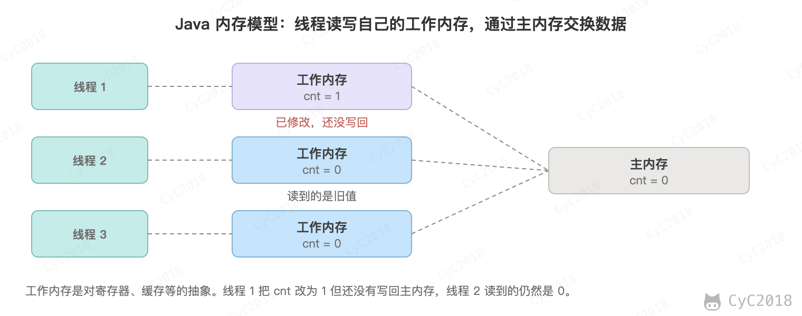 </div><br>

### 内存间交互操作

Java 内存模型定义了 8 个操作来完成主内存和工作内存的交互操作。这种描述来自 JDK 5 之前的规范，现在的规范改用下文的先行发生关系来定义，但它仍然便于理解变量在主内存和工作内存之间的传递。

<div align="center"> 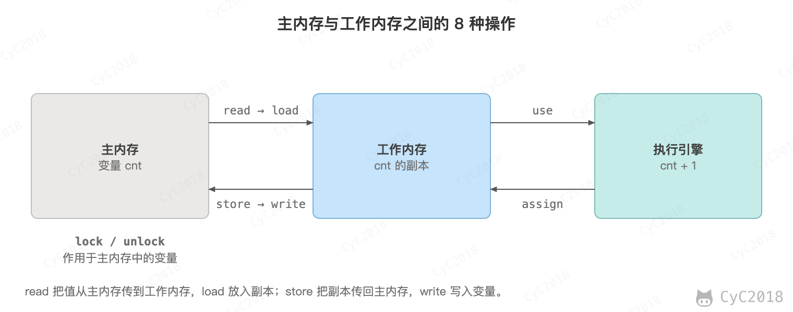 </div><br>

- read：把一个变量的值从主内存传输到工作内存中
- load：在 read 之后执行，把 read 得到的值放入工作内存的变量副本中
- use：把工作内存中一个变量的值传递给执行引擎
- assign：把一个从执行引擎接收到的值赋给工作内存的变量
- store：把工作内存的一个变量的值传送到主内存中
- write：在 store 之后执行，把 store 得到的值放入主内存的变量中
- lock：作用于主内存的变量，把一个变量标识为一条线程独占的状态
- unlock：作用于主内存的变量，把一个处于锁定状态的变量释放出来，释放后的变量才可以被其它线程锁定

### 内存模型三大特性

#### 1. 原子性

Java 内存模型保证了 read、load、use、assign、store、write、lock 和 unlock 操作具有原子性，例如对一个 int 类型的变量执行 assign 赋值操作，这个操作就是原子性的。但是 Java 内存模型允许虚拟机将没有被 volatile 修饰的 64 位数据（long，double）的读写操作划分为两次 32 位的操作来进行，即 load、store、read 和 write 操作可以不具备原子性。

有一个错误认识就是，int 等原子性的类型在多线程环境中不会出现线程安全问题。前面的线程不安全示例代码中，cnt 属于 int 类型变量，1000 个线程对它进行自增操作之后，得到的值为 997 而不是 1000。

为了方便讨论，将内存间的交互操作简化为 3 个：load、assign、store。

下图演示了两个线程同时对 cnt 进行操作，load、assign、store 这一系列操作整体上看不具备原子性，那么在 T1 修改 cnt 并且还没有将修改后的值写入主内存，T2 依然可以读入旧值。可以看出，这两个线程虽然执行了两次自增运算，但是主内存中 cnt 的值最后为 1 而不是 2。因此对 int 类型读写操作满足原子性只是说明 load、assign、store 这些单个操作具备原子性。

<div align="center"> 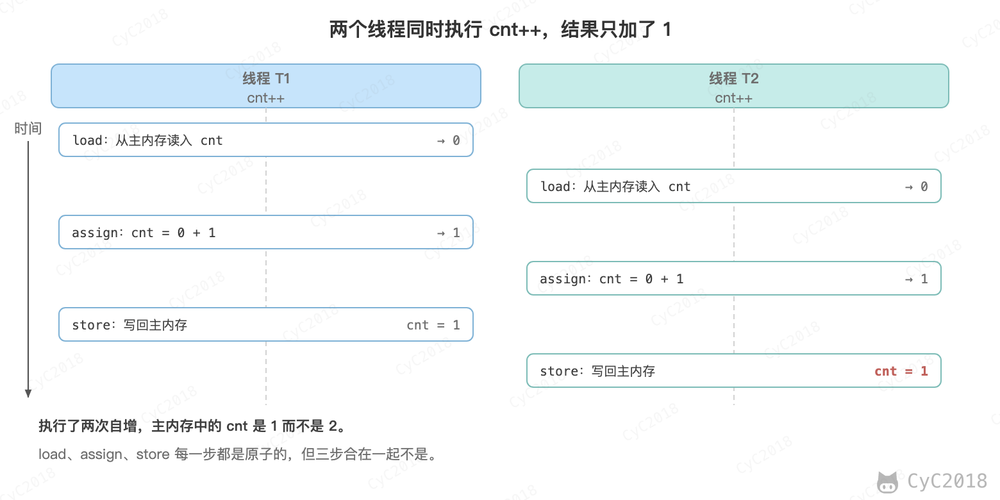 </div><br>

AtomicInteger 能保证多个线程修改的原子性。

<div align="center"> 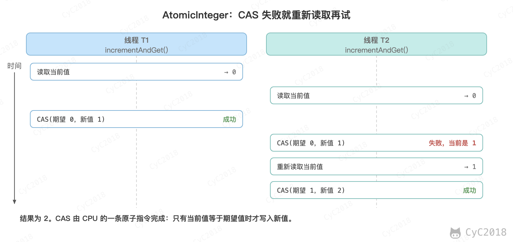 </div><br>

使用 AtomicInteger 重写之前线程不安全的代码之后得到以下线程安全实现：

```java
public class AtomicExample {
    private AtomicInteger cnt = new AtomicInteger();

    public void add() {
        cnt.incrementAndGet();
    }

    public int get() {
        return cnt.get();
    }
}
```

```java
public static void main(String[] args) throws InterruptedException {
    final int threadSize = 1000;
    AtomicExample example = new AtomicExample(); // 只修改这条语句
    final CountDownLatch countDownLatch = new CountDownLatch(threadSize);
    ExecutorService executorService = Executors.newCachedThreadPool();
    for (int i = 0; i < threadSize; i++) {
        executorService.execute(() -> {
            example.add();
            countDownLatch.countDown();
        });
    }
    countDownLatch.await();
    executorService.shutdown();
    System.out.println(example.get());
}
```

```text
1000
```

除了使用原子类之外，也可以使用 synchronized 互斥锁来保证操作的原子性。它对应的内存间交互操作为：lock 和 unlock，在虚拟机实现上对应的字节码指令为 monitorenter 和 monitorexit。

```java
public class AtomicSynchronizedExample {
    private int cnt = 0;

    public synchronized void add() {
        cnt++;
    }

    public synchronized int get() {
        return cnt;
    }
}
```

```java
public static void main(String[] args) throws InterruptedException {
    final int threadSize = 1000;
    AtomicSynchronizedExample example = new AtomicSynchronizedExample();
    final CountDownLatch countDownLatch = new CountDownLatch(threadSize);
    ExecutorService executorService = Executors.newCachedThreadPool();
    for (int i = 0; i < threadSize; i++) {
        executorService.execute(() -> {
            example.add();
            countDownLatch.countDown();
        });
    }
    countDownLatch.await();
    executorService.shutdown();
    System.out.println(example.get());
}
```

```text
1000
```

#### 2. 可见性

可见性指当一个线程修改了共享变量的值，其它线程能够立即得知这个修改。Java 内存模型是通过在变量修改后将新值同步回主内存，在变量读取前从主内存刷新变量值来实现可见性的。

主要有三种实现可见性的方式：

- volatile
- synchronized，对一个变量执行 unlock 操作之前，必须把变量值同步回主内存。
- final，被 final 关键字修饰的字段在构造器中一旦初始化完成，并且没有发生 this 逃逸（其它线程通过 this 引用访问到初始化了一半的对象），那么其它线程就能看见 final 字段的值。

对前面的线程不安全示例中的 cnt 变量使用 volatile 修饰，不能解决线程不安全问题，因为 volatile 并不能保证操作的原子性。

没有可见性保证时，即时编译器可以只读取一次字段，之后一直使用缓存的值（JLS 17.3）。例如下面的循环，stop 不加 volatile 时，主线程把它改为 true 之后，worker 线程仍然一直循环；加上 volatile 后，每次循环都重新读取 stop，worker 很快结束（JDK 21 各运行 3 次，结果相同，见[附录 A3](#a3-volatile-与循环条件)）：

```java
static boolean stop;               // 改为 static volatile boolean stop 后循环能结束

new Thread(() -> { while (!stop) { } }).start();
Thread.sleep(1000);
stop = true;
```

这也是 volatile 最常见的用法：一个线程写、其它线程读的状态标志。count++ 这类读-改-写操作仍然要用锁或者原子类。

#### 3. 有序性

有序性是指：在本线程内观察，所有操作都是有序的。在一个线程观察另一个线程，所有操作都是无序的，无序是因为发生了重排序。在 Java 内存模型中，允许编译器和处理器对指令进行重排序，重排序过程不会影响到单线程程序的执行，却会影响到多线程并发执行的正确性。

volatile 关键字通过添加内存屏障的方式来禁止重排序，即重排序时不能把后面的指令放到内存屏障之前。

以 x86 为例，处理器本身只会把写操作之后的读操作提前执行，其它重排序都不会发生。因此 HotSpot 只在 volatile 写之后插入一条带 lock 前缀的空操作（lock addl $0, [rsp - C]）作为 StoreLoad 屏障：它之前的写入对其它处理器可见之后，后面的读操作才能执行。

也可以通过 synchronized 来保证有序性，它保证每个时刻只有一个线程执行同步代码，相当于是让线程顺序执行同步代码。

### 先行发生原则

上面提到了可以用 volatile 和 synchronized 来保证有序性。JDK 5（JSR-133）起，Java 内存模型用先行发生（happens-before）关系来定义可见性：如果操作 A 先行发生于操作 B，那么 A 的结果对 B 可见。它说的是可见性和顺序上的保证，并不要求 A 在时间上先执行。以下规则天然成立，不需要额外的同步手段。

#### 1. 单一线程原则

在一个线程内，在程序前面的操作先行发生于后面的操作。

<div align="center"> 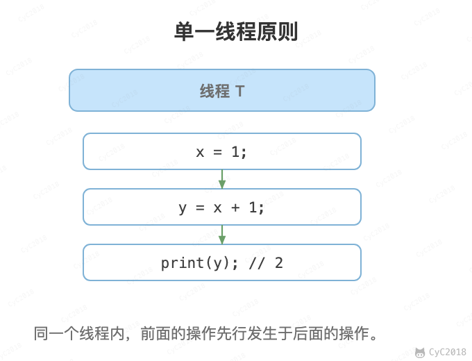 </div><br>

#### 2. 管程锁定规则

一个 unlock 操作先行发生于后面对同一个锁的 lock 操作。

<div align="center"> 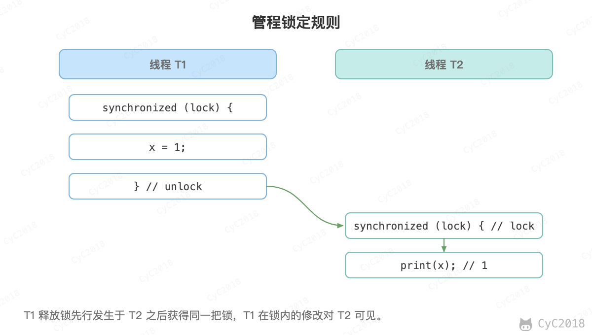 </div><br>

#### 3. volatile 变量规则

对一个 volatile 变量的写操作先行发生于后面对这个变量的读操作。

<div align="center"> 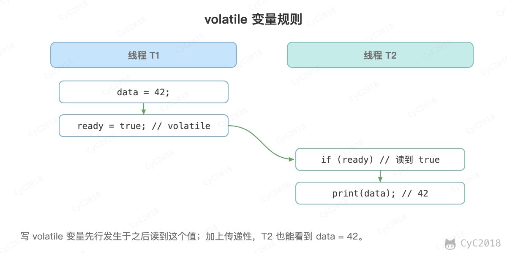 </div><br>

#### 4. 线程启动规则

Thread 对象的 start() 方法调用先行发生于此线程的每一个动作。

<div align="center"> 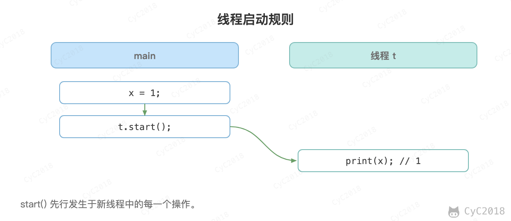 </div><br>

#### 5. 线程加入规则

Thread 对象的结束先行发生于 join() 方法返回。

<div align="center"> 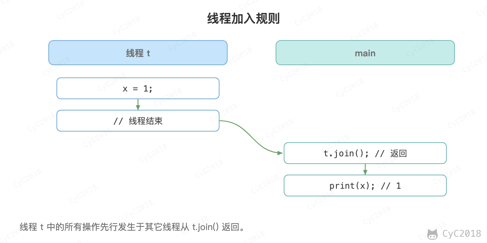 </div><br>

#### 6. 线程中断规则

对线程 interrupt() 方法的调用先行发生于被中断线程的代码检测到中断事件的发生，可以通过 interrupted() 方法检测到是否有中断发生。

#### 7. 对象终结规则

一个对象的初始化完成（构造函数执行结束）先行发生于它的 finalize() 方法的开始。

#### 8. 传递性

如果操作 A 先行发生于操作 B，操作 B 先行发生于操作 C，那么操作 A 先行发生于操作 C。

## 十一、线程安全

多个线程不管以何种方式访问某个类，并且在主调代码中不需要进行同步，都能表现正确的行为。

线程安全有以下几种实现方式：

### 不可变

不可变（Immutable）的对象一定是线程安全的，不需要再采取任何的线程安全保障措施。只要一个不可变的对象被正确地构建出来，永远也不会看到它在多个线程之中处于不一致的状态。多线程环境下，应当尽量使对象成为不可变，来满足线程安全。

不可变的类型：

- final 关键字修饰的基本数据类型
- String
- 枚举类型
- Number 部分子类，如 Long 和 Double 等数值包装类型，BigInteger 和 BigDecimal 等大数据类型。但同为 Number 的原子类 AtomicInteger 和 AtomicLong 则是可变的。

对于集合类型，可以使用 Collections.unmodifiableXXX() 方法来获取一个不可变的集合。

```java
public class ImmutableExample {
    public static void main(String[] args) {
        Map<String, Integer> map = new HashMap<>();
        Map<String, Integer> unmodifiableMap = Collections.unmodifiableMap(map);
        unmodifiableMap.put("a", 1);
    }
}
```

```text
Exception in thread "main" java.lang.UnsupportedOperationException
    at java.util.Collections$UnmodifiableMap.put(Collections.java:1457)
    at ImmutableExample.main(ImmutableExample.java:9)
```

Collections.unmodifiableXXX() 返回的是原集合的只读视图，并不拷贝数据：通过视图修改会抛出异常，但原集合被修改后，视图中也能看到变化（JDK 21 实测）。需要真正不可变的拷贝时，使用 JDK 10 起的 Map.copyOf()、List.copyOf()。视图中需要对集合进行修改的方法都直接抛出异常：

```java
public V put(K key, V value) {
    throw new UnsupportedOperationException();
}
```

### 互斥同步

synchronized 和 ReentrantLock。

### 非阻塞同步

互斥同步最主要的问题就是线程阻塞和唤醒所带来的性能问题，因此这种同步也称为阻塞同步。

互斥同步属于一种悲观的并发策略，总是认为只要不去做正确的同步措施，那就肯定会出现问题。无论共享数据是否真的会出现竞争，它都要进行加锁（这里讨论的是概念模型，实际上虚拟机会优化掉很大一部分不必要的加锁）、用户态核心态转换、维护锁计数器和检查是否有被阻塞的线程需要唤醒等操作。

随着硬件指令集的发展，可以使用基于冲突检测的乐观并发策略：先进行操作，如果没有其它线程争用共享数据，那操作就成功了，否则采取补偿措施（不断地重试，直到成功为止）。这种乐观的并发策略的许多实现都不需要将线程阻塞，因此这种同步操作称为非阻塞同步。

#### 1. CAS

乐观锁需要操作和冲突检测这两个步骤具备原子性，这里就不能再使用互斥同步来保证了，只能靠硬件来完成。硬件支持的原子性操作最典型的是：比较并交换（Compare-and-Swap，CAS）。CAS 指令需要有 3 个操作数，分别是内存地址 V、旧的预期值 A 和新值 B。当执行操作时，只有当 V 的值等于 A，才将 V 的值更新为 B。

#### 2. AtomicInteger

J.U.C 包里面的整数原子类 AtomicInteger 的方法调用了 Unsafe 类的 CAS 操作。

以下代码使用了 AtomicInteger 执行了自增的操作。

```java
private AtomicInteger cnt = new AtomicInteger();

public void add() {
    cnt.incrementAndGet();
}
```

以下是 JDK 21 中 incrementAndGet() 的源码，它调用了 Unsafe 的 getAndAddInt()：

```java
public final int incrementAndGet() {
    return U.getAndAddInt(this, VALUE, 1) + 1;
}
```

getAndAddInt() 中，o 是对象，offset 是 value 字段相对对象起始地址的偏移，delta 是要加的数值，这里为 1。先用 getIntVolatile() 读出当前值 v，再用 weakCompareAndSetInt() 进行 CAS：字段的值仍等于 v 时更新为 v + delta；否则说明被其它线程改过，重新读取再试。发生冲突时的做法就是在循环中不断重试：

```java
public final int getAndAddInt(Object o, long offset, int delta) {
    int v;
    do {
        v = getIntVolatile(o, offset);
    } while (!weakCompareAndSetInt(o, offset, v, v + delta));
    return v;
}
```

JDK 8 中这段代码在 sun.misc.Unsafe 中，CAS 方法名为 compareAndSwapInt()，逻辑相同。

冲突激烈时，CAS 的代价会明显上升：很多线程同时更新同一个变量，这个变量所在的缓存行要在 CPU 核心之间来回传递，用 CAS 循环更新时失败重试的次数也越来越多。8 个线程各对同一个 AtomicLong 累加 1000 万次，共 8000 万次，耗时 3.5～5.1 秒；单线程累加 1000 万次约 70 毫秒，按此计算 8000 万次也只要约 0.56 秒（JDK 21 实测，见[附录 A4](#a4-atomiclong-与-longadder)）。

LongAdder 把计数分散到多个 Cell 中，不同线程更新不同的 Cell，调用 sum() 时再把它们加起来，同样的 8 线程累加只用了 0.10～0.12 秒。代价是 sum() 返回的不是某一时刻的原子快照，所以它适合统计请求数这类计数，不适合需要根据当前值做判断的场景。

#### 3. ABA

如果一个变量初次读取的时候是 A 值，它的值被改成了 B，后来又被改回为 A，那 CAS 操作就会误认为它从来没有被改变过。

J.U.C 包提供了一个带有标记的原子引用类 AtomicStampedReference 来解决这个问题，它可以通过控制变量值的版本来保证 CAS 的正确性。大部分情况下 ABA 问题不会影响程序并发的正确性，如果需要解决 ABA 问题，改用传统的互斥同步可能会比原子类更高效。

#### 4. 乐观锁与悲观锁

悲观锁认为冲突一定会发生，访问共享数据之前先加锁，其它线程只能等待，例如 synchronized、ReentrantLock，以及数据库的 SELECT ... FOR UPDATE。乐观锁认为冲突很少发生，不加锁直接操作，提交时再检查数据是否被别人改过，改过就重试或放弃，例如 CAS 和数据库中的版本号。

数据库中常用版本号实现乐观锁。例如两个请求都读到库存 10、版本号 1，然后都执行：

```sql
UPDATE product SET stock = stock - 1, version = version + 1 WHERE id = 1 AND version = 1;
```

先执行的请求影响 1 行，库存变为 9、版本号变为 2；后执行的请求影响 0 行，说明数据已被修改，需要重新读取后再试。

两者的选择：

- 读多写少、冲突少时用乐观锁，没有加锁和阻塞的开销；
- 写多、冲突频繁时用悲观锁，否则乐观锁会不断失败重试，反而浪费 CPU；
- 乐观锁只能保证单个变量或单行数据的原子更新，涉及多个资源时仍然要加锁或使用事务。

### 无同步方案

要保证线程安全，并不是一定就要进行同步。如果一个方法本来就不涉及共享数据，那它自然就无须任何同步措施去保证正确性。

#### 1. 栈封闭

多个线程访问同一个方法的局部变量时，不会出现线程安全问题，因为局部变量存储在虚拟机栈中，属于线程私有的。

```java
public class StackClosedExample {
    public void add100() {
        int cnt = 0;
        for (int i = 0; i < 100; i++) {
            cnt++;
        }
        System.out.println(cnt);
    }
}
```

```java
public static void main(String[] args) {
    StackClosedExample example = new StackClosedExample();
    ExecutorService executorService = Executors.newCachedThreadPool();
    executorService.execute(() -> example.add100());
    executorService.execute(() -> example.add100());
    executorService.shutdown();
}
```

```text
100
100
```

#### 2. 线程本地存储（Thread Local Storage）

如果一段代码中所需要的数据必须与其他代码共享，那就看看这些共享数据的代码是否能保证在同一个线程中执行。如果能保证，就可以把共享数据的可见范围限制在同一个线程之内，这样，无须同步也能保证线程之间不出现数据争用的问题。

符合这种特点的应用并不少见，大部分使用消费队列的架构模式（如“生产者-消费者”模式）都会将产品的消费过程尽量在一个线程中消费完。其中最重要的一个应用实例就是经典 Web 交互模型中的“一个请求对应一个服务器线程”（Thread-per-Request）的处理方式，这种处理方式的广泛应用使得很多 Web 服务端应用都可以使用线程本地存储来解决线程安全问题。

可以使用 java.lang.ThreadLocal 类来实现线程本地存储功能。

对于以下代码，thread1 中设置 threadLocal 为 1，而 thread2 设置 threadLocal 为 2。过了一段时间之后，thread1 读取 threadLocal 依然是 1，不受 thread2 的影响。

```java
public class ThreadLocalExample {
    public static void main(String[] args) {
        ThreadLocal threadLocal = new ThreadLocal();
        Thread thread1 = new Thread(() -> {
            threadLocal.set(1);
            try {
                Thread.sleep(1000);
            } catch (InterruptedException e) {
                e.printStackTrace();
            }
            System.out.println(threadLocal.get());
            threadLocal.remove();
        });
        Thread thread2 = new Thread(() -> {
            threadLocal.set(2);
            threadLocal.remove();
        });
        thread1.start();
        thread2.start();
    }
}
```

```text
1
```

为了理解 ThreadLocal，先看以下代码：

```java
public class ThreadLocalExample1 {
    public static void main(String[] args) {
        ThreadLocal threadLocal1 = new ThreadLocal();
        ThreadLocal threadLocal2 = new ThreadLocal();
        Thread thread1 = new Thread(() -> {
            threadLocal1.set(1);
            threadLocal2.set(1);
        });
        Thread thread2 = new Thread(() -> {
            threadLocal1.set(2);
            threadLocal2.set(2);
        });
        thread1.start();
        thread2.start();
    }
}
```

它所对应的底层结构图为：

<div align="center"> 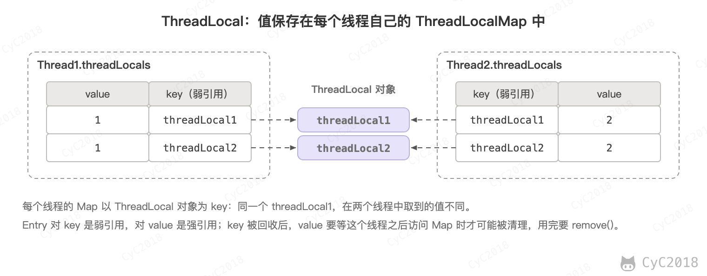 </div><br>

每个 Thread 都有一个 ThreadLocal.ThreadLocalMap 对象。

```java
/* ThreadLocal values pertaining to this thread. This map is maintained
 * by the ThreadLocal class. */
ThreadLocal.ThreadLocalMap threadLocals = null;
```

当调用一个 ThreadLocal 的 set(T value) 方法时，先得到当前线程的 ThreadLocalMap 对象，然后将 ThreadLocal-\>value 键值对插入到该 Map 中。

```java
public void set(T value) {
    Thread t = Thread.currentThread();
    ThreadLocalMap map = getMap(t);
    if (map != null)
        map.set(this, value);
    else
        createMap(t, value);
}
```

get() 方法类似。

```java
public T get() {
    Thread t = Thread.currentThread();
    ThreadLocalMap map = getMap(t);
    if (map != null) {
        ThreadLocalMap.Entry e = map.getEntry(this);
        if (e != null) {
            @SuppressWarnings("unchecked")
            T result = (T)e.value;
            return result;
        }
    }
    return setInitialValue();
}
```

ThreadLocal 从理论上讲并不是用来解决多线程并发问题的，因为根本不存在多线程竞争。

ThreadLocalMap 的 Entry 继承自 WeakReference，对 key（ThreadLocal 对象）是弱引用，对 value 是强引用。ThreadLocal 对象没有其它强引用时，key 会在 GC 后变为 null，但 value 仍然被线程的 Map 引用着；线程池中的线程一直存活，这些 value 就一直无法回收，这就是 ThreadLocal 的内存泄漏。

更常见的问题是线程池复用线程导致数据串用。在只有一个线程的线程池中，请求 1 设置了用户 alice 但没有 remove()，请求 2 没有登录，调用 get() 却读到了 alice。所以每次使用 ThreadLocal 后都要在 finally 中调用 remove()：

```java
try {
    USER.set(user);
    handle(request);
} finally {
    USER.remove();
}
```

子线程读不到父线程设置的 ThreadLocal 值。InheritableThreadLocal 会在创建子线程时把父线程的值复制过去，但只在创建时复制一次，而线程池中的线程创建之后会被反复使用。例如主线程先后设置 alice 和 bob，每次都向只有一个线程的线程池提交任务，两次读到的都是 alice（JDK 21 实测，见[附录 A5](#a5-inheritablethreadlocal-与线程池)）。需要把上下文传给线程池中的任务时，可以在提交任务时显式传递，或者使用阿里开源的 TransmittableThreadLocal，它在提交任务时捕获当前的值，执行任务前设置，执行后恢复。

#### 3. 可重入代码（Reentrant Code）

这种代码也叫做纯代码（Pure Code），可以在代码执行的任何时刻中断它，转而去执行另外一段代码（包括递归调用它本身），而在控制权返回后，原来的程序不会出现任何错误。

可重入代码有一些共同的特征，例如不依赖存储在堆上的数据和公用的系统资源、用到的状态量都由参数中传入、不调用非可重入的方法等。

## 十二、锁优化

这里的锁优化主要是指 JVM 对 synchronized 的优化。

### 自旋锁

互斥同步进入阻塞状态的开销都很大，应该尽量避免。在许多应用中，共享数据的锁定状态只会持续很短的一段时间。自旋锁的思想是让一个线程在请求一个共享数据的锁时执行忙循环（自旋）一段时间，如果在这段时间内能获得锁，就可以避免进入阻塞状态。

自旋锁虽然能避免进入阻塞状态从而减少开销，但是它需要进行忙循环操作占用 CPU 时间，它只适用于共享数据的锁定状态很短的场景。

在 JDK 1.6 中引入了自适应的自旋锁。自适应意味着自旋的次数不再固定了，而是由前一次在同一个锁上的自旋次数及锁的拥有者的状态来决定。

### 锁消除

锁消除是指对于被检测出不可能存在竞争的共享数据的锁进行消除。

锁消除主要是通过逃逸分析来支持，如果堆上的共享数据不可能逃逸出去被其它线程访问到，那么就可以把它们当成私有数据对待，也就可以将它们的锁进行消除。

对于一些看起来没有加锁的代码，其实隐式的加了很多锁。例如下面的字符串拼接代码就隐式加了锁：

```java
public static String concatString(String s1, String s2, String s3) {
    return s1 + s2 + s3;
}
```

String 是一个不可变的类，编译器会对 String 的拼接自动优化。在 JDK 1.5 之前，会转化为 StringBuffer 对象的连续 append() 操作：

```java
public static String concatString(String s1, String s2, String s3) {
    StringBuffer sb = new StringBuffer();
    sb.append(s1);
    sb.append(s2);
    sb.append(s3);
    return sb.toString();
}
```

每个 append() 方法中都有一个同步块。虚拟机观察变量 sb，很快就会发现它的动态作用域被限制在 concatString() 方法内部。也就是说，sb 的所有引用永远不会逃逸到 concatString() 方法之外，其他线程无法访问到它，因此可以进行消除。

需要注意的是，这是 JDK 1.5 之前的情况。JDK 5 到 8 的 javac 改用不加锁的 StringBuilder，JDK 9 起改为 invokedynamic 调用 makeConcatWithConstants，用 javap 查看 JDK 21 编译出的字节码可以确认，现在的字符串拼接已经没有锁了。但在代码中直接使用 StringBuffer、Vector 这类同步容器的局部对象时，锁消除仍然适用。

### 锁粗化

如果一系列的连续操作都对同一个对象反复加锁和解锁，频繁的加锁操作就会导致性能损耗。

上一节的示例代码中连续的 append() 方法就属于这类情况。如果虚拟机探测到有这样的一串零碎的操作都对同一个对象加锁，将会把加锁的范围扩展（粗化）到整个操作序列的外部。对于上一节的示例代码就是扩展到第一个 append() 操作之前直至最后一个 append() 操作之后，这样只需要加锁一次就可以了。

### 轻量级锁

JDK 1.6 引入了偏向锁和轻量级锁，从而让锁拥有了四个状态：无锁状态（unlocked）、偏向锁状态（biasable）、轻量级锁状态（lightweight locked）和重量级锁状态（inflated）。

以下是 64 位 HotSpot 虚拟机对象头的内存布局，这些数据被称为 Mark Word。末尾两位的锁标志和倒数第 3 位的偏向标志区分了五种状态，除了 GC 标记状态，其它四个状态已经在前面介绍过了。

<div align="center"> 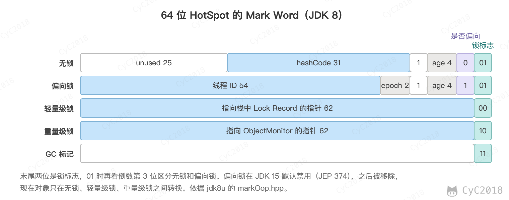 </div><br>

下图左侧是一个线程的虚拟机栈，其中有一部分称为 Lock Record 的区域，这是在轻量级锁运行过程创建的，用于存放锁对象的 Mark Word。而右侧就是一个锁对象，包含了 Mark Word 和其它信息。

<div align="center"> 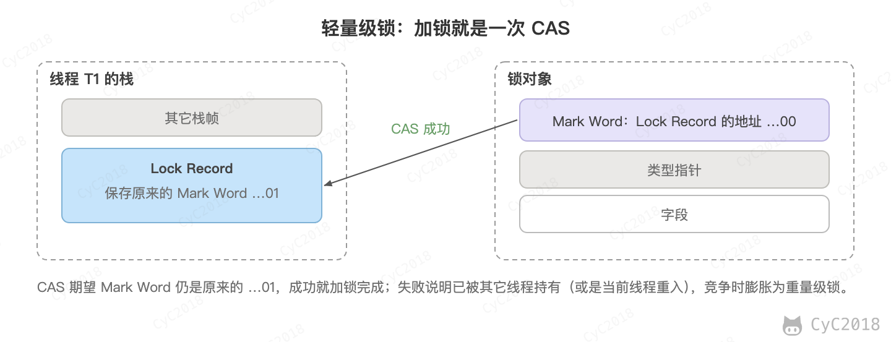 </div><br>

轻量级锁是相对于传统的重量级锁而言，它使用 CAS 操作来避免重量级锁使用互斥量的开销。对于绝大部分的锁，在整个同步周期内都是不存在竞争的，因此也就不需要都使用互斥量进行同步，可以先采用 CAS 操作进行同步，如果 CAS 失败了再改用互斥量进行同步。

当尝试获取一个锁对象时，如果锁对象标记为 0 01，说明锁对象的锁未锁定（unlocked）状态。此时虚拟机在当前线程的虚拟机栈中创建 Lock Record，然后使用 CAS 操作将对象的 Mark Word 更新为 Lock Record 指针。如果 CAS 操作成功了，那么线程就获取了该对象上的锁，并且对象的 Mark Word 的锁标记变为 00，表示该对象处于轻量级锁状态。

<div align="center"> 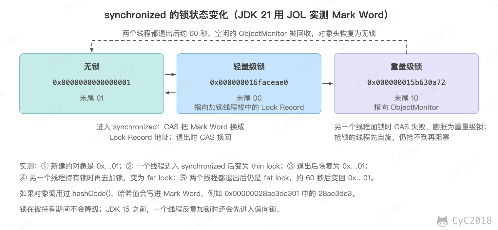 </div><br>

如果 CAS 操作失败了，虚拟机首先会检查对象的 Mark Word 是否指向当前线程的虚拟机栈，如果是的话说明当前线程已经拥有了这个锁对象，那就可以直接进入同步块继续执行，否则说明这个锁对象已经被其他线程抢占了。如果有两条以上的线程争用同一个锁，那轻量级锁就不再有效，要膨胀为重量级锁。

以上是 JDK 21 默认的实现（LockingMode 为 1）。JDK 23 起默认改为新的轻量级锁实现（LM_LIGHTWEIGHT），不再把 Mark Word 复制到栈上的 Lock Record 中，而是在线程中维护一个持有的锁对象列表。

### 偏向锁

偏向锁的思想是偏向于让第一个获取锁对象的线程，这个线程在之后获取该锁就不再需要进行同步操作，甚至连 CAS 操作也不再需要。

当锁对象第一次被线程获得的时候，进入偏向状态，标记为 1 01。同时使用 CAS 操作将线程 ID 记录到 Mark Word 中，如果 CAS 操作成功，这个线程以后每次进入这个锁相关的同步块就不需要再进行任何同步操作。

当有另外一个线程去尝试获取这个锁对象时，偏向状态就宣告结束，此时撤销偏向（Revoke Bias）后恢复到未锁定状态或者轻量级锁状态。

需要注意的是，偏向锁在 JDK 15 中被默认禁用并废弃（JEP 374），JDK 18 起相关参数已不再生效。

## 十三、多线程开发良好的实践

- 给线程起个有意义的名字，这样可以方便找 Bug；
- 缩小同步范围，从而减少锁争用。例如对于 synchronized，应该尽量使用同步块而不是同步方法；
- 多用同步工具少用 wait() 和 notify()。首先，CountDownLatch、CyclicBarrier、Semaphore 和 Exchanger 这些同步类简化了编码操作，而用 wait() 和 notify() 很难实现复杂控制流；其次，这些同步类由 JDK 维护，在后续的版本中还会不断优化和完善；
- 使用 BlockingQueue 实现生产者消费者问题；
- 多用并发集合少用同步集合，例如应该使用 ConcurrentHashMap 而不是 Hashtable；
- 使用本地变量和不可变类来保证线程安全；
- 使用线程池而不是直接创建线程，这是因为创建线程代价很高，线程池可以有效地利用有限的线程来启动任务。

## 附录：实测

以下实验的环境为 Apple M1 Pro（10 核）、macOS，JDK 为 Adoptium OpenJDK 21.0.13。

### A1 三种锁在读多写少时的耗时

HashMap 中保存 1000 个商品价格，读操作遍历求总价，写操作修改一个价格。8 个线程各执行 2 万次，每次以 1% 的概率写、99% 的概率读，三种锁各运行 3 轮。StampedLock 的读操作：

```java
long stamp = sl.tryOptimisticRead();        // 不加锁，只记下版本号
long s = readWork();
if (!sl.validate(stamp)) {                  // 读的过程中有写入，退回到加读锁重读
    stamp = sl.readLock();
    try { s = readWork(); } finally { sl.unlockRead(stamp); }
}
```

之后检查读锁升级和写锁降级：

```java
rw.readLock().lock();
boolean got = rw.writeLock().tryLock(1, TimeUnit.SECONDS);
rw.readLock().unlock();
rw.writeLock().lock();
rw.readLock().lock();
rw.writeLock().unlock();
```

```text
ReentrantLock：371 ms
ReentrantReadWriteLock：168 ms
StampedLock 乐观读：59 ms
ReentrantLock：391 ms
ReentrantReadWriteLock：141 ms
StampedLock 乐观读：52 ms
ReentrantLock：438 ms
ReentrantReadWriteLock：139 ms
StampedLock 乐观读：69 ms
单线程不加锁执行 16 万次读：331 ms
持有读锁时获取写锁：false
写锁降级后持有读锁数：1，写锁被持有：false
```

### A2 公平锁与非公平锁

8 个线程各加锁、解锁 20 万次，每次在锁内把计数加 1，运行 3 次：

```java
ReentrantLock l = new ReentrantLock(fair);
for (int i = 0; i < 8; i++)
    pool.submit(() -> { for (int k = 0; k < 200_000; k++) { l.lock(); try { cnt[0]++; } finally { l.unlock(); } } });
```

```text
fair=false count=1600000 53 ms
fair=true count=1600000 3068 ms
fair=false count=1600000 55 ms
fair=true count=1600000 3114 ms
fair=false count=1600000 55 ms
fair=true count=1600000 3019 ms
```

### A3 volatile 与循环条件

JDK 21.0.13，Apple M1 Pro。worker 线程循环读取 stop 并计数，主线程 1 秒后把 stop 改为 true，再等待 worker 3 秒；不加参数时 stop 是普通字段，加参数 v 时读写 volatile 字段：

```text
$ java StopFlag        （运行 3 次）
普通变量：主线程置为 true 3 秒后，worker 仍在运行
普通变量：主线程置为 true 3 秒后，worker 仍在运行
普通变量：主线程置为 true 3 秒后，worker 仍在运行
$ java StopFlag v      （运行 3 次）
worker 结束，循环 1762145299 次
volatile：主线程置为 true 3 秒后，worker 已结束
worker 结束，循环 1745928341 次
volatile：主线程置为 true 3 秒后，worker 已结束
worker 结束，循环 1746228300 次
volatile：主线程置为 true 3 秒后，worker 已结束
```

### A4 AtomicLong 与 LongAdder

JDK 21.0.13，Apple M1 Pro（10 核）。每个线程累加 1000 万次，每种线程数运行 3 轮：

```java
static long run(Runnable inc, int threads, int n) throws Exception {
    Thread[] ts = new Thread[threads];
    long t0 = System.nanoTime();
    for (int i = 0; i < threads; i++) {
        ts[i] = new Thread(() -> { for (int j = 0; j < n; j++) inc.run(); });
        ts[i].start();
    }
    for (Thread t : ts) t.join();
    return (System.nanoTime() - t0) / 1_000_000;
}

// run(atomicLong::incrementAndGet, threads, 10_000_000) 与 run(longAdder::increment, threads, 10_000_000)
```

```text
线程 1 第 1 轮：AtomicLong 74 ms（结果 10000000），LongAdder 74 ms（结果 10000000）
线程 1 第 2 轮：AtomicLong 70 ms（结果 10000000），LongAdder 71 ms（结果 10000000）
线程 1 第 3 轮：AtomicLong 70 ms（结果 10000000），LongAdder 73 ms（结果 10000000）
线程 8 第 1 轮：AtomicLong 3986 ms（结果 80000000），LongAdder 103 ms（结果 80000000）
线程 8 第 2 轮：AtomicLong 5111 ms（结果 80000000），LongAdder 124 ms（结果 80000000）
线程 8 第 3 轮：AtomicLong 3485 ms（结果 80000000），LongAdder 118 ms（结果 80000000）
```

### A5 InheritableThreadLocal 与线程池

```java
static final InheritableThreadLocal<String> USER = new InheritableThreadLocal<>();

ExecutorService pool = Executors.newFixedThreadPool(1);
for (String u : new String[]{"alice", "bob"}) {
    USER.set(u);
    new Thread(() -> System.out.println("新建线程中读到：" + USER.get())).start();
    Thread.sleep(100);
    pool.submit(() -> System.out.println("线程池中读到：" + USER.get())).get();
}
```

```text
新建线程中读到：alice
线程池中读到：alice
新建线程中读到：bob
线程池中读到：alice
```

## 参考资料

- [Object (Java SE 21)](https://docs.oracle.com/en/java/javase/21/docs/api/java.base/java/lang/Object.html)
- Brian Goetz. Java 并发编程实战 [M]. 机械工业出版社, 2012.
- [ThreadPoolExecutor (Java SE 21)](https://docs.oracle.com/en/java/javase/21/docs/api/java.base/java/util/concurrent/ThreadPoolExecutor.html)
- Eckel B. Java 编程思想: 第 4 版 [M]. 机械工业出版社, 2007.
- 周志明. 深入理解 Java 虚拟机 [M]. 机械工业出版社, 2011.
- [Threads and Locks](https://docs.oracle.com/javase/specs/jvms/se6/html/Threads.doc.html)
- [线程通信](http://ifeve.com/thread-signaling/#missed_signal)
- [Java 线程面试题 Top 50](http://www.importnew.com/12773.html)
- [BlockingQueue](http://tutorials.jenkov.com/java-util-concurrent/blockingqueue.html)
- [thread state java](https://stackoverflow.com/questions/11265289/thread-state-java)
- [CSC 456 Spring 2012/ch7 MN](https://web.archive.org/web/20250417190245/https://wiki.expertiza.ncsu.edu/index.php/CSC_456_Spring_2012/ch7_MN)
- [Java - Understanding Happens-before relationship](https://www.logicbig.com/tutorials/core-java-tutorial/java-multi-threading/happens-before.html)
- [6장 Thread Synchronization](https://www.slideshare.net/novathinker/6-thread-synchronization)
- [How is Java's ThreadLocal implemented under the hood?](https://stackoverflow.com/questions/1202444/how-is-javas-threadlocal-implemented-under-the-hood/15653015)
- [Concurrent](https://sites.google.com/site/webdevelopart/21-compile/06-java/javase/concurrent?tmpl=%2Fsystem%2Fapp%2Ftemplates%2Fprint%2F&showPrintDialog=1)
- [JAVA FORK JOIN EXAMPLE](http://www.javacreed.com/java-fork-join-example/ "Java Fork Join Example")
- [聊聊并发（八）——Fork/Join 框架介绍](http://ifeve.com/talk-concurrency-forkjoin/)
- [Eliminating SynchronizationRelated Atomic Operations with Biased Locking and Bulk Rebiasing](http://www.oracle.com/technetwork/java/javase/tech/biasedlocking-oopsla2006-preso-150106.pdf)
- [JEP 374: Deprecate and Disable Biased Locking](https://openjdk.org/jeps/374)
- [markOop.hpp | OpenJDK jdk8u](https://github.com/openjdk/jdk8u/blob/master/hotspot/src/share/vm/oops/markOop.hpp)
- [JDK 23 Release Notes: Change LockingMode Default from LM_LEGACY to LM_LIGHTWEIGHT](https://www.oracle.com/java/technologies/javase/23-relnote-issues.html)
- [Thread.State (Java SE 21)](https://docs.oracle.com/en/java/javase/21/docs/api/java.base/java/lang/Thread.State.html)
- [The Java Language Specification, Java SE 21 Edition: Chapter 17. Threads and Locks](https://docs.oracle.com/javase/specs/jls/se21/html/jls-17.html)
- [LongAdder (Java SE 21)](https://docs.oracle.com/en/java/javase/21/docs/api/java.base/java/util/concurrent/atomic/LongAdder.html)
- [objectMonitor.hpp | OpenJDK jdk21u](https://github.com/openjdk/jdk21u/blob/master/src/hotspot/share/runtime/objectMonitor.hpp)
- [assembler_x86.cpp | OpenJDK jdk21u](https://github.com/openjdk/jdk21u/blob/master/src/hotspot/cpu/x86/assembler_x86.cpp)
- [TransmittableThreadLocal](https://github.com/alibaba/transmittable-thread-local)
