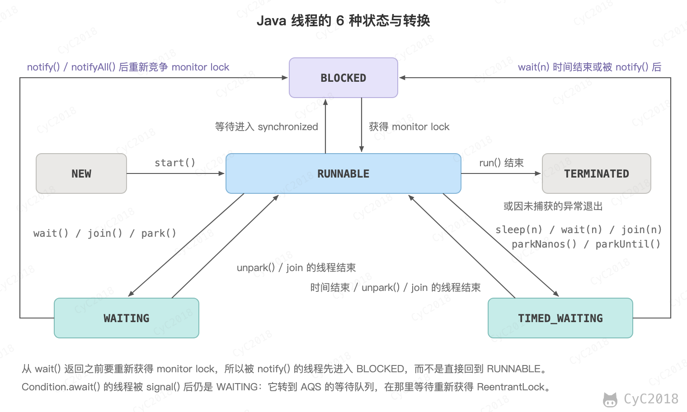
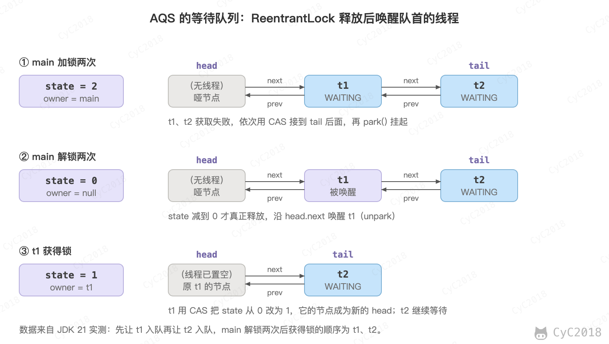
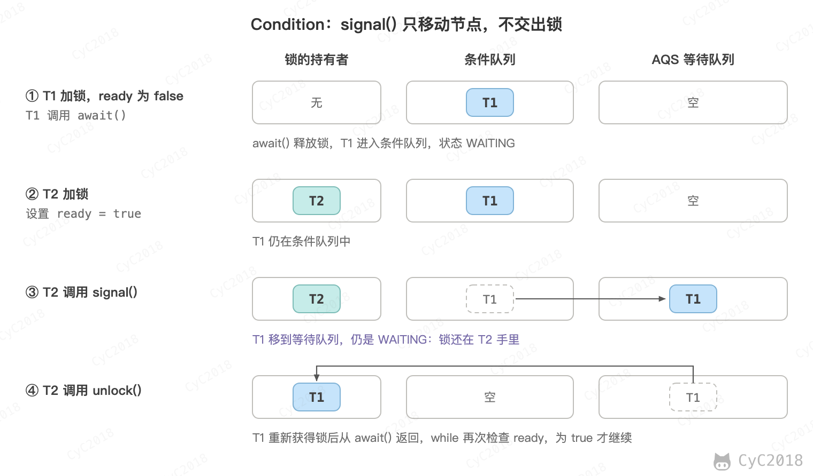
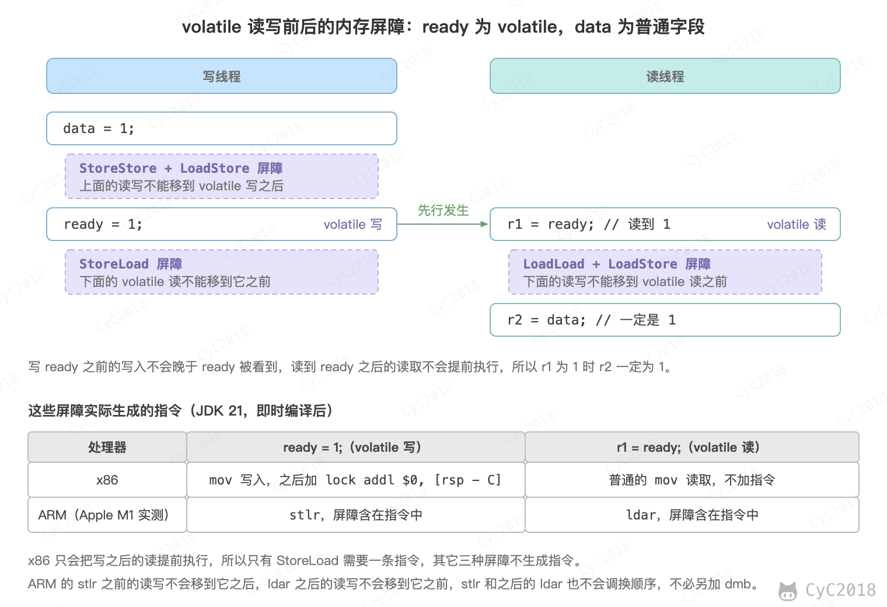
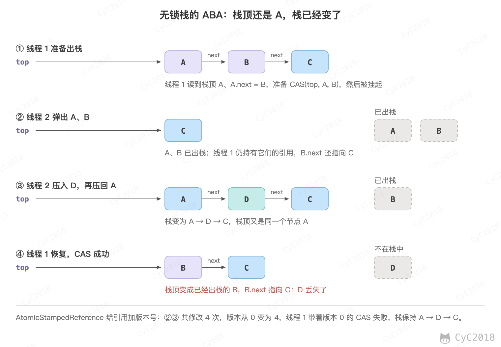
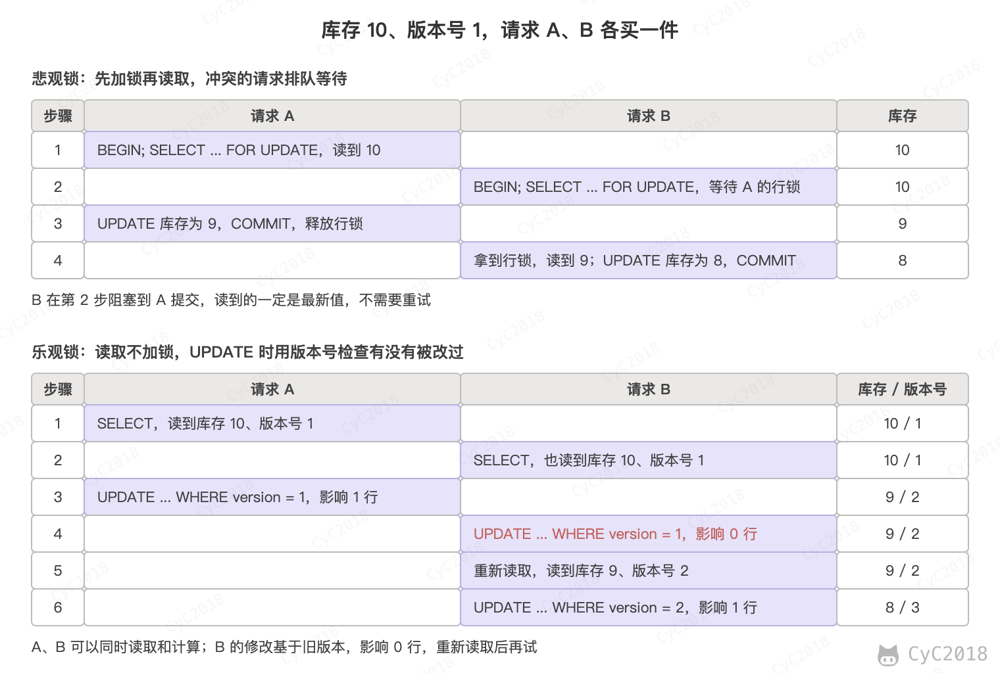

# Java 并发
<!-- GFM-TOC -->
* [Java 并发](#java-并发)
    * [一、使用线程](#一使用线程) 🔥
        * [实现 Runnable 接口](#实现-runnable-接口)
        * [实现 Callable 接口](#实现-callable-接口)
        * [继承 Thread 类](#继承-thread-类)
        * [实现接口 VS 继承 Thread](#实现接口-vs-继承-thread)
    * [二、基础线程机制](#二基础线程机制)
        * [Daemon](#daemon)
        * [sleep()](#sleep)
        * [yield()](#yield)
        * [Executor](#executor)
        * [ThreadPoolExecutor](#threadpoolexecutor) 🔥🔥
    * [三、中断](#三中断)
        * [InterruptedException](#interruptedexception)
        * [interrupted()](#interrupted)
        * [Executor 的中断操作](#executor-的中断操作)
    * [四、互斥同步](#四互斥同步)
        * [synchronized](#synchronized)
        * [ReentrantLock](#reentrantlock)
        * [比较](#比较)
        * [使用选择](#使用选择)
        * [Java 中的锁](#java-中的锁) 🔥
    * [五、线程之间的协作](#五线程之间的协作)
        * [join()](#join)
        * [wait() notify() notifyAll()](#wait-notify-notifyall)
        * [await() signal() signalAll()](#await-signal-signalall)
        * [交替打印](#交替打印)
    * [六、线程状态](#六线程状态)
        * [新建（NEW）](#新建new)
        * [可运行（RUNNABLE）](#可运行runnable)
        * [阻塞（BLOCKED）](#阻塞blocked)
        * [无限期等待（WAITING）](#无限期等待waiting)
        * [限期等待（TIMED_WAITING）](#限期等待timed_waiting)
        * [死亡（TERMINATED）](#死亡terminated)
    * [七、J.U.C - AQS](#七juc---aqs) 🔥
        * [CountDownLatch](#countdownlatch)
        * [CyclicBarrier](#cyclicbarrier)
        * [Semaphore](#semaphore)
    * [八、J.U.C - 其它组件](#八juc---其它组件)
        * [FutureTask](#futuretask)
        * [CompletableFuture](#completablefuture)
        * [BlockingQueue](#blockingqueue)
        * [ForkJoin](#forkjoin)
    * [九、线程不安全示例](#九线程不安全示例)
    * [十、Java 内存模型](#十java-内存模型)
        * [主内存与工作内存](#主内存与工作内存)
        * [内存间交互操作](#内存间交互操作)
        * [内存模型三大特性](#内存模型三大特性) 🔥🔥
        * [先行发生原则](#先行发生原则)
        * [volatile](#volatile)
    * [十一、线程安全](#十一线程安全) 🔥🔥
        * [不可变](#不可变)
        * [互斥同步](#互斥同步)
        * [非阻塞同步](#非阻塞同步)
        * [无同步方案](#无同步方案)
    * [十二、锁优化](#十二锁优化)
        * [自旋锁](#自旋锁)
        * [锁消除](#锁消除)
        * [锁粗化](#锁粗化)
        * [轻量级锁](#轻量级锁) 🔥
        * [偏向锁](#偏向锁)
        * [锁升级的过程](#锁升级的过程)
    * [十三、多线程开发良好的实践](#十三多线程开发良好的实践)
    * [附录：实测](#附录实测)
        * [A1 三种锁在读多写少时的耗时](#a1-三种锁在读多写少时的耗时)
        * [A2 公平锁与非公平锁](#a2-公平锁与非公平锁)
        * [A3 volatile 与循环条件](#a3-volatile-与循环条件)
        * [A4 AtomicLong 与 LongAdder](#a4-atomiclong-与-longadder)
        * [A5 InheritableThreadLocal 与线程池](#a5-inheritablethreadlocal-与线程池)
        * [A6 简化版线程池](#a6-简化版线程池)
        * [A7 线程池的异常与参数调整](#a7-线程池的异常与参数调整)
        * [A8 重排序与 volatile](#a8-重排序与-volatile)
        * [A9 ABA 与 AtomicStampedReference](#a9-aba-与-atomicstampedreference)
        * [A10 锁状态与监视器的回收](#a10-锁状态与监视器的回收)
        * [A11 线程池关闭后的 CallerRunsPolicy](#a11-线程池关闭后的-callerrunspolicy)
        * [A12 中断标记的清除](#a12-中断标记的清除)
        * [A13 ThreadLocal 的陈旧条目与数据串用](#a13-threadlocal-的陈旧条目与数据串用)
        * [A14 虚拟线程在 synchronized 中阻塞](#a14-虚拟线程在-synchronized-中阻塞)
        * [A15 AQS 等待队列的获取顺序](#a15-aqs-等待队列的获取顺序)
        * [A16 线程状态的转换](#a16-线程状态的转换)
        * [A17 交替打印的两种错误写法](#a17-交替打印的两种错误写法)
        * [A18 CompletableFuture 的默认线程](#a18-completablefuture-的默认线程)
        * [A19 只读视图与不可变拷贝](#a19-只读视图与不可变拷贝)
        * [A20 CompletableFuture 组合异步调用](#a20-completablefuture-组合异步调用)
        * [A21 优先级队列与超时](#a21-优先级队列与超时)
        * [A22 start() 与操作系统线程](#a22-start-与操作系统线程)
        * [A23 拒绝策略的执行线程与 Future](#a23-拒绝策略的执行线程与-future)
        * [A24 volatile 的自增与机器码](#a24-volatile-的自增与机器码)
        * [A25 线程池空闲线程的状态与 submit()](#a25-线程池空闲线程的状态与-submit)
        * [A26 CompletableFuture 的回调线程与异常](#a26-completablefuture-的回调线程与异常)
        * [A27 traceId 随任务传递](#a27-traceid-随任务传递)
    * [参考资料](#参考资料)
<!-- GFM-TOC -->


## 一、使用线程 🔥

有三种使用线程的方法：

- 实现 Runnable 接口；
- 实现 Callable 接口；
- 继承 Thread 类。

实现 Runnable 和 Callable 接口的类只能当做一个可以在线程中运行的任务，不是真正意义上的线程，因此最后还需要通过 Thread 来调用。实际开发中更常把任务提交给[线程池](#threadpoolexecutor)，所以线程池通常也算作一种创建线程的方式。

这里的线程都是平台线程，每个对应一个操作系统线程。JDK 21 的虚拟线程用 Thread.ofVirtual().start(task) 创建，由 JVM 调度到少量平台线程上运行，见[协程与虚拟线程](计算机操作系统%20-%20进程管理.md#5-协程)。

### 实现 Runnable 接口

需要实现接口中的 run() 方法。

```java
public class MyRunnable implements Runnable {
    @Override
    public void run() {
        // ...
    }
}
```

使用 Runnable 实例再创建一个 Thread 实例，然后调用 Thread 实例的 start() 方法来启动线程。

```java
public static void main(String[] args) {
    MyRunnable instance = new MyRunnable();
    Thread thread = new Thread(instance);
    thread.start();
}
```

### 实现 Callable 接口

与 Runnable 相比，Callable 的 call() 可以有返回值，也可以抛出受检异常。Thread 只接受 Runnable，所以要先把 Callable 包装成同时实现了 Runnable 和 Future 的 [FutureTask](#futuretask)，再用 get() 等待结果。

```java
public class MyCallable implements Callable<Integer> {
    public Integer call() {
        return 123;
    }
}
```

```java
public static void main(String[] args) throws ExecutionException, InterruptedException {
    MyCallable mc = new MyCallable();
    FutureTask<Integer> ft = new FutureTask<>(mc);
    Thread thread = new Thread(ft);
    thread.start();
    System.out.println(ft.get());
}
```

### 继承 Thread 类

同样也是需要实现 run() 方法，因为 Thread 类也实现了 Runnable 接口。

new Thread() 只是在堆上创建了一个对象，状态为 NEW。调用 start() 后，JVM 才向操作系统申请创建线程（Linux 上调用 pthread_create），并分配[线程栈](Java%20虚拟机.md#java-虚拟机栈)（-Xss，x86-64 的 Linux 上默认 1 MB），新线程获得 CPU 后执行 run()（JDK 21 实测，见[附录 A22](#a22-start-与操作系统线程)）。

需要注意的是，直接调用 run() 只是在当前线程中执行一个普通方法，run() 中打印的线程名是 main。同一个 Thread 对象只能 start() 一次，再次调用会抛出 IllegalThreadStateException。

```java
public class MyThread extends Thread {
    public void run() {
        // ...
    }
}
```

```java
public static void main(String[] args) {
    MyThread mt = new MyThread();
    mt.start();
}
```

### 实现接口 VS 继承 Thread

实现接口会更好一些，因为：

- Java 不支持多重继承，因此继承了 Thread 类就无法继承其它类，但是可以实现多个接口；
- 任务与线程解耦：实现接口的任务可以提交给线程池，由已有的线程执行。

## 二、基础线程机制

### Daemon

守护线程是程序运行时在后台提供服务的线程，不属于程序中不可或缺的部分。

当所有非守护线程结束时，程序也就终止，同时会杀死所有守护线程。

main() 属于非守护线程。

在线程启动之前使用 setDaemon() 方法可以将一个线程设置为守护线程。

```java
public static void main(String[] args) {
    Thread thread = new Thread(new MyRunnable());
    thread.setDaemon(true);
    thread.start();
}
```

### sleep()

Thread.sleep(millisec) 方法会休眠当前正在执行的线程，millisec 单位为毫秒。

sleep() 可能会抛出 InterruptedException，它是受检异常，而 run() 的签名没有声明异常，所以只能在 run() 内部捕获。线程中抛出的其它异常也不会传播到启动它的线程，没有捕获时只结束这个线程。

```java
public void run() {
    try {
        Thread.sleep(3000);
    } catch (InterruptedException e) {
        e.printStackTrace();
    }
}
```

### yield()

对静态方法 Thread.yield() 的调用表示当前线程愿意让出 CPU，可以切换给其它线程来执行。该方法只是对线程调度器的一个提示，调度器可以忽略它，Javadoc 也说明很少有适合使用它的场合，主要用于调试和测试。

```java
public void run() {
    Thread.yield();
}
```

### Executor

Executor 把任务的提交和执行分开，提交者只管提交任务，不用自己创建和管理线程。多个任务访问共享的可变状态时仍然需要同步。

主要有三种 Executor：

- CachedThreadPool：有空闲线程时复用，没有时为任务新建一个线程，线程空闲 60 秒后被回收；
- FixedThreadPool：所有任务只能使用固定大小的线程；
- SingleThreadExecutor：相当于大小为 1 的 FixedThreadPool，但不能再被调大线程数。

```java
public static void main(String[] args) {
    ExecutorService executorService = Executors.newCachedThreadPool();
    for (int i = 0; i < 5; i++) {
        executorService.execute(new MyRunnable());
    }
    executorService.shutdown();
}
```

### ThreadPoolExecutor 🔥🔥

线程池指的是预先创建一组线程反复执行提交的任务，而不是为每个任务新建线程。这是因为创建线程要分配线程栈、进行系统调用，任务很短时这部分开销可能超过任务本身；线程太多还会占用大量内存、加剧[上下文切换](计算机操作系统%20-%20进程管理.md#4-上下文切换)。所以线程池一方面复用线程，另一方面限制线程的数量，任务太多时排队或者拒绝。

上面的三种 Executor 都是通过 ThreadPoolExecutor 创建的，它的构造函数有以下参数：

- corePoolSize：核心线程数，核心线程空闲时也不会被回收，除非调用了 allowCoreThreadTimeOut(true)；
- maximumPoolSize：最大线程数；
- keepAliveTime 和 unit：线程数超过核心线程数时，多出的线程空闲超过这个时间就会被回收；
- workQueue：保存等待执行的任务的阻塞队列，常用有界的 ArrayBlockingQueue、默认无界的 LinkedBlockingQueue，以及不保存任务、每个任务必须直接交给一个线程的 SynchronousQueue（CachedThreadPool 使用它）；
- threadFactory：创建线程的工厂，常用来给线程起有意义的名字，方便排查问题；
- handler：拒绝策略，线程数达到最大并且队列已满时，用来处理新提交的任务。

提交一个任务时，线程池按以下顺序处理：

1. 线程数小于核心线程数时，新建线程执行任务，即使其它线程是空闲的；
2. 否则把任务放入队列；
3. 队列已满时，如果线程数小于最大线程数，新建线程执行这个任务；
4. 否则执行拒绝策略。

例如核心线程数为 2、最大线程数为 4、队列容量为 2，依次提交 7 个各执行 1 秒的任务：

<div align="center">  </div><br>

```java
ThreadPoolExecutor pool = new ThreadPoolExecutor(2, 4, 60, TimeUnit.SECONDS,
        new ArrayBlockingQueue<>(2), new ThreadPoolExecutor.AbortPolicy());
for (int i = 1; i <= 7; i++) {
    try {
        pool.execute(() -> {
            try {
                Thread.sleep(1000);
            } catch (InterruptedException ignored) {
            }
        });
        System.out.println("提交任务 " + i + "：线程数 " + pool.getPoolSize()
                + "，队列中 " + pool.getQueue().size() + " 个");
    } catch (RejectedExecutionException e) {
        System.out.println("提交任务 " + i + "：被拒绝");
    }
}
pool.shutdown();    // 不关闭的话，核心线程一直存活，程序不会退出
```

```text
提交任务 1：线程数 1，队列中 0 个
提交任务 2：线程数 2，队列中 0 个
提交任务 3：线程数 2，队列中 1 个
提交任务 4：线程数 2，队列中 2 个
提交任务 5：线程数 3，队列中 2 个
提交任务 6：线程数 4，队列中 2 个
提交任务 7：被拒绝
```

需要注意的是，任务 5、6 比先提交的任务 3、4 更早执行：队列满后新建的线程直接执行当前提交的任务，队列中的任务要等有线程空闲后才会被取出。

先放入队列、队列满了才增加线程，是因为线程比排队的任务昂贵得多：核心线程承担平时的负载，短时间的高峰由队列缓冲，队列也放不下说明负载持续超出了处理能力，才临时增加线程，高峰过后再减少。Tomcat 的线程池则反过来：没有空闲线程、线程数又没到最大值时，它的队列在 offer() 中返回 false，线程池当作队列已满而先增加线程，让等待 I/O 的请求尽快开始处理。

核心线程数为 0 时，任务直接进入队列，execute() 发现没有线程时只创建一个。例如核心线程数为 0、最大线程数为 4、使用无界队列时，提交 3 个任务只有 1 个线程逐个执行（JDK 21 实测，见[附录 A7](#a7-线程池的异常与参数调整)）。

按优先级执行可以用 PriorityBlockingQueue（无界），任务类实现 Comparable 并用 execute() 提交，submit() 包装出的 FutureTask 不可比较，入队时抛出 ClassCastException（见[附录 A21](#a21-优先级队列与超时)）。

拒绝策略：

- AbortPolicy：默认策略，抛出 RejectedExecutionException；
- CallerRunsPolicy：由提交任务的线程（不一定是主线程）自己执行这个任务，执行完才返回，从而降低了提交速度；
- DiscardPolicy：直接丢弃任务；
- DiscardOldestPolicy：丢弃队列中最早的任务，再重新提交当前任务。

选择拒绝策略主要看任务能不能丢：

- 不能丢、提交方能处理失败时用 AbortPolicy，捕获异常后返回错误或者稍后重试；
- 不能丢、可以接受变慢时用 CallerRunsPolicy，不允许阻塞的线程（例如 Netty 的 I/O 线程）不能这样用；
- 允许丢失的任务，例如统计数据的上报，用 DiscardPolicy，只关心最新数据时用 DiscardOldestPolicy。

需要注意的是，线程池关闭之后再提交任务也会触发拒绝策略，这时只有 AbortPolicy 抛出异常，另外三种都直接丢弃任务。用 submit() 或 supplyAsync() 提交的任务被丢弃后，返回的 Future 永远不会完成，不带超时的 get()、join() 会一直阻塞（JDK 21 实测，见[附录 A11](#a11-线程池关闭后的-callerrunspolicy)、[A23](#a23-拒绝策略的执行线程与-future)）。

也可以实现 RejectedExecutionHandler 接口自定义拒绝策略，例如统计拒绝次数、记录日志后抛出异常，不能丢的任务也可以写入数据库或消息队列稍后重试：

```java
AtomicLong rejected = new AtomicLong();    // 拒绝次数，供监控采集
RejectedExecutionHandler handler = (task, executor) -> {
    rejected.incrementAndGet();
    log.warn("任务被拒绝：线程数 {}，队列中 {} 个", executor.getPoolSize(), executor.getQueue().size());
    throw new RejectedExecutionException("订单线程池已满");
};
ThreadPoolExecutor pool = new ThreadPoolExecutor(2, 4, 60, TimeUnit.SECONDS,
        new ArrayBlockingQueue<>(2), handler);
```

不建议用 Executors 创建线程池，而是直接创建 ThreadPoolExecutor 并使用有界队列：

- newFixedThreadPool() 和 newSingleThreadExecutor() 使用没有容量限制的 LinkedBlockingQueue，任务堆积时可能耗尽内存，最大线程数也不再起作用；
- newCachedThreadPool() 的最大线程数为 Integer.MAX_VALUE，任务多时会创建大量线程。

线程数可以按任务类型估算：

- CPU 密集型：取 CPU 核数 + 1，多出的一个线程用于在某个线程因缺页等原因暂停时继续使用 CPU；
- I/O 密集型：线程等待 I/O 时不占用 CPU，可以按 核数 × (1 + 等待时间 / 计算时间) 估算。例如 8 核 CPU，每个任务计算 10 ms、等待数据库 90 ms，约为 8 × (1 + 90 / 10) = 80 个线程。

核数取 availableProcessors() 的值，JDK 10 起在容器中按 CPU 配额计算，也可以用 -XX:ActiveProcessorCount 指定。

也可以从吞吐量估算：同时在执行的任务数 = 每秒到达的任务数 × 每个任务的耗时（利特尔法则）。例如每秒 200 个请求，每个耗时 100 ms，平均有 200 × 0.1 = 20 个任务同时在执行，线程数至少为 20，再按高峰留出余量。

CPU 或下游资源（例如数据库连接池）饱和后，再加线程也不能提高吞吐量。

队列长度按可以接受的排队时间估算，例如上例每秒处理 200 个任务，最多排队 0.5 秒时约为 100，再长的话任务排到时调用方可能已经超时。

I/O 密集、估出的线程数成百上千时，JDK 21 可以改用虚拟线程（Executors.newVirtualThreadPerTaskExecutor()，每个任务一个，不池化），对下游的并发数用 [Semaphore](#semaphore) 限制。

估算值只是起点，最终要通过压测确定。上线后用 getActiveCount()、getQueue().size() 等方法监控活跃线程数和队列长度，在拒绝策略中统计拒绝次数，必要时调用 setCorePoolSize()、setMaximumPoolSize() 在运行时调整，参数放在配置中心、变更时调用这两个方法就是动态线程池。需要注意的是，JDK 9 起 setCorePoolSize() 的新值大于最大线程数时抛出 IllegalArgumentException，两者都要调大时先调最大线程数；调小核心线程数后，多出的线程要再空闲满 keepAliveTime 才退出，调大时只按队列中排队的任务数补建线程（JDK 21 实测，见[附录 A7](#a7-线程池的异常与参数调整)）；LinkedBlockingQueue 的容量是 final 字段，队列长度要可调时只能自己实现队列。

不同业务最好使用各自的线程池（线程池隔离），例如导出报表变慢时只占满自己的线程，不影响下单。

线程池的队列在内存中，进程崩溃时队列中和正在执行的任务都会丢失。不能丢的任务要先写入数据库或消息队列，执行完再标记完成，重启后重新执行未完成的，因此任务要幂等。

线程池的核心结构并不复杂，常被要求手写一个简化版：固定数量的工作线程循环从阻塞队列中取任务执行，队列满了或者线程池已经关闭时拒绝新任务。

```java
public class SimplePool {
    private final BlockingQueue<Runnable> queue;
    private final List<Thread> workers = new ArrayList<>();
    private volatile boolean shutdown = false;

    public SimplePool(int threads, int capacity) {
        queue = new ArrayBlockingQueue<>(capacity);
        for (int i = 0; i < threads; i++) {
            Thread t = new Thread(() -> {
                // 关闭后也要把队列中剩下的任务执行完再退出
                while (!shutdown || !queue.isEmpty()) {
                    Runnable task;
                    try {
                        task = queue.poll(100, TimeUnit.MILLISECONDS);
                    } catch (InterruptedException e) {
                        return;
                    }
                    if (task == null) {
                        continue;
                    }
                    try {
                        task.run();
                    } catch (RuntimeException e) {
                        // 一个任务抛出异常，不能让工作线程退出
                        e.printStackTrace();
                    }
                }
            }, "pool-" + i);
            workers.add(t);
            t.start();
        }
    }

    // 检查状态和入队要在同一把锁内完成，否则检查之后、入队之前发生关闭，
    // 工作线程可能已经全部退出，这个任务就没人执行了
    public synchronized void execute(Runnable task) {
        if (shutdown || !queue.offer(task)) {
            throw new RejectedExecutionException("线程池已关闭或队列已满");
        }
    }

    public synchronized void shutdown() {
        shutdown = true;
    }
}
```

例如 2 个线程执行 4 个任务，其中任务 2 抛出异常，其余 3 个任务仍由这两个线程执行完；关闭之后再提交会被拒绝（JDK 21 实测，见[附录 A6](#a6-简化版线程池)）。

ThreadPoolExecutor 的结构与它相同，多做了以下几件事：

- 线程不是一开始就全部创建，而是按前面的提交顺序按需创建（prestartAllCoreThreads() 可以提前创建核心线程）；
- 工作线程在 getTask() 中取任务，线程本身没有核心与非核心之分：线程数超过核心线程数（或开启了 allowCoreThreadTimeOut）时用 poll(keepAliveTime) 等待，超时后再检查一次、仍可以减少线程才退出，否则用 take() 一直等待，所以空闲后退出的不一定是后创建的线程（见[附录 A25](#a25-线程池空闲线程的状态与-submit)）；
- 运行状态和线程数保存在同一个 AtomicInteger（ctl）中，两者可以在一次 CAS 中一起修改。运行状态有 RUNNING、SHUTDOWN（shutdown() 之后，执行完队列中的任务）、STOP（shutdownNow() 之后）、TIDYING 和 TERMINATED 五种。

提交任务还可以用 submit()，它也接收 Callable，把任务包装成 [FutureTask](#futuretask) 后调用 execute()。任务抛出异常时两者的表现不同：execute() 提交的任务，异常打印到标准错误，执行它的线程退出，线程池再补一个新线程；submit() 的异常保存在 Future 中，不打印，线程也不退出，调用 future.get() 时才以 ExecutionException 抛出（JDK 21 实测，见[附录 A7](#a7-线程池的异常与参数调整)）。所以用 submit() 提交又不调用 get() 的任务，异常会被悄悄吞掉，需要在任务内部捕获并记录。

## 三、中断

一个线程执行完毕之后会自动结束，如果在运行过程中发生异常也会提前结束。

停止一个线程要靠协作：其它线程设置一个 volatile 停止标记或者调用 interrupt()，由线程自己检查后在合适的位置结束；只设置停止标记不会唤醒停在 sleep()、wait() 中的线程，这时要用 interrupt()。Thread.stop() 会让线程在任意位置停下，可能留下修改了一半的数据，JDK 20 起直接抛出 UnsupportedOperationException。

### InterruptedException

通过调用一个线程的 interrupt() 来中断该线程，如果该线程正在 sleep()、wait()、join() 等方法中处于限期等待或者无限期等待状态，那么就会抛出 InterruptedException。中断只是一个请求，异常被捕获之后线程是否结束由代码自己决定。但是不能中断等待 synchronized 锁的阻塞（BLOCKED），平台线程阻塞在 ServerSocket.accept() 这类传统 I/O 上时通常也不响应中断（见[附录 A16](#a16-线程状态的转换)）。

对于以下代码，在 main() 中启动一个线程之后再中断它，由于线程中调用了 Thread.sleep() 方法，因此会抛出一个 InterruptedException，从而提前结束线程，不执行之后的语句。

```java
public class InterruptExample {

    private static class MyThread1 extends Thread {
        @Override
        public void run() {
            try {
                Thread.sleep(2000);
                System.out.println("Thread run");
            } catch (InterruptedException e) {
                e.printStackTrace();
            }
        }
    }
}
```

```java
public static void main(String[] args) throws InterruptedException {
    Thread thread1 = new MyThread1();
    thread1.start();
    thread1.interrupt();
    System.out.println("Main run");
}
```

```text
Main run
java.lang.InterruptedException: sleep interrupted
    at java.base/java.lang.Thread.sleep0(Native Method)
    at java.base/java.lang.Thread.sleep(Thread.java:509)
    at InterruptExample$MyThread1.run(InterruptExample.java:6)
```

### interrupted()

如果一个线程的 run() 方法执行一个无限循环，并且没有执行 sleep() 等会抛出 InterruptedException 的操作，那么调用线程的 interrupt() 方法就无法使线程提前结束。

但是调用 interrupt() 方法会设置线程的中断标记，此时调用 interrupted() 方法会返回 true。因此可以在循环体中使用 interrupted() 方法来判断线程是否处于中断状态，从而提前结束线程。

```java
public class InterruptExample {

    private static class MyThread2 extends Thread {
        @Override
        public void run() {
            while (!interrupted()) {
                // ..
            }
            System.out.println("Thread end");
        }
    }
}
```

```java
public static void main(String[] args) throws InterruptedException {
    Thread thread2 = new MyThread2();
    thread2.start();
    thread2.interrupt();
}
```

```text
Thread end
```

需要注意的是，静态方法 interrupted() 返回的同时会清除中断标记，只检查不清除要用实例方法 isInterrupted()；抛出 InterruptedException 时中断标记也已被清除，捕获后不结束线程时应调用 Thread.currentThread().interrupt() 恢复标记，让外层的代码仍能检查到中断（JDK 21 实测，见[附录 A12](#a12-中断标记的清除)）。

### Executor 的中断操作

调用 Executor 的 shutdown() 方法后，线程池不再接受新任务，已经提交的任务会继续执行完，它本身不会阻塞等待，需要等待时调用 awaitTermination()；如果调用的是 shutdownNow() 方法，则相当于调用每个线程的 interrupt() 方法，并返回队列中还没有执行的任务。

以下使用 Lambda 创建线程，相当于创建了一个匿名内部线程。

```java
public static void main(String[] args) {
    ExecutorService executorService = Executors.newCachedThreadPool();
    executorService.execute(() -> {
        try {
            Thread.sleep(2000);
            System.out.println("Thread run");
        } catch (InterruptedException e) {
            e.printStackTrace();
        }
    });
    executorService.shutdownNow();
    System.out.println("Main run");
}
```

```text
Main run
java.lang.InterruptedException: sleep interrupted
    at java.base/java.lang.Thread.sleep0(Native Method)
    at java.base/java.lang.Thread.sleep(Thread.java:509)
    at ExecutorInterruptExample.lambda$main$0(ExecutorInterruptExample.java:7)
    at java.base/java.util.concurrent.ThreadPoolExecutor.runWorker(ThreadPoolExecutor.java:1144)
    at java.base/java.util.concurrent.ThreadPoolExecutor$Worker.run(ThreadPoolExecutor.java:642)
    at java.base/java.lang.Thread.run(Thread.java:1583)
```

如果只想中断 Executor 中的一个线程，可以通过使用 submit() 方法来提交一个线程，它会返回一个 Future\<?\> 对象，调用该对象的 cancel(true) 方法会取消这个任务，并中断正在执行它的线程。

```java
Future<?> future = executorService.submit(() -> {
    // ..
});
future.cancel(true);
```

## 四、互斥同步

Java 提供了两种锁机制来控制多个线程对共享资源的互斥访问，第一个是 JVM 实现的 synchronized，而另一个是 JDK 实现的 ReentrantLock。

### synchronized

#### 1. 同步一个代码块

```java
public void func() {
    synchronized (this) {
        // ...
    }
}
```

它只作用于同一个对象，如果调用两个对象上的同步代码块，就不会进行同步。

对于以下代码，使用 ExecutorService 执行了两个线程，由于调用的是同一个对象的同步代码块，因此这两个线程会进行同步，当一个线程进入同步语句块时，另一个线程就必须等待。

```java
public class SynchronizedExample {

    public void func1() {
        synchronized (this) {
            for (int i = 0; i < 10; i++) {
                System.out.print(i + " ");
            }
        }
    }
}
```

```java
public static void main(String[] args) {
    SynchronizedExample e1 = new SynchronizedExample();
    ExecutorService executorService = Executors.newCachedThreadPool();
    executorService.execute(() -> e1.func1());
    executorService.execute(() -> e1.func1());
}
```

```text
0 1 2 3 4 5 6 7 8 9 0 1 2 3 4 5 6 7 8 9
```

对于以下代码，两个线程调用了不同对象的同步代码块，因此这两个线程就不需要同步，输出可能交叉（循环很短，不保证每次都交叉），例如其中一次的输出：

```java
public static void main(String[] args) {
    SynchronizedExample e1 = new SynchronizedExample();
    SynchronizedExample e2 = new SynchronizedExample();
    ExecutorService executorService = Executors.newCachedThreadPool();
    executorService.execute(() -> e1.func1());
    executorService.execute(() -> e2.func1());
}
```

```text
0 1 2 0 1 2 3 4 5 6 7 8 9 3 4 5 6 7 8 9
```


#### 2. 同步一个方法

```java
public synchronized void func () {
    // ...
}
```

它和同步代码块一样，作用于同一个对象。

#### 3. 同步一个类

```java
public void func() {
    synchronized (SynchronizedExample.class) {
        // ...
    }
}
```

作用于整个类：两个线程调用同一个类的不同对象上的这种同步语句，也会进行同步。

```java
public class SynchronizedExample {

    public void func2() {
        synchronized (SynchronizedExample.class) {
            for (int i = 0; i < 10; i++) {
                System.out.print(i + " ");
            }
        }
    }
}
```

```java
public static void main(String[] args) {
    SynchronizedExample e1 = new SynchronizedExample();
    SynchronizedExample e2 = new SynchronizedExample();
    ExecutorService executorService = Executors.newCachedThreadPool();
    executorService.execute(() -> e1.func2());
    executorService.execute(() -> e2.func2());
}
```

```text
0 1 2 3 4 5 6 7 8 9 0 1 2 3 4 5 6 7 8 9
```

#### 4. 同步一个静态方法

```java
public synchronized static void fun() {
    // ...
}
```

作用于整个类。

需要注意的是，同步实例方法和 synchronized (this) 锁的是当前对象，同步静态方法和 synchronized (X.class) 锁的是 Class 对象，两者是不同的锁，互不阻塞。

### ReentrantLock

ReentrantLock 是 java.util.concurrent（J.U.C）包中的锁。

```java
public class LockExample {

    private Lock lock = new ReentrantLock();

    public void func() {
        lock.lock();
        try {
            for (int i = 0; i < 10; i++) {
                System.out.print(i + " ");
            }
        } finally {
            lock.unlock(); // 确保释放锁，从而避免发生死锁。
        }
    }
}
```

```java
public static void main(String[] args) {
    LockExample lockExample = new LockExample();
    ExecutorService executorService = Executors.newCachedThreadPool();
    executorService.execute(() -> lockExample.func());
    executorService.execute(() -> lockExample.func());
}
```

```text
0 1 2 3 4 5 6 7 8 9 0 1 2 3 4 5 6 7 8 9
```


### 比较

#### 1. 锁的实现

synchronized 是 JVM 实现的，而 ReentrantLock 是 JDK 实现的。

synchronized 代码块编译后是一对 monitorenter 和 monitorexit 指令，编译器还会生成一个异常处理器，抛出异常时也执行 monitorexit，保证锁一定会被释放；synchronized 方法没有这两条指令，而是在方法的访问标志中设置 ACC_SYNCHRONIZED，由 JVM 在调用和返回时加锁和解锁。下面是 JDK 21 的 javap 输出（有删节）：

```text
public void inc();                 // synchronized (this) { count++; }
     3: monitorenter
    ...                            // count++
    15: monitorexit
    16: goto          24
    19: astore_2                   // 异常处理器：出现异常时也释放锁
    20: aload_1
    21: monitorexit
    23: athrow

public synchronized void dec();
  flags: (0x0021) ACC_PUBLIC, ACC_SYNCHRONIZED
```

发生竞争、锁膨胀为重量级锁之后，HotSpot 用 ObjectMonitor 管理这把锁：_owner 指向持有锁的线程，_recursions 记录重入的次数；抢不到锁的线程进入 _cxq、_EntryList 队列并阻塞，调用 wait() 的线程进入 _WaitSet，被 notify() 之后再回到队列中重新竞争锁。ReentrantLock 则是用 Java 代码基于 AQS 实现的，见 [七、J.U.C - AQS](#七juc---aqs)。

#### 2. 性能

新版本 Java 对 synchronized 进行了很多优化，例如自旋锁等，在平台线程上 synchronized 与 ReentrantLock 的性能大致相同。JDK 21 的虚拟线程是例外，见[使用选择](#使用选择)。

#### 3. 等待可中断

当持有锁的线程长期不释放锁的时候，正在等待的线程可以选择放弃等待，改为处理其他事情。

ReentrantLock 可中断，而 synchronized 不行：等待进入 synchronized 的线程被中断后仍然继续等待。ReentrantLock 的 lockInterruptibly() 在等待时响应中断，tryLock(timeout) 还可以限定等待的时间：

```java
if (lock.tryLock(1, TimeUnit.SECONDS)) {   // 最多等 1 秒，等待期间也响应中断
    try {
        // 访问共享资源
    } finally {
        lock.unlock();
    }
} else {
    // 等待超时，放弃或降级处理
}
```

#### 4. 公平锁

公平锁是指多个线程在等待同一个锁时，必须按照申请锁的时间顺序来依次获得锁。

synchronized 中的锁是非公平的，ReentrantLock 默认情况下也是非公平的，但是也可以是公平的。需要注意的是，无参的 tryLock() 不遵守公平设置，可能插队。

#### 5. 锁绑定多个条件

一个 ReentrantLock 可以同时绑定多个 Condition 对象。

### 使用选择

除非需要使用 ReentrantLock 的高级功能，否则优先使用 synchronized。这是因为 synchronized 是 JVM 实现的一种锁机制，JVM 原生地支持它，并且使用 synchronized 不用担心没有释放锁而导致死锁问题，因为 JVM 会确保锁的释放；ReentrantLock 则必须在 finally 中调用 unlock()。

JDK 21 的虚拟线程在 synchronized 块内阻塞时会被固定（pinned）在载体线程上，载体线程也随之阻塞：1000 个虚拟线程各在一个 synchronized 块内 sleep 100 ms，10 核机器上约 10.4 秒，换成 ReentrantLock 约 0.1 秒（JDK 21 实测，见[附录 A14](#a14-虚拟线程在-synchronized-中阻塞)）。所以 JDK 21 中虚拟线程内有阻塞操作的临界区要用 ReentrantLock，JDK 24 起（[JEP 491](https://openjdk.org/jeps/491)）基本不再固定。

### Java 中的锁 🔥

Java 中的锁可以从几个角度分类，同一把锁会同时属于多类，例如 ReentrantLock 默认是悲观、独占、可重入的非公平锁：

| 分类 | 区别 | 例子 |
| --- | --- | --- |
| [悲观锁与乐观锁](#4-乐观锁与悲观锁) | 先加锁再访问；或者先访问，提交时再检查有没有冲突 | synchronized、ReentrantLock；AtomicInteger 的 CAS、StampedLock 的乐观读 |
| 独占锁与共享锁 | 同一时刻只能有一个线程持有；或者可以有多个 | ReentrantLock、写锁；读锁、Semaphore |
| [公平锁与非公平锁](#七juc---aqs) | 按申请的顺序获得锁；或者允许新来的线程插队 | new ReentrantLock(true)；synchronized、ReentrantLock 默认 |
| 可重入锁 | 持有锁的线程可以再次获得同一把锁，不会被自己阻塞 | synchronized、ReentrantLock、ReentrantReadWriteLock |
| [自旋锁](#自旋锁) | 获取失败时循环重试，而不是挂起线程 | synchronized 的自适应自旋、CAS 循环 |
| [偏向锁、轻量级锁、重量级锁](#十二锁优化) | synchronized 在不同竞争程度下的实现 | synchronized |

读多写少时，读和读之间不需要互斥，可以使用读写锁 ReentrantReadWriteLock：读锁是共享锁，多个线程可以同时持有；写锁是独占锁，持有写锁时其它线程既不能读也不能写。JDK 8 的 StampedLock 还提供乐观读，读之前不加锁，只记下一个版本号，读完再检查期间有没有写入，有写入才加读锁重读：

```java
long stamp = lock.tryOptimisticRead();
long sum = readWork();
if (!lock.validate(stamp)) {                // 读的过程中有写入
    stamp = lock.readLock();
    try { sum = readWork(); } finally { lock.unlockRead(stamp); }
}
```

例如 8 个线程访问同一个保存了 1000 个商品价格的 HashMap，99% 的操作是遍历求总价，1% 是修改价格，每个线程 2 万次，三种锁的耗时如下（JDK 21 实测，见[附录 A1](#a1-三种锁在读多写少时的耗时)）：

- ReentrantLock：370～440 ms，读也互斥，与单线程不加锁执行同样多次读的 331 ms 差不多，8 个线程实际上是排队执行的；
- ReentrantReadWriteLock：140～170 ms，读可以并行，但每次加读锁都要用 CAS 修改锁中的读线程计数，多个线程争抢同一个变量，不能做到 8 倍；
- StampedLock 乐观读：50～70 ms，读的时候不修改任何共享变量，只有极少数读取需要重试。

需要注意的是：

- ReentrantReadWriteLock 的读锁不能升级为写锁：持有读锁时再获取写锁，要等所有读锁释放，而自己的读锁不会释放，tryLock(1, TimeUnit.SECONDS) 等待 1 秒后返回 false，用 lock() 就会永远阻塞；
- 写锁可以降级为读锁：先获取写锁，再获取读锁，然后释放写锁，这样修改之后的数据可以继续读，期间不会被其它线程修改；
- StampedLock 不可重入，也不支持 Condition。乐观读期间读到的数据可能不一致，读取过程也可能出错（例如遍历正在增删键的 HashMap，上例只改价格），只能在 validate 成功之后使用读到的值。

## 五、线程之间的协作

当多个线程可以一起工作去解决某个问题时，如果某些部分必须在其它部分之前完成，那么就需要对线程进行协调。

### join()

在线程中调用另一个线程的 join() 方法，会将当前线程挂起，而不是忙等待，直到目标线程结束。

对于以下代码，b 线程在 run() 中调用了 a 线程的 join() 方法，会等待 a 线程结束才继续执行，因此能够保证 a 线程的输出先于 b 线程的输出。需要注意的是，join() 只对已经启动的线程有效，如果调用 a.join() 时 a 线程还未启动，join() 会立即返回。

```java
public class JoinExample {

    private class A extends Thread {
        @Override
        public void run() {
            System.out.println("A");
        }
    }

    private class B extends Thread {

        private A a;

        B(A a) {
            this.a = a;
        }

        @Override
        public void run() {
            try {
                a.join();
            } catch (InterruptedException e) {
                e.printStackTrace();
            }
            System.out.println("B");
        }
    }

    public void test() {
        A a = new A();
        B b = new B(a);
        a.start();
        b.start();
    }
}
```

```java
public static void main(String[] args) {
    JoinExample example = new JoinExample();
    example.test();
}
```

```text
A
B
```

### wait() notify() notifyAll()

调用 wait() 使得线程等待某个条件满足，线程在等待时会被挂起，当其他线程的运行使得这个条件满足时，其它线程会调用 notify() 或者 notifyAll() 来唤醒挂起的线程。

它们都属于 Object 的一部分，而不属于 Thread。

只能用在同步方法或者同步控制块中使用，否则会在运行时抛出 IllegalMonitorStateException。

使用 wait() 挂起期间，线程会释放锁。这是因为，如果没有释放锁，那么其它线程就无法进入对象的同步方法或者同步控制块中，那么就无法执行 notify() 或者 notifyAll() 来唤醒挂起的线程，造成死锁。

```java
public class WaitNotifyExample {

    private boolean ready = false;   // 等待的条件，读写都在锁内

    public synchronized void before() {
        System.out.println("before");
        ready = true;
        notifyAll();
    }

    public synchronized void after() {
        try {
            while (!ready) {         // 条件已经满足就不用等待，被唤醒后也要重新检查
                wait();
            }
            System.out.println("after");
        } catch (InterruptedException e) {
            e.printStackTrace();     // 被中断时条件不一定满足，不能继续执行 after 的逻辑
        }
    }
}
```

```java
public static void main(String[] args) {
    ExecutorService executorService = Executors.newCachedThreadPool();
    WaitNotifyExample example = new WaitNotifyExample();
    executorService.execute(() -> example.after());
    executorService.execute(() -> example.before());
    executorService.shutdown();
}
```

```text
before
after
```

ready 不能省略：如果 before() 先执行，这次 notifyAll() 没有唤醒任何线程，通知也不会被保存，after() 随后调用 wait() 就会一直等下去。所以 wait() 要配合一个受锁保护的条件。

wait() 和 sleep() 的区别：

- wait() 是 Object 的方法，而 sleep() 是 Thread 的静态方法；
- wait() 必须在持有该对象锁的同步块中调用，sleep() 在任何地方都可以调用；
- wait() 会释放锁，sleep() 不会；
- 不带超时的 wait() 要等 notify() 或 notifyAll() 唤醒（也可能虚假唤醒），sleep() 到时间自动返回，两者都可以被 interrupt() 打断。

### await() signal() signalAll()

java.util.concurrent 类库中提供了 Condition 类来实现线程之间的协调，可以在 Condition 上调用 await() 方法使线程等待，其它线程调用 signal() 或 signalAll() 方法唤醒等待的线程。

与 wait() 相比，一个 Lock 可以创建多个 Condition，signal() 只唤醒等某个条件的线程；而一个对象只有一个等待集合，notifyAll() 会唤醒所有等待的线程。

使用 Lock 来获取一个 Condition 对象。

```java
public class AwaitSignalExample {

    private Lock lock = new ReentrantLock();
    private Condition condition = lock.newCondition();
    private boolean ready = false;

    public void before() {
        lock.lock();
        try {
            System.out.println("before");
            ready = true;
            condition.signalAll();
        } finally {
            lock.unlock();
        }
    }

    public void after() {
        lock.lock();
        try {
            while (!ready) {
                condition.await();
            }
            System.out.println("after");
        } catch (InterruptedException e) {
            e.printStackTrace();
        } finally {
            lock.unlock();
        }
    }
}
```

```java
public static void main(String[] args) {
    ExecutorService executorService = Executors.newCachedThreadPool();
    AwaitSignalExample example = new AwaitSignalExample();
    executorService.execute(() -> example.after());
    executorService.execute(() -> example.before());
    executorService.shutdown();
}
```

```text
before
after
```

### 交替打印

多个线程按固定顺序轮流执行是常见的手写题，例如三个线程依次打印 A、B、C，共打印 10 轮。思路是用一个共享变量记录轮到哪个线程：没轮到的线程等待，轮到的线程打印后把轮次交给下一个线程，并唤醒等待的线程。

```java
public class PrintABC {
    private final Object lock = new Object();
    private int turn = 0;    // 轮到第几个线程：0、1、2

    public void print(int id, char c, int times) throws InterruptedException {
        for (int i = 0; i < times; i++) {
            synchronized (lock) {
                while (turn != id) {
                    lock.wait();
                }
                System.out.print(c);
                turn = (turn + 1) % 3;
                lock.notifyAll();
            }
        }
    }

    public static void main(String[] args) {
        PrintABC p = new PrintABC();
        for (int i = 0; i < 3; i++) {
            int id = i;
            new Thread(() -> {
                try {
                    p.print(id, (char) ('A' + id), 10);
                } catch (InterruptedException ignored) {
                }
            }).start();
        }
    }
}
```

```text
ABCABCABCABCABCABCABCABCABCABC
```

有两处容易写错：

- 等待条件要用 while 而不是 if：线程被唤醒时不一定轮到了自己，例如和其它线程一起被 notifyAll() 唤醒，或者发生了虚假唤醒，醒来后必须重新检查条件；
- 要用 notifyAll() 而不是 notify()：notify() 只唤醒任意一个等待的线程，例如 B 打印完后唤醒的是 A，A 发现没轮到自己又继续等待，C 就再也不会被唤醒，三个线程都在等待。

把上面代码中的 notifyAll() 改成 notify() 后运行 100 次，98 次在打印出几个字母后卡住；把 while 改成 if 后，100 次全部乱序，其中 92 次乱序后卡住（JDK 21 实测，见[附录 A17](#a17-交替打印的两种错误写法)）。

用 Semaphore 实现更直观：每个线程对应一个信号量，只有第一个线程的许可为 1。线程打印前获取自己的许可，打印后释放下一个线程的许可，就像传递接力棒：

```java
Semaphore[] s = {new Semaphore(1), new Semaphore(0), new Semaphore(0)};
for (int i = 0; i < 3; i++) {
    int id = i;
    new Thread(() -> {
        for (int k = 0; k < 10; k++) {
            try {
                s[id].acquire();
            } catch (InterruptedException e) {
                return;
            }
            System.out.print((char) ('A' + id));
            s[(id + 1) % 3].release();
        }
    }).start();
}
```

两个线程交替打印奇偶数也是同样的做法，把轮次改为两个即可。使用 ReentrantLock 时，可以为每个线程创建一个 Condition，打印后只唤醒下一个线程。

## 六、线程状态

一个线程只能处于一种状态，并且这里的线程状态特指 Java 虚拟机的线程状态，不能反映线程在特定操作系统下的状态。

与操作系统的[进程状态](计算机操作系统%20-%20进程管理.md#进程状态的切换)对照：RUNNABLE 包含了就绪和运行；平台线程处于 BLOCKED、WAITING、TIMED_WAITING 时，在操作系统层面通常都是阻塞，区别只在等待的原因。

<div align="center">  </div><br>

### 新建（NEW）

创建后尚未启动。

### 可运行（RUNNABLE）

正在 Java 虚拟机中运行。但是在操作系统层面，它可能处于运行状态，也可能等待资源调度（例如处理器资源），资源调度完成就进入运行状态。所以该状态的可运行是指可以被运行，具体有没有运行要看底层操作系统的资源调度。平台线程阻塞在 ServerSocket.accept() 这类传统 I/O 上时，getState() 通常也返回 RUNNABLE（见[附录 A16](#a16-线程状态的转换)）。

### 阻塞（BLOCKED）

请求获取 monitor lock 从而进入 synchronized 函数或者代码块，但是其它线程已经占用了该 monitor lock，所以处于阻塞状态。要结束该状态从而进入 RUNNABLE 需要其他线程释放 monitor lock。

### 无限期等待（WAITING）

等待其它线程显式地唤醒。

阻塞和等待的区别在于，阻塞是被动的，它是在等待获取 monitor lock。而等待是主动的，通过调用  Object.wait() 等方法进入。

需要注意的是，只有等待 synchronized 的线程才处于 BLOCKED 状态。ReentrantLock 基于 AQS，抢不到锁的线程通过 LockSupport.park() 挂起，状态是 WAITING：让一个线程等待 synchronized、另一个线程等待 ReentrantLock，在 JDK 21 上打印两者的 getState()，分别是 BLOCKED 和 WAITING（见[附录 A15](#a15-aqs-等待队列的获取顺序)、[附录 A16](#a16-线程状态的转换)）。

| 进入方法 | 退出方法 |
| --- | --- |
| 没有设置 Timeout 参数的 Object.wait() 方法 | Object.notify() / Object.notifyAll() |
| 没有设置 Timeout 参数的 Thread.join() 方法 | 被调用的线程执行完毕 |
| LockSupport.park() 方法 | LockSupport.unpark(Thread) |

### 限期等待（TIMED_WAITING）

无需等待其它线程显式地唤醒，在一定时间之后会被系统自动唤醒。

| 进入方法 | 退出方法 |
| --- | --- |
| Thread.sleep() 方法 | 时间结束 |
| 设置了 Timeout 参数的 Object.wait() 方法 | 时间结束 / Object.notify() / Object.notifyAll()  |
| 设置了 Timeout 参数的 Thread.join() 方法 | 时间结束 / 被调用的线程执行完毕 |
| LockSupport.parkNanos() 方法 | 时间结束 / LockSupport.unpark(Thread) |
| LockSupport.parkUntil() 方法 | 时间结束 / LockSupport.unpark(Thread) |

调用 Thread.sleep() 方法使线程进入限期等待状态时，常常用“使一个线程睡眠”进行描述。调用 Object.wait() 方法使线程进入限期等待或者无限期等待时，常常用“挂起一个线程”进行描述。睡眠和挂起是用来描述行为，而阻塞和等待用来描述状态。

### 死亡（TERMINATED）

可以是线程结束任务之后自己结束，或者产生了异常而结束。

## 七、J.U.C - AQS 🔥

AbstractQueuedSynchronizer（AQS）用两样东西实现了各种同步器：

- 一个 volatile 的 int 类型 state，含义由具体的同步器决定，修改时使用 CAS；
- 一个等待队列，获取失败的线程包装成节点加入队尾，并通过 LockSupport.park() 挂起，释放时唤醒队头的线程。

AQS 用模板方法把这两部分分开：子类只定义怎样修改 state 算获取成功、怎样算释放，排队、挂起和唤醒都由 AQS 完成。获取分为两种模式：

- 独占模式一次只有一个线程能获取成功，子类实现 tryAcquire()、tryRelease()，例如 ReentrantLock 和读写锁的写锁；
- 共享模式可以有多个线程同时获取成功，子类实现 tryAcquireShared()、tryReleaseShared()，例如 Semaphore、CountDownLatch 和读写锁的读锁。

以 ReentrantLock 为例，state 表示锁被重入的次数，exclusiveOwnerThread 记录持有锁的线程：0 表示没有被持有，加锁时用 CAS 把 0 改为 1 并记下持有者，持有者再次加锁时直接加 1，解锁时减 1，减到 0 才清空持有者、真正释放。可重入让加锁的 transfer() 能调用同样加这把锁的 withdraw()，否则线程会等待只有自己才会释放的锁（[自死锁](计算机操作系统%20-%20死锁.md#1-java-线程死锁)）。

下面的代码中，main 线程加锁两次后，t1、t2 都进入了等待队列：

```java
ReentrantLock lock = new ReentrantLock();
lock.lock();
lock.lock();
System.out.println(lock.getHoldCount());     // 2
Runnable task = () -> {
    lock.lock();
    try {
        // 访问共享资源
    } finally {
        lock.unlock();
    }
};
Thread t1 = new Thread(task), t2 = new Thread(task);
t1.start(); t2.start();
Thread.sleep(200);
System.out.println(lock.getQueueLength());   // 2，t1、t2 的状态都是 WAITING
lock.unlock();
lock.unlock();                               // state 减到 0，唤醒等待队列中最先入队的线程
t1.join(); t2.join();
```

等待队列是一个带哑头节点的双向链表，下图是 t1 先入队、t2 后入队时的三步（JDK 21 实测，见[附录 A15](#a15-aqs-等待队列的获取顺序)）：

<div align="center">  </div><br>

用双向链表是因为 next 用于释放时找到要唤醒的后继，prev 用于判断前驱是不是头节点、取消时跳过已取消的前驱。

ReentrantLock 的每个 Condition 还有自己的条件队列：await() 释放锁并进入条件队列，signal() 把节点移到等待队列，被移过去的线程要重新获得锁才能从 await() 返回（JDK 21 实测，见[附录 A15](#a15-aqs-等待队列的获取顺序)）：

<div align="center">  </div><br>

公平锁与非公平锁的区别在于获取锁之前是否先看队列，等待队列本身是先进先出的。下面是公平锁加锁的代码（JDK 21 源码，有简化）：

```java
final void lock() {
    if (!initialTryLock())
        acquire(1);              // AQS：tryAcquire() 失败就入队，排到队首时重试，仍失败才 park
}

final boolean initialTryLock() {
    int c = getState();
    if (c == 0) {
        if (!hasQueuedThreads() && compareAndSetState(0, 1)) {  // 非公平锁不检查队列
            setExclusiveOwnerThread(Thread.currentThread());
            return true;
        }
    } else if (getExclusiveOwnerThread() == Thread.currentThread()) {
        setState(c + 1);         // 重入：只有持有者会执行这里，不需要 CAS
        return true;
    }
    return false;
}
```

tryAcquire() 中也一样，公平锁先用 hasQueuedPredecessors() 检查队列，非公平锁直接 CAS。所以非公平锁下新来的线程可能抢在已入队的线程前面，不保证先来先得。

非公平锁的好处是少切换线程：被唤醒的线程要等操作系统调度才能运行，公平锁下这段时间锁只能空着，非公平锁则让正在运行的线程直接拿到锁。例如 8 个线程各加锁、解锁 20 万次，非公平锁约 55 ms，持有者只换了 1～3 万次；公平锁约 3 秒，几乎每次加锁都换一个线程（JDK 21 实测，见[附录 A2](#a2-公平锁与非公平锁)）。代价是排队的线程可能一再被插队，所以 ReentrantLock 默认非公平，只有严格要求先来先得时才用公平锁。

CountDownLatch、Semaphore 等也基于 AQS，只是对 state 的解释不同：CountDownLatch 的 state 是剩余的计数，Semaphore 的 state 是剩余的许可数。

### CountDownLatch

用来控制一个或者多个线程等待多个线程。

计数器就是 AQS 的 state，每次调用 countDown() 方法会让计数器的值减 1，减到 0 的时候，那些因为调用 await() 方法而在等待的线程就会被唤醒。

<div align="center">  </div><br>

```java
public class CountdownLatchExample {

    public static void main(String[] args) throws InterruptedException {
        final int totalThread = 10;
        CountDownLatch countDownLatch = new CountDownLatch(totalThread);
        ExecutorService executorService = Executors.newCachedThreadPool();
        for (int i = 0; i < totalThread; i++) {
            executorService.execute(() -> {
                try {
                    System.out.print("run..");
                } finally {
                    countDownLatch.countDown();  // 任务抛出异常也要减 1
                }
            });
        }
        countDownLatch.await();
        System.out.println("end");
        executorService.shutdown();
    }
}
```

```text
run..run..run..run..run..run..run..run..run..run..end
```

### CyclicBarrier

用来控制多个线程互相等待，只有当多个线程都到达时，这些线程才会继续执行。

和 CountDownLatch 相似，都是通过维护计数器来实现的。线程执行 await() 方法之后计数器会减 1，并进行等待，直到计数器为 0，所有调用 await() 方法而在等待的线程才能继续执行。

它不直接基于 AQS，而是用 ReentrantLock 和 Condition 实现，最后一个到达的线程调用 signalAll() 唤醒全部。

CyclicBarrier 和 CountDownLatch 的一个区别是，所有线程到达、屏障打开之后，CyclicBarrier 的计数器会自动恢复为初始值，可以用于下一轮，所以它才叫做循环屏障；CountDownLatch 的计数减到 0 之后不能再重置。reset() 用于强制重置屏障，正在等待的线程会抛出 BrokenBarrierException。

CyclicBarrier 有两个构造函数，其中 parties 指示计数器的初始值，barrierAction 在所有线程都到达屏障的时候会执行一次。

```java
public CyclicBarrier(int parties, Runnable barrierAction) {
    if (parties <= 0) throw new IllegalArgumentException();
    this.parties = parties;
    this.count = parties;
    this.barrierCommand = barrierAction;
}

public CyclicBarrier(int parties) {
    this(parties, null);
}
```

<div align="center">  </div><br>

```java
public class CyclicBarrierExample {

    public static void main(String[] args) {
        final int totalThread = 10;
        CyclicBarrier cyclicBarrier = new CyclicBarrier(totalThread);
        ExecutorService executorService = Executors.newCachedThreadPool();
        for (int i = 0; i < totalThread; i++) {
            executorService.execute(() -> {
                System.out.print("before..");
                try {
                    cyclicBarrier.await();
                } catch (InterruptedException | BrokenBarrierException e) {
                    e.printStackTrace();
                }
                System.out.print("after..");
            });
        }
        executorService.shutdown();
    }
}
```

```text
before..before..before..before..before..before..before..before..before..before..after..after..after..after..after..after..after..after..after..after..
```

### Semaphore

Semaphore 类似于操作系统中的[信号量](计算机操作系统%20-%20进程管理.md#3-信号量)，可以控制对互斥资源的访问线程数。

以下代码模拟了对某个服务的并发请求，每次只能有 3 个客户端同时访问，请求总数为 10。

```java
public class SemaphoreExample {

    public static void main(String[] args) {
        final int clientCount = 3;
        final int totalRequestCount = 10;
        Semaphore semaphore = new Semaphore(clientCount);
        ExecutorService executorService = Executors.newCachedThreadPool();
        for (int i = 0; i < totalRequestCount; i++) {
            executorService.execute(()->{
                try {
                    semaphore.acquire();
                } catch (InterruptedException e) {
                    Thread.currentThread().interrupt();
                    return;               // 被中断时没有拿到许可，release() 会让许可多出一个
                }
                try {
                    System.out.print(semaphore.availablePermits() + " ");
                } finally {
                    semaphore.release();
                }
            });
        }
        executorService.shutdown();
    }
}
```

```text
2 1 2 2 2 2 2 1 2 2
```

## 八、J.U.C - 其它组件

### FutureTask

Callable 可以有返回值，返回值通过 Future\<V\> 进行封装。FutureTask 实现了 RunnableFuture 接口，该接口继承自 Runnable 和 Future\<V\> 接口，这使得 FutureTask 既可以当做一个任务执行，也可以有返回值。

```java
public class FutureTask<V> implements RunnableFuture<V>
```

```java
public interface RunnableFuture<V> extends Runnable, Future<V>
```

FutureTask 可用于异步获取执行结果或取消执行任务的场景。当一个计算任务需要执行很长时间，那么就可以用 FutureTask 来封装这个任务，主线程在完成自己的任务之后再去获取结果。

```java
public class FutureTaskExample {

    public static void main(String[] args) throws ExecutionException, InterruptedException {
        FutureTask<Integer> futureTask = new FutureTask<Integer>(new Callable<Integer>() {
            @Override
            public Integer call() throws Exception {
                int result = 0;
                for (int i = 0; i < 100; i++) {
                    Thread.sleep(10);
                    result += i;
                }
                return result;
            }
        });

        Thread computeThread = new Thread(futureTask);
        computeThread.start();

        Thread otherThread = new Thread(() -> {
            System.out.println("other task is running...");
            try {
                Thread.sleep(1000);
            } catch (InterruptedException e) {
                e.printStackTrace();
            }
        });
        otherThread.start();
        System.out.println(futureTask.get());
    }
}
```

```text
other task is running...
4950
```

### CompletableFuture

Future 只能调用 get() 阻塞等待结果，多个异步任务之间有依赖时（A 完成后做 B，A 和 B 都完成后合并结果），需要自己写等待的逻辑。JDK 8 的 CompletableFuture 可以给任务注册回调，把多个异步任务组合起来。

例如订单详情页要依次查询订单和物流（查物流要用到订单中的运单号），同时还要查询优惠券，每次调用约 200 ms。下面的 call() 模拟一次远程调用，其中优惠券服务会抛出异常：

```java
ExecutorService pool = Executors.newFixedThreadPool(8);
CompletableFuture<String> order = CompletableFuture.supplyAsync(() -> call("订单 1024", 200), pool);
CompletableFuture<String> logistics = order.thenApplyAsync(o -> call("物流 SF1234567", 200), pool);  // 订单查完才查物流
CompletableFuture<String> coupon = CompletableFuture.supplyAsync(() -> call("优惠券 2 张", 200), pool)
        .exceptionally(e -> "优惠券暂不可用");                                                      // 失败时降级
String page = logistics.thenCombine(coupon, (l, c) -> l + "，" + c).join();
pool.shutdown();
```

```text
物流 SF1234567，优惠券暂不可用，耗时 413 ms
```

三次调用依次执行要 610～630 ms，组合之后约等于两次调用（JDK 21 实测，见[附录 A20](#a20-completablefuture-组合异步调用)）。

需要注意的是：

- 带 Async 的方法不传入线程池时，任务在 ForkJoinPool.commonPool() 中执行，它的线程数默认为 CPU 核数 − 1，并且被并行流等代码共用，阻塞的 I/O 任务应该使用自己的线程池（commonPool 并行度小于 2 时改为每个任务新建一个线程，见[附录 A18](#a18-completablefuture-的默认线程)）；不带 Async 的回调通常由完成上一步的线程执行，也可能由其他调用 get()、join() 等方法的线程执行，注册时上一步已完成则由注册的线程直接执行，所以不要依赖回调所在的线程；
- 异常不会自动抛出，要用 exceptionally、handle 处理，否则 get()、join() 分别抛出包装后的 ExecutionException、CompletionException，exceptionally 收到的异常在任务中抛出时被包装成 CompletionException，要用 getCause() 取原始异常，而 orTimeout() 的 TimeoutException 没有包装（JDK 21 实测，见[附录 A26](#a26-completablefuture-的回调线程与异常)）；
- 远程调用要设置超时：JDK 9 起 orTimeout() 超时后以 TimeoutException 结束，可以接 exceptionally 降级，但它和 cancel() 一样不中断正在执行的任务，所以 HTTP 客户端、数据库驱动本身也要设置超时（JDK 21 实测，见[附录 A21](#a21-优先级队列与超时)）；
- thenApply 的函数返回普通的值，thenCompose 的函数返回另一个 CompletableFuture，用来串联两个异步调用，避免得到 CompletableFuture&lt;CompletableFuture&lt;T&gt;&gt;。

### BlockingQueue

java.util.concurrent.BlockingQueue 接口有以下阻塞队列的实现：

- FIFO 队列：ArrayBlockingQueue（固定长度，入队出队共用一把锁）、LinkedBlockingQueue（入队出队各一把锁，默认容量 Integer.MAX_VALUE）；
- 优先级队列：PriorityBlockingQueue；
- 延迟队列：DelayQueue，元素到期后才能取出；
- 直接交接：SynchronousQueue，不保存元素，put() 要等另一个线程 take()。

提供了阻塞的 take() 和 put() 方法：如果队列为空 take() 将阻塞，直到队列中有内容；如果队列为满 put() 将阻塞，直到队列有空闲位置。

使用 BlockingQueue 实现生产者消费者问题：

```java
public class ProducerConsumer {

    private static BlockingQueue<String> queue = new ArrayBlockingQueue<>(5);

    private static class Producer extends Thread {
        @Override
        public void run() {
            try {
                queue.put("product");
            } catch (InterruptedException e) {
                e.printStackTrace();
            }
            System.out.print("produce..");
        }
    }

    private static class Consumer extends Thread {

        @Override
        public void run() {
            try {
                String product = queue.take();
            } catch (InterruptedException e) {
                e.printStackTrace();
            }
            System.out.print("consume..");
        }
    }
}
```

```java
public static void main(String[] args) {
    for (int i = 0; i < 2; i++) {
        Producer producer = new Producer();
        producer.start();
    }
    for (int i = 0; i < 5; i++) {
        Consumer consumer = new Consumer();
        consumer.start();
    }
    for (int i = 0; i < 3; i++) {
        Producer producer = new Producer();
        producer.start();
    }
}
```

```text
produce..produce..consume..consume..produce..consume..produce..consume..produce..consume..
```

### ForkJoin

主要用于并行计算中，和 MapReduce 原理类似，都是把大的计算任务拆分成多个小任务并行计算。

```java
public class ForkJoinExample extends RecursiveTask<Integer> {

    private final int threshold = 5;
    private int first;
    private int last;

    public ForkJoinExample(int first, int last) {
        this.first = first;
        this.last = last;
    }

    @Override
    protected Integer compute() {
        int result = 0;
        if (last - first <= threshold) {
            // 任务足够小则直接计算
            for (int i = first; i <= last; i++) {
                result += i;
            }
        } else {
            // 拆分成小任务
            int middle = first + (last - first) / 2;
            ForkJoinExample leftTask = new ForkJoinExample(first, middle);
            ForkJoinExample rightTask = new ForkJoinExample(middle + 1, last);
            leftTask.fork();
            rightTask.fork();
            result = leftTask.join() + rightTask.join();
        }
        return result;
    }
}
```

```java
public static void main(String[] args) throws ExecutionException, InterruptedException {
    ForkJoinExample example = new ForkJoinExample(1, 10000);
    ForkJoinPool forkJoinPool = new ForkJoinPool();
    Future result = forkJoinPool.submit(example);
    System.out.println(result.get());
}
```

ForkJoin 使用 ForkJoinPool 来启动，它是一个特殊的线程池，线程数量取决于 CPU 核数。

```java
public class ForkJoinPool extends AbstractExecutorService
```

ForkJoinPool 实现了工作窃取算法来提高 CPU 的利用率。每个线程都维护了一个双端队列，用来存储需要执行的任务。工作窃取算法允许空闲的线程从其它线程的双端队列中窃取一个任务来执行。线程从自己队列的一端取最新放入的任务，窃取者从另一端取最早放入的任务，两者分别在队列的两端操作，避免发生竞争。例如下图中，Thread2 从 Thread1 的队列中窃取最早的 Task1，Thread1 自己取出 Task3 执行。但是如果队列中只有一个任务时还是会发生竞争。

<div align="center">  </div><br>

## 九、线程不安全示例

如果多个线程对同一个共享数据进行访问而不采取同步操作的话，那么操作的结果是不一致的。

以下代码演示了 1000 个线程同时对 cnt 执行自增操作，操作结束之后它的值有可能小于 1000。

```java
public class ThreadUnsafeExample {

    private int cnt = 0;

    public void add() {
        cnt++;
    }

    public int get() {
        return cnt;
    }
}
```

```java
public static void main(String[] args) throws InterruptedException {
    final int threadSize = 1000;
    ThreadUnsafeExample example = new ThreadUnsafeExample();
    final CountDownLatch countDownLatch = new CountDownLatch(threadSize);
    ExecutorService executorService = Executors.newCachedThreadPool();
    for (int i = 0; i < threadSize; i++) {
        executorService.execute(() -> {
            example.add();
            countDownLatch.countDown();
        });
    }
    countDownLatch.await();
    executorService.shutdown();
    System.out.println(example.get());
}
```

```text
997
```

结果变小是因为 cnt++ 分为读取、加 1、写回三步，两个线程读到同一个值时就少加了一次，见[原子性](#1-原子性)。

## 十、Java 内存模型

Java 内存模型（Java Memory Model, JMM）规定了一个线程对共享变量的写入在什么条件下对其它线程可见、操作的顺序能保证到什么程度，屏蔽了各种硬件和编译器的差异。它和堆、栈这些[运行时数据区域](Java%20虚拟机.md#一运行时数据区域)不是一回事。

### 主内存与工作内存

处理器上的寄存器的读写的速度比内存快几个数量级，为了解决这种速度矛盾，在它们之间加入了高速缓存。

加入高速缓存带来了一个新的问题：缓存一致性。如果多个缓存共享同一块主内存区域，那么多个缓存的数据可能会不一致，需要一些协议来解决这个问题。

<div align="center">  </div><br>

这里的变量指实例字段、静态字段和数组元素，不包括局部变量。所有的变量都存储在主内存中，每个线程还有自己的工作内存，保存了该线程使用的变量的主内存副本拷贝。

工作内存是一个抽象概念。硬件的缓存一致性协议（例如 MESI）已经保证了各个核心看到的缓存行一致，Java 中的可见性问题主要来自编译器把变量的值留在寄存器中（见[可见性](#2-可见性)一节的循环），以及处理器的写缓冲。

线程只能直接操作工作内存中的变量，不同线程之间的变量值传递需要通过主内存来完成。

<div align="center">  </div><br>

### 内存间交互操作

Java 内存模型定义了 8 个操作来完成主内存和工作内存的交互操作。这种描述来自 JDK 5 之前的规范，现在的规范改用下文的先行发生关系来定义，但它仍然便于理解变量在主内存和工作内存之间的传递。

<div align="center">  </div><br>

- read：把一个变量的值从主内存传输到工作内存中；
- load：在 read 之后执行，把 read 得到的值放入工作内存的变量副本中；
- use：把工作内存中一个变量的值传递给执行引擎；
- assign：把一个从执行引擎接收到的值赋给工作内存的变量；
- store：把工作内存的一个变量的值传送到主内存中；
- write：在 store 之后执行，把 store 得到的值放入主内存的变量中；
- lock：取得一个对象关联的锁，使它被一条线程独占；
- unlock：释放这把锁，释放后其它线程才可以取得它。

### 内存模型三大特性 🔥🔥

#### 1. 原子性

Java 内存模型保证了 read、load、use、assign、store、write、lock 和 unlock 操作具有原子性，例如对一个 int 类型的变量执行 assign 赋值操作，这个操作就是原子性的。但是 Java 内存模型允许虚拟机将没有被 volatile 修饰的 64 位数据（long，double）的读写操作划分为两次 32 位的操作来进行，即 load、store、read 和 write 操作可以不具备原子性。

有一个错误认识就是，int 等原子性的类型在多线程环境中不会出现线程安全问题。前面的线程不安全示例代码中，cnt 属于 int 类型变量，1000 个线程对它进行自增操作之后，得到的值为 997 而不是 1000。

为了方便讨论，将内存间的交互操作简化为 3 个：load、assign、store。

下图演示了两个线程同时对 cnt 进行操作，load、assign、store 这一系列操作整体上看不具备原子性，那么在 T1 修改 cnt 并且还没有将修改后的值写入主内存，T2 依然可以读入旧值。这两个线程虽然执行了两次自增运算，但是主内存中 cnt 的值最后为 1 而不是 2。因此对 int 类型读写操作满足原子性只是说明 load、assign、store 这些单个操作具备原子性。

<div align="center">  </div><br>

AtomicInteger 能保证多个线程修改的原子性。

<div align="center">  </div><br>

使用 AtomicInteger 重写之前线程不安全的代码之后得到以下线程安全实现，main() 与[线程不安全示例](#九线程不安全示例)相同，只把 example 换成 AtomicExample：

```java
public class AtomicExample {
    private AtomicInteger cnt = new AtomicInteger();

    public void add() {
        cnt.incrementAndGet();
    }

    public int get() {
        return cnt.get();
    }
}
```

```text
1000
```

除了使用原子类之外，也可以使用 synchronized 互斥锁来保证操作的原子性。它对应的内存间交互操作为：lock 和 unlock，在虚拟机实现上对应的字节码指令为 monitorenter 和 monitorexit。同样用前面的 main() 运行，结果也是 1000：

```java
public class AtomicSynchronizedExample {
    private int cnt = 0;

    public synchronized void add() {
        cnt++;
    }

    public synchronized int get() {
        return cnt;
    }
}
```

#### 2. 可见性

可见性指当一个线程修改了共享变量的值，其它线程能够立即得知这个修改。Java 内存模型是通过在变量修改后将新值同步回主内存，在变量读取前从主内存刷新变量值来实现可见性的。

主要有三种实现可见性的方式：

- volatile：写入的值对之后读取它的线程立即可见；
- synchronized：释放锁之前的写入，对之后获得同一把锁的线程可见；
- final：被 final 关键字修饰的字段在构造器中一旦初始化完成，并且没有发生 this 逃逸（其它线程通过 this 引用访问到初始化了一半的对象），那么其它线程就能看见 final 字段的值。

对前面的线程不安全示例中的 cnt 变量使用 volatile 修饰，不能解决线程不安全问题。volatile 只保证每次读取时拿到当时的最新值：在[原子性](#1-原子性)一节的图中，T2 读到的 0 就是当时的最新值，两个线程仍然都写回 1。两个线程各对 volatile int 自增 1000 万次，结果只有 984 万～1624 万（JDK 21 实测，见[附录 A24](#a24-volatile-的自增与机器码)）。

没有可见性保证时，即时编译器可以只读取一次字段，之后一直使用缓存的值（JLS 17.3）。例如下面的循环，stop 不加 volatile 时，主线程把它改为 true 之后，worker 线程仍然一直循环；加上 volatile 后，每次循环都重新读取 stop，worker 很快结束（JDK 21 各运行 3 次，结果相同，见[附录 A3](#a3-volatile-与循环条件)）：

```java
static boolean stop;               // 改为 static volatile boolean stop 后循环能结束

new Thread(() -> { while (!stop) { } }).start();
Thread.sleep(1000);
stop = true;
```

这也是 volatile 最常见的用法：一个线程写、其它线程读的状态标志。

#### 3. 有序性

有序性是指：在本线程内观察，所有操作都是有序的。在一个线程中观察另一个线程，所有操作都是无序的，无序是因为发生了重排序。在 Java 内存模型中，允许编译器和处理器对指令进行重排序，重排序过程不会影响到单线程程序的执行，却会影响到多线程并发执行的正确性。

重排序是为了让程序跑得更快，来自两处：

- 编译器：例如即时编译器把循环中不变的读取提到循环外；
- 处理器：读指令缓存未命中时先执行后面不依赖它的指令，写入先放进写缓冲、稍后才进入缓存。

例如写线程先执行 data = 1，再执行 ready = 1；读线程先读 ready，再读 data。按照代码的顺序，读到 ready 为 1 时 data 一定已经是 1，但两个都是普通字段时，编译器和处理器可以调整两次写入或两次读取的顺序：在 ARM 架构的 Apple M1 上，读到 ready 为 1 的约 1.3 亿次中，有约 1000～2300 次读到的 data 仍为 0；把 ready 改为 volatile 后一次也没有出现（JDK 21 实测，见[附录 A8](#a8-重排序与-volatile)）。

volatile 关键字通过添加内存屏障（memory barrier）的方式来禁止重排序，禁止的方向和屏障的位置见 [volatile](#volatile) 一节。

也可以通过 synchronized 来保证有序性，它保证每个时刻只有一个线程执行同步代码，相当于是让线程顺序执行同步代码。

### 先行发生原则

JDK 5（JSR-133）起，Java 内存模型用先行发生（happens-before）关系来定义可见性：如果操作 A 先行发生于操作 B，那么 A 的结果对 B 可见。它说的是可见性和顺序上的保证，并不要求 A 在时间上先执行。以下规则天然成立，不需要额外的同步手段。

#### 1. 单一线程原则

在一个线程内，在程序前面的操作先行发生于后面的操作。

<div align="center">  </div><br>

#### 2. 管程锁定规则

一个 unlock 操作先行发生于后面对同一个锁的 lock 操作。管程（monitor）在这里指 synchronized 的对象锁，见[管程](计算机操作系统%20-%20进程管理.md#4-管程)。

<div align="center">  </div><br>

#### 3. volatile 变量规则

对一个 volatile 变量的写操作先行发生于后面对这个变量的读操作。

<div align="center">  </div><br>

#### 4. 线程启动规则

Thread 对象的 start() 方法调用先行发生于此线程的每一个动作。

<div align="center">  </div><br>

#### 5. 线程加入规则

Thread 对象的结束先行发生于 join() 方法返回。

<div align="center">  </div><br>

#### 6. 线程中断规则

对线程 interrupt() 方法的调用先行发生于被中断线程的代码检测到中断事件的发生，可以通过 interrupted() 方法检测到是否有中断发生。

#### 7. 对象终结规则

一个对象的初始化完成（构造函数执行结束）先行发生于它的 finalize() 方法的开始。finalize() 自 JDK 9 起已废弃（[JEP 421](https://openjdk.org/jeps/421)）。

#### 8. 传递性

如果操作 A 先行发生于操作 B，操作 B 先行发生于操作 C，那么操作 A 先行发生于操作 C。

### volatile

volatile 修饰的变量有两项保证：

- 可见性：写入对之后读取它的线程立即可见；
- 有序性：volatile 写之前的读写不会被重排序到它之后，volatile 读之后的读写不会被重排序到它之前。

volatile 变量单次的读、写是原子的（包括 long、double），但它不保证 count++ 这类复合操作的原子性，见[可见性](#2-可见性)。

有序性使 volatile 变量可以用来发布数据。前面的例子中 ready 改为 volatile 后：写 data 先行发生于写 ready（单一线程原则），写 ready 先行发生于读到这个值（volatile 变量规则），读 ready 先行发生于读 data，由传递性，读到 ready 为 1 的线程一定能看到 data 为 1，data 本身不需要是 volatile。双重校验锁的单例必须加 volatile 也是这个原因，否则其它线程可能拿到一个构造方法还没有执行完的对象，见[单例](设计模式%20%20-%20单例.md#4-双重校验锁-线程安全)。

这两项保证由即时编译器和处理器共同实现：即时编译器每次都真正读写 volatile 字段、不做上面禁止的重排序，并在读写前后插入内存屏障，禁止处理器重排序（ARM 的指令为 JDK 21 实测，见[附录 A24](#a24-volatile-的自增与机器码)）：

<div align="center">  </div><br>

x86 上 volatile 写之后的 lock addl 要等写缓冲中的写入进入缓存，后面的读才能执行；其它核心中这一行的旧副本由 MESI 等协议置为失效，随后读到的就是新值。

volatile 与 synchronized 的区别：volatile 只修饰变量，保证可见性和有序性，不保证复合操作的原子性，线程不会阻塞；synchronized 修饰方法和代码块，同一时刻只有一个线程执行，同时保证原子性、可见性和有序性，代价是竞争时线程会阻塞。所以状态标志、发布数据用 volatile，读-改-写操作和多个变量一起修改用锁或原子类。

## 十一、线程安全 🔥🔥

线程安全指的是：多个线程不管以何种方式访问某个类，并且在主调代码中不需要进行同步，都能表现正确的行为。例如 HashMap 不是线程安全的，8 个线程同时放入共 80 万个不同的键，结束后 size 远小于 80 万，见 [HashMap 的线程安全](Java%20容器.md#10-线程安全)。

线程不安全的根源是多个线程同时读写共享的可变数据，表现为原子性、可见性和有序性三类问题，见[内存模型三大特性](#内存模型三大特性)。所以保证线程安全的思路有两类：一是让数据不被共享，或者不可变；二是必须共享可变数据时，用同步手段同时解决这三个问题。线程安全有以下几种实现方式：

### 不可变

不可变（Immutable）的对象一定是线程安全的：只要它被正确地构建出来，任何线程都不会看到它处于不一致的状态，不需要任何同步。多线程环境下应当尽量使对象不可变。

不可变的类型：

- final 关键字修饰的基本数据类型
- String
- 没有可变字段的枚举类型
- Number 部分子类，如 Long 和 Double 等数值包装类型，BigInteger 和 BigDecimal 等大数据类型。但同为 Number 的原子类 AtomicInteger 和 AtomicLong 则是可变的。

对于集合类型，可以使用 Collections.unmodifiableXXX() 方法来获取一个只读的集合。

```java
public class ImmutableExample {
    public static void main(String[] args) {
        Map<String, Integer> map = new HashMap<>();
        Map<String, Integer> unmodifiableMap = Collections.unmodifiableMap(map);
        unmodifiableMap.put("a", 1);
    }
}
```

```text
Exception in thread "main" java.lang.UnsupportedOperationException
    at java.base/java.util.Collections$UnmodifiableMap.put(Collections.java:1660)
    at ImmutableExample.main(ImmutableExample.java:9)
```

Collections.unmodifiableXXX() 返回的是原集合的只读视图，并不拷贝数据：通过视图修改会抛出异常，但原集合被修改后，视图中也能看到变化（JDK 21 实测，见[附录 A19](#a19-只读视图与不可变拷贝)）。需要不随原集合变化的拷贝时，使用 JDK 10 起的 Map.copyOf()、List.copyOf()，它们只保证集合本身不可修改，不会复制其中的可变对象。视图中需要对集合进行修改的方法都直接抛出异常：

```java
public V put(K key, V value) {
    throw new UnsupportedOperationException();
}
```

### 互斥同步

即前面的 synchronized 和 ReentrantLock，见[四、互斥同步](#四互斥同步)。

以线程安全的计数器为例，几种实现方式的取舍：

- synchronized 或 ReentrantLock：最通用，计数的同时还要修改其它变量时通常用锁；
- AtomicInteger：用 CAS 实现，线程不阻塞，见[非阻塞同步](#非阻塞同步)；
- LongAdder：高并发下最快，但 sum() 不是某一时刻的精确值，适合统计请求数；
- 每个线程各自计数、最后汇总，计数过程不需要同步，见[无同步方案](#无同步方案)。

JDK 中线程安全的类有不可变类、StringBuffer 和 Vector 这类每个方法都加锁的类、ConcurrentHashMap 等并发容器和原子类，容器的选择见 [Java 容器](Java%20容器.md#一概览)。

需要注意的是，线程安全的类组合在一起不一定线程安全。例如先调用 ConcurrentHashMap 的 containsKey() 再调用 put()，其它线程可能在两次调用之间放入同一个键，要改用 putIfAbsent() 这类一次完成判断和修改的方法。

### 非阻塞同步

互斥同步也称为阻塞同步，属于悲观的并发策略：无论是否真的出现竞争都先加锁，竞争时线程的阻塞和唤醒涉及用户态与内核态的切换，这是它主要的性能开销。

随着硬件指令集的发展，可以使用基于冲突检测的乐观并发策略：先进行操作，如果没有其它线程争用共享数据，那操作就成功了，否则采取补偿措施（不断地重试，直到成功为止）。这种乐观的并发策略的许多实现都不需要将线程阻塞，因此这种同步操作称为非阻塞同步。

#### 1. CAS

乐观锁需要操作和冲突检测这两个步骤具备原子性，这里就不能再使用互斥同步来保证了，只能靠硬件来完成。硬件支持的原子性操作最典型的是：比较并交换（Compare-and-Swap，CAS）。CAS 指令需要有 3 个操作数，分别是内存地址 V、旧的预期值 A 和新值 B。当执行操作时，只有当 V 的值等于 A，才将 V 的值更新为 B。CAS 失败时不阻塞线程，只返回 false，由调用方决定重试还是放弃。

CAS 由处理器指令完成，比较和写入之间不会被其它核心插入：x86 上 HotSpot 生成带 lock 前缀的 cmpxchg 指令，lock 前缀保证执行期间其它核心不能访问这个内存位置；ARM 上使用 ARMv8.1 的 CAS 指令，不支持时用独占加载、存储指令 LDXR、STXR 循环实现。Java 代码通过 Unsafe 的 compareAndSetInt() 等方法使用 CAS，JIT 把它们直接编译成这些指令。

#### 2. AtomicInteger

java.util.concurrent.atomic 包中的原子类都基于 CAS，按更新的对象分为几类：

- 基本类型：AtomicInteger、AtomicLong、AtomicBoolean；
- 数组：AtomicIntegerArray、AtomicLongArray、AtomicReferenceArray；
- 引用：AtomicReference，以及带版本号的 AtomicStampedReference、带标记的 AtomicMarkableReference；
- 字段更新器：AtomicIntegerFieldUpdater 等，更新已有类的 volatile 字段；
- 累加器：LongAdder、LongAccumulator，见本节末尾。

AtomicInteger 的方法调用了 Unsafe 类的 CAS 操作，用法见[原子性](#1-原子性)中的例子。以下是 JDK 21 中 incrementAndGet() 的源码，它调用了 Unsafe 的 getAndAddInt()：

```java
public final int incrementAndGet() {
    return U.getAndAddInt(this, VALUE, 1) + 1;
}
```

getAndAddInt() 中，o 是对象，offset 是 value 字段相对对象起始地址的偏移，delta 是要加的数值，这里为 1。先用 getIntVolatile() 读出当前值 v，再用 weakCompareAndSetInt() 进行 CAS：字段的值仍等于 v 时更新为 v + delta；否则说明被其它线程改过，重新读取再试。发生冲突时的做法就是在循环中不断重试：

```java
public final int getAndAddInt(Object o, long offset, int delta) {
    int v;
    do {
        v = getIntVolatile(o, offset);
    } while (!weakCompareAndSetInt(o, offset, v, v + delta));
    return v;
}
```

JDK 8 中这段代码在 sun.misc.Unsafe 中，CAS 方法名为 compareAndSwapInt()，逻辑相同。这是 Java 层面的写法，即时编译器可能替换为原子加法指令，例如 x86 上的 lock xadd。AtomicInteger 的 value 字段本身是 volatile 的，get()、set() 靠它保证可见性。

冲突激烈时，CAS 的代价会明显上升：很多线程同时更新同一个变量，这个变量所在的缓存行要在 CPU 核心之间来回传递，用 CAS 循环更新时失败重试的次数也越来越多。8 个线程各对同一个 AtomicLong 累加 1000 万次，共 8000 万次，耗时 3.5～5.1 秒；单线程累加 1000 万次约 70 毫秒，按此计算 8000 万次也只要约 0.56 秒（JDK 21 实测，见[附录 A4](#a4-atomiclong-与-longadder)）。

LongAdder 把计数分散到多个 Cell 中，不同线程更新不同的 Cell，调用 sum() 时再把它们加起来，同样的 8 线程累加只用了 0.10～0.12 秒。代价是 sum() 返回的不是某一时刻的原子快照，所以它适合统计请求数这类计数，不适合需要根据当前值做判断的场景。

#### 3. ABA

如果一个变量初次读取的时候是 A 值，它的值被改成了 B，后来又被改回为 A，那 CAS 操作就会误认为它从来没有被改变过。

ABA 是否有害，取决于值相同是否代表状态相同。计数器这类只关心数值的变量，A 变成 B 又变回 A 没有影响；用 CAS 实现的无锁栈、链表则可能出错。例如下图的无锁栈，线程 1 出栈时被挂起，期间栈从 A → B → C 变成了 A → D → C，线程 1 的 CAS(栈顶, A, B) 仍然成功，D 丢失了（JDK 21 实测，见[附录 A9](#a9-aba-与-atomicstampedreference)）：

<div align="center">  </div><br>

在 Java 中，线程 1 持有 A 的引用，A 不会被回收，所以只有把弹出的节点重新压栈、复用节点时才会出现这种情况。

J.U.C 包提供了一个带有标记的原子引用类 AtomicStampedReference 来解决这个问题，它把引用和一个整数版本号放在一起进行 CAS，每次修改都把版本号加 1。A 变为 B 再变回 A 之后，版本号已经从 0 变为 2，持有旧版本号 0 的 CAS 会失败（JDK 21 实测，见[附录 A9](#a9-aba-与-atomicstampedreference)）。数据库中用版本号实现的乐观锁也是同样的思路，版本号只增不减，不会出现 ABA。如果需要解决 ABA 问题，改用传统的互斥同步可能会比原子类更高效。

需要注意的是，AtomicStampedReference 和 AtomicReference 比较的是引用，而不是 equals()。用它们保存 Integer 时，值为 100 的 CAS 成功，值为 1000 的 CAS 却失败了，这是因为 -128～127 之外的整数每次自动装箱都会创建新的对象（见[附录 A9](#a9-aba-与-atomicstampedreference)）。

除了 ABA，CAS 还有两个问题：一是竞争激烈时大量失败重试，浪费 CPU，见上一节的测试，可以限制重试次数、改用锁，或者像 LongAdder 那样分散竞争；二是只能保证一个变量的原子更新，多个变量要一起修改时，可以把它们放进一个不可变对象，用 AtomicReference 整体替换，或者直接加锁。

#### 4. 乐观锁与悲观锁

悲观锁认为冲突一定会发生，访问共享数据之前先加锁，其它线程只能等待，例如 synchronized、ReentrantLock，以及数据库的 SELECT ... FOR UPDATE。乐观锁认为冲突很少发生，不加锁直接操作，提交时再检查数据是否被别人改过，改过就重试或放弃，例如 CAS、数据库中的版本号和 Redis 的 [WATCH](Redis.md#九事务)。

以库存 10、版本号 1 的商品为例，两个请求各买一件：

<div align="center">  </div><br>

悲观锁的 SELECT ... FOR UPDATE 要在事务中执行，锁持有到事务提交，加锁范围见 [Next-Key Locks](数据库系统原理.md#next-key-locks)。乐观锁的检查写在 UPDATE 的条件中，影响 0 行就重新读取再试：

```sql
UPDATE product SET stock = stock - 1, version = version + 1 WHERE id = 1 AND version = 1;
```

项目中通常把读取和这条 UPDATE 放在循环中，并限制重试的次数。

需要注意的是，乐观锁并不是完全不加锁：InnoDB 执行这条 UPDATE 时仍然会给这一行加行锁，持有到事务提交，只是读取和计算期间不持有锁。

两者的选择：

- 读多写少、冲突少时用乐观锁，没有加锁和阻塞的开销；
- 写多、冲突频繁时用悲观锁，否则乐观锁会不断失败重试，反而浪费 CPU；
- 读取和提交之间隔着用户操作时用乐观锁，例如打开编辑页面几分钟后才保存，版本号随页面返回、保存时再比较；
- 一次 CAS 只能更新一个变量，一条带版本号的 UPDATE 只保护这一行，涉及多个资源时仍然要加锁或使用事务。

秒杀这类同一行冲突激烈的扣库存，用版本号时有库存也会大量失败，更适合把判断写进条件（`WHERE stock > 0`），见[防止超卖的几种做法](系统设计基础.md#防止超卖的几种做法)。

### 无同步方案

要保证线程安全，并不是一定就要进行同步。如果一个方法本来就不涉及共享数据，那它自然就无须任何同步措施去保证正确性。

#### 1. 栈封闭

多个线程访问同一个方法的局部变量时，不会出现线程安全问题，因为局部变量存储在虚拟机栈中，属于线程私有的。需要注意的是，局部变量引用的对象被放进共享的集合或字段后，就不再是线程私有的。

```java
public class StackClosedExample {
    public void add100() {
        int cnt = 0;
        for (int i = 0; i < 100; i++) {
            cnt++;
        }
        System.out.println(cnt);
    }
}
```

```java
public static void main(String[] args) {
    StackClosedExample example = new StackClosedExample();
    ExecutorService executorService = Executors.newCachedThreadPool();
    executorService.execute(() -> example.add100());
    executorService.execute(() -> example.add100());
    executorService.shutdown();
}
```

```text
100
100
```

#### 2. 线程本地存储（Thread Local Storage）

如果一份数据只会在一个线程内使用，就可以让每个线程各存一份，把它的可见范围限制在线程之内，无须同步也不会出现数据争用。例如一个请求由一个线程处理到底，拦截器校验登录后把当前用户放进 ThreadLocal，之后的 Controller、Service 直接取用，不必层层传参，其它请求的线程取到的是各自的用户。

对于以下代码，thread1 中设置 threadLocal 为 1，而 thread2 设置 threadLocal 为 2。过了一段时间之后，thread1 读取 threadLocal 依然是 1，不受 thread2 的影响。

```java
public class ThreadLocalExample {
    public static void main(String[] args) {
        ThreadLocal threadLocal = new ThreadLocal();
        Thread thread1 = new Thread(() -> {
            threadLocal.set(1);
            try {
                Thread.sleep(1000);
            } catch (InterruptedException e) {
                e.printStackTrace();
            }
            System.out.println(threadLocal.get());
            threadLocal.remove();
        });
        Thread thread2 = new Thread(() -> {
            threadLocal.set(2);
            threadLocal.remove();
        });
        thread1.start();
        thread2.start();
    }
}
```

```text
1
```

为了理解 ThreadLocal，先看以下代码：

```java
public class ThreadLocalExample1 {
    public static void main(String[] args) {
        ThreadLocal threadLocal1 = new ThreadLocal();
        ThreadLocal threadLocal2 = new ThreadLocal();
        Thread thread1 = new Thread(() -> {
            threadLocal1.set(1);
            threadLocal2.set(1);
        });
        Thread thread2 = new Thread(() -> {
            threadLocal1.set(2);
            threadLocal2.set(2);
        });
        thread1.start();
        thread2.start();
    }
}
```

它所对应的底层结构图为：

<div align="center">  </div><br>

每个 Thread 都有一个 ThreadLocal.ThreadLocalMap 对象。

```java
/* ThreadLocal values pertaining to this thread. This map is maintained
 * by the ThreadLocal class. */
ThreadLocal.ThreadLocalMap threadLocals = null;
```

当调用一个 ThreadLocal 的 set(T value) 方法时，先得到当前线程的 ThreadLocalMap 对象，然后将 ThreadLocal-\>value 键值对插入到该 Map 中。ThreadLocalMap 不是 HashMap，哈希冲突时用线性探测。下面是 JDK 8 的源码，JDK 21 的逻辑相同。

```java
public void set(T value) {
    Thread t = Thread.currentThread();
    ThreadLocalMap map = getMap(t);
    if (map != null)
        map.set(this, value);
    else
        createMap(t, value);
}
```

get() 方法类似。

```java
public T get() {
    Thread t = Thread.currentThread();
    ThreadLocalMap map = getMap(t);
    if (map != null) {
        ThreadLocalMap.Entry e = map.getEntry(this);
        if (e != null) {
            @SuppressWarnings("unchecked")
            T result = (T)e.value;
            return result;
        }
    }
    return setInitialValue();
}
```

ThreadLocal 和锁解决的是不同的问题：锁让多个线程排队访问必须共享的数据，ThreadLocal 给每个线程一份，用于本来就属于某个线程的数据，例如当前用户、Spring 事务绑定的数据库连接。但它保存的只是引用，多个线程放进同一个可变对象时，这个对象仍然是共享的。

ThreadLocalMap 的 Entry 继承自 WeakReference，对 key（ThreadLocal 对象）是弱引用，对 value 是强引用。key 用弱引用，是为了让不再使用的 ThreadLocal 对象能被回收：没有其它强引用时，key 在 GC 后变为 null，留下陈旧的条目。

陈旧条目的 value 仍被 Map 强引用，只有这个线程之后调用 set()、remove() 或 get() 没有直接命中时才会被顺带清理。例如 5 个临时 ThreadLocal 各放 10 MB 不 remove()，GC 后 Map 中仍留着 50 MB（JDK 21 实测，见[附录 A13](#a13-threadlocal-的陈旧条目与数据串用)）。线程池中的线程一直存活，又没有触发清理时，这些 value 就一直留着，这就是 ThreadLocal 的内存泄漏，引用链见[弱引用](Java%20虚拟机.md#3-弱引用)的配图。常用的 static final ThreadLocal 一直强可达，旧 value 只能靠 remove() 或下一次 set() 覆盖。

更常见的问题是线程池复用线程导致数据串用。在只有一个线程的线程池中，请求 1 设置了用户 alice 但没有 remove()，请求 2 没有登录，调用 get() 却读到了 alice（JDK 21 实测，见[附录 A13](#a13-threadlocal-的陈旧条目与数据串用)）。所以每次使用 ThreadLocal 后都要在 finally 中调用 remove()；在拦截器中设置的，在 afterCompletion() 中调用（preHandle() 返回 false 或抛出异常时它不会执行，见[请求的处理过程](Spring.md#请求的处理过程)）：

```java
try {
    USER.set(user);
    handle(request);
} finally {
    USER.remove();
}
```

子线程读不到父线程设置的 ThreadLocal 值，因为值存在父线程自己的 Map 中。InheritableThreadLocal 在 new Thread() 时把父线程的值复制给子线程（复制的是引用），但只复制这一次，而线程池中的线程会被反复使用。例如主线程先后设置 alice 和 bob，每次都向只有一个线程的线程池提交任务，两次读到的都是 alice（JDK 21 实测，见[附录 A5](#a5-inheritablethreadlocal-与线程池)）。
线程池中的任务同样读不到提交者的值。例如过滤器把链路追踪的 traceId 放进请求线程的 ThreadLocal（日志框架的 MDC 也存在 ThreadLocal 中），业务代码把发短信交给线程池，任务读的是工作线程自己的 Map，得到 null 或者之前某个任务没清理的值，这条日志就和请求对不上了。

解决办法是让任务带着上下文走：提交时在调用者线程中捕获，执行前在工作线程中设置，执行后在 finally 中恢复工作线程原来的值：

```java
static final ThreadLocal<String> TRACE_ID = new ThreadLocal<>();

static Runnable wrap(Runnable task) {
    String captured = TRACE_ID.get();      // 提交时，在调用者线程中捕获
    return () -> {
        String backup = TRACE_ID.get();    // 工作线程原来的值
        TRACE_ID.set(captured);            // 执行前设置
        try {
            task.run();
        } finally {
            if (backup == null) TRACE_ID.remove(); else TRACE_ID.set(backup);  // 恢复
        }
    };
}

pool.execute(wrap(() -> log.info("traceId={} 发送短信", TRACE_ID.get())));
```

最后恢复而不是直接 remove()，是因为任务也可能在调用者线程中执行（例如 CallerRunsPolicy），直接 remove() 会把调用者自己的 traceId 清掉（JDK 21 实测，见[附录 A27](#a27-traceid-随任务传递)）。

每个提交点都手写 wrap() 容易漏，一般在线程池上统一处理：

- Spring 的 ThreadPoolTaskExecutor 用 setTaskDecorator() 设置一个 TaskDecorator，在 decorate() 中写同样的逻辑，经这个线程池执行的任务（包括 @Async 方法）都会被包装；MDC 用 MDC.getCopyOfContextMap() 捕获、MDC.setContextMap() 设置；
- 把 traceId 存进阿里开源的 TransmittableThreadLocal（TTL）而不是普通 ThreadLocal，再用 TtlExecutors 包装线程池，由它完成捕获、设置和恢复；MDC 不会随之传递，需要另外处理。

需要注意的是，只有被包装的任务才带着上下文。CompletableFuture 中没有指定线程池的 thenRunAsync() 这类方法在 ForkJoinPool.commonPool() 中执行，这一步读不到请求的 traceId（附录中读到的是 null）。

#### 3. 可重入代码（Reentrant Code）

这种代码也叫做纯代码（Pure Code），可以在代码执行的任何时刻中断它，转而去执行另外一段代码（包括递归调用它本身），而在控制权返回后，原来的程序不会出现任何错误。

可重入代码有一些共同的特征，例如不依赖存储在堆上的数据和公用的系统资源、用到的状态量都由参数中传入、不调用非可重入的方法等。

## 十二、锁优化

这里的锁优化主要是指 JVM 对 synchronized 的优化。

### 自旋锁

互斥同步进入阻塞状态的开销都很大，应该尽量避免。在许多应用中，共享数据的锁定状态只会持续很短的一段时间。自旋锁的思想是让一个线程在请求一个共享数据的锁时执行忙循环（自旋）一段时间，如果在这段时间内能获得锁，就可以避免进入阻塞状态。

自旋锁虽然能避免进入阻塞状态从而减少开销，但是它需要进行忙循环操作占用 CPU 时间，它只适用于共享数据的锁定状态很短的场景。

固定的自旋次数少了等不到释放，多了白白占用 CPU。在 JDK 1.6 中引入了自适应的自旋锁。自适应意味着自旋的次数不再固定了，而是由前一次在同一个锁上的自旋次数及锁的拥有者的状态来决定。

### 锁消除

锁消除是指对于被检测出不可能存在竞争的共享数据的锁进行消除。

锁消除主要是通过逃逸分析来支持，如果堆上的共享数据不可能逃逸出去被其它线程访问到，那么就可以把它们当成私有数据对待，也就可以将它们的锁进行消除。

对于一些看起来没有加锁的代码，其实隐式的加了很多锁。例如下面的字符串拼接代码就隐式加了锁：

```java
public static String concatString(String s1, String s2, String s3) {
    return s1 + s2 + s3;
}
```

String 是一个不可变的类，编译器会对 String 的拼接自动优化。在 JDK 1.5 之前，会转化为 StringBuffer 对象的连续 append() 操作：

```java
public static String concatString(String s1, String s2, String s3) {
    StringBuffer sb = new StringBuffer();
    sb.append(s1);
    sb.append(s2);
    sb.append(s3);
    return sb.toString();
}
```

每个 append() 方法中都有一个同步块。虚拟机观察变量 sb，很快就会发现它的动态作用域被限制在 concatString() 方法内部。也就是说，sb 的所有引用永远不会逃逸到 concatString() 方法之外，其他线程无法访问到它，因此可以进行消除。

需要注意的是，这是 JDK 1.5 之前的情况。JDK 5 到 8 的 javac 改用不加锁的 StringBuilder，JDK 9 起改为 invokedynamic 调用 makeConcatWithConstants，用 javap 查看 JDK 21 编译出的字节码可以确认，现在的字符串拼接已经没有锁了。但在代码中直接使用 StringBuffer、Vector 这类同步容器的局部对象时，锁消除仍然适用。

### 锁粗化

如果一系列的连续操作都对同一个对象反复加锁和解锁，频繁的加锁操作就会导致性能损耗。

上一节的示例代码中连续的 append() 方法就属于这类情况。如果虚拟机探测到有这样的一串零碎的操作都对同一个对象加锁，将会把加锁的范围扩展（粗化）到整个操作序列的外部。对于上一节的示例代码就是扩展到第一个 append() 操作之前直至最后一个 append() 操作之后，这样只需要加锁一次就可以了。

### 轻量级锁 🔥

JDK 1.6 引入了偏向锁，加上此前已有的轻量级锁，锁拥有了四个状态：无锁状态（unlocked）、偏向锁状态（biasable）、轻量级锁状态（lightweight locked）和重量级锁状态（inflated）。

以下是 64 位 HotSpot 虚拟机对象头的内存布局，这些数据被称为 Mark Word。末尾两位的锁标志和倒数第 3 位的偏向标志区分了五种状态：上面的四种，以及 GC 时使用的标记状态。

<div align="center">  </div><br>

下图左侧是一个线程的虚拟机栈，其中有一部分称为 Lock Record 的区域，这是在轻量级锁运行过程创建的，用于存放锁对象的 Mark Word。而右侧就是一个锁对象，包含了 Mark Word 和其它信息。

<div align="center">  </div><br>

轻量级锁是相对于传统的重量级锁而言，它使用 CAS 操作来避免重量级锁使用互斥量的开销。对于绝大部分的锁，在整个同步周期内都是不存在竞争的，因此也就不需要都使用互斥量进行同步，可以先采用 CAS 操作进行同步，如果 CAS 失败了再改用互斥量进行同步。

当尝试获取一个锁对象时，如果锁对象标记为 0 01，说明锁对象的锁未锁定（unlocked）状态。此时虚拟机在当前线程的虚拟机栈中创建 Lock Record，然后使用 CAS 操作将对象的 Mark Word 更新为 Lock Record 指针。如果 CAS 操作成功了，那么线程就获取了该对象上的锁，并且对象的 Mark Word 的锁标记变为 00，表示该对象处于轻量级锁状态。

<div align="center">  </div><br>

如果 CAS 操作失败了，虚拟机首先会检查对象的 Mark Word 是否指向当前线程的虚拟机栈，如果是的话说明当前线程已经拥有了这个锁对象，那就可以直接进入同步块继续执行，否则说明这个锁对象已经被其他线程抢占了。如果有两条以上的线程争用同一个锁，那轻量级锁就不再有效，要膨胀为重量级锁。

以上是 JDK 21 默认的实现（LockingMode 为 1）。JDK 23 起默认改为新的轻量级锁实现（LM_LIGHTWEIGHT），不再把 Mark Word 复制到栈上的 Lock Record 中，而是在线程中维护一个持有的锁对象列表。

### 偏向锁

偏向锁的思想是偏向于让第一个获取锁对象的线程，这个线程在之后获取该锁就不再需要进行同步操作，甚至连 CAS 操作也不再需要。

当锁对象第一次被线程获得的时候，进入偏向状态，标记为 1 01。同时使用 CAS 操作将线程 ID 记录到 Mark Word 中，如果 CAS 操作成功，这个线程以后每次进入这个锁相关的同步块就不需要再进行任何同步操作，只比较 Mark Word 中的线程 ID，退出时也不修改 Mark Word。

当有另外一个线程去尝试获取这个锁对象时，偏向状态就宣告结束。撤销偏向（Revoke Bias）要在安全点暂停偏向的线程、检查它的栈：还在同步块中就改为由它持有的轻量级锁，已经退出就恢复为无锁状态。

需要注意的是，偏向锁在 JDK 15 中被默认禁用并废弃（JEP 374），JDK 18 起相关参数已不再生效。

### 锁升级的过程

synchronized 设计锁升级，是因为重量级锁的代价在阻塞和唤醒：抢不到锁的线程要通过系统调用挂起、再被唤醒，涉及用户态与内核态的切换和上下文切换。而大部分锁在同一时刻只有一个线程使用，一次 [CAS](#1-cas) 就能加锁，没有必要付出这个代价。所以 JVM 先用代价低的实现，出现竞争后再换成代价高的实现。JDK 21 中锁的状态依次为：

1. 无锁：新创建的对象，Mark Word 末尾为 01；
2. 轻量级锁：一个线程进入 synchronized 时，用 CAS 把 Mark Word 换成指向自己栈中 Lock Record 的指针，末尾变为 00；同一个线程重入时只在栈中多放一个 Lock Record，退出时再用 CAS 把 Mark Word 换回来；
3. 重量级锁：其它线程持有锁时 CAS 失败，锁膨胀为 ObjectMonitor（结构见[锁的实现](#1-锁的实现)），原持有者成为它的 _owner，Mark Word 改为指向它，末尾变为 10。抢锁的线程先自适应自旋若干次，仍然抢不到再进入队列阻塞，原持有者退出时唤醒它们。

轻量级锁一节中锁状态变化的图就是这个过程（JDK 21 实测，见[附录 A10](#a10-锁状态与监视器的回收)）。JDK 15 之前，无锁和轻量级锁之间还有偏向锁，其它线程来加锁时要先在安全点[撤销偏向](#偏向锁)，代价很高。偏向锁的收益主要来自 Vector、Hashtable 这类每个方法都加锁、实际只被一个线程使用的旧代码，又让 JVM 的同步代码很复杂，所以 JDK 15 起被默认禁用（JEP 374），之后被移除。

需要注意的是：

- 在 HotSpot 的实现中，自旋发生在膨胀为重量级锁之后、线程阻塞之前，而不是在轻量级锁阶段：其它线程持有轻量级锁时，CAS 失败就直接膨胀；
- “锁只能升级、不能降级”的说法并不准确。锁在被持有期间不会降级，但空闲的 ObjectMonitor 会被 JVM 回收（deflation），对象头恢复为无锁状态。例如两个线程竞争后锁变为重量级锁，都释放后约 60 秒，对象头变回 0x…01，再由一个线程加锁时又是轻量级锁（JDK 21 实测，见[附录 A10](#a10-锁状态与监视器的回收)）。

## 十三、多线程开发良好的实践

- 给线程起个有意义的名字，这样可以方便找 Bug；
- 缩小同步范围，从而减少锁争用。例如对于 synchronized，应该尽量使用同步块而不是同步方法；
- 多用同步工具少用 wait() 和 notify()。首先，CountDownLatch、CyclicBarrier、Semaphore 和 Exchanger 这些同步类简化了编码操作，而用 wait() 和 notify() 很难实现复杂控制流；其次，这些同步类由 JDK 维护，在后续的版本中还会不断优化和完善；
- 使用 BlockingQueue 实现生产者消费者问题；
- 多用并发集合少用同步集合，例如应该使用 ConcurrentHashMap 而不是 Hashtable；
- 使用本地变量和不可变类来保证线程安全；
- 使用线程池而不是直接创建线程，这是因为创建线程代价很高，线程池可以有效地利用有限的线程来启动任务。

## 附录：实测

以下实验的环境为 Apple M1 Pro（10 核）、macOS，JDK 为 Adoptium OpenJDK 21.0.13。

### A1 三种锁在读多写少时的耗时

HashMap 中保存 1000 个商品价格，读操作遍历求总价，写操作修改一个价格。8 个线程各执行 2 万次，每次以 1% 的概率写、99% 的概率读，三种锁各运行 3 轮。StampedLock 的读操作：

```java
long stamp = sl.tryOptimisticRead();        // 不加锁，只记下版本号
long s = readWork();
if (!sl.validate(stamp)) {                  // 读的过程中有写入，退回到加读锁重读
    stamp = sl.readLock();
    try { s = readWork(); } finally { sl.unlockRead(stamp); }
}
```

之后检查读锁升级和写锁降级：

```java
rw.readLock().lock();
boolean got = rw.writeLock().tryLock(1, TimeUnit.SECONDS);
rw.readLock().unlock();
rw.writeLock().lock();
rw.readLock().lock();
rw.writeLock().unlock();
```

```text
ReentrantLock：371 ms
ReentrantReadWriteLock：168 ms
StampedLock 乐观读：59 ms
ReentrantLock：391 ms
ReentrantReadWriteLock：141 ms
StampedLock 乐观读：52 ms
ReentrantLock：438 ms
ReentrantReadWriteLock：139 ms
StampedLock 乐观读：69 ms
单线程不加锁执行 16 万次读：331 ms
持有读锁时获取写锁：false
写锁降级后持有读锁数：1，写锁被持有：false
```

### A2 公平锁与非公平锁

8 个线程各加锁、解锁 20 万次，每次在锁内把计数加 1，运行 3 次：

```java
ReentrantLock l = new ReentrantLock(fair);
for (int i = 0; i < 8; i++)
    pool.submit(() -> { for (int k = 0; k < 200_000; k++) { l.lock(); try { cnt[0]++; } finally { l.unlock(); } } });
```

```text
fair=false count=1600000 53 ms
fair=true count=1600000 3068 ms
fair=false count=1600000 55 ms
fair=true count=1600000 3114 ms
fair=false count=1600000 55 ms
fair=true count=1600000 3019 ms
```

锁内再记下上一次的持有者，统计 160 万次加锁中换了多少次线程（JDK 21.0.13，Apple M1 Pro，2026-10-30 重跑；这次机器负载较高，耗时比上面长，只列切换次数）：

```java
l.lock();
try {
    cnt[0]++;
    Thread me = Thread.currentThread();
    if (last[0] != me) { switches[0]++; last[0] = me; }
} finally { l.unlock(); }
```

```text
fair=false 持有者切换 15535 次
fair=true  持有者切换 1599695 次
fair=false 持有者切换 12103 次
fair=true  持有者切换 1598792 次
fair=false 持有者切换 19352 次
fair=true  持有者切换 1596940 次
```

共运行 9 次，非公平锁为 11862～29162 次，公平锁都在 159.6 万次以上。

### A3 volatile 与循环条件

JDK 21.0.13，Apple M1 Pro。worker 线程循环读取 stop 并计数，主线程 1 秒后把 stop 改为 true，再等待 worker 3 秒；不加参数时 stop 是普通字段，加参数 v 时读写 volatile 字段：

```text
$ java StopFlag        （运行 3 次）
普通变量：主线程置为 true 3 秒后，worker 仍在运行
普通变量：主线程置为 true 3 秒后，worker 仍在运行
普通变量：主线程置为 true 3 秒后，worker 仍在运行
$ java StopFlag v      （运行 3 次）
worker 结束，循环 1762145299 次
volatile：主线程置为 true 3 秒后，worker 已结束
worker 结束，循环 1745928341 次
volatile：主线程置为 true 3 秒后，worker 已结束
worker 结束，循环 1746228300 次
volatile：主线程置为 true 3 秒后，worker 已结束
```

### A4 AtomicLong 与 LongAdder

JDK 21.0.13，Apple M1 Pro（10 核）。每个线程累加 1000 万次，每种线程数运行 3 轮：

```java
static long run(Runnable inc, int threads, int n) throws Exception {
    Thread[] ts = new Thread[threads];
    long t0 = System.nanoTime();
    for (int i = 0; i < threads; i++) {
        ts[i] = new Thread(() -> { for (int j = 0; j < n; j++) inc.run(); });
        ts[i].start();
    }
    for (Thread t : ts) t.join();
    return (System.nanoTime() - t0) / 1_000_000;
}

// run(atomicLong::incrementAndGet, threads, 10_000_000) 与 run(longAdder::increment, threads, 10_000_000)
```

```text
线程 1 第 1 轮：AtomicLong 74 ms（结果 10000000），LongAdder 74 ms（结果 10000000）
线程 1 第 2 轮：AtomicLong 70 ms（结果 10000000），LongAdder 71 ms（结果 10000000）
线程 1 第 3 轮：AtomicLong 70 ms（结果 10000000），LongAdder 73 ms（结果 10000000）
线程 8 第 1 轮：AtomicLong 3986 ms（结果 80000000），LongAdder 103 ms（结果 80000000）
线程 8 第 2 轮：AtomicLong 5111 ms（结果 80000000），LongAdder 124 ms（结果 80000000）
线程 8 第 3 轮：AtomicLong 3485 ms（结果 80000000），LongAdder 118 ms（结果 80000000）
```

### A5 InheritableThreadLocal 与线程池

```java
static final InheritableThreadLocal<String> USER = new InheritableThreadLocal<>();

ExecutorService pool = Executors.newFixedThreadPool(1);
for (String u : new String[]{"alice", "bob"}) {
    USER.set(u);
    new Thread(() -> System.out.println("新建线程中读到：" + USER.get())).start();
    Thread.sleep(100);
    pool.submit(() -> System.out.println("线程池中读到：" + USER.get())).get();
}
```

```text
新建线程中读到：alice
线程池中读到：alice
新建线程中读到：bob
线程池中读到：alice
```

### A6 简化版线程池

环境：JDK 21.0.13，Apple M1 Pro。正文中的 SimplePool 加上 awaitTermination()（依次 join 所有工作线程），用下面的代码运行 3 次：

```java
SimplePool pool = new SimplePool(2, 10);
for (int i = 1; i <= 4; i++) {
    int id = i;
    pool.execute(() -> {
        if (id == 2) {
            throw new IllegalStateException("任务 2 出错");
        }
        System.out.println("任务 " + id + " 由 " + Thread.currentThread().getName() + " 执行");
    });
}
pool.shutdown();
try {
    pool.execute(() -> {});
} catch (RejectedExecutionException e) {
    System.out.println("关闭后提交：" + e.getMessage());
}
pool.awaitTermination();
System.out.println("全部完成");
```

```text
== run 1
java.lang.IllegalStateException: 任务 2 出错
关闭后提交：线程池已关闭或队列已满
任务 3 由 pool-0 执行
任务 1 由 pool-1 执行
任务 4 由 pool-0 执行
全部完成
== run 2
java.lang.IllegalStateException: 任务 2 出错
关闭后提交：线程池已关闭或队列已满
任务 1 由 pool-0 执行
任务 4 由 pool-0 执行
任务 3 由 pool-1 执行
全部完成
== run 3
java.lang.IllegalStateException: 任务 2 出错
关闭后提交：线程池已关闭或队列已满
任务 3 由 pool-1 执行
任务 4 由 pool-1 执行
任务 1 由 pool-0 执行
全部完成
```

异常的堆栈只保留了第一行。任务执行的先后和线程的分配每次不同，但每次都是 3 个任务完成、关闭后的提交被拒绝。ThreadPoolExecutor 的 ctl、getTask() 中的 poll/take 见 JDK 21 源码 java/util/concurrent/ThreadPoolExecutor.java。

### A7 线程池的异常与参数调整

线程工厂把线程依次命名为 worker-1、worker-2……，每次提交后等待 100 ms：

```java
ThreadPoolExecutor pool = new ThreadPoolExecutor(1, 1, 0, TimeUnit.SECONDS, new LinkedBlockingQueue<>(), factory);
pool.execute(() -> System.out.println("任务 1 运行在 " + Thread.currentThread().getName()));
pool.execute(() -> { throw new IllegalStateException("execute 中的异常"); });
pool.execute(() -> System.out.println("任务 3 运行在 " + Thread.currentThread().getName()));
Future<?> f = pool.submit(() -> { throw new IllegalStateException("submit 中的异常"); });
pool.execute(() -> System.out.println("任务 5 运行在 " + Thread.currentThread().getName()));
f.get();                                                   // 捕获 ExecutionException 后打印

ThreadPoolExecutor p0 = new ThreadPoolExecutor(0, 4, 60, TimeUnit.SECONDS, new LinkedBlockingQueue<>());
for (int i = 0; i < 3; i++) p0.execute(() -> sleep(200));  // 50 ms 后查看线程数和队列长度

ThreadPoolExecutor p = new ThreadPoolExecutor(2, 4, 60, TimeUnit.SECONDS, new ArrayBlockingQueue<>(10));
p.setCorePoolSize(8);
p.setMaximumPoolSize(8);
p.setCorePoolSize(8);

ThreadPoolExecutor ps = new ThreadPoolExecutor(5, 10, 60, TimeUnit.SECONDS, new SynchronousQueue<>());
for (int i = 0; i < 15; i++) ps.execute(() -> sleep(1000)); // 捕获 RejectedExecutionException 并计数

ThreadPoolExecutor p1 = new ThreadPoolExecutor(10, 10, 2, TimeUnit.SECONDS, new LinkedBlockingQueue<>());
p1.prestartAllCoreThreads();
p1.setCorePoolSize(2);                                       // 0.5 s 和 3 s 时查看线程数

ThreadPoolExecutor p2 = new ThreadPoolExecutor(2, 10, 60, TimeUnit.SECONDS, new LinkedBlockingQueue<>());
p2.prestartAllCoreThreads();
p2.setCorePoolSize(6);                                       // 队列为空

ThreadPoolExecutor p3 = new ThreadPoolExecutor(2, 10, 60, TimeUnit.SECONDS, new LinkedBlockingQueue<>());
for (int i = 0; i < 5; i++) p3.execute(() -> release.await()); // 2 个在执行、3 个排队，省略了 try/catch
p3.setCorePoolSize(6);
```

```text
任务 1 运行在 worker-1
Exception in thread "worker-1" java.lang.IllegalStateException: execute 中的异常
	at PoolDemo.lambda$main$1(PoolDemo.java:10)
	at java.base/java.util.concurrent.ThreadPoolExecutor.runWorker(ThreadPoolExecutor.java:1144)
任务 3 运行在 worker-2
submit 之后没有打印异常，completedTaskCount=4
任务 5 运行在 worker-2
future.get() 抛出 java.lang.IllegalStateException: submit 中的异常
核心线程数 0、最大 4、无界队列，提交 3 个各 200 ms 的任务：线程数 1，队列中 2
全部完成用时约 614 ms，最大线程数达到过 1
最大线程数为 4 时 setCorePoolSize(8)：IllegalArgumentException
先 setMaximumPoolSize(8) 再 setCorePoolSize(8)：core=8 max=8
核心 5、最大 10、SynchronousQueue，提交 15 个 1 s 的任务：线程数 10，被拒绝 5 个
keepAliveTime 2 s，核心线程数 10 → 2：0.5 s 时线程数 10，3 s 时线程数 2
队列为空时核心线程数 2 → 6：线程数 2
队列中 3 个任务时核心线程数 2 → 6：线程数 5
```

JDK 8 的 setCorePoolSize() 只检查新值是否小于 0，JDK 9 起增加了与最大线程数的比较（见两个版本的 ThreadPoolExecutor.java）。调小核心线程数时 setCorePoolSize() 只中断空闲线程，被唤醒的线程回到 getTask() 后仍用 poll(keepAliveTime) 等待，超时才退出；调大时最多补建 min(增量, 队列长度) 个线程，上例增量为 4、队列中 3 个，所以补建 3 个。

### A8 重排序与 volatile

写线程对 200 万个对象依次执行 data = 1、ready = 1，读线程同时对这些对象依次读 ready、再读 data，读 4 遍，统计读到 ready 为 1 而 data 为 0 的次数。每次运行重复 20 轮，普通字段和 volatile 各运行 3 次：

```java
static class Plain { int data; int ready; }
static class Vol { int data; volatile int ready; }

// 写线程
for (int i = 0; i < N; i++) { Plain p = a[i]; p.data = 1; p.ready = 1; }
// 读线程
for (int i = 0; i < N; i++) {
    Plain p = a[i];
    int rd = p.ready;
    int d = p.data;
    if (rd == 1) { seen++; if (d == 0) bad++; }
}
```

```text
普通字段：读到 ready=1 的次数 128333444，其中 data=0 的次数 2287
ready 为 volatile：读到 ready=1 的次数 145911502，其中 data=0 的次数 0
普通字段：读到 ready=1 的次数 133943114，其中 data=0 的次数 1085
ready 为 volatile：读到 ready=1 的次数 145143824，其中 data=0 的次数 0
普通字段：读到 ready=1 的次数 133534876，其中 data=0 的次数 967
ready 为 volatile：读到 ready=1 的次数 145152682，其中 data=0 的次数 0
```

### A9 ABA 与 AtomicStampedReference

```java
AtomicReference<String> top = new AtomicReference<>("A");
String seen = top.get();                           // 线程 1 读到 A
top.set("B"); top.set("A");                        // 线程 2 改为 B 又改回 A
top.compareAndSet(seen, "C");

AtomicStampedReference<String> ref = new AtomicStampedReference<>("A", 0);
int[] h = new int[1];
String v = ref.get(h); int stamp = h[0];           // 线程 1 读到 A、版本 0
ref.compareAndSet("A", "B", 0, 1);                 // 线程 2
ref.compareAndSet("B", "A", 1, 2);
ref.compareAndSet(v, "C", stamp, stamp + 1);

new AtomicStampedReference<>(100, 0).compareAndSet(100, 50, 0, 1);
new AtomicStampedReference<>(1000, 0).compareAndSet(1000, 500, 0, 1);
```

```text
AtomicReference CAS(A -> C)：true
AtomicStampedReference CAS(A -> C, 版本 0)：false，当前值 A，版本 2
值为 100 时 CAS(100 -> 50)：true
值为 1000 时 CAS(1000 -> 500)：false
```

正文中无锁栈的例子用 AtomicReference<Node> 实现的栈，按正文的步骤手动交错执行两个线程的操作：

```text
初始：A B C
线程 2 操作后：A D C
线程 1 CAS(栈顶, A, B)：true
结果：B C
```

把栈顶换成 AtomicStampedReference<Node>，同样的步骤：

```text
线程 2 操作后：A D C，版本 4
线程 1 CAS(A, B, 版本 0)：false
结果：A D C
```

### A10 锁状态与监视器的回收

用 JOL 0.17 打印对象头中的 Mark Word。新对象、一个线程加锁、释放后、与另一个线程竞争后、都释放后：

```java
Object lock = new Object();
synchronized (lock) { /* 打印 */ }
Thread t = new Thread(() -> { synchronized (lock) { sleep(500); } });
t.start();
Thread.sleep(100);
synchronized (lock) { /* 与 t 竞争，打印 */ }
```

```text
① 无锁　　　　0x0000000000000001 (non-biasable; age: 0)
② 一个线程加锁 0x000000016d14eae0 (thin lock: 0x000000016d14eae0)
③ 释放后　　　0x0000000000000001 (non-biasable; age: 0)
④ 发生竞争后　0x0000000129624112 (fat lock: 0x0000000129624112)
⑤ 都释放后　　0x0000000129624112 (fat lock: 0x0000000129624112)
```

Mark Word 中的地址每次运行都不同。

线程 A 持有轻量级锁、还在同步块中时，线程 B 来加锁（JDK 21.0.13，Apple M1 Pro，运行 3 次结果相同）：

```java
Thread a = new Thread(() -> { synchronized (lock) { /* 打印 */ sleep(300); /* 再打印 */ } });
Thread b = new Thread(() -> { synchronized (lock) { /* 打印 */ } });
a.start(); Thread.sleep(100); b.start();
```

```text
   6 ms A 加锁　　　　0x000000017027e8b0 (thin lock: 0x000000017027e8b0) A.holdsLock=true
 112 ms B 开始加锁
 216 ms B 的状态：BLOCKED
 320 ms A 仍在同步块中 0x0000000129e3ec82 (fat lock: 0x0000000129e3ec82) A.holdsLock=true
 321 ms A 退出
 322 ms B 获得锁　　　0x0000000129e3ec82 (fat lock: 0x0000000129e3ec82)
```

B 把锁膨胀为重量级锁后，A 仍然持有它；A 退出后 B 随即获得锁。

竞争之后每 5 秒打印一次，直到不再是 fat lock，然后再由一个线程加锁：

```text
竞争后　　0x0000000124208ff2 (fat lock: 0x0000000124208ff2)
释放后 0 秒：0x0000000124208ff2 (fat lock: 0x0000000124208ff2)
……
释放后 55 秒：0x0000000124208ff2 (fat lock: 0x0000000124208ff2)
释放后 60 秒：0x0000000000000001 (non-biasable; age: 0)
再由一个线程加锁：0x000000016dffaad0 (thin lock: 0x000000016dffaad0)
```

JDK 21 中空闲监视器的回收由 MonitorDeflationThread 进行，距上次回收超过 GuaranteedAsyncDeflationInterval（默认 60000 ms）时一定会回收一次，见 JDK 21 源码 src/hotspot/share/runtime/synchronizer.cpp。

### A11 线程池关闭后的 CallerRunsPolicy

JDK 21.0.13。线程池先调用 shutdown()，再分别用 execute() 和 submit() 提交任务：

```java
ThreadPoolExecutor pool = new ThreadPoolExecutor(1, 1, 0, TimeUnit.SECONDS,
        new ArrayBlockingQueue<>(1), new ThreadPoolExecutor.CallerRunsPolicy());
pool.shutdown();
pool.execute(() -> System.out.println("execute 的任务执行了"));
Future<String> f = pool.submit(() -> "submit 的结果");
try {
    System.out.println(f.get(1, TimeUnit.SECONDS));
} catch (TimeoutException e) {
    System.out.println("submit 的 Future 1 秒内没有完成：isDone = " + f.isDone());
}
```

```text
submit 的 Future 1 秒内没有完成：isDone = false
```

execute() 提交的任务没有执行。CallerRunsPolicy 的 rejectedExecution() 只在 !e.isShutdown() 时才调用 r.run()，线程池关闭后什么也不做。

### A12 中断标记的清除

JDK 21.0.13。线程在 sleep() 中被中断，捕获异常后依次检查中断标记：

```java
Thread t = new Thread(() -> {
    try {
        Thread.sleep(2000);
    } catch (InterruptedException e) {
        System.out.println("捕获 InterruptedException 后 isInterrupted() = " + Thread.currentThread().isInterrupted());
        Thread.currentThread().interrupt();
        System.out.println("调用 interrupt() 恢复后 isInterrupted() = " + Thread.currentThread().isInterrupted());
        System.out.println("第一次 Thread.interrupted() = " + Thread.interrupted());
        System.out.println("第二次 Thread.interrupted() = " + Thread.interrupted());
    }
});
t.start();
t.interrupt();
t.join();
```

```text
捕获 InterruptedException 后 isInterrupted() = false
调用 interrupt() 恢复后 isInterrupted() = true
第一次 Thread.interrupted() = true
第二次 Thread.interrupted() = false
```
### A13 ThreadLocal 的陈旧条目与数据串用

JDK 21.0.13，默认 G1。在一个新线程中执行下面的代码，并用反射读取当前线程 ThreadLocalMap 的 table，统计 key 仍存活的条目（live）和 key 已被回收、value 还在的条目（stale）：

```java
ThreadLocal<String> keep = new ThreadLocal<>();     // 一直有强引用
keep.set("ok");
for (int i = 0; i < 5; i++) {
    ThreadLocal<byte[]> tl = new ThreadLocal<>();   // 临时创建，用完不 remove()
    tl.set(new byte[10 << 20]);
}
System.gc();
keep.get();                                         // 直接命中
new ThreadLocal<Integer>().set(1);                  // 新增一个条目
```

```text
① 设置 5 个 10MB 后：live=6 stale=0 staleValueMB=0
② GC 之后：live=1 stale=5 staleValueMB=50
③ keep.get() 后：live=1 stale=5 staleValueMB=50
④ 另一个 ThreadLocal.set() 后：live=2 stale=0 staleValueMB=0
```

运行 3 次结果相同。④ 中 5 个陈旧条目全部被清掉，与它们在表中的位置有关，set() 不保证每次都清理全部。

数据串用：只有一个线程的线程池依次执行 4 个任务，USER 是 static final ThreadLocal：

```java
pool.submit(() -> { USER.set("alice"); System.out.println("请求 1 设置用户 alice，没有 remove()"); }).get();
pool.submit(() -> System.out.println("请求 2 没有登录，读到的用户：" + USER.get())).get();
pool.submit(() -> { try { USER.set("bob"); } finally { USER.remove(); } }).get();
pool.submit(() -> System.out.println("请求 3 用完后 remove()，请求 4 读到：" + USER.get())).get();
```

```text
请求 1 设置用户 alice，没有 remove()
请求 2 没有登录，读到的用户：alice
请求 3 用完后 remove()，请求 4 读到：null
```
### A14 虚拟线程在 synchronized 中阻塞

JDK 21.0.13，Apple M1 Pro（10 核）。1000 个虚拟线程，每个在自己的锁内 sleep 100 ms，锁之间没有竞争：

```java
try (ExecutorService es = Executors.newVirtualThreadPerTaskExecutor()) {
    for (int i = 0; i < 1000; i++) {
        Object mon = new Object();
        ReentrantLock lock = new ReentrantLock();
        es.submit(() -> {
            if (sync) {
                synchronized (mon) { sleep(); }
            } else {
                lock.lock();
                try { sleep(); } finally { lock.unlock(); }
            }
        });
    }
}
```

```text
CPU 核数 10
synchronized：10363 ms，ReentrantLock：105 ms
synchronized：10350 ms，ReentrantLock：107 ms
synchronized：10349 ms，ReentrantLock：106 ms
```

synchronized 的耗时约为 1000 × 100 ms ÷ 10 个载体线程。加上 -Djdk.tracePinnedThreads=short 运行，输出中有固定的原因：

```text
VirtualThread[#20]/runnable@ForkJoinPool-1-worker-1 reason:MONITOR
    Pin1.lambda$main$0(Pin1.java:4) <== monitors:1
```
### A15 AQS 等待队列的获取顺序

JDK 21.0.13。main 加锁两次后，先让 t1 入队，确认入队后再启动 t2，然后 main 解锁两次：

```java
Runnable task = () -> {
    lock.lock();
    try { order.add(Thread.currentThread().getName()); } finally { lock.unlock(); }
};
Thread t1 = new Thread(task, "t1"), t2 = new Thread(task, "t2");
t1.start();
while (!lock.hasQueuedThread(t1)) Thread.onSpinWait();   // 确保 t1 先入队
t2.start();
while (!lock.hasQueuedThread(t2)) Thread.onSpinWait();
lock.unlock();
lock.unlock();
t1.join(); t2.join();
```

```text
main 加锁两次，holdCount=2
队列长度 2，t1 WAITING，t2 WAITING
unlock 一次后仍持有：true，队列长度 2
获得锁的顺序 [t1, t2]，最后 isLocked=false
```

运行 3 次结果相同。

Condition：T1 加锁后在 ready 为 false 时调用 await()，T2 随后加锁，把 ready 改为 true 并调用 signal()，再 sleep 200 ms 后解锁，用 getWaitQueueLength()、hasQueuedThread() 查看两个队列：

```java
// T1
lock.lock();
try { while (!ready) cond.await(); } finally { lock.unlock(); }
// T2，在 T1 进入 await() 之后启动
lock.lock();
try {
    ready = true;
    cond.signal();
    System.out.println(lock.getWaitQueueLength(cond) + " " + lock.hasQueuedThread(t1) + " " + t1.getState());
    Thread.sleep(200);
} finally { lock.unlock(); }
```

```text
① T1 await() 之后：锁被持有=false，T1 状态=WAITING，等待队列中有 T1=false
② T2 获得锁：条件队列长度=1，等待队列中有 T1=false
③ T2 signal() 之后：条件队列长度=0，等待队列中有 T1=true，锁的持有者仍是 T2=true，T1 状态=WAITING
   T2 sleep 200 ms 后 T1 状态=WAITING（还在等锁）
④ T2 unlock()
T1: after（从 await 返回，持有锁 hold=1）
```

### A16 线程状态的转换

JDK 21.0.13。在各种调用之后等待 100 ms，再打印目标线程的 getState()，例如 wait() 与 notify() 一组：

```java
Object mon = new Object();
Thread t = new Thread(() -> {
    synchronized (mon) {
        try { mon.wait(); } catch (InterruptedException e) { }
    }
});
t.start();
show("synchronized 内 wait()", t);
synchronized (mon) {
    mon.notify();
    show("notify() 后、通知方仍持有锁", t);
}
```

其余几组分别是 sleep(500)、parkNanos(500 ms)、Condition 的 await() 与 signal()、等待进入另一个线程持有的 synchronized：

```text
new Thread() 之后                        NEW
synchronized 内 wait()                  WAITING
notify() 后、通知方仍持有锁                BLOCKED
run() 结束                              TERMINATED
sleep(500)                             TIMED_WAITING
parkNanos(500 ms)                      TIMED_WAITING
parkNanos 超时、无人 unpark 后            TERMINATED
Condition.await()                      WAITING
signal() 后、通知方仍持有 ReentrantLock    WAITING
等待进入 synchronized                    BLOCKED
```

另外分别让一个平台线程（Thread.ofPlatform()）和一个虚拟线程（Thread.ofVirtual()）阻塞在 ServerSocket 的 accept() 上，300 ms 后打印：

```text
平台线程 阻塞在 accept()：RUNNABLE
虚拟线程 阻塞在 accept()：WAITING
```

再对两者调用 interrupt()：平台线程 300 ms 后仍是 RUNNABLE，直到 Socket 被关闭；虚拟线程立即抛出异常：

```text
虚拟线程 accept() 抛出 java.net.SocketException: Closed by interrupt，中断标记=true，socket 已关闭=true
```

### A17 交替打印的两种错误写法

JDK 21.0.13，Apple M1 Pro。在[交替打印](#交替打印)的 PrintABC 中分别把 notifyAll() 改为 notify()、把 while 改为 if，每种写法启动 100 次 JVM，每次 3 个线程各打印 10 次；1 秒内没有全部结束记为卡住，输出不是 ABC 循环的前缀记为乱序：

```text
while + notify()：  98 次卡住·有序，2 次完成·有序
if + notifyAll()：  92 次卡住·乱序，8 次完成·乱序
```

在同一个 JVM 中连续运行 100 次，结果分别是 97 次和 88 次卡住，比例随调度变化，但两种写法都会出错。

### A18 CompletableFuture 的默认线程

JDK 21.0.13。不传线程池，用 runAsync() 提交 20 个各 sleep 100 ms 的任务，统计用到的线程，用 -XX:ActiveProcessorCount 模拟不同的核数：

```java
for (int i = 0; i < 20; i++) {
    fs.add(CompletableFuture.runAsync(() -> {
        names.add(Thread.currentThread().getName());
        try { Thread.sleep(100); } catch (InterruptedException e) { }
    }));
}
fs.forEach(CompletableFuture::join);
```

```text
$ java -XX:ActiveProcessorCount=10 CfPool
CPU 核数 10，commonPool 并行度 9
20 个任务用到的线程数 9，例如 ForkJoinPool.commonPool-worker-9
$ java -XX:ActiveProcessorCount=2 CfPool
CPU 核数 2，commonPool 并行度 1
20 个任务用到的线程数 20，例如 Thread-3
```

CompletableFuture 中 USE_COMMON_POOL 为 ForkJoinPool.getCommonPoolParallelism() > 1，否则使用 ThreadPerTaskExecutor。

### A19 只读视图与不可变拷贝

JDK 21.0.13：

```java
Map<String, Integer> map = new HashMap<>();
Map<String, Integer> view = Collections.unmodifiableMap(map);
Map<String, Integer> copy = Map.copyOf(map);
map.put("a", 1);
System.out.println("原集合 put 后，视图：" + view + "，copyOf 的拷贝：" + copy);
view.put("b", 2);
```

```text
原集合 put 后，视图：{a=1}，copyOf 的拷贝：{}
Exception in thread "main" java.lang.UnsupportedOperationException
    at java.base/java.util.Collections$UnmodifiableMap.put(Collections.java:1660)
```

### A20 CompletableFuture 组合异步调用

JDK 21.0.13，Apple M1 Pro。call(result, ms) 先 sleep(ms)，结果以“优惠券”开头时抛出异常。先在 main 线程中依次调用三次，再用 [CompletableFuture](#completablefuture) 一节的代码组合，各运行 3 次：

```java
long start = System.currentTimeMillis();
String serial = call("订单 1024", 200) + call("物流 SF1234567", 200);
try { call("优惠券 2 张", 200); } catch (Exception ignored) { }
System.out.println("串行：" + (System.currentTimeMillis() - start) + " ms");
```

```text
串行：614 ms
物流 SF1234567，优惠券暂不可用，耗时 413 ms
串行：630 ms
物流 SF1234567，优惠券暂不可用，耗时 451 ms
串行：609 ms
物流 SF1234567，优惠券暂不可用，耗时 415 ms
```

### A21 优先级队列与超时

JDK 21.0.13，Apple M1 Pro。Job 按 pri 从小到大执行，用 `java PriorityPoolDemo.java` 运行：

```java
import java.util.concurrent.*;

public class PriorityPoolDemo {
    record Job(int pri, String name) implements Runnable, Comparable<Job> {
        public void run() { System.out.println("执行 " + name); }
        public int compareTo(Job o) { return Integer.compare(pri, o.pri); }
    }

    public static void main(String[] args) throws Exception {
        ThreadPoolExecutor p = new ThreadPoolExecutor(1, 1, 0, TimeUnit.SECONDS, new PriorityBlockingQueue<>());
        p.execute(() -> sleep(300));   // 占住唯一的线程，后面的任务进入队列
        p.execute(new Job(3, "低"));
        p.execute(new Job(1, "高"));
        p.execute(new Job(2, "中"));
        try { p.submit(new Job(0, "submit")); } catch (Exception e) { System.out.println("submit: " + e.getClass().getSimpleName()); }
        p.shutdown();
        p.awaitTermination(5, TimeUnit.SECONDS);

        ExecutorService pool = Executors.newFixedThreadPool(1);
        long t0 = System.currentTimeMillis();
        CompletableFuture<String> f = CompletableFuture.supplyAsync(() -> {
            sleep(2000);
            System.out.println("慢调用仍执行完，" + (System.currentTimeMillis() - t0) + " ms");
            return "x";
        }, pool).orTimeout(500, TimeUnit.MILLISECONDS).exceptionally(e -> "降级(" + e.getClass().getSimpleName() + ")");
        System.out.println(f.join() + "，" + (System.currentTimeMillis() - t0) + " ms");
        pool.submit(() -> System.out.println("下一个任务开始，" + (System.currentTimeMillis() - t0) + " ms")).get();
        pool.shutdown();
    }

    static void sleep(long ms) {
        try { Thread.sleep(ms); } catch (InterruptedException e) { throw new RuntimeException(e); }
    }
}
```

```text
submit: ClassCastException
执行 高
执行 中
执行 低
降级(TimeoutException)，508 ms
慢调用仍执行完，2004 ms
下一个任务开始，2005 ms
```

### A22 start() 与操作系统线程

JDK 21.0.13，macOS 15.8（Apple M1 Pro）。osThreads() 用 ps -M -p <pid> 统计本进程的操作系统线程数（第一次启动子进程时 JDK 会多创建一个 process reaper 线程，所以先调用一次预热），线程在 run() 中等待 done 以便统计：

```java
CountDownLatch done = new CountDownLatch(1);
Runnable task = () -> {
    System.out.println("run() 运行在 " + Thread.currentThread().getName());
    try { done.await(); } catch (InterruptedException ignored) { }
};
osThreads();
System.out.println("开始时操作系统线程数 " + osThreads());
Thread t = new Thread(task);
System.out.println("new Thread() 之后 " + osThreads() + "，状态 " + t.getState());
t.start();
Thread.sleep(200);
System.out.println("start() 之后 " + osThreads() + "，状态 " + t.getState());
done.countDown();
t.join();
System.out.println("线程结束后 " + osThreads() + "，状态 " + t.getState());
new Thread(task).run();   // done 已归零，run() 直接返回
try {
    t.start();
} catch (IllegalThreadStateException e) {
    System.out.println("再次 start()：" + e);
}
```

```text
开始时操作系统线程数 22
new Thread() 之后 22，状态 NEW
run() 运行在 Thread-0
start() 之后 23，状态 WAITING
线程结束后 22，状态 TERMINATED
run() 运行在 main
再次 start()：java.lang.IllegalThreadStateException
```

开始时的 22 个线程包括 main、垃圾收集、即时编译等 JVM 自己的线程和 process reaper。start() 之后的状态是 WAITING，因为新线程正在等待 done。

### A23 拒绝策略的执行线程与 Future

JDK 21.0.13，Apple M1 Pro。每个线程池只有 1 个线程、队列容量为 1，先用两个 2 秒的任务把线程和队列占满，再提交新任务：

```java
import java.util.concurrent.*;

public class RejectDemo {
    // 1 个线程、队列容量 1，先用两个 2 秒的任务把线程和队列占满
    static ThreadPoolExecutor busyPool(RejectedExecutionHandler handler) {
        ThreadPoolExecutor pool = new ThreadPoolExecutor(1, 1, 0, TimeUnit.SECONDS,
                new ArrayBlockingQueue<>(1), handler);
        pool.execute(() -> sleep(2000));
        pool.execute(() -> sleep(2000));
        return pool;
    }

    public static void main(String[] args) throws Exception {
        Thread request = new Thread(() -> {
            ThreadPoolExecutor pool = busyPool(new ThreadPoolExecutor.CallerRunsPolicy());
            long t0 = System.currentTimeMillis();
            pool.execute(() -> System.out.print("[CallerRuns] 任务运行在 " + Thread.currentThread().getName()));
            System.out.println("，execute() 返回");
            CompletableFuture<String> coupon = CompletableFuture.supplyAsync(() -> call("优惠券 2 张", 1000), pool);
            long t1 = System.currentTimeMillis() - t0;
            String r = coupon.orTimeout(300, TimeUnit.MILLISECONDS).exceptionally(e -> "优惠券暂不可用").join();
            System.out.println("[CallerRuns] supplyAsync() " + t1 + " ms 后返回，300 ms 超时后的结果：" + r);
            pool.shutdown();
        }, "request-1");
        request.start();
        request.join();

        ThreadPoolExecutor abort = busyPool(new ThreadPoolExecutor.AbortPolicy());
        CompletableFuture<String> coupon;
        try {
            coupon = CompletableFuture.supplyAsync(() -> call("优惠券 2 张", 1000), abort);
        } catch (RejectedExecutionException e) {
            System.out.print("[Abort] supplyAsync() 抛出 RejectedExecutionException");
            coupon = CompletableFuture.completedFuture("优惠券暂不可用");
        }
        System.out.println("，降级为：" + coupon.join());
        abort.shutdown();

        ThreadPoolExecutor discard = busyPool(new ThreadPoolExecutor.DiscardPolicy());
        Future<String> f = discard.submit(() -> "submit 的结果");
        CompletableFuture<String> cf = CompletableFuture.supplyAsync(() -> "supplyAsync 的结果", discard);
        discard.shutdown();
        discard.awaitTermination(10, TimeUnit.SECONDS);
        System.out.println("[Discard] 线程池已终止，submit 的 Future isDone = " + f.isDone()
                + "，supplyAsync 的 Future isDone = " + cf.isDone());

        ThreadPoolExecutor oldest = new ThreadPoolExecutor(1, 1, 0, TimeUnit.SECONDS,
                new ArrayBlockingQueue<>(1), new ThreadPoolExecutor.DiscardOldestPolicy());
        oldest.execute(() -> sleep(500));
        Future<String> head = oldest.submit(() -> "队首的任务");
        Future<String> newer = oldest.submit(() -> "新提交的任务");   // 挤掉队首的任务
        oldest.shutdown();
        oldest.awaitTermination(10, TimeUnit.SECONDS);
        oldest.execute(() -> System.out.println("不会执行"));          // 关闭后提交，不抛出异常
        System.out.println("[DiscardOldest] " + newer.get() + "完成，被丢弃的队首任务 isDone = " + head.isDone());
    }

    static String call(String name, long ms) {
        sleep(ms);
        return name;
    }

    static void sleep(long ms) {
        try {
            Thread.sleep(ms);
        } catch (InterruptedException e) {
            throw new RuntimeException(e);
        }
    }
}
```

```text
[CallerRuns] 任务运行在 request-1，execute() 返回
[CallerRuns] supplyAsync() 1018 ms 后返回，300 ms 超时后的结果：优惠券 2 张
[Abort] supplyAsync() 抛出 RejectedExecutionException，降级为：优惠券暂不可用
[Discard] 线程池已终止，submit 的 Future isDone = false，supplyAsync 的 Future isDone = false
[DiscardOldest] 新提交的任务完成，被丢弃的队首任务 isDone = false
```

3 次运行中 supplyAsync() 分别在 1018、1008、1008 ms 后返回，返回时查询已经在 request-1 线程中执行完，orTimeout() 不再起作用。DiscardOldestPolicy 的 rejectedExecution() 与 CallerRunsPolicy 一样先检查 isShutdown()，线程池关闭后什么也不做，所以最后一次 execute() 既没有执行任务，也没有抛出异常。

### A24 volatile 的自增与机器码

JDK 21.0.13，Apple M1 Pro。两个线程同时开始，各对 volatile int 自增 1000 万次，运行 10 次：

```java
import java.util.concurrent.CountDownLatch;

public class VolInc {
    static volatile int vol;

    public static void main(String[] args) throws InterruptedException {
        CountDownLatch go = new CountDownLatch(1);
        Runnable r = () -> {
            try { go.await(); } catch (InterruptedException e) { return; }
            for (int i = 0; i < 10_000_000; i++) vol++;
        };
        Thread t1 = new Thread(r), t2 = new Thread(r);
        t1.start(); t2.start();
        go.countDown();
        t1.join(); t2.join();
        System.out.println(vol);
    }
}
```

```text
11238586
16240335
14087758
12424758
11042940
10497991
12019974
12214413
10275853
9835329
```

机器码：把写线程和读线程的操作写成两个方法，在 main() 中交替调用 200 万次，使它们被 C2 编译：

```java
int data;
volatile int ready;

void writer() { data = 1; ready = 1; }
int reader() { int r = ready; return r + data; }
```

用 java -XX:+UnlockDiagnosticVMOptions -XX:-TieredCompilation -XX:CompileCommand=print,VolAsm::writer -XX:CompileCommand=print,VolAsm::reader VolAsm 输出机器码。本机没有反汇编插件，输出是十六进制，按 AArch64 的指令编码解出其中的读写指令：

```text
writer：str  w11, [x1, #12]    // data = 1
        stlr w11, [x10]        // ready = 1，x10 = x1 + 16
reader：ldar w11, [x10]        // 读 ready
        ldr  w10, [x1, #12]    // 读 data
```

两个方法中都没有 dmb 屏障指令。

### A25 线程池空闲线程的状态与 submit()

JDK 21.0.13，Apple M1 Pro。沿用正文的例子：核心线程数 2、最大线程数 4、keepAliveTime 60 秒、队列容量 2，提交 7 个各执行 1 秒的任务。线程工厂把线程依次命名为“线程 1”到“线程 4”，任务开始时打印执行它的线程；shutdown() 推迟到观察结束后调用，2.5 秒和 63 秒时用下面的代码打印每个线程的状态，以及它阻塞在队列的哪个方法上：

```java
for (Thread t : workers) {    // 线程工厂创建过的全部线程
    if (!t.isAlive()) {
        System.out.println(t.getName() + "：已退出");
        continue;
    }
    String where = "?";
    for (StackTraceElement e : t.getStackTrace()) {
        if (e.getClassName().endsWith("BlockingQueue")) {
            where = e.getMethodName();
            break;
        }
    }
    System.out.println(t.getName() + "：" + t.getState() + "，" + where + "()");
}
```

运行 4 次，下面是其中两次：

```text
== run 1
任务 3 由线程 1 执行
任务 4 由线程 2 执行
2.5 秒，任务全部完成，线程数 4：
线程 1：TIMED_WAITING，poll()
线程 2：TIMED_WAITING，poll()
线程 3：TIMED_WAITING，poll()
线程 4：TIMED_WAITING，poll()
63 秒，线程数 2：
线程 1：WAITING，take()
线程 2：WAITING，take()
线程 3：已退出
线程 4：已退出
== run 2
任务 3 由线程 3 执行
任务 4 由线程 4 执行
（2.5 秒时同样是 4 个 TIMED_WAITING）
63 秒，线程数 2：
线程 1：已退出
线程 2：已退出
线程 3：WAITING，take()
线程 4：WAITING，take()
```

省略了任务 1、2、5、6 的输出，它们分别由线程 1 到线程 4 执行，任务 7 被拒绝。另外两次与 run 2 相同。每次留下的都是执行了任务 3、4 的线程。

把 execute() 重写为先打印参数的类型，再用 submit() 提交一个 Callable：

```java
ThreadPoolExecutor pool = new ThreadPoolExecutor(1, 1, 0, TimeUnit.SECONDS, new LinkedBlockingQueue<>()) {
    @Override
    public void execute(Runnable command) {
        System.out.println("execute() 收到 " + command.getClass().getSimpleName());
        super.execute(command);
    }
};
Future<Integer> f = pool.submit(() -> 1 + 2);
System.out.println("submit() 返回 " + f.getClass().getSimpleName() + "，get() = " + f.get());
pool.shutdown();
```

```text
execute() 收到 FutureTask
submit() 返回 FutureTask，get() = 3
```

### A26 CompletableFuture 的回调线程与异常

JDK 21.0.13，Apple M1 Pro。pool 是 2 个线程的线程池，线程名以 biz- 开头；下面省略了 try/catch 和 sleep() 的定义：

```java
// 回调线程
CompletableFuture.completedFuture("x").thenApply(v -> Thread.currentThread().getName()).join();
CompletableFuture.supplyAsync(() -> { sleep(200); return "y"; }, pool)
        .thenApply(v -> Thread.currentThread().getName()).join();

// 异常的包装
CompletableFuture<Object> bad = CompletableFuture.supplyAsync(() -> { throw new IllegalStateException("boom"); }, pool);
bad.get();     // 捕获后打印异常类型和 getCause()
bad.join();
CompletableFuture.supplyAsync(() -> { if (true) throw new RuntimeException("down"); return "ok"; }, pool)
        .exceptionally(e -> "降级:" + e.getClass().getSimpleName()).join();
CompletableFuture.supplyAsync(() -> { sleep(500); return "ok"; }, pool)
        .orTimeout(100, TimeUnit.MILLISECONDS)
        .exceptionally(e -> e.getClass().getSimpleName() + ", getCause()=" + e.getCause()).join();

// cancel(true) 是否中断任务
CompletableFuture<Void> running = CompletableFuture.runAsync(() -> {
    try { Thread.sleep(500); finished.set(true); } catch (InterruptedException e) { interrupted.set(true); }
}, pool);
sleep(100);
running.cancel(true);   // 600 ms 后查看两个标志
```

```text
thenApply 的执行线程：上一步已完成时在 main；未完成时在 biz-666
get()：ExecutionException(cause=IllegalStateException)
join()：CompletionException(cause=IllegalStateException)
exceptionally 收到：CompletionException
orTimeout 后 exceptionally 收到：TimeoutException, getCause()=null
cancel(true) 返回 true，任务被中断 = false，任务照常执行完 = true
```

多次运行结果相同（biz- 后的编号每次不同）。任务中抛出的异常由 completeThrowable() 包装成 CompletionException，超时则直接 completeExceptionally(new TimeoutException())；CompletableFuture 的 cancel() 文档写明 mayInterruptIfRunning 参数没有作用。

### A27 traceId 随任务传递

JDK 21.0.13，Apple M1 Pro。TRACE_ID 是普通 ThreadLocal，wrap() 为正文中的包装器，wrapRemove() 在 finally 中直接 remove()；pool 只有一个线程 pool-1，之前一个没有清理的任务在其中留下了 t-old：

```java
for (String id : new String[]{"t-alice", "t-bob"}) {
    TRACE_ID.set(id);
    pool.submit(() -> log("不包装：发送短信")).get();
    pool.submit(wrap(() -> log("包装：发送短信"))).get();
    CompletableFuture.runAsync(wrap(() -> log("包装：第一步")), pool)
            .thenRunAsync(() -> log("commonPool：第二步"))
            .thenRunAsync(wrap(() -> log("包装：第三步")), pool).join();
    TRACE_ID.remove();
}
pool.submit(() -> log("任务结束后工作线程残留")).get();

TRACE_ID.set("t-carol");
wrap(() -> {}).run();          // 调用者自己执行任务
log("调用者自己执行 wrap 后");
wrapRemove(() -> {}).run();
log("调用者自己执行 wrapRemove 后");
```

```text
[pool-1] traceId=t-old 不包装：发送短信
[pool-1] traceId=t-alice 包装：发送短信
[pool-1] traceId=t-alice 包装：第一步
[ForkJoinPool.commonPool-worker-1] traceId=null commonPool：第二步
[pool-1] traceId=t-alice 包装：第三步
[pool-1] traceId=t-old 不包装：发送短信
[pool-1] traceId=t-bob 包装：发送短信
[pool-1] traceId=t-bob 包装：第一步
[ForkJoinPool.commonPool-worker-1] traceId=null commonPool：第二步
[pool-1] traceId=t-bob 包装：第三步
[pool-1] traceId=t-old 任务结束后工作线程残留
[main] traceId=t-carol 调用者自己执行 wrap 后
[main] traceId=null 调用者自己执行 wrapRemove 后
```

第三步的 wrap() 在 main 线程构造调用链时就执行了，所以捕获到的是请求的值；工作线程在任务结束后恢复为原来的 t-old。

## 参考资料

- [Object (Java SE 21)](https://docs.oracle.com/en/java/javase/21/docs/api/java.base/java/lang/Object.html)
- Brian Goetz. Java 并发编程实战 [M]. 机械工业出版社, 2012.
- [ThreadPoolExecutor (Java SE 21)](https://docs.oracle.com/en/java/javase/21/docs/api/java.base/java/util/concurrent/ThreadPoolExecutor.html)
- Eckel B. Java 编程思想: 第 4 版 [M]. 机械工业出版社, 2007.
- 周志明. 深入理解 Java 虚拟机 [M]. 机械工业出版社, 2011.
- [Threads and Locks](https://docs.oracle.com/javase/specs/jvms/se6/html/Threads.doc.html)
- [线程通信](http://ifeve.com/thread-signaling/#missed_signal)
- [Java 线程面试题 Top 50](http://www.importnew.com/12773.html)
- [BlockingQueue](http://tutorials.jenkov.com/java-util-concurrent/blockingqueue.html)
- [thread state java](https://stackoverflow.com/questions/11265289/thread-state-java)
- [CSC 456 Spring 2012/ch7 MN](https://web.archive.org/web/20250417190245/https://wiki.expertiza.ncsu.edu/index.php/CSC_456_Spring_2012/ch7_MN)
- [Java - Understanding Happens-before relationship](https://www.logicbig.com/tutorials/core-java-tutorial/java-multi-threading/happens-before.html)
- [6장 Thread Synchronization](https://www.slideshare.net/novathinker/6-thread-synchronization)
- [How is Java's ThreadLocal implemented under the hood?](https://stackoverflow.com/questions/1202444/how-is-javas-threadlocal-implemented-under-the-hood/15653015)
- [Concurrent](https://sites.google.com/site/webdevelopart/21-compile/06-java/javase/concurrent?tmpl=%2Fsystem%2Fapp%2Ftemplates%2Fprint%2F&showPrintDialog=1)
- [JAVA FORK JOIN EXAMPLE](http://www.javacreed.com/java-fork-join-example/ "Java Fork Join Example")
- [聊聊并发（八）——Fork/Join 框架介绍](http://ifeve.com/talk-concurrency-forkjoin/)
- [Eliminating SynchronizationRelated Atomic Operations with Biased Locking and Bulk Rebiasing](http://www.oracle.com/technetwork/java/javase/tech/biasedlocking-oopsla2006-preso-150106.pdf)
- [JEP 374: Deprecate and Disable Biased Locking](https://openjdk.org/jeps/374)
- [JEP 444: Virtual Threads](https://openjdk.org/jeps/444)
- [JEP 491: Synchronize Virtual Threads without Pinning](https://openjdk.org/jeps/491)
- [JEP 421: Deprecate Finalization for Removal](https://openjdk.org/jeps/421)
- [JDK 21 源码：AbstractQueuedSynchronizer.java](https://github.com/openjdk/jdk21u/blob/master/src/java.base/share/classes/java/util/concurrent/locks/AbstractQueuedSynchronizer.java)
- [JDK 21 源码：ReentrantLock.java](https://github.com/openjdk/jdk21u/blob/master/src/java.base/share/classes/java/util/concurrent/locks/ReentrantLock.java)
- [ReentrantLock (Java SE 21)](https://docs.oracle.com/en/java/javase/21/docs/api/java.base/java/util/concurrent/locks/ReentrantLock.html)
- [JDK 21 源码：ThreadLocal.java](https://github.com/openjdk/jdk21u/blob/master/src/java.base/share/classes/java/lang/ThreadLocal.java)
- [markOop.hpp | OpenJDK jdk8u](https://github.com/openjdk/jdk8u/blob/master/hotspot/src/share/vm/oops/markOop.hpp)
- [JDK 23 Release Notes: Change LockingMode Default from LM_LEGACY to LM_LIGHTWEIGHT](https://www.oracle.com/java/technologies/javase/23-relnote-issues.html)
- [Thread.State (Java SE 21)](https://docs.oracle.com/en/java/javase/21/docs/api/java.base/java/lang/Thread.State.html)
- [The Java Language Specification, Java SE 21 Edition: Chapter 17. Threads and Locks](https://docs.oracle.com/javase/specs/jls/se21/html/jls-17.html)
- [JDK 21 源码：ThreadPoolExecutor.java](https://github.com/openjdk/jdk21u/blob/master/src/java.base/share/classes/java/util/concurrent/ThreadPoolExecutor.java)
- [Apache Tomcat 源码：TaskQueue.java](https://github.com/apache/tomcat/blob/main/java/org/apache/tomcat/util/threads/TaskQueue.java)
- [AtomicStampedReference (Java SE 21)](https://docs.oracle.com/en/java/javase/21/docs/api/java.base/java/util/concurrent/atomic/AtomicStampedReference.html)
- [JDK 21 源码：x86_64.ad](https://github.com/openjdk/jdk21u/blob/master/src/hotspot/cpu/x86/x86_64.ad)
- [JDK 21 源码：macroAssembler_aarch64.cpp](https://github.com/openjdk/jdk21u/blob/master/src/hotspot/cpu/aarch64/macroAssembler_aarch64.cpp)
- [JDK 21 源码：synchronizer.cpp](https://github.com/openjdk/jdk21u/blob/master/src/hotspot/share/runtime/synchronizer.cpp)
- [JDK 21 源码：objectMonitor.cpp](https://github.com/openjdk/jdk21u/blob/master/src/hotspot/share/runtime/objectMonitor.cpp)
- [JSR 133 (Java Memory Model) FAQ](https://www.cs.umd.edu/~pugh/java/memoryModel/jsr-133-faq.html)
- [LongAdder (Java SE 21)](https://docs.oracle.com/en/java/javase/21/docs/api/java.base/java/util/concurrent/atomic/LongAdder.html)
- [objectMonitor.hpp | OpenJDK jdk21u](https://github.com/openjdk/jdk21u/blob/master/src/hotspot/share/runtime/objectMonitor.hpp)
- [assembler_x86.cpp | OpenJDK jdk21u](https://github.com/openjdk/jdk21u/blob/master/src/hotspot/cpu/x86/assembler_x86.cpp)
- [TransmittableThreadLocal](https://github.com/alibaba/transmittable-thread-local)
- [Thread (Java SE 21)](https://docs.oracle.com/en/java/javase/21/docs/api/java.base/java/lang/Thread.html)
- [TaskDecorator (Spring Framework)](https://docs.spring.io/spring-framework/docs/current/javadoc-api/org/springframework/core/task/TaskDecorator.html)
- [Logback Manual: Mapped Diagnostic Context](https://logback.qos.ch/manual/mdc.html)
- [JDK 21 源码：jvm.cpp](https://github.com/openjdk/jdk21u/blob/master/src/hotspot/share/prims/jvm.cpp)
- [Java SE 6 Performance White Paper](https://www.oracle.com/java/technologies/javase/6performance.html)
- [biasedLocking.cpp | OpenJDK jdk8u](https://github.com/openjdk/jdk8u/blob/master/hotspot/src/share/vm/runtime/biasedLocking.cpp)
- [JDK 21 源码：os_posix.cpp](https://github.com/openjdk/jdk21u/blob/master/src/hotspot/os/posix/os_posix.cpp)
- [futex(7) - Linux manual page](https://man7.org/linux/man-pages/man7/futex.7.html)
- [The JSR-133 Cookbook for Compiler Writers](https://gee.cs.oswego.edu/dl/jmm/cookbook.html)
- [JDK 21 源码：aarch64.ad](https://github.com/openjdk/jdk21u/blob/master/src/hotspot/cpu/aarch64/aarch64.ad)
