# Java 虚拟机
<!-- GFM-TOC -->
* [Java 虚拟机](#java-虚拟机)
    * [一、运行时数据区域](#一运行时数据区域)
        * [程序计数器](#程序计数器)
        * [Java 虚拟机栈](#java-虚拟机栈)
        * [本地方法栈](#本地方法栈)
        * [堆](#堆)
        * [方法区](#方法区)
        * [运行时常量池](#运行时常量池)
        * [直接内存](#直接内存)
        * [堆和栈的区别](#堆和栈的区别)
        * [对象的创建与内存布局](#对象的创建与内存布局)
    * [二、垃圾收集](#二垃圾收集)
        * [判断一个对象是否可被回收](#判断一个对象是否可被回收)
        * [引用类型](#引用类型)
        * [垃圾收集算法](#垃圾收集算法)
        * [垃圾收集器](#垃圾收集器)
    * [三、内存分配与回收策略](#三内存分配与回收策略)
        * [Minor GC 和 Full GC](#minor-gc-和-full-gc)
        * [内存分配策略](#内存分配策略)
        * [Full GC 的触发条件](#full-gc-的触发条件)
    * [四、类加载机制](#四类加载机制)
        * [类的生命周期](#类的生命周期)
        * [类加载过程](#类加载过程)
        * [类初始化时机](#类初始化时机)
        * [类与类加载器](#类与类加载器)
        * [类加载器分类](#类加载器分类)
        * [双亲委派模型](#双亲委派模型)
        * [自定义类加载器实现](#自定义类加载器实现)
    * [五、线上问题排查](#五线上问题排查)
        * [JVM 调优](#jvm-调优)
        * [内存溢出与内存泄漏](#内存溢出与内存泄漏)
        * [CPU 占用过高](#cpu-占用过高)
        * [死锁](#死锁)
    * [附录：实测](#附录实测)
        * [A1 默认的线程栈大小](#a1-默认的线程栈大小)
        * [A2 逃逸分析](#a2-逃逸分析)
        * [A3 不同收集器的停顿](#a3-不同收集器的停顿)
        * [A4 堆大小对 G1 的影响](#a4-堆大小对-g1-的影响)
        * [A5 ThreadLocalMap 的弱引用](#a5-threadlocalmap-的弱引用)
        * [A6 默认的收集器与 G1 的 Region 大小](#a6-默认的收集器与-g1-的-region-大小)
        * [A7 打破双亲委派](#a7-打破双亲委派)
        * [A8 元空间溢出](#a8-元空间溢出)
    * [参考资料](#参考资料)
<!-- GFM-TOC -->


本文大部分内容参考周志明《深入理解 Java 虚拟机》，想要深入学习的话请看原书。

## 一、运行时数据区域

<div align="center"> 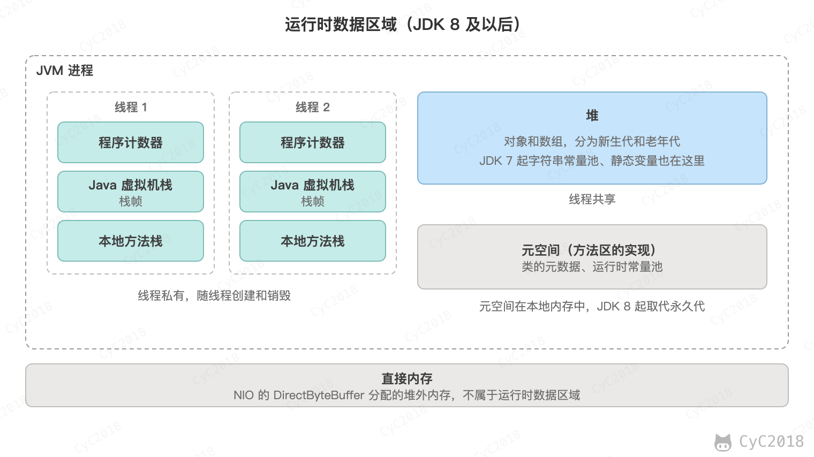 </div><br>

### 程序计数器

记录正在执行的虚拟机字节码指令的地址（如果正在执行的是本地方法则为空）。

### Java 虚拟机栈

每个 Java 方法在执行的同时会创建一个栈帧用于存储局部变量表、操作数栈、常量池引用等信息。从方法调用直至执行完成的过程，对应着一个栈帧在 Java 虚拟机栈中入栈和出栈的过程。

<div align="center"> 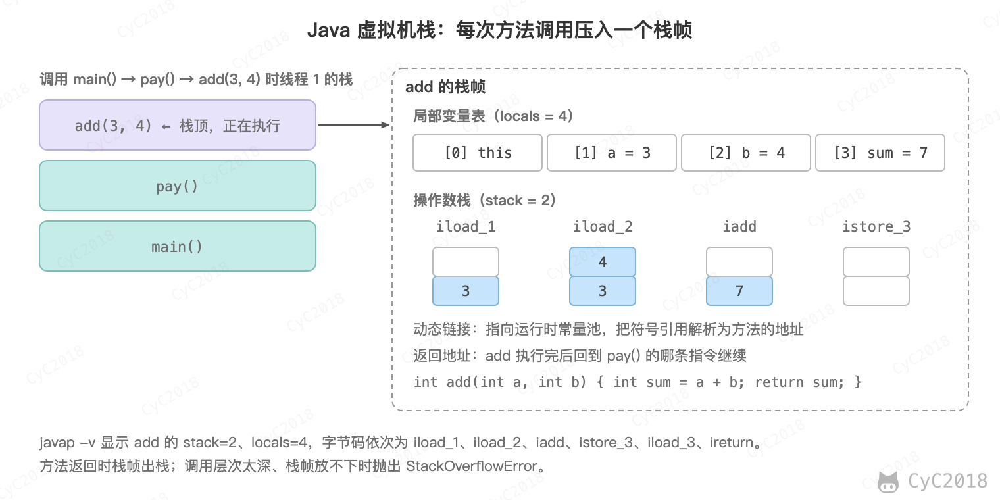 </div><br>

可以通过 -Xss 这个虚拟机参数来指定每个线程的 Java 虚拟机栈内存大小，默认值与平台有关，64 位 Linux 上为 1 MB，macOS（Apple 芯片）上的 JDK 21 为 2 MB（-XX:+PrintFlagsFinal 中的 ThreadStackSize，见[附录 A1](#a1-默认的线程栈大小)）：

```bash
java -Xss2M HackTheJava
```

该区域可能抛出以下异常：

- 当线程请求的栈深度超过最大值，会抛出 StackOverflowError 异常；
- 栈进行动态扩展时如果无法申请到足够内存，会抛出 OutOfMemoryError 异常。

### 本地方法栈

本地方法栈与 Java 虚拟机栈类似，它们之间的区别只不过是本地方法栈为本地方法服务。

本地方法一般是用其它语言（C、C++ 或汇编语言等）编写的，并且被编译为基于本机硬件和操作系统的程序，对待这些方法需要特别处理。

<div align="center"> 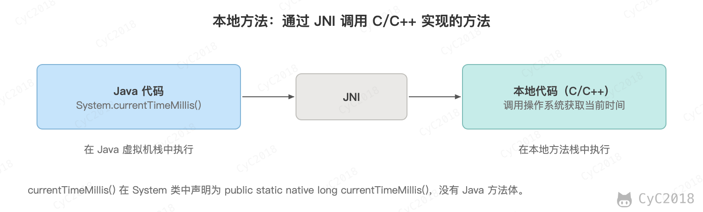 </div><br>

### 堆

几乎所有对象都在这里分配内存（例外见下文的逃逸分析），是垃圾收集的主要区域（“GC 堆”）。

现代的垃圾收集器基本都是采用分代收集算法，其主要的思想是针对不同类型的对象采取不同的垃圾收集算法。可以将堆分成两块：

- 新生代（Young Generation）
- 老年代（Old Generation）

堆不需要连续内存，并且可以动态增加其内存，增加失败会抛出 OutOfMemoryError 异常。

可以通过 -Xms 和 -Xmx 这两个虚拟机参数来指定一个程序的堆内存大小，第一个参数设置初始值，第二个参数设置最大值。

```bash
java -Xms1M -Xmx2M HackTheJava
```

### 方法区

用于存放已被加载的类信息、常量、静态变量、即时编译器编译后的代码等数据。

和堆一样不需要连续的内存，并且可以动态扩展，动态扩展失败一样会抛出 OutOfMemoryError 异常。

对这块区域进行垃圾收集的主要目标是对常量池的回收和对类的卸载，但是一般比较难实现。

JDK 1.8 之前，HotSpot 虚拟机用永久代实现方法区，和堆一样进行垃圾收集。但很难确定永久代的大小，因为它受到很多因素影响，并且每次 Full GC 之后永久代的大小都会改变，所以经常会抛出 OutOfMemoryError 异常。为了更容易管理方法区，从 JDK 1.8 开始，移除永久代，并把方法区移至元空间，它位于本地内存中，而不是虚拟机内存中。

方法区是一个 JVM 规范，永久代与元空间都是其一种实现方式。JDK 1.7 把字符串常量池和类的静态变量从永久代移到了堆中，JDK 1.8 移除永久代，改用本地内存中的元空间存储类的元信息和运行时常量池。

### 运行时常量池

运行时常量池是方法区的一部分。

Class 文件中的常量池（编译器生成的字面量和符号引用）会在类加载后被放入这个区域。

除了在编译期生成的常量，还允许在运行期间放入新的常量。需要注意的是，JDK 7 起字符串常量池已经移到堆中，String 类的 intern() 操作的是堆中的字符串常量池。

### 直接内存

在 JDK 1.4 中新引入了 NIO 类，它可以使用 Native 函数库直接分配堆外内存，然后通过 Java 堆里的 DirectByteBuffer 对象作为这块内存的引用进行操作。这样能在一些场景中显著提高性能，因为避免了在堆内存和堆外内存来回拷贝数据。

### 堆和栈的区别

- 存放的内容：虚拟机栈中是方法调用的栈帧，保存局部变量、操作数和返回地址；堆中是对象和数组，JDK 7 起静态变量和字符串常量池也在堆中；
- 共享范围：每个线程有自己的栈，其它线程访问不到；堆被所有线程共享，所以只有堆中的对象才存在线程安全问题；
- 生命周期：栈帧在方法调用时创建、返回时销毁，不需要垃圾收集；堆中的对象由垃圾收集器回收；
- 大小和异常：栈的大小由 -Xss 设置，调用层次太深时抛出 StackOverflowError；堆的大小由 -Xms、-Xmx 设置，放不下时抛出 OutOfMemoryError。

```java
void pay(long orderId) {
    int amount = 100;                    // 基本类型的局部变量，值在栈帧中
    Order order = new Order(orderId);    // 引用 order 在栈帧中，Order 对象在堆中
}
```

方法返回后，栈帧中的 amount 和 order 立即消失；Order 对象如果没有被其它地方引用，会在之后的 GC 中被回收。操作系统中进程地址空间的栈和堆也是类似的划分：栈由编译器生成的代码自动分配和释放，函数返回时局部变量就被释放，不会泄漏；堆由程序调用 malloc、free 管理，申请后忘记 free 就是内存泄漏。

需要注意的是，对象不一定都在堆中创建。JIT 编译时会做逃逸分析，如果一个对象不会离开创建它的方法（没有被返回、没有赋给字段、没有传给其它线程），HotSpot 会把它拆成几个局部变量，这称为标量替换，堆中不再创建这个对象。例如在循环中创建 2 亿个只在方法内部使用的 Point 对象，默认没有发生 GC，耗时约 130 ms；加上 -XX:-DoEscapeAnalysis 关闭逃逸分析后，发生了 13 次 GC，耗时约 335 ms（JDK 21 实测，见[附录 A2](#a2-逃逸分析)）。

### 对象的创建与内存布局

执行 new Order() 时，虚拟机依次完成以下步骤：

1. 类加载检查：如果 Order 类还没有加载，先执行 [类加载过程](#类加载过程)；
2. 分配内存：对象的大小在类加载完成后就确定了。堆中的内存规整时，只需把空闲位置的指针向后移动对象大小的距离（指针碰撞），有碎片时从空闲列表中找一块；为了避免多个线程同时分配时加锁，每个线程先在 Eden 中领取一小块私有的缓冲区（Thread Local Allocation Buffer, TLAB），在其中分配；
3. 初始化零值：把实例字段都设为 0、false 或 null，所以字段不赋值也有默认值；
4. 设置对象头：写入 Mark Word 和指向类元数据的类型指针；
5. 执行构造方法：按照代码给字段赋值。

对象在堆中由对象头、实例数据和对齐填充三部分组成。用 JOL 在 JDK 21 上查看（64 位，默认开启压缩指针），其中 Order 依次声明了 boolean paid、int userId、long id 和 String note 四个字段：

```text
java.lang.Object
OFF  SZ  DESCRIPTION
  0   8  (object header: mark)
  8   4  (object header: class)
 12   4  (object alignment gap)
Instance size: 16 bytes

Order
OFF  SZ  DESCRIPTION
  0   8  (object header: mark)
  8   4  (object header: class)
 12   4  int Order.userId
 16   8  long Order.id
 24   1  boolean Order.paid
 25   3  (alignment/padding gap)
 28   4  java.lang.String Order.note
Instance size: 32 bytes
```

- 对象头：Mark Word 占 8 字节，存放哈希码、GC 年龄和锁状态，见 [锁优化](Java%20并发.md#十二锁优化)；类型指针占 4 字节，指向对象所属的类；数组还要多 4 字节记录长度；
- 实例数据：字段不按声明的顺序排列，虚拟机会重排以减少空隙，例如 userId 被放进了对象头后面 4 字节的空位；
- 对齐填充：对象的大小必须是 8 字节的整数倍，new Object() 只有 12 字节的对象头，要补齐到 16 字节。

关闭压缩指针（-XX:-UseCompressedOops -XX:-UseCompressedClassPointers）后，类型指针和 note 引用都变成 8 字节，Order 从 32 字节变成 40 字节。压缩指针用 32 位存放对象地址，因为对象按 8 字节对齐，地址的低 3 位总是 0，可以省略，所以最多能表示 2<sup>32</sup> × 8 = 32 GB 的堆。最大堆达到 32 GB 时，对象引用的压缩自动关闭，所有引用都变成 8 字节（JDK 21 中 -Xmx31g 时 UseCompressedOops 为 true，-Xmx32g 时为 false，类型指针的压缩不受影响），这是堆的大小通常小于 32 GB 的原因。

## 二、垃圾收集

垃圾收集主要是针对堆和方法区进行。程序计数器、虚拟机栈和本地方法栈这三个区域属于线程私有的，只存在于线程的生命周期内，线程结束之后就会消失，因此不需要对这三个区域进行垃圾收集。

### 判断一个对象是否可被回收

#### 1. 引用计数算法

为对象添加一个引用计数器，当对象增加一个引用时计数器加 1，引用失效时计数器减 1。引用计数为 0 的对象可被回收。

在两个对象出现循环引用的情况下，此时引用计数器永远不为 0，导致无法对它们进行回收。正是因为循环引用的存在，因此 Java 虚拟机不使用引用计数算法。

```java
public class Test {

    public Object instance = null;

    public static void main(String[] args) {
        Test a = new Test();
        Test b = new Test();
        a.instance = b;
        b.instance = a;
        a = null;
        b = null;
        doSomething();
    }
}
```

在上述代码中，a 与 b 引用的对象实例互相持有了对象的引用，因此把对 a 对象与 b 对象的引用去除之后，由于两个对象还存在互相之间的引用，导致两个 Test 对象无法被回收。

#### 2. 可达性分析算法

以 GC Roots 为起始点进行搜索，可达的对象都是存活的，不可达的对象可被回收。

Java 虚拟机使用该算法来判断对象是否可被回收。

GC Roots 是堆外指向堆中对象的引用，程序不经过其它对象就能直接访问到它们，GC 无法判断这些引用以后还会不会被使用，只能认为它们引用的对象都存活。GC Roots 一般包含以下内容：

- 虚拟机栈中局部变量表中引用的对象，即正在执行的方法的参数和局部变量；
- 本地方法栈中 JNI 中引用的对象；
- 方法区中类静态属性引用的对象，类没有被卸载时，程序随时可以通过类名访问它们；
- 方法区中的常量引用的对象，例如字符串常量池中的字符串；
- 被 synchronized 持有的锁对象、已经启动且没有结束的线程，以及虚拟机内部的引用，例如系统类加载器、常驻的异常对象。

<div align="center"> 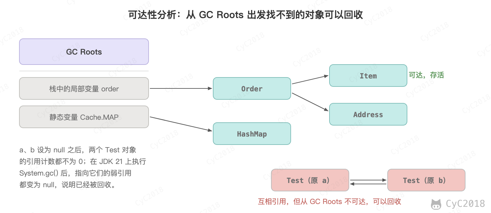 </div><br>


#### 3. 方法区的回收

方法区中的类和常量很少变成垃圾，回收的收益比新生代低很多，所以在方法区上进行回收性价比不高。

主要是对常量池的回收和对类的卸载。

为了避免内存溢出，在大量使用反射和动态代理的场景都需要虚拟机具备类卸载功能。

类的卸载条件很多，需要满足以下三个条件，并且满足了条件也不一定会被卸载：

- 该类所有的实例都已经被回收，此时堆中不存在该类的任何实例；
- 加载该类的 ClassLoader 已经被回收；
- 该类对应的 Class 对象没有在任何地方被引用，也就无法在任何地方通过反射访问该类方法。

#### 4. finalize()

类似 C++ 的析构函数，用于关闭外部资源。但是 try-finally 等方式可以做得更好，并且该方法运行代价很高，不确定性大，无法保证各个对象的调用顺序，因此最好不要使用。finalize() 从 JDK 9 起已经废弃，JDK 18 起标记为将要删除（JEP 421），需要在对象被回收后清理资源时可以使用 java.lang.ref.Cleaner。

当一个对象可被回收时，如果需要执行该对象的 finalize() 方法，那么就有可能在该方法中让对象重新被引用，从而实现自救。自救只能进行一次，如果回收的对象之前调用了 finalize() 方法自救，后面回收时不会再调用该方法。

### 引用类型

无论是通过引用计数算法判断对象的引用数量，还是通过可达性分析算法判断对象是否可达，判定对象是否可被回收都与引用有关。

Java 提供了四种强度不同的引用类型。

#### 1. 强引用

被强引用关联的对象不会被回收。

使用 new 一个新对象的方式来创建强引用。

```java
Object obj = new Object();
```

#### 2. 软引用

被软引用关联的对象只有在内存不够的情况下才会被回收。

使用 SoftReference 类来创建软引用。

```java
Object obj = new Object();
SoftReference<Object> sf = new SoftReference<Object>(obj);
obj = null;  // 使对象只被软引用关联
```

#### 3. 弱引用

只被弱引用关联的对象一定会被回收，也就是说它只能存活到下一次垃圾收集发生之前。

使用 WeakReference 类来创建弱引用。

```java
Object obj = new Object();
WeakReference<Object> wf = new WeakReference<Object>(obj);
obj = null;
```

ThreadLocal 就用到了弱引用。每个线程的 ThreadLocalMap 中，Entry 继承自 WeakReference，key（ThreadLocal 对象）是弱引用，value 是强引用。如果 key 是强引用，业务代码不再使用某个 ThreadLocal 后，它仍然被线程的 Map 引用着，线程池中的线程一直存活，这个 ThreadLocal 对象和它的 value 都无法回收。

key 改为弱引用后，ThreadLocal 对象在下一次 GC 时被回收，Entry 的 key 变为 null。之后这个线程再调用任意 ThreadLocal 的 set()、get()、remove() 时，会顺带清除遇到的一部分 key 为 null 的 Entry，value 才能被回收。在此之前 value 一直被强引用，所以用完之后仍然要调用 remove()，见 [线程本地存储](Java%20并发.md#2-线程本地存储thread-local-storage)。

例如向 ThreadLocal 放入一个 10 MB 的数组，再把 ThreadLocal 变量置为 null：GC 之后 Entry 的 key 变为 null，value 还在；当前线程再通过其它 ThreadLocal 调用 set()，第 2 次调用之后这个 Entry 才被清除（JDK 21 实测，见[附录 A5](#a5-threadlocalmap-的弱引用)）。

#### 4. 虚引用

又称为幽灵引用或者幻影引用，一个对象是否有虚引用的存在，不会对其生存时间造成影响，也无法通过虚引用得到一个对象。

为一个对象设置虚引用的唯一目的是能在这个对象被回收时收到一个系统通知。虚引用需要和引用队列（ReferenceQueue）配合使用，对象被回收时虚引用会被加入队列，程序通过检查队列得知回收的发生。虚引用的 get() 方法总是返回 null。

使用 PhantomReference 来创建虚引用。

```java
Object obj = new Object();
ReferenceQueue<Object> queue = new ReferenceQueue<Object>();
PhantomReference<Object> pf = new PhantomReference<Object>(obj, queue);
obj = null;
```

### 垃圾收集算法

#### 1. 标记 - 清除

<div align="center"> 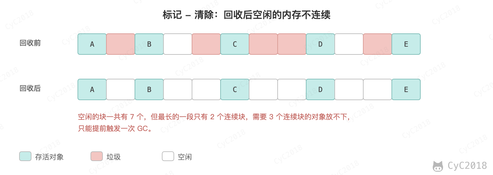 </div><br>

在标记阶段，程序会检查每个对象是否为活动对象，如果是活动对象，则程序会在对象头中打上标记。

在清除阶段，会进行对象回收并取消标志位，另外，还会判断回收后的分块与前一个空闲分块是否连续，若连续，会合并这两个分块。回收对象就是把对象占用的内存作为空闲分块，连接到被称为 “空闲链表” 的单向链表，之后进行分配时只需要遍历这个空闲链表，就可以找到分块。

在分配时，程序会搜索空闲链表寻找空间大于等于新对象大小 size 的块 block。如果它找到的块等于 size，会直接返回这个分块；如果找到的块大于 size，会将块分割成大小为 size 与 (block - size) 的两部分，返回大小为 size 的分块，并把大小为 (block - size) 的块返回给空闲链表。

不足：

- 标记和清除过程效率都不高；
- 会产生大量不连续的内存碎片，导致无法给大对象分配内存。

#### 2. 标记 - 整理

<div align="center"> 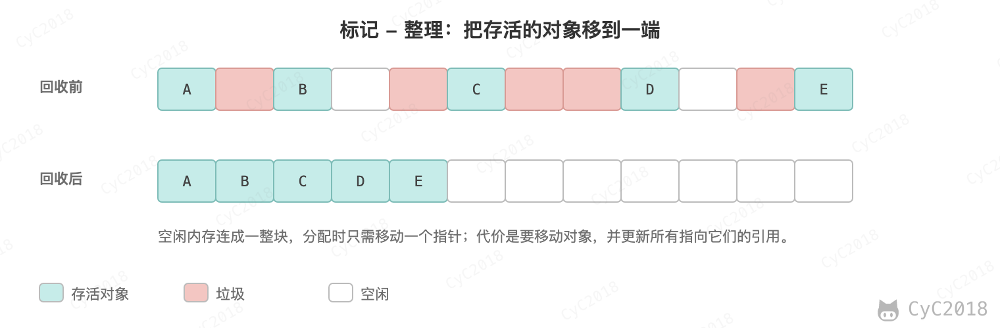 </div><br>

让所有存活的对象都向一端移动，然后直接清理掉端边界以外的内存。

优点：不会产生内存碎片。

不足：需要移动大量对象，处理效率比较低。

#### 3. 复制

<div align="center"> 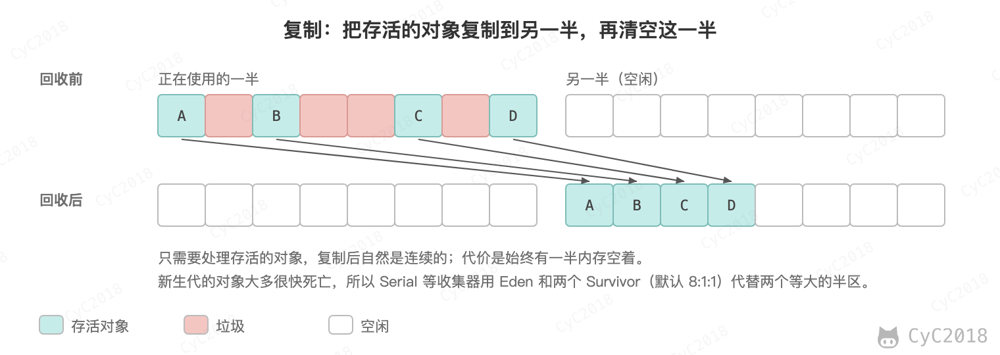 </div><br>

将内存划分为大小相等的两块，每次只使用其中一块，当这一块内存用完了就将还存活的对象复制到另一块上面，然后再把使用过的内存空间进行一次清理。

主要不足是只使用了内存的一半。

现在的商业虚拟机都采用这种收集算法回收新生代，但是并不是划分为大小相等的两块，而是一块较大的 Eden 空间和两块较小的 Survivor 空间，每次使用 Eden 和其中一块 Survivor。在回收时，将 Eden 和 Survivor 中还存活着的对象全部复制到另一块 Survivor 上，最后清理 Eden 和使用过的那一块 Survivor。

HotSpot 虚拟机的 Eden 和 Survivor 大小比例默认为 8:1，保证了内存的利用率达到 90%。如果每次回收有多于 10% 的对象存活，那么一块 Survivor 就不够用了，此时需要依赖于老年代进行空间分配担保，也就是借用老年代的空间存储放不下的对象。

#### 4. 分代收集

现在的商业虚拟机采用分代收集算法，它根据对象存活周期将内存划分为几块，不同块采用适当的收集算法。

一般将堆分为新生代和老年代。

- 新生代使用：复制算法；
- 老年代使用：标记 - 清除 或者 标记 - 整理 算法。

### 垃圾收集器

<div align="center"> 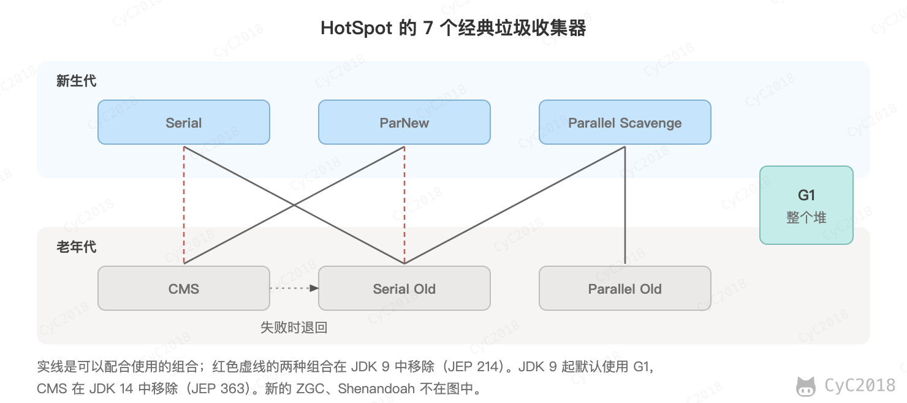 </div><br>

以上是 JDK 8 中 HotSpot 虚拟机的 7 个垃圾收集器，连线表示垃圾收集器可以配合使用。OpenJDK 21 中保留了 Serial、Serial Old、Parallel Scavenge、Parallel Old 和 G1，CMS 和 ParNew 已经移除，另外新增了 ZGC 和 Shenandoah 这两个以并发为主的收集器（Oracle JDK 不包含 Shenandoah）。

- 单线程与多线程：单线程指的是垃圾收集器只使用一个线程，而多线程使用多个线程；
- 串行与并发：串行指的是垃圾收集器与用户程序交替执行，这意味着在执行垃圾收集的时候需要停顿用户程序；并发指的是垃圾收集器和用户程序同时执行。图中除了 CMS 和 G1 之外，其它垃圾收集器都是以串行的方式执行。

#### 1. Serial 收集器

<div align="center"> 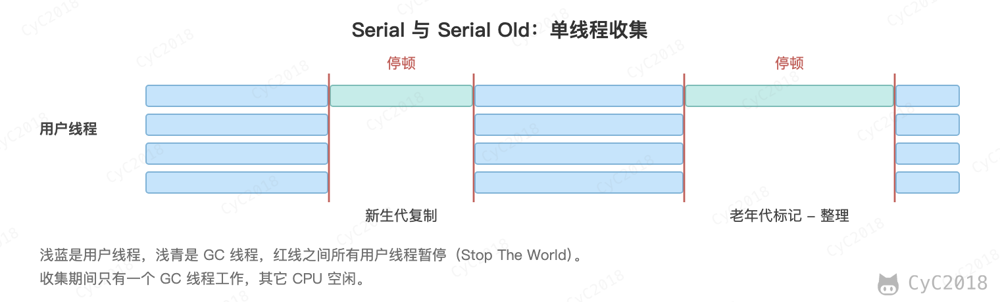 </div><br>

Serial 翻译为串行，也就是说它以串行的方式执行。

它是单线程的收集器，只会使用一个线程进行垃圾收集工作。

它的优点是简单高效，在单个 CPU 环境下，由于没有线程交互的开销，因此拥有最高的单线程收集效率。

它是 Client 场景下的默认新生代收集器，因为在该场景下内存一般来说不会很大。它收集一两百兆垃圾的停顿时间可以控制在一百多毫秒以内，只要不是太频繁，这点停顿时间是可以接受的。

#### 2. ParNew 收集器

<div align="center"> 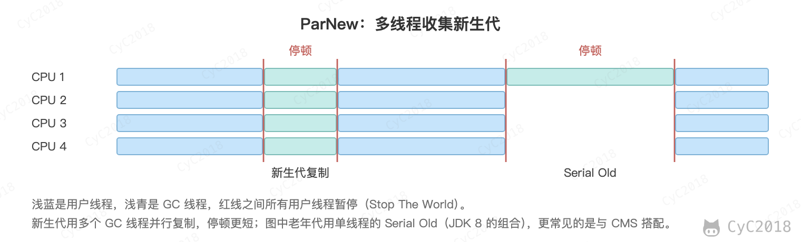 </div><br>

它是 Serial 收集器的多线程版本。

它是 Server 场景下首选的新生代收集器，除了性能原因外，主要是因为除了 Serial 收集器，只有它能与 CMS 收集器配合使用。

#### 3. Parallel Scavenge 收集器

与 ParNew 一样是多线程收集器。

其它收集器目标是尽可能缩短垃圾收集时用户线程的停顿时间，而它的目标是达到一个可控制的吞吐量，因此它被称为“吞吐量优先”收集器。这里的吞吐量指 CPU 用于运行用户程序的时间占总时间的比值。

停顿时间越短就越适合需要与用户交互的程序，良好的响应速度能提升用户体验。而高吞吐量则可以高效率地利用 CPU 时间，尽快完成程序的运算任务，适合在后台运算而不需要太多交互的任务。

缩短停顿时间是以牺牲吞吐量和新生代空间来换取的：新生代空间变小，垃圾收集变得频繁，导致吞吐量下降。

可以通过一个开关参数打开 GC 自适应的调节策略（GC Ergonomics），就不需要手工指定新生代的大小（-Xmn）、Eden 和 Survivor 区的比例、晋升老年代对象年龄等细节参数了。虚拟机会根据当前系统的运行情况收集性能监控信息，动态调整这些参数以提供最合适的停顿时间或者最大的吞吐量。

#### 4. Serial Old 收集器

<div align="center">  </div><br>

是 Serial 收集器的老年代版本，也是给 Client 场景下的虚拟机使用。如果用在 Server 场景下，它有两大用途：

- 在 JDK 1.5 以及之前版本（Parallel Old 诞生以前）中与 Parallel Scavenge 收集器搭配使用；
- 作为 CMS 收集器的后备预案，在并发收集发生 Concurrent Mode Failure 时使用。

#### 5. Parallel Old 收集器

<div align="center"> 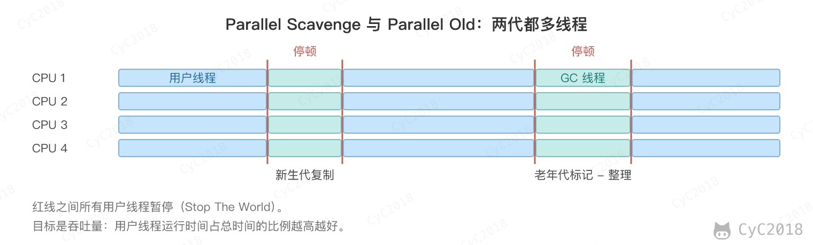 </div><br>

是 Parallel Scavenge 收集器的老年代版本。

在注重吞吐量以及 CPU 资源敏感的场合，都可以优先考虑 Parallel Scavenge 加 Parallel Old 收集器。

#### 6. CMS 收集器

<div align="center"> 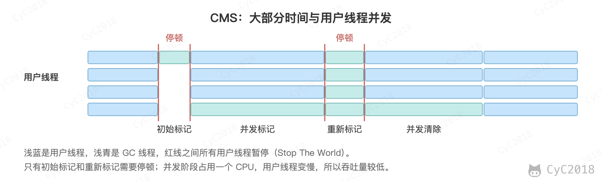 </div><br>

CMS（Concurrent Mark Sweep），Mark Sweep 指的是标记 - 清除算法。

分为以下四个流程：

- 初始标记：仅仅只是标记一下 GC Roots 能直接关联到的对象，速度很快，需要停顿；
- 并发标记：进行 GC Roots Tracing 的过程，它在整个回收过程中耗时最长，不需要停顿；
- 重新标记：为了修正并发标记期间因用户程序继续运作而导致标记产生变动的那一部分对象的标记记录，需要停顿；
- 并发清除：不需要停顿。

在整个过程中耗时最长的并发标记和并发清除过程中，收集器线程都可以与用户线程一起工作，不需要进行停顿。

具有以下缺点：

- 吞吐量低：低停顿时间是以牺牲吞吐量为代价的，导致 CPU 利用率不够高；
- 无法处理浮动垃圾，可能出现 Concurrent Mode Failure。浮动垃圾是指并发清除阶段由于用户线程继续运行而产生的垃圾，这部分垃圾只能到下一次 GC 时才能进行回收。由于浮动垃圾的存在，因此需要预留出一部分内存，意味着 CMS 收集不能像其它收集器那样等待老年代快满的时候再回收。如果预留的内存不够存放浮动垃圾，就会出现 Concurrent Mode Failure，这时虚拟机将临时启用 Serial Old 来替代 CMS；
- 标记 - 清除算法导致的空间碎片，往往出现老年代空间剩余，但无法找到足够大连续空间来分配当前对象，不得不提前触发一次 Full GC。

#### 7. G1 收集器

G1（Garbage-First），它是一款面向服务端应用的垃圾收集器，在多 CPU 和大内存的场景下有很好的性能。HotSpot 开发团队赋予它的使命是未来可以替换掉 CMS 收集器。JDK 9 起 G1 成为默认的垃圾收集器（JEP 248），CMS 在 JDK 14 中被移除（JEP 363）。

没有指定收集器时，JVM 按机器的配置选择：JDK 8 在服务器级的机器（至少 2 个处理器、约 2 GB 以上的物理内存）上默认使用 Parallel Scavenge 加 Parallel Old，否则使用 Serial；JDK 9 起把服务器级机器上的默认值改为 G1。

所以 JDK 21 在只有 1 个处理器的环境中，例如只分配了 1 个 CPU 的容器，默认使用的仍是 Serial（见[附录 A6](#a6-默认的收集器与-g1-的-region-大小)）。JDK 27 起在所有环境中都默认使用 G1（JEP 523）。

堆被分为新生代和老年代，其它收集器进行收集的范围都是整个新生代或者老年代，而 G1 可以直接对新生代和老年代一起回收。

<div align="center"> 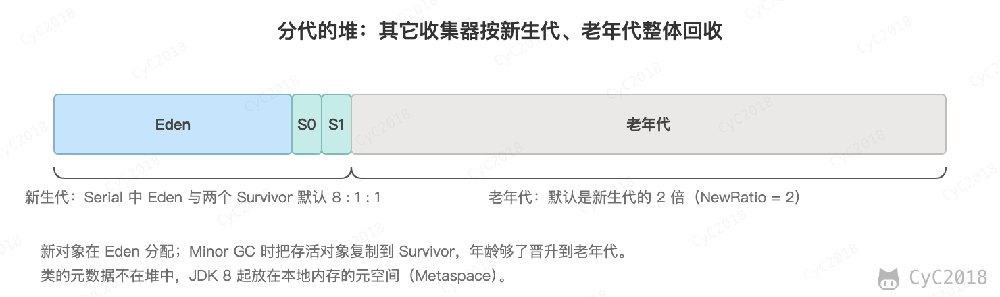 </div><br>

G1 把堆划分成多个大小相等的独立区域（Region），新生代和老年代不再物理隔离。

<div align="center"> 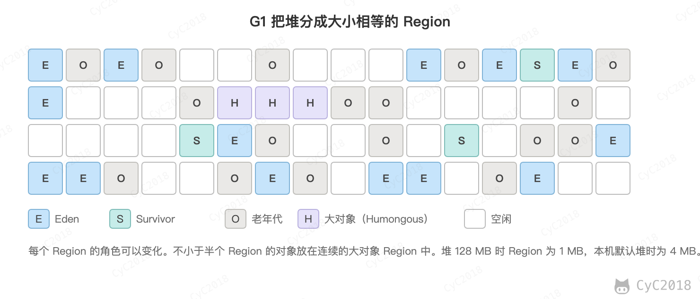 </div><br>

-XX:G1HeapRegionSize 设置的是每个 Region 的大小，取值为 2 的幂，范围为 1 MB～512 MB（JDK 17 及以前最大为 32 MB）；Region 的数量由堆的大小决定。没有指定时，JVM 用最大堆除以 2048，向上取到 2 的幂，并限制在 1 MB～32 MB 之间，最大堆在 2 GB～64 GB 之间时 Region 约有 2048 个。例如 -Xmx4g 时 Region 为 2 MB，-Xmx16g 时为 8 MB，-Xmx64g 时为 32 MB（JDK 21 实测，见[附录 A6](#a6-默认的收集器与-g1-的-region-大小)）。

Region 不区分固定的用途，一个 Region 回收后可以再作为 Eden、Survivor 或老年代使用；大小达到 Region 一半的对象是 Humongous 对象，直接分配在一组连续的 Region 中，见 [大对象直接进入老年代](#2-大对象直接进入老年代)。

通过引入 Region 的概念，从而将原来的一整块内存空间划分成多个的小空间，使得每个小空间可以单独进行垃圾收集。这种划分方法带来了很大的灵活性，使得可预测的停顿时间模型成为可能。通过记录每个 Region 的回收时间以及回收所获得的空间（这两个值是通过过去回收的经验获得），并维护一个优先列表，每次根据允许的收集时间，优先回收价值最大的 Region。

每个 Region 都有一个 Remembered Set，用来记录该 Region 对象的引用对象所在的 Region。通过使用 Remembered Set，在做可达性分析的时候就可以避免全堆扫描。

<div align="center"> 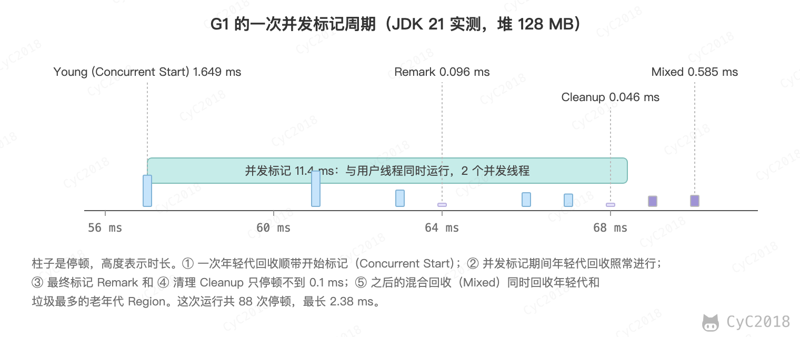 </div><br>

如果不计算维护 Remembered Set 的操作，G1 收集器的运作大致可划分为以下几个步骤：

- 初始标记：在一次新生代回收中顺带完成（Concurrent Start），标记 GC Roots 直接关联的对象，需要停顿；
- 并发标记：与用户线程同时运行，找出老年代中所有存活的对象，期间新生代回收照常进行；
- 最终标记（Remark）：短暂停顿，处理并发标记期间用户线程修改引用留下的记录，完成标记，并直接回收完全空的 Region；
- 清理与混合回收：清理（Cleanup）停顿根据各 Region 的回收价值决定是否进入回收阶段；之后的多次混合回收（Mixed）除了新生代，再挑选一部分垃圾最多的老年代 Region，把其中存活的对象复制出去，每次回收的数量受停顿时间目标（MaxGCPauseMillis，默认 200 ms）限制。

具备如下特点：

- 空间整合：整体来看是基于“标记 - 整理”算法实现的收集器，从局部（两个 Region 之间）上来看是基于“复制”算法实现的，这意味着运行期间不会产生内存空间碎片；
- 可预测的停顿：能让使用者明确指定在一个长度为 M 毫秒的时间片段内，消耗在 GC 上的时间不得超过 N 毫秒。

例如一个不断分配 1～5 KB 的数组、其中四分之一存活较久的程序，用 128 MB 的堆分别运行，停顿情况如下（JDK 21 实测，见[附录 A3](#a3-不同收集器的停顿)）：

| 收集器 | 停顿次数 | 停顿总时长 | 最长停顿 |
| --- | --- | --- | --- |
| Serial | 39 | 90.4 ms | 9.14 ms |
| Parallel | 75 | 96.8 ms | 5.16 ms |
| G1 | 84 | 40.0 ms | 2.01 ms |

G1 停顿的次数更多，但每次都很短，适合对响应时间敏感的服务。

#### 8. ZGC 收集器

ZGC 的目标是让停顿时间不随堆的大小增长，JDK 15 起可以用于生产（JEP 377），JDK 21 加入了分代模式（JEP 439），JDK 23 起分代成为默认模式（JEP 474），JDK 24 移除了不分代的模式（JEP 490）。

G1 的新生代回收和混合回收都要在停顿中把存活对象复制到新的 Region，存活对象越多，停顿越长。ZGC 把标记和复制都放到与用户线程并发执行的阶段，停顿中只做扫描 GC Roots 这类少量工作，所以停顿很短，而且与堆的大小无关。

并发复制的难点在于，对象被移走时，用户线程手里可能还拿着指向旧地址的引用。ZGC 用着色指针和读屏障解决这个问题：

- 着色指针：ZGC 的对象引用固定为 64 位，除了对象的地址，还用其中几位元数据记录状态，例如对象是否已被标记、引用中的地址是否已经更新，看一眼引用就知道它是否可能指向旧地址；
- 读屏障：JIT 在每次从堆中读取引用的地方插入一小段检查，发现引用还指向旧地址，就查转发表换成新地址，并把字段中的引用一起改掉，下次再读就不需要修正了。分代 ZGC 还在写入引用的地方加了写屏障，用来记录老年代对象指向新生代对象的引用。

同一个程序用 JDK 21 的分代 ZGC 运行（见[附录 A3](#a3-不同收集器的停顿)）：

| 堆大小 | 停顿次数 | 停顿总时长 | 最长停顿 | 分配停顿（Allocation Stall） |
| --- | --- | --- | --- | --- |
| 128 MB | 125 | 0.4 ms | 0.008 ms | 41 次，共 93.5 ms，最长 6.1 ms |
| 512 MB | 46 | 0.2 ms | 0.009 ms | 0 次 |

这个程序中 ZGC 的停顿都在 0.01 ms 以内，比 G1 短两个数量级，官方给出的是停顿不超过 1 毫秒。但堆只有 128 MB 时，程序分配内存的速度超过了并发回收的速度，没有空闲的内存可用，分配内存的线程只能等待回收完成，日志中记为 Allocation Stall，对用户来说与停顿无异。所以使用 ZGC 要给堆留出足够的余量，代价是占用更多的内存，读屏障也会让吞吐量略有下降。

## 三、内存分配与回收策略

### Minor GC 和 Full GC

- Minor GC：回收新生代，因为新生代对象存活时间很短，因此 Minor GC 会频繁执行，执行的速度一般也会比较快；
- Full GC：回收老年代和新生代，老年代对象其存活时间长，因此 Full GC 很少执行，执行速度会比 Minor GC 慢很多。

### 内存分配策略

#### 1. 对象优先在 Eden 分配

大多数情况下，对象在新生代 Eden 上分配，当 Eden 空间不够时，发起 Minor GC。

#### 2. 大对象直接进入老年代

大对象是指需要连续内存空间的对象，最典型的大对象是那种很长的字符串以及数组。

经常出现大对象会提前触发垃圾收集以获取足够的连续空间分配给大对象。

-XX:PretenureSizeThreshold，大于此值的对象直接在老年代分配，避免在 Eden 和 Survivor 之间的大量内存复制。该参数只对 Serial 和 ParNew 收集器有效（JDK 21 中 ParNew 已移除，只剩 Serial）。G1 中大小达到 Region 一半的对象称为 Humongous 对象，直接分配在老年代的连续 Region 中。

#### 3. 长期存活的对象进入老年代

为对象定义年龄计数器，对象在 Eden 出生并经过 Minor GC 依然存活，将移动到 Survivor 中，年龄就增加 1 岁，增加到一定年龄则移动到老年代中。

-XX:MaxTenuringThreshold 用来定义年龄的阈值。

#### 4. 动态对象年龄判定

虚拟机并不是永远要求对象的年龄必须达到 MaxTenuringThreshold 才能晋升老年代。HotSpot 会从年龄最小的对象开始累加 Survivor 中各个年龄对象的大小，当累加到某个年龄时总和超过了 Survivor 空间的一半，就取这个年龄和 MaxTenuringThreshold 中较小的值作为晋升阈值，年龄大于或等于该值的对象直接进入老年代。

#### 5. 空间分配担保

在发生 Minor GC 之前，虚拟机先检查老年代最大可用的连续空间是否大于新生代所有对象总空间，如果条件成立的话，那么 Minor GC 可以确认是安全的。

如果不成立，虚拟机会继续检查老年代最大可用的连续空间是否大于历次晋升到老年代对象的平均大小，如果大于就进行 Minor GC，否则进行 Full GC。JDK 6 Update 24 之前还需要 HandlePromotionFailure 参数允许担保失败才会冒险进行 Minor GC，之后该参数不再起作用。

### Full GC 的触发条件

对于 Minor GC，其触发条件非常简单，当 Eden 空间满时，就将触发一次 Minor GC。而 Full GC 则相对复杂，有以下条件：

#### 1. 调用 System.gc()

只是建议虚拟机执行 Full GC，但是虚拟机不一定真正去执行。不建议使用这种方式，而是让虚拟机管理内存。

#### 2. 老年代空间不足

老年代空间不足的常见场景为前文所讲的大对象直接进入老年代、长期存活的对象进入老年代等。

为了避免以上原因引起的 Full GC，应当尽量不要创建过大的对象以及数组。除此之外，可以通过 -Xmn 虚拟机参数调大新生代的大小，让对象尽量在新生代被回收掉，不进入老年代。还可以通过 -XX:MaxTenuringThreshold 调大对象进入老年代的年龄，让对象在新生代多存活一段时间。

#### 3. 空间分配担保失败

使用复制算法的 Minor GC 需要老年代的内存空间作担保，如果担保失败会执行一次 Full GC。具体内容请参考上面的第 5 小节。

#### 4. JDK 1.7 及以前的永久代空间不足

在 JDK 1.7 及以前，HotSpot 虚拟机中的方法区是用永久代实现的，永久代中存放的为一些 Class 的信息、常量、静态变量等数据。

当系统中要加载的类、反射的类和调用的方法较多时，永久代可能会被占满，在未配置为采用 CMS GC 的情况下也会执行 Full GC。如果经过 Full GC 仍然回收不了，那么虚拟机会抛出 java.lang.OutOfMemoryError。

为避免以上原因引起的 Full GC，可采用的方法为增大永久代空间或转为使用 CMS GC。

#### 5. Concurrent Mode Failure

这一条只针对 CMS，CMS 已在 JDK 14 中移除。执行 CMS GC 的过程中同时有对象要放入老年代，而此时老年代空间不足（可能是 GC 过程中浮动垃圾过多导致暂时性的空间不足），便会报 Concurrent Mode Failure 错误，并触发 Full GC。

## 四、类加载机制

类是在运行期间第一次使用时动态加载的，而不是一次性加载所有类。因为如果一次性加载，那么会占用很多的内存。

### 类的生命周期

<div align="center"> 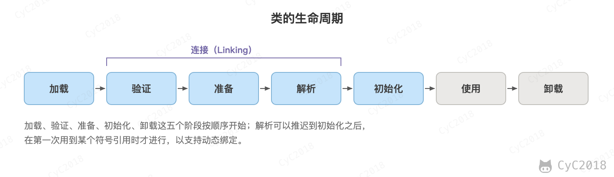 </div><br>

包括以下 7 个阶段：

- 加载（Loading）
- 验证（Verification）
- 准备（Preparation）
- 解析（Resolution）
- 初始化（Initialization）
- 使用（Using）
- 卸载（Unloading）

### 类加载过程

包含了加载、验证、准备、解析和初始化这 5 个阶段。

#### 1. 加载

加载是类加载的一个阶段，注意不要混淆。

加载过程完成以下三件事：

- 通过类的完全限定名称获取定义该类的二进制字节流；
- 将该字节流表示的静态存储结构转换为方法区的运行时存储结构；
- 在内存中生成一个代表该类的 Class 对象，作为方法区中该类各种数据的访问入口。


其中二进制字节流可以从以下方式中获取：

- 从 ZIP 包读取，成为 JAR、EAR、WAR 格式的基础；
- 从网络中获取，最典型的应用是早期的 Applet；
- 运行时计算生成，例如动态代理技术，在 java.lang.reflect.Proxy 使用 ProxyGenerator.generateProxyClass 的代理类的二进制字节流；
- 由其他文件生成，例如由 JSP 文件生成对应的 Class 类。

#### 2. 验证

确保 Class 文件的字节流中包含的信息符合当前虚拟机的要求，并且不会危害虚拟机自身的安全。

#### 3. 准备

类变量是被 static 修饰的变量，准备阶段为类变量分配内存并设置初始值。在 JDK 7 之前类变量放在方法区（永久代）中，JDK 7 起随 Class 对象一起放在堆中。

实例变量不会在这阶段分配内存，它会在对象实例化时随着对象一起被分配在堆中。应该注意到，实例化不是类加载的一个过程，类加载发生在所有实例化操作之前，并且类加载只进行一次，实例化可以进行多次。

初始值一般为 0 值，例如下面的类变量 value 被初始化为 0 而不是 123。

```java
public static int value = 123;
```

如果类变量是常量，那么它将初始化为表达式所定义的值而不是 0。例如下面的常量 value 被初始化为 123 而不是 0。

```java
public static final int value = 123;
```

#### 4. 解析

将常量池的符号引用替换为直接引用的过程。

其中解析过程在某些情况下可以在初始化阶段之后再开始，这是为了支持 Java 的动态绑定。

#### 5. 初始化

初始化阶段才真正开始执行类中定义的 Java 程序代码。初始化阶段是虚拟机执行类构造器 &lt;clinit\>() 方法的过程。在准备阶段，类变量已经赋过一次系统要求的初始值，而在初始化阶段，根据程序员通过程序制定的主观计划去初始化类变量和其它资源。

&lt;clinit\>() 是由编译器自动收集类中所有类变量的赋值动作和静态语句块中的语句合并产生的，编译器收集的顺序由语句在源文件中出现的顺序决定。特别注意的是，静态语句块只能访问到定义在它之前的类变量，定义在它之后的类变量只能赋值，不能访问。例如以下代码：

```java
public class Test {
    static {
        i = 0;                // 给变量赋值可以正常编译通过
        System.out.print(i);  // 这句编译器会提示“非法向前引用”
    }
    static int i = 1;
}
```

由于父类的 &lt;clinit\>() 方法先执行，也就意味着父类中定义的静态语句块的执行要优先于子类。例如以下代码：

```java
static class Parent {
    public static int A = 1;
    static {
        A = 2;
    }
}

static class Sub extends Parent {
    public static int B = A;
}

public static void main(String[] args) {
     System.out.println(Sub.B);  // 2
}
```

接口中不可以使用静态语句块，但仍然有类变量初始化的赋值操作，因此接口与类一样都会生成 &lt;clinit\>() 方法。但接口与类不同的是，执行接口的 &lt;clinit\>() 方法不需要先执行父接口的 &lt;clinit\>() 方法。只有当父接口中定义的变量使用时，父接口才会初始化。另外，接口的实现类在初始化时一般也不会执行接口的 &lt;clinit\>() 方法，例外是接口中定义了 default 方法时，实现类初始化之前要先初始化这个接口。

虚拟机会保证一个类的 &lt;clinit\>() 方法在多线程环境下被正确的加锁和同步，如果多个线程同时初始化一个类，只会有一个线程执行这个类的 &lt;clinit\>() 方法，其它线程都会阻塞等待，直到活动线程执行 &lt;clinit\>() 方法完毕。如果在一个类的 &lt;clinit\>() 方法中有耗时的操作，就可能造成多个线程阻塞，在实际过程中此种阻塞很隐蔽。

### 类初始化时机

#### 1. 主动引用

虚拟机规范中并没有强制约束何时进行加载，但是规范严格规定了有且只有下列六种情况必须对类进行初始化（加载、验证、准备都会随之发生）：

- 遇到 new、getstatic、putstatic、invokestatic 这四条字节码指令时，如果类没有进行过初始化，则必须先触发其初始化。最常见的生成这 4 条指令的场景是：使用 new 关键字实例化对象的时候；读取或设置一个类的静态字段（被 final 修饰、已在编译期把结果放入常量池的静态字段除外）的时候；以及调用一个类的静态方法的时候；
- 使用 java.lang.reflect 包的方法对类进行反射调用的时候，如果类没有进行初始化，则需要先触发其初始化；
- 当初始化一个类的时候，如果发现其父类还没有进行过初始化，则需要先触发其父类的初始化；
- 当虚拟机启动时，用户需要指定一个要执行的主类（包含 main() 方法的那个类），虚拟机会先初始化这个主类；
- 当使用 JDK 1.7 的动态语言支持时，如果一个 java.lang.invoke.MethodHandle 实例最后的解析结果为 REF_getStatic、REF_putStatic、REF_invokeStatic 的方法句柄，并且这个方法句柄所对应的类没有进行过初始化，则需要先触发其初始化；
- 当一个接口定义了 default 方法时，如果它的实现类发生了初始化，要先初始化这个接口。例如 Impl 同时实现了带 default 方法的 WithDefault 和不带 default 方法的 NoDefault，new Impl() 时依次输出“WithDefault 初始化”“Impl 初始化”，NoDefault 没有被初始化（JDK 21 实测）。

#### 2. 被动引用

以上 6 种场景中的行为称为对一个类进行主动引用。除此之外，所有引用类的方式都不会触发初始化，称为被动引用。被动引用的常见例子包括：

- 通过子类引用父类的静态字段，不会导致子类初始化：

```java
System.out.println(SubClass.value);  // value 字段在 SuperClass 中定义
```

- 通过数组定义来引用类，不会触发此类的初始化。该过程会对数组类进行初始化，数组类是一个由虚拟机自动生成的、直接继承自 Object 的子类，其中包含了数组的属性和方法：

```java
SuperClass[] sca = new SuperClass[10];
```

- 常量在编译阶段会存入调用类的常量池中，本质上并没有直接引用到定义常量的类，因此不会触发定义常量的类的初始化：

```java
System.out.println(ConstClass.HELLOWORLD);
```

### 类与类加载器

两个类相等，需要类本身相等，并且使用同一个类加载器进行加载。这是因为每一个类加载器都拥有一个独立的类名称空间。

这里的相等，包括类的 Class 对象的 equals() 方法、isAssignableFrom() 方法、isInstance() 方法的返回结果为 true，也包括使用 instanceof 关键字做对象所属关系判定结果为 true。

### 类加载器分类

从 Java 虚拟机的角度来讲，只存在以下两种不同的类加载器：

- 启动类加载器（Bootstrap ClassLoader），使用 C++ 实现，是虚拟机自身的一部分；
- 所有其它类的加载器，使用 Java 实现，独立于虚拟机，继承自抽象类 java.lang.ClassLoader。

从 Java 开发人员的角度看，类加载器可以划分得更细致一些：

- 启动类加载器（Bootstrap ClassLoader）：此类加载器负责将存放在 &lt;JRE_HOME\>\lib 目录中的，或者被 -Xbootclasspath 参数所指定的路径中的，并且是虚拟机识别的（仅按照文件名识别，如 rt.jar，名字不符合的类库即使放在 lib 目录中也不会被加载）类库加载到虚拟机内存中。启动类加载器无法被 Java 程序直接引用，用户在编写自定义类加载器时，如果需要把加载请求委派给启动类加载器，直接使用 null 代替即可；
- 扩展类加载器（Extension ClassLoader）：这个类加载器是由 ExtClassLoader（sun.misc.Launcher$ExtClassLoader）实现的。它负责将 &lt;JAVA_HOME\>/lib/ext 或者被 java.ext.dir 系统变量所指定路径中的所有类库加载到内存中，开发者可以直接使用扩展类加载器；
- 应用程序类加载器（Application ClassLoader）：这个类加载器是由 AppClassLoader（sun.misc.Launcher$AppClassLoader）实现的。由于这个类加载器是 ClassLoader 中的 getSystemClassLoader() 方法的返回值，因此一般称为系统类加载器。它负责加载用户类路径（ClassPath）上所指定的类库，开发者可以直接使用这个类加载器，如果应用程序中没有自定义过自己的类加载器，一般情况下这个就是程序中默认的类加载器。

以上是 JDK 8 的情况。JDK 9 引入模块系统后，rt.jar 和 lib/ext 目录都被移除，扩展类加载器被平台类加载器（Platform ClassLoader）取代，负责加载 java.sql 等部分平台模块。三层加载器的父子关系不变，只是加载命名模块中的类时，会直接交给定义该模块的加载器。在 JDK 21 上打印：

```text
Loaders 的类加载器: jdk.internal.loader.ClassLoaders$AppClassLoader
它的父加载器:       jdk.internal.loader.ClassLoaders$PlatformClassLoader
再上一层:           null（启动类加载器，在 Java 中用 null 表示）
java.sql.Driver:    jdk.internal.loader.ClassLoaders$PlatformClassLoader
String:             null
```

### 双亲委派模型

应用程序是由三种类加载器互相配合从而实现类加载，除此之外还可以加入自己定义的类加载器。

下图展示了类加载器之间的层次关系，称为双亲委派模型（Parents Delegation Model）。该模型要求除了顶层的启动类加载器外，其它的类加载器都要有自己的父类加载器。这里的父子关系一般通过组合关系（Composition）来实现，而不是继承关系（Inheritance）。

<div align="center"> 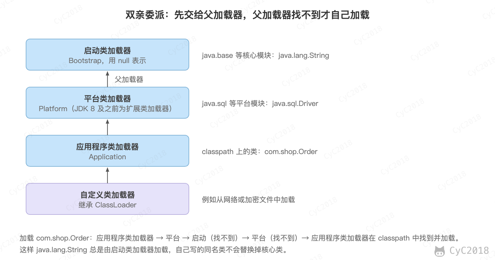 </div><br>

#### 1. 工作过程

一个类加载器首先将类加载请求转发到父类加载器，只有当父类加载器无法完成时才尝试自己加载。

#### 2. 好处

使得 Java 类随着它的类加载器一起具有一种带有优先级的层次关系，从而使得基础类得到统一。

例如 java.lang.Object 存放在 rt.jar 中，如果编写另外一个 java.lang.Object 并放到 ClassPath 中，程序可以编译通过。由于双亲委派模型的存在，所以在 rt.jar 中的 Object 比在 ClassPath 中的 Object 优先级更高，这是因为 rt.jar 中的 Object 使用的是启动类加载器，而 ClassPath 中的 Object 使用的是应用程序类加载器。rt.jar 中的 Object 优先级更高，那么程序中所有的 Object 都是这个 Object。

#### 3. 实现

以下是抽象类 java.lang.ClassLoader 的代码片段，其中的 loadClass() 方法运行过程如下：先检查类是否已经加载过，如果没有则让父类加载器去加载。当父类加载器加载失败时抛出 ClassNotFoundException，此时尝试自己去加载。

```java
public abstract class ClassLoader {
    // The parent class loader for delegation
    private final ClassLoader parent;

    public Class<?> loadClass(String name) throws ClassNotFoundException {
        return loadClass(name, false);
    }

    protected Class<?> loadClass(String name, boolean resolve) throws ClassNotFoundException {
        synchronized (getClassLoadingLock(name)) {
            // First, check if the class has already been loaded
            Class<?> c = findLoadedClass(name);
            if (c == null) {
                try {
                    if (parent != null) {
                        c = parent.loadClass(name, false);
                    } else {
                        c = findBootstrapClassOrNull(name);
                    }
                } catch (ClassNotFoundException e) {
                    // ClassNotFoundException thrown if class not found
                    // from the non-null parent class loader
                }

                if (c == null) {
                    // If still not found, then invoke findClass in order
                    // to find the class.
                    c = findClass(name);
                }
            }
            if (resolve) {
                resolveClass(c);
            }
            return c;
        }
    }

    protected Class<?> findClass(String name) throws ClassNotFoundException {
        throw new ClassNotFoundException(name);
    }
}
```

#### 4. 打破双亲委派

双亲委派的逻辑写在 loadClass() 中，只是一种约定。自定义类加载器重写 loadClass()，先自己加载，找不到再交给父加载器，就打破了双亲委派：

```java
@Override
protected Class<?> loadClass(String name, boolean resolve) throws ClassNotFoundException {
    synchronized (getClassLoadingLock(name)) {
        Class<?> c = findLoadedClass(name);
        if (c == null && !name.startsWith("java.")) {
            try {
                c = findClass(name);                 // 先在自己的目录中查找
            } catch (ClassNotFoundException ignored) {
            }
        }
        if (c == null) c = super.loadClass(name, false);   // 找不到再走双亲委派
        if (resolve) resolveClass(c);
        return c;
    }
}
```

需要打破双亲委派的常见场景：

- SPI：JDBC 的 DriverManager 由平台类加载器加载（JDK 8 中为启动类加载器），而 MySQL 驱动等实现类在 classpath 上，由应用类加载器加载，父加载器看不到子加载器中的类。DriverManager 通过 ServiceLoader 查找驱动，ServiceLoader 使用线程上下文类加载器（Thread.getContextClassLoader()，默认就是应用类加载器）加载实现类，相当于父加载器委托子加载器加载类；
- Tomcat：每个 Web 应用有自己的 WebappClassLoader，先在本应用的 /WEB-INF/classes 和 /WEB-INF/lib 中查找，找不到再交给父加载器，这样同一个 Tomcat 中的两个应用可以使用同一个库的不同版本；JDK 的核心类和 Servlet 等规范接口仍然先交给父加载器；
- 热部署：同一个类加载器不能重复定义同一个类，修改后的类要用新的类加载器加载，旧的加载器连同它加载的类一起丢弃，OSGi 等模块系统也为每个模块使用单独的加载器。

例如两个上面这样的类加载器分别从 v1、v2 目录加载同名的 Greeter 类，在同一个 JVM 中得到两个不同的 Class 对象，分别输出 Greeter v1 和 Greeter v2。打破双亲委派也不能替换 JDK 的核心类，defineClass() 拒绝定义 java. 开头的包中的类，抛出 SecurityException: Prohibited package name: java.lang（JDK 21 实测，见[附录 A7](#a7-打破双亲委派)）。

### 自定义类加载器实现

以下代码中的 FileSystemClassLoader 是自定义类加载器，继承自 java.lang.ClassLoader，用于加载文件系统上的类。它首先根据类的全名在文件系统上查找类的字节代码文件（.class 文件），然后读取该文件内容，最后通过 defineClass() 方法来把这些字节代码转换成 java.lang.Class 类的实例。

java.lang.ClassLoader 的 loadClass() 实现了双亲委派模型的逻辑，自定义类加载器一般不去重写它，但是需要重写 findClass() 方法。

```java
public class FileSystemClassLoader extends ClassLoader {

    private String rootDir;

    public FileSystemClassLoader(String rootDir) {
        this.rootDir = rootDir;
    }

    protected Class<?> findClass(String name) throws ClassNotFoundException {
        byte[] classData = getClassData(name);
        if (classData == null) {
            throw new ClassNotFoundException();
        } else {
            return defineClass(name, classData, 0, classData.length);
        }
    }

    private byte[] getClassData(String className) {
        String path = classNameToPath(className);
        try {
            InputStream ins = new FileInputStream(path);
            ByteArrayOutputStream baos = new ByteArrayOutputStream();
            int bufferSize = 4096;
            byte[] buffer = new byte[bufferSize];
            int bytesNumRead;
            while ((bytesNumRead = ins.read(buffer)) != -1) {
                baos.write(buffer, 0, bytesNumRead);
            }
            return baos.toByteArray();
        } catch (IOException e) {
            e.printStackTrace();
        }
        return null;
    }

    private String classNameToPath(String className) {
        return rootDir + File.separatorChar
                + className.replace('.', File.separatorChar) + ".class";
    }
}
```

## 五、线上问题排查

### JVM 调优

调优之前先明确目标：在线服务关心最长停顿时间，批处理任务关心吞吐量。大多数情况下先使用默认的 G1，开启 GC 日志观察，确实有问题再调整参数；线上的 GC 问题大多是代码造成的，例如内存泄漏、一次查询加载了太多数据，只调参数解决不了。

常用的参数：

| 参数 | 作用 |
| --- | --- |
| -Xms、-Xmx | 堆的初始大小和最大值，线上通常设为相同，避免运行中扩容和收缩 |
| -XX:MaxRAMPercentage | 不指定 -Xmx 时，最大堆占物理内存（容器中为容器的内存限制）的比例，默认 25% |
| -Xss | 每个线程的栈大小 |
| -XX:MaxMetaspaceSize | 元空间的上限，默认不限制 |
| -XX:+UseG1GC、-XX:+UseZGC | 选择垃圾收集器，JDK 9 起默认 G1 |
| -XX:MaxGCPauseMillis | G1 的停顿时间目标，默认 200 ms |
| -Xlog:gc*:file=gc.log | 输出 GC 日志（JDK 9 起；JDK 8 使用 -XX:+PrintGCDetails -Xloggc:gc.log） |
| -XX:+HeapDumpOnOutOfMemoryError | 内存溢出时保存堆转储 |

例如一个程序长期持有约 60 MB 的对象，同时不断创建短命的对象，用 G1 分别以 72 MB 和 256 MB 的堆运行（JDK 21 实测，见[附录 A4](#a4-堆大小对-g1-的影响)）：

| 堆大小 | 新生代回收 | Full GC | 停顿总时长 | 最长停顿 | 运行时间 |
| --- | --- | --- | --- | --- | --- |
| 72 MB | 454 次 | 6 次 | 168.1 ms | 5.88 ms | 398 ms |
| 256 MB | 43 次 | 0 次 | 42.7 ms | 1.22 ms | 317 ms |

堆太小时，存活的对象几乎占满了老年代，日志中反复出现 Pause Full (G1 Compaction Pause) 71M->27M(72M)：每次 Full GC 后仍有一半以上的空间被占用，很快又满了。

线上频繁 Full GC 的排查思路：

1. 用 jstat -gcutil 观察老年代使用率（O 列）和 Full GC 次数（FGC 列）；
2. Full GC 之后老年代使用率仍然很高，并且越来越高，说明对象一直无法回收，导出堆转储查找内存泄漏；
3. Full GC 之后老年代能降下来，说明堆对于正常的负载偏小，或者有大对象、大量对象过早进入老年代，可以增大堆、调整新生代大小，或者从代码上减少一次创建的数据量；
4. 元空间不足也会触发 Full GC，日志中的原因为 Metadata GC Threshold，检查是否在动态生成大量的类。

### 内存溢出与内存泄漏

OutOfMemoryError 的详细信息指明了是哪一块内存不足，常见的有：

- Java heap space：堆中无法再分配对象，可能是堆设置得太小，也可能是内存泄漏；
- GC overhead limit exceeded：GC 占用了约 98% 的时间，却只回收了不到 2% 的堆，说明存活的对象几乎占满了堆；
- Metaspace：加载的类太多，元空间超过了 MaxMetaspaceSize，常见于运行时动态生成大量的类，例如 CGLIB 生成代理类、Groovy 脚本每次执行都编译出新类，以及热部署时旧的类加载器仍被引用，它加载的类无法卸载。

例如每次都创建一个新的类加载器重新定义 Plugin 类，并把得到的 Class 对象保存在列表中，-XX:MaxMetaspaceSize=16m 时定义了约 2600 个类后抛出 OutOfMemoryError: Metaspace；不保存 Class 对象时，10 万次定义中有约 9.8 万个类被卸载，没有溢出（JDK 21 实测，见[附录 A8](#a8-元空间溢出)）。类只有在它的类加载器被回收后才能卸载，见 [方法区的回收](#3-方法区的回收)。

内存泄漏指的是对象已经不再使用，但仍然被引用着，GC 无法回收，堆内存持续增长，最终导致内存溢出。常见原因：

- 静态集合只添加不清理，例如用 static Map 做缓存却没有淘汰策略；
- 线程池中的线程使用 ThreadLocal 后没有调用 remove()，线程一直存活，值也一直无法被回收，见 [弱引用](#3-弱引用)；
- 连接、流等资源没有关闭；
- 注册的监听器、回调没有注销。

排查步骤：

1. 启动参数加上 -XX:+HeapDumpOnOutOfMemoryError，发生内存溢出时自动保存堆转储，用 -XX:HeapDumpPath 指定保存位置；进程还在运行时，可以用 jcmd <pid> GC.heap_dump <文件名> 手动导出；
2. 用 Eclipse MAT 等工具打开堆转储，找到占用内存最多的对象，查看它们到 GC Roots 的引用链，确定是谁持有了这些对象；
3. 引用链指向不应该存活的对象（例如上面的静态集合）就是内存泄漏，需要修改代码；否则说明确实需要这么多内存，应该增大堆或者减少一次加载的数据量。

例如下面的程序不断向静态列表中添加 1 MB 的数组，静态变量引用的对象属于 GC Roots，这些数组都无法被回收：

```java
public class Leak {
    static final List<byte[]> CACHE = new ArrayList<>();

    public static void main(String[] args) {
        while (true) {
            CACHE.add(new byte[1024 * 1024]);
        }
    }
}
```

```text
$ java -Xmx32m -XX:+HeapDumpOnOutOfMemoryError Leak
java.lang.OutOfMemoryError: Java heap space
Dumping heap to java_pid24607.hprof ...
Heap dump file created [19154891 bytes in 0.007 secs]
```

### CPU 占用过高

1. 用 top 找到 CPU 占用高的 Java 进程；
2. 用 top -H -p <pid> 查看这个进程中每个线程的 CPU 占用，记下占用最高的线程 ID；
3. 用 jstack <pid> 或者 jcmd <pid> Thread.print 导出所有线程的调用栈，按线程 ID 找到对应的线程；
4. 查看这个线程正在执行的代码，常见原因有死循环、频繁 GC（这时占用 CPU 的是 GC 线程）。

调用栈中的 nid 就是操作系统中的线程 ID。JDK 18 起 nid 以十进制显示，可以直接和 top 中的线程 ID 对应；更早的版本以 0x 开头的十六进制显示，需要先用 printf '%x\n' <线程 ID> 转换。JDK 11 起每个线程还带有累计占用的 CPU 时间 cpu=。例如一个执行死循环的线程：

```text
"busy-worker" #20 [26883] prio=5 os_prio=31 cpu=2148.39ms elapsed=2.15s tid=0x000000012f811200 nid=26883 runnable  [0x000000016dfda000]
   java.lang.Thread.State: RUNNABLE
        at Busy.lambda$main$0(Busy.java:3)
```

需要注意的是，Linux 的平均负载（load average，top 和 uptime 显示的三个数）统计的不只是正在运行和等待 CPU 的任务（R 状态），还包括不可中断睡眠的任务（D 状态，通常在等待磁盘 I/O）。所以 CPU 利用率低而负载很高时，通常是大量线程阻塞在 I/O 上，例如磁盘读写过慢、NFS 挂载无响应。这时 top 中的 wa（等待 I/O 的时间占比）和 vmstat 中的 b 列（阻塞在 I/O 上的进程数）偏高，可以用 ps -eLo stat,pid,tid,comm 找出状态为 D 的线程。

### 死锁

jstack 会自动检测死锁，在输出的末尾给出互相等待的线程，以及每个线程持有和等待的锁：

```text
Found one Java-level deadlock:
=============================
"t1":
  waiting to lock monitor 0x0000000140e63bb0 (object 0x000000061fc144c8, a java.lang.Object),
  which is held by "t2"

"t2":
  waiting to lock monitor 0x0000000141818190 (object 0x000000061fc144b8, a java.lang.Object),
  which is held by "t1"
```

后面还会列出这两个线程的调用栈，指出它们在哪一行获取锁。避免死锁的方法见 [计算机操作系统 - 死锁](计算机操作系统%20-%20死锁.md)。

## 附录：实测

以下实验的环境为 Apple M1 Pro（10 核）、macOS，JDK 为 Adoptium OpenJDK 21.0.13（Temurin）。GC 的停顿次数和时长从 -Xlog:gc 的日志中统计，统计的是所有 Pause 行。

### A1 默认的线程栈大小

```text
$ java -XX:+PrintFlagsFinal -version | grep ThreadStackSize
     intx ThreadStackSize                          = 2048                                   {pd product} {default}
```

### A2 逃逸分析

```java
record Point(int x, int y) {}

static long sum(int n) {
    long s = 0;
    for (int i = 0; i < n; i++) {
        Point p = new Point(i, i + 1);     // p 没有离开这个方法
        s += p.x() + p.y();
    }
    return s;
}
// main 中调用 20 次 sum(10_000_000)，共创建 2 亿个 Point
```

```text
$ java -Xlog:gc:file=esc-on.log Escape
2000000000000000，耗时 130 ms
$ grep -c Pause esc-on.log
0
$ java -XX:-DoEscapeAnalysis -Xlog:gc:file=esc-off.log Escape
2000000000000000，耗时 335 ms
$ grep -c Pause esc-off.log
13
```

### A3 不同收集器的停顿

测试程序分配 40 万个 1～5 KB 的数组，每 4 个中保留 1 个，保留的数组超过 3 万个时丢弃最早的 1.5 万个：

```java
for (int i = 0; i < 400_000; i++) {
    byte[] b = new byte[1024 + r.nextInt(4096)];
    if (i % 4 == 0) keep.add(b);
    if (keep.size() > 30_000) keep.subList(0, 15_000).clear();
}
```

```text
$ java -Xmx128m -Xms128m -XX:+UseSerialGC -Xlog:gc:file=UseSerialGC.log GCDemo（Parallel、G1 同理）
UseSerialGC：停顿 39 次（Young 31，Full 8），共 90.4 ms，最长 9.135 ms
UseParallelGC：停顿 75 次（Young 56，Full 19），共 96.8 ms，最长 5.157 ms
UseG1GC：停顿 84 次（Young 64，Full 0），共 40.0 ms，最长 2.011 ms
[0.020s][info][gc] GC(0) Pause Young (Normal) (G1 Evacuation Pause) 24M->6M(128M) 0.937ms

$ java -Xmx128m -Xms128m -XX:+UseZGC -XX:+ZGenerational -Xlog:gc+phases=info,gc=info:file=zgc-128m.log GCDemo
ZGC 128m：停顿 125 次，共 0.4 ms，最长 0.008 ms；Allocation Stall 41 次，共 93.5 ms，最长 6.1 ms
ZGC 512m：停顿 46 次，共 0.2 ms，最长 0.009 ms；Allocation Stall 0 次
[0.041s][info][gc       ] Allocation Stall (main) 0.162ms
```

### A4 堆大小对 G1 的影响

```java
Map<Integer, byte[]> sessions = new HashMap<>();   // 长期存活约 60 MB
for (int i = 0; i < 3_000_000; i++) {
    byte[] tmp = new byte[2048];                     // 短命对象
    if (i % 50 == 0) sessions.put(r.nextInt(30_000), new byte[2048]);
    tmp[0] = 1;
}
```

```text
$ java -Xmx72m -Xms72m -XX:+UseG1GC -Xlog:gc:file=tune-72m.log Tune
398 ms
G1 72m：停顿 512 次（Young 454，Full 6），共 168.1 ms，最长 5.877 ms
[0.127s][info][gc] GC(50) Pause Full (G1 Compaction Pause) 71M->27M(72M) 3.721ms
$ java -Xmx256m -Xms256m -XX:+UseG1GC -Xlog:gc:file=tune-256m.log Tune
317 ms
G1 256m：停顿 43 次（Young 43，Full 0），共 42.7 ms，最长 1.223 ms
```

### A5 ThreadLocalMap 的弱引用

用反射在当前线程的 ThreadLocalMap 中找到 value 为 session 的 Entry，运行时需要加上 --add-opens java.base/java.lang=ALL-UNNAMED：

```java
byte[] session = new byte[10 * 1024 * 1024];
ThreadLocal<byte[]> tl = new ThreadLocal<>();
tl.set(session);
tl = null;                                                  // 业务代码不再引用这个 ThreadLocal
System.gc();
for (int i = 1; i <= 64; i++) {
    new ThreadLocal<>().set(i);                             // 其它 ThreadLocal 的 set，每次之后检查 Entry，被清除时停止
}
```

```text
set 之后：     Entry 还在，key=java.lang.ThreadLocal@31befd9f，value 还被引用
GC 之后：      Entry 还在，key=null，value 还被引用
第 2 次 set 后：Entry 已被清除
```

运行 3 次，都是在第 2 次 set() 之后被清除。

### A6 默认的收集器与 G1 的 Region 大小

本机有 10 个处理器，-XX:ActiveProcessorCount=1 让 JVM 认为只有 1 个处理器：

```text
$ java -XX:+PrintFlagsFinal -version | grep -E "Use(Serial|Parallel|G1|Z)GC " | awk '$4=="true"{print $2}'
UseG1GC
$ java -XX:ActiveProcessorCount=1 -XX:+PrintFlagsFinal -version | grep -E "Use(Serial|Parallel|G1|Z)GC " | awk '$4=="true"{print $2}'
UseSerialGC
```

不同最大堆下的 G1HeapRegionSize（字节）：

```text
-Xmx128m: 1048576
-Xmx1g:   1048576
-Xmx4g:   2097152
-Xmx16g:  8388608
-Xmx64g:  33554432
$ java -Xmx1g -XX:G1HeapRegionSize=64m -XX:+PrintFlagsFinal -version | grep -w G1HeapRegionSize
   size_t G1HeapRegionSize                         = 67108864                                  {product} {command line}
$ java -Xmx1g -XX:G1HeapRegionSize=3m -XX:+PrintFlagsFinal -version | grep -w G1HeapRegionSize
   size_t G1HeapRegionSize                         = 4194304                                   {product} {command line, ergonomic}
$ java -Xmx4g -Xlog:gc+init -version
[0.005s][info][gc,init] Heap Region Size: 2M
```

指定 3m 时向上取为 4 MB。

### A7 打破双亲委派

DemoDriver 实现了 java.sql.Driver，在静态语句块中向 DriverManager 注册自己，并在 META-INF/services/java.sql.Driver 中登记；v1、v2 目录中各有一个 Greeter.class，hello() 分别返回 Greeter v1 和 Greeter v2；ChildFirstLoader 的 loadClass() 即正文中的代码：

```java
System.out.println("DriverManager 的加载器: " + DriverManager.class.getClassLoader());
System.out.println("线程上下文类加载器:     " + Thread.currentThread().getContextClassLoader());
Driver d = DriverManager.getDriver("jdbc:demo:orders");
System.out.println("找到的驱动 " + d.getClass().getName() + "，加载器: " + d.getClass().getClassLoader());

ClassLoader app = BreakDemo.class.getClassLoader();
Class<?> g1 = new ChildFirstLoader(Path.of("../v1"), app).loadClass("Greeter");
Class<?> g2 = new ChildFirstLoader(Path.of("../v2"), app).loadClass("Greeter");

// 用一个普通的类加载器把 Greeter 的字节码定义为 java.lang.Greeter
new ClassLoader(app) {
    Class<?> def() { return defineClass("java.lang.Greeter", b, 0, b.length); }
}.def();
```

```text
DriverManager 的加载器: jdk.internal.loader.ClassLoaders$PlatformClassLoader@55f96302
线程上下文类加载器:     jdk.internal.loader.ClassLoaders$AppClassLoader@2c854dc5
找到的驱动 DemoDriver，加载器: jdk.internal.loader.ClassLoaders$AppClassLoader@2c854dc5
Greeter v1 / Greeter v2，g1 == g2: false
java.lang.SecurityException: Prohibited package name: java.lang
```

### A8 元空间溢出

```java
static class OneShotLoader extends ClassLoader {
    Class<?> define(byte[] b) { return defineClass("Plugin", b, 0, b.length); }
}

byte[] bytes = Files.readAllBytes(Path.of("Plugin.class"));
List<Class<?>> loaded = new ArrayList<>();
while (true) loaded.add(new OneShotLoader().define(bytes));   // MetaLeak：一直持有，类无法卸载

for (int i = 0; i < 100_000; i++) new OneShotLoader().define(bytes);   // MetaNoLeak：不持有
```

```text
$ java -XX:MaxMetaspaceSize=16m MetaLeak
加载了 2639 个 Plugin 类后：Metaspace
$ java -XX:MaxMetaspaceSize=16m -Xlog:class+unload=info:file=unload.log MetaNoLeak
加载了 100000 个 Plugin 类，没有溢出
$ grep -c "unloading class Plugin" unload.log
97643
```

## 参考资料

- [Troubleshooting Memory Leaks (Java SE 21)](https://docs.oracle.com/en/java/javase/21/troubleshoot/troubleshooting-memory-leaks.html)
- [JDK-8268425: Show decimal nid of OSThread instead of hex format one](https://bugs.openjdk.org/browse/JDK-8268425)
- [JDK-8200720: Print additional information in thread dump](https://bugs.openjdk.org/browse/JDK-8200720)
- 周志明. 深入理解 Java 虚拟机 [M]. 机械工业出版社, 2011.
- [Chapter 2. The Structure of the Java Virtual Machine](https://docs.oracle.com/javase/specs/jvms/se8/html/jvms-2.html#jvms-2.5.4)
- [Jvm memory](https://www.slideshare.net/benewu/jvm-memory)
- [Getting Started with the G1 Garbage Collector](http://www.oracle.com/webfolder/technetwork/tutorials/obe/java/G1GettingStarted/index.html)
- [JNI Part1: Java Native Interface Introduction and “Hello World” application](http://electrofriends.com/articles/jni/jni-part1-java-native-interface/)
- [Memory Architecture Of JVM(Runtime Data Areas)](https://hackthejava.wordpress.com/2015/01/09/memory-architecture-by-jvmruntime-data-areas/)
- [Android on x86: Java Native Interface and the Android Native Development Kit](https://web.archive.org/web/20240706002000/https://www.drdobbs.com/architecture-and-design/android-on-x86-java-native-interface-and/240166271)
- [深入理解 JVM(2)——GC 算法与内存分配策略](https://web.archive.org/web/20201120232823/https://crowhawk.github.io/2017/08/10/jvm_2/)
- [深入理解 JVM(3)——7 种垃圾收集器](https://web.archive.org/web/20201120232823/https://crowhawk.github.io/2017/08/15/jvm_3/)
- [JVM Internals](http://blog.jamesdbloom.com/JVMInternals.html)
- [深入探讨 Java 类加载器](https://www.ibm.com/developerworks/cn/java/j-lo-classloader/index.html#code6)
- [Guide to WeakHashMap in Java](http://www.baeldung.com/java-weakhashmap)
- [Tomcat example source code file (ConcurrentCache.java)](https://alvinalexander.com/java/jwarehouse/apache-tomcat-6.0.16/java/org/apache/el/util/ConcurrentCache.java.shtml)
- [Garbage-First (G1) Garbage Collector | Java SE 17 GC Tuning Guide](https://docs.oracle.com/en/java/javase/17/gctuning/garbage-first-g1-garbage-collector1.html)
- [The Z Garbage Collector | Java SE 21 GC Tuning Guide](https://docs.oracle.com/en/java/javase/21/gctuning/z-garbage-collector2.html)
- [JEP 439: Generational ZGC](https://openjdk.org/jeps/439)
- [JEP 490: ZGC: Remove the Non-Generational Mode](https://openjdk.org/jeps/490)
- [JEP 421: Deprecate Finalization for Removal](https://openjdk.org/jeps/421)
- [JEP 363: Remove the Concurrent Mark Sweep (CMS) Garbage Collector](https://openjdk.org/jeps/363)
- [JEP 379: Shenandoah: A Low-Pause-Time Garbage Collector (Production)](https://openjdk.org/jeps/379)
- [JEP 248: Make G1 the Default Garbage Collector](https://openjdk.org/jeps/248)
- [JEP 523: Make G1 the Default Garbage Collector in All Environments](https://openjdk.org/jeps/523)
- [Ergonomics | Java SE 8 HotSpot Virtual Machine Garbage Collection Tuning Guide](https://docs.oracle.com/javase/8/docs/technotes/guides/vm/gctuning/ergonomics.html)
- [JDK 18 Release Notes: Allow G1 Heap Regions up to 512MB](https://www.oracle.com/java/technologies/javase/18-relnote-issues.html)
- [Eclipse Memory Analyzer: Garbage Collection Roots](https://help.eclipse.org/latest/topic/org.eclipse.mat.ui.help/concepts/gcroots.html)
- [Apache Tomcat 10.1: Class Loader How-To](https://tomcat.apache.org/tomcat-10.1-doc/class-loader-howto.html)
- [JDK 21 源码：ThreadLocal.java](https://github.com/openjdk/jdk21u/blob/master/src/java.base/share/classes/java/lang/ThreadLocal.java)
- [JDK 21 源码：ServiceLoader.java](https://github.com/openjdk/jdk21u/blob/master/src/java.base/share/classes/java/util/ServiceLoader.java)
- [proc_loadavg(5) — Linux manual page](https://man7.org/linux/man-pages/man5/proc_loadavg.5.html)
- [vmstat(8) — Linux manual page](https://man7.org/linux/man-pages/man8/vmstat.8.html)
