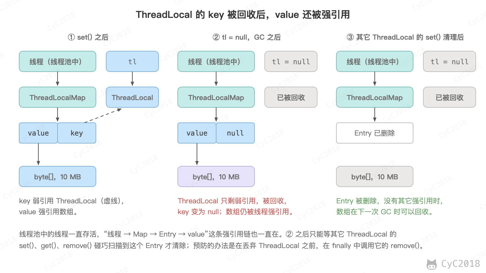
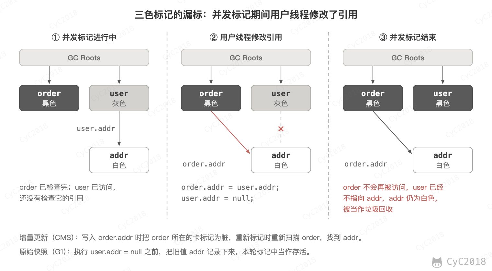
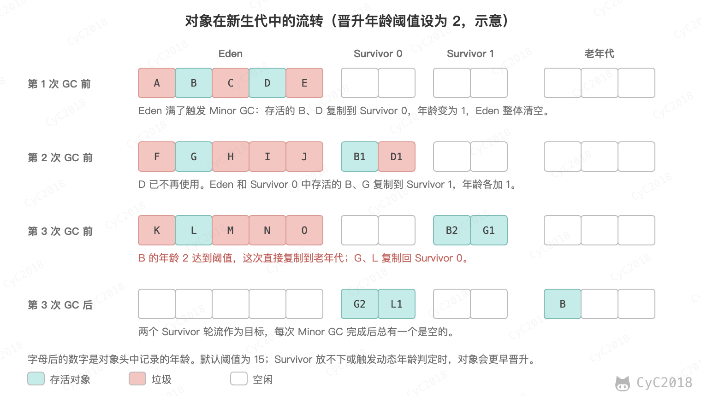
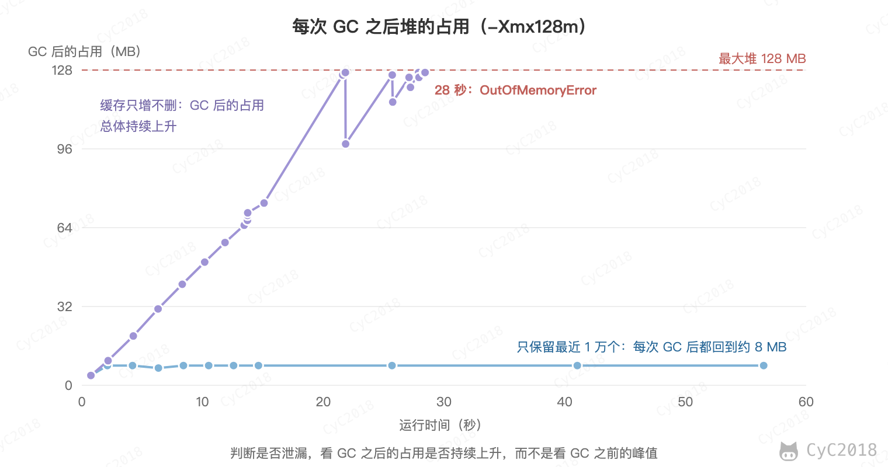

# Java 虚拟机
<!-- GFM-TOC -->
* [Java 虚拟机](#java-虚拟机)
    * [一、运行时数据区域](#一运行时数据区域) 🔥🔥
        * [程序计数器](#程序计数器)
        * [Java 虚拟机栈](#java-虚拟机栈)
        * [本地方法栈](#本地方法栈)
        * [堆](#堆)
        * [方法区](#方法区)
        * [运行时常量池](#运行时常量池)
        * [直接内存](#直接内存)
        * [堆和栈的区别](#堆和栈的区别)
        * [对象的创建与内存布局](#对象的创建与内存布局)
    * [二、垃圾收集](#二垃圾收集) 🔥🔥
        * [判断一个对象是否可被回收](#判断一个对象是否可被回收)
        * [引用类型](#引用类型)
        * [垃圾收集算法](#垃圾收集算法)
        * [Stop The World](#stop-the-world)
        * [垃圾收集器](#垃圾收集器)
        * [三色标记](#三色标记)
    * [三、内存分配与回收策略](#三内存分配与回收策略)
        * [Minor GC 和 Full GC](#minor-gc-和-full-gc) 🔥
        * [内存分配策略](#内存分配策略)
        * [Full GC 的触发条件](#full-gc-的触发条件)
    * [四、类加载机制](#四类加载机制)
        * [类的生命周期](#类的生命周期)
        * [类加载过程](#类加载过程)
        * [类初始化时机](#类初始化时机)
        * [类与类加载器](#类与类加载器)
        * [类加载器分类](#类加载器分类)
        * [双亲委派模型](#双亲委派模型) 🔥
        * [自定义类加载器实现](#自定义类加载器实现)
    * [五、线上问题排查](#五线上问题排查)
        * [内存溢出与内存泄漏](#内存溢出与内存泄漏) 🔥🔥
        * [JVM 调优](#jvm-调优) 🔥
        * [CPU 占用过高](#cpu-占用过高) 🔥
        * [死锁](#死锁)
    * [附录：实测](#附录实测)
        * [A1 默认的线程栈大小](#a1-默认的线程栈大小)
        * [A2 逃逸分析](#a2-逃逸分析)
        * [A3 不同收集器的停顿](#a3-不同收集器的停顿)
        * [A4 堆大小对 G1 的影响](#a4-堆大小对-g1-的影响)
        * [A5 ThreadLocalMap 的弱引用](#a5-threadlocalmap-的弱引用)
        * [A6 默认的收集器与 G1 的 Region 大小](#a6-默认的收集器与-g1-的-region-大小)
        * [A7 打破双亲委派](#a7-打破双亲委派)
        * [A8 元空间溢出](#a8-元空间溢出)
        * [A9 G1 的标记周期与安全点](#a9-g1-的标记周期与安全点)
        * [A10 直接内存与线程数的溢出](#a10-直接内存与线程数的溢出)
        * [A11 堆直方图](#a11-堆直方图)
        * [A12 泄漏时 GC 之后的占用](#a12-泄漏时-gc-之后的占用)
        * [A13 软引用的清除时机](#a13-软引用的清除时机)
        * [A14 System.gc() 与直接内存](#a14-systemgc-与直接内存)
        * [A15 元空间触发的 GC](#a15-元空间触发的-gc)
        * [A16 动态对象年龄判定](#a16-动态对象年龄判定)
        * [A17 堆转储目录不存在](#a17-堆转储目录不存在)
        * [A18 堆的分代划分](#a18-堆的分代划分)
        * [A19 GC 时间的占比](#a19-gc-时间的占比)
        * [A20 线程栈中的 CPU 时间](#a20-线程栈中的-cpu-时间)
        * [A21 堆以外的内存](#a21-堆以外的内存)
        * [A22 容器中的默认堆](#a22-容器中的默认堆)
        * [A23 等待连接池时的线程栈](#a23-等待连接池时的线程栈)
    * [参考资料](#参考资料)
<!-- GFM-TOC -->


本文大部分内容参考周志明《深入理解 Java 虚拟机》，想要深入学习的话请看原书。

## 一、运行时数据区域 🔥🔥

<div align="center">  </div><br>

程序计数器、Java 虚拟机栈和本地方法栈是线程私有的，随线程创建和销毁；堆和方法区被所有线程共享。除了程序计数器，JVM 规范为其它区域都规定了抛出 OutOfMemoryError 的情况，两种栈还可能抛出 StackOverflowError。

需要注意的是，面试中说的“JVM 内存模型”通常指这里的运行时数据区域，而 Java 内存模型（Java Memory Model, JMM）规定的是多个线程读写共享变量时的可见性和顺序，见 [Java 内存模型](Java%20并发.md#十java-内存模型)。

### 程序计数器

记录正在执行的虚拟机字节码指令的地址。如果正在执行的是本地方法，它的值是未定义的。

线程被切换出去再切换回来时，要从原来的位置继续执行，所以每个线程都有自己的程序计数器。

### Java 虚拟机栈

每个 Java 方法在执行的同时会创建一个栈帧，用于存储局部变量表、操作数栈、动态链接和方法返回地址等信息。栈帧中保存着指向当前方法所属类的运行时常量池的引用，用于支持动态链接：在运行时把常量池中方法和字段的符号引用解析为实际的方法入口和字段位置。从方法调用直至执行完成的过程，对应着一个栈帧在 Java 虚拟机栈中入栈和出栈的过程。

<div align="center">  </div><br>

可以通过 -Xss 这个虚拟机参数来指定每个线程的 Java 虚拟机栈内存大小，默认值与平台有关，x86-64 的 Linux 上为 1 MB，ARM64 的 Linux 上为 2040 KB，macOS（Apple 芯片）上为 2 MB（-XX:+PrintFlagsFinal 中的 ThreadStackSize，见[附录 A1](#a1-默认的线程栈大小) 和[附录 A10](#a10-直接内存与线程数的溢出) 中的 stacksize）：

```bash
java -Xss2M HackTheJava
```

该区域可能抛出以下异常：

- 当线程请求的栈深度超过最大值，会抛出 StackOverflowError 异常，例如没有终止条件的递归；
- 栈进行动态扩展时如果无法申请到足够内存，会抛出 OutOfMemoryError 异常。HotSpot 中平台线程的栈大小在创建时就固定了，这类错误出现在创建平台线程时，见 [内存溢出与内存泄漏](#内存溢出与内存泄漏) 中的 unable to create native thread。

### 本地方法栈

本地方法栈与 Java 虚拟机栈类似，它们之间的区别只不过是本地方法栈为本地方法服务。

本地方法一般是用其它语言（C、C++ 或汇编语言等）编写的，并且被编译为基于本机硬件和操作系统的程序，对待这些方法需要特别处理。

<div align="center">  </div><br>

### 堆

几乎所有对象都在这里分配内存（例外见下文的逃逸分析），是垃圾收集的主要区域（“GC 堆”）。

现代的垃圾收集器基本都是采用分代收集算法，其主要的思想是针对不同类型的对象采取不同的垃圾收集算法。可以将堆分成两块：

- 新生代（Young Generation）
- 老年代（Old Generation）

Serial 收集器把新生代分为一个 Eden 和两个 Survivor，新生代默认占堆的 1/3（NewRatio=2），Eden 与两个 Survivor 为 8:1:1（SurvivorRatio=8），例如 300 MB 的堆中 Eden 约 81 MB、每个 Survivor 约 10 MB（JDK 21 实测，见[附录 A18](#a18-堆的分代划分)）；G1 的新生代由若干 Eden Region 和 Survivor Region 组成，数量随停顿时间目标动态调整。为什么这样划分见 [分代收集](#4-分代收集)。

堆不需要连续内存，并且可以动态增加其内存，增加失败会抛出 OutOfMemoryError 异常。

可以通过 -Xms 和 -Xmx 这两个虚拟机参数来指定一个程序的堆内存大小，第一个参数设置初始值，第二个参数设置最大值。

```bash
java -Xms1M -Xmx2M HackTheJava
```

### 方法区

用于存放已被加载的类信息、常量、静态变量、即时编译器编译后的代码等数据。

和堆一样不需要连续的内存，并且可以动态扩展，动态扩展失败一样会抛出 OutOfMemoryError 异常。

对这块区域进行垃圾收集的主要目标是对常量池的回收和对类的卸载，但是一般比较难实现。

JDK 1.8 之前，HotSpot 虚拟机用永久代实现方法区，和堆一样进行垃圾收集。但永久代的上限要在启动时用 -XX:MaxPermSize 设定，加载多少类很难事先估准，设小了就会抛出 OutOfMemoryError: PermGen space。为了更容易管理方法区，同时与没有永久代的 JRockit 虚拟机合并，从 JDK 1.8 开始，移除永久代，并把方法区移至元空间，它位于本地内存中，不属于 Java 堆。元空间默认只受本地内存限制，可以用 -XX:MaxMetaspaceSize 设置上限，超过时抛出 OutOfMemoryError: Metaspace。

方法区是 JVM 规范中的概念，永久代与元空间都是它的实现。JDK 1.7 已经把字符串常量池和类的静态变量从永久代移到了堆中，所以元空间中存放的是类的元信息和运行时常量池；JIT 编译后的代码则在单独的代码缓存（Code Cache）中。例如 static final String NAME = "cs"：字符串 "cs" 和静态变量 NAME 都在堆中，元空间中是字段名、类型这些元数据。

### 运行时常量池

运行时常量池是方法区的一部分。

Class 文件中的常量池（编译器生成的字面量和符号引用）会在类加载后被放入这个区域。

除了在编译期生成的常量，还允许在运行期间放入新的常量。需要注意的是，JDK 7 起字符串常量池已经移到堆中，String 类的 intern() 操作的是堆中的字符串常量池，见 [String Pool](Java%20基础.md#string-pool)。

### 直接内存

在 JDK 1.4 中新引入了 NIO 类，它可以使用 Native 函数库直接分配堆外内存，然后通过 Java 堆里的 DirectByteBuffer 对象作为这块内存的引用进行操作。这样能在一些场景中显著提高性能，因为避免了在堆内存和堆外内存来回拷贝数据。

直接内存不属于 JVM 规范定义的运行时数据区域，但同样会耗尽：它的上限由 -XX:MaxDirectMemorySize 设置，没有设置时与最大堆相同，超出时抛出 OutOfMemoryError，见 [内存溢出与内存泄漏](#内存溢出与内存泄漏)。堆外内存不由 GC 直接回收，DirectByteBuffer 对象被回收后，由它关联的 Cleaner 释放对应的堆外内存。

### 堆和栈的区别

- 存放的内容：虚拟机栈中是方法调用的栈帧，保存局部变量、操作数和返回地址；堆中是对象和数组，JDK 7 起静态变量和字符串常量池也在堆中；
- 共享范围：每个线程有自己的栈，其它线程访问不到；堆被所有线程共享，所以只有堆中的对象才存在线程安全问题；
- 生命周期：栈帧在方法调用时创建、返回时销毁，不需要垃圾收集；堆中的对象由垃圾收集器回收；
- 大小和异常：栈的大小由 -Xss 设置，调用层次太深时抛出 StackOverflowError；堆的大小由 -Xms、-Xmx 设置，放不下时抛出 OutOfMemoryError。

```java
void pay(long orderId) {
    int amount = 100;                    // 基本类型的局部变量，值在栈帧中
    Order order = new Order(orderId);    // 引用 order 在栈帧中，Order 对象在堆中
}
```

方法返回后，栈帧中的 amount 和 order 立即消失；Order 对象如果没有被其它地方引用，会在之后的 GC 中被回收。操作系统中[进程地址空间](计算机操作系统%20-%20内存管理.md#分页与分段的比较)的栈和堆也是类似的划分：栈由编译器生成的代码自动分配和释放，函数返回时局部变量就被释放，不会泄漏；堆由程序调用 malloc、free 管理，申请后忘记 free 就是内存泄漏。

需要注意的是，对象不一定都要在堆中分配。JIT 编译时会做逃逸分析，如果能证明一个对象不会离开创建它的方法（没有被返回、没有赋给字段、没有传给其它线程），C2 编译器可以把它拆成几个局部变量，这称为标量替换，堆中不再分配这个对象；这不是把整个对象搬到栈上。例如在循环中创建 2 亿个只在方法内部使用的 Point 对象，默认没有发生 GC，耗时约 130 ms；加上 -XX:-DoEscapeAnalysis 关闭逃逸分析后，发生了 13 次 GC，耗时约 335 ms（JDK 21 实测，见[附录 A2](#a2-逃逸分析)）。

### 对象的创建与内存布局

执行 new Order() 时，虚拟机依次完成以下步骤：

1. 类加载检查：如果 Order 类还没有加载或初始化，先执行 [类加载过程](#类加载过程)，静态语句块在这一步执行；
2. 分配内存：对象的大小在类加载完成后就确定了。堆中的内存规整时，只需把空闲位置的指针向后移动对象大小的距离（指针碰撞），有碎片时从空闲列表中找一块；为了避免多个线程同时分配时加锁，每个线程先在 Eden 中领取一小块私有的缓冲区（Thread Local Allocation Buffer, TLAB），在其中分配；
3. 初始化零值：把实例字段都设为 0、false 或 null，所以字段不赋值也有默认值；
4. 设置对象头：写入 Mark Word 和指向类元数据的类型指针；
5. 执行构造函数：按照代码给字段赋值。

对象在堆中由对象头、实例数据和对齐填充三部分组成。用 JOL 在 JDK 21 上查看（64 位，默认开启压缩指针），其中 Order 依次声明了 boolean paid、int userId、long id 和 String note 四个字段：

```text
java.lang.Object
OFF  SZ  DESCRIPTION
  0   8  (object header: mark)
  8   4  (object header: class)
 12   4  (object alignment gap)
Instance size: 16 bytes

Order
OFF  SZ  DESCRIPTION
  0   8  (object header: mark)
  8   4  (object header: class)
 12   4  int Order.userId
 16   8  long Order.id
 24   1  boolean Order.paid
 25   3  (alignment/padding gap)
 28   4  java.lang.String Order.note
Instance size: 32 bytes
```

- 对象头：Mark Word 占 8 字节，存放哈希码、GC 年龄和锁状态，见 [锁优化](Java%20并发.md#十二锁优化)；类型指针占 4 字节，指向对象所属的类；数组还要多 4 字节记录长度；
- 实例数据：字段不按声明的顺序排列，虚拟机会重排以减少空隙，例如 userId 被放进了对象头后面 4 字节的空位；
- 对齐填充：对象的大小必须是 8 字节的整数倍，new Object() 只有 12 字节的对象头，要补齐到 16 字节。

以上是 JDK 21 的布局。JDK 27 起默认使用紧凑对象头（JEP 534）：压缩后的类型指针放进 Mark Word 的高 22 位，对象头只有 8 字节，new Object() 也只占 8 字节，可以用 -XX:-UseCompactObjectHeaders 关闭。

在 JDK 21 中关闭压缩指针（-XX:-UseCompressedOops -XX:-UseCompressedClassPointers）后，类型指针和 note 引用都变成 8 字节，Order 从 32 字节变成 40 字节。压缩指针用 32 位存放对象地址，因为对象按 8 字节对齐，地址的低 3 位总是 0，可以省略，所以最多能表示 2<sup>32</sup> × 8 = 32 GB 的堆。最大堆接近 32 GB 时，对象引用的压缩自动关闭，所有引用都变成 8 字节（JDK 21 中 -Xmx32736m 时 UseCompressedOops 为 true，-Xmx32737m 时为 false，类型指针的压缩不受影响），这是堆的大小通常小于 32 GB 的原因。JDK 27 起类型指针总是压缩，-XX:-UseCompressedClassPointers 会被忽略。

## 二、垃圾收集 🔥🔥

垃圾收集主要是针对堆和方法区进行。程序计数器、虚拟机栈和本地方法栈这三个区域属于线程私有的，只存在于线程的生命周期内，线程结束之后就会消失，因此不需要对这三个区域进行垃圾收集。

垃圾收集要回答三个问题：哪些对象可以回收、怎么回收、什么时候回收。HotSpot 用可达性分析找出从 GC Roots 出发不可达的对象；按存活时间把堆分成新生代和老年代，分别用复制和标记 - 整理等算法；Eden 满时进行 Minor GC，老年代空间不足时进行 Full GC 或者并发的老年代回收，见 [三、内存分配与回收策略](#三内存分配与回收策略)。例如处理一次请求时创建的临时对象，请求结束后就不可达，下一次 Minor GC 随 Eden 一起清空；缓存中的对象熬过多次 Minor GC，被复制到老年代，之后只在回收老年代时才检查它。

### 判断一个对象是否可被回收

#### 1. 引用计数算法

为对象添加一个引用计数器，当对象增加一个引用时计数器加 1，引用失效时计数器减 1。引用计数为 0 的对象可被回收。

在两个对象出现循环引用的情况下，此时引用计数器永远不为 0，导致无法对它们进行回收。正是因为循环引用的存在，因此 Java 虚拟机不使用引用计数算法。

```java
public class Test {

    public Object instance = null;

    public static void main(String[] args) {
        Test a = new Test();
        Test b = new Test();
        a.instance = b;
        b.instance = a;
        a = null;
        b = null;
        doSomething();
    }
}
```

在上述代码中，a 与 b 引用的对象实例互相持有了对象的引用，因此把对 a 对象与 b 对象的引用去除之后，由于两个对象还存在互相之间的引用，采用引用计数时两个 Test 对象都无法被回收。

#### 2. 可达性分析算法

以 GC Roots 为起始点进行搜索，可达的对象都是存活的，不可达的对象可被回收。

Java 虚拟机使用该算法来判断对象是否可被回收。

GC Roots 是堆外指向堆中对象的引用，程序不经过其它对象就能直接访问到它们，GC 无法判断这些引用以后还会不会被使用，只能认为它们引用的对象都存活。GC Roots 一般包含以下内容：

- 虚拟机栈中局部变量表中引用的对象，即正在执行的方法的参数和局部变量；
- 本地方法栈中 JNI 中引用的对象；
- 方法区中类静态属性引用的对象，类没有被卸载时，程序随时可以通过类名访问它们；
- 方法区中的常量引用的对象；
- 被 synchronized 持有的锁对象、已经启动且没有结束的线程，以及虚拟机内部的引用，例如系统类加载器、常驻的异常对象。

<div align="center">  </div><br>


#### 3. 方法区的回收

方法区中的类和常量很少变成垃圾，回收的收益比新生代低很多，所以在方法区上进行回收性价比不高。

主要是对常量池的回收和对类的卸载。

为了避免内存溢出，在大量使用反射和动态代理的场景都需要虚拟机具备类卸载功能。

类的卸载条件很多，需要满足以下三个条件，并且满足了条件也不一定会被卸载：

- 该类所有的实例都已经被回收，此时堆中不存在该类的任何实例；
- 加载该类的 ClassLoader 已经不可达，可以被回收，所以启动类加载器加载的类不会被卸载；
- 该类对应的 Class 对象没有在任何地方被引用，也就无法在任何地方通过反射访问该类方法。

#### 4. finalize()

类似 C++ 的析构函数，用于关闭外部资源。但是 try-finally 等方式可以做得更好，并且该方法运行代价很高，不确定性大，无法保证各个对象的调用顺序，因此最好不要使用。finalize() 从 JDK 9 起已经废弃，JDK 18 起标记为将要删除，需要在对象被回收后清理资源时可以使用 java.lang.ref.Cleaner。

当一个对象可被回收时，如果需要执行该对象的 finalize() 方法，那么就有可能在该方法中让对象重新被引用，从而实现自救。自救只能进行一次，如果回收的对象之前调用了 finalize() 方法自救，后面回收时不会再调用该方法。

### 引用类型

无论是通过引用计数算法判断对象的引用数量，还是通过可达性分析算法判断对象是否可达，判定对象是否可被回收都与引用有关。

Java 提供了四种强度不同的引用类型。

#### 1. 强引用

从 GC Roots 出发沿强引用可达的对象不会被回收；两个对象只是互相强引用、从 GC Roots 不可达时，仍然会被回收。

使用 new 一个新对象的方式来创建强引用。

```java
Object obj = new Object();
```

#### 2. 软引用

内存不足、即将抛出 OutOfMemoryError 之前，只被软引用关联的对象一定会被回收；其它时候由 GC 决定，并不是内存够用就一定保留。HotSpot 按最近一次访问的时间淘汰：一个软引用超过“最大堆中空闲的 MB 数 × 1 秒”没有被 get() 访问，就会在 GC 时被清除，例如空闲 250 MB 时约 4 分钟，每 MB 对应的时间由 -XX:SoftRefLRUPolicyMSPerMB 设置（JDK 21 实测，见[附录 A13](#a13-软引用的清除时机)）。所以用软引用做缓存时，内存充足也可能被清掉。

使用 SoftReference 类来创建软引用。

```java
Object obj = new Object();
SoftReference<Object> sf = new SoftReference<Object>(obj);
obj = null;  // 使对象只被软引用关联
```

#### 3. 弱引用

只被弱引用关联的对象一定会被回收，它只能存活到下一次回收它所在区域的垃圾收集之前。

使用 WeakReference 类来创建弱引用。

```java
Object obj = new Object();
WeakReference<Object> wf = new WeakReference<Object>(obj);
obj = null;
```

ThreadLocal 就用到了弱引用。每个线程的 ThreadLocalMap 中，Entry 继承自 WeakReference，key（ThreadLocal 对象）是弱引用，value 是强引用。如果 key 是强引用，业务代码不再使用某个 ThreadLocal 后，它仍然被线程的 Map 引用着，线程池中的线程一直存活，这个 ThreadLocal 对象和它的 value 都无法回收。

key 改为弱引用后，ThreadLocal 对象在下一次 GC 时被回收，Entry 的 key 变为 null。之后这个线程再调用任意 ThreadLocal 的 set()、get()、remove() 时，会顺带清除遇到的一部分 key 为 null 的 Entry，value 才能被回收。在此之前 value 一直被强引用，所以用完之后仍然要调用 remove()，见 [线程本地存储](Java%20并发.md#2-线程本地存储thread-local-storage)。

例如向 ThreadLocal 放入一个 10 MB 的数组，再把 ThreadLocal 变量置为 null：GC 之后 Entry 的 key 变为 null，value 还在；当前线程再通过其它 ThreadLocal 调用 set()，第 2 次调用之后这个 Entry 才被清除（JDK 21 实测，见[附录 A5](#a5-threadlocalmap-的弱引用)）。

<div align="center">  </div><br>

#### 4. 虚引用

又称为幽灵引用或者幻影引用，一个对象是否有虚引用的存在，不会对其生存时间造成影响，也无法通过虚引用得到一个对象。

为一个对象设置虚引用的唯一目的是能在这个对象被回收时收到一个系统通知。虚引用需要和引用队列（ReferenceQueue）配合使用，对象被回收时虚引用会被加入队列，程序通过检查队列得知回收的发生。虚引用的 get() 方法总是返回 null。

使用 PhantomReference 来创建虚引用。

```java
Object obj = new Object();
ReferenceQueue<Object> queue = new ReferenceQueue<Object>();
PhantomReference<Object> pf = new PhantomReference<Object>(obj, queue);
obj = null;
```

### 垃圾收集算法

#### 1. 标记 - 清除

<div align="center">  </div><br>

标记阶段从 GC Roots 出发，给所有存活的对象打上标记；清除阶段遍历整个堆，把没有标记的对象占用的内存加入空闲链表，与相邻的空闲块合并。之后分配对象时，从空闲链表中找一块足够大的，多出来的部分放回链表。

不足：

- 标记和清除都要处理大量对象，堆越大越慢；
- 会产生大量不连续的内存碎片，空闲内存的总量足够，也可能放不下一个大对象。

#### 2. 标记 - 整理

<div align="center">  </div><br>

标记之后，让所有存活的对象都向一端移动，然后直接清理掉端边界以外的内存。

优点：不会产生内存碎片。

不足：要搬移对象，还要修改所有指向它们的引用，而且搬移时用户线程不能同时访问这些对象。

两者的区别在于是否移动对象：标记 - 清除不移动，容易与用户线程并发进行，代价是碎片和较慢的分配；标记 - 整理消除了碎片，之后分配只需移动指针。例如追求低停顿的 CMS 用标记 - 清除，追求吞吐量的 Parallel Old 用标记 - 整理。

#### 3. 复制

<div align="center">  </div><br>

将内存划分为大小相等的两块，每次只使用其中一块，当这一块内存用完了就将还存活的对象复制到另一块上面，然后再把使用过的内存空间进行一次清理。

复制不需要单独的标记阶段：从 GC Roots 出发沿引用遍历，边遍历边复制，旧对象头里记下新地址，避免重复复制。遍历完后原来的一半整块清空，所以耗时只与存活对象的多少有关。

主要不足是只使用了内存的一半。

Serial、ParNew 和 Parallel Scavenge 用复制算法回收新生代，但不是划分为两个等大的半区，而是一块较大的 Eden 和两块较小的 Survivor，每次使用 Eden 和其中一块 Survivor；回收时把这两块中存活的对象复制到另一块 Survivor，再清空 Eden 和用过的 Survivor。

Serial 收集器中 Eden 和 Survivor 大小比例默认为 8:1，保证了内存的利用率达到 90%；Parallel 初始为 6:1，之后由自适应策略调整。两个 Survivor 轮流作为复制的目标，每次回收后总有一个是空的，过程见 [长期存活的对象进入老年代](#3-长期存活的对象进入老年代)。存活的对象超过一块 Survivor 时，放不下的直接进入老年代，见 [空间分配担保](#5-空间分配担保)。

#### 4. 分代收集

分代收集不是第四种回收方式，而是根据对象的存活周期把堆分为新生代和老年代，每一代选用合适的算法：

- 新生代用复制算法，例如 Serial、ParNew、Parallel Scavenge；
- 老年代用标记 - 整理（Serial Old、Parallel Old）或标记 - 清除（CMS）。

G1 的两代都是把存活的对象复制到空闲的 Region，见 [G1 收集器](#7-g1-收集器)。

分代的依据是弱分代假说：大多数对象很快就不再使用，而存活较久的对象往往会继续存活下去。所以新生代每次回收只有少量对象存活，用复制算法代价很小；老年代的对象大多存活，复制要搬动大量对象，还要预留能放下它们的空间，所以用标记 - 清除或标记 - 整理。分开之后，频繁的 Minor GC 只处理很小的新生代。

分代也带来一个问题：老年代的对象可能引用新生代的对象，Minor GC 时这些引用也是 GC Roots。为了不扫描整个老年代，HotSpot 把老年代按 512 字节划分为卡（card），用户线程写入引用字段时，写屏障把所在的卡在卡表（card table）中标记为脏，Minor GC 时只扫描脏卡。G1 的 Remembered Set 也是同样的作用。

### Stop The World

垃圾收集时暂停所有用户线程，称为 Stop The World（STW）。这是因为可达性分析要遍历对象之间的引用，用户线程同时修改引用，就可能漏掉存活的对象；复制和整理算法还要移动对象、修改指向它的引用，期间不能让用户线程访问这些对象。

用户线程要运行到安全点（safepoint）才能暂停，在安全点上 JIT 记录了栈中哪些位置是对象引用，GC 才能准确地找到 GC Roots。JIT 在方法调用和返回、循环的回跳等位置插入检查，需要暂停时 JVM 设置一个标志，各线程运行到最近的检查点时挂起。所以一次停顿包括等待所有线程到达安全点和在安全点上执行 GC 两段时间，例如 G1 的一次新生代回收中，前者约 5 微秒，后者约 1.9 毫秒（JDK 21 实测，见[附录 A9](#a9-g1-的标记周期与安全点)）。

STW 无法完全消除，但可以缩短：CMS、G1 把耗时最长的标记与用户线程并发执行，ZGC 连复制对象也并发进行，停顿中只剩少量时间有界的工作（JDK 16 起线程栈也改为并发扫描）。并发标记带来的问题见 [三色标记](#三色标记)。

### 垃圾收集器

<div align="center">  </div><br>

以上是 JDK 8 中 HotSpot 虚拟机的 7 个垃圾收集器，连线表示垃圾收集器可以配合使用。OpenJDK 21 中保留了 Serial、Serial Old、Parallel Scavenge、Parallel Old 和 G1，CMS 和 ParNew 已经移除，另外新增了 ZGC 和 Shenandoah 这两个以并发为主的收集器（Oracle JDK 不包含 Shenandoah）。

- 单线程与多线程：单线程指的是垃圾收集器只使用一个线程，而多线程使用多个线程，多个 GC 线程同时工作称为并行（Parallel）；
- 独占与并发：独占指的是垃圾收集时停顿用户程序（Stop The World），垃圾收集器与用户程序交替执行；并发指的是垃圾收集器和用户程序同时执行。图中除了 CMS 和 G1 之外，其它垃圾收集器的整个收集过程都需要停顿用户程序。

评价收集器主要看停顿时间、吞吐量和内存占用，三者难以兼顾。一般先用默认的 G1；批处理等只看吞吐量的任务用 Parallel；堆只有约 100 MB 以内或只有 1 个处理器时用 Serial；要求停顿在毫秒以下、堆又很大时用 ZGC。运行中的应用用的是哪个收集器，用 `jcmd <pid> VM.flags` 查看，输出中的 -XX:+UseG1GC 就是 G1（见[附录 A6](#a6-默认的收集器与-g1-的-region-大小)）。

#### 1. Serial 收集器

<div align="center">  </div><br>

它是单线程的收集器，只会使用一个线程进行垃圾收集工作。

它的优点是简单高效，在单个 CPU 环境下，由于没有线程交互的开销，因此拥有最高的单线程收集效率。

在 JDK 26 及以前，它是非服务器级机器（例如只有 1 个处理器）上的默认收集器，见 [G1 收集器](#7-g1-收集器) 中默认收集器的选择，这类机器的内存一般来说不会很大。它收集一两百兆垃圾的停顿时间可以控制在一百多毫秒以内，只要不是太频繁，这点停顿时间是可以接受的。

#### 2. ParNew 收集器

<div align="center">  </div><br>

它是 Serial 收集器的多线程版本。

JDK 8 及以前，它是 Server 场景下首选的新生代收集器，除了性能原因外，主要是因为除了 Serial 收集器，只有它能与 CMS 收集器配合使用。

#### 3. Parallel Scavenge 收集器

与 ParNew 一样是多线程收集器。

其它收集器目标是尽可能缩短垃圾收集时用户线程的停顿时间，而它的目标是达到一个可控制的吞吐量，因此它被称为“吞吐量优先”收集器。这里的吞吐量指 CPU 用于运行用户程序的时间占总时间的比值。

停顿时间越短就越适合需要与用户交互的程序，良好的响应速度能提升用户体验。而高吞吐量则可以高效率地利用 CPU 时间，尽快完成程序的运算任务，适合在后台运算而不需要太多交互的任务。

缩短停顿时间是以牺牲吞吐量和新生代空间来换取的：新生代空间变小，垃圾收集变得频繁，导致吞吐量下降。

-XX:+UseAdaptiveSizePolicy 打开 GC 自适应的调节策略（GC Ergonomics，默认开启），就不需要手工指定新生代的大小（-Xmn）、Eden 和 Survivor 区的比例、晋升老年代对象年龄等细节参数了。虚拟机会根据当前系统的运行情况收集性能监控信息，动态调整这些参数以提供最合适的停顿时间或者最大的吞吐量。

#### 4. Serial Old 收集器

<div align="center">  </div><br>

是 Serial 收集器的老年代版本，与 Serial 一样用于非服务器级的机器。JDK 8 及以前，它在服务器级机器上还有两大用途：

- 在 JDK 1.5 以及之前版本（Parallel Old 诞生以前）中与 Parallel Scavenge 收集器搭配使用；
- 作为 CMS 收集器的后备预案，在并发收集发生 Concurrent Mode Failure 时使用。

#### 5. Parallel Old 收集器

<div align="center">  </div><br>

是 Parallel Scavenge 收集器的老年代版本。

在注重吞吐量以及 CPU 资源敏感的场合，都可以优先考虑 Parallel Scavenge 加 Parallel Old 收集器。

#### 6. CMS 收集器

<div align="center">  </div><br>

CMS（Concurrent Mark Sweep），Mark Sweep 指的是标记 - 清除算法。它是老年代收集器，新生代一般配合 ParNew。

分为以下四个流程：

- 初始标记：仅仅只是标记一下 GC Roots 能直接关联到的对象，速度很快，需要停顿；
- 并发标记：进行 GC Roots Tracing 的过程，它在整个回收过程中耗时最长，不需要停顿；
- 重新标记：为了修正并发标记期间因用户程序继续运作而导致标记产生变动的那一部分对象的标记记录，需要停顿；
- 并发清除：不需要停顿。

具有以下缺点：

- 吞吐量低：并发阶段的 GC 线程与用户线程争用 CPU，低停顿是以牺牲吞吐量为代价的；
- 无法处理浮动垃圾，可能出现 Concurrent Mode Failure。浮动垃圾是指并发标记和并发清除阶段由于用户线程继续运行而产生的垃圾，这部分垃圾只能到下一次 GC 时才能进行回收。并发回收期间用户线程还在分配对象、新生代还在晋升，所以 CMS 要在老年代占满之前提前启动（-XX:CMSInitiatingOccupancyFraction 可调）。如果回收还没完成，剩余空间就满足不了分配或晋升，就会出现 Concurrent Mode Failure，这时虚拟机将临时启用 Serial Old 来替代 CMS；
- 标记 - 清除算法导致的空间碎片，往往出现老年代空间剩余，但无法找到足够大连续空间来分配当前对象，不得不提前触发一次 Full GC。

#### 7. G1 收集器

G1（Garbage-First），它是一款面向服务端应用的垃圾收集器，在多 CPU 和大内存的场景下有很好的性能。HotSpot 开发团队赋予它的使命是未来可以替换掉 CMS 收集器。JDK 9 起 G1 成为默认的垃圾收集器，CMS 在 JDK 14 中被移除。

堆被分为新生代和老年代，其它收集器进行收集的范围都是整个新生代或者老年代，而 G1 可以直接对新生代和老年代一起回收。

<div align="center">  </div><br>

G1 把堆划分成多个大小相等的独立区域（Region），新生代和老年代不再物理隔离。

<div align="center">  </div><br>

-XX:G1HeapRegionSize 设置的是每个 Region 的大小，取值为 2 的幂，范围为 1 MB～512 MB（JDK 17 及以前最大为 32 MB）；Region 的数量由堆的大小决定。没有指定时，JVM 用最大堆除以 2048，向上取到 2 的幂，并限制在 1 MB～32 MB 之间，最大堆在 2 GB～64 GB 之间时 Region 约有 2048 个。例如 -Xmx4g 时 Region 为 2 MB，-Xmx16g 时为 8 MB，-Xmx64g 时为 32 MB（JDK 21 实测，见[附录 A6](#a6-默认的收集器与-g1-的-region-大小)）。

Region 不区分固定的用途，一个 Region 回收后可以再作为 Eden、Survivor 或老年代使用；大小超过 Region 一半的对象是 Humongous 对象，直接分配在一组连续的 Region 中，见 [大对象直接进入老年代](#2-大对象直接进入老年代)。

通过引入 Region 的概念，从而将原来的一整块内存空间划分成多个的小空间，使得每个小空间可以单独进行垃圾收集。这种划分方法带来了很大的灵活性，使得可预测的停顿时间模型成为可能。通过记录每个 Region 的回收时间以及回收所获得的空间（这两个值是通过过去回收的经验获得），并维护一个优先列表，每次根据允许的收集时间，优先回收价值最大的 Region。

每个 Region 都有一个 Remembered Set，记录其它 Region 中有哪些位置（以 512 字节的卡为单位）引用了本 Region 的对象。回收这个 Region 时，只需把这些位置当作额外的根扫描，并在对象移动后修正其中的引用，避免了全堆扫描。

<div align="center">  </div><br>

如果不计算维护 Remembered Set 的操作，G1 收集器的运作大致可划分为以下几个步骤：

- 初始标记：老年代的占用超过阈值（-XX:InitiatingHeapOccupancyPercent，初始为 45%，之后 G1 根据标记所需的时间自适应调整）时，在下一次新生代回收中顺带完成（Concurrent Start），标记 GC Roots 直接关联的对象，需要停顿；
- 并发标记：与用户线程同时运行，找出老年代中所有存活的对象，期间新生代回收照常进行；
- 最终标记（Remark）：短暂停顿，处理并发标记期间用户线程修改引用留下的记录，完成标记，再处理软、弱引用并卸载不再使用的类，直接回收完全空的 Region；
- 清理与混合回收：清理（Cleanup）停顿根据各 Region 的回收价值决定是否进入回收阶段；之后的多次混合回收（Mixed）除了新生代，再挑选一部分垃圾最多的老年代 Region，把其中存活的对象复制出去，每次回收的数量受停顿时间目标（MaxGCPauseMillis，默认 200 ms）限制。

例如一个 128 MB 堆的程序，GC 日志中一个完整的周期依次是 Pause Young (Concurrent Start)、并发标记、Pause Remark、Pause Cleanup、Pause Young (Prepare Mixed) 和 Pause Young (Mixed)。整个标记周期从开始到 Cleanup 约 13.5 ms，期间还穿插了 4 次普通的新生代回收；Remark 和 Cleanup 的停顿分别只有约 0.1 ms 和 0.03 ms（JDK 21 实测，见[附录 A9](#a9-g1-的标记周期与安全点)）。

具备如下特点：

- 空间整合：整体来看是基于“标记 - 整理”算法实现的收集器，从局部（两个 Region 之间）上来看是基于“复制”算法实现的，这意味着回收普通对象不会产生内存空间碎片，例外是需要连续 Region 的 Humongous 对象；
- 可预测的停顿：-XX:MaxGCPauseMillis 是软目标，G1 按过去的回收耗时调整新生代 Region 的数量和每次混合回收的老年代 Region 数，多数停顿能满足目标，但不保证每一次都满足。

例如一个不断分配 1～5 KB 的数组、其中四分之一存活较久的程序，用 128 MB 的堆分别运行，停顿情况如下（JDK 21 实测，见[附录 A3](#a3-不同收集器的停顿)）：

| 收集器 | 停顿次数 | 停顿总时长 | 最长停顿 |
| --- | --- | --- | --- |
| Serial | 39 | 90.4 ms | 9.14 ms |
| Parallel | 75 | 96.8 ms | 5.16 ms |
| G1 | 84 | 40.0 ms | 2.01 ms |

G1 停顿的次数更多，但每次都很短，适合对响应时间敏感的服务。

没有指定收集器时，JVM 按机器的配置选择：JDK 8 在服务器级的机器（至少 2 个处理器、约 2 GB 以上的物理内存）上默认使用 Parallel Scavenge 加 Parallel Old，否则使用 Serial；JDK 9 起把服务器级机器上的默认值改为 G1。

所以 JDK 21 在只有 1 个处理器的环境中，例如只分配了 1 个 CPU 的容器，默认使用的仍是 Serial（见[附录 A6](#a6-默认的收集器与-g1-的-region-大小)）。JDK 27 起在所有环境中都默认使用 G1。

与 CMS 相比，G1 的主要改进：

- 回收范围：CMS 只回收老年代，要与 ParNew 配合；G1 用 Region 统一管理新生代和老年代，混合回收时一起回收；
- 碎片：CMS 用标记 - 清除，碎片多了只能 Full GC 整理；G1 把存活对象复制到空闲的 Region，普通对象不产生碎片；
- 停顿：CMS 的停顿无法控制；G1 按停顿时间目标挑选每次回收的 Region，停顿更可预测；
- 并发标记：CMS 用增量更新，G1 用原始快照，见 [三色标记](#三色标记)。

G1 的代价是 Remembered Set 等数据结构要占用额外的内存，写屏障更复杂，并发执行的 GC 线程也会占用 CPU，与 Parallel 相比停顿短得多，但吞吐量通常略低。

#### 8. ZGC 收集器

ZGC 的目标是让停顿时间不随堆的大小增长，JDK 15 起可以用于生产，JDK 21 加入了分代模式，JDK 23 起分代成为默认模式，JDK 24 移除了不分代的模式。

G1 的新生代回收和混合回收都要在停顿中把存活对象复制到新的 Region，存活对象越多，停顿越长。ZGC 把标记和复制都放到与用户线程并发执行的阶段，停顿中只做少量时间有界的工作，所以停顿很短，而且与堆的大小无关。

并发复制的难点在于，对象被移走时，用户线程手里可能还拿着指向旧地址的引用。ZGC 用着色指针和读屏障解决这个问题：

- 着色指针：ZGC 的对象引用固定为 64 位，除了对象的地址，还用其中几位元数据记录状态，例如对象是否已被标记、引用中的地址是否已经更新，看一眼引用就知道它是否可能指向旧地址；
- 读屏障：JIT 在每次从堆中读取引用的地方插入一小段检查，发现引用还指向旧地址，就查转发表换成新地址，并把字段中的引用一起改掉，下次再读就不需要修正了。分代 ZGC 还在写入引用的地方加了写屏障，用来记录老年代对象指向新生代对象的引用，并在覆盖引用之前把旧值交给标记。

同一个程序用 JDK 21 的分代 ZGC 运行（见[附录 A3](#a3-不同收集器的停顿)）：

| 堆大小 | 停顿次数 | 停顿总时长 | 最长停顿 | 分配停顿（Allocation Stall） |
| --- | --- | --- | --- | --- |
| 128 MB | 125 | 0.4 ms | 0.008 ms | 41 次，共 93.5 ms，最长 6.1 ms |
| 512 MB | 46 | 0.2 ms | 0.009 ms | 0 次 |

这个程序中 ZGC 的停顿都在 0.01 ms 以内，比 G1 短两个数量级，官方给出的是停顿不超过 1 毫秒。但堆只有 128 MB 时，程序分配内存的速度超过了并发回收的速度，没有空闲的内存可用，分配内存的线程只能等待回收完成，日志中记为 Allocation Stall，对用户来说与停顿无异。所以使用 ZGC 要给堆留出足够的余量，代价是占用更多的内存，读屏障也会让吞吐量略有下降。

### 三色标记

CMS 和 G1 的并发标记与用户线程同时运行。标记过程用三种颜色表示对象的状态：

- 白色：还没有被访问到，标记结束时仍为白色的就是垃圾；
- 灰色：已经被访问到，但它引用的对象还没有全部检查；
- 黑色：它引用的对象都已经检查过，之后不会再访问它。

标记从 GC Roots 直接引用的对象开始，把它们置为灰色，然后不断取出一个灰色对象，把它引用的白色对象置为灰色，自己置为黑色，直到没有灰色对象。

已经不可达的对象，用户线程拿不到它的引用，不会再被引用；标记期间新分配的对象直接当作存活。

用户线程在标记期间修改引用，可能让存活的对象被当成垃圾，这称为漏标。例如订单对象 order 已经是黑色，用户对象 user 是灰色，user.addr 引用着白色的地址对象 addr。这时用户线程执行 order.addr = user.addr 和 user.addr = null，addr 只被 order 引用，但 order 已经检查过，不会再被访问，addr 一直是白色，标记结束后被回收，order.addr 就指向了一个已经被回收的对象。

<div align="center">  </div><br>

漏标需要同时满足两个条件：黑色对象新增了指向白色对象的引用；从灰色对象出发到这个白色对象的引用全部被删除。破坏任意一个条件就不会漏标，CMS 和 G1 各选了一个：

- 增量更新（CMS）：写入引用字段时，写屏障把对象所在的卡标记为脏，重新标记时重新扫描脏卡中的对象，order 被再次检查，从而找到 addr；
- 原始快照（Snapshot At The Beginning, SATB，G1）：删除或覆盖引用之前，写屏障把旧值记录下来并当作存活，执行 user.addr = null 时 addr 被记录下来。代价是标记期间才变成垃圾的对象要等下一个周期才能回收。

所以重新标记（Remark）的停顿不能省略，并发标记期间记录下来的对象要在用户线程暂停时处理完。CMS 要重新扫描 GC Roots 和所有脏卡，用户线程修改的引用越多停顿越长；G1 不必重新扫描脏卡，只需处理 SATB 记录的对象，再完成引用处理、类卸载等收尾工作，停顿通常更短。

## 三、内存分配与回收策略

### Minor GC 和 Full GC 🔥

- Minor GC（也称 Young GC）：回收新生代，Eden 满时触发。因为新生代对象存活时间很短，因此 Minor GC 会频繁执行，执行的速度一般也会比较快；
- Mixed GC：只有 G1 有，并发标记结束后，在回收新生代的同时挑选一部分老年代 Region 一起回收，见 [G1 收集器](#7-g1-收集器)；
- Full GC：回收整个堆和元空间，老年代对象其存活时间长，因此 Full GC 很少执行，执行速度会比 Minor GC 慢很多，触发条件见 [Full GC 的触发条件](#full-gc-的触发条件)。

G1 的日志中三者分别记为 Pause Young (Normal)、Pause Young (Mixed) 和 Pause Full。Major GC 的含义不统一，有的资料指只回收老年代（例如 CMS 的老年代回收），有的等同于 Full GC。

### 内存分配策略

#### 1. 对象优先在 Eden 分配

大多数情况下，对象在新生代 Eden 上分配，当 Eden 空间不够时，发起 Minor GC。

#### 2. 大对象直接进入老年代

大对象是指需要连续内存空间的对象，最典型的大对象是那种很长的字符串以及数组。

经常出现大对象会提前触发垃圾收集以获取足够的连续空间分配给大对象。

-XX:PretenureSizeThreshold，大于此值的对象直接在老年代分配，避免在 Eden 和 Survivor 之间的大量内存复制。该参数只对 Serial 和 ParNew 收集器有效（JDK 21 中 ParNew 已移除，只剩 Serial）。G1 中大小超过 Region 一半的对象称为 Humongous 对象，直接分配在老年代的连续 Region 中。

#### 3. 长期存活的对象进入老年代

为对象定义年龄计数器：对象在 Eden 出生，经过 Minor GC 依然存活，被复制到 Survivor 时年龄为 1，之后每熬过一次 Minor GC 年龄加 1；年龄达到阈值后，下一次 Minor GC 时被复制到老年代。

<div align="center">  </div><br>

-XX:MaxTenuringThreshold 用来定义年龄的阈值，默认为 15。这是因为年龄记录在对象头 Mark Word 的 4 位中，最大只能表示 15。

#### 4. 动态对象年龄判定

虚拟机并不是永远要求对象的年龄必须达到 MaxTenuringThreshold 才能晋升老年代。以 Serial 为例，每次 Minor GC 结束时，从年龄最小的对象开始累加 Survivor 中各个年龄对象的大小，当累加到某个年龄时总和超过了 Survivor 空间的一半，就取这个年龄和 MaxTenuringThreshold 中较小的值作为新的晋升阈值，下一次 Minor GC 时年龄大于或等于该值的对象直接进入老年代。这是为了在 Survivor 快要放不下时让较老的对象先晋升，给刚出生的对象留出空间。G1 和 Parallel 的阈值也会动态调整，计算方式不同。

例如 Survivor 为 4 MB，一半是 2 MB，每次 Minor GC 都有约 768 KB 的对象存活下来。第 3 次 Minor GC 后年龄 1、2、3 的对象累加到 2.3 MB，阈值从 15 变为 3，之后每次 Minor GC 都把年龄为 3 的对象移到老年代，Survivor 中再也没有年龄 4 的对象（JDK 21 实测，见[附录 A16](#a16-动态对象年龄判定)）。

#### 5. 空间分配担保

这一步针对 Serial 和 Parallel。在发生 Minor GC 之前，虚拟机先检查老年代最大可用的连续空间是否大于新生代所有对象总空间，如果条件成立的话，那么 Minor GC 可以确认是安全的。这是因为最坏的情况是新生代的对象全部存活，Survivor 放不下的都要进入老年代。

如果不成立，虚拟机会继续检查老年代最大可用的连续空间是否大于历次晋升到老年代对象的平均大小，如果大于就进行 Minor GC，否则进行 Full GC。JDK 6 Update 24 之前还需要 HandlePromotionFailure 参数允许担保失败才会冒险进行 Minor GC，之后该参数不再起作用。G1 没有这一步，复制时找不到空闲的 Region 就是 Evacuation Failure，见 [Full GC 的触发条件](#full-gc-的触发条件)。

### Full GC 的触发条件

对于 Minor GC，其触发条件非常简单，当 Eden 空间满时，就将触发一次 Minor GC。而 Full GC 则相对复杂，有以下条件：

#### 1. 调用 System.gc()

规范只把它定义为建议虚拟机执行垃圾收集，HotSpot 默认会执行一次 Full GC，G1 的日志中为 Pause Full (System.gc())，加上 -XX:+DisableExplicitGC 后不再起作用。不建议使用这种方式，而是让虚拟机管理内存。

需要注意的是，直接内存达到上限时，JDK 会调用 System.gc() 回收不再使用的 DirectByteBuffer，禁用后可能直接内存溢出：上限为 64 MB 时循环申请 1 MB 并丢弃，默认能完成 2000 次，加上 -XX:+DisableExplicitGC 后第 65 次就抛出了 OutOfMemoryError（JDK 21 实测，见[附录 A14](#a14-systemgc-与直接内存)）。

#### 2. 老年代空间不足

老年代空间不足的常见场景为前文所讲的大对象直接进入老年代、长期存活的对象进入老年代等。

为了避免以上原因引起的 Full GC，应当尽量不要创建过大的对象以及数组。除此之外，可以通过 -Xmn 虚拟机参数调大新生代的大小，让对象尽量在新生代被回收掉，不进入老年代。还可以通过 -XX:MaxTenuringThreshold 调大对象进入老年代的年龄，让对象在新生代多存活一段时间。需要注意的是，使用 G1 时不要用 -Xmn 固定新生代的大小，因为 G1 正是靠调整新生代的大小来满足停顿时间目标的。

使用 G1 时，老年代空间不足的 Full GC 常见于两种情况：混合回收来不及释放老年代，复制存活对象时找不到空闲的 Region（日志中先出现 Evacuation Failure，随后是 Pause Full (G1 Compaction Pause)，见[附录 A12](#a12-泄漏时-gc-之后的占用)）；Humongous 对象找不到足够的连续 Region。这时 G1 在停顿中用多线程的标记 - 整理压缩整个堆，比一次混合回收慢得多。

#### 3. 空间分配担保失败

使用复制算法的 Minor GC 需要老年代的内存空间作担保，如果担保失败会执行一次 Full GC，见 [空间分配担保](#5-空间分配担保)。

#### 4. JDK 1.7 及以前的永久代空间不足

在 JDK 1.7 及以前，HotSpot 虚拟机中的方法区是用永久代实现的，永久代中存放的为一些 Class 的信息、常量、静态变量等数据。

当系统中要加载的类、反射的类和调用的方法较多时，永久代可能会被占满，在未配置为采用 CMS GC 的情况下也会执行 Full GC。如果经过 Full GC 仍然回收不了，那么虚拟机会抛出 java.lang.OutOfMemoryError。

为避免以上原因引起的 Full GC，可采用的方法为增大永久代空间或转为使用 CMS GC。

JDK 8 起方法区改用元空间实现，元空间的占用达到阈值（初始值由 -XX:MetaspaceSize 设置）时也会触发 GC，日志中的原因为 Metadata GC Threshold：Serial 和 Parallel 会进行 Full GC；G1 先扩大元空间，并启动并发标记周期卸载不再使用的类，扩大也失败时才 Full GC（JDK 21 实测，见[附录 A15](#a15-元空间触发的-gc)）。

#### 5. Concurrent Mode Failure

这一条只针对 CMS，CMS 已在 JDK 14 中移除。执行 CMS GC 的过程中同时有对象要放入老年代，而此时老年代空间不足（可能是 GC 过程中浮动垃圾过多导致暂时性的空间不足），便会报 Concurrent Mode Failure 错误，并触发 Full GC。

## 四、类加载机制

HotSpot 在运行期间按需加载类，而不是启动时一次性加载所有类，因为一次性加载会占用很多的内存。

### 类的生命周期

<div align="center">  </div><br>

包括以下 7 个阶段：

- 加载（Loading）
- 验证（Verification）
- 准备（Preparation）
- 解析（Resolution）
- 初始化（Initialization）
- 使用（Using）
- 卸载（Unloading）

### 类加载过程

包含了加载、验证、准备、解析和初始化这 5 个阶段。

#### 1. 加载

加载是类加载的一个阶段，注意不要混淆。

加载过程完成以下三件事：

- 通过类的完全限定名称获取定义该类的二进制字节流；
- 将该字节流表示的静态存储结构转换为方法区的运行时存储结构；
- 在内存中生成一个代表该类的 Class 对象，作为方法区中该类各种数据的访问入口。


其中二进制字节流可以从以下方式中获取：

- 从 ZIP 包读取，成为 JAR、EAR、WAR 格式的基础；
- 从网络中获取，最典型的应用是早期的 Applet；
- 运行时计算生成，例如动态代理技术，在 java.lang.reflect.Proxy 使用 ProxyGenerator.generateProxyClass 的代理类的二进制字节流；
- 由其他文件生成，例如由 JSP 文件生成对应的 Class 类。

#### 2. 验证

确保 Class 文件的字节流中包含的信息符合当前虚拟机的要求，并且不会危害虚拟机自身的安全。

例如检查 final 类没有被继承、final 方法没有被覆盖，以及字节码中操作数栈不会溢出、每条指令的操作数类型正确，例如不能把 int 当作对象引用使用。

#### 3. 准备

类变量是被 static 修饰的变量，准备阶段为类变量分配内存并设置初始值。在 JDK 7 之前类变量放在方法区（永久代）中，JDK 7 起随 Class 对象一起放在堆中。

实例变量不会在这阶段分配内存，它会在对象实例化时随着对象一起被分配在堆中。应该注意到，实例化不是类加载的一个过程，类加载发生在所有实例化操作之前，并且类加载只进行一次，实例化可以进行多次。

初始值一般为 0 值，例如下面的类变量 value 被初始化为 0 而不是 123。

```java
public static int value = 123;
```

如果类变量是常量（类型为基本类型或 String、用常量表达式初始化的 static final 变量，static final Integer 不算），编译器会为它生成 ConstantValue 属性，虚拟机直接用这个值赋值，不需要执行 &lt;clinit\>() 中的赋值语句。例如下面的常量 value 是 123 而不是 0。《深入理解 Java 虚拟机》把这一步归在准备阶段，JVM 规范则把它写在初始化过程中、执行 &lt;clinit\>() 之前。

```java
public static final int value = 123;
```

#### 4. 解析

将常量池的符号引用替换为直接引用的过程。

符号引用是用名字描述的目标，例如 Order 类中调用 name.length()，常量池里记录的只是 java/lang/String.length:()I；直接引用是目标在内存中的地址或方法表中的索引。HotSpot 通常在 invokevirtual、getfield、new 等指令第一次执行时才解析它用到的符号引用，所以解析可以在初始化阶段之后才进行。

#### 5. 初始化

初始化阶段才真正开始执行类中定义的 Java 程序代码。初始化阶段是虚拟机执行类构造器 &lt;clinit\>() 方法的过程。在准备阶段，类变量已经赋过一次系统要求的初始值，而在初始化阶段，根据程序员通过程序制定的主观计划去初始化类变量和其它资源。

&lt;clinit\>() 是由编译器自动收集类中所有类变量的赋值动作和静态语句块中的语句合并产生的，编译器收集的顺序由语句在源文件中出现的顺序决定。特别注意的是，静态语句块只能访问到定义在它之前的类变量，定义在它之后的类变量只能赋值，不能访问。例如以下代码：

```java
public class Test {
    static {
        i = 0;                // 给变量赋值可以正常编译通过
        System.out.print(i);  // 这句编译器会提示“非法前向引用”
    }
    static int i = 1;
}
```

由于父类的 &lt;clinit\>() 方法先执行，也就意味着父类中定义的静态语句块的执行要优先于子类。例如以下代码：

```java
static class Parent {
    public static int A = 1;
    static {
        A = 2;
    }
}

static class Sub extends Parent {
    public static int B = A;
}

public static void main(String[] args) {
     System.out.println(Sub.B);  // 2
}
```

加上实例变量、普通语句块和构造函数之后的完整执行顺序见 [初始化顺序](Java%20基础.md#6-初始化顺序)。

接口中不可以使用静态语句块，但仍然有类变量初始化的赋值操作，因此接口与类一样都会生成 &lt;clinit\>() 方法。但接口与类不同的是，执行接口的 &lt;clinit\>() 方法不需要先执行父接口的 &lt;clinit\>() 方法。只有当父接口中定义的变量使用时，父接口才会初始化。另外，接口的实现类在初始化时一般也不会执行接口的 &lt;clinit\>() 方法，例外是接口中声明了非 abstract、非 static 的方法（default 方法或 JDK 9 起的 private 方法）时，实现类初始化之前要先初始化这个接口。

虚拟机会保证一个类的 &lt;clinit\>() 方法在多线程环境下被正确的加锁和同步，如果多个线程同时初始化一个类，只会有一个线程执行这个类的 &lt;clinit\>() 方法，其它线程都会阻塞等待，直到活动线程执行 &lt;clinit\>() 方法完毕。如果在一个类的 &lt;clinit\>() 方法中有耗时的操作，就可能造成多个线程阻塞，在实际过程中此种阻塞很隐蔽。更隐蔽的是两个类的 &lt;clinit\>() 互相用到对方、又被两个线程同时初始化时，两个线程会永久等待，jstack 中它们的状态是 RUNNABLE，显示 waiting on the Class initialization monitor，不会报告死锁（JDK 21 实测）。

### 类初始化时机

#### 1. 主动引用

虚拟机规范中并没有强制约束何时进行加载，但是规范严格规定了有且只有下列六种情况必须对类进行初始化（加载、验证、准备都会随之发生）：

- 遇到 new、getstatic、putstatic、invokestatic 这四条字节码指令时，如果类没有进行过初始化，则必须先触发其初始化。最常见的生成这 4 条指令的场景是：使用 new 关键字实例化对象的时候；读取或设置一个类的静态字段（被 final 修饰、已在编译期把结果放入常量池的静态字段除外）的时候；以及调用一个类的静态方法的时候；
- 调用 Class.forName("Order")，或者使用 java.lang.reflect 包的方法对类进行反射调用的时候，如果类没有进行初始化，则需要先触发其初始化，而 Order.class 和 Class.forName("Order", false, loader) 只取得 Class 对象，不会触发，见 [反射](Java%20基础.md#七反射)；
- 当初始化一个类的时候，如果发现其父类还没有进行过初始化，则需要先触发其父类的初始化；
- 当虚拟机启动时，用户需要指定一个要执行的主类（包含 main() 方法的那个类），虚拟机会先初始化这个主类；
- 当使用 JDK 1.7 的动态语言支持时，如果一个 java.lang.invoke.MethodHandle 实例最后的解析结果为 REF_getStatic、REF_putStatic、REF_invokeStatic、REF_newInvokeSpecial 的方法句柄，并且这个方法句柄所对应的类没有进行过初始化，则在第一次调用它时需要先触发其初始化；
- 当一个接口声明了非 abstract、非 static 的方法（default 方法或 JDK 9 起的 private 方法）时，如果它的实现类发生了初始化，要先初始化这个接口。例如 Impl 同时实现了带 default 方法的 WithDefault 和不带 default 方法的 NoDefault，new Impl() 时依次输出“WithDefault 初始化”“Impl 初始化”，NoDefault 没有被初始化（JDK 21 实测）。

#### 2. 被动引用

以上 6 种场景中的行为称为对一个类进行主动引用。除此之外，所有引用类的方式都不会触发初始化，称为被动引用。被动引用的常见例子包括：

- 通过子类引用父类的静态字段，不会导致子类初始化：

```java
System.out.println(SubClass.value);  // value 字段在 SuperClass 中定义
```

- 通过数组定义来引用类，不会触发此类的初始化。该过程会对数组类进行初始化，数组类是一个由虚拟机自动生成的、直接继承自 Object 的子类，其中包含了数组的属性和方法：

```java
SuperClass[] sca = new SuperClass[10];
```

- 常量在编译阶段会存入调用类的常量池中，本质上并没有直接引用到定义常量的类，因此不会触发定义常量的类的初始化：

```java
System.out.println(ConstClass.HELLOWORLD);
```

### 类与类加载器

两个类相等，需要类本身相等，并且使用同一个类加载器进行加载。这是因为每一个类加载器都拥有一个独立的类名称空间。

类加载器不同时，即使来自同一个 Class 文件，也是两个不同的类：Class 对象的 equals()、instanceof 等类型判断都不成立，强制转换会抛出 ClassCastException。例如 [打破双亲委派](#4-打破双亲委派) 中两个加载器分别加载的 Greeter。

### 类加载器分类

从 Java 虚拟机的角度来讲，只存在以下两种不同的类加载器：

- 启动类加载器（Bootstrap ClassLoader），使用 C++ 实现，是虚拟机自身的一部分；
- 所有其它类的加载器，使用 Java 实现，独立于虚拟机，继承自抽象类 java.lang.ClassLoader。

从 Java 开发人员的角度看，类加载器可以划分得更细致一些：

- 启动类加载器（Bootstrap ClassLoader）：此类加载器负责将存放在 &lt;JRE_HOME\>\lib 目录中的，或者被 -Xbootclasspath 参数所指定的路径中的，并且是虚拟机识别的（仅按照文件名识别，如 rt.jar，名字不符合的类库即使放在 lib 目录中也不会被加载）类库加载到虚拟机内存中。启动类加载器无法被 Java 程序直接引用，用户在编写自定义类加载器时，如果需要把加载请求委派给启动类加载器，直接使用 null 代替即可；
- 扩展类加载器（Extension ClassLoader）：这个类加载器是由 ExtClassLoader（sun.misc.Launcher$ExtClassLoader）实现的。它负责将 &lt;JAVA_HOME\>/lib/ext 或者被 java.ext.dirs 系统变量所指定路径中的所有类库加载到内存中，开发者可以直接使用扩展类加载器；
- 应用程序类加载器（Application ClassLoader）：这个类加载器是由 AppClassLoader（sun.misc.Launcher$AppClassLoader）实现的。由于这个类加载器是 ClassLoader 中的 getSystemClassLoader() 方法的返回值，因此一般称为系统类加载器。它负责加载用户类路径（ClassPath）上所指定的类库，开发者可以直接使用这个类加载器，如果应用程序中没有自定义过自己的类加载器，一般情况下这个就是程序中默认的类加载器。

以上是 JDK 8 的情况。JDK 9 引入模块系统后，rt.jar 和 lib/ext 目录都被移除，扩展类加载器被平台类加载器（Platform ClassLoader）取代，负责加载 java.sql 等部分平台模块。三层加载器的父子关系不变，只是加载命名模块中的类时，会直接交给定义该模块的加载器。在 JDK 21 上打印：

```text
Loaders 的类加载器: jdk.internal.loader.ClassLoaders$AppClassLoader
它的父加载器:       jdk.internal.loader.ClassLoaders$PlatformClassLoader
再上一层:           null（启动类加载器，在 Java 中用 null 表示）
java.sql.Driver:    jdk.internal.loader.ClassLoaders$PlatformClassLoader
String:             null
```

### 双亲委派模型 🔥

应用程序是由三种类加载器互相配合从而实现类加载，除此之外还可以加入自己定义的类加载器。

下图展示了类加载器之间的层次关系，称为双亲委派模型（Parents Delegation Model）。该模型要求除了顶层的启动类加载器外，其它的类加载器都要有自己的父类加载器。这里的父子关系一般通过组合关系（Composition）来实现，而不是继承关系（Inheritance）。

<div align="center">  </div><br>

#### 1. 工作过程

一个类加载器首先将类加载请求转发到父类加载器，只有当父类加载器无法完成时才尝试自己加载。

#### 2. 好处

使得 Java 类随着它的类加载器一起具有一种带有优先级的层次关系，带来两点好处：

- 核心类不会被替换：自己编写一个 java.lang.Object 放到 ClassPath 中，加载请求最终交给启动类加载器，它加载的是 JDK 自带的 Object，程序中所有的 Object 都是这一个；
- 不重复加载：父加载器已经加载过的类，子加载器直接使用，不会再加载一份，避免同一个类出现两个互不相等的 Class 对象。

#### 3. 实现

以下是抽象类 java.lang.ClassLoader 的代码片段，其中的 loadClass() 方法运行过程如下：先检查类是否已经加载过，如果没有则让父类加载器去加载。当父类加载器加载失败时抛出 ClassNotFoundException，此时尝试自己去加载。

```java
public abstract class ClassLoader {
    // The parent class loader for delegation
    private final ClassLoader parent;

    public Class<?> loadClass(String name) throws ClassNotFoundException {
        return loadClass(name, false);
    }

    protected Class<?> loadClass(String name, boolean resolve) throws ClassNotFoundException {
        synchronized (getClassLoadingLock(name)) {
            // First, check if the class has already been loaded
            Class<?> c = findLoadedClass(name);
            if (c == null) {
                try {
                    if (parent != null) {
                        c = parent.loadClass(name, false);
                    } else {
                        c = findBootstrapClassOrNull(name);
                    }
                } catch (ClassNotFoundException e) {
                    // ClassNotFoundException thrown if class not found
                    // from the non-null parent class loader
                }

                if (c == null) {
                    // If still not found, then invoke findClass in order
                    // to find the class.
                    c = findClass(name);
                }
            }
            if (resolve) {
                resolveClass(c);
            }
            return c;
        }
    }

    protected Class<?> findClass(String name) throws ClassNotFoundException {
        throw new ClassNotFoundException(name);
    }
}
```

#### 4. 打破双亲委派

双亲委派的逻辑写在 loadClass() 中，只是一种约定。自定义类加载器重写 loadClass()，先自己加载，找不到再交给父加载器，就打破了双亲委派：

```java
@Override
protected Class<?> loadClass(String name, boolean resolve) throws ClassNotFoundException {
    synchronized (getClassLoadingLock(name)) {
        Class<?> c = findLoadedClass(name);
        if (c == null && !name.startsWith("java.")) {
            try {
                c = findClass(name);                 // 先在自己的目录中查找
            } catch (ClassNotFoundException ignored) {
            }
        }
        if (c == null) c = super.loadClass(name, false);   // 找不到再走双亲委派
        if (resolve) resolveClass(c);
        return c;
    }
}
```

需要打破双亲委派的常见场景：

- SPI：JDBC 的 DriverManager 由平台类加载器加载（JDK 8 中为启动类加载器），而 MySQL 驱动等实现类在 classpath 上，由应用类加载器加载，父加载器看不到子加载器中的类。DriverManager 通过 ServiceLoader 查找驱动，ServiceLoader 使用线程上下文类加载器（Thread.getContextClassLoader()，默认就是应用类加载器）加载实现类，相当于父加载器委托子加载器加载类；
- Tomcat：每个 Web 应用有自己的 WebappClassLoader，先在本应用的 /WEB-INF/classes 和 /WEB-INF/lib 中查找，找不到再交给父加载器，这样同一个 Tomcat 中的两个应用可以使用同一个库的不同版本；JDK 自带的类先交给加载 JDK 类的加载器（JDK 9 起为平台类加载器，JDK 8 为扩展类加载器），Servlet 等规范接口和 Tomcat 自身的类先交给父加载器，Web 应用无法用自己的版本覆盖它们；
- 热部署：同一个类加载器不能重复定义同一个类，修改后的类要用新的类加载器加载，旧的加载器连同它加载的类一起丢弃，OSGi 等模块系统也为每个模块使用单独的加载器。

例如两个上面这样的类加载器分别从 v1、v2 目录加载同名的 Greeter 类，在同一个 JVM 中得到两个不同的 Class 对象，分别输出 Greeter v1 和 Greeter v2。打破双亲委派也不能替换 JDK 的核心类，defineClass() 拒绝定义 java. 开头的包中的类，抛出 SecurityException: Prohibited package name: java.lang（JDK 21 实测，见[附录 A7](#a7-打破双亲委派)）。

### 自定义类加载器实现

以下代码中的 FileSystemClassLoader 是自定义类加载器，继承自 java.lang.ClassLoader，用于加载文件系统上的类。它首先根据类的全名在文件系统上查找类的字节代码文件（.class 文件），然后读取该文件内容，最后通过 defineClass() 方法来把这些字节代码转换成 java.lang.Class 类的实例。

java.lang.ClassLoader 的 loadClass() 实现了双亲委派模型的逻辑，自定义类加载器一般不去重写它，但是需要重写 findClass() 方法。

```java
public class FileSystemClassLoader extends ClassLoader {

    private final Path rootDir;

    public FileSystemClassLoader(String rootDir) {
        this.rootDir = Path.of(rootDir);
    }

    @Override
    protected Class<?> findClass(String name) throws ClassNotFoundException {
        Path path = rootDir.resolve(name.replace('.', File.separatorChar) + ".class");
        try {
            byte[] classData = Files.readAllBytes(path);    // 读完或出错时都会关闭文件
            return defineClass(name, classData, 0, classData.length);
        } catch (IOException e) {
            throw new ClassNotFoundException(name, e);
        }
    }
}
```

## 五、线上问题排查

### 内存溢出与内存泄漏 🔥🔥

OutOfMemoryError 的详细信息指明了是哪一块内存不足，常见的有：

- Java heap space：堆中无法再分配对象，可能是堆设置得太小，也可能是内存泄漏；
- GC overhead limit exceeded：GC 占用了约 98% 的时间，却只回收了不到 2% 的堆，说明存活的对象几乎占满了堆。JDK 21 中只有 Parallel 收集器会报这个错误，G1 和 Serial 报 Java heap space（JDK 26 起 G1 也实现了这项检查）；
- Metaspace：加载的类太多，元空间超过了 MaxMetaspaceSize，常见于运行时动态生成大量的类，例如 CGLIB 生成代理类、Groovy 脚本每次执行都编译出新类，以及热部署时旧的类加载器仍被引用，它加载的类无法卸载；
- Cannot reserve ... bytes of direct buffer memory：NIO 的直接内存超过了 -XX:MaxDirectMemorySize，没有设置时上限与最大堆相同，常见于 Netty 等框架申请的堆外内存没有释放；
- unable to create native thread：线程数达到了进程或容器的上限，或者没有内存分配线程栈，不能靠增大堆解决。例如把容器的进程数限制为 500，堆几乎是空的，创建第 474 个线程时就抛出了这个错误，增大 -Xmx 解决不了（JDK 21 实测，见[附录 A10](#a10-直接内存与线程数的溢出)）。

例如每次都创建一个新的类加载器重新定义 Plugin 类，并把得到的 Class 对象保存在列表中，-XX:MaxMetaspaceSize=16m 时定义了约 2600 个类后抛出 OutOfMemoryError: Metaspace；不保存 Class 对象时，10 万次定义中有约 9.8 万个类被卸载，没有溢出（JDK 21 实测，见[附录 A8](#a8-元空间溢出)）。类只有在它的类加载器不可达、可以被回收后才能卸载，见 [方法区的回收](#3-方法区的回收)。

内存泄漏指的是对象已经不再使用，但仍然被引用着，GC 无法回收，堆内存持续增长，最终导致内存溢出。内存溢出则是申请内存时空间不够这个结果，内存泄漏是原因之一，另一个常见原因是正常需要的内存就超过了上限，例如一次查询加载了上百万行数据，或者无界队列中堆积了大量任务（见 [ThreadPoolExecutor](Java%20并发.md#threadpoolexecutor)），要改为分批处理、给队列设上限。内存泄漏的常见原因：

- 静态集合只添加不清理，例如用 static Map 做缓存却没有淘汰策略；
- 线程池中的线程使用 ThreadLocal 后没有调用 remove()，线程一直存活，值也一直无法被回收，见 [弱引用](#3-弱引用)；
- 连接、流等资源没有关闭；
- 注册的监听器、回调没有注销；
- 作为 HashMap 键的对象放入之后，修改了参与 hashCode() 计算的字段，之后 remove() 时到别的桶中查找，删不掉原来的键值对，查找过程见 [hashCode()](Java%20基础.md#hashcode)。

以上几类要按各自的原因检查，下面是最常见的 Java heap space 的排查步骤：

1. 启动参数加上 -XX:+HeapDumpOnOutOfMemoryError，发生内存溢出时自动保存堆转储，用 -XX:HeapDumpPath 指定保存位置。它只对虚拟机报告的溢出（例如 Java heap space、Metaspace）生效，并且只转储第一次，直接内存和线程数的溢出不会生成堆转储；进程还在运行时，可以用 `jcmd <pid> GC.heap_dump <文件名>` 手动导出；
2. 用 Eclipse MAT 等工具打开堆转储，按 Retained Heap（对象被回收后能一起释放的内存）排序找到占用最多的对象，查看它们到 GC Roots 的引用链，确定是谁持有了这些对象；
3. 引用链指向不应该存活的对象（例如上面的静态集合）就是内存泄漏，需要修改代码；否则说明确实需要这么多内存，应该增大堆或者减少一次加载的数据量。

需要注意的是，堆转储的大小与堆中对象的占用相当，要给 HeapDumpPath 所在的磁盘留出空间，并且这个目录要事先存在，否则不会生成文件（JDK 21 实测，见[附录 A17](#a17-堆转储目录不存在)）。

如果进程突然消失，日志中既没有 OutOfMemoryError 也没有堆转储，通常是堆加上堆外内存超过了容器或机器的内存，进程被操作系统的 OOM Killer 用 SIGKILL 杀掉（退出码 137），JVM 来不及抛出异常或保存堆转储，用 dmesg 或 docker inspect 确认，见 [Pod 异常状态的排查](Docker.md#pod-异常状态的排查)。

例如下面的程序不断向静态列表中添加 1 MB 的数组，静态变量引用的对象属于 GC Roots，这些数组都无法被回收：

```java
public class Leak {
    static final List<byte[]> CACHE = new ArrayList<>();

    public static void main(String[] args) {
        while (true) {
            CACHE.add(new byte[1024 * 1024]);
        }
    }
}
```

```text
$ java -Xmx32m -XX:+HeapDumpOnOutOfMemoryError Leak
java.lang.OutOfMemoryError: Java heap space
Dumping heap to java_pid24607.hprof ...
Heap dump file created [19154891 bytes in 0.007 secs]
```

线上的泄漏通常很慢，还没有发生内存溢出，只是每次 GC 后堆的占用越来越高。这时可以每隔一段时间用 jcmd \<pid> GC.class_histogram 统计一次各个类的实例数和字节数，持续增长的类就是线索；它会先进行一次 Full GC，只统计存活的对象，对线上服务有影响。例如一个用 HashMap 做缓存、从不删除的程序，相隔 20 秒的两次统计中，Session 对象从约 8.2 万个增长到约 25.0 万个，HashMap$Node 同步增长，说明某个 HashMap 只增不减，再导出堆转储找到持有它的对象（JDK 21 实测，见[附录 A11](#a11-堆直方图)）。

判断是不是泄漏，要看每次 GC 之后堆的占用。例如把附录 A11 的程序和一个只保留最近 1 万个 Session 的版本都用 128 MB 的堆运行：前者 GC 后的占用总体持续上升，最后几次 Full GC 后仍有 115～127 MB，28 秒时抛出 OutOfMemoryError；后者每次 GC 后都回到约 8 MB（JDK 21 实测，见[附录 A12](#a12-泄漏时-gc-之后的占用)）。

<div align="center">  </div><br>

### JVM 调优 🔥

调优之前先明确目标：在线服务关心最长停顿时间，批处理任务关心吞吐量。大多数情况下先使用默认的 G1，开启 GC 日志观察，确实有问题再调整参数；线上的 GC 问题大多是代码造成的，例如内存泄漏、一次查询加载了太多数据，只调参数解决不了。

参数写在 java 与主类或 -jar 之间，例如 `java -Xms4g -Xmx4g -jar app.jar`，容器中也常用 JAVA_TOOL_OPTIONS 环境变量传入；运行中的进程实际生效的参数用 `jcmd <pid> VM.flags` 查看。常用的参数：

| 参数 | 作用 |
| --- | --- |
| -Xms、-Xmx | 堆的初始大小和最大值，线上通常设为相同，避免运行中扩容和收缩 |
| -XX:MaxRAMPercentage | 不指定 -Xmx 时，最大堆占物理内存（容器中为容器的内存限制）的比例，默认 25% |
| -Xss | 每个线程的栈大小 |
| -XX:MaxMetaspaceSize | 元空间的上限，默认不限制 |
| -Xmn、-XX:MaxTenuringThreshold | 新生代的大小、晋升老年代的年龄阈值（默认 15），见 [长期存活的对象进入老年代](#3-长期存活的对象进入老年代)；G1 不要用 -Xmn 固定新生代 |
| -XX:+UseG1GC、-XX:+UseZGC | 选择垃圾收集器，JDK 9 起默认 G1 |
| -XX:MaxGCPauseMillis | G1 的停顿时间目标，默认 200 ms |
| -Xlog:gc*:file=gc.log | 输出 GC 日志（JDK 9 起；JDK 8 使用 -XX:+PrintGCDetails -Xloggc:gc.log） |
| -XX:+HeapDumpOnOutOfMemoryError | 内存溢出时保存堆转储 |

例如一个程序的缓存逐渐增长到 50 MB 以上，同时不断创建短命的对象，用 G1 分别以 72 MB 和 256 MB 的堆运行（JDK 21 实测，见[附录 A4](#a4-堆大小对-g1-的影响)）：

| 堆大小 | 新生代回收 | Full GC | 停顿总时长 | 最长停顿 | 运行时间 |
| --- | --- | --- | --- | --- | --- |
| 72 MB | 454 次 | 6 次 | 168.1 ms | 5.88 ms | 398 ms |
| 256 MB | 43 次 | 0 次 | 42.7 ms | 1.22 ms | 317 ms |

堆太小时，日志中反复出现 Pause Full (G1 Compaction Pause)，6 次 Full GC 后的占用从约 27 MB 涨到 53 MB：缓存越来越大，每次 Full GC 能腾出的空间越来越少，很快又满了。

堆设多大，先看 Full GC 之后堆的占用，这是长期存活的数据量，堆要在它之上留出余量，余量越小 GC 越频繁；定下初值后压测，看停顿和 GC 时间的占比是否达标。-Xmx 也不能等于容器的内存，进程还有元空间、线程栈、直接内存、代码缓存和 GC 自己的数据结构，例如 4 GB 堆的 G1 进程，GC 的数据结构就提交了约 135 MB（JDK 21 实测，见[附录 A21](#a21-堆以外的内存)）。

容器中，JVM 默认开启 -XX:+UseContainerSupport（JDK 10 起；cgroup v2 需要 JDK 15、11.0.16 或 8u372 起），把容器的内存限制当作物理内存，按 MaxRAMPercentage 算出最大堆，例如限制 1 GiB 时为 256 MiB。内存不到约 250 MiB 时改为取一半（MinRAMPercentage，默认 50%），调 MaxRAMPercentage 不起作用（JDK 21 实测，见[附录 A22](#a22-容器中的默认堆)）。

常见做法是不写 -Xmx，用 MaxRAMPercentage 按比例设堆，但比例不能太高。例如限制 1 GiB、比例 75% 时堆最大 768 MiB，堆外只剩 256 MiB，要放下元空间、线程栈、代码缓存、GC 数据结构和直接内存；直接内存没有设上限时可以和堆一样大。例如堆用到 700 MiB、ByteBuffer.allocateDirect 申请的直接内存 300 MiB，再加上约 100 MiB 的其它堆外内存，合计约 1.1 GiB，堆还没到上限，进程已经超过了限制。这时 JVM 不会抛出 OutOfMemoryError，而是被内核的 OOM Killer 杀掉（退出码 137，见 [内存溢出与内存泄漏](#内存溢出与内存泄漏)）。所以要用 -XX:MaxDirectMemorySize 给 NIO 的直接缓冲区设上限，压测时加 -XX:NativeMemoryTracking=summary，用 `jcmd <pid> VM.native_memory summary` 看各部分的占用（输出见[附录 A21](#a21-堆以外的内存)），再定堆的比例。

判断 GC 是不是瓶颈，看停顿时间占运行时间的比例和最长停顿。jstat -gcutil \<pid> 5000 每 5 秒输出一次，GCT 列是累计的停顿秒数，两次之差除以间隔就是这段时间的占比。-Xlog:gc 日志中以 Pause 开头的行记录一次停顿，例如 Pause Young (Normal) (G1 Evacuation Pause) 24M->1M(64M) 0.542ms 依次是回收的类型、原因、回收前后堆的占用、堆的大小和停顿时长；Concurrent 开头的行是并发执行的耗时，不计入停顿。例如 64 MB 的堆中老年代已用 92%，5 秒内新生代回收了 1403 次，20% 的时间都在停顿（JDK 21 实测，见[附录 A19](#a19-gc-时间的占比)）。

线上频繁 Full GC 的排查思路：

1. 先看 GC 日志中每次 Full GC 括号里的原因：老年代不够（例如 G1 Compaction Pause、Allocation Failure）、元空间不够（Metadata GC Threshold），还是 System.gc()；
2. 用 jstat -gcutil 观察老年代使用率（O 列）和 Full GC 次数（FGC 列）；
3. Full GC 之后老年代使用率仍然很高，并且越来越高，说明对象一直无法回收，导出堆转储查找内存泄漏；
4. Full GC 之后老年代能降下来，说明堆对于正常的负载偏小，或者有大对象、大量对象过早进入老年代，可以增大堆、调整新生代大小，或者从代码上减少一次创建的数据量；
5. 老年代使用率不高却频繁 Full GC，按第 1 步的原因处理：元空间不够时检查是否在动态生成大量的类，System.gc() 则找出调用它的代码，或者检查直接内存的用量（直接内存达到上限时 JDK 会调用它）。

### CPU 占用过高 🔥

1. 用 top 找到 CPU 占用高的 Java 进程；
2. 用 top -H -p \<pid> 查看这个进程中每个线程的 CPU 占用，记下占用最高的线程 ID（输出示例见 [Linux - CPU 占用高](Linux.md#cpu-占用高)）；
3. 用 jstack \<pid> 或者 jcmd \<pid> Thread.print 导出所有线程的调用栈，按线程 ID 找到对应的线程；
4. 查看这个线程正在执行的代码，隔几秒再导出两三次，确认它一直停在同一段代码中。

需要重启恢复服务时，先导出线程栈再重启，重启后现场就丢失了。

调用栈中的 nid 就是操作系统中的线程 ID。JDK 18 起 nid 以十进制显示，可以直接和 top 中的线程 ID 对应；更早的版本以 0x 开头的十六进制显示，需要先用 printf '%x\n' <线程 ID> 转换。JDK 11 起每个线程还带有累计占用的 CPU 时间 cpu=。例如一个执行死循环的线程：

```text
"busy-worker" #20 [26883] prio=5 os_prio=31 cpu=2148.39ms elapsed=2.15s tid=0x000000012f811200 nid=26883 runnable  [0x000000016dfda000]
   java.lang.Thread.State: RUNNABLE
        at Busy.lambda$main$0(Busy.java:3)
```

要按线程 ID 查找，不能只看状态：阻塞在 socket 读取上等待数据的线程也是 RUNNABLE，但 cpu= 几乎不增长（JDK 21 实测，见[附录 A20](#a20-线程栈中的-cpu-时间)）。

jstack 和 Thread.print 不输出虚拟线程的栈，要用 jcmd \<pid> Thread.dump_to_file <文件> 导出（JDK 21 实测）。

常见的原因有：

- 死循环，例如空转等待、出错后立即重试，或者多线程同时扩容 JDK 1.7 的 HashMap 使链表成环，之后的 get() 在环上不停遍历（见 [HashMap 的线程安全](Java%20容器.md#10-线程安全)）；
- 频繁 GC，这时 CPU 占用高的线程中有多个 GC 线程（名为 GC Thread#0、G1 Conc#0 等）。用 jstat -gcutil \<pid> 1000 看哪一列增长得快：FGC 增长时按 [JVM 调优](#jvm-调优) 中频繁 Full GC 的思路排查；只有 YGC 增长时，多半是对象分配太快或堆太小。

需要注意的是，Linux 的平均负载（load average，top 和 uptime 显示的三个数）统计的不只是正在运行和等待 CPU 的任务（R 状态），还包括不可中断睡眠的任务（D 状态，通常在等待磁盘 I/O）。所以 CPU 利用率低而负载很高时，通常是大量线程阻塞在 I/O 上，例如磁盘读写过慢、NFS 挂载无响应。这时 top 中的 wa（等待 I/O 的时间占比）和 vmstat 中的 b 列（阻塞在 I/O 上的进程数）偏高，可以用 ps -eLo stat,pid,tid,comm 找出状态为 D 的线程。

CPU 和负载都不高、接口却变慢时，线程多半在等待。多导出几次线程栈，看大量线程停在哪里：

- BLOCKED，停在同一把 synchronized 锁上：找到持有这把锁的线程在做什么；
- TIMED_WAITING (parking)，停在 HikariPool.getConnection 这类获取连接的方法中：连接池已经耗尽，要找的是拿着连接不还或执行太慢的线程，原因在数据库一侧时扩大连接池没有用；
- RUNNABLE，停在 socket 读取上（例如 MySQL 驱动的 ReadAheadInputStream.read）：在等数据库或下游服务返回，状态是 RUNNABLE 却不占 CPU。

连接池耗尽时常常是后两种同时出现：少数线程拿着连接、在数据库中等待行锁，其余线程在等连接（JDK 21、HikariCP 5.1 实测，见[附录 A23](#a23-等待连接池时的线程栈)）。数据库一侧找到持有锁的源头事务的方法见[慢查询的定位与优化](MySQL.md#2-分析原因)。

### 死锁

jstack 会自动检测死锁，在输出的末尾给出互相等待的线程，以及每个线程持有和等待的锁：

```text
Found one Java-level deadlock:
=============================
"t1":
  waiting to lock monitor 0x0000000140e63bb0 (object 0x000000061fc144c8, a java.lang.Object),
  which is held by "t2"

"t2":
  waiting to lock monitor 0x0000000141818190 (object 0x000000061fc144b8, a java.lang.Object),
  which is held by "t1"
```

后面还会列出这两个线程的调用栈，指出它们在哪一行获取锁。避免死锁的方法见 [计算机操作系统 - 死锁](计算机操作系统%20-%20死锁.md)。

## 附录：实测

以下实验的环境为 Apple M1 Pro（10 核）、macOS，JDK 为 Adoptium OpenJDK 21.0.13（Temurin）。GC 的停顿次数和时长从 -Xlog:gc 的日志中统计，统计的是所有 Pause 行。

### A1 默认的线程栈大小

```text
$ java -XX:+PrintFlagsFinal -version | grep ThreadStackSize
     intx ThreadStackSize                          = 2048                                   {pd product} {default}
```

### A2 逃逸分析

```java
record Point(int x, int y) {}

static long sum(int n) {
    long s = 0;
    for (int i = 0; i < n; i++) {
        Point p = new Point(i, i + 1);     // p 没有离开这个方法
        s += p.x() + p.y();
    }
    return s;
}
// main 中调用 20 次 sum(10_000_000)，共创建 2 亿个 Point
```

```text
$ java -Xlog:gc:file=esc-on.log Escape
2000000000000000，耗时 130 ms
$ grep -c Pause esc-on.log
0
$ java -XX:-DoEscapeAnalysis -Xlog:gc:file=esc-off.log Escape
2000000000000000，耗时 335 ms
$ grep -c Pause esc-off.log
13
```

### A3 不同收集器的停顿

测试程序分配 40 万个 1～5 KB 的数组，每 4 个中保留 1 个，保留的数组超过 3 万个时丢弃最早的 1.5 万个：

```java
for (int i = 0; i < 400_000; i++) {
    byte[] b = new byte[1024 + r.nextInt(4096)];
    if (i % 4 == 0) keep.add(b);
    if (keep.size() > 30_000) keep.subList(0, 15_000).clear();
}
```

```text
$ java -Xmx128m -Xms128m -XX:+UseSerialGC -Xlog:gc:file=UseSerialGC.log GCDemo（Parallel、G1 同理）
UseSerialGC：停顿 39 次（Young 31，Full 8），共 90.4 ms，最长 9.135 ms
UseParallelGC：停顿 75 次（Young 56，Full 19），共 96.8 ms，最长 5.157 ms
UseG1GC：停顿 84 次（Young 64，Full 0），共 40.0 ms，最长 2.011 ms
[0.020s][info][gc] GC(0) Pause Young (Normal) (G1 Evacuation Pause) 24M->6M(128M) 0.937ms

$ java -Xmx128m -Xms128m -XX:+UseZGC -XX:+ZGenerational -Xlog:gc+phases=info,gc=info:file=zgc-128m.log GCDemo
ZGC 128m：停顿 125 次，共 0.4 ms，最长 0.008 ms；Allocation Stall 41 次，共 93.5 ms，最长 6.1 ms
ZGC 512m：停顿 46 次，共 0.2 ms，最长 0.009 ms；Allocation Stall 0 次
[0.041s][info][gc       ] Allocation Stall (main) 0.162ms
```

### A4 堆大小对 G1 的影响

```java
Map<Integer, byte[]> sessions = new HashMap<>();   // 缓存逐渐增长到 50 MB 以上
for (int i = 0; i < 3_000_000; i++) {
    byte[] tmp = new byte[2048];                     // 短命对象
    if (i % 50 == 0) sessions.put(r.nextInt(30_000), new byte[2048]);
    tmp[0] = 1;
}
```

```text
$ java -Xmx72m -Xms72m -XX:+UseG1GC -Xlog:gc:file=tune-72m.log Tune
398 ms
G1 72m：停顿 512 次（Young 454，Full 6），共 168.1 ms，最长 5.877 ms
[0.127s][info][gc] GC(50) Pause Full (G1 Compaction Pause) 71M->27M(72M) 3.721ms
$ java -Xmx256m -Xms256m -XX:+UseG1GC -Xlog:gc:file=tune-256m.log Tune
317 ms
G1 256m：停顿 43 次（Young 43，Full 0），共 42.7 ms，最长 1.223 ms
```

### A5 ThreadLocalMap 的弱引用

用反射在当前线程的 ThreadLocalMap 中找到 value 为 session 的 Entry，运行时需要加上 --add-opens java.base/java.lang=ALL-UNNAMED：

```java
byte[] session = new byte[10 * 1024 * 1024];
ThreadLocal<byte[]> tl = new ThreadLocal<>();
tl.set(session);
tl = null;                                                  // 业务代码不再引用这个 ThreadLocal
System.gc();
for (int i = 1; i <= 64; i++) {
    new ThreadLocal<>().set(i);                             // 其它 ThreadLocal 的 set，每次之后检查 Entry，被清除时停止
}
```

```text
set 之后：     Entry 还在，key=java.lang.ThreadLocal@31befd9f，value 还被引用
GC 之后：      Entry 还在，key=null，value 还被引用
第 2 次 set 后：Entry 已被清除
```

运行 3 次，都是在第 2 次 set() 之后被清除。

### A6 默认的收集器与 G1 的 Region 大小

本机有 10 个处理器，-XX:ActiveProcessorCount=1 让 JVM 认为只有 1 个处理器：

```text
$ java -XX:+PrintFlagsFinal -version | grep -E "Use(Serial|Parallel|G1|Z)GC " | awk '$4=="true"{print $2}'
UseG1GC
$ java -XX:ActiveProcessorCount=1 -XX:+PrintFlagsFinal -version | grep -E "Use(Serial|Parallel|G1|Z)GC " | awk '$4=="true"{print $2}'
UseSerialGC
$ java -XX:+PrintCommandLineFlags -version 2>&1 | head -1 | tr ' ' '\n' | grep -E "Use.*GC"
-XX:+UseG1GC
$ jcmd <pid> VM.flags | tr ' ' '\n' | grep -E "Use.*GC"
-XX:+UseG1GC
```

不同最大堆下的 G1HeapRegionSize（字节）：

```text
-Xmx128m: 1048576
-Xmx1g:   1048576
-Xmx4g:   2097152
-Xmx16g:  8388608
-Xmx64g:  33554432
$ java -Xmx1g -XX:G1HeapRegionSize=64m -XX:+PrintFlagsFinal -version | grep -w G1HeapRegionSize
   size_t G1HeapRegionSize                         = 67108864                                  {product} {command line}
$ java -Xmx1g -XX:G1HeapRegionSize=3m -XX:+PrintFlagsFinal -version | grep -w G1HeapRegionSize
   size_t G1HeapRegionSize                         = 4194304                                   {product} {command line, ergonomic}
$ java -Xmx4g -Xlog:gc+init -version
[0.005s][info][gc,init] Heap Region Size: 2M
```

指定 3m 时向上取为 4 MB。

### A7 打破双亲委派

DemoDriver 实现了 java.sql.Driver，在静态语句块中向 DriverManager 注册自己，并在 META-INF/services/java.sql.Driver 中登记；v1、v2 目录中各有一个 Greeter.class，hello() 分别返回 Greeter v1 和 Greeter v2；ChildFirstLoader 的 loadClass() 即正文中的代码：

```java
System.out.println("DriverManager 的加载器: " + DriverManager.class.getClassLoader());
System.out.println("线程上下文类加载器:     " + Thread.currentThread().getContextClassLoader());
Driver d = DriverManager.getDriver("jdbc:demo:orders");
System.out.println("找到的驱动 " + d.getClass().getName() + "，加载器: " + d.getClass().getClassLoader());

ClassLoader app = BreakDemo.class.getClassLoader();
Class<?> g1 = new ChildFirstLoader(Path.of("../v1"), app).loadClass("Greeter");
Class<?> g2 = new ChildFirstLoader(Path.of("../v2"), app).loadClass("Greeter");

// 用一个普通的类加载器把 Greeter 的字节码定义为 java.lang.Greeter
new ClassLoader(app) {
    Class<?> def() { return defineClass("java.lang.Greeter", b, 0, b.length); }
}.def();
```

```text
DriverManager 的加载器: jdk.internal.loader.ClassLoaders$PlatformClassLoader@55f96302
线程上下文类加载器:     jdk.internal.loader.ClassLoaders$AppClassLoader@2c854dc5
找到的驱动 DemoDriver，加载器: jdk.internal.loader.ClassLoaders$AppClassLoader@2c854dc5
Greeter v1 / Greeter v2，g1 == g2: false
java.lang.SecurityException: Prohibited package name: java.lang
```

### A8 元空间溢出

```java
static class OneShotLoader extends ClassLoader {
    Class<?> define(byte[] b) { return defineClass("Plugin", b, 0, b.length); }
}

byte[] bytes = Files.readAllBytes(Path.of("Plugin.class"));
List<Class<?>> loaded = new ArrayList<>();
while (true) loaded.add(new OneShotLoader().define(bytes));   // MetaLeak：一直持有，类无法卸载

for (int i = 0; i < 100_000; i++) new OneShotLoader().define(bytes);   // MetaNoLeak：不持有
```

```text
$ java -XX:MaxMetaspaceSize=16m MetaLeak
加载了 2639 个 Plugin 类后：Metaspace
$ java -XX:MaxMetaspaceSize=16m -Xlog:class+unload=info:file=unload.log MetaNoLeak
加载了 100000 个 Plugin 类，没有溢出
$ grep -c "unloading class Plugin" unload.log
97643
```

### A9 G1 的标记周期与安全点

运行 A3 中的程序，同时输出 GC 和安全点的日志：

```text
$ java -Xmx128m -XX:+UseG1GC -Xlog:gc GCDemo
[0.056s][info][gc] GC(6) Pause Young (Concurrent Start) (G1 Evacuation Pause) 103M->76M(128M) 1.591ms
[0.056s][info][gc] GC(7) Concurrent Mark Cycle
[0.063s][info][gc] GC(8) Pause Young (Normal) (G1 Evacuation Pause) 108M->85M(128M) 4.229ms
[0.065s][info][gc] GC(9) Pause Young (Normal) (G1 Evacuation Pause) 111M->92M(128M) 0.788ms
[0.066s][info][gc] GC(7) Pause Remark 105M->105M(128M) 0.107ms
[0.067s][info][gc] GC(10) Pause Young (Normal) (G1 Evacuation Pause) 113M->99M(128M) 0.657ms
[0.069s][info][gc] GC(11) Pause Young (Normal) (G1 Evacuation Pause) 116M->103M(128M) 0.583ms
[0.070s][info][gc] GC(7) Pause Cleanup 112M->112M(128M) 0.034ms
[0.070s][info][gc] GC(7) Concurrent Mark Cycle 13.498ms
[0.071s][info][gc] GC(12) Pause Young (Prepare Mixed) (G1 Evacuation Pause) (Evacuation Failure) 119M->110M(128M) 0.661ms
[0.072s][info][gc] GC(13) Pause Young (Mixed) (G1 Evacuation Pause) 120M->112M(128M) 0.421ms

$ java -Xmx128m -XX:+UseG1GC -Xlog:gc,safepoint GCDemo
[0.044s][info][gc] GC(0) Pause Young (Normal) (G1 Evacuation Pause) 24M->6M(128M) 1.801ms
[0.044s][info][safepoint] Safepoint "G1CollectForAllocation", Time since last: 16699083 ns, Reaching safepoint: 4750 ns, Cleanup: 2458 ns, At safepoint: 1858667 ns, Leaving safepoint: 4875 ns, Total: 1870750 ns
```

Reaching safepoint 是等待所有线程到达安全点的时间，At safepoint 是在安全点上执行操作（这里是新生代回收）的时间。

### A10 直接内存与线程数的溢出

不断分配 1 MB 的直接内存并保存在列表中：

```java
List<ByteBuffer> buffers = new ArrayList<>();
while (true) buffers.add(ByteBuffer.allocateDirect(1024 * 1024));
```

```text
$ java -Xmx256m -XX:MaxDirectMemorySize=32m Direct
Exception in thread "main" java.lang.OutOfMemoryError: Cannot reserve 1048576 bytes of direct buffer memory (allocated: 33554432, limit: 33554432)
	at java.base/java.nio.Bits.reserveMemory(Bits.java:178)
	at java.base/java.nio.DirectByteBuffer.<init>(DirectByteBuffer.java:111)
	at java.base/java.nio.ByteBuffer.allocateDirect(ByteBuffer.java:360)
$ java -Xmx64m Direct
Exception in thread "main" java.lang.OutOfMemoryError: Cannot reserve 1048576 bytes of direct buffer memory (allocated: 67108864, limit: 67108864)
```

不断创建等待同一个 CountDownLatch 的线程。在 Docker 的 Ubuntu 24.04 容器（aarch64）中运行 Linux 版的 JDK 21.0.13，用 --pids-limit 500 限制容器的进程数：

```java
CountDownLatch never = new CountDownLatch(1);
while (true) {
    new Thread(() -> { try { never.await(); } catch (InterruptedException e) { } }).start();
    n++;
}
```

```text
$ docker run --pids-limit 500 ... java -Xmx256m Threads
[0.261s][warning][os,thread] Failed to start thread "Unknown thread" - pthread_create failed (EAGAIN) for attributes: stacksize: 2040k, guardsize: 4k, detached.
[0.262s][warning][os,thread] Failed to start the native thread for java.lang.Thread "Thread-474"
已创建 474 个线程：java.lang.OutOfMemoryError: unable to create native thread: possibly out of memory or process/resource limits reached
```

### A11 堆直方图

用 HashMap 做缓存，每次放入一个带 512 字节数组的 Session，从不删除，每放入 100 个休眠 10 ms；运行 10 秒和 30 秒时各执行一次 jcmd \<pid> GC.class_histogram：

```java
record Session(String id, byte[] payload) {}
static final Map<String, Session> CACHE = new HashMap<>();

for (long i = 0; ; i++) {
    String id = "s" + i;
    CACHE.put(id, new Session(id, new byte[512]));
    byte[] garbage = new byte[4096];          // 正常的临时对象，很快被回收
    if (i % 100 == 0) Thread.sleep(10);
}
```

```text
（10 秒）
 num     #instances         #bytes  class name (module)
-------------------------------------------------------
   1:        172630       45831736  [B (java.base@21.0.13)
   2:         83430        2669760  java.util.HashMap$Node (java.base@21.0.13)
   3:         90148        2163552  java.lang.String (java.base@21.0.13)
   4:         82401        1977624  SlowLeak$Session
（30 秒）
   1:        508630      138567736  [B (java.base@21.0.13)
   2:        251430        8045760  java.util.HashMap$Node (java.base@21.0.13)
   3:        258148        6195552  java.lang.String (java.base@21.0.13)
   4:        250401        6009624  SlowLeak$Session
```

两次执行后 jstat -gcutil 的 FGC 列分别为 1 和 2，每次统计前都进行了一次 Full GC。临时的 4 KB 数组已经被回收，没有出现在统计中；[B 的数量约为 Session 的 2 倍，分别是 Session 的 payload 和 String 内部的字节数组。

### A12 泄漏时 GC 之后的占用

JDK 21.0.13，Apple M1 Pro，默认的 G1。与 A11 相同的缓存，参数 leak 时只增不删，bounded 时用 LinkedHashMap 只保留最近 1 万个；两个进程同时用 -Xmx128m -Xlog:gc:file=... 运行 60 秒：

```java
import java.util.*;

/** 与附录 A11 相同的缓存泄漏；参数 bounded 时缓存只保留最近 1 万个 Session，作为对照。运行 seconds 秒后退出。 */
public class SlowLeak {
    record Session(String id, byte[] payload) {}

    public static void main(String[] args) throws Exception {
        boolean bounded = args[0].equals("bounded");
        long seconds = Long.parseLong(args[1]);
        Map<String, Session> cache = bounded
                ? new LinkedHashMap<>() { protected boolean removeEldestEntry(Map.Entry<String, Session> e) { return size() > 10_000; } }
                : new HashMap<>();
        long end = System.currentTimeMillis() + seconds * 1000;
        for (long i = 0; System.currentTimeMillis() < end; i++) {
            String id = "s" + i;
            cache.put(id, new Session(id, new byte[512]));
            byte[] garbage = new byte[4096];          // 正常的临时对象，很快被回收
            if (i % 100 == 0) Thread.sleep(10);
        }
        System.out.println((bounded ? "有上限" : "不删除") + "，缓存中 " + cache.size() + " 个 Session");
    }
}
```

```text
$ java -Xmx128m -Xlog:gc:file=leak.log SlowLeak leak 60
Exception in thread "main" java.lang.OutOfMemoryError: Java heap space

leak.log（节选）
[0.755s][info][gc] GC(0) Pause Young (Normal) (G1 Evacuation Pause) 24M->4M(128M) 2.158ms
[2.179s][info][gc] GC(1) Pause Young (Normal) (G1 Evacuation Pause) 51M->10M(128M) 3.072ms
[4.267s][info][gc] GC(2) Pause Young (Normal) (G1 Evacuation Pause) 79M->20M(128M) 10.267ms
[6.319s][info][gc] GC(3) Pause Young (Normal) (G1 Evacuation Pause) 86M->31M(128M) 15.447ms
[8.322s][info][gc] GC(4) Pause Young (Normal) (G1 Evacuation Pause) 97M->41M(128M) 13.792ms
[10.182s][info][gc] GC(5) Pause Young (Normal) (G1 Evacuation Pause) 103M->50M(128M) 4.855ms
...
[28.356s][info][gc] GC(26) Pause Young (Concurrent Start) (G1 Evacuation Pause) (Evacuation Failure) 127M->127M(128M) 3.220ms
[28.400s][info][gc] GC(27) Pause Full (G1 Compaction Pause) 127M->127M(128M) 44.129ms
[28.435s][info][gc] GC(29) Pause Full (G1 Compaction Pause) 127M->127M(128M) 34.784ms
[28.435s][info][gc] GC(30) Pause Young (Normal) (G1 Evacuation Pause) 127M->127M(128M) 0.164ms
[28.437s][info][gc] GC(31) Pause Full (G1 Compaction Pause) 127M->1M(10M) 1.570ms

bounded.log（节选）
[0.755s][info][gc] GC(0) Pause Young (Normal) (G1 Evacuation Pause) 24M->4M(128M) 2.283ms
[2.121s][info][gc] GC(1) Pause Young (Normal) (G1 Evacuation Pause) 51M->8M(128M) 5.769ms
[4.199s][info][gc] GC(2) Pause Young (Normal) (G1 Evacuation Pause) 77M->8M(128M) 7.833ms
...
[41.045s][info][gc] GC(9) Pause Young (Normal) (G1 Evacuation Pause) 77M->8M(128M) 2.278ms
[56.477s][info][gc] GC(10) Pause Young (Normal) (G1 Evacuation Pause) 77M->8M(128M) 4.599ms
```

leak 的最后一行发生在异常抛出、主线程结束之后，缓存已经不可达；作图时不包括这一行。

### A13 软引用的清除时机

JDK 21.0.13，Apple M1 Pro。软引用指向 1 MB 的数组，之后既不访问它，也几乎不分配对象，堆一直很空闲。HotSpot 的软引用时钟在每次 GC 结束时更新，所以休眠之后要再做两次 GC 才按间隔判断：

```java
import java.lang.ref.SoftReference;

public class Soft {
    public static void main(String[] args) throws Exception {
        SoftReference<byte[]> ref = new SoftReference<>(new byte[1024 * 1024]);
        System.gc();
        Thread.sleep(Long.parseLong(args[0]));          // 期间不调用 ref.get()
        System.gc();
        System.gc();
        long freeMB = Runtime.getRuntime().freeMemory() >> 20;
        System.out.println("free≈" + freeMB + "MB, 三次 GC 后软引用对象 " + (ref.get() == null ? "已被回收" : "仍然存在"));
    }
}
```

```text
$ java -Xmx256m -XX:+UseSerialGC Soft 4000
free≈244MB, 三次 GC 后软引用对象 仍然存在
$ java -Xmx256m -XX:+UseSerialGC -XX:SoftRefLRUPolicyMSPerMB=0 Soft 1000
free≈244MB, 三次 GC 后软引用对象 已被回收
$ java -Xmx256m -XX:+UseSerialGC -XX:SoftRefLRUPolicyMSPerMB=10 Soft 1000
free≈244MB, 三次 GC 后软引用对象 仍然存在
$ java -Xmx256m -XX:+UseSerialGC -XX:SoftRefLRUPolicyMSPerMB=10 Soft 4000
free≈244MB, 三次 GC 后软引用对象 已被回收
```

SoftRefLRUPolicyMSPerMB=10 时阈值约为 244 × 10 ms ≈ 2.4 秒，所以 1 秒没访问的保留、4 秒的被清除。默认值 1000 时阈值约 4 分钟，4 秒内不会清除。G1 的结果相同；它的已提交堆较小，打印的 free 只有 6～10 MB，但阈值按 -Xmx 减去上次 GC 后的占用计算，与 free 无关。

### A14 System.gc() 与直接内存

JDK 21.0.13，Apple M1 Pro，默认的 G1。直接内存的上限为 64 MB，循环申请 1 MB 的直接内存后立即丢弃；堆中几乎不分配对象，不会因为堆满而触发 GC：

```java
import java.nio.ByteBuffer;

public class DirectGc2 {
    public static void main(String[] args) {
        int i = 0;
        try {
            for (i = 1; i <= 2000; i++) {
                ByteBuffer.allocateDirect(1 << 20);  // 申请 1 MB 直接内存后立即丢弃
            }
            System.out.println("2000 次申请全部完成");
        } catch (OutOfMemoryError e) {
            System.out.println("第 " + i + " 次申请失败：" + e.getMessage());
        }
    }
}
```

```text
$ java -Xmx1g -XX:MaxDirectMemorySize=64m -Xlog:gc DirectGc2
（日志中有 31 次 Pause Full (System.gc())）
2000 次申请全部完成
$ java -Xmx1g -XX:MaxDirectMemorySize=64m -XX:+DisableExplicitGC DirectGc2
第 65 次申请失败：Cannot reserve 1048576 bytes of direct buffer memory (allocated: 67108864, limit: 67108864)
```


### A15 元空间触发的 GC

不断用新的类加载器定义 Plugin 类，每 10 个保留 1 个，元空间的初始阈值设为 8 MB，分别用三种收集器运行，统计日志中的 Pause 行（Parallel 和 Serial 每次 Full GC 都较慢，统计的是前 50 秒）：

```text
$ java -XX:+UseG1GC -XX:MetaspaceSize=8m -Xlog:gc MetaGC（Parallel、Serial 同理）
G1：      Pause Young (Concurrent Start) (Metadata GC Threshold) 6 次，没有 Pause Full
Parallel：Pause Young (Metadata GC Threshold) 6 次，Pause Full (Metadata GC Threshold) 6 次
Serial：  Pause Full (Metadata GC Threshold) 6 次
[0.802s][info][gc] GC(0) Pause Young (Concurrent Start) (Metadata GC Threshold) 4M->2M(516M) 72.783ms
[0.803s][info][gc] GC(0) Pause Full (Metadata GC Threshold) 14M->1M(495M) 11.444ms
```

前一行来自 G1，后一行来自 Serial。

### A16 动态对象年龄判定

JDK 21.0.13，Apple M1 Pro。每轮保留一个 768 KB 的数组，再分配约一个 Eden 的垃圾触发一次 Minor GC。-Xmn40m 时 Serial 的 Survivor 为 4 MB，Desired survivor size 是它的一半（TargetSurvivorRatio 默认 50）：

```java
static List<byte[]> keep = new ArrayList<>();

public static void main(String[] args) {
    for (int round = 0; round < 6; round++) {
        keep.add(new byte[768 * 1024]);
        for (int i = 0; i < 31; i++) { byte[] g = new byte[1024 * 1024]; }
    }
}
```


```text
$ java -XX:+UseSerialGC -Xmn40m -Xmx200m -Xlog:gc+age=trace,gc Age
GC(1) Desired survivor size 2097152 bytes, new threshold 15 (max threshold 15)
GC(1) - age   1:     786448 bytes,     786448 total
GC(1) - age   2:     865608 bytes,    1652056 total
GC(2) Desired survivor size 2097152 bytes, new threshold 3 (max threshold 15)
GC(2) - age   1:     786448 bytes,     786448 total
GC(2) - age   2:     786448 bytes,    1572896 total
GC(2) - age   3:     865608 bytes,    2438504 total
GC(3) Desired survivor size 2097152 bytes, new threshold 3 (max threshold 15)
GC(3) - age   1:     786448 bytes,     786448 total
GC(3) - age   2:     786448 bytes,    1572896 total
GC(3) - age   3:     786448 bytes,    2359344 total
GC(3) Pause Young (Allocation Failure) 34M->4M(196M) 0.320ms
```

GC(2) 后累加到年龄 3 时超过 2097152 字节，阈值变为 3；GC(3) 中上一次年龄为 3 的对象晋升到老年代，GC 之后的堆占用每次增加约 1 MB。

### A17 堆转储目录不存在

JDK 21.0.13，Apple M1 Pro。用上文的 Leak 程序，把 HeapDumpPath 指向不存在的目录：

```text
$ java -Xmx32m -XX:+HeapDumpOnOutOfMemoryError -XX:HeapDumpPath=/no/such/dir/ Leak
java.lang.OutOfMemoryError: Java heap space
Dumping heap to /no/such/dir/ ...
Unable to create /no/such/dir/: No such file or directory
```

### A18 堆的分代划分

JDK 21.0.13，Apple M1 Pro。Serial 收集器，堆设为 300 MB（对齐后实际为 304 MB），退出时打印各代的容量（新生代的 total 只计 Eden 和一个 Survivor）：

```text
$ java -XX:+UseSerialGC -Xms300m -Xmx300m -Xlog:gc+heap+exit -version
 def new generation   total 93376K, used 6640K
  eden space 83008K,   8% used
  from space 10368K,   0% used
  to   space 10368K,   0% used
 tenured generation   total 207552K, used 1056K
```

### A19 GC 时间的占比

JDK 21.0.13，Apple M1 Pro。程序在 12 秒内不断分配 1 KB 的数组，按 1% 的概率保留，最多保留 4 万个（约 40 MB）：

```java
List<byte[]> keep = new ArrayList<>();
while (System.currentTimeMillis() < end) {
    byte[] b = new byte[1024];
    if (keep.size() < 40000 && Math.random() < 0.01) keep.add(b);
}
```

```text
$ java -Xmx64m -XX:+UseG1GC -Xlog:gc:file=gc.log Churn &
$ jstat -gcutil <pid> 5000 2
  S0     S1     E      O      M     CCS    YGC     YGCT     FGC    FGCT     CGC    CGCT       GCT
     -      -   5.26  92.01  35.43   5.08    631     0.379     0     0.000   359     0.049     0.428
     -      -  52.63  92.01  35.43   5.08   2034     1.209     0     0.000  1300     0.217     1.426
$ head -3 gc.log
[0.010s][info][gc] Using G1
[0.035s][info][gc] GC(0) Pause Young (Normal) (G1 Evacuation Pause) 24M->1M(64M) 0.542ms
[0.043s][info][gc] GC(1) Pause Young (Normal) (G1 Evacuation Pause) 38M->1M(64M) 0.502ms
$ java -XX:+UseG1GC -XX:+PrintFlagsFinal -version | grep ' GCTimeRatio'
    uintx GCTimeRatio                              = 12
```

GCT 是 YGCT、FGCT 和 CGCT（G1 并发周期中 Remark、Cleanup 的停顿）之和，5 秒内增加 0.998 秒。Parallel 收集器的 GCTimeRatio 默认为 99，即目标 1%。

### A20 线程栈中的 CPU 时间

JDK 21.0.13，Apple M1 Pro，机器上同时运行着其它程序，所以 cpu= 小于 elapsed。一个线程执行死循环，另一个线程阻塞在 socket 读取上（连接已建立，对方不发送数据），相隔 4 秒导出两次线程栈：

```java
Thread busy = new Thread(() -> { long x = 0; while (true) x++; }, "busy-worker");
Thread reader = new Thread(() -> {
    try (InputStream in = client.getInputStream()) { in.read(); } catch (Exception e) { }
}, "net-reader");
```

```text
"busy-worker" #20 [26115] prio=5 os_prio=31 cpu=338.49ms elapsed=3.31s tid=0x000000014a846600 nid=26115 runnable  [0x00000001723b6000]
   java.lang.Thread.State: RUNNABLE
	at Hot.lambda$main$0(Hot.java:11)
"net-reader" #21 [26627] prio=5 os_prio=31 cpu=1.37ms elapsed=3.11s tid=0x000000015a815600 nid=26627 runnable  [0x00000001725c2000]
   java.lang.Thread.State: RUNNABLE
	at sun.nio.ch.SocketDispatcher.read0(java.base@21.0.13/Native Method)
（4 秒后）
"busy-worker" #20 [26115] prio=5 os_prio=31 cpu=1149.13ms elapsed=7.31s ...
"net-reader" #21 [26627] prio=5 os_prio=31 cpu=1.37ms elapsed=7.11s ...
```

用 -Xmx64m 运行一个始终持有约 48 MB 对象、同时不断创建 16 KB 临时数组的程序。线程栈的末尾列出了 GC 线程，下面 4 个的 cpu= 合计约 720 ms，单个都低于业务线程 order-handler，合计接近它的 2 倍；jstat 中老年代使用率为 94%，2 秒内新生代回收了 279 次，GCT 增加 0.88 秒：

```text
"order-handler" #1 [5635] prio=5 os_prio=31 cpu=391.22ms elapsed=11.54s ... runnable
"G1 Conc#0" os_prio=31 cpu=274.05ms elapsed=11.54s ... runnable
"G1 Conc#1" os_prio=31 cpu=275.38ms elapsed=11.13s ... runnable
"GC Thread#0" os_prio=31 cpu=89.28ms elapsed=11.54s ... runnable
"GC Thread#1" os_prio=31 cpu=80.38ms elapsed=11.31s ... runnable
$ jstat -gcutil <pid> 1000 3
  S0     S1     E      O      M     CCS    YGC     YGCT     FGC    FGCT     CGC    CGCT       GCT
     -      -  90.78  94.27  33.79   4.30    309     2.878     0     0.000   138     0.500     3.378
     -      -   9.09  94.27  33.79   4.30    358     3.278     0     0.000   152     0.547     3.826
     -      -   9.09  94.27  33.79   4.30    588     3.677     0     0.000   240     0.581     4.258
```

### A21 堆以外的内存

JDK 21.0.13，Apple M1 Pro。程序持有 64 个 1 MB 的直接内存，再启动 200 个休眠的线程，用 NMT 统计各部分提交的内存（单位 MB，节选）：

```java
for (int i = 0; i < 64; i++) direct.add(ByteBuffer.allocateDirect(1024 * 1024));
for (int i = 0; i < 200; i++) new Thread(() -> { try { Thread.sleep(Long.MAX_VALUE); } catch (InterruptedException e) { } }).start();
```

```text
$ java -Xms4g -Xmx4g -XX:+UseG1GC -XX:NativeMemoryTracking=summary Footprint &
$ jcmd <pid> VM.native_memory summary scale=MB
-                 Java Heap (reserved=4096MB, committed=4096MB)
-                    Thread (reserved=439MB, committed=439MB)
                            (threads #218)
-                      Code (reserved=242MB, committed=7MB)
-                        GC (reserved=135MB, committed=135MB)
-                     Other (reserved=64MB, committed=64MB)
```

| 堆 | G1 的 GC 一项 | Parallel 的 GC 一项 |
| --- | --- | --- |
| 256 MB | 56 MB | 38 MB |
| 1 GB | 73 MB | 66 MB |
| 4 GB | 135 MB | 178 MB |

直接内存记在 Other 中。macOS 上 NMT 把线程栈按 -Xss（2 MB）整段记为已提交，Linux 上只统计实际用到的页，数值小得多。这个程序几乎不加载类，元空间不到 1 MB，实际的服务加载的类多得多，元空间也大得多。

### A22 容器中的默认堆

JDK 21.0.13，Apple M1 Pro。容器感知只在 Linux 上生效，这里用 -XX:MaxRAM 模拟 JVM 看到的内存：容器中 JVM 把内存限制当作物理内存，与 MaxRAM 进入同一段堆大小的计算。

```text
$ java -XX:+PrintFlagsFinal -version | grep RAMPercentage
   double InitialRAMPercentage                     = 1.562500
   double MaxRAMPercentage                         = 25.000000
   double MinRAMPercentage                         = 50.000000
$ java -XX:MaxRAM=1g -XX:+PrintFlagsFinal -version | grep ' MaxHeapSize '
   size_t MaxHeapSize                              = 268435456
```

| JVM 看到的内存 | 默认的最大堆 | MaxRAMPercentage=75 |
| --- | --- | --- |
| 200 MiB | 104 MiB | 104 MiB |
| 256 MiB | 128 MiB | 192 MiB |
| 512 MiB | 128 MiB | 384 MiB |
| 1 GiB | 256 MiB | 768 MiB |
| 2 GiB | 512 MiB | 1536 MiB |

256 MiB 和 512 MiB 都是 128 MiB：内存的一半不小于默认的最小值（约 125 MiB）时，最大堆取 25% 与这个最小值中较大的一个。

### A23 等待连接池时的线程栈

JDK 21.0.13、HikariCP 5.1.0、MySQL Connector/J 9.4.0、MySQL 8.0.44，Apple M1 Pro。先用一个单独的连接执行 UPDATE account SET balance = balance - 1 WHERE id = 1 且不提交；再建一个最大连接数为 2 的连接池，3 个线程各取一个连接执行 UPDATE account SET balance = balance + 1 WHERE id = 1。6 秒后用 jstack 导出线程栈（节选）：

```text
"http-nio-8080-exec-1" ... runnable
   java.lang.Thread.State: RUNNABLE
	at sun.nio.ch.Net.poll(java.base@21.0.13/Native Method)
	...
	at com.mysql.cj.protocol.ReadAheadInputStream.fill(ReadAheadInputStream.java:91)
	at com.mysql.cj.protocol.ReadAheadInputStream.read(ReadAheadInputStream.java:157)

"http-nio-8080-exec-3" ... waiting on condition
   java.lang.Thread.State: TIMED_WAITING (parking)
	at jdk.internal.misc.Unsafe.park(java.base@21.0.13/Native Method)
	...
	at java.util.concurrent.SynchronousQueue.poll(java.base@21.0.13/SynchronousQueue.java:338)
	at com.zaxxer.hikari.util.ConcurrentBag.borrow(ConcurrentBag.java:151)
	at com.zaxxer.hikari.pool.HikariPool.getConnection(HikariPool.java:162)
```

exec-1、exec-2 拿到了连接，在 socket 上等数据库返回，实际是在数据库中等待行锁；exec-3 等连接，30 秒后抛出 SQLTransientConnectionException: Connection is not available, request timed out after 30012ms (total=2, active=2, idle=0, waiting=0)。同一时刻数据库一侧的查询结果见 [MySQL 附录 A14](MySQL.md#a14-找到持有锁的源头事务)。

## 参考资料

- [Troubleshooting Memory Leaks (Java SE 21)](https://docs.oracle.com/en/java/javase/21/troubleshoot/troubleshooting-memory-leaks.html)
- [JDK-8268425: Show decimal nid of OSThread instead of hex format one](https://bugs.openjdk.org/browse/JDK-8268425)
- [JDK-8200720: Print additional information in thread dump](https://bugs.openjdk.org/browse/JDK-8200720)
- [Thread.State (Java SE 21 & JDK 21)](https://docs.oracle.com/en/java/javase/21/docs/api/java.base/java/lang/Thread.State.html)
- 周志明. 深入理解 Java 虚拟机 [M]. 机械工业出版社, 2011.
- [Chapter 2. The Structure of the Java Virtual Machine](https://docs.oracle.com/javase/specs/jvms/se8/html/jvms-2.html#jvms-2.5.4)
- [Jvm memory](https://www.slideshare.net/benewu/jvm-memory)
- [Getting Started with the G1 Garbage Collector](http://www.oracle.com/webfolder/technetwork/tutorials/obe/java/G1GettingStarted/index.html)
- [JNI Part1: Java Native Interface Introduction and “Hello World” application](http://electrofriends.com/articles/jni/jni-part1-java-native-interface/)
- [Memory Architecture Of JVM(Runtime Data Areas)](https://hackthejava.wordpress.com/2015/01/09/memory-architecture-by-jvmruntime-data-areas/)
- [Android on x86: Java Native Interface and the Android Native Development Kit](https://web.archive.org/web/20240706002000/https://www.drdobbs.com/architecture-and-design/android-on-x86-java-native-interface-and/240166271)
- [深入理解 JVM(2)——GC 算法与内存分配策略](https://web.archive.org/web/20201120232823/https://crowhawk.github.io/2017/08/10/jvm_2/)
- [深入理解 JVM(3)——7 种垃圾收集器](https://web.archive.org/web/20201120232823/https://crowhawk.github.io/2017/08/15/jvm_3/)
- [JVM Internals](http://blog.jamesdbloom.com/JVMInternals.html)
- 深入探讨 Java 类加载器（IBM developerWorks 中文站，已下线）
- [Guide to WeakHashMap in Java](http://www.baeldung.com/java-weakhashmap)
- [Tomcat example source code file (ConcurrentCache.java)](https://alvinalexander.com/java/jwarehouse/apache-tomcat-6.0.16/java/org/apache/el/util/ConcurrentCache.java.shtml)
- [Garbage-First (G1) Garbage Collector | Java SE 17 GC Tuning Guide](https://docs.oracle.com/en/java/javase/17/gctuning/garbage-first-g1-garbage-collector1.html)
- [Garbage-First Garbage Collector Tuning | Java SE 21 GC Tuning Guide](https://docs.oracle.com/en/java/javase/21/gctuning/garbage-first-garbage-collector-tuning.html)
- [The Z Garbage Collector | Java SE 21 GC Tuning Guide](https://docs.oracle.com/en/java/javase/21/gctuning/z-garbage-collector2.html)
- [JEP 439: Generational ZGC](https://openjdk.org/jeps/439)
- [JEP 490: ZGC: Remove the Non-Generational Mode](https://openjdk.org/jeps/490)
- [JEP 421: Deprecate Finalization for Removal](https://openjdk.org/jeps/421)
- [JEP 363: Remove the Concurrent Mark Sweep (CMS) Garbage Collector](https://openjdk.org/jeps/363)
- [JEP 379: Shenandoah: A Low-Pause-Time Garbage Collector (Production)](https://openjdk.org/jeps/379)
- [JEP 248: Make G1 the Default Garbage Collector](https://openjdk.org/jeps/248)
- [JEP 523: Make G1 the Default Garbage Collector in All Environments](https://openjdk.org/jeps/523)
- [Ergonomics | Java SE 8 HotSpot Virtual Machine Garbage Collection Tuning Guide](https://docs.oracle.com/javase/8/docs/technotes/guides/vm/gctuning/ergonomics.html)
- [JDK 18 Release Notes: Allow G1 Heap Regions up to 512MB](https://www.oracle.com/java/technologies/javase/18-relnote-issues.html)
- [Eclipse Memory Analyzer: Garbage Collection Roots](https://help.eclipse.org/latest/topic/org.eclipse.mat.ui.help/concepts/gcroots.html)
- [Apache Tomcat 10.1: Class Loader How-To](https://tomcat.apache.org/tomcat-10.1-doc/class-loader-howto.html)
- [JDK 21 源码：ThreadLocal.java](https://github.com/openjdk/jdk21u/blob/master/src/java.base/share/classes/java/lang/ThreadLocal.java)
- [JDK 21 源码：ServiceLoader.java](https://github.com/openjdk/jdk21u/blob/master/src/java.base/share/classes/java/util/ServiceLoader.java)
- [proc_loadavg(5) — Linux manual page](https://man7.org/linux/man-pages/man5/proc_loadavg.5.html)
- [vmstat(8) — Linux manual page](https://man7.org/linux/man-pages/man8/vmstat.8.html)
- [HotSpot Glossary of Terms](https://openjdk.org/groups/hotspot/docs/HotSpotGlossary.html)
- [Garbage-First (G1) Garbage Collector | Java SE 21 GC Tuning Guide](https://docs.oracle.com/en/java/javase/21/gctuning/garbage-first-g1-garbage-collector1.html)
- [The java Command (Java SE 21)](https://docs.oracle.com/en/java/javase/21/docs/specs/man/java.html)
- [The jcmd Command (Java SE 21)](https://docs.oracle.com/en/java/javase/21/docs/specs/man/jcmd.html)
- [JDK 8 源码：concurrentMarkSweepGeneration.cpp](https://github.com/openjdk/jdk8u/blob/master/hotspot/src/share/vm/gc_implementation/concurrentMarkSweep/concurrentMarkSweepGeneration.cpp)
- [Chapter 2. The Structure of the Java Virtual Machine (Java SE 21)](https://docs.oracle.com/javase/specs/jvms/se21/html/jvms-2.html#jvms-2.5)
