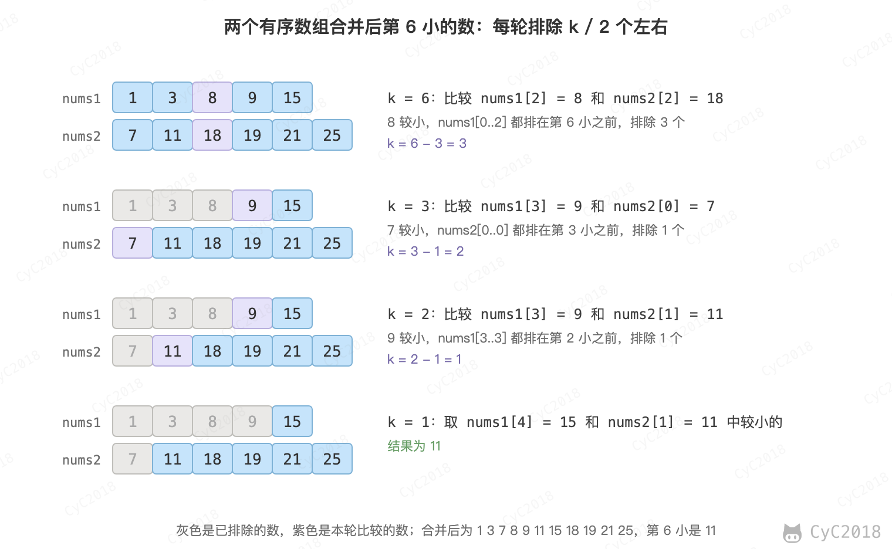

# Leetcode 题解 - 二分查找
<!-- GFM-TOC -->
* [Leetcode 题解 - 二分查找](#leetcode-题解---二分查找)
    * [1. 求开方](#1-求开方)
    * [2. 大于给定元素的最小元素](#2-大于给定元素的最小元素)
    * [3. 有序数组的 Single Element](#3-有序数组的-single-element)
    * [4. 第一个错误的版本](#4-第一个错误的版本)
    * [5. 旋转数组的最小数字](#5-旋转数组的最小数字)
    * [6. 查找区间](#6-查找区间)
    * [7. 两个有序数组的中位数](#7-两个有序数组的中位数)
    * [参考资料](#参考资料)
<!-- GFM-TOC -->


#### 正常实现

```text
Input : [1,2,3,4,5]
key : 3
return the index : 2
```

```java
public int binarySearch(int[] nums, int key) {
    int l = 0, h = nums.length - 1;
    while (l <= h) {
        int m = l + (h - l) / 2;
        if (nums[m] == key) {
            return m;
        } else if (nums[m] > key) {
            h = m - 1;
        } else {
            l = m + 1;
        }
    }
    return -1;
}
```

#### 时间复杂度

二分查找也称为折半查找，每次都能将查找区间减半，这种折半特性的算法时间复杂度为 O(logN)。

#### m 计算

有两种计算中值 m 的方式：

- m = (l + h) / 2
- m = l + (h - l) / 2

l + h 可能出现加法溢出，也就是说加法的结果大于整型能够表示的范围。但是 l 和 h 都不小于 0，因此 h - l 不会出现溢出问题。所以，最好使用第二种计算方法。

#### 未成功查找的返回值

循环退出时如果仍然没有查找到 key，那么表示查找失败。可以有两种返回值：

- -1：以一个错误码表示没有查找到 key；
- l：将 key 插入到 nums 中的正确位置。

#### 变种

二分查找可以有很多变种，实现变种要注意边界值的判断。例如在一个有重复元素的数组中查找 key 的最左位置的实现如下：

```java
public int binarySearch(int[] nums, int key) {
    int l = 0, h = nums.length;
    while (l < h) {
        int m = l + (h - l) / 2;
        if (nums[m] >= key) {
            h = m;
        } else {
            l = m + 1;
        }
    }
    return l;
}
```

该实现和正常实现有以下不同：

- h 的赋值表达式为 h = m；
- 循环条件为 l \< h；
- 最后返回 l 而不是 -1。

在 nums[m] \>= key 的情况下，可以推导出最左 key 位于 [l, m] 区间中，这是一个闭区间。h 的赋值表达式为 h = m，因为 m 位置也可能是解。

在 h 的赋值表达式为 h = m 的情况下，如果循环条件为 l \<= h，那么会出现循环无法退出的情况，因此循环条件只能是 l \< h。以下演示了循环条件为 l \<= h 时循环无法退出的情况：

```text
nums = {0, 1, 2}, key = 1
l   m   h
0   1   3  nums[m] >= key
0   0   1  nums[m] < key
1   1   1  nums[m] >= key
1   1   1  nums[m] >= key
...
```

当循环体退出时，不表示没有查找到 key，因此最后返回的结果不应该为 -1。为了验证有没有查找到，需要在调用端先判断返回值小于 nums.length，再判断该位置上的值和 key 是否相等。

## 1. 求开方

69\. Sqrt(x) (Easy)

[Leetcode](https://leetcode.com/problems/sqrtx/description/) / [力扣](https://leetcode-cn.com/problems/sqrtx/description/)

```text
Input: 4
Output: 2

Input: 8
Output: 2
Explanation: The square root of 8 is 2.82842..., and since we want to return an integer, the decimal part will be truncated.
```

要找的是满足 r * r \<= x 的最大整数 r，它一定在 1 \~ x 之间（x \>= 2 时），可以用二分查找。比较 mid 和 x / mid 而不是计算 mid * mid，是为了避免乘法溢出。

对于 x = 8，它的开方是 2.82842...，最后应该返回 2 而不是 3。在循环条件为 l \<= h 并且循环退出时，h 总是比 l 小 1，也就是说 h = 2，l = 3，因此最后的返回值应该为 h 而不是 l。

```java
public int mySqrt(int x) {
    if (x <= 1) {
        return x;
    }
    int l = 1, h = x;
    while (l <= h) {
        int mid = l + (h - l) / 2;
        int sqrt = x / mid;
        if (sqrt == mid) {
            return mid;
        } else if (mid > sqrt) {
            h = mid - 1;
        } else {
            l = mid + 1;
        }
    }
    return h;
}
```

## 2. 大于给定元素的最小元素

744\. Find Smallest Letter Greater Than Target (Easy)

[Leetcode](https://leetcode.com/problems/find-smallest-letter-greater-than-target/description/) / [力扣](https://leetcode-cn.com/problems/find-smallest-letter-greater-than-target/description/)

```text
Input:
letters = ["c", "f", "j"]
target = "d"
Output: "f"

Input:
letters = ["c", "f", "j"]
target = "k"
Output: "c"
```

题目描述：给定一个有序的字符数组 letters 和一个字符 target，要求找出 letters 中大于 target 的最小字符，如果找不到就返回第 1 个字符。

letters[m] \<= target 时答案一定在 m 的右边，令 l = m + 1；否则 m 可能就是答案，令 h = m - 1 继续在左边找更小的。循环结束时 l = h + 1，指向第一个大于 target 的字符，l 等于 n 表示所有字符都不大于 target。

```java
public char nextGreatestLetter(char[] letters, char target) {
    int n = letters.length;
    int l = 0, h = n - 1;
    while (l <= h) {
        int m = l + (h - l) / 2;
        if (letters[m] <= target) {
            l = m + 1;
        } else {
            h = m - 1;
        }
    }
    return l < n ? letters[l] : letters[0];
}
```

## 3. 有序数组的 Single Element

540\. Single Element in a Sorted Array (Medium)

[Leetcode](https://leetcode.com/problems/single-element-in-a-sorted-array/description/) / [力扣](https://leetcode-cn.com/problems/single-element-in-a-sorted-array/description/)

```text
Input: [1, 1, 2, 3, 3, 4, 4, 8, 8]
Output: 2
```

题目描述：一个有序数组只有一个数不出现两次，找出这个数。

要求以 O(logN) 时间复杂度进行求解，因此不能遍历数组并进行异或操作来求解，这么做的时间复杂度为 O(N)。

令 index 为 Single Element 在数组中的位置。在 index 之后，数组中原来存在的成对状态被改变。如果 m 为偶数，并且 m + 1 \< index，那么 nums[m] == nums[m + 1]；m + 1 \>= index，那么 nums[m] != nums[m + 1]。

例如 [1, 1, 2, 3, 3, 4, 4, 8, 8] 中 index = 2：m = 0 时 nums[0] == nums[1]，还没到 index；m = 4 时 nums[4] = 3、nums[5] = 4，成对状态已经被打乱，index 在 m 或它的左边。

从上面的规律可以知道，如果 nums[m] == nums[m + 1]，那么 index 所在的数组位置为 [m + 2, h]，此时令 l = m + 2；如果 nums[m] != nums[m + 1]，那么 index 所在的数组位置为 [l, m]，此时令 h = m。

因为 h 的赋值表达式为 h = m，那么循环条件也就只能使用 l \< h 这种形式。

```java
public int singleNonDuplicate(int[] nums) {
    int l = 0, h = nums.length - 1;
    while (l < h) {
        int m = l + (h - l) / 2;
        if (m % 2 == 1) {
            m--;   // 保证 l/h/m 都在偶数位，使得查找区间大小一直都是奇数
        }
        if (nums[m] == nums[m + 1]) {
            l = m + 2;
        } else {
            h = m;
        }
    }
    return nums[l];
}
```

## 4. 第一个错误的版本

278\. First Bad Version (Easy)

[Leetcode](https://leetcode.com/problems/first-bad-version/description/) / [力扣](https://leetcode-cn.com/problems/first-bad-version/description/)

题目描述：给定一个元素 n 代表有 [1, 2, ..., n] 版本，在第 x 位置开始出现错误版本，导致后面的版本都错误。可以调用 isBadVersion(int x) 知道某个版本是否错误，要求找到第一个错误的版本。

如果第 m 个版本出错，则表示第一个错误的版本在 [l, m] 之间，令 h = m；否则第一个错误的版本在 [m + 1, h] 之间，令 l = m + 1。

因为 h 的赋值表达式为 h = m，因此循环条件为 l \< h。

```java
public int firstBadVersion(int n) {
    int l = 1, h = n;
    while (l < h) {
        int mid = l + (h - l) / 2;
        if (isBadVersion(mid)) {
            h = mid;
        } else {
            l = mid + 1;
        }
    }
    return l;
}
```

## 5. 旋转数组的最小数字

153\. Find Minimum in Rotated Sorted Array (Medium)

[Leetcode](https://leetcode.com/problems/find-minimum-in-rotated-sorted-array/description/) / [力扣](https://leetcode-cn.com/problems/find-minimum-in-rotated-sorted-array/description/)

```text
Input: [3,4,5,1,2],
Output: 1
```

题目描述：一个升序数组在某个位置被旋转，数组中的元素互不相同，求最小值。

旋转后的数组分为两段升序，后一段的元素都小于前一段，最小值是后一段的第一个元素。用 nums[m] 和区间末尾的 nums[h] 比较：nums[m] \<= nums[h] 说明 m 已经在后一段，最小值在 [l, m] 中，令 h = m；否则 m 还在前一段，最小值在 [m + 1, h] 中，令 l = m + 1。

不能改为和 nums[l] 比较：nums[m] \> nums[l] 时，可能是 m 在前一段，也可能是 [l, h] 这一段本身没有旋转、最小值就是 nums[l]，两种情况无法区分。

```java
public int findMin(int[] nums) {
    int l = 0, h = nums.length - 1;
    while (l < h) {
        int m = l + (h - l) / 2;
        if (nums[m] <= nums[h]) {
            h = m;
        } else {
            l = m + 1;
        }
    }
    return nums[l];
}
```

## 6. 查找区间

34\. Find First and Last Position of Element in Sorted Array (Medium)

[Leetcode](https://leetcode.com/problems/find-first-and-last-position-of-element-in-sorted-array/) / [力扣](https://leetcode-cn.com/problems/find-first-and-last-position-of-element-in-sorted-array/)

```text
Input: nums = [5,7,7,8,8,10], target = 8
Output: [3,4]

Input: nums = [5,7,7,8,8,10], target = 6
Output: [-1,-1]
```

题目描述：给定一个有序数组 nums 和一个目标 target，要求找到 target 在 nums 中的第一个位置和最后一个位置。

可以用二分查找找出第一个位置和最后一个位置，但是寻找的方法有所不同，需要实现两个二分查找。将寻找 target 最后一个位置，转换成寻找 target+1 第一个位置，再往前移动一个位置。这样只需要实现一个二分查找代码即可。

```java
public int[] searchRange(int[] nums, int target) {
    int first = findFirst(nums, target);
    int last = findFirst(nums, target + 1) - 1;
    if (first == nums.length || nums[first] != target) {
        return new int[]{-1, -1};
    } else {
        return new int[]{first, Math.max(first, last)};
    }
}

private int findFirst(int[] nums, int target) {
    int l = 0, h = nums.length; // 注意 h 的初始值
    while (l < h) {
        int m = l + (h - l) / 2;
        if (nums[m] >= target) {
            h = m;
        } else {
            l = m + 1;
        }
    }
    return l;
}
```

在寻找第一个位置的二分查找代码中，需要注意 h 的初始值为 nums.length，而不是 nums.length - 1。先看以下示例：

```text
nums = [2,2], target = 2
```

findFirst(nums, 3) 要返回 3 应该插入的位置，也就是 nums.length = 2，于是 last = 2 - 1 = 1。如果 h 的初始值为 nums.length - 1，findFirst 的返回值只能在 [0, nums.length - 1] 中，这里会返回 1，得到错误的 last = 0。

## 7. 两个有序数组的中位数

4\. Median of Two Sorted Arrays (Hard)

[Leetcode](https://leetcode.com/problems/median-of-two-sorted-arrays/) / [力扣](https://leetcode.cn/problems/median-of-two-sorted-arrays/)

题目描述：求两个有序数组合并后的中位数，要求时间复杂度为 O(log(m + n))。

把问题转化为求两个数组合并后第 k 小的数。比较两个数组各自的第 k / 2 个元素，假设 nums1 的不大于 nums2 的。合并时让相等的元素中 nums1 的排在前面，那么排在它前面的最多只有 nums1 中的 k / 2 - 1 个和 nums2 中的 k / 2 - 1 个，它最多排在第 k - 1 位，因此 nums1 的前 k / 2 个元素都排在第 k 小之前，可以一次排除。

排除了 x 个数之后，在剩下的部分里寻找第 k - x 小的数；某个数组剩余的长度不足 k / 2 时，取它的最后一个元素比较。k 每轮减半，时间复杂度为 O(log(m + n))。

<div align="center">  </div><br>

```java
public double findMedianSortedArrays(int[] nums1, int[] nums2) {
    int total = nums1.length + nums2.length;
    if (total % 2 == 1) {
        return kth(nums1, 0, nums2, 0, total / 2 + 1);
    }
    return (kth(nums1, 0, nums2, 0, total / 2) + kth(nums1, 0, nums2, 0, total / 2 + 1)) / 2.0;
}

// nums1[i..] 和 nums2[j..] 合并后第 k 小的数，k 从 1 开始
private int kth(int[] nums1, int i, int[] nums2, int j, int k) {
    if (i == nums1.length) {
        return nums2[j + k - 1];
    }
    if (j == nums2.length) {
        return nums1[i + k - 1];
    }
    if (k == 1) {
        return Math.min(nums1[i], nums2[j]);
    }
    int a = Math.min(i + k / 2, nums1.length) - 1;
    int b = Math.min(j + k / 2, nums2.length) - 1;
    if (nums1[a] <= nums2[b]) {
        return kth(nums1, a + 1, nums2, j, k - (a - i + 1));
    }
    return kth(nums1, i, nums2, b + 1, k - (b - j + 1));
}
```

## 参考资料

- [LeetCode 题库](https://leetcode.com/problemset/)
