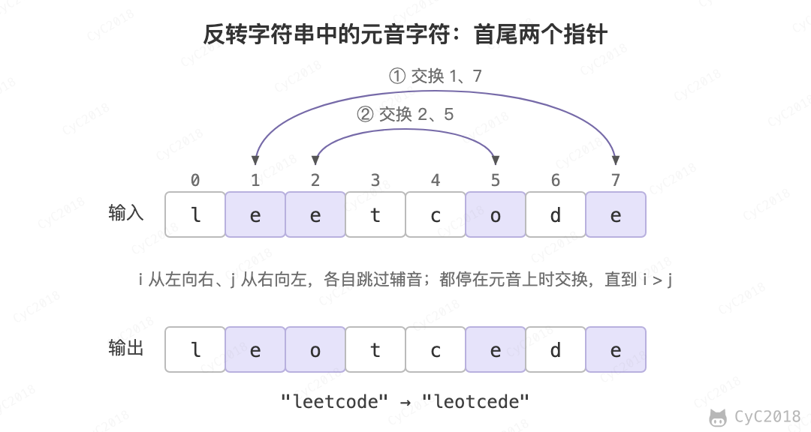
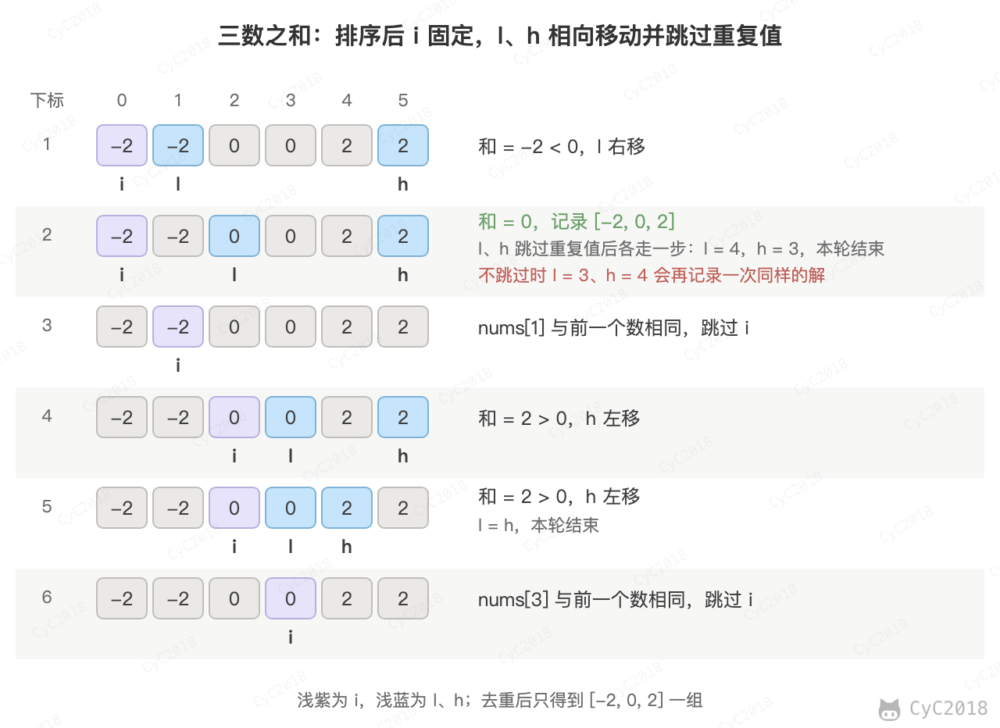
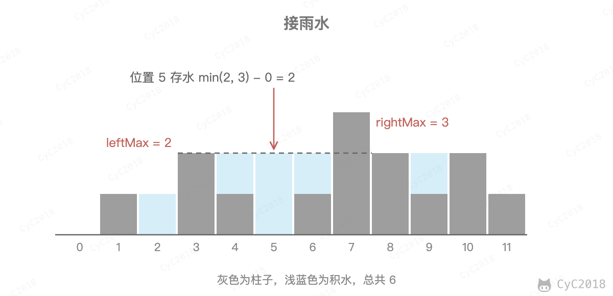

# Leetcode 题解 - 双指针
<!-- GFM-TOC -->
* [Leetcode 题解 - 双指针](#leetcode-题解---双指针)
    * [1. 有序数组的 Two Sum](#1-有序数组的-two-sum)
    * [2. 两数平方和](#2-两数平方和)
    * [3. 反转字符串中的元音字符](#3-反转字符串中的元音字符)
    * [4. 回文字符串](#4-回文字符串)
    * [5. 归并两个有序数组](#5-归并两个有序数组)
    * [6. 判断链表是否存在环](#6-判断链表是否存在环)
    * [7. 最长子序列](#7-最长子序列)
    * [8. 三数之和](#8-三数之和)
    * [9. 接雨水](#9-接雨水)
    * [10. 最小覆盖子串](#10-最小覆盖子串)
    * [11. 无重复字符的最长子串](#11-无重复字符的最长子串)
    * [参考资料](#参考资料)
<!-- GFM-TOC -->


双指针主要用于遍历数组，两个指针指向不同的元素，从而协同完成任务。

## 1. 有序数组的 Two Sum

167\. Two Sum II - Input Array Is Sorted (Medium)

[Leetcode](https://leetcode.com/problems/two-sum-ii-input-array-is-sorted/description/) / [力扣](https://leetcode.cn/problems/two-sum-ii-input-array-is-sorted/description/)

```text
Input: numbers={2, 7, 11, 15}, target=9
Output: index1=1, index2=2
```

题目描述：在有序数组中找出两个数，使它们的和为 target。

使用双指针，一个指针指向值较小的元素，一个指针指向值较大的元素。指向较小元素的指针从头向尾遍历，指向较大元素的指针从尾向头遍历。

- 如果两个指针指向元素的和 sum == target，那么得到要求的结果；
- 如果 sum \> target，移动较大的元素，使 sum 变小一些；
- 如果 sum \< target，移动较小的元素，使 sum 变大一些。

这样移动不会错过答案：sum \< target 时，numbers[i] 与 i、j 之间任何元素的和都不超过 sum，i 不可能属于答案；sum \> target 时同理排除 j。

数组中的元素最多遍历一次，时间复杂度为 O(N)。只使用了两个额外变量，空间复杂度为  O(1)。

<div align="center">  </div><br>

```java
public int[] twoSum(int[] numbers, int target) {
    if (numbers == null) return null;
    int i = 0, j = numbers.length - 1;
    while (i < j) {
        int sum = numbers[i] + numbers[j];
        if (sum == target) {
            return new int[]{i + 1, j + 1};
        } else if (sum < target) {
            i++;
        } else {
            j--;
        }
    }
    return null;
}
```

## 2. 两数平方和

633\. Sum of Square Numbers (Medium)

[Leetcode](https://leetcode.com/problems/sum-of-square-numbers/description/) / [力扣](https://leetcode.cn/problems/sum-of-square-numbers/description/)

```text
Input: 5
Output: True
Explanation: 1 * 1 + 2 * 2 = 5
```

题目描述：判断一个非负整数是否为两个整数的平方和。

可以看成是在元素为 0\~target 的有序数组中查找两个数，使得这两个数的平方和为 target，做法与[有序数组的 Two Sum](#1-有序数组的-two-sum)相同，只是把和换成了平方和。

本题的关键是右指针的初始化，实现剪枝，从而降低时间复杂度。两个数都不会超过 sqrt(target)，因此右指针从 sqrt(target) 开始即可。

因为最多只需要遍历一次 0\~sqrt(target)，所以时间复杂度为 O(sqrt(target))。又因为只使用了两个额外的变量，因此空间复杂度为 O(1)。

```java
 public boolean judgeSquareSum(int target) {
     if (target < 0) return false;
     int i = 0, j = (int) Math.sqrt(target);
     while (i <= j) {
         long powSum = (long) i * i + (long) j * j;
         if (powSum == target) {
             return true;
         } else if (powSum > target) {
             j--;
         } else {
             i++;
         }
     }
     return false;
 }
```

## 3. 反转字符串中的元音字符

345\. Reverse Vowels of a String (Easy)

[Leetcode](https://leetcode.com/problems/reverse-vowels-of-a-string/description/) / [力扣](https://leetcode.cn/problems/reverse-vowels-of-a-string/description/)

```text
Given s = "leetcode", return "leotcede".
```

<div align="center">  </div><br>

使用双指针，一个指针从头向尾遍历，一个指针从尾到头遍历，当两个指针都遍历到元音字符时，交换这两个元音字符。

为了快速判断一个字符是不是元音字符，将全部元音字符添加到集合 HashSet 中，从而以 O(1) 的时间复杂度进行该操作。

- 时间复杂度为 O(N)：只需要遍历所有元素一次；
- 空间复杂度为 O(N)：Java 的字符串不可修改，需要一个与 s 等长的字符数组保存结果。

<div align="center">  </div><br>

```java
private final static HashSet<Character> vowels = new HashSet<>(
        Arrays.asList('a', 'e', 'i', 'o', 'u', 'A', 'E', 'I', 'O', 'U'));

public String reverseVowels(String s) {
    if (s == null) return null;
    int i = 0, j = s.length() - 1;
    char[] result = new char[s.length()];
    while (i <= j) {
        char ci = s.charAt(i);
        char cj = s.charAt(j);
        if (!vowels.contains(ci)) {
            result[i++] = ci;
        } else if (!vowels.contains(cj)) {
            result[j--] = cj;
        } else {
            result[i++] = cj;
            result[j--] = ci;
        }
    }
    return new String(result);
}
```

## 4. 回文字符串

680\. Valid Palindrome II (Easy)

[Leetcode](https://leetcode.com/problems/valid-palindrome-ii/description/) / [力扣](https://leetcode.cn/problems/valid-palindrome-ii/description/)

```text
Input: "abca"
Output: True
Explanation: You could delete the character 'c'.
```

题目描述：可以删除一个字符，判断是否能构成回文字符串。

所谓的回文字符串，是指具有左右对称特点的字符串，例如 "abcba" 就是一个回文字符串。

使用双指针可以很容易判断一个字符串是否是回文字符串：令一个指针从左到右遍历，一个指针从右到左遍历，这两个指针同时移动一个位置，每次都判断两个指针指向的字符是否相同，如果都相同，字符串才是具有左右对称性质的回文字符串。

<div align="center">  </div><br>

本题的关键是处理删除一个字符。在使用双指针遍历字符串时，如果出现两个指针指向的字符不相等的情况，就试着删除一个字符，再判断删除完之后的字符串是否是回文字符串。

在判断是否为回文字符串时，不需要判断整个字符串，因为左指针左边和右指针右边的字符之前已经判断过具有对称性质，所以只需要判断中间的子字符串即可。

在试着删除字符时，既可以删除左指针指向的字符，也可以删除右指针指向的字符。

<div align="center">  </div><br>

```java
public boolean validPalindrome(String s) {
    for (int i = 0, j = s.length() - 1; i < j; i++, j--) {
        if (s.charAt(i) != s.charAt(j)) {
            return isPalindrome(s, i, j - 1) || isPalindrome(s, i + 1, j);
        }
    }
    return true;
}

private boolean isPalindrome(String s, int i, int j) {
    while (i < j) {
        if (s.charAt(i++) != s.charAt(j--)) {
            return false;
        }
    }
    return true;
}
```

## 5. 归并两个有序数组

88\. Merge Sorted Array (Easy)

[Leetcode](https://leetcode.com/problems/merge-sorted-array/description/) / [力扣](https://leetcode.cn/problems/merge-sorted-array/description/)

```text
Input:
nums1 = [1,2,3,0,0,0], m = 3
nums2 = [2,5,6],       n = 3

Output: [1,2,2,3,5,6]
```

题目描述：把归并结果存到第一个数组上。

需要从尾开始遍历，否则在 nums1 上归并得到的值会覆盖还未进行归并比较的值。

```java
public void merge(int[] nums1, int m, int[] nums2, int n) {
    int index1 = m - 1, index2 = n - 1;
    int indexMerge = m + n - 1;
    while (index2 >= 0) {
        if (index1 < 0) {
            nums1[indexMerge--] = nums2[index2--];
        } else if (nums1[index1] > nums2[index2]) {
            nums1[indexMerge--] = nums1[index1--];
        } else {
            nums1[indexMerge--] = nums2[index2--];
        }
    }
}
```

每次循环写入一个位置，最多 m + n 次，时间复杂度 O(m + n)；直接在 nums1 上归并，空间复杂度 O(1)。

## 6. 判断链表是否存在环

141\. Linked List Cycle (Easy)

[Leetcode](https://leetcode.com/problems/linked-list-cycle/description/) / [力扣](https://leetcode.cn/problems/linked-list-cycle/description/)

使用双指针，一个指针每次移动一个节点，一个指针每次移动两个节点，如果存在环，那么这两个指针一定会相遇。这是因为进入环之后，快指针每次比慢指针多走一步，两者的距离每次缩小 1，不会跳过慢指针。

求环的入口时，快慢指针都要从头节点出发，做法见[剑指 Offer 23](23.%20链表中环的入口结点.md)。

```java
public boolean hasCycle(ListNode head) {
    if (head == null) {
        return false;
    }
    ListNode l1 = head, l2 = head.next;
    while (l1 != null && l2 != null && l2.next != null) {
        if (l1 == l2) {
            return true;
        }
        l1 = l1.next;
        l2 = l2.next.next;
    }
    return false;
}
```

慢指针进入环之前最多走 N 步，进入环之后快指针每次追近 1 步，不超过环长就能追上，时间复杂度 O(N)；只用两个指针，空间复杂度 O(1)。用 HashSet 记录访问过的节点也能判断，但需要 O(N) 的空间。

## 7. 最长子序列

524\. Longest Word in Dictionary through Deleting (Medium)

[Leetcode](https://leetcode.com/problems/longest-word-in-dictionary-through-deleting/description/) / [力扣](https://leetcode.cn/problems/longest-word-in-dictionary-through-deleting/description/)

```text
Input:
s = "abpcplea", d = ["ale","apple","monkey","plea"]

Output:
"apple"
```

题目描述：删除 s 中的一些字符，使得它构成字符串列表 d 中的一个字符串，找出能构成的最长字符串。如果有多个相同长度的结果，返回字典序的最小字符串。

通过删除字符串 s 中的一些字符能得到字符串 t，可以认为 t 是 s 的子序列。使用双指针可以判断一个字符串是否为另一个字符串的子序列。

遍历 d 时，比当前答案短、或者一样长但字典序更大的字符串直接跳过。

```java
public String findLongestWord(String s, List<String> d) {
    String longestWord = "";
    for (String target : d) {
        int l1 = longestWord.length(), l2 = target.length();
        if (l1 > l2 || (l1 == l2 && longestWord.compareTo(target) < 0)) {
            continue;
        }
        if (isSubsequence(s, target)) {
            longestWord = target;
        }
    }
    return longestWord;
}

private boolean isSubsequence(String s, String target) {
    int i = 0, j = 0;
    while (i < s.length() && j < target.length()) {
        if (s.charAt(i) == target.charAt(j)) {
            j++;
        }
        i++;
    }
    return j == target.length();
}
```

## 8. 三数之和

15\. 3Sum (Medium)

[Leetcode](https://leetcode.com/problems/3sum/) / [力扣](https://leetcode.cn/problems/3sum/)

```text
Input: nums = [-1, 0, 1, 2, -1, -4]
Output: [[-1, -1, 2], [-1, 0, 1]]
```

题目描述：找出所有和为 0 且不重复的三元组。

先排序，然后枚举第一个数 nums[i]，在它右边用[有序数组的 Two Sum](#1-有序数组的-two-sum)的双指针方法寻找和为 -nums[i] 的两个数。去重的关键是跳过相同的值：i 跳过与前一个数相同的值，找到一组解之后，两个指针也跳过相同的值。nums[i] 大于 0 时三个数都大于 0，可以直接结束。时间复杂度为 O(N<sup>2</sup>)。以 [-2, -2, 0, 0, 2, 2] 为例：

<div align="center">  </div><br>

```java
public List<List<Integer>> threeSum(int[] nums) {
    Arrays.sort(nums);
    List<List<Integer>> ret = new ArrayList<>();
    for (int i = 0; i < nums.length - 2; i++) {
        if (nums[i] > 0) {
            break;
        }
        if (i > 0 && nums[i] == nums[i - 1]) {
            continue;
        }
        int l = i + 1, h = nums.length - 1;
        while (l < h) {
            int sum = nums[i] + nums[l] + nums[h];
            if (sum < 0) {
                l++;
            } else if (sum > 0) {
                h--;
            } else {
                ret.add(Arrays.asList(nums[i], nums[l], nums[h]));
                while (l < h && nums[l] == nums[l + 1]) {
                    l++;
                }
                while (l < h && nums[h] == nums[h - 1]) {
                    h--;
                }
                l++;
                h--;
            }
        }
    }
    return ret;
}
```

## 9. 接雨水

42\. Trapping Rain Water (Hard)

[Leetcode](https://leetcode.com/problems/trapping-rain-water/) / [力扣](https://leetcode.cn/problems/trapping-rain-water/)

```text
Input: height = [0, 1, 0, 2, 1, 0, 1, 3, 2, 1, 2, 1]
Output: 6
```

位置 i 上方能存的水，取决于它左边最高的柱子和右边最高的柱子中较矮的那一个：water[i] = min(leftMax, rightMax) - height[i]。

用两个指针从两端向中间移动，leftMax、rightMax 分别是 [0, l] 和 [r, n - 1] 中最高的柱子。如果 leftMax < rightMax，左指针右边最高的柱子不低于 rightMax，水位只由 leftMax 决定，可以直接结算左指针并右移；反之结算右指针并左移。不需要额外的数组，空间复杂度为 O(1)。

<div align="center">  </div><br>

```java
public int trap(int[] height) {
    int l = 0, r = height.length - 1;
    int leftMax = 0, rightMax = 0, ret = 0;
    while (l < r) {
        leftMax = Math.max(leftMax, height[l]);
        rightMax = Math.max(rightMax, height[r]);
        if (leftMax < rightMax) {
            ret += leftMax - height[l++];
        } else {
            ret += rightMax - height[r--];
        }
    }
    return ret;
}
```

## 10. 最小覆盖子串

76\. Minimum Window Substring (Hard)

[Leetcode](https://leetcode.com/problems/minimum-window-substring/) / [力扣](https://leetcode.cn/problems/minimum-window-substring/)

```text
Input: s = "ADOBECODEBANC", t = "ABC"
Output: "BANC"
```

题目描述：找出 s 中包含 t 所有字符（包括重复字符）的最短子串。

使用滑动窗口。need[c] 表示窗口还缺几个字符 c，missing 表示一共还缺几个字符。右指针不断扩大窗口，直到 missing 为 0，此时窗口包含了 t 的所有字符；然后移动左指针缩小窗口，在窗口仍然满足条件时更新答案。

need[c] 可以小于 0，表示窗口中的 c 比需要的多。因此只有加入前 need[c] 大于 0 的 c 才让 missing 减一，移出后 need[c] 大于 0 时 missing 才加一。例如 s = "AAAB"、t = "AAB"：

```text
操作    窗口   need[A]  need[B]  missing
初始           2        1        3
加入 A  A      1        1        2
加入 A  AA     0        1        1
加入 A  AAA    -1       1        1        多出一个 A，missing 不变
加入 B  AAAB   -1       0        0        满足条件，记录长度 4
移出 A  AAB    0        0        0        仍满足条件，记录长度 3
移出 A  AB     1        0        1        又缺一个 A，停止收缩
```

```java
public String minWindow(String s, String t) {
    int[] need = new int[128];
    for (char c : t.toCharArray()) {
        need[c]++;
    }
    int missing = t.length(), start = 0, minLen = Integer.MAX_VALUE;
    for (int l = 0, r = 0; r < s.length(); r++) {
        if (need[s.charAt(r)]-- > 0) {
            missing--;
        }
        while (missing == 0) {
            if (r - l + 1 < minLen) {
                minLen = r - l + 1;
                start = l;
            }
            if (++need[s.charAt(l++)] > 0) {
                missing++;
            }
        }
    }
    return minLen == Integer.MAX_VALUE ? "" : s.substring(start, start + minLen);
}
```

## 11. 无重复字符的最长子串

3\. Longest Substring Without Repeating Characters (Medium)

[Leetcode](https://leetcode.com/problems/longest-substring-without-repeating-characters/) / [力扣](https://leetcode.cn/problems/longest-substring-without-repeating-characters/)

```text
Input: s = "pwwkew"
Output: 3
```

题目描述：求不含重复字符的最长子串的长度，字符都在 ASCII 范围内。

使用滑动窗口，保证窗口 [l, r] 内没有重复字符。last[c] 是字符 c 上次出现位置的下一位，右指针遇到 c 时，左指针移到 max(l, last[c])：c 上次出现的位置可能已经在窗口左边，左指针不能后退。时间复杂度为 O(N)。

同一道题的另一种写法见[剑指 Offer 48](48.%20最长不含重复字符的子字符串.md)。

```java
public int lengthOfLongestSubstring(String s) {
    int[] last = new int[128]; // 字符上次出现位置的下一位
    int ret = 0;
    for (int l = 0, r = 0; r < s.length(); r++) {
        char c = s.charAt(r);
        l = Math.max(l, last[c]);
        ret = Math.max(ret, r - l + 1);
        last[c] = r + 1;
    }
    return ret;
}
```

## 参考资料

- [LeetCode 题库](https://leetcode.com/problemset/)
