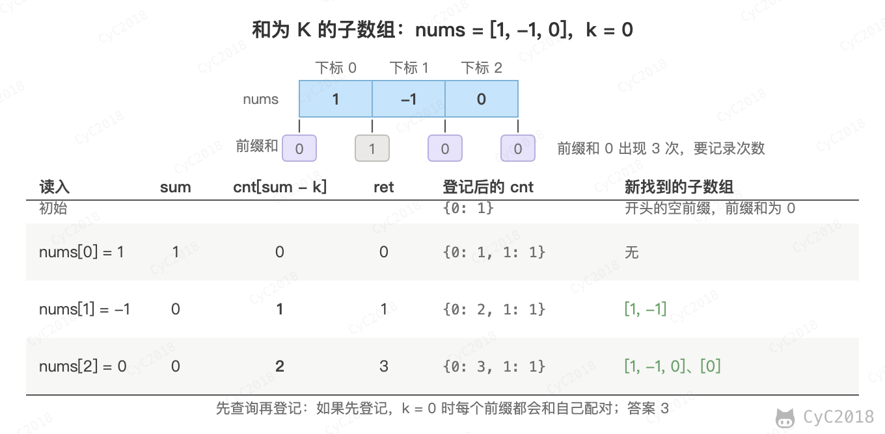

# Leetcode 题解 - 哈希表
<!-- GFM-TOC -->
* [Leetcode 题解 - 哈希表](#leetcode-题解---哈希表)
    * [1. 数组中两个数的和为给定值](#1-数组中两个数的和为给定值)
    * [2. 判断数组是否含有重复元素](#2-判断数组是否含有重复元素)
    * [3. 最长和谐序列](#3-最长和谐序列)
    * [4. 最长连续序列](#4-最长连续序列)
    * [5. 和为 K 的子数组](#5-和为-k-的子数组)
    * [参考资料](#参考资料)
<!-- GFM-TOC -->


哈希表使用 O(N) 空间复杂度存储数据，查找、插入的平均时间复杂度为 O(1)，用空间换时间。

- Java 中的 HashSet 用于存储一个集合，可以查找元素是否在集合中。如果元素有穷，并且范围不大，那么可以用一个布尔数组来存储一个元素是否存在。例如对于只有小写字符的元素，就可以用一个长度为 26 的布尔数组来存储一个字符集合，使得空间复杂度降低为 O(1)。

- Java 中的 HashMap 主要用于映射关系，从而把两个元素联系起来。HashMap 也可以用来对元素进行计数统计，此时键为元素，值为计数。和 HashSet 类似，如果元素有穷并且范围不大，可以用整型数组来进行统计。在对一个内容进行压缩或者其它转换时，利用 HashMap 可以把原始内容和转换后的内容联系起来。例如在一个简化 url 的系统中（535\. Encode and Decode TinyURL (Medium)，[Leetcode](https://leetcode.com/problems/encode-and-decode-tinyurl/description/) / [力扣](https://leetcode.cn/problems/encode-and-decode-tinyurl/description/)），利用 HashMap 就可以存储精简后的 url 到原始 url 的映射，使得不仅可以显示简化的 url，也可以根据简化的 url 得到原始 url 从而定位到正确的资源。


## 1. 数组中两个数的和为给定值

1\. Two Sum (Easy)

[Leetcode](https://leetcode.com/problems/two-sum/description/) / [力扣](https://leetcode.cn/problems/two-sum/description/)

可以先对数组进行排序，然后使用双指针方法或者二分查找方法，时间复杂度为 O(NlogN)。需要注意的是，题目要求返回原数组的下标，排序会打乱下标，因此要把元素和原下标一起排序，空间复杂度为 O(N)。

用 HashMap 存储数组元素和索引的映射，在访问到 nums[i] 时，判断 HashMap 中是否存在 target - nums[i]，如果存在说明 target - nums[i] 所在的索引和 i 就是要找的两个数。该方法的时间复杂度为 O(N)，空间复杂度为 O(N)，使用空间来换取时间。

```java
public int[] twoSum(int[] nums, int target) {
    HashMap<Integer, Integer> indexForNum = new HashMap<>();
    for (int i = 0; i < nums.length; i++) {
        if (indexForNum.containsKey(target - nums[i])) {
            return new int[]{indexForNum.get(target - nums[i]), i};
        } else {
            indexForNum.put(nums[i], i);
        }
    }
    return null;
}
```

## 2. 判断数组是否含有重复元素

217\. Contains Duplicate (Easy)

[Leetcode](https://leetcode.com/problems/contains-duplicate/description/) / [力扣](https://leetcode.cn/problems/contains-duplicate/description/)

```java
public boolean containsDuplicate(int[] nums) {
    Set<Integer> set = new HashSet<>();
    for (int num : nums) {
        set.add(num);
    }
    return set.size() < nums.length;
}
```

## 3. 最长和谐序列

594\. Longest Harmonious Subsequence (Easy)

[Leetcode](https://leetcode.com/problems/longest-harmonious-subsequence/description/) / [力扣](https://leetcode.cn/problems/longest-harmonious-subsequence/description/)

```text
Input: [1,3,2,2,5,2,3,7]
Output: 5
Explanation: The longest harmonious subsequence is [3,2,2,2,3].
```

和谐序列中最大数和最小数之差正好为 1，需要注意的是序列的元素不一定是数组的连续元素。统计每个数出现的次数，对每个 num，只有 num + 1 也存在时，两者的次数之和才是以它们为最小、最大值的和谐序列长度。

```java
public int findLHS(int[] nums) {
    Map<Integer, Integer> countForNum = new HashMap<>();
    for (int num : nums) {
        countForNum.put(num, countForNum.getOrDefault(num, 0) + 1);
    }
    int longest = 0;
    for (int num : countForNum.keySet()) {
        if (countForNum.containsKey(num + 1)) {
            longest = Math.max(longest, countForNum.get(num + 1) + countForNum.get(num));
        }
    }
    return longest;
}
```

## 4. 最长连续序列

128\. Longest Consecutive Sequence (Medium)

[Leetcode](https://leetcode.com/problems/longest-consecutive-sequence/description/) / [力扣](https://leetcode.cn/problems/longest-consecutive-sequence/description/)

```text
Given [100, 4, 200, 1, 3, 2],
The longest consecutive elements sequence is [1, 2, 3, 4]. Return its length: 4.
```

要求以 O(N) 的时间复杂度求解，因此不能排序。

把所有数放进 HashSet，只从每段连续序列的起点开始向后数：num - 1 不在集合中时，num 是起点，依次查找 num + 1、num + 2……直到断开。例如 4 不是起点（3 在集合中），跳过；1 是起点，向后数到 4，长度为 4。每个数只会在它所在序列的起点被数到一次，总的时间复杂度为 O(N)。

```java
public int longestConsecutive(int[] nums) {
    Set<Integer> set = new HashSet<>();
    for (int num : nums) {
        set.add(num);
    }
    int longest = 0;
    for (int num : set) {
        if (set.contains(num - 1)) {
            continue; // num 不是一段连续序列的起点
        }
        int end = num;
        while (set.contains(end + 1)) {
            end++;
        }
        longest = Math.max(longest, end - num + 1);
    }
    return longest;
}
```

需要注意的是，遍历的是 set 而不是 nums：nums 中同一个起点重复出现很多次时，遍历 nums 会把同一段序列重复数很多遍。

## 5. 和为 K 的子数组

560\. Subarray Sum Equals K (Medium)

[Leetcode](https://leetcode.com/problems/subarray-sum-equals-k/) / [力扣](https://leetcode.cn/problems/subarray-sum-equals-k/)

```text
Input: nums = [1, 1, 1], k = 2
Output: 2
```

题目描述：统计和为 k 的连续子数组个数，数组元素可能为负数。

用 sum 表示从数组开头到当前位置的前缀和，以当前位置结尾、和为 k 的子数组，对应前面某个位置的前缀和为 sum - k。遍历时用哈希表记录每个前缀和出现的次数即可。数组中有负数，窗口变大时和不一定变大，因此不能用滑动窗口。

有两处容易写错：

- 开始时放入前缀和 0、次数 1，表示数组开始之前的空前缀，这样从下标 0 开始的子数组也能被统计；
- 先查询 sum - k、再登记当前的 sum，保证配对的是更早的前缀，否则 k = 0 时当前前缀会和自己配对。

哈希表记录的是次数而不是是否出现，因为同一个前缀和可能出现多次，每一次都对应一个不同的子数组。例如 nums = [1, -1, 0]、k = 0：

<div align="center">  </div><br>

```java
public int subarraySum(int[] nums, int k) {
    Map<Integer, Integer> cnt = new HashMap<>();
    cnt.put(0, 1);
    int sum = 0, ret = 0;
    for (int num : nums) {
        sum += num;
        ret += cnt.getOrDefault(sum - k, 0);
        cnt.merge(sum, 1, Integer::sum);
    }
    return ret;
}
```

## 参考资料

- [LeetCode 题库](https://leetcode.com/problemset/)
