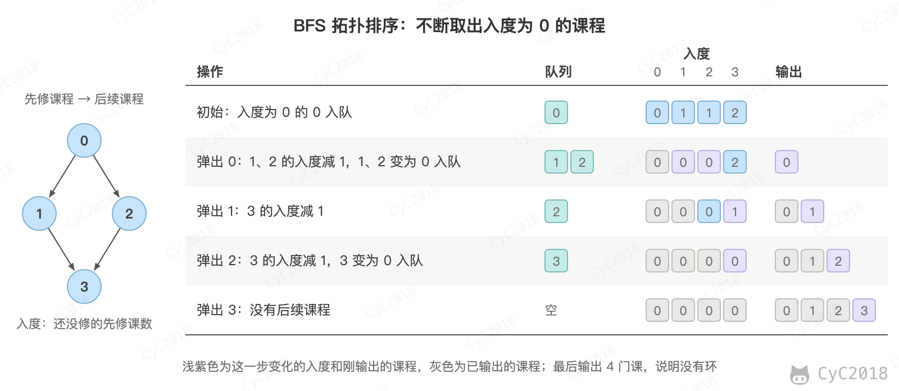

# Leetcode 题解 - 图
<!-- GFM-TOC -->
* [Leetcode 题解 - 图](#leetcode-题解---图)
    * [二分图](#二分图)
        * [1. 判断是否为二分图](#1-判断是否为二分图)
    * [拓扑排序](#拓扑排序)
        * [1. 课程安排的合法性](#1-课程安排的合法性)
        * [2. 课程安排的顺序](#2-课程安排的顺序)
    * [并查集](#并查集)
        * [1. 冗余连接](#1-冗余连接)
    * [参考资料](#参考资料)
<!-- GFM-TOC -->


## 二分图

如果可以用两种颜色对图中的节点进行着色，并且保证相邻的节点颜色不同，那么这个图就是二分图。

### 1. 判断是否为二分图

785\. Is Graph Bipartite? (Medium)

[Leetcode](https://leetcode.com/problems/is-graph-bipartite/description/) / [力扣](https://leetcode.cn/problems/is-graph-bipartite/description/)

```text
Input: [[1,3], [0,2], [1,3], [0,2]]
Output: true
Explanation:
The graph looks like this:
0----1
|    |
|    |
3----2
We can divide the vertices into two groups: {0, 2} and {1, 3}.
```

```text
Example 2:
Input: [[1,2,3], [0,2], [0,1,3], [0,2]]
Output: false
Explanation:
The graph looks like this:
0----1
| \  |
|  \ |
3----2
We cannot find a way to divide the set of nodes into two independent subsets.
```

从一个未着色的节点开始 DFS，给它涂色 0，它的邻居涂色 1，邻居的邻居再涂色 0。如果遇到一个已经着色的节点，颜色与应该涂的颜色不同，就说明有两个相邻节点必须同色，不是二分图。例 2 中 0 涂色 0、1 涂色 1、2 涂色 0，而 2 与 0 相邻，矛盾。

```java
public boolean isBipartite(int[][] graph) {
    int[] colors = new int[graph.length];
    Arrays.fill(colors, -1);
    for (int i = 0; i < graph.length; i++) {  // 处理图不是连通的情况
        if (colors[i] == -1 && !isBipartite(i, 0, colors, graph)) {
            return false;
        }
    }
    return true;
}

private boolean isBipartite(int curNode, int curColor, int[] colors, int[][] graph) {
    if (colors[curNode] != -1) {
        return colors[curNode] == curColor;
    }
    colors[curNode] = curColor;
    for (int nextNode : graph[curNode]) {
        if (!isBipartite(nextNode, 1 - curColor, colors, graph)) {
            return false;
        }
    }
    return true;
}
```

## 拓扑排序

拓扑排序指的是把有向无环图的节点排成一个序列，使得每条边 u → v 中 u 都排在 v 的前面，常用于有先后依赖的任务规划，例如安排课程的学习顺序。图中有环时不存在拓扑排序。

### 1. 课程安排的合法性

207\. Course Schedule (Medium)

[Leetcode](https://leetcode.com/problems/course-schedule/description/) / [力扣](https://leetcode.cn/problems/course-schedule/description/)

```text
2, [[1,0]]
return true
```

```text
2, [[1,0],[0,1]]
return false
```

题目描述：一个课程可能会先修课程，判断给定的先修课程规定是否合法。

本题不需要使用拓扑排序，只需要检测有向图是否存在环即可。

用 DFS 检测环时，节点有三种状态：没访问过；在当前的递归路径上（localMarked 为 true）；已经访问完并且确认从它出发没有环（只有 globalMarked 为 true）。沿着边走到一个仍在当前路径上的节点，说明绕回了自己，存在环。只用一个 visited 数组无法区分后两种状态，例如 0 → 1、0 → 2、2 → 1 中，从 2 走到 1 时 1 已经访问过，但没有环。

```java
public boolean canFinish(int numCourses, int[][] prerequisites) {
    List<Integer>[] graphic = new List[numCourses];
    for (int i = 0; i < numCourses; i++) {
        graphic[i] = new ArrayList<>();
    }
    for (int[] pre : prerequisites) {
        graphic[pre[0]].add(pre[1]);
    }
    boolean[] globalMarked = new boolean[numCourses];
    boolean[] localMarked = new boolean[numCourses];
    for (int i = 0; i < numCourses; i++) {
        if (hasCycle(globalMarked, localMarked, graphic, i)) {
            return false;
        }
    }
    return true;
}

private boolean hasCycle(boolean[] globalMarked, boolean[] localMarked,
                         List<Integer>[] graphic, int curNode) {

    if (localMarked[curNode]) {
        return true;
    }
    if (globalMarked[curNode]) {
        return false;
    }
    globalMarked[curNode] = true;
    localMarked[curNode] = true;
    for (int nextNode : graphic[curNode]) {
        if (hasCycle(globalMarked, localMarked, graphic, nextNode)) {
            return true;
        }
    }
    localMarked[curNode] = false;
    return false;
}
```

### 2. 课程安排的顺序

210\. Course Schedule II (Medium)

[Leetcode](https://leetcode.com/problems/course-schedule-ii/description/) / [力扣](https://leetcode.cn/problems/course-schedule-ii/description/)

```text
4, [[1,0],[2,0],[3,1],[3,2]]
There are a total of 4 courses to take. To take course 3 you should have finished both courses 1 and 2. Both courses 1 and 2 should be taken after you finished course 0. So one correct course order is [0,1,2,3]. Another correct ordering is[0,2,1,3].
```

使用 DFS 来实现拓扑排序：在一个节点的所有后继都访问完之后，再把它放入后序遍历的结果，也就是 postOrder.push(curNode) 所在的位置。

对于任何一条边 v-\>w，后序遍历可以保证 w 先于 v 进入结果，因此后序遍历结果的逆序就是拓扑排序。代码中的边从课程指向它的先修课程（graphic[pre[0]].add(pre[1])），先修课程会先进入后序结果，所以按入栈的顺序输出就是可行的上课顺序，不需要再逆序。以输入为例，从 0 出发时 0 没有先修课程，0 先入栈；从 1 出发时先修课程 0 已访问，1 入栈；随后是 2、3，结果为 [0,1,2,3]。

```java
public int[] findOrder(int numCourses, int[][] prerequisites) {
    List<Integer>[] graphic = new List[numCourses];
    for (int i = 0; i < numCourses; i++) {
        graphic[i] = new ArrayList<>();
    }
    for (int[] pre : prerequisites) {
        graphic[pre[0]].add(pre[1]);
    }
    Stack<Integer> postOrder = new Stack<>();
    boolean[] globalMarked = new boolean[numCourses];
    boolean[] localMarked = new boolean[numCourses];
    for (int i = 0; i < numCourses; i++) {
        if (hasCycle(globalMarked, localMarked, graphic, i, postOrder)) {
            return new int[0];
        }
    }
    int[] orders = new int[numCourses];
    for (int i = numCourses - 1; i >= 0; i--) {
        orders[i] = postOrder.pop();
    }
    return orders;
}

private boolean hasCycle(boolean[] globalMarked, boolean[] localMarked, List<Integer>[] graphic,
                         int curNode, Stack<Integer> postOrder) {

    if (localMarked[curNode]) {
        return true;
    }
    if (globalMarked[curNode]) {
        return false;
    }
    globalMarked[curNode] = true;
    localMarked[curNode] = true;
    for (int nextNode : graphic[curNode]) {
        if (hasCycle(globalMarked, localMarked, graphic, nextNode, postOrder)) {
            return true;
        }
    }
    localMarked[curNode] = false;
    postOrder.push(curNode);
    return false;
}
```

拓扑排序也常用 BFS 实现（Kahn 算法）。这时边从先修课程指向后续课程，节点的入度就是还没修的先修课程数。入度为 0 的课程可以直接上，把它们放入队列；每取出一门课程，就把它指向的课程入度减 1，减到 0 的放入队列。如果最后输出的课程少于 numCourses，说明图中有环：环上的课程，以及依赖环上课程的课程，入度始终减不到 0。

<div align="center">  </div><br>

```java
public int[] findOrder(int numCourses, int[][] prerequisites) {
    List<Integer>[] graphic = new List[numCourses];
    for (int i = 0; i < numCourses; i++) {
        graphic[i] = new ArrayList<>();
    }
    int[] inDegree = new int[numCourses];
    for (int[] pre : prerequisites) {
        graphic[pre[1]].add(pre[0]); // 边从先修课程指向后续课程
        inDegree[pre[0]]++;
    }
    Queue<Integer> queue = new LinkedList<>();
    for (int i = 0; i < numCourses; i++) {
        if (inDegree[i] == 0) {
            queue.add(i);
        }
    }
    int[] orders = new int[numCourses];
    int cnt = 0;
    while (!queue.isEmpty()) {
        int cur = queue.poll();
        orders[cnt++] = cur;
        for (int next : graphic[cur]) {
            if (--inDegree[next] == 0) {
                queue.add(next);
            }
        }
    }
    return cnt == numCourses ? orders : new int[0];
}
```

## 并查集

并查集可以动态地连通两个点，并且可以非常快速地判断两个点是否连通。

### 1. 冗余连接

684\. Redundant Connection (Medium)

[Leetcode](https://leetcode.com/problems/redundant-connection/description/) / [力扣](https://leetcode.cn/problems/redundant-connection/description/)

```text
Input: [[1,2], [1,3], [2,3]]
Output: [2,3]
Explanation: The given undirected graph will be like this:
  1
 / \
2 - 3
```

题目描述：有一系列的边连成的图，找出一条边，移除它之后该图能够成为一棵树。

按顺序加边，用并查集记录哪些节点已经连通。如果一条边的两个端点在加它之前就已经连通，这条边就形成了环，是多余的边。图中只有一个环，环上最后加入的边就是第一次检测到的这条边，满足题目“有多个答案时返回最后出现的边”的要求。这里的并查集是最简单的 Quick Find 实现，更快的实现见[算法 - 并查集](算法%20-%20并查集.md)。

```java
public int[] findRedundantConnection(int[][] edges) {
    int N = edges.length;
    UF uf = new UF(N);
    for (int[] e : edges) {
        int u = e[0], v = e[1];
        if (uf.connect(u, v)) {
            return e;
        }
        uf.union(u, v);
    }
    return new int[]{-1, -1};
}

private class UF {

    private int[] id;

    UF(int N) {
        id = new int[N + 1];
        for (int i = 0; i < id.length; i++) {
            id[i] = i;
        }
    }

    void union(int u, int v) {
        int uID = find(u);
        int vID = find(v);
        if (uID == vID) {
            return;
        }
        for (int i = 0; i < id.length; i++) {
            if (id[i] == uID) {
                id[i] = vID;
            }
        }
    }

    int find(int p) {
        return id[p];
    }

    boolean connect(int u, int v) {
        return find(u) == find(v);
    }
}
```

## 参考资料

- [LeetCode 题库](https://leetcode.com/problemset/)
- Sedgewick R, Wayne K. 算法（第 4 版）[M]. 人民邮电出版社, 2012.
