# Leetcode 题解 - 搜索
<!-- GFM-TOC -->
* [Leetcode 题解 - 搜索](#leetcode-题解---搜索)
    * [BFS](#bfs)
        * [1. 计算在网格中从原点到特定点的最短路径长度](#1-计算在网格中从原点到特定点的最短路径长度)
        * [2. 组成整数的最小平方数数量](#2-组成整数的最小平方数数量)
        * [3. 最短单词路径](#3-最短单词路径)
    * [DFS](#dfs)
        * [1. 查找最大的连通面积](#1-查找最大的连通面积)
        * [2. 矩阵中的连通分量数目](#2-矩阵中的连通分量数目)
        * [3. 好友关系的连通分量数目](#3-好友关系的连通分量数目)
        * [4. 填充封闭区域](#4-填充封闭区域)
        * [5. 能到达的太平洋和大西洋的区域](#5-能到达的太平洋和大西洋的区域)
    * [Backtracking](#backtracking)
        * [1. 数字键盘组合](#1-数字键盘组合)
        * [2. IP 地址划分](#2-ip-地址划分)
        * [3. 在矩阵中寻找字符串](#3-在矩阵中寻找字符串)
        * [4. 输出二叉树中所有从根到叶子的路径](#4-输出二叉树中所有从根到叶子的路径)
        * [5. 排列](#5-排列)
        * [6. 含有相同元素求排列](#6-含有相同元素求排列)
        * [7. 组合](#7-组合)
        * [8. 组合求和](#8-组合求和)
        * [9. 含有相同元素的组合求和](#9-含有相同元素的组合求和)
        * [10. 1-9 数字的组合求和](#10-1-9-数字的组合求和)
        * [11. 子集](#11-子集)
        * [12. 含有相同元素求子集](#12-含有相同元素求子集)
        * [13. 分割字符串使得每个部分都是回文数](#13-分割字符串使得每个部分都是回文数)
        * [14. 数独](#14-数独)
        * [15. N 皇后](#15-n-皇后)
    * [附录：实测](#附录实测)
        * [A1. 岛屿数量的递归深度](#a1-岛屿数量的递归深度)
<!-- GFM-TOC -->


深度优先搜索和广度优先搜索广泛运用于树和图中，但是它们的应用远远不止如此。

## BFS

<div align="center"> 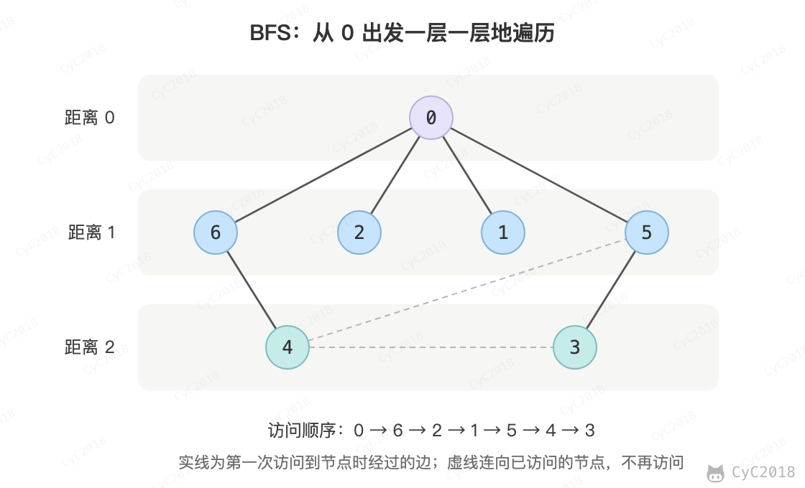 </div><br>

广度优先搜索一层一层地进行遍历，每层遍历都是以上一层遍历的结果作为起点，遍历一个距离能访问到的所有节点。需要注意的是，遍历过的节点不能再次被遍历。

第一层：

- 0 -\> {6,2,1,5}

第二层：

- 6 -\> {4}
- 2 -\> {}
- 1 -\> {}
- 5 -\> {3}

第三层：

- 4 -\> {}
- 3 -\> {}

每一层遍历的节点都与根节点距离相同。设 d<sub>i</sub> 表示第 i 个节点与根节点的距离，推导出一个结论：对于先遍历的节点 i 与后遍历的节点 j，有 d<sub>i</sub> <= d<sub>j</sub>。利用这个结论，可以求解最短路径等最优解问题：第一次遍历到目的节点，其所经过的路径为最短路径。需要注意的是，BFS 只能求解无权图的最短路径，无权图是指从一个节点到另一个节点的代价都记为 1。

在程序实现 BFS 时需要考虑以下问题：

- 队列：用来存储每一轮遍历得到的节点；
- 标记：对于遍历过的节点，应该将它标记，防止重复遍历。

下面的代码每轮先记下队列大小 size，取出的这 size 个节点正好是一层。

### 1. 计算在网格中从原点到特定点的最短路径长度

1091\. Shortest Path in Binary Matrix (Medium)

[Leetcode](https://leetcode.com/problems/shortest-path-in-binary-matrix/) / [力扣](https://leetcode-cn.com/problems/shortest-path-in-binary-matrix/)

```text
Input: grid = [[0,0,0],
               [1,1,0],
               [1,1,0]]
Output: 4
```

题目描述：0 表示可以经过，每一步可以走到相邻的 8 个格子（包括斜对角），求从左上角到右下角最少经过几个格子，无法到达时返回 -1。

```java
public int shortestPathBinaryMatrix(int[][] grids) {
    if (grids == null || grids.length == 0 || grids[0].length == 0) {
        return -1;
    }
    int[][] direction = {{1, -1}, {1, 0}, {1, 1}, {0, -1}, {0, 1}, {-1, -1}, {-1, 0}, {-1, 1}};
    int m = grids.length, n = grids[0].length;
    Queue<int[]> queue = new LinkedList<>();
    queue.add(new int[]{0, 0});
    int pathLength = 0;
    while (!queue.isEmpty()) {
        int size = queue.size();
        pathLength++;
        while (size-- > 0) {
            int[] cur = queue.poll();
            int cr = cur[0], cc = cur[1];
            if (grids[cr][cc] == 1) {
                continue;
            }
            if (cr == m - 1 && cc == n - 1) {
                return pathLength;
            }
            grids[cr][cc] = 1; // 标记
            for (int[] d : direction) {
                int nr = cr + d[0], nc = cc + d[1];
                if (nr < 0 || nr >= m || nc < 0 || nc >= n) {
                    continue;
                }
                queue.add(new int[]{nr, nc});
            }
        }
    }
    return -1;
}
```

### 2. 组成整数的最小平方数数量

279\. Perfect Squares (Medium)

[Leetcode](https://leetcode.com/problems/perfect-squares/description/) / [力扣](https://leetcode-cn.com/problems/perfect-squares/description/)

```text
For example, given n = 12, return 3 because 12 = 4 + 4 + 4; given n = 13, return 2 because 13 = 4 + 9.
```

可以将每个整数看成图中的一个节点，如果两个整数之差为一个平方数，那么这两个整数所在的节点就有一条边。

要求解最小的平方数数量，就是求解从节点 n 到节点 0 的最短路径。

本题也可以用动态规划求解，在之后动态规划部分中会再次出现。

```java
public int numSquares(int n) {
    List<Integer> squares = generateSquares(n);
    Queue<Integer> queue = new LinkedList<>();
    boolean[] marked = new boolean[n + 1];
    queue.add(n);
    marked[n] = true;
    int level = 0;
    while (!queue.isEmpty()) {
        int size = queue.size();
        level++;
        while (size-- > 0) {
            int cur = queue.poll();
            for (int s : squares) {
                int next = cur - s;
                if (next < 0) {
                    break;
                }
                if (next == 0) {
                    return level;
                }
                if (marked[next]) {
                    continue;
                }
                marked[next] = true;
                queue.add(next);
            }
        }
    }
    return n;
}

/**
 * 生成小于等于 n 的平方数序列
 * @return 1,4,9,...
 */
private List<Integer> generateSquares(int n) {
    List<Integer> squares = new ArrayList<>();
    int square = 1;
    int diff = 3;
    while (square <= n) {
        squares.add(square);
        square += diff;
        diff += 2;
    }
    return squares;
}
```

### 3. 最短单词路径

127\. Word Ladder (Hard)

[Leetcode](https://leetcode.com/problems/word-ladder/description/) / [力扣](https://leetcode-cn.com/problems/word-ladder/description/)

```text
Input:
beginWord = "hit",
endWord = "cog",
wordList = ["hot","dot","dog","lot","log","cog"]

Output: 5

Explanation: As one shortest transformation is "hit" -> "hot" -> "dot" -> "dog" -> "cog",
return its length 5.
```

```text
Input:
beginWord = "hit"
endWord = "cog"
wordList = ["hot","dot","dog","lot","log"]

Output: 0

Explanation: The endWord "cog" is not in wordList, therefore no possible transformation.
```

题目描述：找出一条从 beginWord 到 endWord 的最短路径，每次移动规定为改变一个字符，并且改变之后的字符串必须在 wordList 中。

把每个单词看成节点，只差一个字符的两个单词之间连一条边，问题就变成了无权图的最短路径。

```java
public int ladderLength(String beginWord, String endWord, List<String> wordList) {
    wordList.add(beginWord);
    int N = wordList.size();
    int start = N - 1;
    int end = 0;
    while (end < N && !wordList.get(end).equals(endWord)) {
        end++;
    }
    if (end == N) {
        return 0;
    }
    List<Integer>[] graphic = buildGraphic(wordList);
    return getShortestPath(graphic, start, end);
}

private List<Integer>[] buildGraphic(List<String> wordList) {
    int N = wordList.size();
    List<Integer>[] graphic = new List[N];
    for (int i = 0; i < N; i++) {
        graphic[i] = new ArrayList<>();
        for (int j = 0; j < N; j++) {
            if (isConnect(wordList.get(i), wordList.get(j))) {
                graphic[i].add(j);
            }
        }
    }
    return graphic;
}

private boolean isConnect(String s1, String s2) {
    int diffCnt = 0;
    for (int i = 0; i < s1.length() && diffCnt <= 1; i++) {
        if (s1.charAt(i) != s2.charAt(i)) {
            diffCnt++;
        }
    }
    return diffCnt == 1;
}

private int getShortestPath(List<Integer>[] graphic, int start, int end) {
    Queue<Integer> queue = new LinkedList<>();
    boolean[] marked = new boolean[graphic.length];
    queue.add(start);
    marked[start] = true;
    int path = 1;
    while (!queue.isEmpty()) {
        int size = queue.size();
        path++;
        while (size-- > 0) {
            int cur = queue.poll();
            for (int next : graphic[cur]) {
                if (next == end) {
                    return path;
                }
                if (marked[next]) {
                    continue;
                }
                marked[next] = true;
                queue.add(next);
            }
        }
    }
    return 0;
}
```

## DFS

<div align="center"> 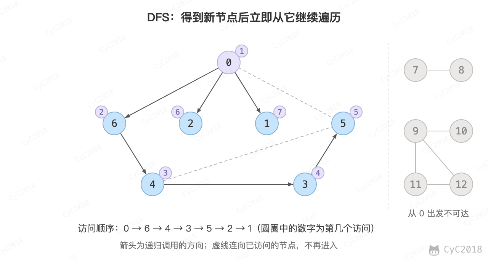 </div><br>

广度优先搜索一层一层遍历，每一层得到的所有新节点，要用队列存储起来以备下一层遍历的时候再遍历。

而深度优先搜索在得到一个新节点时立即对新节点进行遍历：从节点 0 出发开始遍历，得到新节点 6 时，立马对新节点 6 进行遍历，得到新节点 4；如此反复以这种方式遍历新节点，直到没有新节点了，此时返回。返回到根节点 0 的情况是，继续对根节点 0 进行遍历，得到新节点 2，然后继续以上步骤。

从一个节点出发，使用 DFS 对一个图进行遍历时，能够遍历到的节点都是从初始节点可达的，DFS 常用来求解这种可达性问题。

在程序实现 DFS 时需要考虑以下问题：

- 栈：用栈来保存当前节点信息，当遍历新节点返回时能够继续遍历当前节点，通常直接使用递归栈；
- 标记：和 BFS 一样同样需要对已经遍历过的节点进行标记。

### 1. 查找最大的连通面积

695\. Max Area of Island (Medium)

[Leetcode](https://leetcode.com/problems/max-area-of-island/description/) / [力扣](https://leetcode-cn.com/problems/max-area-of-island/description/)

```text
[[0,0,1,0,0,0,0,1,0,0,0,0,0],
 [0,0,0,0,0,0,0,1,1,1,0,0,0],
 [0,1,1,0,1,0,0,0,0,0,0,0,0],
 [0,1,0,0,1,1,0,0,1,0,1,0,0],
 [0,1,0,0,1,1,0,0,1,1,1,0,0],
 [0,0,0,0,0,0,0,0,0,0,1,0,0],
 [0,0,0,0,0,0,0,1,1,1,0,0,0],
 [0,0,0,0,0,0,0,1,1,0,0,0,0]]
```

题目描述：求上下左右相连的 1 组成的最大区域有多少个格子，上面的例子为 6。

```java
private int m, n;
private int[][] direction = {{0, 1}, {0, -1}, {1, 0}, {-1, 0}};

public int maxAreaOfIsland(int[][] grid) {
    if (grid == null || grid.length == 0) {
        return 0;
    }
    m = grid.length;
    n = grid[0].length;
    int maxArea = 0;
    for (int i = 0; i < m; i++) {
        for (int j = 0; j < n; j++) {
            maxArea = Math.max(maxArea, dfs(grid, i, j));
        }
    }
    return maxArea;
}

private int dfs(int[][] grid, int r, int c) {
    if (r < 0 || r >= m || c < 0 || c >= n || grid[r][c] == 0) {
        return 0;
    }
    grid[r][c] = 0;
    int area = 1;
    for (int[] d : direction) {
        area += dfs(grid, r + d[0], c + d[1]);
    }
    return area;
}
```

### 2. 矩阵中的连通分量数目

200\. Number of Islands (Medium)

[Leetcode](https://leetcode.com/problems/number-of-islands/description/) / [力扣](https://leetcode-cn.com/problems/number-of-islands/description/)

```text
Input:
11000
11000
00100
00011

Output: 3
```

可以将矩阵看成一张无向图，每个岛屿是一个连通分量，每次 DFS 把一整座岛屿改为 0，避免重复计数。

```java
private int m, n;
private int[][] direction = {{0, 1}, {0, -1}, {1, 0}, {-1, 0}};

public int numIslands(char[][] grid) {
    if (grid == null || grid.length == 0) {
        return 0;
    }
    m = grid.length;
    n = grid[0].length;
    int islandsNum = 0;
    for (int i = 0; i < m; i++) {
        for (int j = 0; j < n; j++) {
            if (grid[i][j] != '0') {
                dfs(grid, i, j);
                islandsNum++;
            }
        }
    }
    return islandsNum;
}

private void dfs(char[][] grid, int i, int j) {
    if (i < 0 || i >= m || j < 0 || j >= n || grid[i][j] == '0') {
        return;
    }
    grid[i][j] = '0';
    for (int[] d : direction) {
        dfs(grid, i + d[0], j + d[1]);
    }
}
```

需要注意的是，递归深度最多等于岛屿的格子数，300 × 300 的网格全是 1 时深达 9 万层，JDK 21 默认的线程栈会溢出（见[附录 A1](#a1-岛屿数量的递归深度)），这时可以把 dfs 换成下面的 BFS：

```java
private void bfs(char[][] grid, int i, int j) {
    Queue<int[]> queue = new LinkedList<>();
    queue.add(new int[]{i, j});
    grid[i][j] = '0';
    while (!queue.isEmpty()) {
        int[] cur = queue.poll();
        for (int[] d : direction) {
            int r = cur[0] + d[0], c = cur[1] + d[1];
            if (r < 0 || r >= m || c < 0 || c >= n || grid[r][c] == '0') {
                continue;
            }
            grid[r][c] = '0';
            queue.add(new int[]{r, c});
        }
    }
}
```

### 3. 好友关系的连通分量数目

547\. Number of Provinces (Medium)

[Leetcode](https://leetcode.com/problems/number-of-provinces/description/) / [力扣](https://leetcode-cn.com/problems/number-of-provinces/description/)

```text
Input:
[[1,1,0],
 [1,1,0],
 [0,0,1]]

Output: 2

Explanation:The 0th and 1st students are direct friends, so they are in a friend circle.
The 2nd student himself is in a friend circle. So return 2.
```

题目描述：好友关系可以看成是一个无向图，例如第 0 个人与第 1 个人是好友，那么 M[0][1] 和 M[1][0] 的值都为 1。

```java
private int n;

public int findCircleNum(int[][] M) {
    n = M.length;
    int circleNum = 0;
    boolean[] hasVisited = new boolean[n];
    for (int i = 0; i < n; i++) {
        if (!hasVisited[i]) {
            dfs(M, i, hasVisited);
            circleNum++;
        }
    }
    return circleNum;
}

private void dfs(int[][] M, int i, boolean[] hasVisited) {
    hasVisited[i] = true;
    for (int k = 0; k < n; k++) {
        if (M[i][k] == 1 && !hasVisited[k]) {
            dfs(M, k, hasVisited);
        }
    }
}
```

### 4. 填充封闭区域

130\. Surrounded Regions (Medium)

[Leetcode](https://leetcode.com/problems/surrounded-regions/description/) / [力扣](https://leetcode-cn.com/problems/surrounded-regions/description/)

```text
For example,
X X X X
X O O X
X X O X
X O X X

After running your function, the board should be:
X X X X
X X X X
X X X X
X O X X
```

题目描述：使被 'X' 包围的 'O' 转换为 'X'。

先填充最外侧，剩下的就是里侧了。

<div align="center"> 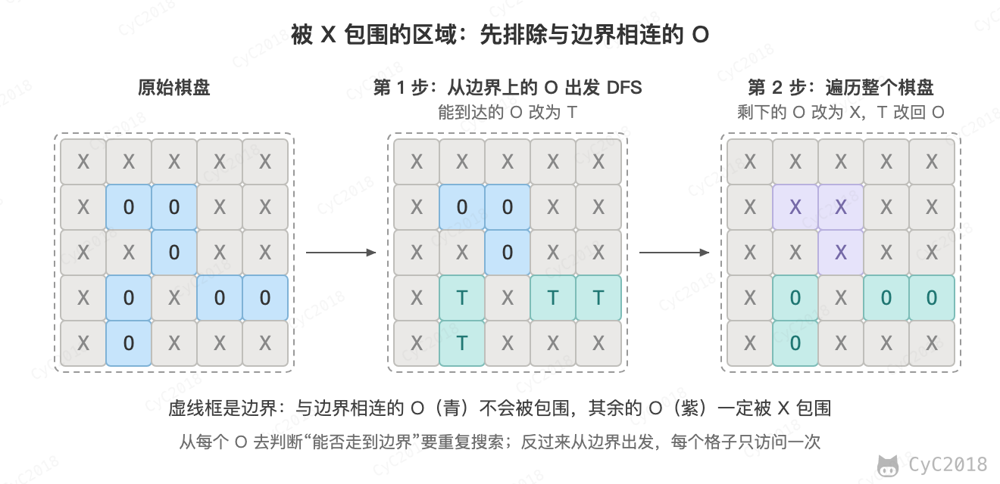 </div><br>

```java
private int[][] direction = {{0, 1}, {0, -1}, {1, 0}, {-1, 0}};
private int m, n;

public void solve(char[][] board) {
    if (board == null || board.length == 0) {
        return;
    }

    m = board.length;
    n = board[0].length;

    for (int i = 0; i < m; i++) {
        dfs(board, i, 0);
        dfs(board, i, n - 1);
    }
    for (int i = 0; i < n; i++) {
        dfs(board, 0, i);
        dfs(board, m - 1, i);
    }

    for (int i = 0; i < m; i++) {
        for (int j = 0; j < n; j++) {
            if (board[i][j] == 'T') {
                board[i][j] = 'O';
            } else if (board[i][j] == 'O') {
                board[i][j] = 'X';
            }
        }
    }
}

private void dfs(char[][] board, int r, int c) {
    if (r < 0 || r >= m || c < 0 || c >= n || board[r][c] != 'O') {
        return;
    }
    board[r][c] = 'T';
    for (int[] d : direction) {
        dfs(board, r + d[0], c + d[1]);
    }
}
```

### 5. 能到达的太平洋和大西洋的区域

417\. Pacific Atlantic Water Flow (Medium)

[Leetcode](https://leetcode.com/problems/pacific-atlantic-water-flow/description/) / [力扣](https://leetcode-cn.com/problems/pacific-atlantic-water-flow/description/)

```text
Given the following 5x5 matrix:

  Pacific ~   ~   ~   ~   ~
       ~  1   2   2   3  (5) *
       ~  3   2   3  (4) (4) *
       ~  2   4  (5)  3   1  *
       ~ (6) (7)  1   4   5  *
       ~ (5)  1   1   2   4  *
          *   *   *   *   * Atlantic

Return:
[[0, 4], [1, 3], [1, 4], [2, 2], [3, 0], [3, 1], [4, 0]] (positions with parentheses in above matrix).
```

左边和上边是太平洋，右边和下边是大西洋，内部的数字代表海拔，水能从一个格子流向海拔不高于它的相邻格子，求解水能够流到太平洋和大西洋的所有位置。

和上一题一样从边界出发：分别从两个大洋的沿岸逆着水流搜索，两边都能走到的格子就是答案。

<div align="center"> 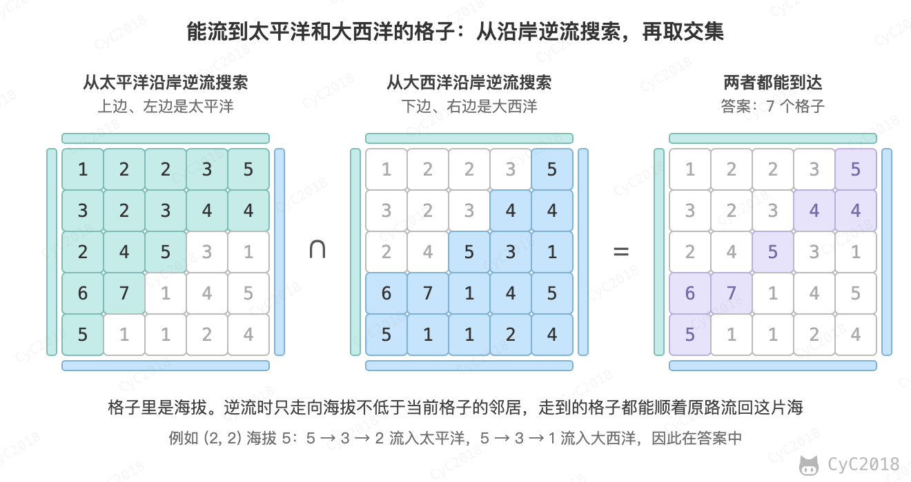 </div><br>

```java
private int m, n;
private int[][] matrix;
private int[][] direction = {{0, 1}, {0, -1}, {1, 0}, {-1, 0}};

public List<List<Integer>> pacificAtlantic(int[][] matrix) {
    List<List<Integer>> ret = new ArrayList<>();
    if (matrix == null || matrix.length == 0) {
        return ret;
    }

    m = matrix.length;
    n = matrix[0].length;
    this.matrix = matrix;
    boolean[][] canReachP = new boolean[m][n];
    boolean[][] canReachA = new boolean[m][n];

    for (int i = 0; i < m; i++) {
        dfs(i, 0, canReachP);
        dfs(i, n - 1, canReachA);
    }
    for (int i = 0; i < n; i++) {
        dfs(0, i, canReachP);
        dfs(m - 1, i, canReachA);
    }

    for (int i = 0; i < m; i++) {
        for (int j = 0; j < n; j++) {
            if (canReachP[i][j] && canReachA[i][j]) {
                ret.add(Arrays.asList(i, j));
            }
        }
    }

    return ret;
}

private void dfs(int r, int c, boolean[][] canReach) {
    if (canReach[r][c]) {
        return;
    }
    canReach[r][c] = true;
    for (int[] d : direction) {
        int nextR = d[0] + r;
        int nextC = d[1] + c;
        if (nextR < 0 || nextR >= m || nextC < 0 || nextC >= n
                || matrix[r][c] > matrix[nextR][nextC]) {

            continue;
        }
        dfs(nextR, nextC, canReach);
    }
}
```

## Backtracking

Backtracking（回溯）属于 DFS。

- 普通 DFS 主要用在可达性问题，这种问题只需要执行到特定的位置然后返回即可；
- 而 Backtracking 主要用于求解排列组合问题，例如有 { 'a','b','c' } 三个字符，求解所有由这三个字符排列得到的字符串，这种问题在执行到特定的位置返回之后还会继续执行求解过程。

各题的代码都是下面的结构，加入结果时要复制当前选择，因为这个列表之后还会被修改：

```text
backtracking(当前选择):
    if 满足结束条件:
        结果.add(复制当前选择)
        return
    for 候选 in 这一层的候选:
        if 不合法: continue
        做选择（加入列表、标记已访问）
        backtracking(当前选择)
        撤销选择（移出列表、取消标记）
```

因为 Backtracking 不是立即返回，而要继续求解，因此在程序实现时，需要注意对元素的标记问题：

- 在访问一个新元素进入新的递归调用时，需要将新元素标记为已经访问，这样才能在继续递归调用时不用重复访问该元素；
- 但是在递归返回时，需要将元素标记为未访问，因为只需要保证在一个递归链中不同时访问一个元素，可以访问已经访问过但是不在当前递归链中的元素。

[岛屿数量](#2-矩阵中的连通分量数目)的标记表示格子已经处理过，不再撤销；[在矩阵中寻找字符串](#3-在矩阵中寻找字符串)的标记表示格子在当前路径上，换一条路径时要撤销。

### 1. 数字键盘组合

17\. Letter Combinations of a Phone Number (Medium)

[Leetcode](https://leetcode.com/problems/letter-combinations-of-a-phone-number/description/) / [力扣](https://leetcode-cn.com/problems/letter-combinations-of-a-phone-number/description/)

<div align="center"> 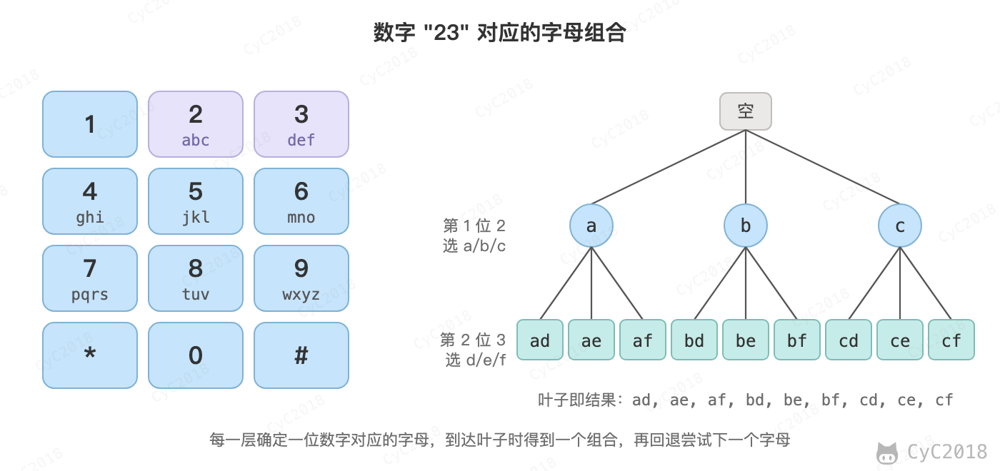 </div><br>

```text
Input:Digit string "23"
Output: ["ad", "ae", "af", "bd", "be", "bf", "cd", "ce", "cf"].
```

```java
private static final String[] KEYS = {"", "", "abc", "def", "ghi", "jkl", "mno", "pqrs", "tuv", "wxyz"};

public List<String> letterCombinations(String digits) {
    List<String> combinations = new ArrayList<>();
    if (digits == null || digits.length() == 0) {
        return combinations;
    }
    doCombination(new StringBuilder(), combinations, digits);
    return combinations;
}

private void doCombination(StringBuilder prefix, List<String> combinations, final String digits) {
    if (prefix.length() == digits.length()) {
        combinations.add(prefix.toString());
        return;
    }
    int curDigits = digits.charAt(prefix.length()) - '0';
    String letters = KEYS[curDigits];
    for (char c : letters.toCharArray()) {
        prefix.append(c);                         // 添加
        doCombination(prefix, combinations, digits);
        prefix.deleteCharAt(prefix.length() - 1); // 删除
    }
}
```

### 2. IP 地址划分

93\. Restore IP Addresses (Medium)

[Leetcode](https://leetcode.com/problems/restore-ip-addresses/description/) / [力扣](https://leetcode-cn.com/problems/restore-ip-addresses/description/)

```text
Given "25525511135",
return ["255.255.11.135", "255.255.111.35"].
```

每一层截取 1～3 个字符作为一段，段的值不超过 255 且不能有前导 0；截满 4 段且正好用完字符时得到一个结果。

```java
public List<String> restoreIpAddresses(String s) {
    List<String> addresses = new ArrayList<>();
    StringBuilder tempAddress = new StringBuilder();
    doRestore(0, tempAddress, addresses, s);
    return addresses;
}

private void doRestore(int k, StringBuilder tempAddress, List<String> addresses, String s) {
    if (k == 4 || s.length() == 0) {
        if (k == 4 && s.length() == 0) {
            addresses.add(tempAddress.toString());
        }
        return;
    }
    for (int i = 0; i < s.length() && i <= 2; i++) {
        if (i != 0 && s.charAt(0) == '0') {
            break;
        }
        String part = s.substring(0, i + 1);
        if (Integer.valueOf(part) <= 255) {
            if (tempAddress.length() != 0) {
                part = "." + part;
            }
            tempAddress.append(part);
            doRestore(k + 1, tempAddress, addresses, s.substring(i + 1));
            tempAddress.delete(tempAddress.length() - part.length(), tempAddress.length());
        }
    }
}
```

### 3. 在矩阵中寻找字符串

79\. Word Search (Medium)

[Leetcode](https://leetcode.com/problems/word-search/description/) / [力扣](https://leetcode-cn.com/problems/word-search/description/)

```text
For example,
Given board =
[
  ['A','B','C','E'],
  ['S','F','C','S'],
  ['A','D','E','E']
]
word = "ABCCED", -> returns true,
word = "SEE", -> returns true,
word = "ABCB", -> returns false.
```

同一个格子在一条路径中只能用一次，例如 "ABCB" 走到 C 之后，相邻的 B 已经在路径上，因此返回 false。

```java
private final static int[][] direction = {{1, 0}, {-1, 0}, {0, 1}, {0, -1}};
private int m;
private int n;

public boolean exist(char[][] board, String word) {
    if (word == null || word.length() == 0) {
        return true;
    }
    if (board == null || board.length == 0 || board[0].length == 0) {
        return false;
    }

    m = board.length;
    n = board[0].length;
    boolean[][] hasVisited = new boolean[m][n];

    for (int r = 0; r < m; r++) {
        for (int c = 0; c < n; c++) {
            if (backtracking(0, r, c, hasVisited, board, word)) {
                return true;
            }
        }
    }

    return false;
}

private boolean backtracking(int curLen, int r, int c, boolean[][] visited, final char[][] board, final String word) {
    if (curLen == word.length()) {
        return true;
    }
    if (r < 0 || r >= m || c < 0 || c >= n
            || board[r][c] != word.charAt(curLen) || visited[r][c]) {

        return false;
    }

    visited[r][c] = true;

    for (int[] d : direction) {
        if (backtracking(curLen + 1, r + d[0], c + d[1], visited, board, word)) {
            return true;
        }
    }

    visited[r][c] = false;

    return false;
}
```

### 4. 输出二叉树中所有从根到叶子的路径

257\. Binary Tree Paths (Easy)

[Leetcode](https://leetcode.com/problems/binary-tree-paths/description/) / [力扣](https://leetcode-cn.com/problems/binary-tree-paths/description/)

```text
  1
 /  \
2    3
 \
  5
```

```text
["1->2->5", "1->3"]
```

```java
public List<String> binaryTreePaths(TreeNode root) {
    List<String> paths = new ArrayList<>();
    if (root == null) {
        return paths;
    }
    List<Integer> values = new ArrayList<>();
    backtracking(root, values, paths);
    return paths;
}

private void backtracking(TreeNode node, List<Integer> values, List<String> paths) {
    if (node == null) {
        return;
    }
    values.add(node.val);
    if (isLeaf(node)) {
        paths.add(buildPath(values));
    } else {
        backtracking(node.left, values, paths);
        backtracking(node.right, values, paths);
    }
    values.remove(values.size() - 1);
}

private boolean isLeaf(TreeNode node) {
    return node.left == null && node.right == null;
}

private String buildPath(List<Integer> values) {
    StringBuilder str = new StringBuilder();
    for (int i = 0; i < values.size(); i++) {
        str.append(values.get(i));
        if (i != values.size() - 1) {
            str.append("->");
        }
    }
    return str.toString();
}
```

### 5. 排列

46\. Permutations (Medium)

[Leetcode](https://leetcode.com/problems/permutations/description/) / [力扣](https://leetcode-cn.com/problems/permutations/description/)

```text
[1,2,3] have the following permutations:
[
  [1,2,3],
  [1,3,2],
  [2,1,3],
  [2,3,1],
  [3,1,2],
  [3,2,1]
]
```

下图是 [1,2,3] 的前 12 步：

<div align="center"> 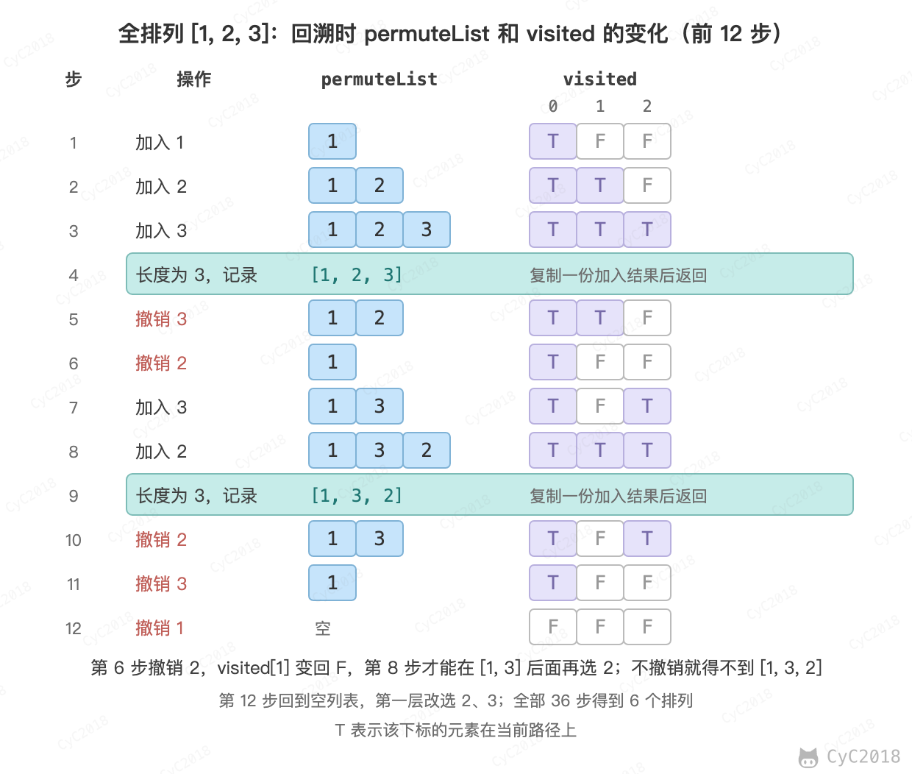 </div><br>

```java
public List<List<Integer>> permute(int[] nums) {
    List<List<Integer>> permutes = new ArrayList<>();
    List<Integer> permuteList = new ArrayList<>();
    boolean[] hasVisited = new boolean[nums.length];
    backtracking(permuteList, permutes, hasVisited, nums);
    return permutes;
}

private void backtracking(List<Integer> permuteList, List<List<Integer>> permutes, boolean[] visited, final int[] nums) {
    if (permuteList.size() == nums.length) {
        permutes.add(new ArrayList<>(permuteList)); // 重新构造一个 List
        return;
    }
    for (int i = 0; i < visited.length; i++) {
        if (visited[i]) {
            continue;
        }
        visited[i] = true;
        permuteList.add(nums[i]);
        backtracking(permuteList, permutes, visited, nums);
        permuteList.remove(permuteList.size() - 1);
        visited[i] = false;
    }
}
```

### 6. 含有相同元素求排列

47\. Permutations II (Medium)

[Leetcode](https://leetcode.com/problems/permutations-ii/description/) / [力扣](https://leetcode-cn.com/problems/permutations-ii/description/)

```text
[1,1,2] have the following unique permutations:
[[1,1,2], [1,2,1], [2,1,1]]
```

数组元素可能含有相同的元素，进行排列时就有可能出现重复的排列，要求重复的排列只返回一个。

和 Permutations 不同的是要先排序，让相同的元素相邻；添加一个元素时，如果它等于前一个元素，并且前一个元素还未访问，就跳过这个元素。

这样值相同的元素只能按下标顺序进入路径，每个排列只生成一次：

<div align="center"> 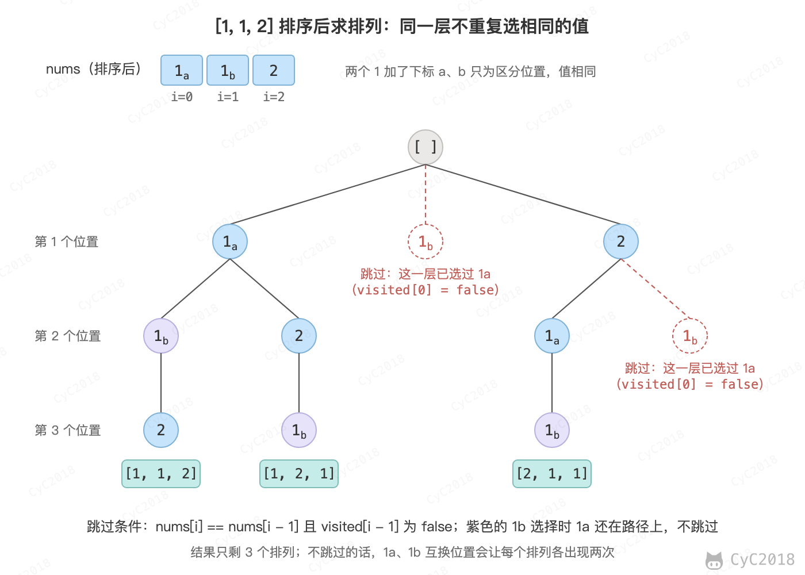 </div><br>

```java
public List<List<Integer>> permuteUnique(int[] nums) {
    List<List<Integer>> permutes = new ArrayList<>();
    List<Integer> permuteList = new ArrayList<>();
    Arrays.sort(nums);  // 排序
    boolean[] hasVisited = new boolean[nums.length];
    backtracking(permuteList, permutes, hasVisited, nums);
    return permutes;
}

private void backtracking(List<Integer> permuteList, List<List<Integer>> permutes, boolean[] visited, final int[] nums) {
    if (permuteList.size() == nums.length) {
        permutes.add(new ArrayList<>(permuteList));
        return;
    }

    for (int i = 0; i < visited.length; i++) {
        if (i != 0 && nums[i] == nums[i - 1] && !visited[i - 1]) {
            continue;  // 防止重复
        }
        if (visited[i]){
            continue;
        }
        visited[i] = true;
        permuteList.add(nums[i]);
        backtracking(permuteList, permutes, visited, nums);
        permuteList.remove(permuteList.size() - 1);
        visited[i] = false;
    }
}
```

### 7. 组合

77\. Combinations (Medium)

[Leetcode](https://leetcode.com/problems/combinations/description/) / [力扣](https://leetcode-cn.com/problems/combinations/description/)

```text
If n = 4 and k = 2, a solution is:
[
  [2,4],
  [3,4],
  [2,3],
  [1,2],
  [1,3],
  [1,4],
]
```

组合不考虑顺序，所以每一层只从比上一个数大的数中选，选出的组合递增，不会重复。

```java
public List<List<Integer>> combine(int n, int k) {
    List<List<Integer>> combinations = new ArrayList<>();
    List<Integer> combineList = new ArrayList<>();
    backtracking(combineList, combinations, 1, k, n);
    return combinations;
}

private void backtracking(List<Integer> combineList, List<List<Integer>> combinations, int start, int k, final int n) {
    if (k == 0) {
        combinations.add(new ArrayList<>(combineList));
        return;
    }
    for (int i = start; i <= n - k + 1; i++) {  // 剪枝：后面至少还要剩下 k - 1 个数
        combineList.add(i);
        backtracking(combineList, combinations, i + 1, k - 1, n);
        combineList.remove(combineList.size() - 1);
    }
}
```

### 8. 组合求和

39\. Combination Sum (Medium)

[Leetcode](https://leetcode.com/problems/combination-sum/description/) / [力扣](https://leetcode-cn.com/problems/combination-sum/description/)

```text
given candidate set [2, 3, 6, 7] and target 7,
A solution set is:
[[7],[2, 2, 3]]
```

每个数可以重复选取，所以递归时传入 i 而不是 i + 1。

```java
public List<List<Integer>> combinationSum(int[] candidates, int target) {
    List<List<Integer>> combinations = new ArrayList<>();
    backtracking(new ArrayList<>(), combinations, 0, target, candidates);
    return combinations;
}

private void backtracking(List<Integer> tempCombination, List<List<Integer>> combinations,
                          int start, int target, final int[] candidates) {

    if (target == 0) {
        combinations.add(new ArrayList<>(tempCombination));
        return;
    }
    for (int i = start; i < candidates.length; i++) {
        if (candidates[i] <= target) {
            tempCombination.add(candidates[i]);
            backtracking(tempCombination, combinations, i, target - candidates[i], candidates);
            tempCombination.remove(tempCombination.size() - 1);
        }
    }
}
```

### 9. 含有相同元素的组合求和

40\. Combination Sum II (Medium)

[Leetcode](https://leetcode.com/problems/combination-sum-ii/description/) / [力扣](https://leetcode-cn.com/problems/combination-sum-ii/description/)

```text
For example, given candidate set [10, 1, 2, 7, 6, 1, 5] and target 8,
A solution set is:
[
  [1, 7],
  [1, 2, 5],
  [2, 6],
  [1, 1, 6]
]
```

每个数只能用一次，递归时传入 i + 1；数组中有重复的数，去重方法与 [含有相同元素求排列](#6-含有相同元素求排列) 相同。

```java
public List<List<Integer>> combinationSum2(int[] candidates, int target) {
    List<List<Integer>> combinations = new ArrayList<>();
    Arrays.sort(candidates);
    backtracking(new ArrayList<>(), combinations, new boolean[candidates.length], 0, target, candidates);
    return combinations;
}

private void backtracking(List<Integer> tempCombination, List<List<Integer>> combinations,
                          boolean[] hasVisited, int start, int target, final int[] candidates) {

    if (target == 0) {
        combinations.add(new ArrayList<>(tempCombination));
        return;
    }
    for (int i = start; i < candidates.length; i++) {
        if (i != 0 && candidates[i] == candidates[i - 1] && !hasVisited[i - 1]) {
            continue;
        }
        if (candidates[i] <= target) {
            tempCombination.add(candidates[i]);
            hasVisited[i] = true;
            backtracking(tempCombination, combinations, hasVisited, i + 1, target - candidates[i], candidates);
            hasVisited[i] = false;
            tempCombination.remove(tempCombination.size() - 1);
        }
    }
}
```

### 10. 1-9 数字的组合求和

216\. Combination Sum III (Medium)

[Leetcode](https://leetcode.com/problems/combination-sum-iii/description/) / [力扣](https://leetcode-cn.com/problems/combination-sum-iii/description/)

```text
Input: k = 3, n = 9

Output:

[[1,2,6], [1,3,5], [2,3,4]]
```

从 1～9 中选出 k 个不重复的数，使得它们的和为 n，写法与 [组合](#7-组合) 相同。

```java
public List<List<Integer>> combinationSum3(int k, int n) {
    List<List<Integer>> combinations = new ArrayList<>();
    List<Integer> path = new ArrayList<>();
    backtracking(k, n, 1, path, combinations);
    return combinations;
}

private void backtracking(int k, int n, int start,
                          List<Integer> tempCombination, List<List<Integer>> combinations) {

    if (k == 0 && n == 0) {
        combinations.add(new ArrayList<>(tempCombination));
        return;
    }
    if (k == 0 || n == 0) {
        return;
    }
    for (int i = start; i <= 9; i++) {
        tempCombination.add(i);
        backtracking(k - 1, n - i, i + 1, tempCombination, combinations);
        tempCombination.remove(tempCombination.size() - 1);
    }
}
```

### 11. 子集

78\. Subsets (Medium)

[Leetcode](https://leetcode.com/problems/subsets/description/) / [力扣](https://leetcode-cn.com/problems/subsets/description/)

找出集合的所有子集，子集不能重复，[1, 2] 和 [2, 1] 这种子集算重复。

子集就是大小为 0～n 的所有组合，对每种大小各做一次组合的回溯。

```java
public List<List<Integer>> subsets(int[] nums) {
    List<List<Integer>> subsets = new ArrayList<>();
    List<Integer> tempSubset = new ArrayList<>();
    for (int size = 0; size <= nums.length; size++) {
        backtracking(0, tempSubset, subsets, size, nums); // 不同的子集大小
    }
    return subsets;
}

private void backtracking(int start, List<Integer> tempSubset, List<List<Integer>> subsets,
                          final int size, final int[] nums) {

    if (tempSubset.size() == size) {
        subsets.add(new ArrayList<>(tempSubset));
        return;
    }
    for (int i = start; i < nums.length; i++) {
        tempSubset.add(nums[i]);
        backtracking(i + 1, tempSubset, subsets, size, nums);
        tempSubset.remove(tempSubset.size() - 1);
    }
}
```

### 12. 含有相同元素求子集

90\. Subsets II (Medium)

[Leetcode](https://leetcode.com/problems/subsets-ii/description/) / [力扣](https://leetcode-cn.com/problems/subsets-ii/description/)

```text
For example,
If nums = [1,2,2], a solution is:

[
  [2],
  [1],
  [1,2,2],
  [2,2],
  [1,2],
  []
]
```

去重方法与 [含有相同元素求排列](#6-含有相同元素求排列) 相同。

```java
public List<List<Integer>> subsetsWithDup(int[] nums) {
    Arrays.sort(nums);
    List<List<Integer>> subsets = new ArrayList<>();
    List<Integer> tempSubset = new ArrayList<>();
    boolean[] hasVisited = new boolean[nums.length];
    for (int size = 0; size <= nums.length; size++) {
        backtracking(0, tempSubset, subsets, hasVisited, size, nums); // 不同的子集大小
    }
    return subsets;
}

private void backtracking(int start, List<Integer> tempSubset, List<List<Integer>> subsets, boolean[] hasVisited,
                          final int size, final int[] nums) {

    if (tempSubset.size() == size) {
        subsets.add(new ArrayList<>(tempSubset));
        return;
    }
    for (int i = start; i < nums.length; i++) {
        if (i != 0 && nums[i] == nums[i - 1] && !hasVisited[i - 1]) {
            continue;
        }
        tempSubset.add(nums[i]);
        hasVisited[i] = true;
        backtracking(i + 1, tempSubset, subsets, hasVisited, size, nums);
        hasVisited[i] = false;
        tempSubset.remove(tempSubset.size() - 1);
    }
}
```

### 13. 分割字符串使得每个部分都是回文数

131\. Palindrome Partitioning (Medium)

[Leetcode](https://leetcode.com/problems/palindrome-partitioning/description/) / [力扣](https://leetcode-cn.com/problems/palindrome-partitioning/description/)

```text
For example, given s = "aab",
Return

[
  ["aa","b"],
  ["a","a","b"]
]
```

每一层从剩余字符串的开头切出一段回文串，再对剩下的部分递归。

```java
public List<List<String>> partition(String s) {
    List<List<String>> partitions = new ArrayList<>();
    List<String> tempPartition = new ArrayList<>();
    doPartition(s, partitions, tempPartition);
    return partitions;
}

private void doPartition(String s, List<List<String>> partitions, List<String> tempPartition) {
    if (s.length() == 0) {
        partitions.add(new ArrayList<>(tempPartition));
        return;
    }
    for (int i = 0; i < s.length(); i++) {
        if (isPalindrome(s, 0, i)) {
            tempPartition.add(s.substring(0, i + 1));
            doPartition(s.substring(i + 1), partitions, tempPartition);
            tempPartition.remove(tempPartition.size() - 1);
        }
    }
}

private boolean isPalindrome(String s, int begin, int end) {
    while (begin < end) {
        if (s.charAt(begin++) != s.charAt(end--)) {
            return false;
        }
    }
    return true;
}
```

### 14. 数独

37\. Sudoku Solver (Hard)

[Leetcode](https://leetcode.com/problems/sudoku-solver/description/) / [力扣](https://leetcode-cn.com/problems/sudoku-solver/description/)

<div align="center"> 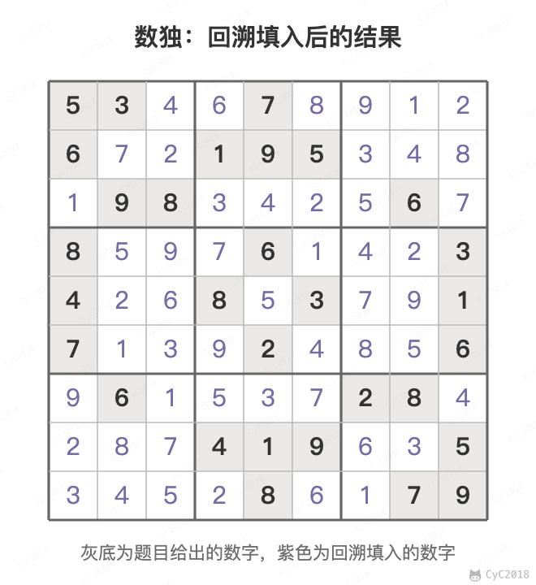 </div><br>

用三个标记数组记录每一行、每一列、每一个 3 \* 3 宫中已经出现的数字。找到一个解就返回 true，不再撤销，棋盘上留下的就是答案。

```java
private boolean[][] rowsUsed = new boolean[9][10];
private boolean[][] colsUsed = new boolean[9][10];
private boolean[][] cubesUsed = new boolean[9][10];
private char[][] board;

public void solveSudoku(char[][] board) {
    this.board = board;
    for (int i = 0; i < 9; i++) {
        for (int j = 0; j < 9; j++) {
            if (board[i][j] == '.') {
                continue;
            }
            int num = board[i][j] - '0';
            rowsUsed[i][num] = true;
            colsUsed[j][num] = true;
            cubesUsed[cubeNum(i, j)][num] = true;
        }
    }
    backtracking(0, 0);
}

private boolean backtracking(int row, int col) {
    while (row < 9 && board[row][col] != '.') {
        row = col == 8 ? row + 1 : row;
        col = col == 8 ? 0 : col + 1;
    }
    if (row == 9) {
        return true;
    }
    for (int num = 1; num <= 9; num++) {
        if (rowsUsed[row][num] || colsUsed[col][num] || cubesUsed[cubeNum(row, col)][num]) {
            continue;
        }
        rowsUsed[row][num] = colsUsed[col][num] = cubesUsed[cubeNum(row, col)][num] = true;
        board[row][col] = (char) (num + '0');
        if (backtracking(row, col)) {
            return true;
        }
        board[row][col] = '.';
        rowsUsed[row][num] = colsUsed[col][num] = cubesUsed[cubeNum(row, col)][num] = false;
    }
    return false;
}

private int cubeNum(int i, int j) {
    int r = i / 3;
    int c = j / 3;
    return r * 3 + c;
}
```

### 15. N 皇后

51\. N-Queens (Hard)

[Leetcode](https://leetcode.com/problems/n-queens/description/) / [力扣](https://leetcode-cn.com/problems/n-queens/description/)

<div align="center"> 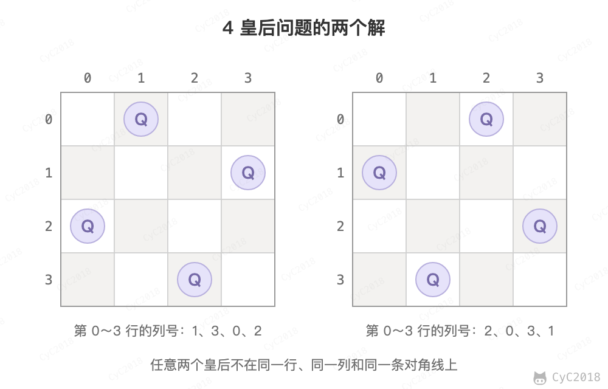 </div><br>

在 n\*n 的矩阵中摆放 n 个皇后，并且每个皇后不能在同一行，同一列，同一对角线上，求所有的 n 皇后的解。

一行一行地摆放，在确定一行中的那个皇后应该摆在哪一列时，需要用三个标记数组来确定某一列是否合法，这三个标记数组分别为：列标记数组、45 度对角线标记数组和 135 度对角线标记数组。

45 度对角线标记数组的长度为 2 \* n - 1，通过下图可以明确 (r, c) 的位置所在的数组下标为 r + c。

<div align="center"> 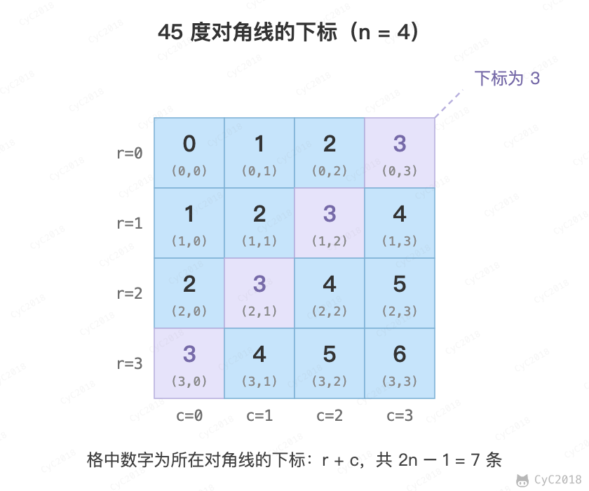 </div><br>


135 度对角线标记数组的长度也是 2 \* n - 1，(r, c) 的位置所在的数组下标为 n - 1 - (r - c)。

<div align="center"> 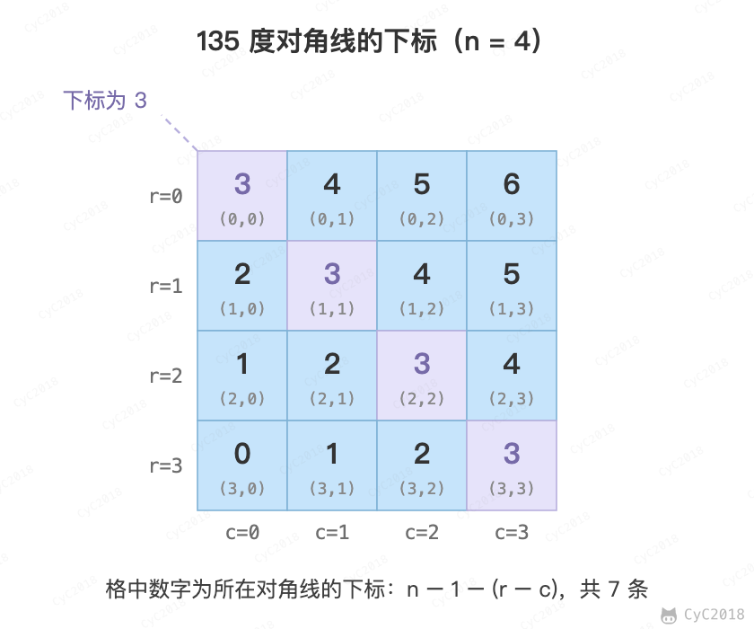 </div><br>

```java
private List<List<String>> solutions;
private char[][] nQueens;
private boolean[] colUsed;
private boolean[] diagonals45Used;
private boolean[] diagonals135Used;
private int n;

public List<List<String>> solveNQueens(int n) {
    solutions = new ArrayList<>();
    nQueens = new char[n][n];
    for (int i = 0; i < n; i++) {
        Arrays.fill(nQueens[i], '.');
    }
    colUsed = new boolean[n];
    diagonals45Used = new boolean[2 * n - 1];
    diagonals135Used = new boolean[2 * n - 1];
    this.n = n;
    backtracking(0);
    return solutions;
}

private void backtracking(int row) {
    if (row == n) {
        List<String> list = new ArrayList<>();
        for (char[] chars : nQueens) {
            list.add(new String(chars));
        }
        solutions.add(list);
        return;
    }

    for (int col = 0; col < n; col++) {
        int diagonals45Idx = row + col;
        int diagonals135Idx = n - 1 - (row - col);
        if (colUsed[col] || diagonals45Used[diagonals45Idx] || diagonals135Used[diagonals135Idx]) {
            continue;
        }
        nQueens[row][col] = 'Q';
        colUsed[col] = diagonals45Used[diagonals45Idx] = diagonals135Used[diagonals135Idx] = true;
        backtracking(row + 1);
        colUsed[col] = diagonals45Used[diagonals45Idx] = diagonals135Used[diagonals135Idx] = false;
        nQueens[row][col] = '.';
    }
}
```

## 附录：实测

### A1. 岛屿数量的递归深度

环境：JDK 21.0.13（Temurin，macOS arm64，默认 ThreadStackSize = 2048 KB）。全为 1 的 N × N 网格，用与正文相同的 dfs（方向顺序右、左、下、上，会蛇形走完整个网格）并统计最大递归深度，命令为 `java Deep200 N`：

```java
static int depth, maxDepth;

static void dfs(char[][] g, int i, int j) {
    if (i < 0 || i >= m || j < 0 || j >= n || g[i][j] == '0') return;
    depth++;
    maxDepth = Math.max(maxDepth, depth);
    g[i][j] = '0';
    for (int[] d : direction) dfs(g, i + d[0], j + d[1]);
    depth--;
}

// main 中：全 1 的 N × N 网格
try {
    dfs(grid, 0, 0);
    System.out.println(N + "x" + N + " all 1: max recursion depth " + maxDepth);
} catch (StackOverflowError e) {
    System.out.println(N + "x" + N + " all 1: StackOverflowError at depth " + depth);
}
```

```text
# 第一次运行
100x100 all 1: max recursion depth 10000
200x200 all 1: StackOverflowError at depth 26231
300x300 all 1: StackOverflowError at depth 25541
# 第二次运行
100x100 all 1: max recursion depth 10000
200x200 all 1: StackOverflowError at depth 21931
300x300 all 1: StackOverflowError at depth 14533
```

正文的 numIslands 在 200 × 200 和 300 × 300 时同样抛出 StackOverflowError；换成 BFS 后三种规模都返回 1。溢出的深度与栈帧大小、JIT 编译状态有关，每次运行不同。

## 参考资料

- [LeetCode 题库](https://leetcode.com/problemset/)
- Sedgewick R, Wayne K. 算法（第 4 版）[M]. 人民邮电出版社, 2012.
- [Algorithms, 4th Edition](https://algs4.cs.princeton.edu/home/)
