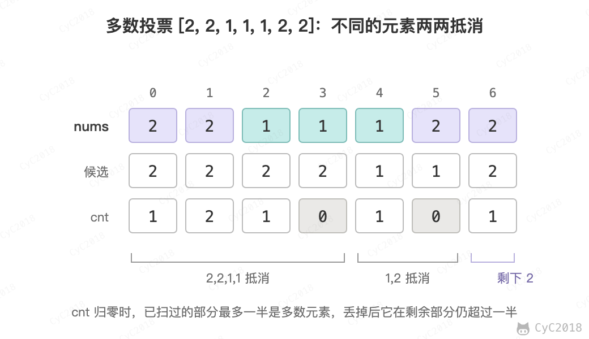

# Leetcode 题解 - 数学
<!-- GFM-TOC -->
* [Leetcode 题解 - 数学](#leetcode-题解---数学)
    * [素数分解](#素数分解)
    * [整除](#整除)
    * [最大公约数最小公倍数](#最大公约数最小公倍数)
        * [1. 生成素数序列](#1-生成素数序列)
        * [2. 最大公约数](#2-最大公约数)
        * [3. 使用位操作和减法求解最大公约数](#3-使用位操作和减法求解最大公约数)
    * [进制转换](#进制转换)
        * [1. 7 进制](#1-7-进制)
        * [2. 16 进制](#2-16-进制)
        * [3. 26 进制](#3-26-进制)
    * [阶乘](#阶乘)
        * [1. 统计阶乘尾部有多少个 0](#1-统计阶乘尾部有多少个-0)
    * [字符串加法减法](#字符串加法减法)
        * [1. 二进制加法](#1-二进制加法)
        * [2. 字符串加法](#2-字符串加法)
    * [相遇问题](#相遇问题)
        * [1. 改变数组元素使所有的数组元素都相等](#1-改变数组元素使所有的数组元素都相等)
    * [多数投票问题](#多数投票问题)
        * [1. 数组中出现次数多于 n / 2 的元素](#1-数组中出现次数多于-n--2-的元素)
    * [其它](#其它)
        * [1. 平方数](#1-平方数)
        * [2. 3 的 n 次方](#2-3-的-n-次方)
        * [3. 乘积数组](#3-乘积数组)
        * [4. 找出数组中的乘积最大的三个数](#4-找出数组中的乘积最大的三个数)
        * [5. 用 Rand7() 实现 Rand10()](#5-用-rand7-实现-rand10)
    * [参考资料](#参考资料)
<!-- GFM-TOC -->


## 素数分解

每一个数都可以分解成素数的乘积，例如 84 = 2<sup>2</sup> \* 3<sup>1</sup> \* 5<sup>0</sup> \* 7<sup>1</sup> \* 11<sup>0</sup> \* 13<sup>0</sup> \* 17<sup>0</sup> \* …

## 整除

令 x = 2<sup>m0</sup> \* 3<sup>m1</sup> \* 5<sup>m2</sup> \* 7<sup>m3</sup> \* 11<sup>m4</sup> \* …

令 y = 2<sup>n0</sup> \* 3<sup>n1</sup> \* 5<sup>n2</sup> \* 7<sup>n3</sup> \* 11<sup>n4</sup> \* …

如果 x 整除 y（y mod x == 0），则对于所有 i，mi \<= ni。

## 最大公约数最小公倍数

x 和 y 的最大公约数为：gcd(x,y) =  2<sup>min(m0,n0)</sup> \* 3<sup>min(m1,n1)</sup> \* 5<sup>min(m2,n2)</sup> \* ...

x 和 y 的最小公倍数为：lcm(x,y) =  2<sup>max(m0,n0)</sup> \* 3<sup>max(m1,n1)</sup> \* 5<sup>max(m2,n2)</sup> \* ...

### 1. 生成素数序列

204\. Count Primes (Medium)

[Leetcode](https://leetcode.com/problems/count-primes/description/) / [力扣](https://leetcode-cn.com/problems/count-primes/description/)

埃拉托斯特尼筛法在每次找到一个素数时，将能被素数整除的数排除掉。

```java
public int countPrimes(int n) {
    boolean[] notPrimes = new boolean[n + 1];
    int count = 0;
    for (int i = 2; i < n; i++) {
        if (notPrimes[i]) {
            continue;
        }
        count++;
        // 从 i * i 开始，因为如果 k < i，那么 k * i 在之前就已经被去除过了
        for (long j = (long) (i) * i; j < n; j += i) {
            notPrimes[(int) j] = true;
        }
    }
    return count;
}
```

### 2. 最大公约数

```java
int gcd(int a, int b) {
    return b == 0 ? a : gcd(b, a % b);
}
```

最小公倍数为两数的乘积除以最大公约数。

```java
int lcm(int a, int b) {
    return a / gcd(a, b) * b; // 先除后乘，避免 a * b 溢出
}
```

### 3. 使用位操作和减法求解最大公约数

《编程之美》2.7

对于 a 和 b 的最大公约数 f(a, b)，有：

- 如果 a 和 b 均为偶数，f(a, b) = 2\*f(a/2, b/2)；
- 如果 a 是偶数 b 是奇数，f(a, b) = f(a/2, b)；
- 如果 b 是偶数 a 是奇数，f(a, b) = f(a, b/2)；
- 如果 a 和 b 均为奇数，f(a, b) = f(b, a-b)。

乘 2 和除 2 都可以转换为移位操作。

```java
public int gcd(int a, int b) {
    if (a < b) {
        return gcd(b, a);
    }
    if (b == 0) {
        return a;
    }
    boolean isAEven = isEven(a), isBEven = isEven(b);
    if (isAEven && isBEven) {
        return 2 * gcd(a >> 1, b >> 1);
    } else if (isAEven && !isBEven) {
        return gcd(a >> 1, b);
    } else if (!isAEven && isBEven) {
        return gcd(a, b >> 1);
    } else {
        return gcd(b, a - b);
    }
}

private boolean isEven(int x) {
    return (x & 1) == 0;
}
```

## 进制转换

### 1. 7 进制

504\. Base 7 (Easy)

[Leetcode](https://leetcode.com/problems/base-7/description/) / [力扣](https://leetcode-cn.com/problems/base-7/description/)

```java
public String convertToBase7(int num) {
    if (num == 0) {
        return "0";
    }
    StringBuilder sb = new StringBuilder();
    boolean isNegative = num < 0;
    if (isNegative) {
        num = -num;
    }
    while (num > 0) {
        sb.append(num % 7);
        num /= 7;
    }
    String ret = sb.reverse().toString();
    return isNegative ? "-" + ret : ret;
}
```

Java 中 static String toString(int num, int radix) 可以将一个整数转换为 radix 进制表示的字符串。

```java
public String convertToBase7(int num) {
    return Integer.toString(num, 7);
}
```

### 2. 16 进制

405\. Convert a Number to Hexadecimal (Easy)

[Leetcode](https://leetcode.com/problems/convert-a-number-to-hexadecimal/description/) / [力扣](https://leetcode-cn.com/problems/convert-a-number-to-hexadecimal/description/)

```text
Input:
26

Output:
"1a"

Input:
-1

Output:
"ffffffff"
```

负数要用它的补码形式。

```java
public String toHex(int num) {
    char[] map = {'0', '1', '2', '3', '4', '5', '6', '7', '8', '9', 'a', 'b', 'c', 'd', 'e', 'f'};
    if (num == 0) return "0";
    StringBuilder sb = new StringBuilder();
    while (num != 0) {
        sb.append(map[num & 0b1111]);
        num >>>= 4; // 因为考虑的是补码形式，因此符号位就不能有特殊的意义，需要使用无符号右移，左边填 0
    }
    return sb.reverse().toString();
}
```

### 3. 26 进制

168\. Excel Sheet Column Title (Easy)

[Leetcode](https://leetcode.com/problems/excel-sheet-column-title/description/) / [力扣](https://leetcode-cn.com/problems/excel-sheet-column-title/description/)

```text
1 -> A
2 -> B
3 -> C
...
26 -> Z
27 -> AA
28 -> AB
```

这种表示没有 0，A \~ Z 对应 1 \~ 26，每一位的取值是 1 \~ 26 而不是 0 \~ 25。先把 n 减 1，最低位就变成 0 \~ 25，对应 A \~ Z，再对 (n - 1) / 26 递归处理更高位。例如 52：51 % 26 = 25 对应 Z，51 / 26 = 1 对应 A，结果为 AZ。

```java
public String convertToTitle(int n) {
    if (n == 0) {
        return "";
    }
    n--;
    return convertToTitle(n / 26) + (char) (n % 26 + 'A');
}
```

## 阶乘

### 1. 统计阶乘尾部有多少个 0

172\. Factorial Trailing Zeroes (Medium)

[Leetcode](https://leetcode.com/problems/factorial-trailing-zeroes/description/) / [力扣](https://leetcode-cn.com/problems/factorial-trailing-zeroes/description/)

尾部的 0 由 2 * 5 得来，2 的数量明显多于 5 的数量，因此只要统计有多少个 5 即可。

对于一个数 N，它所包含 5 的个数为：N/5 + N/5<sup>2</sup> + N/5<sup>3</sup> + ...，其中 N/5 表示不大于 N 的数中 5 的倍数贡献一个 5，N/5<sup>2</sup> 表示不大于 N 的数中 5<sup>2</sup> 的倍数再贡献一个 5 ...。

```java
public int trailingZeroes(int n) {
    return n == 0 ? 0 : n / 5 + trailingZeroes(n / 5);
}
```

如果统计的是 N! 的二进制表示中最低位 1 的位置，只要统计有多少个 2 即可，该题目出自《编程之美》2.2。和求解有多少个 5 一样，2 的个数为 N/2 + N/2<sup>2</sup> + N/2<sup>3</sup> + ...

## 字符串加法减法

### 1. 二进制加法

67\. Add Binary (Easy)

[Leetcode](https://leetcode.com/problems/add-binary/description/) / [力扣](https://leetcode-cn.com/problems/add-binary/description/)

```text
a = "11"
b = "1"
Return "100".
```

```java
public String addBinary(String a, String b) {
    int i = a.length() - 1, j = b.length() - 1, carry = 0;
    StringBuilder str = new StringBuilder();
    while (carry == 1 || i >= 0 || j >= 0) {
        if (i >= 0 && a.charAt(i--) == '1') {
            carry++;
        }
        if (j >= 0 && b.charAt(j--) == '1') {
            carry++;
        }
        str.append(carry % 2);
        carry /= 2;
    }
    return str.reverse().toString();
}
```

### 2. 字符串加法

415\. Add Strings (Easy)

[Leetcode](https://leetcode.com/problems/add-strings/description/) / [力扣](https://leetcode-cn.com/problems/add-strings/description/)

字符串的值为非负整数。

```java
public String addStrings(String num1, String num2) {
    StringBuilder str = new StringBuilder();
    int carry = 0, i = num1.length() - 1, j = num2.length() - 1;
    while (carry == 1 || i >= 0 || j >= 0) {
        int x = i < 0 ? 0 : num1.charAt(i--) - '0';
        int y = j < 0 ? 0 : num2.charAt(j--) - '0';
        str.append((x + y + carry) % 10);
        carry = (x + y + carry) / 10;
    }
    return str.reverse().toString();
}
```

## 相遇问题

### 1. 改变数组元素使所有的数组元素都相等

462\. Minimum Moves to Equal Array Elements II (Medium)

[Leetcode](https://leetcode.com/problems/minimum-moves-to-equal-array-elements-ii/description/) / [力扣](https://leetcode-cn.com/problems/minimum-moves-to-equal-array-elements-ii/description/)

```text
Input:
[1,2,3]

Output:
2

Explanation:
Only two moves are needed (remember each move increments or decrements one element):

[1,2,3]  =>  [2,2,3]  =>  [2,2,2]
```

每次可以对一个数组元素加一或者减一，求最小的改变次数。

这是个典型的相遇问题，移动距离最小的方式是所有元素都移动到中位数。理由如下：

设 m 为中位数。a 和 b 是 m 两边的两个元素，且 b \> a。要使 a 和 b 相等，它们总共移动的次数为 b - a，这个值等于 (b - m) + (m - a)，也就是把这两个数移动到中位数的移动次数。

设数组长度为 N，则可以找到 N/2 对 a 和 b 的组合，使它们都移动到 m 的位置。

#### 解法 1

先排序，时间复杂度：O(NlogN)

```java
public int minMoves2(int[] nums) {
    Arrays.sort(nums);
    int move = 0;
    int l = 0, h = nums.length - 1;
    while (l <= h) {
        move += nums[h] - nums[l];
        l++;
        h--;
    }
    return move;
}
```

#### 解法 2

使用快速选择找到中位数，平均时间复杂度 O(N)。下面的实现固定以第一个元素为基准，输入已经有序时每次只能排除一个元素，退化为 O(N<sup>2</sup>)，可以先随机打乱数组或随机选取基准。

```java
public int minMoves2(int[] nums) {
    int move = 0;
    int median = findKthSmallest(nums, nums.length / 2);
    for (int num : nums) {
        move += Math.abs(num - median);
    }
    return move;
}

private int findKthSmallest(int[] nums, int k) {
    int l = 0, h = nums.length - 1;
    while (l < h) {
        int j = partition(nums, l, h);
        if (j == k) {
            break;
        }
        if (j < k) {
            l = j + 1;
        } else {
            h = j - 1;
        }
    }
    return nums[k];
}

private int partition(int[] nums, int l, int h) {
    int i = l, j = h + 1;
    while (true) {
        while (nums[++i] < nums[l] && i < h) ;
        while (nums[--j] > nums[l] && j > l) ;
        if (i >= j) {
            break;
        }
        swap(nums, i, j);
    }
    swap(nums, l, j);
    return j;
}

private void swap(int[] nums, int i, int j) {
    int tmp = nums[i];
    nums[i] = nums[j];
    nums[j] = tmp;
}
```

## 多数投票问题

### 1. 数组中出现次数多于 n / 2 的元素

169\. Majority Element (Easy)

[Leetcode](https://leetcode.com/problems/majority-element/description/) / [力扣](https://leetcode-cn.com/problems/majority-element/description/)

先对数组排序，最中间那个数出现次数一定多于 n / 2。

```java
public int majorityElement(int[] nums) {
    Arrays.sort(nums);
    return nums[nums.length / 2];
}
```

Boyer-Moore 多数投票算法（Boyer-Moore Majority Vote Algorithm）可以在 O(N) 时间、O(1) 空间内解决这个问题。它维护一个候选元素 majority 和计数 cnt：遇到和候选相同的元素 cnt 加一，不同的元素 cnt 减一，相当于让两个不同的元素互相抵消；cnt 为 0 时把当前元素作为新的候选。

每次抵消的是一对不同的元素，其中最多有一个是多数元素，所以抵消掉若干对之后，多数元素在剩下的元素中出现的次数仍然多于一半。cnt 回到 0 时，从上次 cnt 为 0 到现在扫过的一段恰好两两抵消完，可以整段丢掉，从下一个元素重新开始；扫描结束时没有被抵消的候选就是多数元素。本题保证多数元素存在，否则还要再遍历一次，确认候选的出现次数确实多于 n / 2。

<div align="center">  </div><br>

```java
public int majorityElement(int[] nums) {
    int cnt = 0, majority = nums[0];
    for (int num : nums) {
        majority = (cnt == 0) ? num : majority;
        cnt = (majority == num) ? cnt + 1 : cnt - 1;
    }
    return majority;
}
```

## 其它

### 1. 平方数

367\. Valid Perfect Square (Easy)

[Leetcode](https://leetcode.com/problems/valid-perfect-square/description/) / [力扣](https://leetcode-cn.com/problems/valid-perfect-square/description/)

```text
Input: 16
Returns: True
```

平方序列：1,4,9,16,..

间隔：3,5,7,...

间隔为等差数列，使用这个特性可以得到从 1 开始的平方序列：依次减去 1、3、5……，num 是完全平方数当且仅当恰好减到 0。这种做法的时间复杂度为 O(sqrt(N))。

```java
public boolean isPerfectSquare(int num) {
    int subNum = 1;
    while (num > 0) {
        num -= subNum;
        subNum += 2;
    }
    return num == 0;
}
```

### 2. 3 的 n 次方

326\. Power of Three (Easy)

[Leetcode](https://leetcode.com/problems/power-of-three/description/) / [力扣](https://leetcode-cn.com/problems/power-of-three/description/)

1162261467 是 int 范围内最大的 3 的幂（3<sup>19</sup>）。3 是素数，3<sup>19</sup> 的正约数只有 3<sup>0</sup> \~ 3<sup>19</sup>，因此能整除它的正整数一定是 3 的幂。

```java
public boolean isPowerOfThree(int n) {
    return n > 0 && (1162261467 % n == 0);
}
```

### 3. 乘积数组

238\. Product of Array Except Self (Medium)

[Leetcode](https://leetcode.com/problems/product-of-array-except-self/description/) / [力扣](https://leetcode-cn.com/problems/product-of-array-except-self/description/)

```text
For example, given [1,2,3,4], return [24,12,8,6].
```

给定一个数组，创建一个新数组，新数组的每个元素为原始数组中除了该位置上的元素之外所有元素的乘积。

要求时间复杂度为 O(N)，并且不能使用除法。

除了 nums[i] 之外所有元素的乘积，等于它左边所有元素的乘积乘以右边所有元素的乘积。第一遍从左往右把左边的乘积 left 写进 products，第二遍从右往左再乘上右边的乘积 right，输出数组之外只用了两个变量。例如 [2, 3, 4, 5]：

```text
下标          0    1    2    3
左边的乘积    1    2    6   24
右边的乘积   60   20    5    1
结果         60   40   30   24
```

```java
public int[] productExceptSelf(int[] nums) {
    int n = nums.length;
    int[] products = new int[n];
    Arrays.fill(products, 1);
    int left = 1;
    for (int i = 1; i < n; i++) {
        left *= nums[i - 1];
        products[i] *= left;
    }
    int right = 1;
    for (int i = n - 2; i >= 0; i--) {
        right *= nums[i + 1];
        products[i] *= right;
    }
    return products;
}
```

### 4. 找出数组中的乘积最大的三个数

628\. Maximum Product of Three Numbers (Easy)

[Leetcode](https://leetcode.com/problems/maximum-product-of-three-numbers/description/) / [力扣](https://leetcode-cn.com/problems/maximum-product-of-three-numbers/description/)

```text
Input: [1,2,3,4]
Output: 24
```

数组中可能有负数，乘积最大的三个数只有两种可能：最大的三个数，或者最大的数乘以最小的两个数（两个负数相乘为正）。遍历一次记录最大的三个数和最小的两个数，取两种乘积中较大的一个。

```java
public int maximumProduct(int[] nums) {
    int max1 = Integer.MIN_VALUE, max2 = Integer.MIN_VALUE, max3 = Integer.MIN_VALUE, min1 = Integer.MAX_VALUE, min2 = Integer.MAX_VALUE;
    for (int n : nums) {
        if (n > max1) {
            max3 = max2;
            max2 = max1;
            max1 = n;
        } else if (n > max2) {
            max3 = max2;
            max2 = n;
        } else if (n > max3) {
            max3 = n;
        }

        if (n < min1) {
            min2 = min1;
            min1 = n;
        } else if (n < min2) {
            min2 = n;
        }
    }
    return Math.max(max1*max2*max3, max1*min1*min2);
}
```

### 5. 用 Rand7() 实现 Rand10()

470\. Implement Rand10() Using Rand7() (Medium)

[Leetcode](https://leetcode.com/problems/implement-rand10-using-rand7/) / [力扣](https://leetcode.cn/problems/implement-rand10-using-rand7/)

题目描述：已知 rand7() 等概率返回 1 \~ 7，只用它实现等概率返回 1 \~ 10 的 rand10()。

把两次 rand7() 的结果看成一个两位的 7 进制数，(rand7() - 1) * 7 + rand7() 能等概率地生成 1 \~ 49。只保留 1 \~ 40，它们对 10 取余之后 0 \~ 9 各出现 4 次，仍然是等概率的；落在 41 \~ 49 时重新生成，这种方法称为拒绝采样。每轮成功的概率为 40 / 49，平均需要 49 / 40 ≈ 1.23 轮，也就是约 2.45 次 rand7()。

```java
public int rand10() {
    while (true) {
        int x = (rand7() - 1) * 7 + rand7();
        if (x <= 40) {
            return (x - 1) % 10 + 1;
        }
    }
}
```

## 参考资料

- [LeetCode 题库](https://leetcode.com/problemset/)
- 《编程之美》小组. 编程之美 [M]. 电子工业出版社, 2008.
