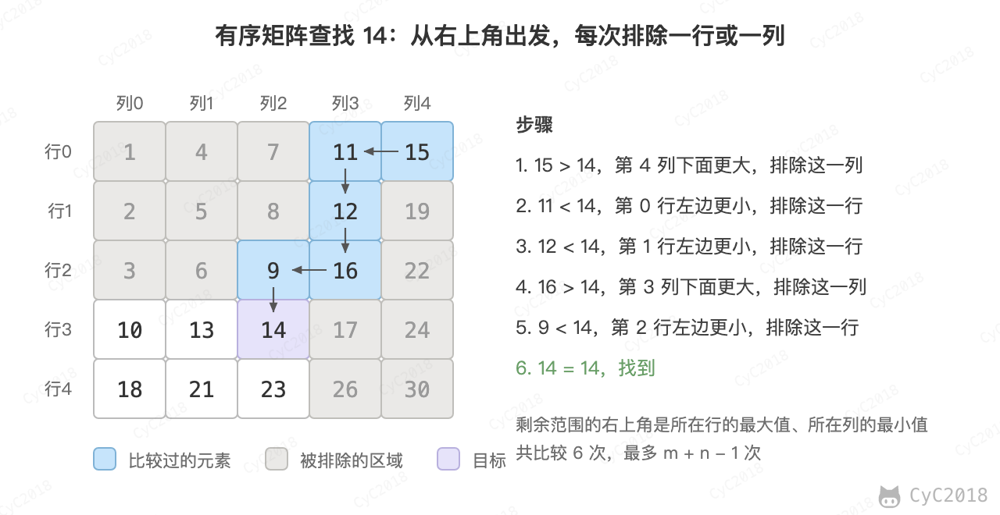
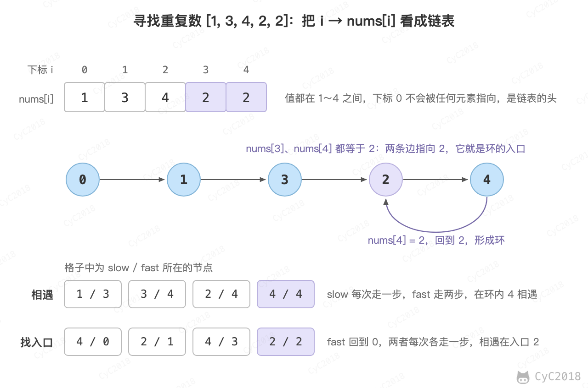

# Leetcode 题解 - 数组与矩阵
<!-- GFM-TOC -->
* [Leetcode 题解 - 数组与矩阵](#leetcode-题解---数组与矩阵)
    * [1. 把数组中的 0 移到末尾](#1-把数组中的-0-移到末尾)
    * [2. 改变矩阵维度](#2-改变矩阵维度)
    * [3. 找出数组中最长的连续 1](#3-找出数组中最长的连续-1)
    * [4. 有序矩阵查找](#4-有序矩阵查找)
    * [5. 有序矩阵的 Kth Element](#5-有序矩阵的-kth-element)
    * [6. 一个数组元素在 [1, n] 之间，其中一个数被替换为另一个数，找出重复的数和丢失的数](#6-一个数组元素在-1-n-之间其中一个数被替换为另一个数找出重复的数和丢失的数)
    * [7. 找出数组中重复的数，数组值在 [1, n] 之间](#7-找出数组中重复的数数组值在-1-n-之间)
    * [8. 数组相邻差值的个数](#8-数组相邻差值的个数)
    * [9. 数组的度](#9-数组的度)
    * [10. 对角元素相等的矩阵](#10-对角元素相等的矩阵)
    * [11. 嵌套数组](#11-嵌套数组)
    * [12. 分隔数组](#12-分隔数组)
    * [13. 合并区间](#13-合并区间)
    * [14. 下一个排列](#14-下一个排列)
    * [参考资料](#参考资料)
<!-- GFM-TOC -->


## 1. 把数组中的 0 移到末尾

283\. Move Zeroes (Easy)

[Leetcode](https://leetcode.com/problems/move-zeroes/description/) / [力扣](https://leetcode-cn.com/problems/move-zeroes/description/)

```text
For example, given nums = [0, 1, 0, 3, 12], after calling your function, nums should be [1, 3, 12, 0, 0].
```

```java
public void moveZeroes(int[] nums) {
    int idx = 0;
    for (int num : nums) {
        if (num != 0) {
            nums[idx++] = num;
        }
    }
    while (idx < nums.length) {
        nums[idx++] = 0;
    }
}
```

## 2. 改变矩阵维度

566\. Reshape the Matrix (Easy)

[Leetcode](https://leetcode.com/problems/reshape-the-matrix/description/) / [力扣](https://leetcode-cn.com/problems/reshape-the-matrix/description/)

```text
Input:
nums =
[[1,2],
 [3,4]]
r = 1, c = 4

Output:
[[1,2,3,4]]

Explanation:
The row-traversing of nums is [1,2,3,4]. The new reshaped matrix is a 1 * 4 matrix, fill it row by row by using the previous list.
```

```java
public int[][] matrixReshape(int[][] nums, int r, int c) {
    int m = nums.length, n = nums[0].length;
    if (m * n != r * c) {
        return nums;
    }
    int[][] reshapedNums = new int[r][c];
    int index = 0;
    for (int i = 0; i < r; i++) {
        for (int j = 0; j < c; j++) {
            reshapedNums[i][j] = nums[index / n][index % n];
            index++;
        }
    }
    return reshapedNums;
}
```

## 3. 找出数组中最长的连续 1

485\. Max Consecutive Ones (Easy)

[Leetcode](https://leetcode.com/problems/max-consecutive-ones/description/) / [力扣](https://leetcode-cn.com/problems/max-consecutive-ones/description/)

```java
public int findMaxConsecutiveOnes(int[] nums) {
    int max = 0, cur = 0;
    for (int x : nums) {
        cur = x == 0 ? 0 : cur + 1;
        max = Math.max(max, cur);
    }
    return max;
}
```

## 4. 有序矩阵查找

240\. Search a 2D Matrix II (Medium)

[Leetcode](https://leetcode.com/problems/search-a-2d-matrix-ii/description/) / [力扣](https://leetcode-cn.com/problems/search-a-2d-matrix-ii/description/)

```text
Input:
matrix = [
  [ 1,  4,  7, 11, 15],
  [ 2,  5,  8, 12, 19],
  [ 3,  6,  9, 16, 22],
  [10, 13, 14, 17, 24],
  [18, 21, 23, 26, 30]
], target = 14

Output: true
```

题目描述：矩阵的每一行从左到右递增，每一列从上到下递增，判断 target 是否在矩阵中。

从右上角开始比较。每次比较的元素都位于剩余范围的右上角，是剩余范围内所在行的最大值、所在列的最小值：target 比它小，这一列下面的元素都更大，可以排除这一列；target 比它大，这一行左边的元素都更小，可以排除这一行。每次比较排除一行或一列，时间复杂度为 O(M + N)。

<div align="center">  </div><br>

```java
public boolean searchMatrix(int[][] matrix, int target) {
    if (matrix == null || matrix.length == 0 || matrix[0].length == 0) return false;
    int m = matrix.length, n = matrix[0].length;
    int row = 0, col = n - 1;
    while (row < m && col >= 0) {
        if (target == matrix[row][col]) return true;
        else if (target < matrix[row][col]) col--;
        else row++;
    }
    return false;
}
```

## 5. 有序矩阵的 Kth Element

378\. Kth Smallest Element in a Sorted Matrix (Medium)

[Leetcode](https://leetcode.com/problems/kth-smallest-element-in-a-sorted-matrix/description/) / [力扣](https://leetcode-cn.com/problems/kth-smallest-element-in-a-sorted-matrix/description/)

```text
matrix = [
  [ 1,  5,  9],
  [10, 11, 13],
  [12, 13, 15]
],
k = 8,

return 13.
```

解题参考：[Share my thoughts and Clean Java Code](https://leetcode-cn.com/problems/kth-smallest-element-in-a-sorted-matrix/discuss/85173)

二分查找解法：在 [matrix[0][0], matrix[m - 1][n - 1]] 这个值域上二分，统计矩阵中不大于 mid 的元素个数 cnt。cnt < k 说明第 k 小的数比 mid 大，否则不大于 mid。循环结束时 lo 是使 cnt >= k 的最小值，这个值一定是矩阵中的元素。

```java
public int kthSmallest(int[][] matrix, int k) {
    int m = matrix.length, n = matrix[0].length;
    int lo = matrix[0][0], hi = matrix[m - 1][n - 1];
    while (lo <= hi) {
        int mid = lo + (hi - lo) / 2;
        int cnt = 0;
        for (int i = 0; i < m; i++) {
            for (int j = 0; j < n && matrix[i][j] <= mid; j++) {
                cnt++;
            }
        }
        if (cnt < k) lo = mid + 1;
        else hi = mid - 1;
    }
    return lo;
}
```

堆解法：每一列从上到下递增，可以看成 n 个有序链表做多路归并。先把第一行放入小根堆，每次弹出堆顶后放入它下面的元素，弹出 k - 1 次后堆顶就是第 k 小的数。

```java
public int kthSmallest(int[][] matrix, int k) {
    int m = matrix.length, n = matrix[0].length;
    PriorityQueue<Tuple> pq = new PriorityQueue<Tuple>();
    for(int j = 0; j < n; j++) pq.offer(new Tuple(0, j, matrix[0][j]));
    for(int i = 0; i < k - 1; i++) { // 小根堆，去掉 k - 1 个堆顶元素，此时堆顶元素就是第 k 小的数
        Tuple t = pq.poll();
        if(t.x == m - 1) continue;
        pq.offer(new Tuple(t.x + 1, t.y, matrix[t.x + 1][t.y]));
    }
    return pq.poll().val;
}

class Tuple implements Comparable<Tuple> {
    int x, y, val;
    public Tuple(int x, int y, int val) {
        this.x = x; this.y = y; this.val = val;
    }

    @Override
    public int compareTo(Tuple that) {
        return this.val - that.val;
    }
}
```

## 6. 一个数组元素在 [1, n] 之间，其中一个数被替换为另一个数，找出重复的数和丢失的数

645\. Set Mismatch (Easy)

[Leetcode](https://leetcode.com/problems/set-mismatch/description/) / [力扣](https://leetcode-cn.com/problems/set-mismatch/description/)

```text
Input: nums = [1,2,2,4]
Output: [2,3]
```

最直接的方法是先对数组进行排序，这种方法时间复杂度为 O(NlogN)。本题可以以 O(N) 的时间复杂度、O(1) 空间复杂度来求解。

主要思想是通过交换数组元素，把值 x 放到下标 x - 1 上：nums[i] 不在正确的位置时，就和它应该去的位置交换，直到当前位置正确或者目标位置上已经是同样的值（说明遇到了重复的数）。放完之后，唯一一个 nums[i] != i + 1 的位置上，nums[i] 是重复的数，i + 1 是丢失的数。例如 [1, 2, 2, 4] 中，下标 2 上是 2，重复的数为 2，丢失的数为 3。

```java
public int[] findErrorNums(int[] nums) {
    for (int i = 0; i < nums.length; i++) {
        while (nums[i] != i + 1 && nums[nums[i] - 1] != nums[i]) {
            swap(nums, i, nums[i] - 1);
        }
    }
    for (int i = 0; i < nums.length; i++) {
        if (nums[i] != i + 1) {
            return new int[]{nums[i], i + 1};
        }
    }
    return null;
}

private void swap(int[] nums, int i, int j) {
    int tmp = nums[i];
    nums[i] = nums[j];
    nums[j] = tmp;
}
```

## 7. 找出数组中重复的数，数组值在 [1, n] 之间

287\. Find the Duplicate Number (Medium)

[Leetcode](https://leetcode.com/problems/find-the-duplicate-number/description/) / [力扣](https://leetcode-cn.com/problems/find-the-duplicate-number/description/)

要求不能修改数组，也不能使用额外的空间。

二分查找解法：对值域 [1, n] 二分，统计数组中不大于 mid 的元素个数 cnt。重复的数大于 mid 时，1 \~ mid 中每个数最多出现一次，cnt 不超过 mid；重复的数不大于 mid 时，大于 mid 的每个数最多出现一次，这类元素最多 n - mid 个，数组共 n + 1 个元素，cnt 至少为 mid + 1。因此 cnt > mid 说明重复的数在 [1, mid] 中，否则在 [mid + 1, n] 中。例如 [1, 3, 4, 2, 2] 中 mid = 2 时 cnt = 3，重复的数不大于 2。时间复杂度为 O(NlogN)。

```java
public int findDuplicate(int[] nums) {
     int l = 1, h = nums.length - 1;
     while (l <= h) {
         int mid = l + (h - l) / 2;
         int cnt = 0;
         for (int i = 0; i < nums.length; i++) {
             if (nums[i] <= mid) cnt++;
         }
         if (cnt > mid) h = mid - 1;
         else l = mid + 1;
     }
     return l;
}
```

双指针解法：把 i → nums[i] 看成链表中的一条边。从下标 0 出发沿边一直走，每一步都落在 [1, n] 的下标上，不会停下，有限个节点中必然会进入环。环的入口至少有两条边指向它（来自环外和环内），也就是至少有两个下标上的值等于它，所以入口就是重复的数。用快慢指针先在环内相遇，再让一个指针回到起点，两个指针每次各走一步，相遇处就是环的入口，与[剑指 Offer 23 链表中环的入口结点](23.%20链表中环的入口结点.md)的做法相同。时间复杂度为 O(N)。

<div align="center">  </div><br>

```java
public int findDuplicate(int[] nums) {
    int slow = nums[0], fast = nums[nums[0]];
    while (slow != fast) {
        slow = nums[slow];
        fast = nums[nums[fast]];
    }
    fast = 0;
    while (slow != fast) {
        slow = nums[slow];
        fast = nums[fast];
    }
    return slow;
}
```

## 8. 数组相邻差值的个数

667\. Beautiful Arrangement II (Medium)

[Leetcode](https://leetcode.com/problems/beautiful-arrangement-ii/description/) / [力扣](https://leetcode-cn.com/problems/beautiful-arrangement-ii/description/)

```text
Input: n = 3, k = 2
Output: [1, 3, 2]
Explanation: The [1, 3, 2] has three different positive integers ranging from 1 to 3, and the [2, 1] has exactly 2 distinct integers: 1 and 2.
```

题目描述：数组元素为 1\~n 的整数，要求构建数组，使得相邻元素的差值不相同的个数为 k。

让前 k+1 个元素构建出 k 个不相同的差值，序列为：1 k+1 2 k 3 k-1 ... k/2 k/2+1，相邻差值依次为 k、k-1、……、1。之后的元素按 k+2、k+3、……、n 递增排列，内部的差值都是 1；前一段的最后一个元素在 k/2 附近，与 k+2 的差值不超过 k，也已经出现过，因此不会产生新的差值。例如 n = 5、k = 3 时得到 [1, 4, 2, 3, 5]，差值为 3、2、1、2，衔接处 3 → 5 的差值 2 已经出现过。

```java
public int[] constructArray(int n, int k) {
    int[] ret = new int[n];
    ret[0] = 1;
    for (int i = 1, interval = k; i <= k; i++, interval--) {
        ret[i] = i % 2 == 1 ? ret[i - 1] + interval : ret[i - 1] - interval;
    }
    for (int i = k + 1; i < n; i++) {
        ret[i] = i + 1;
    }
    return ret;
}
```

## 9. 数组的度

697\. Degree of an Array (Easy)

[Leetcode](https://leetcode.com/problems/degree-of-an-array/description/) / [力扣](https://leetcode-cn.com/problems/degree-of-an-array/description/)

```text
Input: [1,2,2,3,1,4,2]
Output: 6
```

题目描述：数组的度定义为元素出现的最高频率，例如上面的数组度为 3。要求找到一个最小的子数组，这个子数组的度和原数组一样。

子数组的度要和原数组一样，就要包含某个出现次数最多的元素的全部出现位置，最短的就是从它第一次出现到最后一次出现的一段。记录每个元素的出现次数、第一次和最后一次出现的位置，在出现次数最多的元素中取这段长度的最小值。上面的数组中 2 出现 3 次，位置 1 到 6，答案为 6。

```java
public int findShortestSubArray(int[] nums) {
    Map<Integer, Integer> numsCnt = new HashMap<>();
    Map<Integer, Integer> numsLastIndex = new HashMap<>();
    Map<Integer, Integer> numsFirstIndex = new HashMap<>();
    for (int i = 0; i < nums.length; i++) {
        int num = nums[i];
        numsCnt.put(num, numsCnt.getOrDefault(num, 0) + 1);
        numsLastIndex.put(num, i);
        if (!numsFirstIndex.containsKey(num)) {
            numsFirstIndex.put(num, i);
        }
    }
    int maxCnt = 0;
    for (int num : nums) {
        maxCnt = Math.max(maxCnt, numsCnt.get(num));
    }
    int ret = nums.length;
    for (int i = 0; i < nums.length; i++) {
        int num = nums[i];
        int cnt = numsCnt.get(num);
        if (cnt != maxCnt) continue;
        ret = Math.min(ret, numsLastIndex.get(num) - numsFirstIndex.get(num) + 1);
    }
    return ret;
}
```

## 10. 对角元素相等的矩阵

766\. Toeplitz Matrix (Easy)

[Leetcode](https://leetcode.com/problems/toeplitz-matrix/description/) / [力扣](https://leetcode-cn.com/problems/toeplitz-matrix/description/)

```text
1234
5123
9512

In the above grid, the diagonals are "[9]", "[5, 5]", "[1, 1, 1]", "[2, 2, 2]", "[3, 3]", "[4]", and in each diagonal all elements are the same, so the answer is True.
```

```java
public boolean isToeplitzMatrix(int[][] matrix) {
    for (int i = 0; i < matrix[0].length; i++) {
        if (!check(matrix, matrix[0][i], 0, i)) {
            return false;
        }
    }
    for (int i = 0; i < matrix.length; i++) {
        if (!check(matrix, matrix[i][0], i, 0)) {
            return false;
        }
    }
    return true;
}

private boolean check(int[][] matrix, int expectValue, int row, int col) {
    if (row >= matrix.length || col >= matrix[0].length) {
        return true;
    }
    if (matrix[row][col] != expectValue) {
        return false;
    }
    return check(matrix, expectValue, row + 1, col + 1);
}
```

## 11. 嵌套数组

565\. Array Nesting (Medium)

[Leetcode](https://leetcode.com/problems/array-nesting/description/) / [力扣](https://leetcode-cn.com/problems/array-nesting/description/)

```text
Input: A = [5,4,0,3,1,6,2]
Output: 4
Explanation:
A[0] = 5, A[1] = 4, A[2] = 0, A[3] = 3, A[4] = 1, A[5] = 6, A[6] = 2.

One of the longest S[K]:
S[0] = {A[0], A[5], A[6], A[2]} = {5, 6, 2, 0}
```

题目描述：S[i] 表示一个集合，集合的第一个元素是 A[i]，第二个元素是 A[A[i]]，如此嵌套下去。求最大的 S[i]。

数组是 0 \~ n-1 的一个排列，每个下标只被一个元素指向，所以 i → A[i] 把数组分成若干个互不相交的环，S[i] 就是 i 所在的环。同一个环上的起点得到的集合大小相同，遍历过的位置标记为 -1 后不再访问，每个元素只访问一次，时间复杂度为 O(N)。

```java
public int arrayNesting(int[] nums) {
    int max = 0;
    for (int i = 0; i < nums.length; i++) {
        int cnt = 0;
        for (int j = i; nums[j] != -1; ) {
            cnt++;
            int t = nums[j];
            nums[j] = -1; // 标记该位置已经被访问
            j = t;

        }
        max = Math.max(max, cnt);
    }
    return max;
}
```

## 12. 分隔数组

769\. Max Chunks To Make Sorted (Medium)

[Leetcode](https://leetcode.com/problems/max-chunks-to-make-sorted/description/) / [力扣](https://leetcode-cn.com/problems/max-chunks-to-make-sorted/description/)

```text
Input: arr = [1,0,2,3,4]
Output: 4
Explanation:
We can split into two chunks, such as [1, 0], [2, 3, 4].
However, splitting into [1, 0], [2], [3], [4] is the highest number of chunks possible.
```

题目描述：arr 是 0 \~ n-1 的一个排列，把它分成尽量多的块，使得对每块分别排序后整个数组有序。

前 i + 1 个元素能单独成为若干块，当且仅当它们恰好是 0 \~ i，也就是前缀的最大值等于 i。从左往右维护前缀最大值 right，每遇到 right == i 就可以切一刀。例如 [1, 0, 2, 3, 4] 在下标 1、2、3、4 处都满足条件，答案为 4。

```java
public int maxChunksToSorted(int[] arr) {
    if (arr == null) return 0;
    int ret = 0;
    int right = arr[0];
    for (int i = 0; i < arr.length; i++) {
        right = Math.max(right, arr[i]);
        if (right == i) ret++;
    }
    return ret;
}
```

## 13. 合并区间

56\. Merge Intervals (Medium)

[Leetcode](https://leetcode.com/problems/merge-intervals/) / [力扣](https://leetcode.cn/problems/merge-intervals/)

```text
Input: [[1, 3], [2, 6], [8, 10], [15, 18]]
Output: [[1, 6], [8, 10], [15, 18]]
```

按区间的左端点排序后，能合并的区间一定是相邻的。依次检查每个区间：如果它的左端点不超过结果中最后一个区间的右端点，就把两者合并；否则作为一个新区间加入结果。

```java
public int[][] merge(int[][] intervals) {
    Arrays.sort(intervals, (a, b) -> Integer.compare(a[0], b[0]));
    List<int[]> ret = new ArrayList<>();
    for (int[] cur : intervals) {
        if (!ret.isEmpty() && cur[0] <= ret.get(ret.size() - 1)[1]) {
            int[] last = ret.get(ret.size() - 1);
            last[1] = Math.max(last[1], cur[1]);
        } else {
            ret.add(cur);
        }
    }
    return ret.toArray(new int[ret.size()][]);
}
```

## 14. 下一个排列

31\. Next Permutation (Medium)

[Leetcode](https://leetcode.com/problems/next-permutation/) / [力扣](https://leetcode.cn/problems/next-permutation/)

```text
Input: [1, 2, 3]    Output: [1, 3, 2]
Input: [3, 2, 1]    Output: [1, 2, 3]
```

题目描述：把数组原地重排为字典序中下一个更大的排列，如果已经是最大的排列，就重排为最小的排列。

要让排列变大又变得尽量少，应该修改尽量靠右的位置：

- 从右往左找到第一个满足 nums[i] < nums[i + 1] 的位置 i，i 右边是一段降序，已经是这一段能组成的最大排列；
- 从右往左找到第一个大于 nums[i] 的元素 nums[j]，交换两者，i 位置变大了一点；
- 交换后 i 右边仍然是降序，把它反转为升序，使这一段尽量小。

```text
1 5 8 4 7 6 5 3 1
      i     j
交换：1 5 8 5 7 6 4 3 1
反转：1 5 8 5 1 3 4 6 7
```

```java
public void nextPermutation(int[] nums) {
    int i = nums.length - 2;
    while (i >= 0 && nums[i] >= nums[i + 1]) {
        i--;
    }
    if (i >= 0) {
        int j = nums.length - 1;
        while (nums[j] <= nums[i]) {
            j--;
        }
        swap(nums, i, j);
    }
    for (int l = i + 1, r = nums.length - 1; l < r; l++, r--) {
        swap(nums, l, r);
    }
}

private void swap(int[] nums, int i, int j) {
    int t = nums[i];
    nums[i] = nums[j];
    nums[j] = t;
}
```

## 参考资料

- [LeetCode 题库](https://leetcode.com/problemset/)
