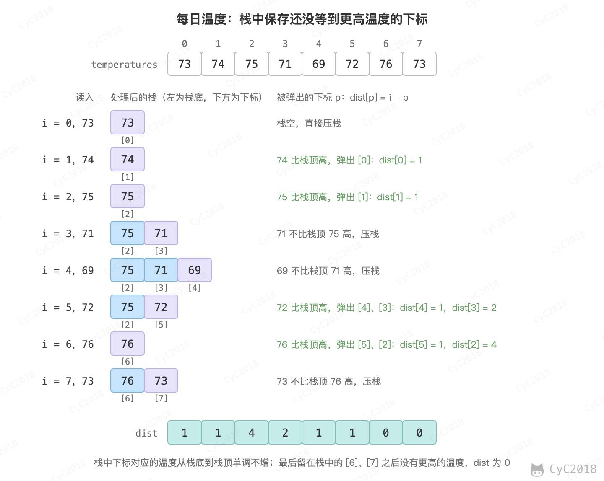

# Leetcode 题解 - 栈和队列
<!-- GFM-TOC -->
* [Leetcode 题解 - 栈和队列](#leetcode-题解---栈和队列)
    * [1. 用栈实现队列](#1-用栈实现队列)
    * [2. 用队列实现栈](#2-用队列实现栈)
    * [3. 最小值栈](#3-最小值栈)
    * [4. 用栈实现括号匹配](#4-用栈实现括号匹配)
    * [5. 数组中元素与下一个比它大的元素之间的距离](#5-数组中元素与下一个比它大的元素之间的距离)
    * [6. 循环数组中比当前元素大的下一个元素](#6-循环数组中比当前元素大的下一个元素)
    * [7. 字符串解码](#7-字符串解码)
    * [8. 基本计算器](#8-基本计算器)
    * [参考资料](#参考资料)
<!-- GFM-TOC -->


## 1. 用栈实现队列

232\. Implement Queue using Stacks (Easy)

[Leetcode](https://leetcode.com/problems/implement-queue-using-stacks/description/) / [力扣](https://leetcode-cn.com/problems/implement-queue-using-stacks/description/)

栈的顺序为后进先出，而队列的顺序为先进先出。使用两个栈实现队列，一个元素需要经过两个栈才能出队列，在经过第一个栈时元素顺序被反转，经过第二个栈时再次被反转，此时就是先进先出顺序。

需要注意的是，只有 out 为空时才把 in 中的元素整体倒进 out，否则后进入的元素会压在先进入的元素上面。每个元素最多被压入、弹出 in 和 out 各一次，因此单次操作的均摊时间复杂度为 O(1)。

```java
class MyQueue {

    private Stack<Integer> in = new Stack<>();
    private Stack<Integer> out = new Stack<>();

    public void push(int x) {
        in.push(x);
    }

    public int pop() {
        in2out();
        return out.pop();
    }

    public int peek() {
        in2out();
        return out.peek();
    }

    private void in2out() {
        if (out.isEmpty()) {
            while (!in.isEmpty()) {
                out.push(in.pop());
            }
        }
    }

    public boolean empty() {
        return in.isEmpty() && out.isEmpty();
    }
}
```

## 2. 用队列实现栈

225\. Implement Stack using Queues (Easy)

[Leetcode](https://leetcode.com/problems/implement-stack-using-queues/description/) / [力扣](https://leetcode-cn.com/problems/implement-stack-using-queues/description/)

在将一个元素 x 插入队列时，为了维护原来的后进先出顺序，需要让 x 插入队列首部。而队列的默认插入顺序是队列尾部，因此在将 x 插入队列尾部之后，需要让除了 x 之外的所有元素出队列，再入队列。

```java
class MyStack {

    private Queue<Integer> queue;

    public MyStack() {
        queue = new LinkedList<>();
    }

    public void push(int x) {
        queue.add(x);
        int cnt = queue.size();
        while (cnt-- > 1) {
            queue.add(queue.poll());
        }
    }

    public int pop() {
        return queue.remove();
    }

    public int top() {
        return queue.peek();
    }

    public boolean empty() {
        return queue.isEmpty();
    }
}
```

## 3. 最小值栈

155\. Min Stack (Medium)

[Leetcode](https://leetcode.com/problems/min-stack/description/) / [力扣](https://leetcode-cn.com/problems/min-stack/description/)

用一个辅助栈 minStack 与数据栈同步压入和弹出，minStack 的每个位置保存数据栈从栈底到该位置的最小值。例如依次压入 3、5、2，minStack 为 3、3、2；弹出 2 之后，栈顶的 3 就是剩下元素的最小值。

```java
class MinStack {

    private Stack<Integer> dataStack;
    private Stack<Integer> minStack;
    private int min;

    public MinStack() {
        dataStack = new Stack<>();
        minStack = new Stack<>();
        min = Integer.MAX_VALUE;
    }

    public void push(int x) {
        dataStack.add(x);
        min = Math.min(min, x);
        minStack.add(min);
    }

    public void pop() {
        dataStack.pop();
        minStack.pop();
        min = minStack.isEmpty() ? Integer.MAX_VALUE : minStack.peek();
    }

    public int top() {
        return dataStack.peek();
    }

    public int getMin() {
        return minStack.peek();
    }
}
```

最小值队列可以用两个最小值栈实现（见[用栈实现队列](#1-用栈实现队列)），队列的最小值就是两个栈的最小值中较小的那个，这个问题出自《编程之美》3.7。

## 4. 用栈实现括号匹配

20\. Valid Parentheses (Easy)

[Leetcode](https://leetcode.com/problems/valid-parentheses/description/) / [力扣](https://leetcode-cn.com/problems/valid-parentheses/description/)

```text
"()[]{}"

Output : true
```

左括号压栈；遇到右括号时，栈顶必须是与它配对的左括号，否则不合法。遍历结束后栈必须为空，例如 "((" 的每一步都没有出错，但仍不合法。

```java
public boolean isValid(String s) {
    Stack<Character> stack = new Stack<>();
    for (char c : s.toCharArray()) {
        if (c == '(' || c == '{' || c == '[') {
            stack.push(c);
        } else {
            if (stack.isEmpty()) {
                return false;
            }
            char cStack = stack.pop();
            boolean b1 = c == ')' && cStack != '(';
            boolean b2 = c == ']' && cStack != '[';
            boolean b3 = c == '}' && cStack != '{';
            if (b1 || b2 || b3) {
                return false;
            }
        }
    }
    return stack.isEmpty();
}
```

## 5. 数组中元素与下一个比它大的元素之间的距离

739\. Daily Temperatures (Medium)

[Leetcode](https://leetcode.com/problems/daily-temperatures/description/) / [力扣](https://leetcode-cn.com/problems/daily-temperatures/description/)

```text
Input: [73, 74, 75, 71, 69, 72, 76, 73]
Output: [1, 1, 4, 2, 1, 1, 0, 0]
```

栈中保存还没有等到更高温度的下标。遍历到 curIndex 时，只要当前温度比栈顶下标的温度高，栈顶下标的答案就是 curIndex，弹出它并记录距离；弹完之后再把 curIndex 压栈。因此栈中下标对应的温度从栈底到栈顶单调不增（相等的温度不会弹栈），这种栈称为单调栈。

<div align="center">  </div><br>

每个下标最多入栈、出栈各一次，时间复杂度为 O(N)。

```java
public int[] dailyTemperatures(int[] temperatures) {
    int n = temperatures.length;
    int[] dist = new int[n];
    Stack<Integer> indexs = new Stack<>();
    for (int curIndex = 0; curIndex < n; curIndex++) {
        while (!indexs.isEmpty() && temperatures[curIndex] > temperatures[indexs.peek()]) {
            int preIndex = indexs.pop();
            dist[preIndex] = curIndex - preIndex;
        }
        indexs.add(curIndex);
    }
    return dist;
}
```

## 6. 循环数组中比当前元素大的下一个元素

503\. Next Greater Element II (Medium)

[Leetcode](https://leetcode.com/problems/next-greater-element-ii/description/) / [力扣](https://leetcode-cn.com/problems/next-greater-element-ii/description/)

```text
Input: [1,2,1]
Output: [2,-1,2]
Explanation: The first 1's next greater number is 2;
The number 2 can't find next greater number;
The second 1's next greater number needs to search circularly, which is also 2.
```

与[每日温度](#5-数组中元素与下一个比它大的元素之间的距离)不同的是，数组是循环数组，并且最后要求的不是距离而是下一个元素。

把数组遍历两遍，相当于在原数组后面再接一份，靠后的元素在第二遍中就能找到位于数组开头的更大元素。第二遍只负责弹栈、填写答案，不再压栈。

```java
public int[] nextGreaterElements(int[] nums) {
    int n = nums.length;
    int[] next = new int[n];
    Arrays.fill(next, -1);
    Stack<Integer> pre = new Stack<>();
    for (int i = 0; i < n * 2; i++) {
        int num = nums[i % n];
        while (!pre.isEmpty() && nums[pre.peek()] < num) {
            next[pre.pop()] = num;
        }
        if (i < n){
            pre.push(i);
        }
    }
    return next;
}
```

## 7. 字符串解码

394\. Decode String (Medium)

[Leetcode](https://leetcode.com/problems/decode-string/) / [力扣](https://leetcode.cn/problems/decode-string/)

```text
Input: "3[a2[c]]"
Output: "accaccacc"
```

括号可以嵌套，用栈保存进入括号之前的状态：遇到 [ 时，把重复次数和当前已经得到的字符串分别压栈，然后从头开始记录括号内的字符串；遇到 ] 时弹出重复次数 k 和之前的字符串 prev，当前字符串变为 prev 加上括号内的字符串重复 k 次。

```java
public String decodeString(String s) {
    Deque<Integer> counts = new ArrayDeque<>();
    Deque<StringBuilder> prevs = new ArrayDeque<>();
    StringBuilder cur = new StringBuilder();
    int k = 0;
    for (char c : s.toCharArray()) {
        if (Character.isDigit(c)) {
            k = k * 10 + c - '0';
        } else if (c == '[') {
            counts.push(k);
            prevs.push(cur);
            cur = new StringBuilder();
            k = 0;
        } else if (c == ']') {
            String inner = cur.toString();
            cur = prevs.pop();
            for (int n = counts.pop(); n > 0; n--) {
                cur.append(inner);
            }
        } else {
            cur.append(c);
        }
    }
    return cur.toString();
}
```

## 8. 基本计算器

227\. Basic Calculator II (Medium)

[Leetcode](https://leetcode.com/problems/basic-calculator-ii/) / [力扣](https://leetcode.cn/problems/basic-calculator-ii/)

```text
Input: " 3+5 / 2 "
Output: 5
```

题目描述：计算只包含非负整数、+、-、*、/ 和空格的表达式，整数除法向零截断。

乘除的优先级高于加减。读到一个数字之后，先不急着计算，等读到它后面的运算符时，再根据它前面的运算符处理：+ 把数字压栈，- 把相反数压栈，* 和 / 与栈顶元素计算后再放回。最后把栈中所有元素相加。例如 3+5/2：读到 + 时按前面默认的 + 压入 3，读到 / 时压入 5，读完字符串时按 / 把栈顶的 5 换成 5 / 2 = 2，结果为 3 + 2 = 5。

```java
public int calculate(String s) {
    Deque<Integer> stack = new ArrayDeque<>();
    char op = '+';
    int num = 0;
    for (int i = 0; i < s.length(); i++) {
        char c = s.charAt(i);
        if (Character.isDigit(c)) {
            num = num * 10 + c - '0';
        }
        if ((!Character.isDigit(c) && c != ' ') || i == s.length() - 1) {
            if (op == '+') {
                stack.push(num);
            } else if (op == '-') {
                stack.push(-num);
            } else if (op == '*') {
                stack.push(stack.pop() * num);
            } else {
                stack.push(stack.pop() / num);
            }
            op = c;
            num = 0;
        }
    }
    int ret = 0;
    for (int x : stack) {
        ret += x;
    }
    return ret;
}
```

## 参考资料

- [LeetCode 题库](https://leetcode.com/problemset/)
- 《编程之美》小组. 编程之美 [M]. 电子工业出版社, 2008.
