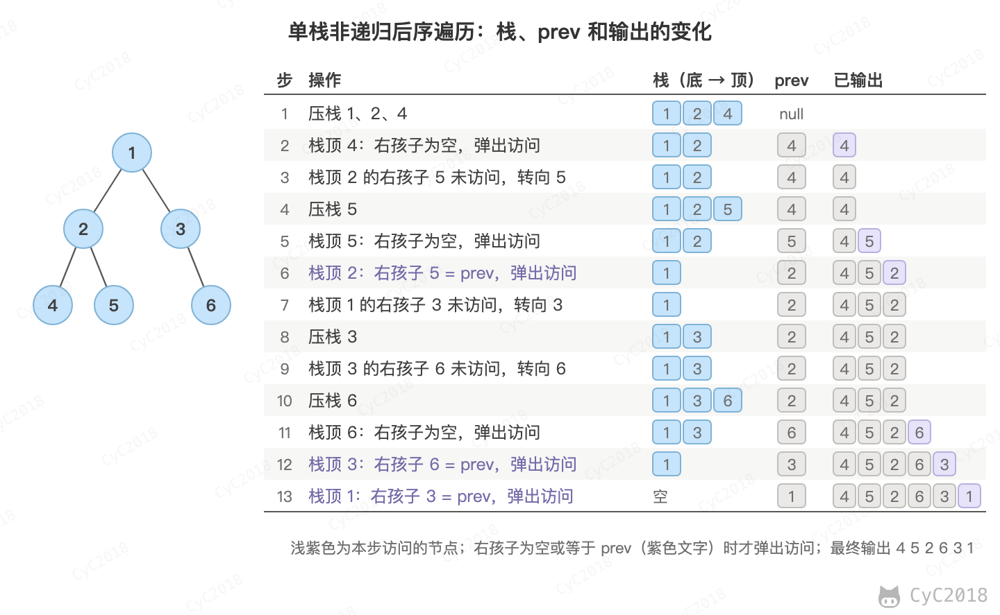
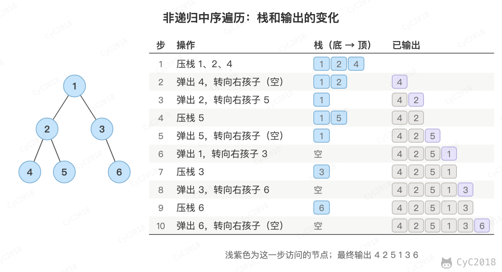
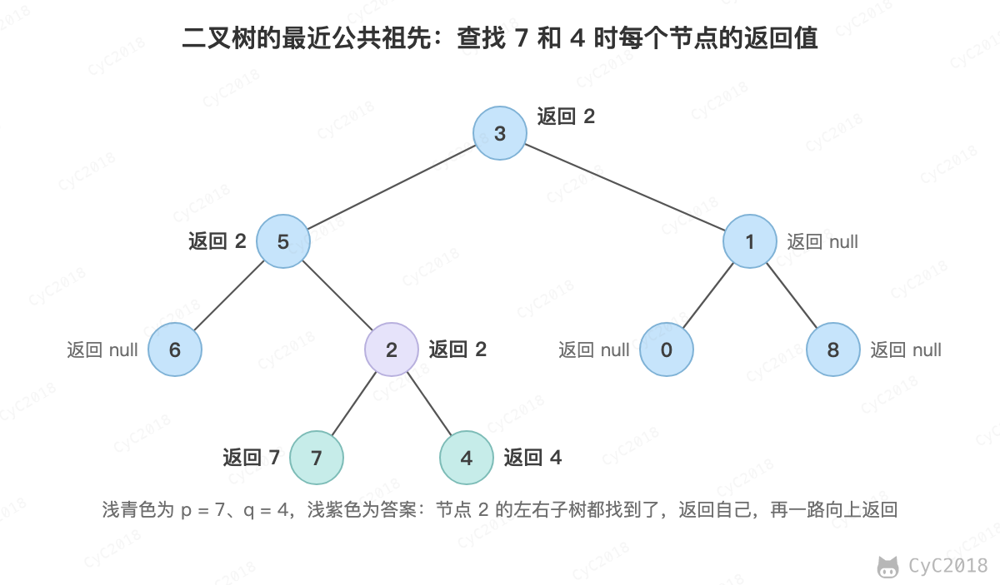
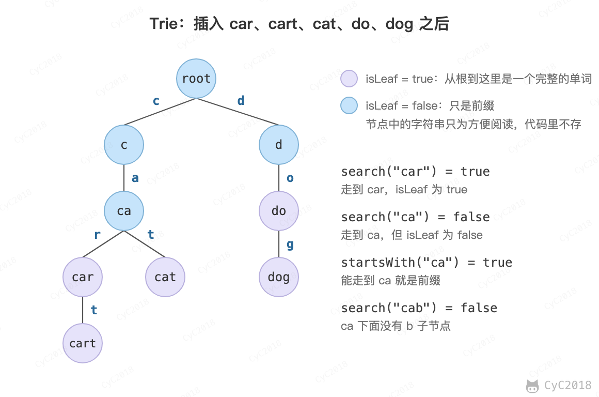

# Leetcode 题解 - 树
<!-- GFM-TOC -->
* [Leetcode 题解 - 树](#leetcode-题解---树)
    * [递归](#递归)
        * [1. 树的高度](#1-树的高度)
        * [2. 平衡树](#2-平衡树)
        * [3. 两节点的最长路径](#3-两节点的最长路径)
        * [4. 翻转树](#4-翻转树)
        * [5. 归并两棵树](#5-归并两棵树)
        * [6. 判断路径和是否等于一个数](#6-判断路径和是否等于一个数)
        * [7. 统计路径和等于一个数的路径数量](#7-统计路径和等于一个数的路径数量)
        * [8. 子树](#8-子树)
        * [9. 树的对称](#9-树的对称)
        * [10. 最小路径](#10-最小路径)
        * [11. 统计左叶子节点的和](#11-统计左叶子节点的和)
        * [12. 相同节点值的最大路径长度](#12-相同节点值的最大路径长度)
        * [13. 间隔遍历](#13-间隔遍历)
        * [14. 找出二叉树中第二小的节点](#14-找出二叉树中第二小的节点)
        * [15. 二叉树中的最大路径和](#15-二叉树中的最大路径和)
    * [层次遍历](#层次遍历)
        * [1. 一棵树每层节点的平均数](#1-一棵树每层节点的平均数)
        * [2. 得到左下角的节点](#2-得到左下角的节点)
    * [前中后序遍历](#前中后序遍历)
        * [1. 非递归实现二叉树的前序遍历](#1-非递归实现二叉树的前序遍历)
        * [2. 非递归实现二叉树的后序遍历](#2-非递归实现二叉树的后序遍历)
        * [3. 非递归实现二叉树的中序遍历](#3-非递归实现二叉树的中序遍历)
    * [BST](#bst)
        * [1. 修剪二叉查找树](#1-修剪二叉查找树)
        * [2. 寻找二叉查找树的第 k 个元素](#2-寻找二叉查找树的第-k-个元素)
        * [3. 把二叉查找树每个节点的值都加上比它大的节点的值](#3-把二叉查找树每个节点的值都加上比它大的节点的值)
        * [4. 二叉查找树的最近公共祖先](#4-二叉查找树的最近公共祖先)
        * [5. 二叉树的最近公共祖先](#5-二叉树的最近公共祖先)
        * [6. 从有序数组中构造二叉查找树](#6-从有序数组中构造二叉查找树)
        * [7. 根据有序链表构造平衡的二叉查找树](#7-根据有序链表构造平衡的二叉查找树)
        * [8. 在二叉查找树中寻找两个节点，使它们的和为一个给定值](#8-在二叉查找树中寻找两个节点使它们的和为一个给定值)
        * [9. 在二叉查找树中查找两个节点之差的最小绝对值](#9-在二叉查找树中查找两个节点之差的最小绝对值)
        * [10. 寻找二叉查找树中出现次数最多的值](#10-寻找二叉查找树中出现次数最多的值)
    * [Trie](#trie)
        * [1. 实现一个 Trie](#1-实现一个-trie)
        * [2. 实现一个 Trie，用来求前缀和](#2-实现一个-trie用来求前缀和)
    * [参考资料](#参考资料)
<!-- GFM-TOC -->


## 递归

一棵树要么是空树，要么有两个指针，每个指针指向一棵树。树是一种递归结构，很多树的问题可以使用递归来处理。

### 1. 树的高度

104\. Maximum Depth of Binary Tree (Easy)

[Leetcode](https://leetcode.com/problems/maximum-depth-of-binary-tree/description/) / [力扣](https://leetcode.cn/problems/maximum-depth-of-binary-tree/description/)

```java
public int maxDepth(TreeNode root) {
    if (root == null) return 0;
    return Math.max(maxDepth(root.left), maxDepth(root.right)) + 1;
}
```

### 2. 平衡树

110\. Balanced Binary Tree (Easy)

[Leetcode](https://leetcode.com/problems/balanced-binary-tree/description/) / [力扣](https://leetcode.cn/problems/balanced-binary-tree/description/)

```text
    3
   / \
  9  20
    /  \
   15   7
```

平衡树指的是每个节点的左右子树高度差都小于等于 1。

```java
private boolean result = true;

public boolean isBalanced(TreeNode root) {
    maxDepth(root);
    return result;
}

public int maxDepth(TreeNode root) {
    if (root == null) return 0;
    int l = maxDepth(root.left);
    int r = maxDepth(root.right);
    if (Math.abs(l - r) > 1) result = false;
    return 1 + Math.max(l, r);
}
```

### 3. 两节点的最长路径

543\. Diameter of Binary Tree (Easy)

[Leetcode](https://leetcode.com/problems/diameter-of-binary-tree/description/) / [力扣](https://leetcode.cn/problems/diameter-of-binary-tree/description/)

```text
Input:

         1
        / \
       2  3
      / \
     4   5

Return 3, which is the length of the path [4,2,1,3] or [5,2,1,3].
```

以某个节点为最高点的最长路径等于它左右子树的高度之和。最长路径不一定经过根节点，因此在求高度的递归中对每个节点都算一次，取最大值。

```java
private int max = 0;

public int diameterOfBinaryTree(TreeNode root) {
    depth(root);
    return max;
}

private int depth(TreeNode root) {
    if (root == null) return 0;
    int leftDepth = depth(root.left);
    int rightDepth = depth(root.right);
    max = Math.max(max, leftDepth + rightDepth);
    return Math.max(leftDepth, rightDepth) + 1;
}
```

### 4. 翻转树

226\. Invert Binary Tree (Easy)

[Leetcode](https://leetcode.com/problems/invert-binary-tree/description/) / [力扣](https://leetcode.cn/problems/invert-binary-tree/description/)

```java
public TreeNode invertTree(TreeNode root) {
    if (root == null) return null;
    TreeNode left = root.left;  // 后面的操作会改变 left 指针，因此先保存下来
    root.left = invertTree(root.right);
    root.right = invertTree(left);
    return root;
}
```

### 5. 归并两棵树

617\. Merge Two Binary Trees (Easy)

[Leetcode](https://leetcode.com/problems/merge-two-binary-trees/description/) / [力扣](https://leetcode.cn/problems/merge-two-binary-trees/description/)

```text
Input:
       Tree 1                     Tree 2
          1                         2
         / \                       / \
        3   2                     1   3
       /                           \   \
      5                             4   7

Output:
         3
        / \
       4   5
      / \   \
     5   4   7
```

```java
public TreeNode mergeTrees(TreeNode t1, TreeNode t2) {
    if (t1 == null && t2 == null) return null;
    if (t1 == null) return t2;
    if (t2 == null) return t1;
    TreeNode root = new TreeNode(t1.val + t2.val);
    root.left = mergeTrees(t1.left, t2.left);
    root.right = mergeTrees(t1.right, t2.right);
    return root;
}
```

### 6. 判断路径和是否等于一个数

112\. Path Sum (Easy)

[Leetcode](https://leetcode.com/problems/path-sum/description/) / [力扣](https://leetcode.cn/problems/path-sum/description/)

```text
Given the below binary tree and sum = 22,

              5
             / \
            4   8
           /   / \
          11  13  4
         /  \      \
        7    2      1

return true, as there exist a root-to-leaf path 5->4->11->2 which sum is 22.
```

路径和定义为从 root 到 leaf 的所有节点的和。

```java
public boolean hasPathSum(TreeNode root, int sum) {
    if (root == null) return false;
    if (root.left == null && root.right == null && root.val == sum) return true;
    return hasPathSum(root.left, sum - root.val) || hasPathSum(root.right, sum - root.val);
}
```

### 7. 统计路径和等于一个数的路径数量

437\. Path Sum III (Medium)

[Leetcode](https://leetcode.com/problems/path-sum-iii/description/) / [力扣](https://leetcode.cn/problems/path-sum-iii/description/)

```text
root = [10,5,-3,3,2,null,11,3,-2,null,1], sum = 8

      10
     /  \
    5   -3
   / \    \
  3   2   11
 / \   \
3  -2   1

Return 3. The paths that sum to 8 are:

1.  5 -> 3
2.  5 -> 2 -> 1
3. -3 -> 11
```

路径不一定以 root 开头，也不一定以 leaf 结尾，但是必须连续。

对每个节点各统计一次以它开头的路径，每个节点会被它的每个祖先各访问一次，平衡树中时间复杂度为 O(NlogN)，退化成链时为 O(N²)。节点值可达 10^9，sum 一路相减可能溢出 int，因此用 long。

用[和为 K 的子数组](Leetcode%20题解%20-%20哈希表.md#5-和为-k-的子数组)的前缀和方法可以做到 O(N)：哈希表记录根到当前节点路径上各前缀和的出现次数，回溯时减掉。

```java
public int pathSum(TreeNode root, int sum) {
    if (root == null) return 0;
    int ret = pathSumStartWithRoot(root, sum) + pathSum(root.left, sum) + pathSum(root.right, sum);
    return ret;
}

private int pathSumStartWithRoot(TreeNode root, long sum) {
    if (root == null) return 0;
    int ret = 0;
    if (root.val == sum) ret++;
    ret += pathSumStartWithRoot(root.left, sum - root.val) + pathSumStartWithRoot(root.right, sum - root.val);
    return ret;
}
```

### 8. 子树

572\. Subtree of Another Tree (Easy)

[Leetcode](https://leetcode.com/problems/subtree-of-another-tree/description/) / [力扣](https://leetcode.cn/problems/subtree-of-another-tree/description/)

```text
Given tree s:
     3
    / \
   4   5
  / \
 1   2

Given tree t:
   4
  / \
 1   2

Return true, because t has the same structure and node values with a subtree of s.

Given tree s:

     3
    / \
   4   5
  / \
 1   2
    /
   0

Given tree t:
   4
  / \
 1   2

Return false.
```

```java
public boolean isSubtree(TreeNode s, TreeNode t) {
    if (s == null) return false;
    return isSubtreeWithRoot(s, t) || isSubtree(s.left, t) || isSubtree(s.right, t);
}

private boolean isSubtreeWithRoot(TreeNode s, TreeNode t) {
    if (t == null && s == null) return true;
    if (t == null || s == null) return false;
    if (t.val != s.val) return false;
    return isSubtreeWithRoot(s.left, t.left) && isSubtreeWithRoot(s.right, t.right);
}
```

### 9. 树的对称

101\. Symmetric Tree (Easy)

[Leetcode](https://leetcode.com/problems/symmetric-tree/description/) / [力扣](https://leetcode.cn/problems/symmetric-tree/description/)

```text
    1
   / \
  2   2
 / \ / \
3  4 4  3
```

```java
public boolean isSymmetric(TreeNode root) {
    if (root == null) return true;
    return isSymmetric(root.left, root.right);
}

private boolean isSymmetric(TreeNode t1, TreeNode t2) {
    if (t1 == null && t2 == null) return true;
    if (t1 == null || t2 == null) return false;
    if (t1.val != t2.val) return false;
    return isSymmetric(t1.left, t2.right) && isSymmetric(t1.right, t2.left);
}
```

### 10. 最小路径

111\. Minimum Depth of Binary Tree (Easy)

[Leetcode](https://leetcode.com/problems/minimum-depth-of-binary-tree/description/) / [力扣](https://leetcode.cn/problems/minimum-depth-of-binary-tree/description/)

树的根节点到叶子节点的最小路径长度。

需要注意的是，只有一侧子树为空时不能取 min，因为这个节点不是叶子，路径只能走另一侧。

```java
public int minDepth(TreeNode root) {
    if (root == null) return 0;
    int left = minDepth(root.left);
    int right = minDepth(root.right);
    if (left == 0 || right == 0) return left + right + 1;
    return Math.min(left, right) + 1;
}
```

### 11. 统计左叶子节点的和

404\. Sum of Left Leaves (Easy)

[Leetcode](https://leetcode.com/problems/sum-of-left-leaves/description/) / [力扣](https://leetcode.cn/problems/sum-of-left-leaves/description/)

```text
    3
   / \
  9  20
    /  \
   15   7

There are two left leaves in the binary tree, with values 9 and 15 respectively. Return 24.
```

```java
public int sumOfLeftLeaves(TreeNode root) {
    if (root == null) return 0;
    if (isLeaf(root.left)) return root.left.val + sumOfLeftLeaves(root.right);
    return sumOfLeftLeaves(root.left) + sumOfLeftLeaves(root.right);
}

private boolean isLeaf(TreeNode node){
    if (node == null) return false;
    return node.left == null && node.right == null;
}
```

### 12. 相同节点值的最大路径长度

687\. Longest Univalue Path (Medium)

[Leetcode](https://leetcode.com/problems/longest-univalue-path/) / [力扣](https://leetcode.cn/problems/longest-univalue-path/)

```text
             1
            / \
           4   5
          / \   \
         4   4   5

Output : 2
```

做法同[两节点的最长路径](#3-两节点的最长路径)，只是 dfs 返回的是节点值都与 root 相同的单侧最长路径，孩子的值与 root 不同时这一侧记为 0。

```java
private int path = 0;

public int longestUnivaluePath(TreeNode root) {
    dfs(root);
    return path;
}

private int dfs(TreeNode root){
    if (root == null) return 0;
    int left = dfs(root.left);
    int right = dfs(root.right);
    int leftPath = root.left != null && root.left.val == root.val ? left + 1 : 0;
    int rightPath = root.right != null && root.right.val == root.val ? right + 1 : 0;
    path = Math.max(path, leftPath + rightPath);
    return Math.max(leftPath, rightPath);
}
```

### 13. 间隔遍历

337\. House Robber III (Medium)

[Leetcode](https://leetcode.com/problems/house-robber-iii/description/) / [力扣](https://leetcode.cn/problems/house-robber-iii/description/)

```text
     3
    / \
   2   3
    \   \
     3   1
Maximum amount of money the thief can rob = 3 + 3 + 1 = 7.
```

相连的两个节点不能同时选：选 root 时加上四个孙子子树的结果（val1），不选时为两个孩子子树的结果之和（val2）。同一子树会被祖父和父节点各算一次，因此用 cache 记录。

```java
Map<TreeNode, Integer> cache = new HashMap<>(); 

public int rob(TreeNode root) {
    if (root == null) return 0;
    if (cache.containsKey(root)) return cache.get(root);
    int val1 = root.val;
    if (root.left != null) val1 += rob(root.left.left) + rob(root.left.right);
    if (root.right != null) val1 += rob(root.right.left) + rob(root.right.right);
    int val2 = rob(root.left) + rob(root.right);
    int res = Math.max(val1, val2);
    cache.put(root, res);
    return res;
}
```

### 14. 找出二叉树中第二小的节点

671\. Second Minimum Node In a Binary Tree (Easy)

[Leetcode](https://leetcode.com/problems/second-minimum-node-in-a-binary-tree/description/) / [力扣](https://leetcode.cn/problems/second-minimum-node-in-a-binary-tree/description/)

```text
Input:
   2
  / \
 2   5
    / \
    5  7

Output: 5
```

一个节点要么具有 0 个或 2 个子节点，如果有子节点，那么根节点是最小的节点。

孩子的值大于根时，它就是这棵子树中比根大的最小值；等于根时要递归往下找，-1 表示这一侧没有比根大的值。

```java
public int findSecondMinimumValue(TreeNode root) {
    if (root == null) return -1;
    if (root.left == null && root.right == null) return -1;
    int leftVal = root.left.val;
    int rightVal = root.right.val;
    if (leftVal == root.val) leftVal = findSecondMinimumValue(root.left);
    if (rightVal == root.val) rightVal = findSecondMinimumValue(root.right);
    if (leftVal != -1 && rightVal != -1) return Math.min(leftVal, rightVal);
    if (leftVal != -1) return leftVal;
    return rightVal;
}
```

### 15. 二叉树中的最大路径和

124\. Binary Tree Maximum Path Sum (Hard)

[Leetcode](https://leetcode.com/problems/binary-tree-maximum-path-sum/) / [力扣](https://leetcode.cn/problems/binary-tree-maximum-path-sum/)

```text
Input:
       2
      / \
    -6   3
    / \  / \
   3  1 4   6

Output: 13，路径为 4 -> 3 -> 6
```

做法与 [两节点的最长路径](#3-两节点的最长路径) 相同：以每个节点为最高点算一次经过它的最大路径，取最大值。不同的有两处：

- 子树的贡献是负数时不如不走，记为 0，例如 -6 这棵子树向上最多贡献 -6 + 3 = -3，所以根节点不接它；
- 递归返回的只能是向下走一侧的最大和，不能是两侧之和。3 这个节点两侧都接上是 4 + 3 + 6 = 13，但返回给父节点的是 3 + 6 = 9，否则路径会在 3 处分叉。

节点值可能全是负数，max 的初值取 Integer.MIN_VALUE，不能取 0。

```java
private int max = Integer.MIN_VALUE;

public int maxPathSum(TreeNode root) {
    gain(root);
    return max;
}

// 以 root 为起点向下走一侧的最大路径和
private int gain(TreeNode root) {
    if (root == null) return 0;
    int left = Math.max(gain(root.left), 0);
    int right = Math.max(gain(root.right), 0);
    max = Math.max(max, root.val + left + right);
    return root.val + Math.max(left, right);
}
```

每个节点访问一次，时间复杂度 O(N)；递归深度为树的高度，空间复杂度 O(H)。

## 层次遍历

使用 BFS 进行层次遍历。不需要使用两个队列来分别存储当前层的节点和下一层的节点，因为在开始遍历一层的节点时，当前队列中的节点数就是当前层的节点数，只要控制遍历这么多节点数，就能保证这次遍历的都是当前层的节点。按层输出（102 题）和之字形输出的写法见[剑指 Offer 32.2](32.2%20把二叉树打印成多行.md)、[32.3](32.3%20按之字形顺序打印二叉树.md)。

### 1. 一棵树每层节点的平均数

637\. Average of Levels in Binary Tree (Easy)

[Leetcode](https://leetcode.com/problems/average-of-levels-in-binary-tree/description/) / [力扣](https://leetcode.cn/problems/average-of-levels-in-binary-tree/description/)

```java
public List<Double> averageOfLevels(TreeNode root) {
    List<Double> ret = new ArrayList<>();
    if (root == null) return ret;
    Queue<TreeNode> queue = new LinkedList<>();
    queue.add(root);
    while (!queue.isEmpty()) {
        int cnt = queue.size();
        double sum = 0;
        for (int i = 0; i < cnt; i++) {
            TreeNode node = queue.poll();
            sum += node.val;
            if (node.left != null) queue.add(node.left);
            if (node.right != null) queue.add(node.right);
        }
        ret.add(sum / cnt);
    }
    return ret;
}
```

### 2. 得到左下角的节点

513\. Find Bottom Left Tree Value (Medium)

[Leetcode](https://leetcode.com/problems/find-bottom-left-tree-value/description/) / [力扣](https://leetcode.cn/problems/find-bottom-left-tree-value/description/)

```text
Input:

        1
       / \
      2   3
     /   / \
    4   5   6
       /
      7

Output:
7
```

按层遍历时每层先放右孩子、再放左孩子，最后一个出队的节点就是最底层最左边的节点。

```java
public int findBottomLeftValue(TreeNode root) {
    Queue<TreeNode> queue = new LinkedList<>();
    queue.add(root);
    while (!queue.isEmpty()) {
        root = queue.poll();
        if (root.right != null) queue.add(root.right);
        if (root.left != null) queue.add(root.left);
    }
    return root.val;
}
```

## 前中后序遍历

```text
    1
   / \
  2   3
 / \   \
4   5   6
```

- 层次遍历顺序：[1 2 3 4 5 6]
- 前序遍历顺序：[1 2 4 5 3 6]
- 中序遍历顺序：[4 2 5 1 3 6]
- 后序遍历顺序：[4 5 2 6 3 1]

层次遍历使用 BFS 实现，利用的就是 BFS 一层一层遍历的特性；而前序、中序、后序遍历利用了 DFS 实现。

前序、中序、后序遍历只是在对节点访问的顺序有一点不同，其它都相同。

前序遍历：

```java
void dfs(TreeNode root) {
    if (root == null) return;
    visit(root);
    dfs(root.left);
    dfs(root.right);
}
```

中序遍历：

```java
void dfs(TreeNode root) {
    if (root == null) return;
    dfs(root.left);
    visit(root);
    dfs(root.right);
}
```

后序遍历：

```java
void dfs(TreeNode root) {
    if (root == null) return;
    dfs(root.left);
    dfs(root.right);
    visit(root);
}
```

### 1. 非递归实现二叉树的前序遍历

144\. Binary Tree Preorder Traversal (Easy)

[Leetcode](https://leetcode.com/problems/binary-tree-preorder-traversal/description/) / [力扣](https://leetcode.cn/problems/binary-tree-preorder-traversal/description/)

```java
public List<Integer> preorderTraversal(TreeNode root) {
    List<Integer> ret = new ArrayList<>();
    Stack<TreeNode> stack = new Stack<>();
    stack.push(root);
    while (!stack.isEmpty()) {
        TreeNode node = stack.pop();
        if (node == null) continue;
        ret.add(node.val);
        stack.push(node.right);  // 先右后左，保证左子树先遍历
        stack.push(node.left);
    }
    return ret;
}
```

### 2. 非递归实现二叉树的后序遍历

145\. Binary Tree Postorder Traversal (Easy)

[Leetcode](https://leetcode.com/problems/binary-tree-postorder-traversal/description/) / [力扣](https://leetcode.cn/problems/binary-tree-postorder-traversal/description/)

前序遍历为 root -\> left -\> right，后序遍历为 left -\> right -\> root。可以修改前序遍历成为 root -\> right -\> left，那么这个顺序就和后序遍历正好相反。

```java
public List<Integer> postorderTraversal(TreeNode root) {
    List<Integer> ret = new ArrayList<>();
    Stack<TreeNode> stack = new Stack<>();
    stack.push(root);
    while (!stack.isEmpty()) {
        TreeNode node = stack.pop();
        if (node == null) continue;
        ret.add(node.val);
        stack.push(node.left);
        stack.push(node.right);
    }
    Collections.reverse(ret);
    return ret;
}
```

上面的写法只是输出顺序正确，节点并不是按后序访问的。要真正按后序访问，可以像[中序遍历](#3-非递归实现二叉树的中序遍历)那样一路向左压栈，栈顶节点的右子树为空或刚访问完（右孩子等于上一个访问的节点 prev）时才弹出访问，否则先转向右子树。没有 prev 时，下图第 6 步会再次转向 5，陷入死循环：

<div align="center">  </div><br>

```java
public List<Integer> postorderTraversal(TreeNode root) {
    List<Integer> ret = new ArrayList<>();
    Stack<TreeNode> stack = new Stack<>();
    TreeNode cur = root, prev = null; // prev 为上一个访问的节点
    while (cur != null || !stack.isEmpty()) {
        while (cur != null) {
            stack.push(cur);
            cur = cur.left;
        }
        TreeNode node = stack.peek();
        if (node.right != null && node.right != prev) {
            cur = node.right; // 右子树还没访问，先转向右子树
        } else {
            stack.pop();
            ret.add(node.val);
            prev = node;
        }
    }
    return ret;
}
```

### 3. 非递归实现二叉树的中序遍历

94\. Binary Tree Inorder Traversal (Easy)

[Leetcode](https://leetcode.com/problems/binary-tree-inorder-traversal/description/) / [力扣](https://leetcode.cn/problems/binary-tree-inorder-traversal/description/)

从 cur 一路向左压栈直到为空，弹出栈顶访问后转向它的右子树。以上面的树为例：

<div align="center">  </div><br>

```java
public List<Integer> inorderTraversal(TreeNode root) {
    List<Integer> ret = new ArrayList<>();
    if (root == null) return ret;
    Stack<TreeNode> stack = new Stack<>();
    TreeNode cur = root;
    while (cur != null || !stack.isEmpty()) {
        while (cur != null) {
            stack.push(cur);
            cur = cur.left;
        }
        TreeNode node = stack.pop();
        ret.add(node.val);
        cur = node.right;
    }
    return ret;
}
```

## BST

二叉查找树（BST）：根节点大于等于左子树所有节点，小于等于右子树所有节点。

二叉查找树中序遍历有序。

### 1. 修剪二叉查找树

669\. Trim a Binary Search Tree (Medium)

[Leetcode](https://leetcode.com/problems/trim-a-binary-search-tree/description/) / [力扣](https://leetcode.cn/problems/trim-a-binary-search-tree/description/)

```text
Input:

    3
   / \
  0   4
   \
    2
   /
  1

  L = 1
  R = 3

Output:

      3
     /
   2
  /
 1
```

题目描述：只保留值在 L \~ R 之间的节点。

root 的值大于 R 时，它的右子树也都大于 R，结果就是修剪后的左子树；小于 L 时同理。

```java
public TreeNode trimBST(TreeNode root, int L, int R) {
    if (root == null) return null;
    if (root.val > R) return trimBST(root.left, L, R);
    if (root.val < L) return trimBST(root.right, L, R);
    root.left = trimBST(root.left, L, R);
    root.right = trimBST(root.right, L, R);
    return root;
}
```

### 2. 寻找二叉查找树的第 k 个元素

230\. Kth Smallest Element in a BST (Medium)

[Leetcode](https://leetcode.com/problems/kth-smallest-element-in-a-bst/description/) / [力扣](https://leetcode.cn/problems/kth-smallest-element-in-a-bst/description/)


中序遍历解法：

```java
private int cnt = 0;
private int val;

public int kthSmallest(TreeNode root, int k) {
    inOrder(root, k);
    return val;
}

private void inOrder(TreeNode node, int k) {
    if (node == null) return;
    inOrder(node.left, k);
    cnt++;
    if (cnt == k) {
        val = node.val;
        return;
    }
    inOrder(node.right, k);
}
```

递归解法：每层都要重新统计左子树的大小，最坏时间复杂度为 O(N²)；节点中保存子树大小时只需沿一条路径往下走。

```java
public int kthSmallest(TreeNode root, int k) {
    int leftCnt = count(root.left);
    if (leftCnt == k - 1) return root.val;
    if (leftCnt > k - 1) return kthSmallest(root.left, k);
    return kthSmallest(root.right, k - leftCnt - 1);
}

private int count(TreeNode node) {
    if (node == null) return 0;
    return 1 + count(node.left) + count(node.right);
}
```

### 3. 把二叉查找树每个节点的值都加上比它大的节点的值

538\. Convert BST to Greater Tree (Medium)

[Leetcode](https://leetcode.com/problems/convert-bst-to-greater-tree/description/) / [力扣](https://leetcode.cn/problems/convert-bst-to-greater-tree/description/)

```text
Input: The root of a Binary Search Tree like this:

              5
            /   \
           2     13

Output: The root of a Greater Tree like this:

             18
            /   \
          20     13
```

按右、根、左的顺序遍历就是从大到小访问，sum 累加访问过的值并写回当前节点。

```java
private int sum = 0;

public TreeNode convertBST(TreeNode root) {
    traver(root);
    return root;
}

private void traver(TreeNode node) {
    if (node == null) return;
    traver(node.right);
    sum += node.val;
    node.val = sum;
    traver(node.left);
}
```

### 4. 二叉查找树的最近公共祖先

235\. Lowest Common Ancestor of a Binary Search Tree (Medium)

[Leetcode](https://leetcode.com/problems/lowest-common-ancestor-of-a-binary-search-tree/description/) / [力扣](https://leetcode.cn/problems/lowest-common-ancestor-of-a-binary-search-tree/description/)

```text
        _______6______
      /                \
  ___2__             ___8__
 /      \           /      \
0        4         7        9
        /  \
       3   5

For example, the lowest common ancestor (LCA) of nodes 2 and 8 is 6. Another example is LCA of nodes 2 and 4 is 2, since a node can be a descendant of itself according to the LCA definition.
```

p、q 分在 root 两侧或其中一个就是 root 时，root 就是最近公共祖先。

```java
public TreeNode lowestCommonAncestor(TreeNode root, TreeNode p, TreeNode q) {
    if (root.val > p.val && root.val > q.val) return lowestCommonAncestor(root.left, p, q);
    if (root.val < p.val && root.val < q.val) return lowestCommonAncestor(root.right, p, q);
    return root;
}
```

### 5. 二叉树的最近公共祖先

236\. Lowest Common Ancestor of a Binary Tree (Medium) 

[Leetcode](https://leetcode.com/problems/lowest-common-ancestor-of-a-binary-tree/description/) / [力扣](https://leetcode.cn/problems/lowest-common-ancestor-of-a-binary-tree/description/)

```text
       _______3______
      /              \
  ___5__           ___1__
 /      \         /      \
6        2       0        8
        /  \
       7    4

For example, the lowest common ancestor (LCA) of nodes 5 and 1 is 3. Another example is LCA of nodes 5 and 4 is 5, since a node can be a descendant of itself according to the LCA definition.
```

lowestCommonAncestor 在 root 子树中查找：同时有 p、q 时返回最近公共祖先，只有其中一个时返回那个节点，都没有时返回 null。左右子树都找到时 p、q 分在 root 两侧，root 就是答案，否则返回找到的那一侧。查找 5 和 4 时遇到 5 就直接返回，因为 4 在 5 的子树中，5 就是答案。

<div align="center">  </div><br>

```java
public TreeNode lowestCommonAncestor(TreeNode root, TreeNode p, TreeNode q) {
    if (root == null || root == p || root == q) return root;
    TreeNode left = lowestCommonAncestor(root.left, p, q);
    TreeNode right = lowestCommonAncestor(root.right, p, q);
    return left == null ? right : right == null ? left : root;
}
```

每个节点最多访问一次，时间复杂度 O(N)；递归深度最多为树的高度 H，空间复杂度 O(H)，树退化成链时最坏为 O(N)。

### 6. 从有序数组中构造二叉查找树

108\. Convert Sorted Array to Binary Search Tree (Easy)

[Leetcode](https://leetcode.com/problems/convert-sorted-array-to-binary-search-tree/description/) / [力扣](https://leetcode.cn/problems/convert-sorted-array-to-binary-search-tree/description/)

取中间的元素作为根，两侧的元素个数最多相差 1，因此树是平衡的。

```java
public TreeNode sortedArrayToBST(int[] nums) {
    return toBST(nums, 0, nums.length - 1);
}

private TreeNode toBST(int[] nums, int sIdx, int eIdx){
    if (sIdx > eIdx) return null;
    int mIdx = (sIdx + eIdx) / 2;
    TreeNode root = new TreeNode(nums[mIdx]);
    root.left =  toBST(nums, sIdx, mIdx - 1);
    root.right = toBST(nums, mIdx + 1, eIdx);
    return root;
}
```

### 7. 根据有序链表构造平衡的二叉查找树

109\. Convert Sorted List to Binary Search Tree (Medium)

[Leetcode](https://leetcode.com/problems/convert-sorted-list-to-binary-search-tree/description/) / [力扣](https://leetcode.cn/problems/convert-sorted-list-to-binary-search-tree/description/)

```text
Given the sorted linked list: [-10,-3,0,5,9],

One possible answer is: [0,-3,9,-10,null,5], which represents the following height balanced BST:

      0
     / \
   -3   9
   /   /
 -10  5
```

做法同上一题，只是链表要用快慢指针找中点，并在它前面断开。每层找中点共 O(N)，共 O(logN) 层，时间复杂度为 O(NlogN)。

```java
public TreeNode sortedListToBST(ListNode head) {
    if (head == null) return null;
    if (head.next == null) return new TreeNode(head.val);
    ListNode preMid = preMid(head);
    ListNode mid = preMid.next;
    preMid.next = null;  // 断开链表
    TreeNode t = new TreeNode(mid.val);
    t.left = sortedListToBST(head);
    t.right = sortedListToBST(mid.next);
    return t;
}

private ListNode preMid(ListNode head) {
    ListNode slow = head, fast = head.next;
    ListNode pre = head;
    while (fast != null && fast.next != null) {
        pre = slow;
        slow = slow.next;
        fast = fast.next.next;
    }
    return pre;
}
```

### 8. 在二叉查找树中寻找两个节点，使它们的和为一个给定值

653\. Two Sum IV - Input is a BST (Easy)

[Leetcode](https://leetcode.com/problems/two-sum-iv-input-is-a-bst/description/) / [力扣](https://leetcode.cn/problems/two-sum-iv-input-is-a-bst/description/)

```text
Input:

    5
   / \
  3   6
 / \   \
2   4   7

Target = 9

Output: True
```

使用中序遍历得到有序数组之后，再利用双指针对数组进行查找。

需要注意的是，这一题不能分别在左右子树中递归求解，因为两个待求的节点可能分别在左右子树中。

```java
public boolean findTarget(TreeNode root, int k) {
    List<Integer> nums = new ArrayList<>();
    inOrder(root, nums);
    int i = 0, j = nums.size() - 1;
    while (i < j) {
        int sum = nums.get(i) + nums.get(j);
        if (sum == k) return true;
        if (sum < k) i++;
        else j--;
    }
    return false;
}

private void inOrder(TreeNode root, List<Integer> nums) {
    if (root == null) return;
    inOrder(root.left, nums);
    nums.add(root.val);
    inOrder(root.right, nums);
}
```

### 9. 在二叉查找树中查找两个节点之差的最小绝对值

530\. Minimum Absolute Difference in BST (Easy)

[Leetcode](https://leetcode.com/problems/minimum-absolute-difference-in-bst/description/) / [力扣](https://leetcode.cn/problems/minimum-absolute-difference-in-bst/description/)

```text
Input:

   1
    \
     3
    /
   2

Output:

1
```

利用二叉查找树的中序遍历为有序的性质，计算中序遍历中临近的两个节点之差的绝对值，取最小值。

```java
private int minDiff = Integer.MAX_VALUE;
private TreeNode preNode = null;

public int getMinimumDifference(TreeNode root) {
    inOrder(root);
    return minDiff;
}

private void inOrder(TreeNode node) {
    if (node == null) return;
    inOrder(node.left);
    if (preNode != null) minDiff = Math.min(minDiff, node.val - preNode.val);
    preNode = node;
    inOrder(node.right);
}
```

### 10. 寻找二叉查找树中出现次数最多的值

501\. Find Mode in Binary Search Tree (Easy)

[Leetcode](https://leetcode.com/problems/find-mode-in-binary-search-tree/description/) / [力扣](https://leetcode.cn/problems/find-mode-in-binary-search-tree/description/)

```text
   1
    \
     2
    /
   2

return [2].
```

答案可能不止一个，也就是有多个值出现的次数一样多。

中序遍历时相同的值连续出现，和前一个节点比较就能算出当前值的次数 curCnt；curCnt 超过 maxCnt 时结果只留当前值，等于时追加。例如依次访问 1、2、2，结果从 [1] 变为 [1, 2]，再变为 [2]。

```java
private int curCnt = 1;
private int maxCnt = 1;
private TreeNode preNode = null;

public int[] findMode(TreeNode root) {
    List<Integer> maxCntNums = new ArrayList<>();
    inOrder(root, maxCntNums);
    int[] ret = new int[maxCntNums.size()];
    int idx = 0;
    for (int num : maxCntNums) {
        ret[idx++] = num;
    }
    return ret;
}

private void inOrder(TreeNode node, List<Integer> nums) {
    if (node == null) return;
    inOrder(node.left, nums);
    if (preNode != null) {
        if (preNode.val == node.val) curCnt++;
        else curCnt = 1;
    }
    if (curCnt > maxCnt) {
        maxCnt = curCnt;
        nums.clear();
        nums.add(node.val);
    } else if (curCnt == maxCnt) {
        nums.add(node.val);
    }
    preNode = node;
    inOrder(node.right, nums);
}
```

## Trie

<div align="center">  </div><br>

Trie，又称前缀树或字典树，用于判断字符串是否存在或者是否具有某种字符串前缀。

### 1. 实现一个 Trie

208\. Implement Trie (Prefix Tree) (Medium)

[Leetcode](https://leetcode.com/problems/implement-trie-prefix-tree/description/) / [力扣](https://leetcode.cn/problems/implement-trie-prefix-tree/description/)

```java
class Trie {

    private class Node {
        Node[] childs = new Node[26];
        boolean isLeaf;  // 是否有单词在这个节点结束，不一定是叶子
    }

    private Node root = new Node();

    public Trie() {
    }

    public void insert(String word) {
        insert(word, root);
    }

    private void insert(String word, Node node) {
        if (node == null) return;
        if (word.length() == 0) {
            node.isLeaf = true;
            return;
        }
        int index = indexForChar(word.charAt(0));
        if (node.childs[index] == null) {
            node.childs[index] = new Node();
        }
        insert(word.substring(1), node.childs[index]);
    }

    public boolean search(String word) {
        return search(word, root);
    }

    private boolean search(String word, Node node) {
        if (node == null) return false;
        if (word.length() == 0) return node.isLeaf;
        int index = indexForChar(word.charAt(0));
        return search(word.substring(1), node.childs[index]);
    }

    public boolean startsWith(String prefix) {
        return startWith(prefix, root);
    }

    private boolean startWith(String prefix, Node node) {
        if (node == null) return false;
        if (prefix.length() == 0) return true;
        int index = indexForChar(prefix.charAt(0));
        return startWith(prefix.substring(1), node.childs[index]);
    }

    private int indexForChar(char c) {
        return c - 'a';
    }
}
```

需要注意的是，substring 每次都复制剩下的字符串，长度为 L 的单词共复制约 L<sup>2</sup> / 2 个字符；改为传入下标或用循环往下走，每个操作是 O(L)。

### 2. 实现一个 Trie，用来求前缀和

677\. Map Sum Pairs (Medium)

[Leetcode](https://leetcode.com/problems/map-sum-pairs/description/) / [力扣](https://leetcode.cn/problems/map-sum-pairs/description/)

```text
Input: insert("apple", 3), Output: Null
Input: sum("ap"), Output: 3
Input: insert("app", 2), Output: Null
Input: sum("ap"), Output: 5
```

```java
class MapSum {

    private class Node {
        Node[] child = new Node[26];
        int value;
    }

    private Node root = new Node();

    public MapSum() {

    }

    public void insert(String key, int val) {
        insert(key, root, val);
    }

    private void insert(String key, Node node, int val) {
        if (node == null) return;
        if (key.length() == 0) {
            node.value = val;
            return;
        }
        int index = indexForChar(key.charAt(0));
        if (node.child[index] == null) {
            node.child[index] = new Node();
        }
        insert(key.substring(1), node.child[index], val);
    }

    public int sum(String prefix) {
        return sum(prefix, root);
    }

    private int sum(String prefix, Node node) {
        if (node == null) return 0;
        if (prefix.length() != 0) {
            int index = indexForChar(prefix.charAt(0));
            return sum(prefix.substring(1), node.child[index]);
        }
        int sum = node.value;
        for (Node child : node.child) {
            sum += sum(prefix, child);
        }
        return sum;
    }

    private int indexForChar(char c) {
        return c - 'a';
    }
}
```

## 参考资料

- [LeetCode 题库](https://leetcode.com/problemset/)
- Sedgewick R, Wayne K. 算法（第 4 版）[M]. 人民邮电出版社, 2012.
