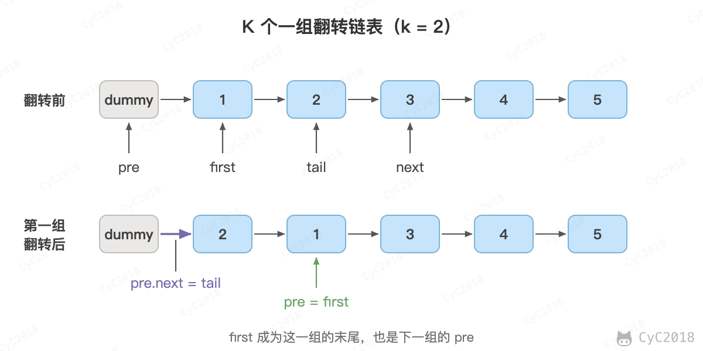

# Leetcode 题解 - 链表
<!-- GFM-TOC -->
* [Leetcode 题解 - 链表](#leetcode-题解---链表)
    * [1. 找出两个链表的交点](#1-找出两个链表的交点)
    * [2. 链表反转](#2-链表反转)
    * [3. 归并两个有序的链表](#3-归并两个有序的链表)
    * [4. 从有序链表中删除重复节点](#4-从有序链表中删除重复节点)
    * [5. 删除链表的倒数第 n 个节点](#5-删除链表的倒数第-n-个节点)
    * [6. 交换链表中的相邻结点](#6-交换链表中的相邻结点)
    * [7. 链表求和](#7-链表求和)
    * [8. 回文链表](#8-回文链表)
    * [9. 分隔链表](#9-分隔链表)
    * [10. 链表元素按奇偶聚集](#10-链表元素按奇偶聚集)
    * [11. K 个一组翻转链表](#11-k-个一组翻转链表)
    * [12. 重排链表](#12-重排链表)
    * [13. 合并 K 个有序链表](#13-合并-k-个有序链表)
    * [14. 链表排序](#14-链表排序)
<!-- GFM-TOC -->


链表是空节点，或者有一个值和一个指向下一个链表的指针，因此很多链表问题可以用递归来处理。

## 1. 找出两个链表的交点

160\. Intersection of Two Linked Lists (Easy)

[Leetcode](https://leetcode.com/problems/intersection-of-two-linked-lists/description/) / [力扣](https://leetcode-cn.com/problems/intersection-of-two-linked-lists/description/)

例如以下示例中 A 和 B 两个链表相交于 c1：

```text
A:          a1 → a2
                    ↘
                      c1 → c2 → c3
                    ↗
B:    b1 → b2 → b3
```

但是不会出现以下相交的情况，因为每个节点只有一个 next 指针，也就只能有一个后继节点，而以下示例中节点 c 有两个后继节点。

```text
A:          a1 → a2       d1 → d2
                    ↘  ↗
                      c
                    ↗  ↘
B:    b1 → b2 → b3        e1 → e2
```


要求时间复杂度为 O(N)，空间复杂度为 O(1)。如果不存在交点则返回 null。

设 A 的长度为 a + c，B 的长度为 b + c，其中 c 为尾部公共部分长度，可知 a + c + b = b + c + a。

当访问 A 链表的指针访问到链表尾部时，令它从链表 B 的头部开始访问链表 B；同样地，当访问 B 链表的指针访问到链表尾部时，令它从链表 A 的头部开始访问链表 A。这样就能控制访问 A 和 B 两个链表的指针能同时访问到交点。

如果不存在交点，那么 a + b = b + a，以下实现代码中 l1 和 l2 会同时为 null，从而退出循环。

```java
public ListNode getIntersectionNode(ListNode headA, ListNode headB) {
    ListNode l1 = headA, l2 = headB;
    while (l1 != l2) {
        l1 = (l1 == null) ? headB : l1.next;
        l2 = (l2 == null) ? headA : l2.next;
    }
    return l1;
}
```

如果只是判断是否存在交点，那么就是另一个问题，即 编程之美 3.6 的问题。有两种解法：

- 把第一个链表的结尾连接到第二个链表的开头，看第二个链表是否存在环；
- 或者直接比较两个链表的最后一个节点是否相同。

## 2. 链表反转

206\. Reverse Linked List (Easy)

[Leetcode](https://leetcode.com/problems/reverse-linked-list/description/) / [力扣](https://leetcode-cn.com/problems/reverse-linked-list/description/)

递归

```java
public ListNode reverseList(ListNode head) {
    if (head == null || head.next == null) {
        return head;
    }
    ListNode next = head.next;
    ListNode newHead = reverseList(next);
    next.next = head;
    head.next = null;
    return newHead;
}
```

头插法

```java
public ListNode reverseList(ListNode head) {
    ListNode newHead = new ListNode(-1);
    while (head != null) {
        ListNode next = head.next;
        head.next = newHead.next;
        newHead.next = head;
        head = next;
    }
    return newHead.next;
}
```

## 3. 归并两个有序的链表

21\. Merge Two Sorted Lists (Easy)

[Leetcode](https://leetcode.com/problems/merge-two-sorted-lists/description/) / [力扣](https://leetcode-cn.com/problems/merge-two-sorted-lists/description/)

```java
public ListNode mergeTwoLists(ListNode l1, ListNode l2) {
    if (l1 == null) return l2;
    if (l2 == null) return l1;
    if (l1.val < l2.val) {
        l1.next = mergeTwoLists(l1.next, l2);
        return l1;
    } else {
        l2.next = mergeTwoLists(l1, l2.next);
        return l2;
    }
}
```

## 4. 从有序链表中删除重复节点

83\. Remove Duplicates from Sorted List (Easy)

[Leetcode](https://leetcode.com/problems/remove-duplicates-from-sorted-list/description/) / [力扣](https://leetcode-cn.com/problems/remove-duplicates-from-sorted-list/description/)

```text
Given 1->1->2, return 1->2.
Given 1->1->2->3->3, return 1->2->3.
```

```java
public ListNode deleteDuplicates(ListNode head) {
    if (head == null || head.next == null) return head;
    head.next = deleteDuplicates(head.next);
    return head.val == head.next.val ? head.next : head;
}
```

## 5. 删除链表的倒数第 n 个节点

19\. Remove Nth Node From End of List (Medium)

[Leetcode](https://leetcode.com/problems/remove-nth-node-from-end-of-list/description/) / [力扣](https://leetcode-cn.com/problems/remove-nth-node-from-end-of-list/description/)

```text
Given linked list: 1->2->3->4->5, and n = 2.
After removing the second node from the end, the linked list becomes 1->2->3->5.
```

```java
public ListNode removeNthFromEnd(ListNode head, int n) {
    ListNode fast = head;
    while (n-- > 0) {
        fast = fast.next;
    }
    if (fast == null) return head.next;
    ListNode slow = head;
    while (fast.next != null) {
        fast = fast.next;
        slow = slow.next;
    }
    slow.next = slow.next.next;
    return head;
}
```

## 6. 交换链表中的相邻结点

24\. Swap Nodes in Pairs (Medium)

[Leetcode](https://leetcode.com/problems/swap-nodes-in-pairs/description/) / [力扣](https://leetcode-cn.com/problems/swap-nodes-in-pairs/description/)

```text
Given 1->2->3->4, you should return the list as 2->1->4->3.
```

题目要求：不能修改结点的 val 值，O(1) 空间复杂度。

```java
public ListNode swapPairs(ListNode head) {
    ListNode node = new ListNode(-1);
    node.next = head;
    ListNode pre = node;
    while (pre.next != null && pre.next.next != null) {
        ListNode l1 = pre.next, l2 = pre.next.next;
        ListNode next = l2.next;
        l1.next = next;
        l2.next = l1;
        pre.next = l2;

        pre = l1;
    }
    return node.next;
}
```

## 7. 链表求和

445\. Add Two Numbers II (Medium)

[Leetcode](https://leetcode.com/problems/add-two-numbers-ii/description/) / [力扣](https://leetcode-cn.com/problems/add-two-numbers-ii/description/)

```text
Input: (7 -> 2 -> 4 -> 3) + (5 -> 6 -> 4)
Output: 7 -> 8 -> 0 -> 7
```

题目要求：不能修改原始链表。

```java
public ListNode addTwoNumbers(ListNode l1, ListNode l2) {
    Stack<Integer> l1Stack = buildStack(l1);
    Stack<Integer> l2Stack = buildStack(l2);
    ListNode head = new ListNode(-1);
    int carry = 0;
    while (!l1Stack.isEmpty() || !l2Stack.isEmpty() || carry != 0) {
        int x = l1Stack.isEmpty() ? 0 : l1Stack.pop();
        int y = l2Stack.isEmpty() ? 0 : l2Stack.pop();
        int sum = x + y + carry;
        ListNode node = new ListNode(sum % 10);
        node.next = head.next;
        head.next = node;
        carry = sum / 10;
    }
    return head.next;
}

private Stack<Integer> buildStack(ListNode l) {
    Stack<Integer> stack = new Stack<>();
    while (l != null) {
        stack.push(l.val);
        l = l.next;
    }
    return stack;
}
```

## 8. 回文链表

234\. Palindrome Linked List (Easy)

[Leetcode](https://leetcode.com/problems/palindrome-linked-list/description/) / [力扣](https://leetcode-cn.com/problems/palindrome-linked-list/description/)

题目要求：以 O(1) 的空间复杂度来求解。

切成两半，把后半段反转，然后比较两半是否相等。

```java
public boolean isPalindrome(ListNode head) {
    if (head == null || head.next == null) return true;
    ListNode slow = head, fast = head.next;
    while (fast != null && fast.next != null) {
        slow = slow.next;
        fast = fast.next.next;
    }
    if (fast != null) slow = slow.next;  // 偶数节点，让 slow 指向下一个节点
    cut(head, slow);                     // 切成两个链表
    return isEqual(head, reverse(slow));
}

private void cut(ListNode head, ListNode cutNode) {
    while (head.next != cutNode) {
        head = head.next;
    }
    head.next = null;
}

private ListNode reverse(ListNode head) {
    ListNode newHead = null;
    while (head != null) {
        ListNode nextNode = head.next;
        head.next = newHead;
        newHead = head;
        head = nextNode;
    }
    return newHead;
}

private boolean isEqual(ListNode l1, ListNode l2) {
    while (l1 != null && l2 != null) {
        if (l1.val != l2.val) return false;
        l1 = l1.next;
        l2 = l2.next;
    }
    return true;
}
```

## 9. 分隔链表

725\. Split Linked List in Parts(Medium)

[Leetcode](https://leetcode.com/problems/split-linked-list-in-parts/description/) / [力扣](https://leetcode-cn.com/problems/split-linked-list-in-parts/description/)

```text
Input:
root = [1, 2, 3, 4, 5, 6, 7, 8, 9, 10], k = 3
Output: [[1, 2, 3, 4], [5, 6, 7], [8, 9, 10]]
Explanation:
The input has been split into consecutive parts with size difference at most 1, and earlier parts are a larger size than the later parts.
```

题目描述：把链表分隔成 k 部分，每部分的长度都应该尽可能相同，排在前面的长度应该大于等于后面的。

```java
public ListNode[] splitListToParts(ListNode root, int k) {
    int N = 0;
    ListNode cur = root;
    while (cur != null) {
        N++;
        cur = cur.next;
    }
    int mod = N % k;
    int size = N / k;
    ListNode[] ret = new ListNode[k];
    cur = root;
    for (int i = 0; cur != null && i < k; i++) {
        ret[i] = cur;
        int curSize = size + (mod-- > 0 ? 1 : 0);
        for (int j = 0; j < curSize - 1; j++) {
            cur = cur.next;
        }
        ListNode next = cur.next;
        cur.next = null;
        cur = next;
    }
    return ret;
}
```

## 10. 链表元素按奇偶聚集

328\. Odd Even Linked List (Medium)

[Leetcode](https://leetcode.com/problems/odd-even-linked-list/description/) / [力扣](https://leetcode-cn.com/problems/odd-even-linked-list/description/)

```text
Example:
Given 1->2->3->4->5->NULL,
return 1->3->5->2->4->NULL.
```

```java
public ListNode oddEvenList(ListNode head) {
    if (head == null) {
        return head;
    }
    ListNode odd = head, even = head.next, evenHead = even;
    while (even != null && even.next != null) {
        odd.next = odd.next.next;
        odd = odd.next;
        even.next = even.next.next;
        even = even.next;
    }
    odd.next = evenHead;
    return head;
}
```

## 11. K 个一组翻转链表

25\. Reverse Nodes in k-Group (Hard)

[Leetcode](https://leetcode.com/problems/reverse-nodes-in-k-group/) / [力扣](https://leetcode.cn/problems/reverse-nodes-in-k-group/)

```text
Input: 1->2->3->4->5, k = 2
Output: 2->1->4->3->5
```

题目描述：每 k 个节点一组进行翻转，最后不足 k 个的节点保持原有顺序。

使用一个虚拟头节点 dummy，pre 指向下一组的前一个节点。先从 pre 向后走 k 步找到这一组的尾节点 tail，走不到说明剩余节点不足 k 个。然后把 pre.next 到 tail 这一段原地翻转，再把它接回原链表，最后 pre 移到这一组翻转后的末尾。

<div align="center">  </div><br>

```java
public ListNode reverseKGroup(ListNode head, int k) {
    ListNode dummy = new ListNode(-1);
    dummy.next = head;
    ListNode pre = dummy;
    while (true) {
        ListNode tail = pre;
        for (int i = 0; i < k && tail != null; i++) {
            tail = tail.next;
        }
        if (tail == null) {
            break;
        }
        ListNode first = pre.next, next = tail.next;
        ListNode prev = next, cur = first;
        while (cur != next) {
            ListNode tmp = cur.next;
            cur.next = prev;
            prev = cur;
            cur = tmp;
        }
        pre.next = tail;
        pre = first;
    }
    return dummy.next;
}
```

## 12. 重排链表

143\. Reorder List (Medium)

[Leetcode](https://leetcode.com/problems/reorder-list/) / [力扣](https://leetcode.cn/problems/reorder-list/)

```text
Input: 1->2->3->4->5
Output: 1->5->2->4->3
```

题目描述：把 L0→L1→…→Ln 重排为 L0→Ln→L1→Ln-1→…，只能修改节点的指针。

可以拆成三个已经解决过的子问题：用快慢指针找到中点并断开；把后半段反转；再把两段交替连接起来。

```java
public void reorderList(ListNode head) {
    if (head == null || head.next == null) {
        return;
    }
    ListNode slow = head, fast = head;
    while (fast.next != null && fast.next.next != null) {
        slow = slow.next;
        fast = fast.next.next;
    }
    ListNode l2 = reverse(slow.next);
    slow.next = null;
    ListNode l1 = head;
    while (l2 != null) {
        ListNode n1 = l1.next, n2 = l2.next;
        l1.next = l2;
        l2.next = n1;
        l1 = n1;
        l2 = n2;
    }
}

private ListNode reverse(ListNode head) {
    ListNode pre = null;
    while (head != null) {
        ListNode next = head.next;
        head.next = pre;
        pre = head;
        head = next;
    }
    return pre;
}
```

## 13. 合并 K 个有序链表

23\. Merge k Sorted Lists (Hard)

[Leetcode](https://leetcode.com/problems/merge-k-sorted-lists/) / [力扣](https://leetcode.cn/problems/merge-k-sorted-lists/)

用小顶堆保存每个链表当前的头节点，每次取出值最小的节点接到结果链表后面，再把它的下一个节点放入堆中。设一共有 N 个节点，每个节点进出堆一次，时间复杂度为 O(NlogK)。

也可以像归并排序那样两两合并，时间复杂度同样是 O(NlogK)。

```java
public ListNode mergeKLists(ListNode[] lists) {
    PriorityQueue<ListNode> pq = new PriorityQueue<>((a, b) -> Integer.compare(a.val, b.val));
    for (ListNode node : lists) {
        if (node != null) {
            pq.add(node);
        }
    }
    ListNode dummy = new ListNode(-1), tail = dummy;
    while (!pq.isEmpty()) {
        ListNode node = pq.poll();
        tail.next = node;
        tail = node;
        if (node.next != null) {
            pq.add(node.next);
        }
    }
    return dummy.next;
}
```

## 14. 链表排序

148\. Sort List (Medium)

[Leetcode](https://leetcode.com/problems/sort-list/) / [力扣](https://leetcode.cn/problems/sort-list/)

题目描述：在 O(NlogN) 时间复杂度内对链表进行排序。

链表不能随机访问，适合用归并排序：用快慢指针找到中点断开，两半分别排序后，用第 3 题的方法归并。递归需要 O(logN) 的栈空间。

```java
public ListNode sortList(ListNode head) {
    if (head == null || head.next == null) {
        return head;
    }
    ListNode slow = head, fast = head.next;
    while (fast != null && fast.next != null) {
        slow = slow.next;
        fast = fast.next.next;
    }
    ListNode right = slow.next;
    slow.next = null;
    return merge(sortList(head), sortList(right));
}

private ListNode merge(ListNode l1, ListNode l2) {
    ListNode dummy = new ListNode(-1), tail = dummy;
    while (l1 != null && l2 != null) {
        if (l1.val <= l2.val) {
            tail.next = l1;
            l1 = l1.next;
        } else {
            tail.next = l2;
            l2 = l2.next;
        }
        tail = tail.next;
    }
    tail.next = l1 != null ? l1 : l2;
    return dummy.next;
}
```
