# Linux
<!-- GFM-TOC -->
* [Linux](#linux)
    * [前言](#前言)
    * [一、常用操作以及概念](#一常用操作以及概念)
        * [快捷键](#快捷键)
        * [求助](#求助)
        * [关机](#关机)
        * [PATH](#path)
        * [sudo](#sudo)
        * [包管理工具](#包管理工具)
        * [发行版](#发行版)
        * [VIM 三个模式](#vim-三个模式)
        * [GNU](#gnu)
        * [开源协议](#开源协议)
    * [二、磁盘](#二磁盘)
        * [磁盘接口](#磁盘接口)
        * [磁盘的文件名](#磁盘的文件名)
    * [三、分区](#三分区)
        * [分区表](#分区表)
        * [开机检测程序](#开机检测程序)
    * [四、文件系统](#四文件系统)
        * [分区与文件系统](#分区与文件系统)
        * [组成](#组成)
        * [文件读取](#文件读取)
        * [磁盘碎片](#磁盘碎片)
        * [block](#block)
        * [inode](#inode)
        * [目录](#目录)
        * [日志](#日志)
        * [挂载](#挂载)
        * [目录配置](#目录配置)
    * [五、文件](#五文件)
        * [文件属性](#文件属性)
        * [文件与目录的基本操作](#文件与目录的基本操作)
        * [修改权限](#修改权限)
        * [默认权限](#默认权限)
        * [目录的权限](#目录的权限)
        * [链接](#链接)
        * [获取文件内容](#获取文件内容)
        * [指令与文件搜索](#指令与文件搜索)
    * [六、压缩与打包](#六压缩与打包)
        * [压缩文件名](#压缩文件名)
        * [压缩指令](#压缩指令)
        * [打包](#打包)
    * [七、Bash](#七bash)
        * [特性](#特性)
        * [变量操作](#变量操作)
        * [指令搜索顺序](#指令搜索顺序)
        * [数据流重定向](#数据流重定向)
    * [八、管道指令](#八管道指令)
        * [提取指令](#提取指令)
        * [排序指令](#排序指令)
        * [双向输出重定向](#双向输出重定向)
        * [字符转换指令](#字符转换指令)
        * [分区指令](#分区指令)
    * [九、正则表达式](#九正则表达式)
        * [grep](#grep)
        * [printf](#printf)
        * [awk](#awk)
    * [十、进程管理](#十进程管理)
        * [查看进程](#查看进程)
        * [进程状态](#进程状态)
        * [SIGCHLD](#sigchld)
        * [wait()](#wait)
        * [waitpid()](#waitpid)
        * [孤儿进程](#孤儿进程)
        * [僵尸进程](#僵尸进程)
    * [十一、线上问题排查](#十一线上问题排查) 🔥🔥
        * [CPU 占用高](#cpu-占用高)
        * [内存占用高](#内存占用高)
        * [端口与磁盘](#端口与磁盘)
        * [日志分析](#日志分析)
    * [参考资料](#参考资料)
<!-- GFM-TOC -->


## 前言

为了便于理解，本文从常用操作和概念开始讲起。虽然已经尽量做到简化，但是涉及到的内容还是有点多。在面试中，Linux 知识点相对于网络和操作系统等知识点而言不是那么重要，只需要重点掌握一些原理和命令即可。为了方便大家准备面试，在此先将一些比较重要的知识点列出来：

- 能简单使用 cat，grep，cut 等命令进行一些操作；
- 文件系统相关的原理，inode 和 block 等概念，数据恢复；
- 硬链接与软链接；
- 进程管理相关，僵尸进程与孤儿进程，SIGCHLD 。

## 一、常用操作以及概念

### 快捷键

- Tab：命令和文件名补全；
- Ctrl+C：中断正在运行的程序；
- Ctrl+D：结束键盘输入（End Of File，EOF）。

### 求助

#### 1. --help

指令的基本用法与选项介绍。

#### 2. man

man 是 manual 的缩写，将指令的具体信息显示出来。

当执行 `man date` 时，有 DATE(1) 出现，其中的数字代表指令的类型，常用的数字及其类型如下：

| 代号 | 类型 |
| :--: | -- |
| 1 | 用户在 shell 环境中可以操作的指令或者可执行文件 |
| 5 | 配置文件 |
| 8 | 系统管理员可以使用的管理指令 |

#### 3. info

info 与 man 类似，但是 info 将文档分成一个个页面，每个页面可以跳转。

#### 4. doc

/usr/share/doc 存放着软件的一整套说明文件。

### 关机

#### 1. who

在关机前需要先使用 who 命令查看有没有其它用户在线。

#### 2. sync

为了加快对磁盘文件的读写速度，位于内存中的文件数据不会立即同步到磁盘，因此关机之前需要先进行 sync 同步操作。

#### 3. shutdown

```text
$ shutdown [-krhc] 时间 [信息]
-k ： 不会关机，只是发送警告信息，通知所有在线的用户
-r ： 将系统的服务停掉后就重新启动
-h ： 将系统的服务停掉后就立即关机
-c ： 取消已经在进行的 shutdown
```

### PATH

可以在环境变量 PATH 中声明可执行文件的路径，路径之间用 : 分隔。

```text
/usr/local/bin:/usr/bin:/usr/local/sbin:/usr/sbin:/home/dmtsai/.local/bin:/home/dmtsai/bin
```

### sudo

sudo 允许一般用户使用 root 可执行的命令，不过只有在 /etc/sudoers（或 /etc/sudoers.d/ 中的文件）里授权的用户和群组才能使用该指令，例如 Ubuntu 默认授权 sudo 组的成员。

### 包管理工具

RPM 和 DPKG 为最常见的两类软件包管理工具：

- RPM 全称为 RPM Package Manager（最初叫 Red Hat Package Manager），最早由 Red Hat 公司制定实施，随后被许多 Linux 发行版采用。YUM 基于 RPM，具有依赖管理和软件升级功能，Fedora、RHEL 8 起改用它的后继者 DNF；
- 与 RPM 竞争的是 Debian 的 DEB 软件包管理工具 DPKG，全称为 Debian Package，功能方面与 RPM 相似。APT 基于 DPKG，负责依赖管理和升级，Ubuntu 中常用 apt install 安装软件。

### 发行版

Linux 发行版是 Linux 内核及各种应用软件的集成版本。

| 基于的包管理工具 | 商业发行版 | 社区发行版 |
| :--: | :--: | :--: |
| RPM | Red Hat | Fedora / CentOS Stream |
| DPKG | Ubuntu | Debian |

CentOS Linux 已于 2024 年 6 月停止维护，原来用 CentOS 的服务器多改用 Rocky Linux、AlmaLinux。

### VIM 三个模式

<div align="center"> 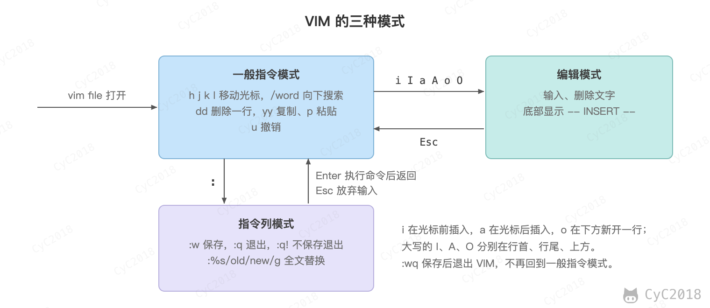 </div><br>


- 一般指令模式（Command mode）：VIM 的默认模式，可以用于移动游标查看内容；
- 编辑模式（Insert mode）：按下 “i” 等按键之后进入，可以对文本进行编辑；
- 指令列模式（Bottom-line mode）：按下 “:” 按键之后进入，用于保存退出等操作。

在指令列模式下，有以下命令用于离开或者保存文件。

| 命令 | 作用 |
| :--: | :--: |
| :w | 写入磁盘|
| :w! | 当文件为只读时，强制写入磁盘。到底能不能写入，与用户对该文件的权限有关 |
| :q | 离开 |
| :q! | 强制离开不保存 |
| :wq | 写入磁盘后离开 |
| :wq!| 强制写入磁盘后离开 |

### GNU

GNU 计划，译为革奴计划，它的目标是创建一套完全自由的操作系统，称为 GNU，其内容软件完全以 GPL 方式发布。其中 GPL 全称为 GNU 通用公共许可协议（GNU General Public License），包含了以下内容：

- 以任何目的运行此程序的自由；
- 再复制的自由；
- 改进此程序，并公开发布改进的自由。

### 开源协议

- [Choose an open source license](https://choosealicense.com/)
- [如何选择开源许可证？](http://www.ruanyifeng.com/blog/2011/05/how_to_choose_free_software_licenses.html)

## 二、磁盘

### 磁盘接口

#### 1. IDE

IDE（Integrated Drive Electronics）通常也称为 ATA（Advanced Technology Attachment），接口速度最大为 133MB/s，因为并口线的抗干扰性太差，且排线占用空间较大，不利电脑内部散热，已逐渐被 SATA 所取代。

#### 2. SATA

SATA 全称 Serial ATA，也就是使用串口的 ATA 接口，抗干扰性强，且对数据线的长度要求比 ATA 低很多，支持热插拔等功能。SATA-II 的接口速度为 300MB/s，而 SATA-III 标准可达到 600MB/s 的传输速度。SATA 的数据线也比 ATA 的细得多，有利于机箱内的空气流通，整理线材也比较方便。

#### 3. SCSI

SCSI 全称是 Small Computer System Interface（小型机系统接口），SCSI 硬盘广为工作站以及个人电脑以及服务器所使用，因此会使用较为先进的技术，如碟片转速 15000rpm 的高转速，且传输时 CPU 占用率较低，但是单价也比相同容量的 ATA 及 SATA 硬盘更加昂贵。

#### 4. SAS

SAS（Serial Attached SCSI）是新一代的 SCSI 技术，和 SATA 硬盘相同，都是采取序列式技术以获得更高的传输速度，SAS-3 为 12Gb/s。此外也通过缩小连接线改善系统内部空间等。

#### 5. NVMe

固态硬盘的速度已经超过了 SATA 接口的上限，NVMe（Non-Volatile Memory Express）让固态硬盘直接通过 PCIe 总线与 CPU 通信，PCIe 4.0 x4 的带宽约为 8 GB/s，远高于 SATA III 的 600 MB/s，并且支持大量并行的队列。Linux 中 NVMe 磁盘的文件名为 /dev/nvme0n1，分区为 /dev/nvme0n1p1。

### 磁盘的文件名

Linux 中每个硬件都被当做一个文件，包括磁盘。磁盘以磁盘接口类型进行命名，常见磁盘的文件名如下：

- IDE 磁盘：/dev/hd[a-d]（旧驱动的命名，Linux 5.14 移除了旧的 IDE 驱动，现在由 libata 驱动 IDE 磁盘，也命名为 /dev/sd*）
- SATA/SCSI/SAS 磁盘：/dev/sd[a-z]（超过 26 块后为 /dev/sdaa、/dev/sdab 等）
- NVMe 磁盘：/dev/nvme0n1、/dev/nvme1n1

其中文件名后面的序号的确定与系统检测到磁盘的顺序有关，而与磁盘所插入的插槽位置无关。

## 三、分区

### 分区表

磁盘分区表主要有两种格式，一种是限制较多的 MBR 分区表，一种是较新且限制较少的 GPT 分区表。

#### 1. MBR

MBR 中，第一个扇区最重要，里面有主要开机记录（Master boot record, MBR）及分区表（partition table），其中主要开机记录占 446 bytes，分区表占 64 bytes。

分区表只有 64 bytes，最多只能存储 4 个分区，这 4 个分区为主分区（Primary）和扩展分区（Extended）。其中扩展分区只有一个，它使用其它扇区来记录额外的分区表，因此通过扩展分区可以分出更多分区，这些分区称为逻辑分区。

Linux 也把分区当成文件，分区文件的命名方式为：磁盘文件名 + 编号，例如 /dev/sda1。注意，逻辑分区的编号从 5 开始。

#### 2. GPT

扇区是磁盘的最小存储单位，旧磁盘的扇区大小通常为 512 bytes，而较新的磁盘支持 4 KB。GPT 用逻辑区块地址（Logical Block Address, LBA）给区块编号，区块的大小由磁盘决定，下面以最常见的 512 bytes 为例。

GPT 的第 1 个区块（LBA 0）是保护性 MBR，它把整块磁盘登记为一个类型特殊的分区，只认识 MBR 的旧工具不会把磁盘当成空盘误改；紧接着是 33 个区块记录分区信息，最后的 33 个区块是它们的备份。这 33 个区块中第一个是 GPT 表头，记录了分区表本身的位置与大小、备份的位置，以及分区表的校验码（CRC32），操作系统根据校验码判断 GPT 是否损坏，损坏时用备份恢复。

GPT 没有扩展分区概念，都是主分区。每个分区项占 128 bytes，一个区块放 4 项，记录分区项的 32 个区块共 4 * 32 = 128 项，因此默认最多 128 个分区。

按 512 bytes 的区块计算，MBR 用 32 位记录区块号，最多寻址 2<sup>32</sup> × 512 B = 2 TiB（约 2.2 TB）；GPT 用 64 位，最多 2<sup>64</sup> × 512 B = 8 ZiB。

<div align="center"> 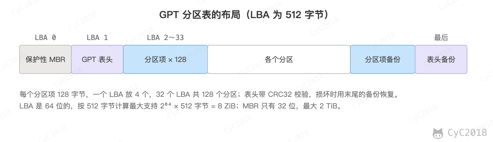 </div><br>

### 开机检测程序

#### 1. BIOS

BIOS（Basic Input/Output System，基本输入输出系统），它是一个固件（嵌入在硬件中的软件），BIOS 程序存放在断电后内容不会丢失的只读内存中。

BIOS 是开机的时候计算机执行的第一个程序，这个程序知道可以开机的磁盘，并读取磁盘第一个扇区的主要开机记录（MBR），由主要开机记录（MBR）执行其中的开机管理程序，这个开机管理程序会加载操作系统的核心文件。

主要开机记录（MBR）中的开机管理程序提供以下功能：选单、载入核心文件以及转交其它开机管理程序。转交这个功能可以用来实现多重引导，只需要将另一个操作系统的开机管理程序安装在其它分区的启动扇区上，在启动开机管理程序时，就可以通过选单选择启动当前的操作系统或者转交给其它开机管理程序从而启动另一个操作系统。

下图中，第一扇区的主要开机记录（MBR）中的开机管理程序提供了两个选单：M1、M2，M1 指向了 Windows 操作系统，而 M2 指向其它分区的启动扇区，里面包含了另外一个开机管理程序，提供了一个指向 Linux 的选单。

<div align="center"> 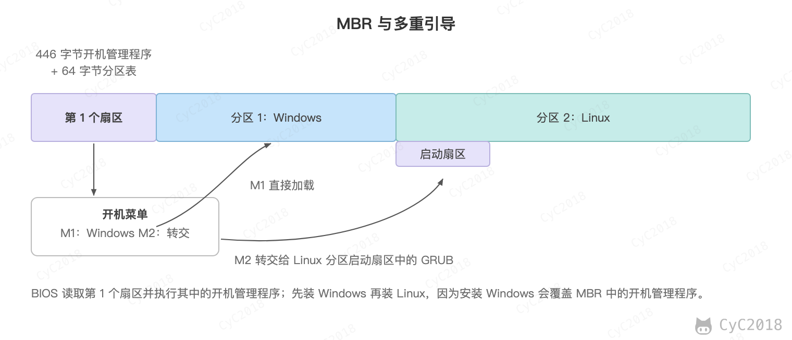 </div><br>

安装多重引导，最好先安装 Windows 再安装 Linux。因为安装 Windows 时会覆盖掉主要开机记录（MBR），而 Linux 可以选择将开机管理程序安装在主要开机记录（MBR）或者其它分区的启动扇区，并且可以设置开机管理程序的选单。

#### 2. UEFI

BIOS 只会执行 MBR 中的开机管理程序，本身不读取分区表，从 GPT 磁盘启动要依靠支持 GPT 的开机管理程序（例如 GRUB）；UEFI 可以直接读取 GPT 分区表。

UEFI 不执行 MBR 中的代码，而是从 EFI 系统分区（EFI System Partition, ESP，FAT 格式）中读取开机管理程序文件来启动，例如 Ubuntu 的 /boot/efi/EFI/ubuntu/shimx64.efi。多重引导时各系统把引导文件放在 ESP 的不同目录中（例如 EFI/Microsoft、EFI/ubuntu），由固件的启动菜单选择，不再争用 MBR 中唯一的 446 bytes。

## 四、文件系统

### 分区与文件系统

对分区进行格式化是为了在分区上建立文件系统。文件系统建立在块设备上，块设备通常是一个分区，也可以是 LVM、RAID 提供的逻辑设备：LVM 可以把一个分区划成多个逻辑卷，各自建立文件系统，也可以和 RAID 一样把多个磁盘合成一个设备。

### 组成

最主要的几个组成部分如下：

- inode：一个文件占用一个 inode，记录文件的属性，同时记录此文件的内容所在的 block 编号；
- block：记录文件的内容，文件太大时，会占用多个 block。

除此之外还包括：

- superblock：记录文件系统的整体信息，包括 inode 和 block 的总量、使用量、剩余量，以及文件系统的格式与相关信息等；
- block bitmap、inode bitmap：分别记录 block、inode 是否已被使用的位图，分配时只需扫描位图。

<div align="center"> 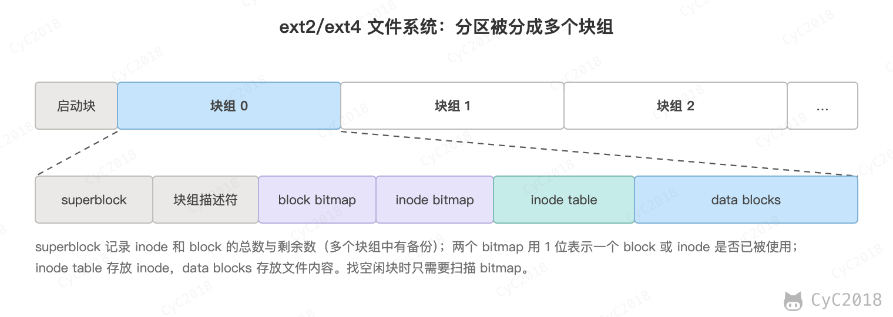 </div><br>

### 文件读取

对于 Ext2 文件系统，当要读取一个文件的内容时，先在 inode 中查找文件内容所在的所有 block，然后把所有 block 的内容读出来。

<div align="center"> 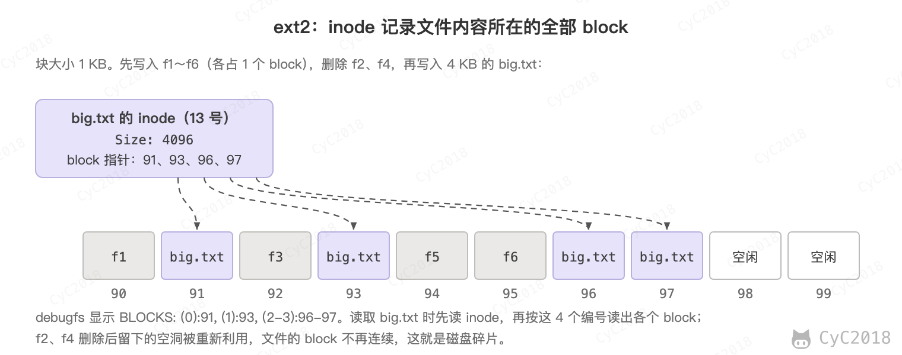 </div><br>

而对于 FAT 文件系统，它没有 inode，每个 block 的下一个 block 编号记录在文件分配表（File Allocation Table, FAT）中，读取时从目录项中的起始编号开始，沿着这条链依次找到所有 block。

<div align="center"> 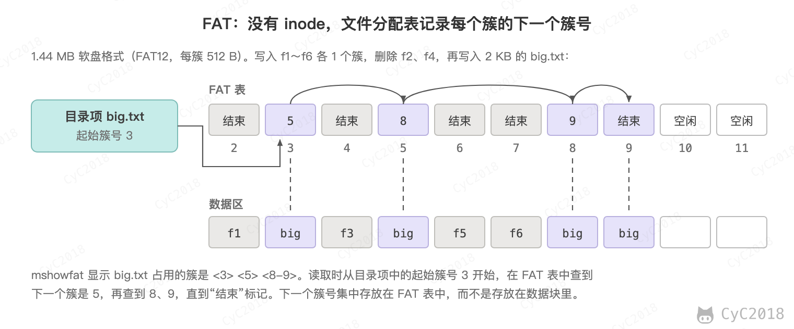 </div><br>

### 磁盘碎片

指一个文件内容所在的 block 过于分散，导致磁盘磁头移动距离过大，从而降低磁盘读写性能。

### block

在 Ext2 文件系统中所支持的 block 大小有 1K，2K 及 4K 三种，不同的大小限制了单个文件和文件系统的最大大小。

| 大小 | 1KB | 2KB | 4KB |
| :---: | :---: | :---: | :---: |
| 最大单一文件 | 16GB | 256GB | 2TB |
| 最大文件系统 | 2TB | 8TB | 16TB |

一个 block 只能被一个文件所使用，未使用的部分直接浪费了。因此如果需要存储大量的小文件，那么最好选用比较小的 block。

### inode

inode 具体包含以下信息：

- 权限（read/write/execute）；
- 拥有者与群组（owner/group）；
- 容量；
- 状态改变的时间（ctime），不是创建时间；
- 最近读取时间（atime）；
- 最近修改时间（mtime）；
- 定义文件特性的旗标（flag），如 SetUID；
- 该文件真正内容的指向（pointer）。

inode 具有以下特点：

- 每个 inode 的大小在格式化时确定，早期的 ext2/ext3 为 128 bytes，现在 mke2fs 默认为 256 bytes；
- 每个文件都仅会占用一个 inode。

inode 中记录了文件内容所在的 block 编号，但一个大文件需要几十万个 block，inode 的大小有限，放不下这么多编号。因此 ext2/ext3 的 inode 只放 12 个直接引用，再加一级、二级、三级间接引用：间接引用指向的 block 不存文件内容，而是存放更多的 block 编号。

<div align="center"> 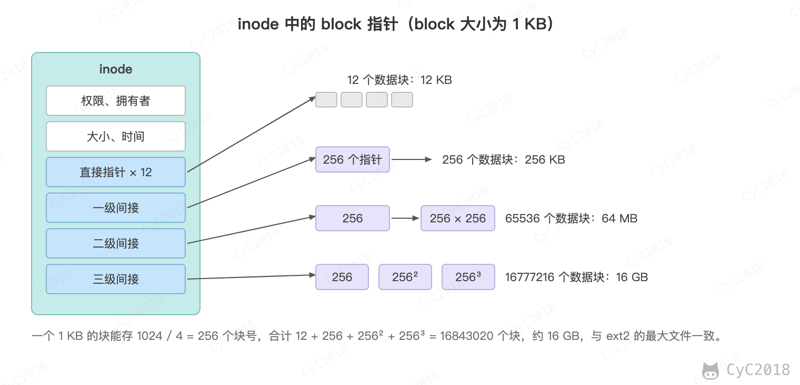 </div><br>

ext4 默认改用区段（extent）记录位置：一条记录只写起始 block 和连续的长度，block 为 4 KB 时一条最多覆盖 128 MB，连续存放的大文件只需要很少几条记录。

### 目录

建立一个目录时，会分配一个 inode 与至少一个 block。block 记录的内容是目录下所有文件的 inode 编号以及文件名。

文件的 inode 本身不记录文件名，文件名记录在目录中，因此新增文件、删除文件、更改文件名这些操作与目录的写权限有关。

### 日志

如果突然断电，那么文件系统会发生错误，例如断电前只修改了 block bitmap，而还没有将数据真正写入 block 中。

ext3/ext4 文件系统引入了日志（journal）：修改元数据之前，先把这次要做的修改写入日志区，写完后再追加一条提交记录，之后才改到实际位置。断电后只需重做有提交记录的修改、丢弃没有提交记录的，不必用 fsck 扫描整个文件系统。ext4 默认只把元数据写入日志，文件内容不经过日志。

### 挂载

挂载指把一个文件系统接到目录树中的某个目录（挂载点）上，进入这个目录就是在访问该文件系统。例如把 U 盘的分区 /dev/sdb1 挂载到 /mnt/usb 后，/mnt/usb 下看到的就是 U 盘中的文件。

### 目录配置

为了使不同 Linux 发行版本的目录结构保持一致性，Filesystem Hierarchy Standard (FHS) 规定了 Linux 的目录结构。最基础的三个目录如下：

- / (root, 根目录)
- /usr (unix software resource)：所有系统默认软件都会安装到这个目录；
- /var (variable)：存放系统或程序运行过程中的数据文件。

<div align="center"> 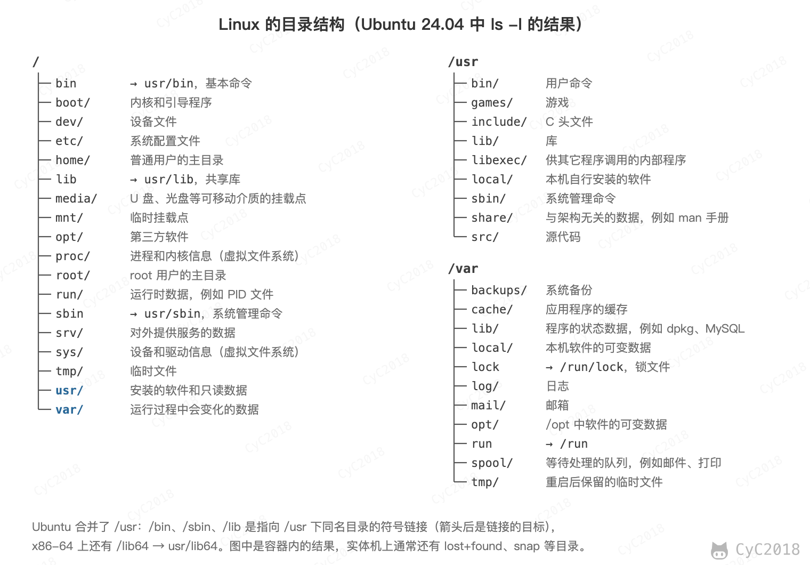 </div><br>

## 五、文件

### 文件属性

用户分为三种：文件拥有者、群组以及其它人，对不同的用户有不同的文件权限。

使用 ls 查看一个文件时，会显示一个文件的信息，例如 `drwxr-xr-x 3 root root 17 May 6 00:14 .config`，对这个信息的解释如下：

- drwxr-xr-x：文件类型以及权限，第 1 位为文件类型字段，后 9 位为文件权限字段
- 3：链接数
- root：文件拥有者
- root：所属群组
- 17：文件大小
- May 6 00:14：文件最后被修改的时间
- .config：文件名

常见的文件类型及其含义有：

- d：目录
- -：文件
- l：链接文件

9 位的文件权限字段中，每 3 个为一组，共 3 组，每一组分别代表对文件拥有者、所属群组以及其它人的文件权限。一组权限中的 3 位分别为 r、w、x 权限，表示可读、可写、可执行。

文件时间有以下三种：

- modification time (mtime)：文件的内容更新就会更新；
- status change time (ctime)：文件的状态（权限、属性）更新就会更新，修改内容时也会更新；
- access time (atime)：读取文件时更新。需要注意的是，默认的挂载选项 relatime 下，只有 atime 不晚于 mtime 或 ctime、或者距上次更新超过一天时才更新。

### 文件与目录的基本操作

#### 1. ls

列出文件或者目录的信息，目录的信息就是其中包含的文件。

```text
$ ls [-aAdfFhilnrRSt] file|dir
-a ：列出全部的文件
-d ：仅列出目录本身
-l ：以长格式列出，包含文件的属性与权限等数据
```

#### 2. cd

更换当前目录。

```bash
cd [相对路径或绝对路径]
```

#### 3. mkdir

创建目录。

```text
$ mkdir [-mp] 目录名称
-m ：配置目录权限
-p ：递归创建目录
```

#### 4. rmdir

删除目录，目录必须为空。

```text
rmdir [-p] 目录名称
-p ：删除后，上层目录变为空时一并删除
```

#### 5. touch

更新文件时间或者建立新文件。

```text
$ touch [-acdmt] filename
-a ： 更新 atime
-c ： 若该文件不存在则不建立新文件
-m ： 更新 mtime
-d ： 后面可以接更新日期而不使用当前日期，也可以使用 --date="日期或时间"
-t ： 后面可以接更新时间而不使用当前时间，格式为[YYYYMMDDhhmm]
```

#### 6. cp

复制文件。如果源文件有两个以上，则目的文件一定要是目录才行。

```text
cp [-adfilprsu] source destination
-a ：相当于 -dr --preserve=all
-d ：若来源文件为链接文件，则复制链接文件属性而非文件本身
-i ：若目标文件已经存在时，在覆盖前会先询问
-p ：连同文件的属性一起复制过去
-r ：递归复制
-u ：destination 比 source 旧才更新 destination，或 destination 不存在的情况下才复制
--preserve=all ：除了 -p 的权限相关参数外，还加入 SELinux 的属性, links, xattr 等也复制了
```

#### 7. rm

删除文件。

```text
$ rm [-fir] 文件或目录
-r ：递归删除
```

#### 8. mv

移动文件。

```text
$ mv [-fiu] source destination
$ mv [options] source1 source2 source3 .... directory
-f ： force 强制的意思，如果目标文件已经存在，不会询问而直接覆盖
```

### 修改权限

可以将一组权限用数字来表示，此时一组权限的 3 个位当做二进制数字的位，从左到右每个位的权值为 4、2、1，即每个权限对应的数字权值为 r : 4、w : 2、x : 1。

```text
$ chmod [-R] xyz dirname/filename
```

示例：将 .bashrc 文件的权限修改为 -rwxr-xr--。

```text
$ chmod 754 .bashrc
```

也可以使用符号来设定权限。

```text
$ chmod [ugoa]  [+-=] [rwx] dirname/filename
- u：拥有者
- g：所属群组
- o：其他人
- a：所有人
- +：添加权限
- -：移除权限
- =：设定权限
```

示例：为 .bashrc 文件的所有用户添加写权限。

```text
$ chmod a+w .bashrc
```

### 默认权限

- 文件默认权限：文件默认没有可执行权限，因此为 666，也就是 -rw-rw-rw- 。
- 目录默认权限：目录必须要能够进入，也就是必须拥有可执行权限，因此为 777 ，也就是 drwxrwxrwx。

可以通过 umask 设置或者查看默认权限，它是一个掩码，表示要从上面的默认权限中去掉哪些位。例如 umask 为 002 时去掉其它用户的写权限，新建文件的权限为 -rw-rw-r--（664）。需要注意的是，这是按位去掉而不是相减：umask 为 023 时文件为 666 去掉 023 中的各位，得到 644，而不是 643。

### 目录的权限

文件名不是存储在一个文件的内容中，而是存储在一个文件所在的目录中。因此，拥有文件的 w 权限并不能对文件名进行修改。

目录存储文件列表，一个目录的权限也就是对其文件列表的权限。因此，目录的 r 权限表示可以读取文件列表；w 权限表示可以修改文件列表，具体来说，就是添加删除文件，对文件名进行修改；x 权限表示可以进入目录、访问其中的文件。没有 x 时，r 只能列出文件名，看不到文件的属性，也打不开其中的文件；w 也无法生效，不能在目录中新建或删除文件。

### 链接

<div align="center"> 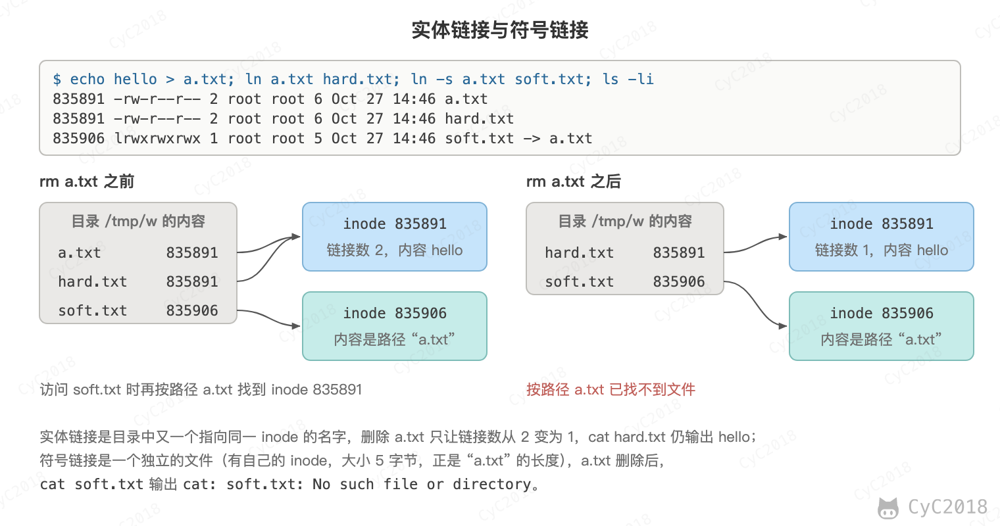 </div><br>


```text
$ ln [-sf] source_filename dist_filename
-s ：默认是实体链接，加 -s 为符号链接
-f ：如果目标文件存在时，先删除目标文件
```

#### 1. 实体链接

在目录下创建一个条目，记录着文件名与 inode 编号，这个 inode 就是源文件的 inode。

删除任意一个条目，文件还是存在，只要引用数量不为 0。

有以下限制：不能跨越文件系统、不能对目录进行链接。

```text
# ln /etc/crontab .
# ll -i /etc/crontab crontab
34474855 -rw-r--r--. 2 root root 451 Jun 10 2014 crontab
34474855 -rw-r--r--. 2 root root 451 Jun 10 2014 /etc/crontab
```

#### 2. 符号链接

符号链接文件保存着源文件的路径（可以是绝对路径，也可以是相对路径），在读取时会定位到源文件上，可以理解为 Windows 的快捷方式。

当源文件被删除了，链接文件就打不开了。

因为记录的是路径，所以可以为目录建立符号链接。

```text
# ll -i /etc/crontab /root/crontab2
34474855 -rw-r--r--. 2 root root 451 Jun 10 2014 /etc/crontab
53745909 lrwxrwxrwx. 1 root root 12 Jun 23 22:31 /root/crontab2 -> /etc/crontab
```

### 获取文件内容

#### 1. cat

取得文件内容。

```text
$ cat [-AbEnTv] filename
-n ：打印出行号，连同空白行也会有行号，-b 不会
```

#### 2. tac

是 cat 的反向操作，从最后一行开始打印。

#### 3. more

和 cat 不同的是它可以一页一页查看文件内容，比较适合大文件的查看。

#### 4. less

和 more 类似，但是多了一个向前翻页的功能。

#### 5. head

取得文件前几行。

```text
$ head [-n number] filename
-n ：后面接数字，代表显示几行的意思
```

#### 6. tail

是 head 的反向操作，只是取得是后几行。

#### 7. od

以字符或者十六进制的形式显示二进制文件。

### 指令与文件搜索

#### 1. which

指令搜索。

```text
$ which [-a] command
-a ：将所有指令列出，而不是只列第一个
```

#### 2. whereis

文件搜索。速度比较快，因为它只搜索几个特定的目录。

```text
$ whereis [-bmsu] dirname/filename
```

#### 3. locate

文件搜索。可以用关键字或者正则表达式进行搜索。

Ubuntu 24.04 中 locate 由 plocate 提供，使用 /var/lib/plocate/ 中的数据库进行搜索。该数据库定期更新，所以无法用 locate 搜索新建的文件。可以使用 updatedb 来立即更新数据库。

```text
$ locate [-ir] keyword
-r：正则表达式
```

#### 4. find

文件搜索。可以使用文件的属性和权限进行搜索。

```text
$ find [basedir] [option]
example: find . -name "shadow*"
```

① 与时间有关的选项：

```text
-mtime  n ：列出在 n 天前的那一天修改过内容的文件
-mtime +n ：列出在 n 天之前 (不含 n 天本身) 修改过内容的文件
-mtime -n ：列出在 n 天之内 (不含 n 天本身) 修改过内容的文件
-newer file ： 列出比 file 更新的文件
```

+4、4 和 -4 指示的时间范围如下：

<div align="center"> 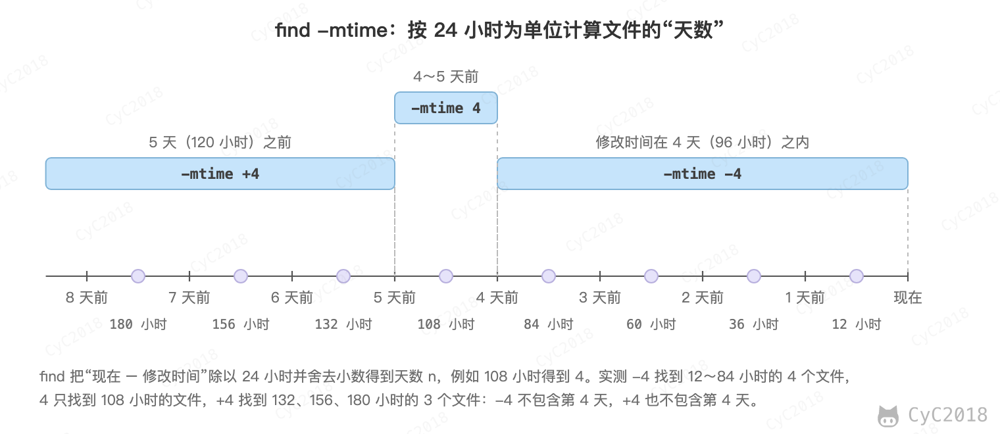 </div><br>

② 与文件拥有者和所属群组有关的选项：

```text
-uid n
-gid n
-user name
-group name
-nouser ：搜索拥有者不存在 /etc/passwd 的文件
-nogroup：搜索所属群组不存在于 /etc/group 的文件
```

③ 与文件权限和名称有关的选项：

```text
-name filename
-size [+-]SIZE：搜寻比 SIZE 还要大 (+) 或小 (-) 的文件。这个 SIZE 的规格有：c: 代表 byte，k: 代表 1024bytes。所以，要找比 50KB 还要大的文件，就是 -size +50k
-type TYPE
-perm mode  ：搜索权限等于 mode 的文件
-perm -mode ：搜索权限包含 mode 的文件
-perm /mode ：搜索权限包含任一 mode 的文件
```

## 六、压缩与打包

### 压缩文件名

Linux 底下有很多压缩文件名，常见的如下：

| 扩展名 | 压缩程序 |
| -- | -- |
| \*.Z | compress |
|\*.zip |  zip |
|\*.gz  | gzip|
|\*.bz2 |  bzip2 |
|\*.xz  | xz |
|\*.tar |  tar 程序打包的数据，没有经过压缩 |
|\*.tar.gz | tar 程序打包的文件，经过 gzip 的压缩 |
|\*.tar.bz2 | tar 程序打包的文件，经过 bzip2 的压缩 |
|\*.tar.xz | tar 程序打包的文件，经过 xz 的压缩 |

### 压缩指令

#### 1. gzip

gzip 是 Linux 使用最广的压缩指令，可以解开 compress、zip 与 gzip 所压缩的文件。

经过 gzip 压缩过，源文件就不存在了。

有 9 个不同的压缩等级可以使用。

可以使用 zcat、zmore、zless 来读取压缩文件的内容。

```text
$ gzip [-cdtv#] filename
-c ：将压缩的数据输出到屏幕上
-d ：解压缩
-t ：检验压缩文件是否出错
-v ：显示压缩比等信息
-# ： # 为数字的意思，代表压缩等级，数字越大压缩比越高，默认为 6
```

#### 2. bzip2

提供比 gzip 更高的压缩比。

查看命令：bzcat、bzmore、bzless、bzgrep。

```text
$ bzip2 [-cdkzv#] filename
-k ：保留源文件
```

#### 3. xz

提供比 bzip2 更佳的压缩比。

gzip、bzip2、xz 的压缩比依次提高，压缩所需的时间通常也依次变长。

查看命令：xzcat、xzmore、xzless、xzgrep。

```text
$ xz [-dtlkc#] filename
```

### 打包

压缩指令只能对一个文件进行压缩，而打包能够将多个文件打包成一个大文件。tar 不仅可以用于打包，也可以使用 gzip、bzip2、xz 将打包文件进行压缩。

```text
$ tar [-z|-j|-J] [cv] [-f 新建的 tar 文件] filename...  ==打包压缩
$ tar [-z|-j|-J] [tv] [-f 已有的 tar 文件]              ==查看
$ tar [-z|-j|-J] [xv] [-f 已有的 tar 文件] [-C 目录]    ==解压缩
-z ：使用 gzip；
-j ：使用 bzip2；
-J ：使用 xz；
-c ：新建打包文件；
-t ：查看打包文件里面有哪些文件；
-x ：解打包或解压缩的功能；
-v ：在压缩/解压缩的过程中，显示正在处理的文件名；
-f : filename：要处理的文件；
-C 目录 ： 在特定目录解压缩。
```

| 使用方式 | 命令 |
| :---: | --- |
| 打包压缩 | tar -jcv -f filename.tar.bz2 要被压缩的文件或目录名称 |
| 查看 | tar -jtv -f filename.tar.bz2 |
| 解压缩 | tar -jxv -f filename.tar.bz2 -C 要解压缩的目录 |

## 七、Bash

可以通过 Shell 请求内核提供服务，Bash 正是 Shell 的一种。

### 特性

- 命令历史：记录使用过的命令
- 命令与文件补全：快捷键：tab
- 命令别名：例如 Ubuntu 默认的 ~/.bashrc 中，ll 是 ls -alF 的别名
- shell scripts
- 通配符：例如 ls -l /usr/bin/X\* 列出 /usr/bin 下面所有以 X 开头的文件

### 变量操作

对一个变量赋值直接使用 =。

对变量取用需要在变量前加上 \$ ，也可以用 \${} 的形式；

输出变量使用 echo 命令。

```bash
$ x=abc
$ echo $x
$ echo ${x}
```

变量内容如果有空格，必须使用双引号或者单引号。

- 双引号内的特殊字符可以保留原本特性，例如 x="lang is \$LANG"，则 x 的值为 lang is zh_TW.UTF-8；
- 单引号内的特殊字符就是特殊字符本身，例如 x='lang is \$LANG'，则 x 的值为 lang is \$LANG。

可以使用 \`指令\` 或者 \$(指令) 的方式将指令的执行结果赋值给变量。例如 version=\$(uname -r)，则 version 的值为 4.15.0-22-generic。

可以使用 export 命令将自定义变量转成环境变量，环境变量可以在子程序中使用，所谓子程序就是由当前 Bash 而产生的子 Bash。

Bash 的变量可以声明为数组和整数数字。注意数字类型没有浮点数。如果不进行声明，默认是字符串类型。变量的声明使用 declare 命令：

```text
$ declare [-aixr] variable
-a ： 定义为数组类型
-i ： 定义为整数类型
-x ： 定义为环境变量
-r ： 定义为 readonly 类型
```

使用 [ ] 来对数组进行索引操作：

```bash
$ array[1]=a
$ array[2]=b
$ echo ${array[1]}
```

### 指令搜索顺序

- 以绝对或相对路径来执行指令，例如 /bin/ls 或者 ./ls ；
- 由别名找到该指令来执行；
- 由 Bash 内置的指令来执行；
- 按 \$PATH 变量指定的搜索路径的顺序找到第一个指令来执行。

### 数据流重定向

重定向指的是使用文件代替标准输入、标准输出和标准错误输出。

| 名称 | 代码 | 运算符 |
| :---: | :---: | :---:|
| 标准输入 (stdin)  | 0 | \< 或 \<\< |
| 标准输出 (stdout) | 1 | &gt; 或 \>\> |
| 标准错误输出 (stderr) | 2 | 2\> 或 2\>\> |

对于输出，一个箭头表示以覆盖的方式重定向，两个箭头表示以追加的方式重定向；输入的 \<\< 表示从后面的几行读入内容，直到遇到指定的结束字符串。

可以将不需要的标准输出以及标准错误输出重定向到 /dev/null，相当于扔进垃圾箱。

如果需要将标准输出以及标准错误输出同时重定向到一个文件，可以用 2\>&1，它表示让 2 号指向 1 号此刻指向的文件。

```bash
$ find /home -name .bashrc > list 2>&1
```

Bash 从左到右处理重定向，所以 2\>&1 要写在 \> list 之后。写成 2\>&1 \> list 时，2 号复制的是 1 号原来指向的终端，错误信息仍然显示在屏幕上：

<div align="center"> 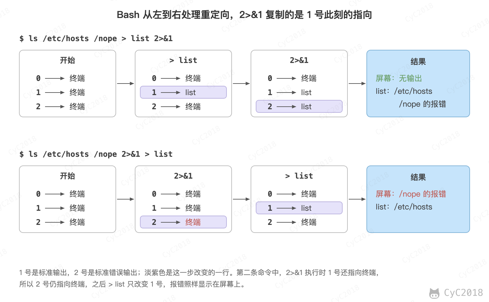 </div><br>

## 八、管道指令

管道是将一个命令的标准输出作为另一个命令的标准输入，在数据需要经过多个步骤的处理之后才能得到想要的内容时就可以使用管道。

在命令之间使用 | 分隔各个管道命令。

```bash
$ ls -al /etc | less
```

### 提取指令

cut 对数据进行切分，取出想要的部分。

切分过程一行一行地进行。

```text
$ cut
-d ：分隔符
-f ：经过 -d 分隔后，使用 -f n 取出第 n 个区间
-c ：以字符为单位取出区间
```

示例 1：last 显示登入者的信息，取出用户名。

```text
$ last
root pts/1 192.168.201.101 Sat Feb 7 12:35 still logged in
root pts/1 192.168.201.101 Fri Feb 6 12:13 - 18:46 (06:33)
root pts/1 192.168.201.254 Thu Feb 5 22:37 - 23:53 (01:16)

$ last | cut -d ' ' -f 1
```

示例 2：将 export 输出的信息，取出第 12 字符以后的所有字符串。

```text
$ export
declare -x HISTCONTROL="ignoredups"
declare -x HISTSIZE="1000"
declare -x HOME="/home/dmtsai"
declare -x HOSTNAME="study.centos.vbird"
.....(其他省略).....

$ export | cut -c 12-
```

### 排序指令

sort 用于排序。

```text
$ sort [-fbMnrtuk] [file or stdin]
-f ：忽略大小写
-b ：忽略最前面的空格
-M ：以月份的名字来排序，例如 JAN，DEC
-n ：使用数字
-r ：反向排序
-u ：相当于 unique，重复的内容只出现一次
-t ：分隔符，默认以空白分隔
-k ：指定排序的区间
```

示例：/etc/passwd 文件内容以 : 来分隔，要求以第三列进行排序。

```text
$ cat /etc/passwd | sort -t ':' -k 3
root:x:0:0:root:/root:/bin/bash
dmtsai:x:1000:1000:dmtsai:/home/dmtsai:/bin/bash
alex:x:1001:1002::/home/alex:/bin/bash
arod:x:1002:1003::/home/arod:/bin/bash
```

需要注意的是，-k 3 表示从第 3 列一直比较到行尾，而且按字符串比较，UID 为 33 的行会排在 1001 之后；只按第 3 列的数值排序要写成 -k 3,3n。

uniq 可以将重复的数据只取一个。

```text
$ uniq [-ic]
-i ：忽略大小写
-c ：进行计数
```

示例：取得每个人的登录总次数

```text
$ last | cut -d ' ' -f 1 | sort | uniq -c
1
6 (unknown
47 dmtsai
4 reboot
7 root
1 wtmp
```

### 双向输出重定向

输出重定向会将输出内容重定向到文件中，而 tee 不仅能够完成这个功能，还能保留屏幕上的输出。也就是说，使用 tee 指令，一个输出会同时传送到文件和屏幕上。

```text
$ tee [-a] file
```

### 字符转换指令

tr 用来删除一行中的字符，或者对字符进行替换。

```text
$ tr [-ds] SET1 ...
-d ： 删除输入中属于 SET1 的每一个字符，例如 tr -d 'abc' 会把 cab 也全部删掉
```

示例，将 last 输出的信息所有小写转换为大写。

```text
$ last | tr '[a-z]' '[A-Z]'
```

col 将 tab 字符转为空格字符。

```text
$ col [-xb]
-x ： 将 tab 键转换成对等的空格键
```

expand 将 tab 转换一定数量的空格，默认是 8 个。

```text
$ expand [-t] file
-t ：tab 转为空格的数量
```

join 将有相同数据的那一行合并在一起。

```text
$ join [-ti12] file1 file2
-t ：分隔符，默认为空格
-i ：忽略大小写的差异
-1 ：第一个文件所用的比较字段
-2 ：第二个文件所用的比较字段
```

paste 直接将两行粘贴在一起。

```text
$ paste [-d] file1 file2
-d ：分隔符，默认为 tab
```

### 分区指令

split 将一个文件划分成多个文件。

```text
$ split [-bl] file PREFIX
-b ：以大小来进行分区，可加单位，例如 b, k, m 等
-l ：以行数来进行分区。
- PREFIX ：分区文件的前导名称
```

## 九、正则表达式

### grep

g/re/p（globally search a regular expression and print)，使用正则表示式进行全局查找并打印。

```text
$ grep [-acinv] [--color=auto] 搜寻字符串 filename
-c ： 统计匹配到行的个数
-i ： 忽略大小写
-n ： 输出行号
-v ： 反向选择，也就是显示出没有 搜寻字符串 内容的那一行
--color=auto ：找到的关键字加颜色显示
```

示例：把含有 the 字符串的行提取出来（注意默认会有 --color=auto 选项，因此以下内容在 Linux 中有颜色显示 the 字符串）

```text
$ grep -n 'the' regular_express.txt
8:I can't finish the test.
12:the symbol '*' is represented as start.
15:You are the best is mean you are the no. 1.
16:The world Happy is the same with "glad".
18:google is the best tools for search keyword
```

示例：正则表达式 a{m,n} 用来匹配字符 a m\~n 次，这里需要将 { 和 } 进行转义，因为 grep 默认使用基础正则表达式（BRE），其中的 { 和 } 需要转义才表示重复次数。

```text
$ grep -n 'a\{2,5\}' regular_express.txt
```

### printf

用于格式化输出。它不属于管道命令，在给 printf 传数据时需要使用 $( ) 形式。

```text
$ printf '%10s %5i %5i %5i %8.2f \n' $(cat printf.txt)
    DmTsai    80    60    92    77.33
     VBird    75    55    80    70.00
       Ken    60    90    70    73.33
```

### awk

是由 Alfred Aho，Peter Weinberger 和 Brian Kernighan 创造，awk 这个名字就是这三个创始人名字的首字母。

awk 每次处理一行，处理的最小单位是字段，每个字段的命名方式为：\$n，n 为字段号，从 1 开始，\$0 表示一整行。

示例：取出最近五个登录用户的用户名和 IP。首先用 last -n 5 取出用最近五个登录用户的所有信息，可以看到用户名和 IP 分别在第 1 列和第 3 列，用 \$1 和 \$3 就能取出这两个字段，然后用 print 进行打印。

```text
$ last -n 5
dmtsai pts/0 192.168.1.100 Tue Jul 14 17:32 still logged in
dmtsai pts/0 192.168.1.100 Thu Jul 9 23:36 - 02:58 (03:22)
dmtsai pts/0 192.168.1.100 Thu Jul 9 17:23 - 23:36 (06:12)
dmtsai pts/0 192.168.1.100 Thu Jul 9 08:02 - 08:17 (00:14)
dmtsai tty1 Fri May 29 11:55 - 12:11 (00:15)
```

```text
$ last -n 5 | awk '{print $1 "\t" $3}'
dmtsai   192.168.1.100
dmtsai   192.168.1.100
dmtsai   192.168.1.100
dmtsai   192.168.1.100
dmtsai   Fri
```

可以根据字段的某些条件进行匹配，例如匹配字段小于某个值的那一行数据。

```text
$ awk '条件类型 1 {动作 1} 条件类型 2 {动作 2} ...' filename
```

示例：/etc/passwd 文件第三个字段为 UID，对 UID 小于 10 的数据进行处理。

```text
$ cat /etc/passwd | awk 'BEGIN {FS=":"} $3 < 10 {print $1 "\t " $3}'
root 0
bin 1
daemon 2
```

awk 变量：

| 变量名称 | 代表意义 |
| :--: | -- |
| NF | 每一行拥有的字段总数 |
| NR | 目前所处理的是第几行数据 |
| FS | 目前的分隔字符，默认是空格键 |

示例：显示正在处理的行号以及每一行有多少字段

```text
$ last -n 5 | awk '{print $1 "\t lines: " NR "\t columns: " NF}'
dmtsai lines: 1 columns: 10
dmtsai lines: 2 columns: 10
dmtsai lines: 3 columns: 10
dmtsai lines: 4 columns: 10
dmtsai lines: 5 columns: 9
```

## 十、进程管理

### 查看进程

#### 1. ps

查看某个时间点的进程信息。

示例：查看自己的进程

```sh
$ ps -l
```

示例：查看系统所有进程

```sh
$ ps aux
```

示例：查看特定的进程

```sh
$ ps aux | grep threadx
```

#### 2. pstree

查看进程树。

示例：查看所有进程树

```sh
$ pstree -A
```

#### 3. top

实时显示进程信息。

示例：两秒钟刷新一次

```sh
$ top -d 2
```

#### 4. netstat

查看占用端口的进程

示例：查看特定端口的进程

```sh
$ netstat -anp | grep port
```

netstat 的替代命令是 ss，用法见[端口与磁盘](#端口与磁盘)。

#### 5. kill

向进程发送信号，常用来结束进程。

```sh
$ kill 911       # 默认发送 SIGTERM（15）
$ kill -9 911    # 发送 SIGKILL（9）
```

SIGTERM 可以被进程捕获，进程收到后可以先保存数据、关闭连接再退出，例如开启了优雅停机的 Spring Boot 应用会在设定的超时时间内等正在处理的请求完成再退出；SIGKILL 不能被捕获或忽略，进程会被内核直接终止，来不及做任何清理。因此应先用 kill，进程没有响应时才用 kill -9。

### 进程状态

| 状态 | 说明 |
| :---: | --- |
| R | running or runnable (on run queue)<br>正在执行或者可执行，此时进程位于执行队列中。|
| D | uninterruptible sleep (usually I/O)<br>不可中断阻塞，通常为 I/O 阻塞。 |
| S | interruptible sleep (waiting for an event to complete) <br> 可中断阻塞，此时进程正在等待某个事件完成。|
| Z | zombie (terminated but not reaped by its parent)<br>僵死，进程已经终止但是尚未被其父进程获取信息。|
| T | stopped (either by a job control signal or because it is being traced) <br> 停止，进程可能被作业控制信号暂停，也可能正在被追踪。|
<br>

<div align="center"> 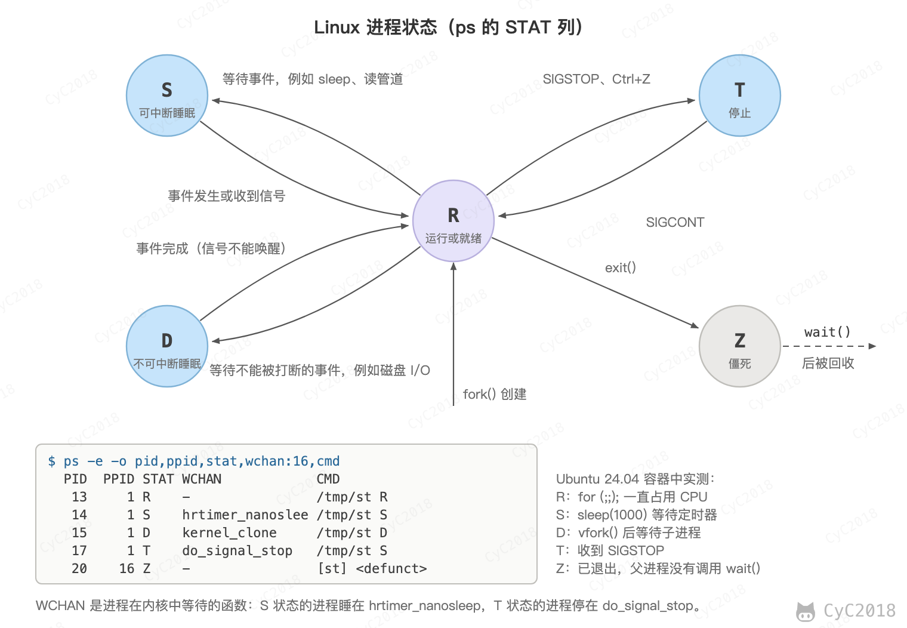 </div><br>

### SIGCHLD

默认情况下，子进程停止、继续或者退出时，父进程都会收到 SIGCHLD 信号，信号中带有子进程的信息，比如进程 ID、进程状态、进程使用 CPU 的时间等。

wait() 只在子进程终止时返回；waitpid() 加上 WUNTRACED、WCONTINUED 选项后，子进程停止、继续时也会返回。

在子进程退出时，它的进程描述符不会立即释放，这是为了让父进程得到子进程信息，父进程通过 wait() 和 waitpid() 来获得一个已经退出的子进程的信息。

<div align="center"> 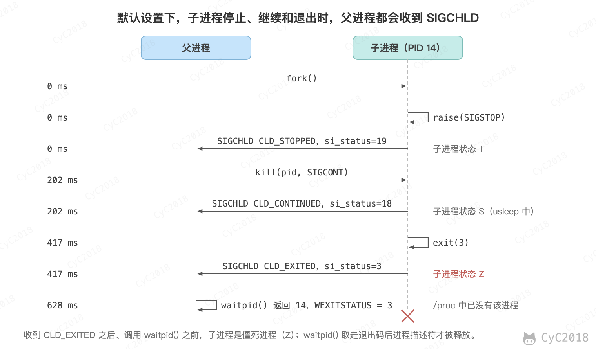 </div><br>

### wait()

```c
pid_t wait(int *status)
```

父进程调用 wait() 会一直阻塞，直到有一个子进程退出，之后 wait() 会回收该子进程并返回；调用时已经有退出的子进程，wait() 会立即返回。

如果成功，返回被收集的子进程的进程 ID；如果调用进程没有子进程，调用就会失败，此时返回 -1，同时 errno 被置为 ECHILD。

参数 status 用来保存被收集的子进程退出时的一些状态，如果对这个子进程是如何死掉的毫不在意，只想把这个子进程消灭掉，可以设置这个参数为 NULL。

### waitpid()

```c
pid_t waitpid(pid_t pid, int *status, int options)
```

作用和 wait() 完全相同，但是多了两个可由用户控制的参数 pid 和 options。

pid 参数指示一个子进程的 ID，表示只等待这个子进程退出。pid 为 -1 时和 wait() 作用相同，等待任意一个子进程退出。

options 参数主要有 WNOHANG、WUNTRACED 和 WCONTINUED 三个选项，WNOHANG 可以使 waitpid() 调用变成非阻塞的，也就是说它会立即返回，父进程可以继续执行其它任务。

### 孤儿进程

一个父进程退出，而它的一个或多个子进程还在运行，那么这些子进程将成为孤儿进程。

孤儿进程由所在 [PID 命名空间](Docker.md#五实现原理)的 1 号进程（init）收养（祖先进程声明了 subreaper 时由它收养），并由它完成状态收集工作。

init、systemd 会及时回收子进程，因此孤儿进程通常不会对系统造成危害。但容器中的 1 号进程如果是不调用 wait() 的业务程序，孤儿进程退出后会一直是僵尸进程，这时可以用 docker run --init 让 tini 作为 1 号进程负责回收。

### 僵尸进程

一个子进程的进程描述符在子进程退出时不会释放，只有当父进程通过 wait() 或 waitpid() 获取了子进程信息后才会释放。如果子进程退出，而父进程并没有调用 wait() 或 waitpid()，那么子进程的进程描述符仍然保存在系统中，这种进程称之为僵尸进程。

僵尸进程通过 ps 命令显示出来的状态为 Z（zombie），第二列是它的父进程：

```sh
$ ps -eo pid,ppid,stat,comm | awk '$3 ~ /Z/'
```

系统所能使用的进程号是有限的，如果产生大量僵尸进程，将因为没有可用的进程号而导致系统不能产生新的进程。

根本的解决办法是让父进程正确回收子进程。需要注意的是，多个子进程同时退出时父进程可能只收到一次 SIGCHLD（标准信号不排队），所以处理 SIGCHLD 时要循环调用 waitpid(-1, &status, WNOHANG)，直到返回 0（还有子进程在运行）或 -1（没有子进程了）。

无法修改父进程时，可以把父进程杀死，僵尸进程就会变成孤儿进程，由收养它的进程（通常是 init）调用 wait() 释放资源。

## 十一、线上问题排查 🔥🔥

以下输出来自一个 Debian 12 容器，其中运行着一个故意写了死循环、并占用了 200 MB 堆内存的 Java 程序（OpenJDK 17），省略了部分内容。

### CPU 占用高

top 的前几行是整机概况。load average 是最近 1、5、15 分钟内处于可运行（R）或等待磁盘 I/O（D）状态的平均任务数，持续高于 CPU 核数说明有任务在排队；负载高而 CPU 使用率不高时，多是大量线程处于 D 状态在等待 I/O（见 [Java 虚拟机 - CPU 占用过高](Java%20虚拟机.md#cpu-占用过高)）。%Cpu(s) 一行中 us 是用户态时间占比，sy 是内核态，wa 是 CPU 空闲但有 I/O 未完成的时间占比，id 是空闲：us 高多是应用自身在计算；wa 高时还要用 iostat 看磁盘的延迟和队列，不能直接断定瓶颈在磁盘。

先用 top 找到占用 CPU 最多的进程，再用 top -H 查看这个进程中的线程：

```sh
$ top -b -n 1 -o %CPU
  PID USER      PR  NI    VIRT    RES    SHR S  %CPU  %MEM     TIME+ COMMAND
  911 root      20   0 4021284 471124  20616 S 100.0   5.9   0:04.30 java

$ top -b -n 2 -d 1 -H -p 911
  PID USER      PR  NI    VIRT    RES    SHR S  %CPU  %MEM     TIME+ COMMAND
  931 root      20   0 4088924 471252  20616 R  99.9   5.9   0:31.17 order-calc
```

%CPU 按单个核计算，100.0 表示占满一个核，多核机器上一个进程可以超过 100%。线程 931 一直占用一个 CPU。jstack 输出的线程栈中，nid 就是线程 ID，JDK 17 及以前为十六进制，931 即 0x3a3；JDK 18 起为十进制（见 [Java 虚拟机 - CPU 占用过高](Java%20虚拟机.md#cpu-占用过高)）：

```sh
$ printf "%x\n" 931
3a3
$ jstack 911 | grep -A3 "nid=0x3a3"
"order-calc" #14 prio=5 os_prio=0 cpu=46406.68ms elapsed=46.46s tid=0x0000ffff80120ad0 nid=0x3a3 runnable
   java.lang.Thread.State: RUNNABLE
	at Busy.lambda$main$0(Busy.java:11)
```

这样就定位到了 Busy.java 第 11 行的死循环。如果是多个 GC 线程占满 CPU，说明在频繁 GC，转而检查内存。Java 进程的排查方法详见 [Java 虚拟机 - 线上问题排查](Java%20虚拟机.md#五线上问题排查)。

### 内存占用高

```sh
$ free -h
               total        used        free      shared  buff/cache   available
Mem:           7.7Gi       1.1Gi       5.8Gi       564Ki       920Mi       6.5Gi
```

需要注意的是，free 列很小不代表内存不足。Linux 会用空闲内存缓存磁盘文件（buff/cache），需要时可以回收，应该看 available 列，它估算的是不使用交换分区还能分配给新程序的内存。在容器中 free 显示的是宿主机的内存，容器的内存上限要看 cgroup 中的 memory.max（见 [Docker - 实现原理](Docker.md#五实现原理)）。

找占内存最多的进程用 ps aux --sort=-%mem | head，或在 top 中按 M 排序。进程的占用看 RES（实际占用的物理内存），不看 VIRT（申请的虚拟地址空间）：上面的 Java 进程 VIRT 约 3.8 GB，RES 只有约 460 MB。

Java 进程用 jstat 查看各区的使用率和 GC 次数，用 jmap 统计堆中哪类对象最多：

```sh
$ jstat -gcutil 911 1000 2
  S0     S1     E      O      M     CCS    YGC     YGCT     FGC    FGCT     CGC    CGCT       GCT
  0.00  13.69   0.00  88.90  37.54   3.98      9     0.008     0     0.000    16     0.005     0.014

$ jmap -histo:live 911 | head -4
 num     #instances         #bytes  class name (module)
   1:          7529      210056264  [B (java.base@17.0.21)
```

老年代（O）已经用了 88.90%，堆中约 200 MB 是 byte 数组，与程序中缓存的 200 个 1 MB 数组对应。这只能说明谁占得多；负载稳定而每次 Full GC 后老年代使用率仍持续上升，才要怀疑内存泄漏，再用 jmap -dump 导出堆快照，看这些对象被谁引用。需要注意的是，-histo:live 会先触发一次 Full GC，生产环境要谨慎使用。

### 端口与磁盘

```sh
$ ss -lntp
State  Recv-Q Send-Q Local Address:Port Peer Address:Port Process
LISTEN 0      50                 *:8080            *:*    users:(("java",pid=911,fd=4))

$ lsof -i :8080
COMMAND PID USER   FD   TYPE DEVICE SIZE/OFF NODE NAME
java    911 root    4u  IPv6   5594      0t0  TCP *:http-alt (LISTEN)

$ ss -Htan state time-wait | wc -l    # 统计 TIME_WAIT 连接数，-H 不输出表头

$ df -h /
Filesystem      Size  Used Avail Use% Mounted on
overlay         453G   24G  406G   6% /
```

ss 是 netstat 的替代，速度更快，-l 只看监听的套接字，-n 不解析端口名，-t 只看 TCP，-p 显示进程。TIME_WAIT 出现在主动关闭连接的一方，数量很大时的原因和处理见 [大量 TIME_WAIT 与 CLOSE_WAIT](计算机网络%20-%20传输层.md#大量-time_wait-与-close_wait)。

上面 / 的类型是 overlay，这是容器由镜像层合并出的根目录（见 [Docker - 镜像与容器](Docker.md#六镜像与容器)）。磁盘满时先用 df -h 找到满的分区，再用 du -sh * 逐级查找大目录。如果 df 显示已满而 du 统计不到这么多，通常是大文件已被删除但仍被进程打开（例如删掉了正在写的日志），空间要等进程关闭文件后才释放，用 lsof +L1 可以找到这些文件和进程。

<div align="center"> 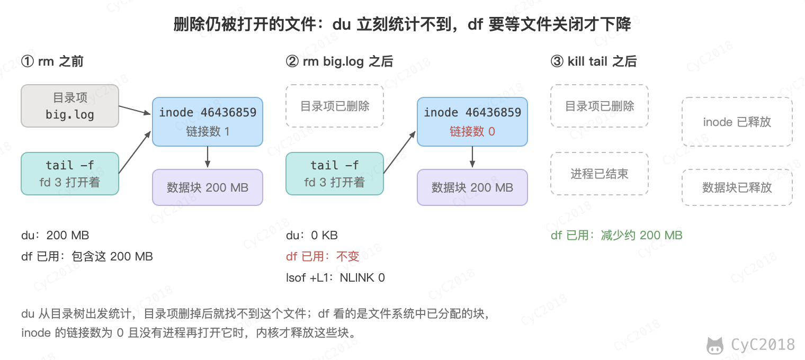 </div><br>

### 日志分析

```sh
$ tail -f app.log                 # 持续输出新写入的日志
$ tail -n 200 app.log             # 最后 200 行
$ grep -n "timeout" app.log | tail -5   # 带行号查找关键字，只看最后 5 处
$ grep -rn "error" --include="*.log" . > error_log.txt   # 递归查找当前目录下所有 .log 文件，结果写入文件
$ grep -c " 500 " access.log      # 统计 500 的行数
214
$ awk '{print $9}' access.log | sort | uniq -c | sort -rn     # 按状态码统计
   9510 200
    276 404
    214 500
$ awk '{print $1}' access.log | sort | uniq -c | sort -rn | head -3   # 访问最多的 IP
   2306 10.0.0.3
   2290 10.0.0.2
   2280 10.0.0.1
```

以上统计基于一个 1 万行的示例访问日志，第 1 列是 IP，第 9 列是状态码。grep -C 5 可以同时显示匹配行前后各 5 行，查看异常前后发生了什么。日志文件很大时不要用 cat 或 vim 整个打开，用 less 分页查看，或者用 tail、grep 只取需要的部分。

## 参考资料

- 鸟哥. 鸟哥的 Linux 私房菜：基础篇 第三版 [M]. 2009.
- [Linux 之守护进程、僵死进程与孤儿进程](http://liubigbin.github.io/2016/03/11/Linux-%E4%B9%8B%E5%AE%88%E6%8A%A4%E8%BF%9B%E7%A8%8B%E3%80%81%E5%83%B5%E6%AD%BB%E8%BF%9B%E7%A8%8B%E4%B8%8E%E5%AD%A4%E5%84%BF%E8%BF%9B%E7%A8%8B/)
- [What is the difference between a symbolic link and a hard link?](https://stackoverflow.com/questions/185899/what-is-the-difference-between-a-symbolic-link-and-a-hard-link)
- [Linux process states](https://idea.popcount.org/2012-12-11-linux-process-states/)
- [GUID Partition Table](https://en.wikipedia.org/wiki/GUID_Partition_Table)
- [详解 wait 和 waitpid 函数](https://web.archive.org/web/20251119085359/https://blog.csdn.net/kevinhg/article/details/7001719)
- [IDE、SATA、SCSI、SAS、FC、SSD 硬盘类型介绍](https://web.archive.org/web/20251209102916/https://blog.csdn.net/tianlesoftware/article/details/6009110)
- [Akai IB-301S SCSI Interface for S2800,S3000](https://web.archive.org/web/20100906064755/http://www.mpchunter.com:80/s3000/akai-ib-301s-scsi-interface-for-s2800s3000/)
- [Parallel ATA](https://en.wikipedia.org/wiki/Parallel_ATA)
- [ADATA XPG SX900 256GB SATA 3 SSD Review – Expanded Capacity and SandForce Driven Speed](http://www.thessdreview.com/our-reviews/adata-xpg-sx900-256gb-sata-3-ssd-review-expanded-capacity-and-sandforce-driven-speed/4/)
- [Decoding UCS Invicta – Part 1](https://blogs.cisco.com/datacenter/decoding-ucs-invicta-part-1)
- [硬盘](https://zh.wikipedia.org/wiki/%E7%A1%AC%E7%9B%98)
- [Difference between SAS and SATA](http://www.differencebetween.info/difference-between-sas-and-sata)
- [BIOS](https://zh.wikipedia.org/wiki/BIOS)
- [File system design case studies](https://web.archive.org/web/20210126111620/https://www.cs.rutgers.edu/~pxk/416/notes/13-fs-studies.html)
- [FILE SYSTEM DESIGN](http://web.cs.ucla.edu/classes/fall14/cs111/scribe/11a/index.html)
