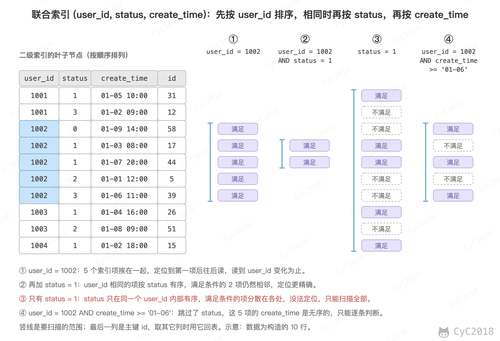
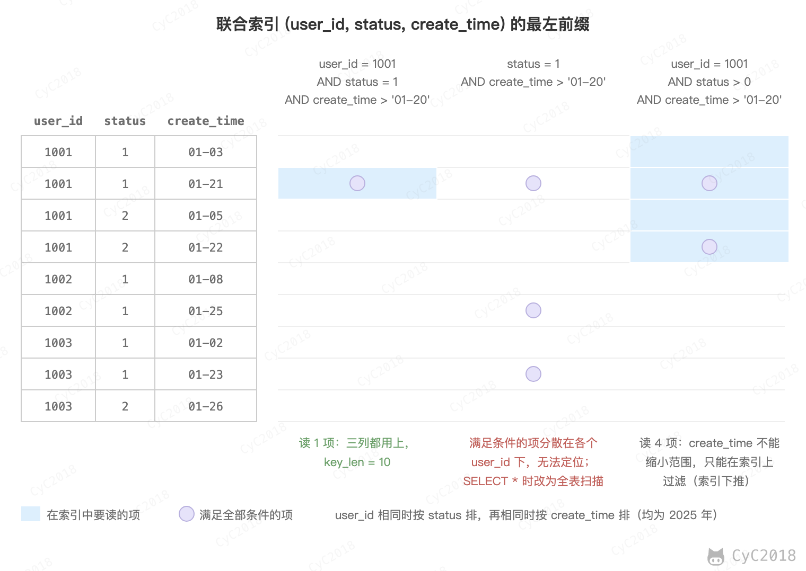
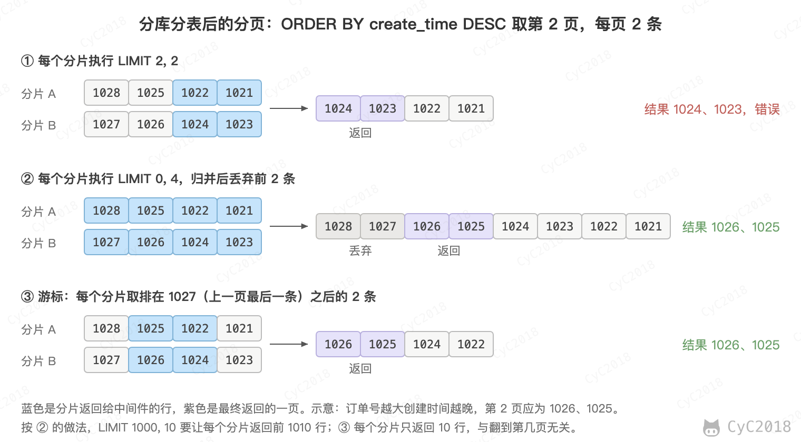
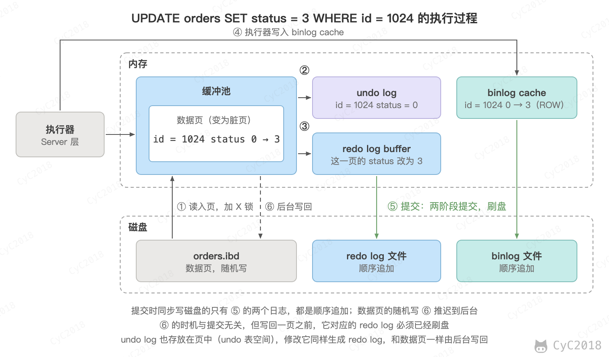

# MySQL
<!-- GFM-TOC -->
* [MySQL](#mysql)
    * [一、索引](#一索引)
        * [B+ Tree 原理](#b-tree-原理) 🔥🔥
        * [MySQL 索引](#mysql-索引) 🔥
        * [索引的优点](#索引的优点)
        * [索引的使用条件](#索引的使用条件) 🔥🔥
        * [索引优化](#索引优化) 🔥
        * [索引失效](#索引失效) 🔥
    * [二、查询性能优化](#二查询性能优化) 🔥🔥
        * [一条 SQL 的执行过程](#一条-sql-的执行过程)
        * [使用 Explain 进行分析](#使用-explain-进行分析)
        * [慢查询的定位与优化](#慢查询的定位与优化)
        * [优化数据访问](#优化数据访问)
        * [重构查询方式](#重构查询方式)
        * [深分页](#深分页)
    * [三、存储引擎](#三存储引擎)
        * [InnoDB](#innodb)
        * [MyISAM](#myisam)
        * [比较](#比较)
    * [四、数据类型](#四数据类型)
        * [整型](#整型)
        * [浮点数](#浮点数)
        * [字符串](#字符串)
        * [时间和日期](#时间和日期)
    * [五、切分](#五切分) 🔥
        * [水平切分](#水平切分)
        * [垂直切分](#垂直切分)
        * [Sharding 策略](#sharding-策略)
        * [Sharding 存在的问题](#sharding-存在的问题)
    * [六、复制](#六复制)
        * [主从复制](#主从复制)
        * [读写分离](#读写分离)
    * [七、日志](#七日志) 🔥
        * [redo log](#redo-log)
        * [binlog](#binlog)
        * [两阶段提交](#两阶段提交)
        * [更新语句的执行过程](#更新语句的执行过程)
    * [附录：实测](#附录实测)
        * [A1 主键索引的高度](#a1-主键索引的高度)
        * [A2 索引的执行计划](#a2-索引的执行计划)
        * [A3 二级索引对写入的影响](#a3-二级索引对写入的影响)
        * [A4 优化器的代价估算](#a4-优化器的代价估算)
        * [A5 深分页的耗时](#a5-深分页的耗时)
        * [A6 联合索引的扫描范围](#a6-联合索引的扫描范围)
        * [A7 慢查询的定位与优化](#a7-慢查询的定位与优化)
        * [A8 唯一索引与普通索引](#a8-唯一索引与普通索引)
        * [A9 字符串与时间类型](#a9-字符串与时间类型)
        * [A10 区分度低的列](#a10-区分度低的列)
        * [A11 redo log 的检查点](#a11-redo-log-的检查点)
        * [A12 主从复制的初始化与延迟](#a12-主从复制的初始化与延迟)
        * [A13 InnoDB 与 MyISAM 的并发读写](#a13-innodb-与-myisam-的并发读写)
        * [A14 找到持有锁的源头事务](#a14-找到持有锁的源头事务)
        * [A15 EXPLAIN ANALYZE 的 loops](#a15-explain-analyze-的-loops)
        * [A16 按自增 id 轮询漏掉的行](#a16-按自增-id-轮询漏掉的行)
    * [参考资料](#参考资料)
<!-- GFM-TOC -->


## 一、索引

### B+ Tree 原理 🔥🔥

#### 1. 数据结构

B+ Tree 是一种多路平衡查找树：每个节点可以有很多个子节点，所有叶子节点都在同一层。InnoDB 的索引就是 B+ Tree，它有两个特点：

- 内部节点只保存 key 和指向子节点的指针，数据都保存在叶子节点中；
- 叶子节点按 key 的顺序用指针连成双向链表，正序、倒序都能顺着扫描。

<div align="center">  </div><br>

#### 2. 操作

查找时从根节点开始，在节点内二分查找，确定下一层走哪个指针，一直走到叶子节点。范围查询先找到起点所在的叶子节点，再沿着叶子之间的指针顺序扫描，不需要回到上层。

插入和删除可能让节点过满或者过空，这时要分裂节点、与相邻节点合并或者从相邻节点借用 key，保证所有叶子节点仍然在同一层。

单点查找从根走到叶子，访问的页数等于树高，约为 log<sub>d</sub>N，d 为每个节点的子节点数，一般只有 3～4 层（容量的计算见[与红黑树的比较](#3-与红黑树的比较)）；插入和删除先同样找到叶子，分裂或合并时还要访问相邻的页和上层的节点。三种操作的时间复杂度都是 O(logN)，范围查询还要加上扫描叶子的代价。

InnoDB 中按主键顺序插入时，每页约填满 15/16；随机插入时，每页只有 1/2 到 15/16 满。删除或更新让一页的使用率低于 50%（MERGE_THRESHOLD 的默认值）时，InnoDB 尝试把它与相邻的页合并。

#### 3. 与红黑树的比较

红黑树等二叉平衡树也能实现索引，但数据库和文件系统普遍采用 B+ Tree。这是因为数据存放在磁盘上，读一次磁盘的代价远大于在内存中比较几次 key，B+ Tree 能让读磁盘的次数最少：

- 树更矮：树高约为 log<sub>d</sub>N，d 为每个节点的子节点数。红黑树的 d 为 2，而 B+ Tree 的一个节点就是一个 16 KB 的页，可以有几百上千个子节点。200 万行的 orders 表，主键索引只有 3 层（MySQL 8.0 实测，见[附录 A1](#a1-主键索引的高度)），换成二叉树高度约为 21；
- 一次 I/O 读入一个节点：操作系统和数据库都以页为单位读写磁盘，B+ Tree 的节点大小正好是一页。对于机械硬盘，读不同位置的页还要移动磁头寻道，树越矮寻道次数越少；
- 适合顺序读：范围查询沿着叶子节点顺序扫描，相邻的页可以利用磁盘的预读提前读入。

根节点和中间节点访问频繁，通常常驻在内存的缓冲池中（3 层放满时中间页也只占约 14 MB），所以按主键查找一行通常只需要读一次磁盘。按[附录 A1](#a1-主键索引的高度)中每个中间页约 900 个指针、每个叶子页约 80 行计算，3 层的 B+ Tree 约能放 900 × 900 × 80 ≈ 6000 万行；每行约 1 KB 时每个叶子页只能放约 14 行，约能放 1100 万行。

网上常见的“约 2000 万行”按每个中间页 1170 条记录、每个叶子页 16 行估算（1170 × 1170 × 16），没有算每条记录的记录头等开销，BIGINT 主键时满的中间页实测只放 928 条（见[附录 A1](#a1-主键索引的高度)）。

#### 4. 与 B Tree 的比较

- B Tree 的每个节点都存放数据，B+ Tree 只有叶子节点存放数据，内部节点只存放 key 和指针，同样大小的页能放下更多的 key，树更矮；
- B+ Tree 的叶子节点按 key 的顺序用指针连接，范围查询找到起点后顺序扫描叶子节点即可，B Tree 则要在不同层的节点之间来回遍历；
- B+ Tree 的每次查找都要走到叶子节点，查询的磁盘 I/O 次数稳定。B Tree 虽然可能在上层命中，但绝大多数 key 都在最下层，平均读盘次数并不更少。

#### 5. 与跳表、LSM 树的比较

跳表和红黑树一样，每个节点只放一个 key，层数随数据量按对数增长，节点分散在各处，适合放在内存中（见 [跳跃表](Redis.md#跳跃表)），放到磁盘上同样要多次读盘。

LSM 树（Log-Structured Merge Tree）先把写入放进内存中的有序表，攒满后顺序写成一个有序文件，后台再合并这些文件，RocksDB、HBase 采用这种结构。它的写入快，但读一个 key 可能要依次查内存和多层文件。B+ Tree 原地更新，读一行固定走 3～4 层，更适合读多、要求查询延迟稳定的场景。

LSM 树常用布隆过滤器跳过一定不含这个 key 的文件，减少点查要读的文件数，但范围查询仍要合并各层的结果。B+ Tree 的写入也有额外开销，以 InnoDB 为例，只改一行，刷盘时也要按页写回（默认 16 KB），默认开启的双写缓冲区（doublewrite buffer）还要先保存一份页的副本。

### MySQL 索引 🔥

索引是在存储引擎层实现的，不同存储引擎支持的索引类型和实现不同。下面按数据结构介绍几种索引；按用途还可以分为主键索引、唯一索引、普通索引、联合索引和前缀索引。

#### 1. B+Tree 索引

B+Tree 索引是大多数 MySQL 存储引擎默认的索引类型。它是有序的，除了查找，还可以用于排序和分组。多个列可以组成一个联合索引，按全部列、列的范围或者最左边的若干列查找都能用上索引，不从最左边的列开始就用不上，见下文的 [索引失效](#索引失效)。

InnoDB 的 B+Tree 索引分为两种：

- 主键索引：叶子节点保存整行数据，表的数据就存放在主键索引中，这种方式称为聚簇索引。因为数据只能按一种顺序存放，所以一张表只能有一个聚簇索引；
- 二级索引（辅助索引）：叶子节点保存索引列和主键的值。

没有定义主键时，InnoDB 用第一个所有列都为 NOT NULL 的唯一索引作为聚簇索引；也没有这样的索引时，自动生成一个 6 字节的隐藏行 ID 作为聚簇索引的 key。

<div align="center">  </div><br>

通过二级索引查询其它列时，要先在二级索引中找到主键，再到聚簇索引中查出整行，这称为回表：

<div align="center">  </div><br>

一段范围内的二级索引项对应的主键一般是无序的，逐行回表是在聚簇索引上随机读。

非聚簇索引在不同语境下含义不同：在 InnoDB 中指的就是二级索引；MyISAM 的数据单独存放在数据文件中，主键索引和其它索引的叶子节点都只保存行在文件中的地址，所有索引都是非聚簇索引。

二级索引的叶子节点保存主键而不是行的地址，这是因为页分裂、合并时行会移动到别的页，保存主键就不用随之修改二级索引；代价是多一次回表，并且主键越长，每个二级索引都越大。所以主键一般用较短的自增整数，自增还能让新行总是追加到最后一页，不会因为在中间插入而频繁分裂页，自增主键与 UUID 主键的实测对比见 [分布式 ID](分布式.md#八分布式-id)。

#### 2. 哈希索引

哈希索引能以 O(1) 时间进行等值查找，但是失去了有序性：

- 无法用于排序与分组；
- 只支持精确查找，无法用于部分查找和范围查找。

MEMORY 引擎支持哈希索引，InnoDB 不能显式创建哈希索引，但有一个“自适应哈希索引”的功能：某些索引值被频繁访问时，InnoDB 自动在 B+Tree 索引之上为它们建立哈希索引，加快等值查找（MySQL 8.4 起默认关闭，由 innodb_adaptive_hash_index 控制）。

#### 3. 全文索引

全文索引用于查找文本中的关键词，而不是直接比较是否相等，查询条件写成 MATCH ... AGAINST。它使用倒排索引实现，记录着关键词到所在文档的映射。最早只有 MyISAM 支持全文索引，InnoDB 从 MySQL 5.6.4 开始支持。

#### 4. 空间数据索引

空间数据索引（R-Tree）用于地理数据，会从所有维度来索引数据，可以按任意维度组合查询，需要使用 GIS 相关的函数来维护数据。MyISAM 支持空间数据索引，InnoDB 从 MySQL 5.7 起也支持。

#### 5. 主键索引、唯一索引与普通索引

按用途，B+Tree 索引分为以下几种：

- 主键索引：一张表只有一个，列不能为 NULL，在 InnoDB 中就是聚簇索引；
- 唯一索引：列的值不能重复，但可以有多个 NULL（MySQL 8.0 实测，见[附录 A8](#a8-唯一索引与普通索引)），在 InnoDB 中通常是二级索引；
- 普通索引：没有唯一性约束；
- 联合索引：建立在多个列上的索引，见下文的 [多列索引](#2-多列索引)；
- 前缀索引：只索引字符串的前一部分，见下文的 [前缀索引](#4-前缀索引)。

唯一索引和普通索引的查询速度差别很小：等值查询时唯一索引找到一条就停止（type 为 const），普通索引还要往后多读一条（type 为 ref）。区别主要在写入：普通索引的页不在缓冲池中时，InnoDB 可以先把修改记在 change buffer 中，以后读入这一页时再合并；唯一索引插入前必须读出这一页检查是否重复，用不上 change buffer。MySQL 8.4 把 change buffer 默认关闭，这个差别也就没有了；9.5 起又默认开启（innodb_change_buffering 为 all），所以要看所用的版本和配置。

### 索引的优点

- 大大减少了服务器需要扫描的数据行数；
- 帮助服务器避免排序和分组时创建临时表：B+Tree 索引是有序的，可以直接用于 ORDER BY 和 GROUP BY；
- 将随机 I/O 变为顺序 I/O：B+Tree 索引是有序的，相邻的数据存储在一起。

### 索引的使用条件 🔥🔥

- 很小的表（例如几百行的配置表）只有几个数据页，全表扫描的代价很小；表越大，索引的作用越明显；
- 特大型的表建立和维护索引的代价也随之增长，可以按时间等条件分区，查询时只扫描相关的分区；
- 索引并不是越多越好：插入、删除数据和修改索引列时，要同时维护每个相关的索引，索引也要占用存储空间。在 orders 表上插入 50 万行，没有二级索引时约 2.0 s，有 4 个二级索引时约 5.2 s，这 4 个索引共占 73 MB，而数据本身是 89 MB（见[附录 A3](#a3-二级索引对写入的影响)）；
- 适合建索引的是经常出现在 WHERE、JOIN、ORDER BY、GROUP BY 中，并且区分度高的列，频繁修改而很少查询的列不适合；
- 区分度很低的列（例如性别）单独建索引的作用不大，甚至更慢：10 万行的表按 gender = 1 查询，一半的行要回表，走索引 20 ms，全表扫描 11 ms；但总是查占比很少的值时索引仍然有效，只占 1% 的 status = 1 走索引 0.6 ms（MySQL 8.0 实测，见[附录 A10](#a10-区分度低的列)）。

设计索引时还要注意：

- 多个条件经常一起出现时，建一个联合索引，而不是每列各建一个，列的顺序见下文的 [索引列的顺序](#3-索引列的顺序)；
- 尽量让高频查询用上覆盖索引，避免回表；
- 已经有联合索引 (a, b) 时，单独的索引 (a) 是冗余的，可以删掉；
- 主键用较短的自增整数，原因见上文的 [B+Tree 索引](#1-btree-索引)；
- 线上加普通二级索引是在线 DDL，期间表仍可读写，但开始和结束时要短暂获取排他元数据锁，遇到长事务会等锁并阻塞后面的读写，所以先检查长事务、在低峰期执行。

以订单表为例，索引从高频查询推出来：

| 高频查询 | 索引 | 理由 |
| --- | --- | --- |
| `WHERE order_no = ?` | 唯一索引 (order_no) | 区分度最高，还能保证不重复 |
| `WHERE user_id = ? AND status = ? ORDER BY create_time DESC LIMIT 10` | (user_id, status, create_time) | 等值列在前、排序列在后，免去排序；只按 user_id 查也能用 |
| `WHERE create_time >= ? AND create_time < ?` | (create_time) | 联合索引不能按 create_time 直接定位 |

status 区分度低且已在联合索引中，不单独建索引。

### 索引优化 🔥

#### 1. 独立的列

在进行查询时，索引列不能是表达式的一部分，也不能是函数的参数，否则无法使用索引。

例如下面的查询不能使用 actor_id 列的索引，更多的例子见下文的 [索引失效](#索引失效)：

```sql
SELECT actor_id FROM sakila.actor WHERE actor_id + 1 = 5;
```

#### 2. 多列索引

在需要使用多个列作为条件进行查询时，使用多列索引比使用多个单列索引性能更好。例如下面的语句中，最好把 actor_id 和 film_id 设置为多列索引。

```sql
SELECT film_id, actor_id FROM sakila.film_actor
WHERE actor_id = 1 AND film_id = 1;
```

这是因为一个单列索引只能按一列定位。例如 100 万行的表上 a = 5 匹配 939 行、b = 7 匹配 9819 行，同时满足的只有 12 行：只有单列索引时，最多分别扫描两个索引再按主键取交集，读了 1 万多个索引项；建立 (a, b) 后只读 12 个（见[附录 A6](#a6-联合索引的扫描范围)）。

联合索引只有一棵 B+ 树，索引项按列的顺序排序：先按第一列排序，第一列相同时再按第二列，以此类推。下图是联合索引 (user_id, status, create_time) 的叶子节点（每项还带有主键 id），以及四种查询条件要扫描的范围：

<div align="center">  </div><br>

由此得到最左前缀原则：查询条件要从最左边的列开始、连续地使用索引列，才能用索引定位。以 (user_id, status, create_time) 为例：

- 条件包含 user_id、user_id 和 status、三列都有：可以逐列缩小扫描范围（图中的 ①、②）；
- 只有 status，或者只有 status 和 create_time：status 只在同一个 user_id 内部有序，无法定位（图中的 ③）；
- 只有 user_id 和 create_time：只能用 user_id 定位，create_time 在定位到的范围内逐条判断（图中的 ④），这一步可以在索引上完成，见下文 [索引失效](#索引失效) 中的索引下推。

需要注意的是，最左前缀看的是索引列有没有出现在条件中，与 WHERE 中的书写顺序无关：status = 1 AND user_id = 1001 和 user_id = 1001 AND status = 1 的执行计划相同，key_len 都是 5（见[附录 A6](#a6-联合索引的扫描范围)）。

MySQL 8.0.13 起，缺少最左列时还可能使用跳跃扫描（Skip Scan）：优化器对第一列的每个取值分别做一次范围扫描。例如 10 万行的表上有索引 (gender, age)，SELECT gender, age ... WHERE age = 30 的 Extra 为 Using index for skip scan，只读了 2000 个索引项，而不是全部 10 万个。

跳跃扫描要求只查一张表、没有 GROUP BY 和 DISTINCT、查询的列都在索引中；后一列为 age IN (30, 40) 这样的多个取值时也不会使用。第一列的不同取值越多，要做的范围扫描越多，估算的成本高于扫描整个索引时就不会选它，例如 10 万行的表第一列有 1 万种取值时改为扫描整个索引（MySQL 8.0.44 实测，见[附录 A6](#a6-联合索引的扫描范围)）。所以它不能用来代替正确的索引设计。

#### 3. 索引列的顺序

列的顺序首先要满足最左前缀（例如还经常单独按 user_id 查询，user_id 就要放在最前面），其次让选择性最强的列放在前面。

索引的选择性是指：不重复的索引值和记录总数的比值。最大值为 1，此时每个记录都有唯一的索引与其对应。选择性越高，每个记录的区分度越高，查询效率也越高。

需要注意的是，这个规则的前提是这些列都以等值条件出现。范围条件之后的列一般不能再用来缩小扫描的范围（范围条件带等号时的例外见[索引失效](#索引失效)），所以经常用于范围查询的列（例如时间）应该放在联合索引的后面。

例如下面显示的结果中 customer_id 的选择性比 staff_id 更高，因此最好把 customer_id 列放在多列索引的前面。

```sql
SELECT COUNT(DISTINCT staff_id)/COUNT(*) AS staff_id_selectivity,
COUNT(DISTINCT customer_id)/COUNT(*) AS customer_id_selectivity,
COUNT(*)
FROM payment;
```

```text
   staff_id_selectivity: 0.0001
customer_id_selectivity: 0.0373
               COUNT(*): 16049
```

联合索引还能用于排序：前面的列已经用等值条件固定时，后一列本来就是有序的，ORDER BY 这一列不需要额外排序。例如查询用户 1001 状态为 1 的最近 10 个订单，WHERE user_id = 1001 AND status = 1 ORDER BY create_time DESC LIMIT 10 直接倒序扫描索引，Extra 为 Backward index scan；去掉 status 条件后，create_time 不再连续有序，Extra 变为 Using filesort（见[附录 A6](#a6-联合索引的扫描范围)）。所以联合索引的列一般按这样的顺序排列：等值条件的列在前，其中区分度高的更靠前，然后是排序的列，范围条件的列放在最后。

#### 4. 前缀索引

对于 BLOB 和 TEXT 类型的列，必须使用前缀索引，只索引开始的部分字符；对于 VARCHAR 和 CHAR 类型的列，可以选择使用前缀索引来减小索引的大小。

CHAR、VARCHAR、TEXT 列的前缀长度按字符数指定，BINARY、VARBINARY、BLOB 按字节数指定。InnoDB 使用默认的 16 KB 页和 DYNAMIC 行格式时，索引键最长 3072 字节，utf8mb4 每个字符按 4 字节算，所以单列索引最多索引前 768 个字符，前缀或整列索引的键长超过 3072 字节时，默认的严格 SQL 模式下报错 1071（Specified key was too long）。

前缀长度的选取需要根据索引选择性来确定：用 COUNT(DISTINCT LEFT(email, 10)) / COUNT(*) 计算不同前缀长度的选择性，选出接近完整列的最短长度，再建立索引：

```sql
ALTER TABLE user ADD INDEX idx_email (email(10));
```

前缀索引只保存了每个值的一部分，所以不能用于 ORDER BY、GROUP BY，也不能作为覆盖索引。

#### 5. 覆盖索引

覆盖索引指的是索引中已经包含了查询需要的所有列，不需要回表。例如二级索引 idx_user_status_time 包含 user_id、status、create_time，叶子节点中还有主键 id，所以下面的查询的 Extra 为 Using index（见[附录 A2](#a2-索引的执行计划)）：

```sql
SELECT user_id, status, create_time, id FROM orders WHERE user_id = 1001;
```

它的优点是只读取索引，读取的数据量小，并且避免了回表带来的随机 I/O。代价是索引更大、写入更慢，所以只为最高频的查询这样设计。

### 索引失效 🔥

索引失效指的是查询条件中有索引列，执行计划却没有使用这个索引，或者只用到了联合索引的一部分。下面是在一张 200 万行的订单表 orders 上用 Explain 查看的结果（MySQL 8.0，见[附录 A2](#a2-索引的执行计划)），表上有联合索引 idx_user_status_time(user_id, status, create_time)、单列索引 idx_create_time(create_time) 和 idx_order_no(order_no)，其中 order_no 是 VARCHAR 类型：

| 查询条件 | type | 原因 |
| --- | --- | --- |
| `status = 1 AND create_time > '2025-01-20'` | ALL | 没有从联合索引最左边的 user_id 开始 |
| `DATE(create_time) = '2025-01-12'` | ALL | 对索引列使用了函数 |
| `order_no = 7007` | ALL | 字符串列与数字比较，发生了隐式类型转换 |
| `order_no LIKE '%7007'` | ALL | 以 % 开头，无法利用索引的顺序 |
| `user_id = 5 OR amount = 10.99` | ALL | OR 的一侧没有索引，仍然要扫描全表 |
| `user_id != 5` | ALL | 几乎匹配所有行 |

需要注意的是，表中都是 SELECT * 的结果。查询的列都在某个索引中时（覆盖索引），不需要回表，优化器会改为扫描这个二级索引：SELECT order_no 加 `LIKE '%7007'` 的 type 为 index，SELECT user_id 加 `user_id != 5` 的 type 为 range，仍然要读几乎全部的索引项，只是比扫描整张表的数据量小（见[附录 A2](#a2-索引的执行计划)）。

对应的写法：

- 把函数改写为范围：`create_time >= '2025-01-12' AND create_time < '2025-01-13'`，type 变为 range；不能改写 SQL 时，MySQL 8.0.13 起可以建函数索引 `INDEX ((DATE(create_time)))`，原来的查询就能按 ref 查找（见[附录 A2](#a2-索引的执行计划)）；
- 字符串列用字符串比较：`order_no = '7007'`，type 变为 ref。这是因为 '7007'、' 7007'、'7007a' 转换成数字后都等于 7007，没法按索引的顺序查找；反过来，整数列与字符串比较（`id = '1001'`）仍然走主键，因为被转换的是常量而不是列；
- 只在右边模糊匹配：`LIKE '7007%'`，type 为 range；按关键词搜索可以改用全文索引或 Elasticsearch；
- OR 两侧的列都有索引时，可以分别扫描两个索引再合并结果，type 为 index_merge。它同样按成本选择，例如 20 万行的表上 a = 5 OR b = 7 匹配约 2000 行时用 index_merge，改为 a = 5 OR b < 10、匹配约 2 万行时就扫描全表（见[附录 A2](#a2-索引的执行计划)）。

IS NULL、IS NOT NULL、NOT IN 本身不会让索引失效：order_no IS NULL 的 type 为 ref；NOT IN 和 != 一样，走不走索引取决于匹配的行数（见[附录 A6](#a6-联合索引的扫描范围)）。

联合索引中出现范围条件时，范围条件之后的列一般不能再用来缩小扫描的范围，范围条件带等号时的例外见下文。Explain 的 key_len 表示用到了索引的前几列，user_id 为 INT，占 4 字节，status 为 TINYINT，占 1 字节，create_time 为 DATETIME，占 5 字节：

```sql
WHERE user_id = 5 AND status = 1 AND create_time > '2025-01-05'   -- key_len = 10，三列都用上了
WHERE user_id = 5 AND status > 0 AND create_time > '2025-01-05'   -- key_len = 5，只用到前两列
```

<div align="center">  </div><br>

不过第二条语句的 Extra 为 Using index condition，也就是索引下推：create_time 虽然不能缩小扫描范围，但仍然在索引上过滤，不满足条件的行不需要回表，所以范围条件之后的列并不是完全没有作用。

跳过中间列时也一样：`user_id = 1001 AND create_time >= '2025-01-20'` 跳过了 status，只能用 user_id 定位（key_len = 4），user_id 为 1001 的 20 行中只有 3 行满足时间条件。有索引下推时只需回表 3 次，关闭索引下推后要回表 20 次，再由 Server 层过滤。

另外，范围条件带等号（>=、<=、BETWEEN）时，后面的列还能参与确定扫描的起点和终点。例如 user_id BETWEEN 1001 AND 1006 AND status = 2 的 key_len 为 5，关闭索引下推后读了 100 个索引项；改为 user_id > 1000 AND user_id < 1007 后 key_len 为 4，要读 120 个（见[附录 A6](#a6-联合索引的扫描范围)）。起点和终点之间的索引项仍然要逐条判断 status。

需要注意的是，是否使用索引是优化器按成本估算决定的。走二级索引的每一行都要回表，匹配的行越多回表越多，超过一定比例后全表扫描反而更快。这个比例并不固定（早期版本按 30% 判断，现在由代价估算决定）：`create_time > '2025-01-23'` 匹配 9.9 万行，走 idx_create_time；`create_time > '2025-01-02'` 匹配 191 万行，就选择了全表扫描。IN 也一样，`user_id IN` 5 个值、1 万个值时都走索引，2 万个值时就改为全表扫描。因此同一种写法有时走索引有时不走，可能是因为匹配的数据量不同，也可能是统计信息不准（见[分析原因](#2-分析原因)）。

## 二、查询性能优化 🔥🔥

### 一条 SQL 的执行过程

MySQL 分为 Server 层和存储引擎层：Server 层负责连接、解析、优化和执行，存储引擎负责数据的存储和读取，例如 InnoDB。一条查询在 Server 层主要经过以下环节（连接建立后可以执行多条语句）：

- 连接器：建立连接时校验用户名和密码，之后维持连接；
- 解析器：做词法和语法分析，生成语法树，关键字写错（例如 selec）时报 ERROR 1064；
- 预处理：检查当前用户对涉及的表和列有没有权限（每条语句都检查），以及表和列是否存在，列名写错时报 ERROR 1054，没有相应权限时先报权限错误；
- 优化器：估算各种执行方式的代价，选出代价最小的；
- 执行器：按执行计划调用存储引擎的接口，过滤并返回结果。

<div align="center">  </div><br>

图中的数据来自 200 万行的 orders 表（MySQL 8.0 的 optimizer_trace，见[附录 A4](#a4-优化器的代价估算)）。优化器并不是“有索引就用”：idx_create_time 也能用于这个查询，但估算要扫描 98 万行、再回表 98 万次，代价比全表扫描还高；联合索引 idx_user_status_time 的第一列就是 user_id，只需要扫描 20 行。用 EXPLAIN 可以看到最终的选择（key: idx_user_status_time，rows: 20），开启 optimizer_trace 可以看到每种方案的估算代价。

需要注意的是，MySQL 5.7 及以前在解析之前还会查询缓存：SQL 要逐字节相同才能命中，表一有修改相关的缓存就全部失效，多核高并发下它本身还会成为瓶颈，所以 5.6 起默认关闭、5.7.20 起弃用，8.0 已经移除了查询缓存。

更新语句的执行过程与查询相同，只是在执行器调用 InnoDB 修改数据时，还要写 undo log、redo log 和 binlog，见下文的 [日志](#七日志)。

### 使用 Explain 进行分析

Explain 用来查看优化器选定的执行计划，语句本身并不执行，也可以用于 UPDATE、DELETE 等语句。

比较重要的字段有：

- id 和 table：每张表一行，有子查询、UNION 时 id 不同；连接查询中 id 相同的几行按 MySQL 读取的顺序排列，上面的是驱动表；
- select_type：查询类型，有简单查询、联合查询、子查询等；
- type：访问类型，从好到差常见的有 system、const、eq_ref、ref、range、index、ALL。system 表示表中只有一行（InnoDB 表上一般见不到），const 表示通过主键或唯一索引最多匹配一行，eq_ref 表示连接时用被驱动表的主键或唯一索引匹配，ref 表示通过普通索引等值匹配，range 表示索引范围扫描，index 表示按索引顺序扫描整个索引树（扫描的是二级索引、Extra 中又没有 Using index 时，每一行还要回表，可能比 ALL 更慢），ALL 表示全表扫描；
- possible_keys 和 key：可以使用的索引和实际使用的索引。possible_keys 中有索引而 key 为 NULL，说明优化器认为走索引的代价更高；
- key_len：使用的索引长度，联合索引可以据此算出用到了前几列，见 [索引失效](#索引失效)。可以为 NULL 的列多 1 字节，变长的列多 2 字节，例如可以为 NULL 的 utf8mb4 列 order_no VARCHAR(32)，key_len 为 32 × 4 + 2 + 1 = 131；
- ref：与索引比较的是常量（const）还是其它表的列；
- rows：估算的扫描行数；
- filtered：按其余条件过滤后剩下的行占 rows 的百分比，也是估算值；
- Extra：额外信息，Using where 表示存储引擎返回的行还要在 Server 层按 WHERE 条件过滤，走了索引时也可能出现（见[附录 A7](#a7-慢查询的定位与优化)）；Using index 表示使用了覆盖索引，不需要回表；Using index condition 表示使用了索引下推，只按索引列做范围查询、没有其它条件可下推时也会出现，这时并不减少回表；Using filesort 表示无法利用索引的顺序，需要额外排序；Using temporary 表示使用了临时表，常见于 GROUP BY 的列无法利用索引的顺序，或者 GROUP BY 和 ORDER BY 的列不一致。

出现 ALL、Using filesort 或 Using temporary，并且 rows 远多于需要的行时，通常需要调整索引或者改写查询。

例如统计 2025 年 1 月 12 日各状态的订单数（MySQL 8.0，省略了部分字段，见[附录 A7](#a7-慢查询的定位与优化)）：

```text
mysql> EXPLAIN SELECT status, COUNT(*) FROM orders
       WHERE create_time >= '2025-01-12' AND create_time < '2025-01-13' GROUP BY status\G
         type: range
possible_keys: idx_create_time,idx_user_status_time
          key: idx_create_time
      key_len: 5
         rows: 177198
     filtered: 100.00
        Extra: Using index condition; Using MRR; Using temporary
```

它按 idx_create_time 做范围扫描，但索引中没有 status，每一行都要回表；Using MRR 表示回表前先把主键排序，尽量顺序读，它不减少回表的次数，默认配置下只有表的数据不小于缓冲池、估算要回表的行数较多时，优化器才会比较代价，决定是否选用；Using temporary 表示用临时表做分组。

Explain 只显示估算值，MySQL 8.0.18 起可以用 EXPLAIN ANALYZE 实际执行一遍，显示每一步真实的行数和耗时：

```text
-> Table scan on <temporary>  (actual time=225..225 rows=4 loops=1)
    -> Aggregate using temporary table  (actual time=225..225 rows=4 loops=1)
        -> Index range scan on orders using idx_create_time over ('2025-01-12 00:00:00' <= create_time < '2025-01-13 00:00:00')
           (cost=166757 rows=177198) (actual time=11.8..216 rows=86400 loops=1)
```

输出从内向外读：范围扫描估算 177198 行，实际读了 86400 行，用了 216 ms，几乎是全部的耗时。actual time 的两个数字分别是返回第一行和全部行的时间（毫秒）。loops 是这一步执行的次数，大于 1 时 time 和 rows 都是每次的平均值，例如连接中被驱动表显示 rows=2.5 loops=100，实际共返回 250 行（MySQL 8.0 实测，见[附录 A15](#a15-explain-analyze-的-loops)）。怎样优化这条语句见下一节。

### 慢查询的定位与优化

排查慢查询一般分三步：先找出哪些语句慢，再分析为什么慢，最后修改并验证效果。

#### 1. 找出慢查询

开启慢查询日志（slow_query_log）后，执行时间超过 long_query_time 的语句会被记录下来。long_query_time 默认是 10 秒，线上常调到 1 秒左右；更小的值（小于 1 秒）会让日志很快变大，手册建议只在测试环境或线上短时间使用。下面是 long_query_time 设为 0.2 秒时记录的一条：

```text
# Query_time: 0.364178  Lock_time: 0.000001 Rows_sent: 4  Rows_examined: 86400
SELECT status, COUNT(*) FROM orders WHERE create_time >= '2025-01-13' AND create_time < '2025-01-14' GROUP BY status;
```

最有用的是 Rows_examined 与 Rows_sent 的对比：这条语句只返回 4 行，却读了 86400 行。Lock_time 很大则说明时间花在了等锁上，要查的是锁冲突和长事务，而不是索引（8.0.28 起才包含等待行锁的时间）。

同一类语句的参数各不相同，逐条看日志很难抓住重点。mysqldumpslow 把数字和字符串替换为 N 和 'S'，按语句归类汇总，例如按总耗时排序（-s t）：

```text
Count: 3  Time=0.55s (1s)  Lock=0.00s (0s)  Rows=4.0 (12), root[root]@localhost
  SELECT status, COUNT(*) FROM orders WHERE create_time >= 'S' AND create_time < 'S' GROUP BY status

Count: 2  Time=0.70s (1s)  Lock=0.00s (0s)  Rows=0.5 (1), root[root]@localhost
  SELECT * FROM orders WHERE order_no = N
```

第二类是 [索引失效](#索引失效) 中的隐式类型转换，每次都读了全部 200 万行。MySQL 8.0 的 performance_schema 默认也按这种方式归类统计每类语句的执行次数、总耗时和平均扫描行数，查询 sys.statement_analysis 即可，不需要事先开启慢查询日志；正在执行的语句可以用 SHOW PROCESSLIST 查看。

需要注意的是，performance_schema 的统计保存在内存中，从启动或者最近一次清空后累计，重启后丢失。分析某个时间段要事先采集快照再计算差值，回查每一条慢查询和它发生的时间仍要靠慢查询日志。

#### 2. 分析原因

用 Explain 和 EXPLAIN ANALYZE 查看执行计划，常见的原因和对应的做法有：

- 没有走索引，或者只用到了联合索引的一部分：见 [索引失效](#索引失效)；
- 走了索引但[回表](#1-btree-索引)太多：改为[覆盖索引](#5-覆盖索引)，或者用 [深分页](#深分页) 中的延迟关联；
- 出现 Using filesort、Using temporary：让排序和分组的列利用索引的顺序，见 [索引列的顺序](#3-索引列的顺序)。filesort 在排序缓冲中排序，缓冲最大为 sort_buffer_size（默认 256 KB），放不下时分块排序后写入临时文件再归并，所以先让索引满足排序，再考虑调大这个参数；
- 连接查询中被驱动表的连接列没有索引：被驱动表只能扫描读取，应在连接列上建索引，连接算法见下文；
- Lock_time 大，或者同一条语句的耗时忽长忽短：通常是在等待行锁或元数据锁，见 [MySQL 中的锁](数据库系统原理.md#mysql-中的锁)。行锁等待查询 sys.innodb_lock_waits（元数据锁等待查 performance_schema.metadata_locks），可以看到谁在等谁，等待的连接也可能挡住别人，只作为 blocking_pid 出现、自己不在等待的那个连接才是源头；它执行完语句却没有提交时，blocking_query 为 NULL，在 PROCESSLIST 中显示为 Sleep，要到应用中找到没有提交的事务，紧急时用 KILL 结束这个连接，它的事务会回滚（MySQL 8.0 实测，见[附录 A14](#a14-找到持有锁的源头事务)）；
- 统计信息不准导致选错了索引：执行 ANALYZE TABLE 更新统计信息，必要时用 FORCE INDEX 指定索引；
- 索引已经用对，但要读的行本身就很多（例如按月统计几千万条订单）：定时汇总到统计表，或者缓存查询结果。

被驱动表的连接列没有索引时，8.0.18 之前用块嵌套循环（BNL）：驱动表的行先放进连接缓冲，每批缓冲的数据都要扫描一遍被驱动表。8.0.18 起等值连接改用哈希连接，8.0.20 起原来用 BNL 的地方都改用哈希连接，所需内存超过 join_buffer_size 时会使用磁盘文件。

#### 3. 修改并验证

上面的统计语句只用到 create_time 和 status，在 (create_time, status) 上建联合索引后就成为覆盖索引：Extra 变为 Using index，不再回表，执行时间从 237 ms 降到 20 ms（MySQL 8.0，取 5 次中最快的一次，见[附录 A7](#a7-慢查询的定位与优化)）。原来的 idx_create_time 是新索引的前缀，可以删掉。

修改后要再看一次执行计划和实际耗时，同时考虑新索引对写入的影响（见[附录 A3](#a3-二级索引对写入的影响)）。

### 优化数据访问

#### 1. 减少请求的数据量

- 只返回必要的列：最好不要使用 SELECT * 语句，只查需要的列还可能用上覆盖索引；
- 只返回必要的行：使用 LIMIT 语句来限制返回的数据；
- 缓存重复查询的数据：经常被重复查询的数据放在 Redis 等缓存中，避免每次都查询数据库。

#### 2. 减少服务器端扫描的行数

让过滤条件用上索引，直接定位到要读的范围。覆盖索引只减少回表，不减少扫描的索引项，见 [深分页](#深分页) 中的延迟关联。

### 重构查询方式

#### 1. 切分大查询

一个大查询如果一次性执行的话，可能一次锁住很多数据、占满整个事务日志、耗尽系统资源、阻塞很多小的但重要的查询。

```sql
DELETE FROM messages WHERE create_time < DATE_SUB(NOW(), INTERVAL 3 MONTH);
```

```text
rows_affected = 0
do {
    rows_affected = do_query(
    "DELETE FROM messages WHERE create_time < DATE_SUB(NOW(), INTERVAL 3 MONTH) LIMIT 10000")
} while rows_affected > 0
```

#### 2. 分解大连接查询

将一个大连接查询分解成对每一个表进行一次单表查询，然后在应用程序中进行关联，这样做的好处有：

- 应用层的缓存更容易命中：单表查询的结果可以按主键缓存，被其它查询复用，其中一张表变化时也只需要让这张表相关的缓存失效；
- 在应用层进行连接，可以更容易对数据库进行拆分，从而更容易做到高性能和可伸缩；
- 查询本身效率也可能会有所提升。例如下面的例子中，使用 IN() 代替连接查询，可以让 MySQL 按照 ID 顺序进行查询，这可能比随机的连接要更高效。

```sql
SELECT * FROM tag
JOIN tag_post ON tag_post.tag_id=tag.id
JOIN post ON tag_post.post_id=post.id
WHERE tag.tag='mysql';
```

```sql
SELECT * FROM tag WHERE tag='mysql';
SELECT * FROM tag_post WHERE tag_id=1234;
SELECT * FROM post WHERE post.id IN (123,456,567,9098,8904);
```

代价是要多次访问数据库，几次查询读到的也可能不是同一时刻的数据。

### 深分页

深分页指的是偏移量很大的分页查询。例如 200 万行的订单表 orders，create_time 上有普通索引 idx_create_time，按创建时间翻到第 100001 页：

```sql
SELECT * FROM orders ORDER BY create_time, id LIMIT 1000000, 10;
```

MySQL 没办法直接跳到第 1000001 行，只能先找出排在前面的 1000010 行，丢弃前 1000000 行，再返回最后 10 行，偏移量越大越慢。

这条查询的执行计划中 type 为 ALL、Extra 为 Using filesort，也就是全表扫描后排序。这是因为如果走 idx_create_time，读出的 1000010 条索引项都要回表取整行，产生上百万次随机读，优化器判断这样还不如全表扫描。

延迟关联指的是先在索引上查出这一页的主键，再根据主键回表。子查询只用到 create_time 和 id，idx_create_time 就是覆盖索引（Extra 为 Using index），虽然仍要扫描 1000010 条索引项，但不需要回表，只有最后 10 行需要回表：

```sql
SELECT o.* FROM orders o
JOIN (SELECT id FROM orders ORDER BY create_time, id LIMIT 1000000, 10) t ON o.id = t.id
ORDER BY o.create_time, o.id;
```

游标分页（也叫书签分页）指的是记住上一页最后一行的排序值，下一页从它之后开始查。这样可以直接在索引上定位到上一页结束的位置，只读 10 行：

```sql
-- 上一页最后一行：create_time = '2025-01-12 13:46:39'，id = 982321
SELECT * FROM orders
WHERE create_time > '2025-01-12 13:46:39'
   OR (create_time = '2025-01-12 13:46:39' AND id > 982321)
ORDER BY create_time, id
LIMIT 10;
```

排序列的值可能重复，所以要再按主键排序，并把主键也作为游标的一部分，否则时间相同的行会被跳过或者重复返回。游标分页的代价是不能直接跳到任意一页，只能逐页翻，适合 App 下拉加载、按时间浏览记录这类场景。必须跳页的场景用延迟关联，并限制翻页的深度，例如只允许翻到前 100 页。

需要注意的是，条件写成行构造器 (create_time, id) > ('2025-01-12 13:46:39', 982321) 时结果相同，但 MySQL 8.0 不对它做范围扫描：type 为 index，从索引开头逐行回表，读了 100 万行才找到这 10 行，耗时约 7 s（见[附录 A5](#a5-深分页的耗时)）；即使建了 (create_time, id) 联合索引也一样（MySQL 8.0.44 实测）。

三种写法返回的 10 行相同，读取的数据和耗时如下（MySQL 8.0，缓冲池小于表，取 5 次中最快的一次，见[附录 A5](#a5-深分页的耗时)），作为对比，LIMIT 0, 10 只需 0.05 ms：

<div align="center">  </div><br>

Elasticsearch 同样限制翻页的深度，默认不允许 from + size 超过 10000，更深的翻页要用 search_after，原理与游标分页相同。

需要注意的是，分页时常常还要显示总记录数。InnoDB 没有保存表的行数，因为并发的事务看到的行数可能不同，COUNT(*) 需要扫描整个索引，上面的表执行一次约需 130 ms。数据量大时可以缓存总数、显示估算值，或者只提供“下一页”。

COUNT(*) 和 COUNT(1) 在 InnoDB 中的处理方式相同，都统计行数，优化器会选最小的二级索引来扫描，上面的表用的是 idx_create_time；COUNT(列) 只统计这一列不为 NULL 的行，要扫描包含这一列的索引（见[附录 A7](#a7-慢查询的定位与优化)）。

## 三、存储引擎

### InnoDB

是 MySQL 默认的事务型存储引擎，只有在需要它不支持的特性时，才考虑使用其它存储引擎。

实现了四个标准的隔离级别，默认级别是可重复读（REPEATABLE READ）。在可重复读隔离级别下，通过多版本并发控制（MVCC）+ Next-Key Locks 在很大程度上避免了幻读，但一个事务中混用快照读和当前读时仍可能出现，见 [数据库系统原理](数据库系统原理.md#六next-key-locks)。

主键索引是聚簇索引，数据就保存在索引的叶子节点中，按主键查询走到叶子节点就拿到了整行。

崩溃恢复靠两种 [日志](#七日志)：先重放 redo log 恢复数据页，再用 undo log 回滚崩溃时还没有提交的事务。

内部做了很多优化，包括从磁盘读取数据时的预读、自动创建的自适应哈希索引、加速二级索引写入的 change buffer 等。

支持在线热备份：mysqldump --single-transaction 在一个事务中读取一致的快照，备份期间不阻塞增删改（但要避免对这些表执行 DDL）。MyISAM 要得到一致的备份通常要先加读锁，备份期间写入都被阻塞。

### MyISAM

设计简单，数据和索引分别存放在 .MYD 和 .MYI 文件中，提供压缩表、空间数据索引等特性。只读的数据，或者表比较小、可以容忍修复操作时，仍然可以使用它。MySQL 5.5.5 起默认的存储引擎就是 InnoDB，8.0 起 mysql 库中的授权表也从 MyISAM 改为了 InnoDB。

不支持事务，也不支持行级锁：读取时对表加共享锁，写入时对表加排他锁。表有读取操作的同时，也可以在表的末尾插入新的记录，这被称为并发插入（CONCURRENT INSERT）。

崩溃后表可能损坏，需要手工或者自动执行检查和修复，修复很慢，并且可能丢失一些数据。

### 比较

- 事务：InnoDB 是事务型的，可以使用 Commit 和 Rollback 语句；
- 并发：MyISAM 只支持表级锁，UPDATE、DELETE 与读互相阻塞；InnoDB 还支持行级锁，默认的可重复读级别下，普通的 SELECT 通过 MVCC 读快照，不用等写锁。例如会话 A 执行一条耗时约 3 秒的单行 UPDATE 时，会话 B 读另一行，MyISAM 下要等约 2.7 秒，InnoDB 下只要 1～2 ms（MySQL 8.0 实测，见[附录 A13](#a13-innodb-与-myisam-的并发读写)）；
- 外键：InnoDB 支持外键；
- 索引：InnoDB 的主键索引是聚簇索引，MyISAM 的索引都保存行的地址，见 [B+Tree 索引](#1-btree-索引)；
- 行数：MyISAM 保存了表的行数，不带 WHERE 的 COUNT(*) 直接返回，InnoDB 要扫描索引；
- 备份：InnoDB 支持在线热备份；
- 崩溃恢复：MyISAM 崩溃后发生损坏的概率比 InnoDB 高很多，而且恢复的速度也更慢；
- 性能：MyISAM 的表锁让并发的读写互相等待，16 个客户端读写各半时耗时是 InnoDB 的 2～5 倍，只读时 InnoDB 也不更慢（macOS 上的 MySQL 8.0 实测，见[附录 A13](#a13-innodb-与-myisam-的并发读写)；InnoDB 每次提交刷盘，macOS 的 fsync 不要求磁盘清空写缓存，在刷盘更慢的服务器上倍数可能不同）；
- 其它特性：MyISAM 支持压缩表，空间数据索引 InnoDB 从 MySQL 5.7 起也支持。

## 四、数据类型

### 整型

TINYINT, SMALLINT, MEDIUMINT, INT, BIGINT 分别使用 8, 16, 24, 32, 64 位存储空间，一般情况下越小的列越好。

INT(11) 中的数字只是规定了交互工具显示字符的个数，对于存储和计算来说是没有意义的。MySQL 8.0.17 起这种写法已被废弃，建表时会给出警告 Integer display width is deprecated，SHOW CREATE TABLE 中也只显示 int。

### 浮点数

FLOAT 和 DOUBLE 为浮点类型，DECIMAL 为高精度小数类型。CPU 原生支持浮点运算，但是不支持 DECIMAL 类型的计算，因此 DECIMAL 的计算比浮点类型需要更高的代价。

DECIMAL 可以指定精度，例如 DECIMAL(18, 9) 表示总共 18 位，取 9 位存储小数部分，剩下 9 位存储整数部分。FLOAT 和 DOUBLE 也能写成 FLOAT(7, 4) 这种形式，但 MySQL 8.0.17 起已被废弃。金额等需要精确计算的数据应该使用 DECIMAL。

### 字符串

主要有 CHAR 和 VARCHAR 两种类型，一种是定长的，一种是变长的。

括号中的数字是字符数而不是字节数。例如 utf8mb4 下的 VARCHAR(10) 能存 10 个字符，9 个汉字加 1 个字母共占 28 字节，存第 11 个字符时报错（MySQL 8.0 实测，见[附录 A9](#a9-字符串与时间类型)）。一行所有列加起来不能超过 65535 字节，utf8mb4 的一个字符最多 4 字节，所以单个 VARCHAR 列最多 16383 个字符，更长的用 TEXT。

VARCHAR 还要用 1～2 字节记录实际长度；CHAR(n) 不足 n 个字符时补空格，读取时去掉末尾的空格，存入的 'ab  ' 读出来是 'ab'，VARCHAR 则原样保留。长度固定的值（例如 MD5 摘要）适合用 CHAR。

VARCHAR 这种变长类型能够节省空间，因为只需要存储必要的内容。但是在执行 UPDATE 时可能会使行变得比原来长，当超出一个页所能容纳的大小时，就要执行额外的操作。MyISAM 会将行拆成不同的片段存储，而 InnoDB 则需要分裂页来使行放进页内。

### 时间和日期

MySQL 提供了两种相似的日期时间类型：DATETIME 和 TIMESTAMP。

#### 1. DATETIME

能够保存从 1000 年到 9999 年的日期和时间，精度默认为秒，可以用 DATETIME(6) 精确到微秒，使用 5 字节的存储空间（MySQL 5.6.4 之前为 8 字节），小数部分另外占用 0～3 字节。

它与时区无关。

默认情况下，MySQL 以一种可排序的、无歧义的格式显示 DATETIME 值，例如“2008-01-16 22:37:08”，这是 ANSI 标准定义的日期和时间表示方法。

#### 2. TIMESTAMP

和 UNIX 时间戳相同，保存从 1970 年 1 月 1 日午夜（格林威治时间）以来的秒数，使用 4 个字节，只能表示从 1970 年到 2038 年。

它和时区有关：写入时从会话的时区（time_zone）转换为 UTC 保存，读取时再转换回会话的时区，例如在 +08:00 的会话中写入 10:00，在 +00:00 的会话中读出 02:00，同时写入的 DATETIME 列仍是 10:00（MySQL 8.0 实测，见[附录 A9](#a9-字符串与时间类型)）。

MySQL 提供了 FROM_UNIXTIME() 函数把 UNIX 时间戳转换为日期，并提供了 UNIX_TIMESTAMP() 函数把日期转换为 UNIX 时间戳。

如果希望插入时没有指定 TIMESTAMP 列的值就设置为当前时间，需要显式声明 DEFAULT CURRENT_TIMESTAMP。MySQL 8.0 默认开启了 explicit_defaults_for_timestamp，不再自动为表中第一个 TIMESTAMP 列添加这个默认值。

TIMESTAMP 比 DATETIME 少占用 1 字节，但是只能表示到 2038 年，需要表示更大的时间范围时应当使用 DATETIME。

## 五、切分 🔥

### 水平切分

水平切分又称为 Sharding，它是将同一个表中的记录拆分到多个结构相同的表中。

当单表的数据量或者写入量超过一台数据库服务器的承受能力时，就需要 Sharding，把数据分布到集群的不同节点上，从而缓解单个数据库的压力。

单表的行数本身并不是瓶颈，3 层的 B+ Tree 就能放几千万行（见 [与红黑树的比较](#3-与红黑树的比较)）。真正需要拆分的是单机承受不了的写入量和数据量，以及随之变慢的备份、加列、建索引等运维操作；如果只是读压力大，先用读写分离和缓存。阿里巴巴的 Java 开发手册给出的经验值是单表超过 500 万行或者 2 GB 再考虑分库分表，预计三年内达不到就不要提前拆分。

分表和分库解决的问题不同：分表把一张大表拆成多张小表，缓解单表的加列、建索引、备份等问题，但所有表仍在同一台机器上；分库把数据分到多台机器上，才能扩展连接数、CPU、磁盘 I/O 和存储容量。所以只是单表太大时可以只分表，单机的写入或存储扛不住时再分库，两者也常常一起做。

<div align="center">  </div><br>

### 垂直切分

垂直切分是将一张表按列切分成多个表，通常是按照列的关系密集程度进行切分，也可以利用垂直切分将经常被使用的列和不经常被使用的列切分到不同的表中。

例如把商品表中只有详情页才读的几 KB 描述拆到 product_detail 表，主表每页能放下更多行，列表查询读的页更少；代价是需要完整信息时要多查一张表。

在数据库的层面使用垂直切分将按数据库中表的密集程度部署到不同的库中，例如将原来的电商数据库垂直切分成商品数据库、用户数据库等。

<div align="center">  </div><br>

### Sharding 策略

- 哈希取模：hash(key) % N；
- 范围：可以是 ID 范围也可以是时间范围；
- 映射表：使用单独的一个数据库来存储映射关系。

哈希取模让数据分布均匀，但按范围查询（例如某段时间的订单）要访问所有分片，增加分片时还要迁移数据；按范围分片便于范围查询，扩容时增加新的范围即可，但新数据都写入最后一个分片，形成写入热点。

选择分片键时，要让最常用的查询都带上它，这样每次查询只访问一个分片。例如订单表按 user_id 分成 16 张表，放在 4 个库中：表号为 user_id % 16，库号为表号 / 4。user_id 为 10086 的用户，10086 % 16 = 6，订单都在 db_1.orders_6 中。

分片数量一开始就定得比库的数量多，扩容时把整张表迁移到新库，每一行所属的表不变。如果直接按 hash(key) % 库数 分配，库从 4 个增加到 5 个时约 80% 的行都要迁移（见 [一致性哈希](缓存.md#六一致性哈希)）。

分片键的取值还要足够分散，否则会出现热点。例如订单按商家 ID 分片时，一个大商家的订单全部落在同一个分片上。常用的做法是把已知的热点键单独放在一个分片，或者在键后面加上随机后缀，把它的数据分散到多个分片，代价是读取时要查询多个分片再合并。

### Sharding 存在的问题

#### 1. 事务问题

一个事务涉及多个分片时，需要使用分布式事务，见 [分布式事务](分布式.md#二分布式事务)。

#### 2. 连接

可以将原来的连接分解成多个单表查询，然后在用户程序中进行连接。也可以避免跨库连接：字典表这类很少修改的小表在每个库中都存一份（广播表）；订单表和订单明细表按 user_id 使用相同的分片规则，同一用户的数据在同一个库中，可以直接连接；只需要少量字段时冗余到当前表。

#### 3. ID 唯一性

不能再依赖单表的自增主键，常用的方法见 [分布式 ID](分布式.md#八分布式-id)：

- 使用全局唯一 ID（UUID）；
- 为每个分片指定一个 ID 范围；
- 使用分布式 ID 生成器，例如雪花算法（Snowflake）。

#### 4. 不带分片键的查询

订单按 user_id 分片后，按订单号或者按商家查询时不知道数据在哪个分片，只能查询所有分片再合并。常用的做法：

- 基因法：生成订单号时在末尾预留 4 个二进制位放 user_id % 16，订单号 % 16 就等于 user_id % 16，按订单号也能算出所在的表。需要注意的是，要从序号中让出这 4 位（例如雪花算法的 12 位序号缩为 8 位），直接覆盖原来的低 4 位会让同一毫秒内的订单号重复；
- 映射表：另存一张订单号到 user_id 的映射，先查映射再查订单；
- 按另一个维度再存一份：例如按商家 ID 分片再存一份订单，或者同步到 Elasticsearch，通常订阅 binlog 异步更新，所以会有短暂的延迟。

同步到 ES 时，重试会造成重复，并行消费会造成乱序，旧的数据可能覆盖新的。可以用行上每次更新都加 1 的 version 列作外部版本号（version_type=external），版本号不大于已有文档的写入会被拒绝。用 CURRENT_TIMESTAMP 自动维护的 updated_at 不适合，它取的是语句开始执行的时间，并发事务中后提交的修改时间可能更早。

#### 5. 跨分片的排序和分页

分片后执行 ORDER BY create_time DESC LIMIT 1000, 10，每个分片都要返回前 1010 行，由中间件归并排序后再取出第 1001～1010 行，页数越深，每个分片返回的数据越多。常用游标分页代替：记住上一页最后一条的 create_time 和 id，每个分片只取排在它之后的 10 行，见上文的 [深分页](#深分页)。

<div align="center">  </div><br>

ShardingSphere 等中间件负责按分片键路由 SQL、改写分页条件和归并结果，应用像访问一张表一样访问分片后的表。

#### 6. 扩容与数据迁移

从单库拆到多个库，或者增加分片时，为了不停机，常用双写迁移：先让新旧两边同时写入，以旧库为准；再把历史数据复制到新库并比对修复；然后逐步把读请求切到新库；最后停止写旧库。在停止写旧库之前，每一步出问题都可以退回上一步。也可以订阅旧库的 binlog 把修改同步到新库，追上之后再切换。

双写阶段新库中可能还没有这一行，这时 UPDATE 和 DELETE 在新库上影响 0 行。如果搬迁程序先读出了这一行，随后应用更新或删除了它，搬迁再把读到的内容写入新库，新库就留下了旧值或已经删除的行，所以搬迁结束后还要以旧库为准比对修复，修复时同样不能覆盖并发的更新，切换前确认差异已经消除。切写时也不直接停写旧库，而是先改为以新库为准、暂时保留对旧库的写入，确认旧库的数据完整后才能安全切回。

用 binlog 同步时，要在导出一致性快照的同时记下 binlog 位点，导入快照后从这个位点开始同步，否则会漏掉或重复快照前后的修改；切换前短暂停写，等同步追平后再把写流量切到新库。

## 六、复制

### 主从复制

主要涉及三个线程：binlog dump 线程、I/O 线程和 SQL 线程。

- binlog dump 线程：主服务器上的数据更改会写入二进制日志（Binary log），该线程负责把二进制日志的内容发送给从服务器；
- I/O 线程：负责从主服务器上读取二进制日志，并写入从服务器的中继日志（Relay log）；
- SQL 线程：负责读取中继日志，解析出主服务器已经执行的数据更改并在从服务器中重放（Replay）。

连接由从服务器发起：I/O 线程告诉主服务器从 binlog 的哪个位置开始发送（使用全局事务 ID，即 GTID 时，告诉它已经执行过哪些事务），之后由 dump 线程主动推送新的 binlog，Canal 这类同步工具也是这样伪装成从库的。

同步到 Elasticsearch 等下游时，按自增 id 或 updated_at 定时轮询会漏数据：后分配 id 的事务可能先提交，updated_at 记录的也是语句执行的时刻而不是提交的时刻。例如事务 A 插入了 id 为 1 的行还没提交，B 插入 id 为 2 的行并提交，轮询读到 2 并记下位置，A 提交后按 id > 2 或者按 updated_at 都拉不到 1（MySQL 8.0 实测，见[附录 A16](#a16-按自增-id-轮询漏掉的行)）。事务在提交阶段才写入 binlog，订阅端按 binlog 的位置继续读，不会因为行的 id 或 updated_at 小于已读到的最大值而漏掉它。

MySQL 8.0.27 起 replica_parallel_workers 默认为 4，从服务器上实际是一个协调线程读取中继日志，再把事务分给 4 个工作线程并行重放，以减小复制延迟。哪些事务可以并行，由主库写在 binlog 中的依赖信息决定：8.0 默认（binlog_transaction_dependency_tracking 为 COMMIT_ORDER）只让主库上同时处于提交阶段的事务并行，主库并发低、事务一个接一个提交时，从库上仍是串行重放；设为 WRITESET 后还按修改的行判断，能让更多互不冲突的事务并行（写集为空或不完整、修改没有主键和唯一键的表或外键中的父表时，仍按提交顺序判断），8.4 删除了这个参数，固定使用 WRITESET。

<div align="center">  </div><br>

新加入的从库先用 mysqldump --single-transaction --source-data 或 CLONE 插件拷贝全量数据，记下对应的 binlog 位置或 GTID 集合，再从这里开始增量复制（见[附录 A12](#a12-主从复制的初始化与延迟)）。

### 读写分离

主服务器处理写操作以及实时性要求比较高的读操作，而从服务器处理读操作。

读写分离能提高性能的原因在于：

- 大多数业务读多写少，读请求可以分散到多个从服务器上，主服务器只处理写入；
- 统计、报表这类耗时的查询放在从服务器上，不占用主服务器的 CPU 和 I/O。

读写分离可以由代理（例如 ProxySQL）转发，对应用透明但多了一跳网络，也可以在应用中选择数据源（例如 ShardingSphere-JDBC）。同一个事务中的读一般也发到主库，否则读不到本事务刚写入的数据。

<div align="center">  </div><br>

MySQL 默认是异步复制，主服务器提交事务后不等从服务器，从服务器的数据会落后一段时间，称为复制延迟。用户刚修改完资料就去从库读取，可能读到修改前的数据。

延迟主要来自三方面：一是大事务，binlog 在提交时才整体写入，从库要等主库提交后才开始重放，例如主库上执行 32 秒的 100 万行 UPDATE，让紧随其后的小修改 1 分钟以上才在从库上可见（见[附录 A12](#a12-主从复制的初始化与延迟)），所以大批量修改要 [分批执行](#1-切分大查询)；二是从库重放跟不上，例如从库的配置或负载不如主库、按上面的依赖信息只能串行重放，或者表没有主键和唯一索引，ROW 格式下从库要扫描表才能找到被修改的行；三是网络慢。

排查时用 SHOW REPLICA STATUS 分清是接收慢还是重放慢：接收位置（Source_Log_File、Read_Source_Log_Pos）已追上主库而 Executed_Gtid_Set 落后于 Retrieved_Gtid_Set，是重放慢；接收位置落后，是网络或接收慢，这时 Seconds_Behind_Source 可能显示为 0。

常用的处理方法：

- 写入后短时间内的读取，或者对实时性要求高的读取，强制走主库，保证用户能读到自己刚写入的数据（读己之写）；
- 写入后记下这个事务的 GTID，读从库前先执行 WAIT_FOR_EXECUTED_GTID_SET，等从库执行完这个事务后，在新开始的事务或快照中读取，超时就改读主库；
- 监控从库的延迟，延迟过大的从库暂时不分配读请求。

使用缓存时，未命中的读请求还可能把从库中的旧值写回缓存，见 [缓存一致性](缓存.md#缓存一致性)。

异步复制时主库宕机，已经提交、还没有发给从库的事务在切换后就丢失了。半同步复制让至少一个从库把 binlog 写入中继日志并刷盘后，主库才返回提交成功。默认的 AFTER_SYNC 在主库的存储引擎提交之前等待确认，等待期间主库上的其它会话也看不到这个事务；改为 AFTER_COMMIT 时先提交再等待，其它会话可能已经读到一个主库宕机后会丢失的事务。半同步复制并不保证从库已经执行完，读从库仍可能读到旧数据；等待超时后主库会退回异步复制。

## 七、日志 🔥

InnoDB 执行一次修改时，会写下面三种日志：

| 日志 | 由谁写 | 记录的内容 | 作用 |
| --- | --- | --- | --- |
| undo log | InnoDB | 修改前的旧版本 | 回滚事务，MVCC 读取旧版本 |
| redo log | InnoDB | 对数据页的修改 | 崩溃恢复 |
| binlog | Server 层 | 修改前后的整行（ROW 格式） | 主从复制，恢复到指定时间点 |

回滚事务时，InnoDB 按 undo log 从后往前逐条撤销：插入的行删除，更新的行写回旧值。undo log 如何串起版本链供 MVCC 读取，见 [Undo 日志](数据库系统原理.md#undo-日志)。

### redo log

InnoDB 以 16 KB 的页为单位存储数据，修改数据时先修改内存中缓存的页。如果每次提交都把修改过的页写回磁盘，修改几行数据就要随机写好几个 16 KB 的页。redo log 的做法是：提交时只把对数据页的修改顺序追加到 redo log 并刷盘，数据页之后再由后台线程批量写回。崩溃重启时重放 redo log 中还没有写回数据页的修改，已提交的事务就不会丢失。这种先写日志、后写数据的方式称为预写日志（Write-Ahead Logging, WAL）。

16 KB 的页写回时断电，可能只写了一部分（磁盘一次写入通常是 4 KB），redo log 无法在这样的页上重放，所以 InnoDB 先把脏页写入双写缓冲（doublewrite buffer），恢复时用这份副本还原写坏的页。

innodb_flush_log_at_trx_commit 控制提交时 redo log 的刷盘方式：

- 1（默认）：每次提交都写入并刷盘，已提交的事务不会丢失；
- 2：每次提交都写入操作系统的缓存，每秒刷盘一次，MySQL 进程崩溃不会丢失数据，操作系统崩溃或者断电可能丢失最近 1 秒左右的事务；
- 0：每秒写入并刷盘一次，MySQL 进程崩溃也可能丢失最近 1 秒左右的事务。

需要注意的是，0 和 2 的“每秒刷盘”受进程调度影响，并不严格每秒一次，“1 秒”只是大致的范围。

redo log 的空间是固定的，循环写入。日志中的位置用不断增大的日志序列号（Log Sequence Number, LSN）表示；检查点（checkpoint）之前的修改都已写回数据页，这部分日志可以被覆盖，崩溃重启时从检查点开始重放。

MySQL 8.0.30 起 redo log 的大小由 innodb_redo_log_capacity 控制，默认为 100 MB。当前 LSN 与检查点的差距（实测见[附录 A11](#a11-redo-log-的检查点)）接近这个大小时，InnoDB 必须先集中写回脏页，写入会明显变慢，所以写入量大的库要调大 redo log。

### binlog

binlog 由 Server 层记录，与存储引擎无关，用于 [主从复制](#主从复制) 和把数据恢复到指定的时间点。binlog 有三种格式：STATEMENT 记录 SQL 语句本身，日志小，但含有 UUID() 或者带 LIMIT 的 UPDATE 这类结果不确定的语句，在从库重放的结果可能不同；ROW 记录每一行修改前后的值；MIXED 平时记录语句，遇到这类语句时自动改用 ROW。MySQL 8.0 默认使用 ROW 格式。例如执行 UPDATE orders SET status = 3 WHERE id = 1024 后，用 mysqlbinlog 解析 binlog（省略了其它列）：

```text
### UPDATE `demo`.`orders`
### WHERE
###   @1=1024
###   @4=0
### SET
###   @1=1024
###   @4=3
... Xid = 341
COMMIT
```

redo log 与 binlog 的区别：

- redo log 是 InnoDB 的日志，记录对数据页的修改，空间固定、循环写，用于崩溃恢复；
- binlog 是 Server 层的日志，记录行的修改或者 SQL 语句，追加写、不会覆盖，可以发送给从库，也可以在还原全量备份后重放，把数据恢复到备份之后的任意时间点（binlog 默认保留 30 天）。

两种日志不能互相代替。崩溃恢复要知道哪些修改已经写入了数据页：每个数据页上记着最后一次修改对应的 redo log 位置（LSN），恢复时从检查点开始重放 redo log，跳过页上已经有的修改；binlog 只记录行或语句，没有数据页的信息，无法判断该从哪里开始重放。反过来，redo log 会被循环覆盖，不能用于复制和按时间点恢复。

### 两阶段提交

一个事务既要写 redo log 又要写 binlog，如果只写成功了一个就崩溃，主库和从库的数据就会不一致。例如 redo log 写了而 binlog 没写，主库重启后保留了这次修改，从库却收不到；反过来，binlog 写了而 redo log 没写，从库就多了主库没有的修改。因此 MySQL 把提交分为两个阶段：

<div align="center">  </div><br>

1. prepare：写入 redo log 并刷盘，事务处于 prepare 状态；
2. 写入 binlog 并刷盘，binlog 中记录了事务的 ID（Xid）；
3. commit：在 redo log 中把事务标记为提交。

崩溃重启时，对于处于 prepare 状态的事务，到 binlog 中查找它的 Xid：找到了说明 binlog 已经写完，就提交这个事务；找不到就回滚。这样主库的数据与 binlog 总是一致的，从库按照 binlog 复制，也就与主库一致。

普通的 DML 事务在第 3 步的提交标记只写入 redo log 的缓冲区，返回客户端之前不再单独刷盘，因为第 2 步之后结果已经由 binlog 决定：返回成功之后崩溃的事务，重启时可能仍处于 prepare，同样靠 binlog 中的 Xid 提交。恢复时只需要检查最后一个 binlog 文件，因为切换到新的 binlog 文件之前，要等已写入当前文件的事务都在引擎中提交，并把 redo log 刷盘（MySQL 8.0.44 源码）。

innodb_flush_log_at_trx_commit 和 sync_binlog 的默认值都是 1，也就是每次提交时两种日志都会刷盘，常被称为“双 1”配置。sync_binlog 为 0 时由操作系统决定何时把 binlog 刷盘，为 N 时每 N 次组提交（同时提交的多个事务合为一批刷盘）才刷盘一次；机器断电时可能丢失还没有刷盘的 binlog，从库和用 binlog 恢复的数据会缺少这些事务。

上面崩溃后保持一致的结论以双 1 为前提。innodb_flush_log_at_trx_commit 为 0 时，普通的 DML 事务提交时不主动把 redo log 缓冲区写入日志文件，由后台约每秒写入并刷盘一次。binlog 照常写入，所以 mysqld 进程崩溃时，binlog 中可能有主库已经丢失的事务，从库会多出这些修改。

### 更新语句的执行过程

以 UPDATE orders SET status = 3 WHERE id = 1024 为例，把三种日志串起来：

<div align="center">  </div><br>

1. 执行器调用 InnoDB 按主键查找 id = 1024 的行，所在的页不在缓冲池中就先从磁盘读入，并对这一行加 [X 锁](数据库系统原理.md#1-读写锁)；
2. InnoDB 把旧值 status = 0 写入 undo log，用于回滚和 MVCC；
3. 修改缓冲池中的数据页，这一页成为脏页，同时生成 redo log 记录，放入内存中的 redo log buffer；
4. 执行器把这次修改写入 binlog cache；
5. 提交时按两阶段提交把 redo log 和 binlog 写入并刷盘，然后释放锁，向客户端返回成功；
6. 脏页由后台线程写回磁盘，写回后对应的 redo log 空间就可以被覆盖。写回的时机与提交无关，未提交事务的修改也可能先写回。

提交时同步写磁盘的只有两个顺序追加的日志，数据页的随机写被推迟到了后台。

## 附录：实测

以下实验在 Apple M1 Pro、macOS 15.8.1、MySQL 8.0.44 上进行，缓冲池为默认的 128 MB。orders 表有 200 万行，数据约 385 MB，平均每行 203 字节，比缓冲池大，扫描全表时仍有一部分页要从数据文件读取（可能命中操作系统的文件缓存）：

```sql
CREATE TABLE `orders` (
  `id` bigint NOT NULL AUTO_INCREMENT,
  `user_id` int NOT NULL,
  `amount` decimal(10,2) NOT NULL,
  `status` tinyint NOT NULL,
  `create_time` datetime NOT NULL,
  `remark` varchar(200) NOT NULL,
  `order_no` varchar(32) DEFAULT NULL,
  PRIMARY KEY (`id`),
  KEY `idx_create_time` (`create_time`),
  KEY `idx_user_status_time` (`user_id`,`status`,`create_time`),
  KEY `idx_order_no` (`order_no`)
);
```

### A1 主键索引的高度

先从 INNODB_INDEXES 查出主键索引根页的页号，再从 orders.ibd 中读出这一页的页头：页头偏移 26 字节处的 PAGE_LEVEL 是根页所在的层号（叶子为 0），偏移 16 字节处的 PAGE_N_RECS 是这一页中的记录数。

```text
mysql> SELECT i.NAME, i.PAGE_NO FROM information_schema.INNODB_INDEXES i
       JOIN information_schema.INNODB_TABLES t ON i.TABLE_ID = t.TABLE_ID
       WHERE t.NAME = 'demo/orders' AND i.NAME = 'PRIMARY';
PRIMARY  4

读取 orders.ibd 第 4 页（偏移 4 × 16384）：PAGE_LEVEL = 2，PAGE_N_RECS = 27
```

PAGE_LEVEL 为 2，说明根页、中间页、叶子页共 3 层。根页中的 27 条记录指向 27 个中间页，叶子页约 2.4 万个（数据 385 MB ÷ 16 KB），每页约 80 行。

每行约 1 KB 时：另建一张表，主键 BIGINT 加 4 个 CHAR 列共 990 字节（latin1），插入 5 万行后从 mysql.innodb_index_stats 读出主键索引的叶子页数：

```text
AVG_ROW_LENGTH = 1277   n_leaf_pages = 3572   50000 ÷ 3572 ≈ 14 行/页
```

中间页最多放多少条记录：建表 (id BIGINT PRIMARY KEY, c CHAR(16) NOT NULL)，latin1、ROW_FORMAT=DYNAMIC，按 id 顺序插入 150 万行，FLUSH TABLES ... FOR EXPORT 后从根页开始逐层读取 .ibd 中每一页的 PAGE_N_RECS。BIGINT 主键、DYNAMIC 行格式下，中间页的每条记录是 5 字节记录头、8 字节主键和 4 字节子页号，不是估算中常用的 8 + 6 字节。再建一张 INT 主键、非主键列约 1 KB 的表，顺序插入 6 万行：

```text
BIGINT 主键，非主键列 16 字节   高度 3   中间页最多 928 条   叶子页最多 358 行
INT 主键，非主键列约 1 KB       高度 3   中间页最多 1203 条  叶子页最多 14 行
```

### A2 索引的执行计划

```text
条件                                                      type   key                   key_len  rows     Extra
status = 1 AND create_time > '2025-01-20'                 ALL    NULL                  NULL     1978736  Using where
DATE(create_time) = '2025-01-12'                          ALL    NULL                  NULL     1978736  Using where
order_no = 7007                                           ALL    NULL                  NULL     1978736  Using where
order_no LIKE '%7007'                                     ALL    NULL                  NULL     1978736  Using where
user_id = 5 OR amount = 10.99                             ALL    NULL                  NULL     1978736  Using where
user_id != 5                                              ALL    NULL                  NULL     1978736  Using where
create_time >= '2025-01-12' AND create_time < '2025-01-13'
                                                          range  idx_create_time       5        177198   Using index condition; Using MRR
order_no = '7007'                                         ref    idx_order_no          131      1        NULL
order_no LIKE '7007%'                                     range  idx_order_no          131      161      Using index condition
id = '1001'                                               const  PRIMARY               8        1        NULL
user_id = 5 AND status = 1 AND create_time > '2025-01-05' range  idx_user_status_time  10       16       Using index condition
user_id = 5 AND status > 0 AND create_time > '2025-01-05' range  idx_user_status_time  5        20       Using index condition
create_time > '2025-01-23'                                range  idx_create_time       5        196312   Using index condition; Using MRR
create_time > '2025-01-02'                                ALL    NULL                  NULL     1978736  Using where
user_id IN (1, 2, 3, 4, 5)                                range  idx_user_status_time  4        100      Using index condition; Using MRR
user_id IN (1, 2, ..., 10000)                             range  idx_user_status_time  4        190000   Using index condition; Using MRR
user_id IN (1, 2, ..., 20000)                             ALL    NULL                  NULL     1978736  Using where
```

rows 是优化器的估算值。实际满足 create_time > '2025-01-23' 的有 99199 行，满足 create_time > '2025-01-02' 的有 1913599 行。

覆盖索引：

```text
EXPLAIN SELECT user_id, status, create_time, id FROM orders WHERE user_id = 1001;
type: ref  key: idx_user_status_time  Extra: Using index
```

索引下推：查询 `SELECT * FROM orders WHERE user_id = 1001 AND create_time >= '2025-01-20'`，执行前后用 SHOW SESSION STATUS 查看 Handler_read_next（存储引擎向 Server 层返回下一条记录的次数，开启索引下推时不包括在引擎内被过滤掉的索引项）：

```text
SET optimizer_switch = 'index_condition_pushdown=on';   Handler_read_next = 3
SET optimizer_switch = 'index_condition_pushdown=off';  Handler_read_next = 20
```

函数索引（10 万行的表 o，create_time 上有普通索引）：

```text
EXPLAIN SELECT * FROM o WHERE DATE(create_time) = '2025-01-12';   type: index  key: idx_ct    Extra: Using where; Using index
ALTER TABLE o ADD INDEX idx_date ((DATE(create_time)));
EXPLAIN SELECT * FROM o WHERE DATE(create_time) = '2025-01-12';   type: ref    key: idx_date  rows: 1440
```

覆盖索引时的前缀通配和不等于：

```text
EXPLAIN SELECT * FROM orders WHERE order_no LIKE '%7007';       type: ALL    key: NULL                  rows: 1978736
EXPLAIN SELECT order_no FROM orders WHERE order_no LIKE '%7007'; type: index  key: idx_order_no          rows: 1978736  Extra: Using where; Using index
EXPLAIN SELECT * FROM orders WHERE user_id != 5;                 type: ALL    key: NULL                  rows: 1978736
EXPLAIN SELECT user_id FROM orders WHERE user_id != 5;           type: range  key: idx_user_status_time  rows: 989468   Extra: Using where; Using index
```

OR 与索引合并：20 万行的表 t(id, a, b, pad)，a、b 上各有单列索引，a 取 0～999、b 取 0～99 的随机值，SELECT * 的执行计划如下（运行 3 次结果相同）：

```text
a = 5 OR b = 7    匹配 2267 行     type: index_merge  key: idx_a,idx_b  Extra: Using union(idx_a,idx_b); Using where
a = 5 OR b < 10   匹配 20187 行    type: ALL          key: NULL         Extra: Using where
a = 5 OR b < 50   匹配 99969 行    type: ALL          key: NULL         Extra: Using where
```

### A3 二级索引对写入的影响

建两张结构与 orders 相同的表：t_noidx 只有主键，t_idx 有 idx_create_time、idx_user_status_time、idx_order_no 和 idx_amount 四个二级索引。各执行两次 `INSERT INTO t SELECT * FROM orders` 插入 50 万行（每次之前 TRUNCATE），再从 mysql.innodb_index_stats 读取各索引的页数：

```text
t_noidx  1.91 s / 2.02 s   PRIMARY 88.6 MB
t_idx    5.18 s / 5.31 s   PRIMARY 88.6 MB  idx_amount 16.5 MB  idx_create_time 15.5 MB
                           idx_order_no 19.6 MB  idx_user_status_time 21.5 MB
```

### A4 优化器的代价估算

```sql
SET optimizer_trace = 'enabled=on';
SELECT * FROM orders WHERE user_id = 1024 AND create_time > '2025-01-10';
SELECT TRACE FROM information_schema.OPTIMIZER_TRACE;
```

trace 中 range_analysis 一节的内容（节选）：

```text
table_scan:            rows 1978736, cost 219687
idx_create_time:       rows 989368,  cost 850325,  chosen false
idx_user_status_time:  rows 20,      cost 20.6022, chosen true
```

### A5 深分页的耗时

每条语句执行 5 次，用 SHOW PROFILES 取最快的一次：

```text
LIMIT 0, 10          0.05 ms
LIMIT 1000000, 10    1547.4 ms   EXPLAIN: type=ALL, Extra=Using filesort
延迟关联             80.76 ms    子查询 EXPLAIN: type=index, key=idx_create_time, Extra=Using index
游标分页             0.19 ms
COUNT(*)             130.38 ms
```

四条分页语句都按 (create_time, id) 排序，后三条返回的 10 个 id 相同（1000000、1017679……1159111）。

按 (create_time, id) 排序后第 1000000 行为 id = 982321、create_time = '2025-01-12 13:46:39'，这就是游标分页示例中使用的游标。

游标条件改用行构造器时（MySQL 8.0.44，执行 5 次）返回的 10 个 id 相同，执行计划与耗时如下：

```text
WHERE (create_time, id) > ('2025-01-12 13:46:39', 982321)   7156 ms
EXPLAIN: type=index, key=idx_create_time, Extra=Using where
EXPLAIN ANALYZE: Index scan on orders using idx_create_time (actual rows=1e+6)
OR 写法: type=range, Index range scan on orders using idx_create_time (actual rows=10)
```

### A6 联合索引的扫描范围

orders 表中 user_id 有 10 万个不同的值，每个用户 20 行，同一个用户的订单 status 相同（user_id % 4）。

```text
条件                                                              type   key                   key_len  rows     Extra
status = 1 AND user_id = 1001                                     ref    idx_user_status_time  5        20       NULL
user_id = 1001 AND status = 1                                     ref    idx_user_status_time  5        20       NULL
status = 1                                                        ALL    NULL                  NULL     1978736  Using where
user_id = 1001 AND status = 1 ORDER BY create_time DESC LIMIT 10  ref    idx_user_status_time  5        20       Backward index scan
user_id = 1001 ORDER BY create_time DESC LIMIT 10                 ref    idx_user_status_time  4        20       Using filesort
order_no IS NULL                                                  ref    idx_order_no          131      1        Using index condition
order_no IS NOT NULL                                              ALL    NULL                  NULL     1978736  Using where
user_id NOT IN (5, 6)                                             ALL    NULL                  NULL     1978736  Using where
```

范围条件带等号时的扫描行数：关闭索引下推（SET optimizer_switch = 'index_condition_pushdown=off'），用 Handler_read_next 统计沿索引读取的次数。user_id 为 1001～1006 的 status 依次为 1、2、3、0、1、2，满足 status = 2 的共 40 行：

```text
user_id BETWEEN 1001 AND 1006 AND status = 2      key_len 5   Handler_read_next = 100
user_id > 1000 AND user_id < 1007 AND status = 2  key_len 4   Handler_read_next = 120
```

跳跃扫描：新建 10 万行的表，gender 只有 0、1 两种取值，age 为 18～67：

```sql
CREATE TABLE t (id INT PRIMARY KEY AUTO_INCREMENT, gender TINYINT NOT NULL, age INT NOT NULL,
                name VARCHAR(20) NOT NULL, KEY idx_gender_age (gender, age));
```

```text
EXPLAIN SELECT gender, age FROM t WHERE age = 30;   type: range  rows: 10017   Extra: Using where; Using index for skip scan
EXPLAIN SELECT * FROM t WHERE age = 30;             type: ALL    rows: 100175  Extra: Using where
```

SET optimizer_switch = 'skip_scan=off' 后，第一条变为 type: index、rows: 100175，扫描整个索引。开启跳跃扫描时执行第一条，返回 2000 行，Handler_read_key = 5，Handler_read_next = 2000。

不使用跳跃扫描的情况：表 t(id, a, age, pad) 有 10 万行和索引 (a, age)，a、age 为随机值，age 取 18～67，每种情况运行 3 次结果相同。a 只有 2 种取值时：

```text
WHERE age = 30                  type: range  rows: 10011   Extra: Using where; Using index for skip scan
WHERE age BETWEEN 30 AND 31     type: range  rows: 11122   Extra: Using where; Using index for skip scan
WHERE age IN (30, 40)           type: index  rows: 100113  Extra: Using where; Using index
```

改变 a 的取值数，执行 SELECT a, age FROM t WHERE age = 30：

```text
a 有 100 种取值     type: range  Extra: Using where; Using index for skip scan
a 有 1000 种取值    type: range  Extra: Using where; Using index for skip scan
a 有 10000 种取值   type: index  Extra: Using where; Using index
a 有 43290 种取值   type: index  Extra: Using where; Using index
```

联合索引与多个单列索引：新建 100 万行的表 t(id, a, b, pad)，a 取 0～999、b 取 0～99 的随机值，a = 5 有 939 行，b = 7 有 9819 行，两者同时满足的有 12 行。a、b 为 INT NOT NULL，FLUSH STATUS 后执行 SELECT * FROM t WHERE a = 5 AND b = 7，再用 SHOW SESSION STATUS LIKE 'Handler_read%' 查看：

```text
索引                 type         key          key_len  Extra                                       Handler_read_next
idx_a、idx_b         index_merge  idx_a,idx_b  4,4      Using intersect(idx_a,idx_b); Using where   10749
idx_ab (a, b)        ref          idx_ab       8        NULL                                        12
```

### A7 慢查询的定位与优化

慢查询日志：SET GLOBAL slow_query_log = ON，会话中 SET long_query_time = 0.2，执行 3 条按天统计的语句和 2 条 order_no 与数字比较的语句，再用 mysqldumpslow -s t 汇总：

```text
# Query_time: 0.891429  Lock_time: 0.000011 Rows_sent: 4  Rows_examined: 86400
SELECT status, COUNT(*) FROM orders WHERE create_time >= '2025-01-12' AND create_time < '2025-01-13' GROUP BY status;
# Query_time: 0.364178  Lock_time: 0.000001 Rows_sent: 4  Rows_examined: 86400
SELECT status, COUNT(*) FROM orders WHERE create_time >= '2025-01-13' AND create_time < '2025-01-14' GROUP BY status;
# Query_time: 0.384019  Lock_time: 0.000001 Rows_sent: 4  Rows_examined: 86400
SELECT status, COUNT(*) FROM orders WHERE create_time >= '2025-01-14' AND create_time < '2025-01-15' GROUP BY status;
# Query_time: 0.834635  Lock_time: 0.000001 Rows_sent: 1  Rows_examined: 2000000
SELECT * FROM orders WHERE order_no = 7007;
# Query_time: 0.558318  Lock_time: 0.000001 Rows_sent: 0  Rows_examined: 2000000
SELECT * FROM orders WHERE order_no = 8812;
```

sys.statement_analysis 中同一类语句（节选）：

```text
query: SELECT STATUS , COUNT ( * ) FR ... eate_time` < ? GROUP BY STATUS
exec_count: 13   rows_examined_avg: 86400   rows_sent_avg: 4
```

加索引在一份与 orders 相同的副本上进行，每条语句执行 5 次，用 SHOW PROFILES 取最快的一次：

```text
加索引前   key: idx_create_time   Extra: Using index condition; Using MRR; Using temporary   236.6 ms
ALTER TABLE ... ADD INDEX idx_time_status (create_time, status);
加索引后   key: idx_time_status   Extra: Using where; Using index; Using temporary            20.4 ms
EXPLAIN ANALYZE：Covering index range scan ... (actual time=0.407..16.6 rows=86400 loops=1)
```

COUNT 的执行计划：

```text
EXPLAIN SELECT COUNT(*) FROM orders;          type: index  key: idx_create_time  Extra: Using index
EXPLAIN SELECT COUNT(1) FROM orders;          type: index  key: idx_create_time  Extra: Using index
EXPLAIN SELECT COUNT(order_no) FROM orders;   type: index  key: idx_order_no     Extra: Using index
```

Extra 中的 Using where 与 Using temporary：

```text
EXPLAIN SELECT * FROM orders WHERE user_id = 1001 AND amount > 500;
type: ref  key: idx_user_status_time  key_len: 4  rows: 20  filtered: 33.33  Extra: Using where
EXPLAIN ANALYZE：
-> Filter: (orders.amount > 500.00)  (cost=19.8 rows=6.67) (actual time=0.0875..0.108 rows=10 loops=1)
    -> Index lookup on orders using idx_user_status_time (user_id=1001)  (cost=19.8 rows=20) (actual time=0.0853..0.104 rows=20 loops=1)

EXPLAIN SELECT status, COUNT(*) FROM orders GROUP BY status;     type: index  key: idx_user_status_time  Extra: Using index; Using temporary
EXPLAIN SELECT user_id, COUNT(*) FROM orders GROUP BY user_id;   type: index  key: idx_user_status_time  Extra: Using index
```

system 与 key_len（新建的 utf8mb4 表）：

```text
只有一行的表 SELECT *        InnoDB 表 type: ALL；MyISAM 表 type: system；FROM (SELECT 1) t 的派生表 type: system
key_len                      VARCHAR(10) NOT NULL 42；VARCHAR(10) NULL 43；CHAR(10) NOT NULL 40；INT NULL 5
```

### A8 唯一索引与普通索引

```sql
CREATE TABLE t (id INT PRIMARY KEY, phone VARCHAR(20), UNIQUE KEY uk_phone (phone));
INSERT INTO t VALUES (1, NULL), (2, NULL), (3, '13800000000');   -- 成功，两行 phone 为 NULL
INSERT INTO t VALUES (4, '13800000000');
-- ERROR 1062 (23000): Duplicate entry '13800000000' for key 't.uk_phone'
```

表 t2 (id, a, b) 上 a 为唯一索引、b 为普通索引，有 (1, 10, 10)、(2, 20, 20)、(3, 30, 30) 三行：

```text
SELECT * FROM t2 WHERE a = 20   type: const   Handler_read_next = 0
SELECT * FROM t2 WHERE b = 20   type: ref     Handler_read_next = 1
```

### A9 字符串与时间类型

```sql
CREATE TABLE s (c CHAR(10), v VARCHAR(10)) CHARSET utf8mb4;
INSERT INTO s VALUES ('ab  ', 'ab  ');
SELECT CONCAT('[', c, ']'), CONCAT('[', v, ']') FROM s;     -- [ab]  [ab  ]
INSERT INTO s VALUES ('数据库系统原理笔记A', '数据库系统原理笔记A');
SELECT CHAR_LENGTH(v), LENGTH(v) FROM s WHERE v LIKE '数据库%';  -- 10  28
INSERT INTO s (v) VALUES ('数据库系统原理笔记AB');
-- ERROR 1406 (22001): Data too long for column 'v' at row 1
CREATE TABLE big (v VARCHAR(20000)) CHARSET utf8mb4;
-- ERROR 1074 (42000): Column length too big for column 'v' (max = 16383); use BLOB or TEXT instead
```

```sql
CREATE TABLE t (ts TIMESTAMP, dt DATETIME);
SET time_zone = '+08:00';
INSERT INTO t VALUES ('2025-01-12 10:00:00', '2025-01-12 10:00:00');
SET time_zone = '+00:00';
SELECT ts, dt FROM t;   -- 2025-01-12 02:00:00  2025-01-12 10:00:00
```

### A10 区分度低的列

10 万行的表，gender 为 0、1 各占一半，status = 1 只占 1%，两列上各有一个单列索引。每条语句执行 5 次，用 SHOW PROFILES 取最快的一次：

```sql
CREATE TABLE t (id INT PRIMARY KEY AUTO_INCREMENT, gender TINYINT NOT NULL, status TINYINT NOT NULL,
                remark VARCHAR(100) NOT NULL, KEY idx_gender (gender), KEY idx_status (status));
SET SESSION cte_max_recursion_depth = 200000;
INSERT INTO t (gender, status, remark)
WITH RECURSIVE seq(n) AS (SELECT 1 UNION ALL SELECT n + 1 FROM seq WHERE n < 100000)
SELECT n % 2, IF(n % 100 = 0, 1, 0), REPEAT('x', 80) FROM seq;
ANALYZE TABLE t;
```

```text
                                                                         type  key         rows   耗时
SELECT COUNT(remark) FROM t WHERE gender = 1                             ref   idx_gender  49692  19.69 ms
SELECT COUNT(remark) FROM t IGNORE INDEX (idx_gender) WHERE gender = 1   ALL   NULL        99385  11.15 ms
SELECT COUNT(remark) FROM t WHERE status = 1                             ref   idx_status  1000    0.58 ms
SELECT COUNT(remark) FROM t IGNORE INDEX (idx_status) WHERE status = 1   ALL   NULL        99385  11.19 ms
```

### A11 redo log 的检查点

innodb_redo_log_capacity 为默认的 100 MB。向一张行长约 200 字节的表插入 30 万行，前后用 SHOW ENGINE INNODB STATUS 查看 LOG 一节（省略了其它行），脏页数取自 Innodb_buffer_pool_pages_dirty：

```text
                     插入之前       插入 30 万行后   10 秒后
Log sequence number  11254876758    11337217873      11337220392
Log flushed up to    11254876758    11337217873      11337220392
Last checkpoint at   11254862981    11255288150      11286198372
脏页数               49             4623             2637
```

插入后 LSN 比检查点领先 81929723 字节（约 78 MB）；10 秒后脏页减少到 2637 页，检查点前移，差距为 51022020 字节（约 49 MB）。重复一次时，插入后领先约 79 MB，10 秒后约 37 MB，后台写回的速度每次不同。

### A12 主从复制的初始化与延迟

MySQL 8.0.44，同一台机器上的两个实例：主库 3357、从库 3358，都开启 GTID（gtid_mode=ON），orders 表 100 万行。

全量加增量：先用 mysqldump 备份，备份之后在主库上再执行两条修改，然后从库导入备份并开始复制：

```bash
mysqldump -uroot -S /tmp/mysql3357.sock --single-transaction --source-data=2 --databases shop > dump.sql
# 备份中记下了对应的 GTID 集合：SET @@GLOBAL.GTID_PURGED='...:1-5'
# 主库上再执行 UPDATE orders SET status = 1 WHERE id = 1024 和一条 INSERT，gtid_executed 变为 1-7
mysql -uroot -S /tmp/mysql3358.sock < dump.sql
mysql -uroot -S /tmp/mysql3358.sock -e "CHANGE REPLICATION SOURCE TO SOURCE_HOST = '127.0.0.1', SOURCE_PORT = 3357,
  SOURCE_USER = 'repl', SOURCE_PASSWORD = 'repl', SOURCE_AUTO_POSITION = 1, GET_SOURCE_PUBLIC_KEY = 1; START REPLICA;"
```

```text
                 行数      id = 1024 的 status   gtid_executed
导入备份后       1000000   0                     1-5
START REPLICA 后 1000001   1                     1-7
SHOW REPLICA STATUS：Retrieved_Gtid_Set 6-7，Executed_Gtid_Set 1-7，Seconds_Behind_Source 0
```

从库只从主库拉取了备份之后的 6、7 两个事务。

大事务造成的延迟：主库执行 UPDATE orders SET amount = amount + 1（100 万行，自动提交），提交后立即把订单 1024 的 status 加 1，然后在从库上读订单 1024，再用 WAIT_FOR_EXECUTED_GTID_SET 等待这个事务（时间从脚本开始计）：

```text
[主库  0.96s] 开始执行大事务
[主库 33.25s] 大事务提交
[主库 33.45s] 订单 1024 改为 status = 2 并提交，gtid_executed = 1-9
[从库 33.46s] 立即读订单 1024：status = 1（旧值）
[从库 35.24s] Retrieved_Gtid_Set 6-9，Executed_Gtid_Set 1-7，Seconds_Behind_Source 34
[从库 93.75s] Retrieved_Gtid_Set 6-9，Executed_Gtid_Set 1-7，Seconds_Behind_Source 93
[从库 94.08s] Executed_Gtid_Set 1-9，status = 2
[从库 94.09s] WAIT_FOR_EXECUTED_GTID_SET 返回 0，等待 60.63s，再读：status = 2
```

重复一次时，大事务在主库执行 35 秒，WAIT_FOR_EXECUTED_GTID_SET 等待了 86 秒。第三次同时记录了接收位置（大事务在主库执行 10 秒，binlog 约 48 MB）：

```text
[主库 10.16s] 小修改提交，主库 binlog 位置 binlog.000001:168742430，gtid_executed = 1-13
[从库 10.56s] Read_Source_Log_Pos 168742430，Retrieved_Gtid_Set 6-13，Executed_Gtid_Set 1-11
[从库 26.26s] Executed_Gtid_Set 1-12（大事务重放完）
[从库 26.36s] Executed_Gtid_Set 1-13，WAIT_FOR_EXECUTED_GTID_SET 等待 16.09s
```

主库提交后 0.4 秒，从库的接收位置就追上了主库，之后 16 秒都在重放，瓶颈在重放。

### A13 InnoDB 与 MyISAM 的并发读写

两张引擎不同、结构相同的表，各 10 万行：

```sql
CREATE TABLE t_InnoDB (id INT PRIMARY KEY, c INT, pad CHAR(100)) ENGINE=InnoDB;
CREATE TABLE t_MyISAM (id INT PRIMARY KEY, c INT, pad CHAR(100)) ENGINE=MyISAM;
```

存储过程 p_InnoDB(pct)、p_MyISAM(pct) 每次调用执行 1000 条按主键随机访问的语句，其中 pct% 是 UPDATE ... SET c = c + 1 WHERE id = k（自动提交，innodb_flush_log_at_trx_commit 和 sync_binlog 都为 1），其余是 SELECT c ... WHERE id = k。用 mysqlslap 启动 16 个客户端，每个客户端调用 4 次，取 3 轮的平均耗时，前后跑了两遍。`--number-of-queries` 是所有客户端合计的调用次数，64 ÷ 16 = 4：

```bash
mysqlslap --create-schema=bench --concurrency=16 --iterations=3 --number-of-queries=64 --query="CALL p_InnoDB(50)"
```

表和存储过程都建在 bench 库中，存储过程的定义如下（p_MyISAM 相同，只把表名换成 t_MyISAM）：

```sql
DELIMITER //
CREATE PROCEDURE p_InnoDB(pct INT)
BEGIN
  DECLARE i INT DEFAULT 0; DECLARE k INT; DECLARE v INT;
  WHILE i < 1000 DO
    SET k = FLOOR(1 + RAND() * 100000);
    IF RAND() * 100 < pct THEN UPDATE t_InnoDB SET c = c + 1 WHERE id = k;
    ELSE SELECT c INTO v FROM t_InnoDB WHERE id = k; END IF;
    SET i = i + 1;
  END WHILE;
END//
DELIMITER ;
```

两遍的平均耗时：

```text
写比例   InnoDB           MyISAM
0%       0.144 / 0.116 s  0.594 / 0.306 s
50%      1.578 / 1.001 s  3.355 / 4.687 s
```

本例中 MyISAM 的 UPDATE 持有表级写锁，另一个会话的 SELECT 要等它结束；InnoDB 中普通的 SELECT 是不加锁的一致性读。每张表 2 行，会话 A 执行 UPDATE t SET c = c + 1 WHERE id = 1 AND SLEEP(3) = 0，0.3 秒后会话 B 执行 SELECT c FROM t WHERE id = 2，各运行 3 次，B 的耗时：

```text
MyISAM  2701.2 ms  2705.4 ms  2701.1 ms
InnoDB     2.3 ms     1.0 ms     1.9 ms
```

### A14 找到持有锁的源头事务

MySQL 8.0.44，Apple M1 Pro。连接 29077 执行 UPDATE account SET balance = balance - 1 WHERE id = 1 后不提交；连接 29078、29079 随后执行 UPDATE account SET balance = balance + 1 WHERE id = 1（应用一侧的线程栈见 [Java 虚拟机附录 A23](Java%20虚拟机.md#a23-等待连接池时的线程栈)）：

```sql
SELECT waiting_pid, waiting_query, blocking_pid, blocking_query FROM sys.innodb_lock_waits;
SELECT id, command, time, state, info FROM information_schema.processlist;
```

```text
waiting_pid  waiting_query                                          blocking_pid  blocking_query
29078        UPDATE account SET balance = balance + 1 WHERE id = 1  29077         NULL
29079        UPDATE account SET balance = balance + 1 WHERE id = 1  29077         NULL
29079        UPDATE account SET balance = balance + 1 WHERE id = 1  29078         UPDATE account SET balance = balance + 1 WHERE id = 1

id     command  time  state     info
29077  Sleep    6               NULL
29078  Query    6     updating  UPDATE account SET balance = balance + 1 WHERE id = 1
29079  Query    6     updating  UPDATE account SET balance = balance + 1 WHERE id = 1
```

29079 同时被 29077 和排在它前面的 29078 挡住；只作为阻塞方出现的是 29077，它没有在执行语句，blocking_query 为 NULL。

### A15 EXPLAIN ANALYZE 的 loops

MySQL 8.0.44，Apple M1 Pro。users 表 100 行，orders 表 250 行，每个用户 2～3 个订单，orders.user_id 上有索引：

```sql
EXPLAIN ANALYZE SELECT u.name, o.amount FROM users u JOIN orders o ON o.user_id = u.id;
```

```text
-> Nested loop inner join  (cost=97.8 rows=250) (actual time=0.0123..0.217 rows=250 loops=1)
    -> Table scan on u  (cost=10.2 rows=100) (actual time=0.00592..0.0157 rows=100 loops=1)
    -> Index lookup on o using idx_user (user_id=u.id)  (cost=0.627 rows=2.5) (actual time=0.00162..0.00185 rows=2.5 loops=100)
```

被驱动表 o 的查找执行了 100 次，每次平均返回 2.5 行，共 250 行，与连接的结果行数一致。

### A16 按自增 id 轮询漏掉的行

MySQL 8.0.44，表 orders(id BIGINT PRIMARY KEY AUTO_INCREMENT, amount INT, updated_at DATETIME(6) DEFAULT CURRENT_TIMESTAMP(6) ON UPDATE CURRENT_TIMESTAMP(6))，三个连接按顺序执行，运行 3 次结果相同：

```text
A: BEGIN; INSERT INTO orders (amount) VALUES (100)          -- 分到 id 1，不提交
B: INSERT INTO orders (amount) VALUES (200)                 -- 分到 id 2，自动提交
轮询: SELECT id, updated_at FROM orders WHERE id > 0        -> 2，记下 id = 2 和它的 updated_at
A: COMMIT
轮询: SELECT id FROM orders WHERE id > 2                    -> 空
轮询: SELECT id FROM orders WHERE updated_at > 记下的时间   -> 空
表中: (1, 07:30:55.516700)  (2, 07:30:55.528103)
```

## 参考资料

- [MySQL 8.0: InnoDB Restrictions and Limitations](https://dev.mysql.com/doc/refman/8.0/en/innodb-restrictions-limitations.html)
- [MySQL 8.0: The Physical Structure of an InnoDB Index](https://dev.mysql.com/doc/refman/8.0/en/innodb-physical-structure.html)
- [MySQL 8.0: Configuring the Merge Threshold for Index Pages](https://dev.mysql.com/doc/refman/8.0/en/index-page-merge-threshold.html)
- [Elasticsearch: Paginate search results](https://www.elastic.co/docs/reference/elasticsearch/rest-apis/paginate-search-results)
- [MySQL 8.0: EXPLAIN Output Format](https://dev.mysql.com/doc/refman/8.0/en/explain-output.html)
- [MySQL 8.0: The Slow Query Log](https://dev.mysql.com/doc/refman/8.0/en/slow-query-log.html)
- Baron Schwartz, Peter Zaitsev, Vadim Tkachenko, 等. 高性能 MySQL[M]. 电子工业出版社, 2013.
- 姜承尧. MySQL 技术内幕: InnoDB 存储引擎 [M]. 机械工业出版社, 2011.
- [20+ 条 MySQL 性能优化的最佳经验](https://www.jfox.info/20-tiao-mysql-xing-nen-you-hua-de-zui-jia-jing-yan.html)
- [How to create unique row ID in sharded databases?](https://stackoverflow.com/questions/788829/how-to-create-unique-row-id-in-sharded-databases)
- [SQL Azure Federation – Introduction](http://geekswithblogs.net/shaunxu/archive/2012/01/07/sql-azure-federation-ndash-introduction.aspx "Title of this entry.")
- [MySQL 索引背后的数据结构及算法原理](http://blog.codinglabs.org/articles/theory-of-mysql-index.html)
- [MySQL 性能优化神器 Explain 使用分析](https://segmentfault.com/a/1190000008131735)
- [How Sharding Works](https://medium.com/@jeeyoungk/how-sharding-works-b4dec46b3f6)
- [大众点评订单系统分库分表实践](https://tech.meituan.com/dianping_order_db_sharding.html)
- [B + 树](https://zh.wikipedia.org/wiki/B%2B%E6%A0%91)
- [MySQL 8.0: Type Conversion in Expression Evaluation](https://dev.mysql.com/doc/refman/8.0/en/type-conversion.html)
- [MySQL 8.0: Redo Log](https://dev.mysql.com/doc/refman/8.0/en/innodb-redo-log.html)
- [MySQL 8.0: Semisynchronous Replication](https://dev.mysql.com/doc/refman/8.0/en/replication-semisync.html)
- [MySQL 8.0: Column Indexes（前缀索引）](https://dev.mysql.com/doc/refman/8.0/en/column-indexes.html)
- [MySQL 8.0: The Binary Log](https://dev.mysql.com/doc/refman/8.0/en/binary-log.html)
- [Replication Implementation | MySQL 8.0 Reference Manual](https://dev.mysql.com/doc/refman/8.0/en/replication-implementation.html)
- [MySQL 8.0: Mixed Binary Logging Format](https://dev.mysql.com/doc/refman/8.0/en/binary-log-mixed.html)
- [Java 开发手册（黄山版）](https://github.com/alibaba/p3c)
- [ShardingSphere: 改写引擎](https://shardingsphere.apache.org/document/current/cn/reference/sharding/rewrite/)
- [Designing Data-Intensive Applications 中文版：分片](https://github.com/vonng/ddia)
- [MySQL 8.0: Multiple-Column Indexes](https://dev.mysql.com/doc/refman/8.0/en/multiple-column-indexes.html)
- [MySQL 8.0: Range Optimization（Skip Scan）](https://dev.mysql.com/doc/refman/8.0/en/range-optimization.html)
- [MySQL 8.0: ORDER BY Optimization](https://dev.mysql.com/doc/refman/8.0/en/order-by-optimization.html)
- [MySQL 8.0: Clustered and Secondary Indexes](https://dev.mysql.com/doc/refman/8.0/en/innodb-index-types.html)
- [MySQL 8.0: Change Buffer](https://dev.mysql.com/doc/refman/8.0/en/innodb-change-buffer.html)
- [MySQL 8.0: Obtaining Information with EXPLAIN ANALYZE](https://dev.mysql.com/doc/refman/8.0/en/explain.html)
- [MySQL 8.0: Performance Schema Statement Digests](https://dev.mysql.com/doc/refman/8.0/en/performance-schema-statement-digests.html)
- [MySQL 8.0: Hash Joins](https://dev.mysql.com/doc/refman/8.0/en/hash-joins.html)
- [MySQL 8.0: Aggregate Function Descriptions（COUNT）](https://dev.mysql.com/doc/refman/8.0/en/aggregate-functions.html)
- [MySQL 8.0: InnoDB Recovery](https://dev.mysql.com/doc/refman/8.0/en/innodb-recovery.html)
- [MySQL 8.0: Undo Logs](https://dev.mysql.com/doc/refman/8.0/en/innodb-undo-logs.html)
- [MySQL 8.0: mysqldump](https://dev.mysql.com/doc/refman/8.0/en/mysqldump.html)
- [Online migrations at scale](https://stripe.com/blog/online-migrations)
