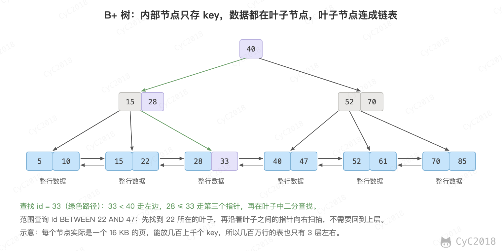
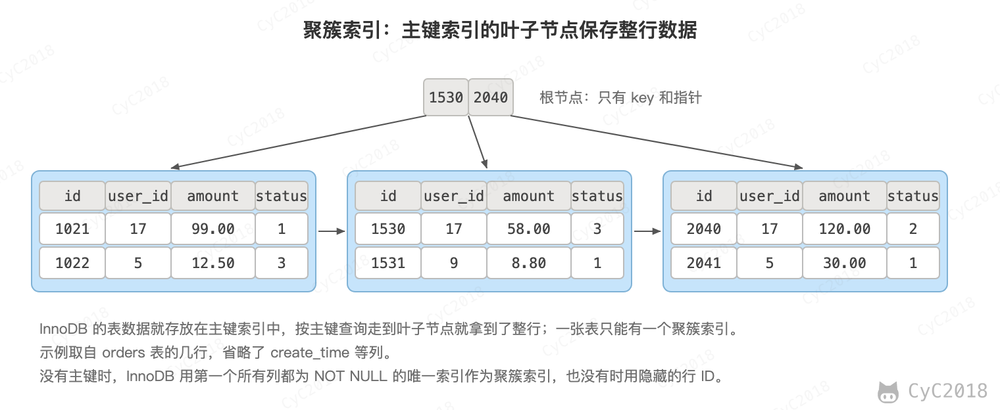
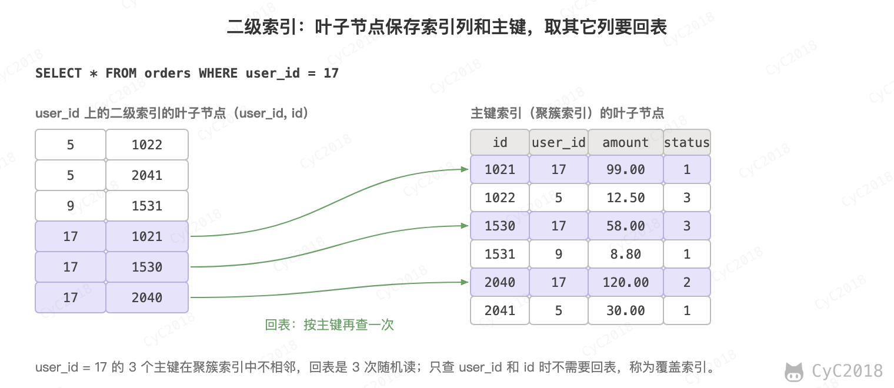
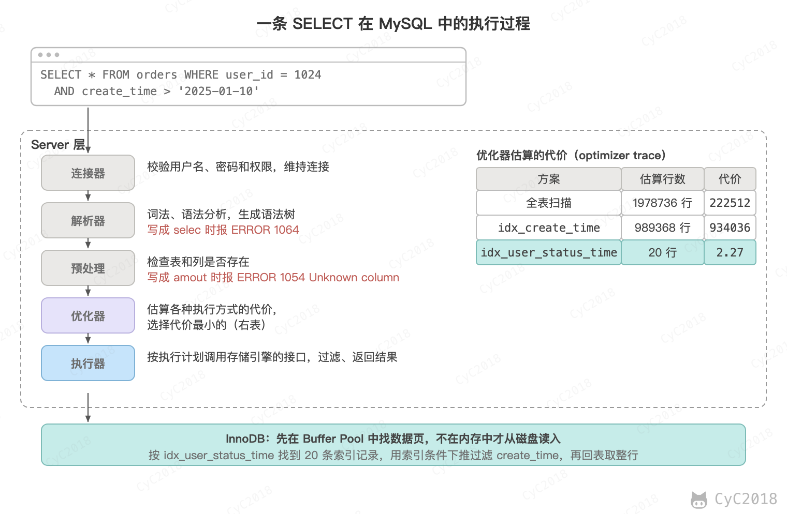
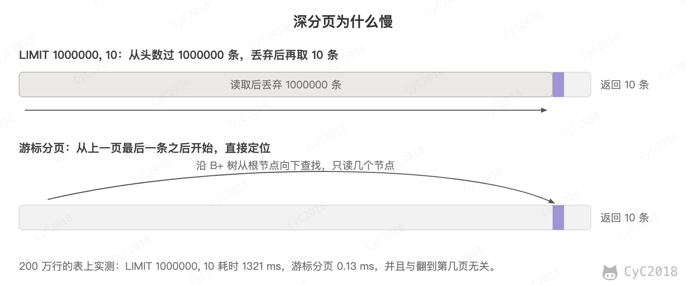
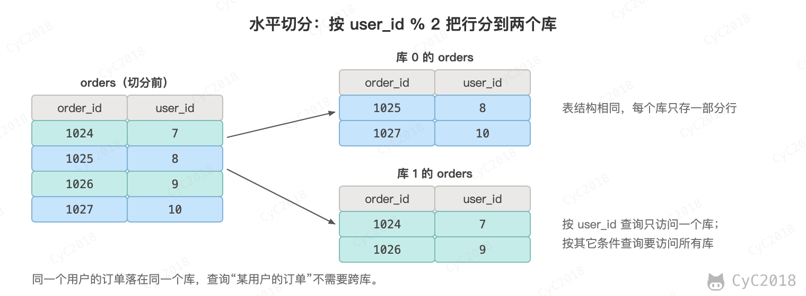
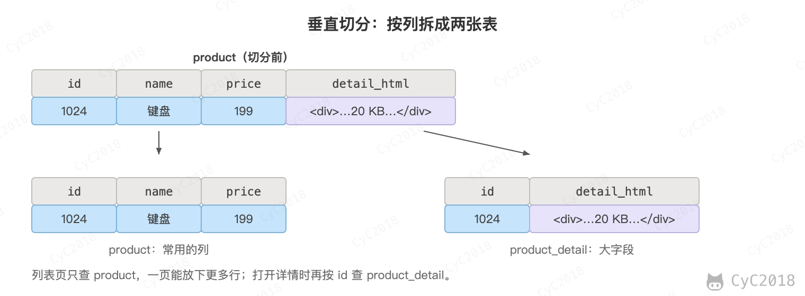
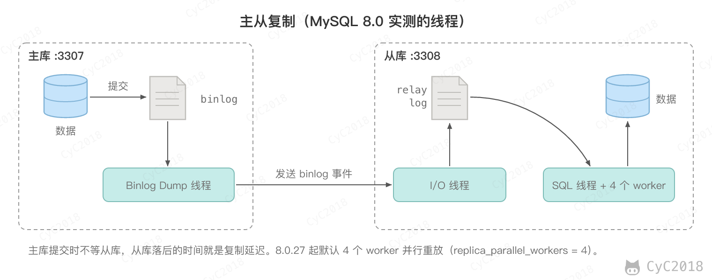
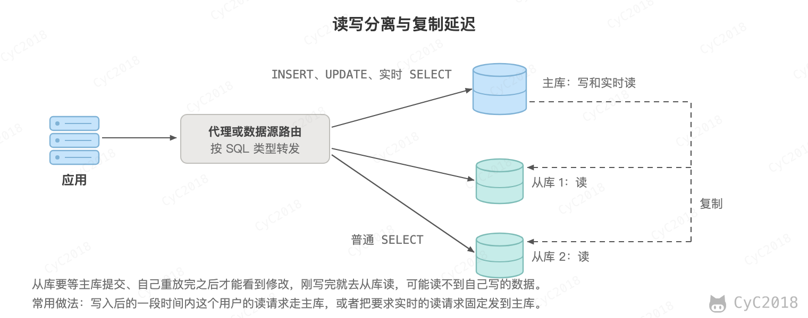
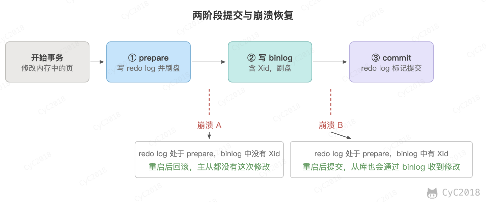

# MySQL
<!-- GFM-TOC -->
* [MySQL](#mysql)
    * [一、索引](#一索引)
        * [B+ Tree 原理](#b-tree-原理)
        * [MySQL 索引](#mysql-索引)
        * [索引的优点](#索引的优点)
        * [索引的使用条件](#索引的使用条件)
        * [索引优化](#索引优化)
        * [索引失效](#索引失效)
    * [二、查询性能优化](#二查询性能优化)
        * [一条 SQL 的执行过程](#一条-sql-的执行过程)
        * [使用 Explain 进行分析](#使用-explain-进行分析)
        * [优化数据访问](#优化数据访问)
        * [重构查询方式](#重构查询方式)
        * [深分页](#深分页)
    * [三、存储引擎](#三存储引擎)
        * [InnoDB](#innodb)
        * [MyISAM](#myisam)
        * [比较](#比较)
    * [四、数据类型](#四数据类型)
        * [整型](#整型)
        * [浮点数](#浮点数)
        * [字符串](#字符串)
        * [时间和日期](#时间和日期)
    * [五、切分](#五切分)
        * [水平切分](#水平切分)
        * [垂直切分](#垂直切分)
        * [Sharding 策略](#sharding-策略)
        * [Sharding 存在的问题](#sharding-存在的问题)
    * [六、复制](#六复制)
        * [主从复制](#主从复制)
        * [读写分离](#读写分离)
    * [七、日志](#七日志)
        * [redo log](#redo-log)
        * [binlog](#binlog)
        * [两阶段提交](#两阶段提交)
    * [附录：实测](#附录实测)
        * [A1 主键索引的高度](#a1-主键索引的高度)
        * [A2 索引的执行计划](#a2-索引的执行计划)
        * [A3 二级索引对写入的影响](#a3-二级索引对写入的影响)
        * [A4 优化器的代价估算](#a4-优化器的代价估算)
        * [A5 深分页的耗时](#a5-深分页的耗时)
    * [参考资料](#参考资料)
<!-- GFM-TOC -->


## 一、索引

### B+ Tree 原理

#### 1. 数据结构

B+ Tree 是一种多路平衡查找树：每个节点可以有很多个子节点，所有叶子节点都在同一层。InnoDB 的索引就是 B+ Tree，它有两个特点：

- 内部节点只保存 key 和指向子节点的指针，数据都保存在叶子节点中；
- 叶子节点按 key 的顺序用指针连成链表。

<div align="center">  </div><br>

#### 2. 操作

查找时从根节点开始，在节点内二分查找，确定下一层走哪个指针，一直走到叶子节点。范围查询先找到起点所在的叶子节点，再沿着叶子之间的指针顺序扫描，不需要回到上层。

插入和删除可能让节点过满或者过空，这时要分裂节点、与相邻节点合并或者从相邻节点借用 key，保证所有叶子节点仍然在同一层。

#### 3. 与红黑树的比较

红黑树等二叉平衡树也能实现索引，但数据库和文件系统普遍采用 B+ Tree。这是因为数据存放在磁盘上，读一次磁盘的代价远大于在内存中比较几次 key，B+ Tree 能让读磁盘的次数最少：

- 树更矮：树高约为 log<sub>d</sub>N，d 为每个节点的子节点数。红黑树的 d 为 2，而 B+ Tree 的一个节点就是一个 16 KB 的页，可以有几百上千个子节点。200 万行的 orders 表，主键索引只有 3 层（MySQL 8.0 实测，见[附录 A1](#a1-主键索引的高度)），换成二叉树高度约为 21；
- 一次 I/O 读入一个节点：操作系统和数据库都以页为单位读写磁盘，B+ Tree 的节点大小正好是一页。对于机械硬盘，读不同位置的页还要移动磁头寻道，树越矮寻道次数越少；
- 适合顺序读：范围查询沿着叶子节点顺序扫描，相邻的页可以利用磁盘的预读提前读入。

根节点和中间节点访问频繁，通常常驻在内存的缓冲池中，所以按主键查找一行实际上最多读一次磁盘。

#### 4. 与 B Tree 的比较

- B Tree 的每个节点都存放数据，B+ Tree 只有叶子节点存放数据，内部节点只存放 key 和指针，同样大小的页能放下更多的 key，树更矮；
- B+ Tree 的叶子节点按 key 的顺序用指针连接，范围查询找到起点后顺序扫描叶子节点即可，B Tree 则要在不同层的节点之间来回遍历；
- B+ Tree 的每次查找都要走到叶子节点，查询的磁盘 I/O 次数稳定。

### MySQL 索引

索引是在存储引擎层实现的，不同存储引擎支持的索引类型和实现不同。下面按数据结构介绍几种索引；按用途还可以分为主键索引、唯一索引、普通索引、联合索引和前缀索引。

#### 1. B+Tree 索引

B+Tree 索引是大多数 MySQL 存储引擎默认的索引类型。它是有序的，除了查找，还可以用于排序和分组。多个列可以组成一个联合索引，按全部列、列的范围或者最左边的若干列查找都能用上索引，不从最左边的列开始就用不上，见下文的 [索引失效](#索引失效)。

InnoDB 的 B+Tree 索引分为两种：

- 主键索引：叶子节点保存整行数据，表的数据就存放在主键索引中，这种方式称为聚簇索引。因为数据只能按一种顺序存放，所以一张表只能有一个聚簇索引；
- 二级索引（辅助索引）：叶子节点保存索引列和主键的值。

<div align="center">  </div><br>

通过二级索引查询其它列时，要先在二级索引中找到主键，再到聚簇索引中查出整行，这称为回表：

<div align="center">  </div><br>

#### 2. 哈希索引

哈希索引能以 O(1) 时间进行等值查找，但是失去了有序性：

- 无法用于排序与分组；
- 只支持精确查找，无法用于部分查找和范围查找。

MEMORY 引擎支持哈希索引，InnoDB 不能显式创建哈希索引，但有一个“自适应哈希索引”的功能：某些索引值被频繁访问时，InnoDB 自动在 B+Tree 索引之上为它们建立哈希索引，加快等值查找。

#### 3. 全文索引

全文索引用于查找文本中的关键词，而不是直接比较是否相等，查询条件写成 MATCH ... AGAINST。它使用倒排索引实现，记录着关键词到所在文档的映射。最早只有 MyISAM 支持全文索引，InnoDB 从 MySQL 5.6.4 开始支持。

#### 4. 空间数据索引

空间数据索引（R-Tree）用于地理数据，会从所有维度来索引数据，可以按任意维度组合查询，需要使用 GIS 相关的函数来维护数据。MyISAM 支持空间数据索引，InnoDB 从 MySQL 5.7 起也支持。

### 索引的优点

- 大大减少了服务器需要扫描的数据行数；
- 帮助服务器避免排序和分组时创建临时表：B+Tree 索引是有序的，可以直接用于 ORDER BY 和 GROUP BY；
- 将随机 I/O 变为顺序 I/O：B+Tree 索引是有序的，相邻的数据存储在一起。

### 索引的使用条件

- 对于非常小的表，大部分情况下简单的全表扫描比建立索引更高效；
- 对于中到大型的表，索引就非常有效；
- 对于特大型的表，建立和维护索引的代价也随之增长，可以使用分区等技术直接区分出需要查询的一组数据，而不是一条记录一条记录地匹配；
- 索引并不是越多越好：插入、删除数据和修改索引列时，要同时维护每个相关的索引，索引也要占用存储空间。在 orders 表上插入 50 万行，没有二级索引时约 2.0 s，有 4 个二级索引时约 5.2 s，这 4 个索引共占 73 MB，而数据本身是 89 MB（见[附录 A3](#a3-二级索引对写入的影响)）；
- 适合建索引的是经常出现在 WHERE、JOIN、ORDER BY、GROUP BY 中，并且区分度高的列，区分度很低的列（例如只有几种取值的状态）单独建索引的作用不大。

### 索引优化

#### 1. 独立的列

在进行查询时，索引列不能是表达式的一部分，也不能是函数的参数，否则无法使用索引。

例如下面的查询不能使用 actor_id 列的索引，更多的例子见下文的 [索引失效](#索引失效)：

```sql
SELECT actor_id FROM sakila.actor WHERE actor_id + 1 = 5;
```

#### 2. 多列索引

在需要使用多个列作为条件进行查询时，使用多列索引比使用多个单列索引性能更好。例如下面的语句中，最好把 actor_id 和 film_id 设置为多列索引。

```sql
SELECT film_id, actor_id FROM sakila.film_actor
WHERE actor_id = 1 AND film_id = 1;
```

#### 3. 索引列的顺序

让选择性最强的索引列放在前面。

索引的选择性是指：不重复的索引值和记录总数的比值。最大值为 1，此时每个记录都有唯一的索引与其对应。选择性越高，每个记录的区分度越高，查询效率也越高。

需要注意的是，这个规则的前提是这些列都以等值条件出现。范围条件之后的列不能再用来缩小扫描的范围，所以经常用于范围查询的列（例如时间）应该放在联合索引的后面。

例如下面显示的结果中 customer_id 的选择性比 staff_id 更高，因此最好把 customer_id 列放在多列索引的前面。

```sql
SELECT COUNT(DISTINCT staff_id)/COUNT(*) AS staff_id_selectivity,
COUNT(DISTINCT customer_id)/COUNT(*) AS customer_id_selectivity,
COUNT(*)
FROM payment;
```

```text
   staff_id_selectivity: 0.0001
customer_id_selectivity: 0.0373
               COUNT(*): 16049
```

#### 4. 前缀索引

对于 BLOB 和 TEXT 类型的列，必须使用前缀索引，只索引开始的部分字符；对于 VARCHAR 和 CHAR 类型的列，可以选择使用前缀索引来减小索引的大小。

前缀长度的选取需要根据索引选择性来确定：用 COUNT(DISTINCT LEFT(email, 10)) / COUNT(*) 计算不同前缀长度的选择性，选出接近完整列的最短长度，再建立索引：

```sql
ALTER TABLE user ADD INDEX idx_email (email(10));
```

前缀索引只保存了每个值的一部分，所以不能用于 ORDER BY、GROUP BY，也不能作为覆盖索引。

#### 5. 覆盖索引

覆盖索引指的是索引中已经包含了查询需要的所有列，不需要回表。例如二级索引 idx_user_status_time 包含 user_id、status、create_time，叶子节点中还有主键 id，所以下面的查询的 Extra 为 Using index（见[附录 A2](#a2-索引的执行计划)）：

```sql
SELECT user_id, status, create_time, id FROM orders WHERE user_id = 1001;
```

它的优点是只读取索引，读取的数据量小，并且避免了回表带来的随机 I/O。

### 索引失效

索引失效指的是查询条件中有索引列，执行计划却没有使用这个索引，或者只用到了联合索引的一部分。下面是在一张 200 万行的订单表 orders 上用 Explain 查看的结果（MySQL 8.0，见[附录 A2](#a2-索引的执行计划)），表上有联合索引 idx_user_status_time(user_id, status, create_time)、单列索引 idx_create_time(create_time) 和 idx_order_no(order_no)，其中 order_no 是 VARCHAR 类型：

| 查询条件 | type | 原因 |
| --- | --- | --- |
| `status = 1 AND create_time > '2025-01-20'` | ALL | 没有从联合索引最左边的 user_id 开始 |
| `DATE(create_time) = '2025-01-12'` | ALL | 对索引列使用了函数 |
| `order_no = 7007` | ALL | 字符串列与数字比较，发生了隐式类型转换 |
| `order_no LIKE '%7007'` | ALL | 以 % 开头，无法利用索引的顺序 |
| `user_id = 5 OR amount = 10.99` | ALL | OR 的一侧没有索引，仍然要扫描全表 |
| `user_id != 5` | ALL | 几乎匹配所有行 |

需要注意的是，表中都是 SELECT * 的结果。查询的列都在某个索引中时（覆盖索引），不需要回表，优化器会改为扫描这个二级索引：SELECT order_no 加 `LIKE '%7007'` 的 type 为 index，SELECT user_id 加 `user_id != 5` 的 type 为 range，仍然要读几乎全部的索引项，只是比扫描整张表的数据量小（见[附录 A2](#a2-索引的执行计划)）。

对应的写法：

- 把函数改写为范围：`create_time >= '2025-01-12' AND create_time < '2025-01-13'`，type 变为 range；
- 字符串列用字符串比较：`order_no = '7007'`，type 变为 ref。这是因为 '7007'、' 7007'、'7007a' 转换成数字后都等于 7007，没法按索引的顺序查找；反过来，整数列与字符串比较（`id = '1001'`）仍然走主键，因为被转换的是常量而不是列；
- 只在右边模糊匹配：`LIKE '7007%'`，type 为 range；
- OR 两侧的列都有索引时，可以分别扫描两个索引再合并结果，type 为 index_merge。

联合索引中出现范围条件时，范围条件之后的列不能再用来缩小扫描的范围。Explain 的 key_len 表示用到了索引的前几列，user_id 为 INT，占 4 字节，status 为 TINYINT，占 1 字节，create_time 为 DATETIME，占 5 字节：

```sql
WHERE user_id = 5 AND status = 1 AND create_time > '2025-01-05'   -- key_len = 10，三列都用上了
WHERE user_id = 5 AND status > 0 AND create_time > '2025-01-05'   -- key_len = 5，只用到前两列
```

不过第二条语句的 Extra 为 Using index condition，也就是索引下推：create_time 虽然不能缩小扫描范围，但仍然在索引上过滤，不满足条件的行不需要回表，所以范围条件之后的列并不是完全没有作用。

例如 `user_id = 1001 AND create_time >= '2025-01-20'` 跳过了 status，只能用 user_id 定位（key_len = 4），user_id 为 1001 的 20 行中只有 3 行满足时间条件。有索引下推时只需回表 3 次，关闭索引下推后要回表 20 次，再由 Server 层过滤。

需要注意的是，是否使用索引是优化器按成本估算决定的。走二级索引的每一行都要回表，匹配的行越多回表越多，超过一定比例后全表扫描反而更快：`create_time > '2025-01-23'` 匹配 9.9 万行，走 idx_create_time；`create_time > '2025-01-02'` 匹配 191 万行，就选择了全表扫描。IN 也一样，`user_id IN` 5 个值、1 万个值时都走索引，2 万个值时就改为全表扫描。因此同一种写法有时走索引有时不走，可能是因为匹配的数据量不同。

## 二、查询性能优化

### 一条 SQL 的执行过程

MySQL 分为 Server 层和存储引擎层：Server 层负责连接、解析、优化和执行，存储引擎负责数据的存储和读取，例如 InnoDB。

<div align="center">  </div><br>

图中的数据来自 200 万行的 orders 表（MySQL 8.0 的 optimizer_trace，见[附录 A4](#a4-优化器的代价估算)）。优化器并不是“有索引就用”：idx_create_time 也能用于这个查询，但估算要扫描 98 万行、再回表 98 万次，代价比全表扫描还高；联合索引 idx_user_status_time 的第一列就是 user_id，只需要扫描 20 行。用 EXPLAIN 可以看到最终的选择（key: idx_user_status_time，rows: 20），开启 optimizer_trace 可以看到每种方案的估算代价。

需要注意的是，MySQL 5.7 及以前在解析之前还会查询缓存，表一有修改相关的缓存就全部失效，命中率很低，8.0 已经移除了查询缓存。

更新语句的执行过程与查询相同，只是在执行器调用 InnoDB 修改数据时，还要写 undo log、redo log 和 binlog，见下文的 [日志](#七日志)。

### 使用 Explain 进行分析

Explain 用来分析 SELECT 查询语句，开发人员可以通过分析 Explain 结果来优化查询语句。

比较重要的字段有：

- select_type：查询类型，有简单查询、联合查询、子查询等；
- type：访问类型，从好到差常见的有 const、eq_ref、ref、range、index、ALL。const 表示通过主键或唯一索引最多匹配一行，ref 表示通过普通索引等值匹配，range 表示索引范围扫描，index 表示扫描整个索引树，ALL 表示全表扫描；
- key：使用的索引；
- rows：估算的扫描行数；
- Extra：额外信息，Using index 表示使用了覆盖索引，不需要回表；Using index condition 表示使用了索引下推；Using filesort 表示无法利用索引的顺序，需要额外排序；Using temporary 表示使用了临时表，常见于 GROUP BY 和 ORDER BY 的列不一致。

Explain 只显示估算值，MySQL 8.0.18 起可以用 EXPLAIN ANALYZE 实际执行一遍，显示每一步真实的行数和耗时。

出现 ALL、Using filesort 或 Using temporary，并且 rows 很大时，通常需要调整索引或者改写查询。

找出慢查询可以使用慢查询日志：开启 slow_query_log 后，执行时间超过 long_query_time（默认 10 秒）的语句会被记录下来，再用 mysqldumpslow 按执行时间、次数汇总分析。

### 优化数据访问

#### 1. 减少请求的数据量

- 只返回必要的列：最好不要使用 SELECT * 语句，只查需要的列还可能用上覆盖索引；
- 只返回必要的行：使用 LIMIT 语句来限制返回的数据；
- 缓存重复查询的数据：经常被重复查询的数据放在 Redis 等缓存中，避免每次都查询数据库。

#### 2. 减少服务器端扫描的行数

最有效的方式是使用索引来覆盖查询。

### 重构查询方式

#### 1. 切分大查询

一个大查询如果一次性执行的话，可能一次锁住很多数据、占满整个事务日志、耗尽系统资源、阻塞很多小的但重要的查询。

```sql
DELETE FROM messages WHERE create_time < DATE_SUB(NOW(), INTERVAL 3 MONTH);
```

```sql
rows_affected = 0
do {
    rows_affected = do_query(
    "DELETE FROM messages WHERE create_time < DATE_SUB(NOW(), INTERVAL 3 MONTH) LIMIT 10000")
} while rows_affected > 0
```

#### 2. 分解大连接查询

将一个大连接查询分解成对每一个表进行一次单表查询，然后在应用程序中进行关联，这样做的好处有：

- 应用层的缓存更容易命中：单表查询的结果可以按主键缓存，被其它查询复用，其中一张表变化时也只需要让这张表相关的缓存失效；
- 减少锁竞争；
- 在应用层进行连接，可以更容易对数据库进行拆分，从而更容易做到高性能和可伸缩；
- 查询本身效率也可能会有所提升。例如下面的例子中，使用 IN() 代替连接查询，可以让 MySQL 按照 ID 顺序进行查询，这可能比随机的连接要更高效。

```sql
SELECT * FROM tag
JOIN tag_post ON tag_post.tag_id=tag.id
JOIN post ON tag_post.post_id=post.id
WHERE tag.tag='mysql';
```

```sql
SELECT * FROM tag WHERE tag='mysql';
SELECT * FROM tag_post WHERE tag_id=1234;
SELECT * FROM post WHERE post.id IN (123,456,567,9098,8904);
```

### 深分页

深分页指的是偏移量很大的分页查询。例如 200 万行的订单表 orders，create_time 上有普通索引 idx_create_time，按创建时间翻到第 100001 页：

```sql
SELECT * FROM orders ORDER BY create_time LIMIT 1000000, 10;
```

MySQL 没办法直接跳到第 1000001 行，只能先找出排在前面的 1000010 行，丢弃前 1000000 行，再返回最后 10 行，偏移量越大越慢。

<div align="center">  </div><br>

这条查询的执行计划中 type 为 ALL、Extra 为 Using filesort，也就是全表扫描后排序。这是因为如果走 idx_create_time，读出的 1000010 条索引项都要回表取整行，产生上百万次随机读，优化器判断这样还不如全表扫描。

延迟关联指的是先在索引上查出这一页的主键，再根据主键回表。子查询只用到 create_time 和 id，idx_create_time 就是覆盖索引（Extra 为 Using index），虽然仍要扫描 1000010 条索引项，但不需要回表，只有最后 10 行需要回表：

```sql
SELECT o.* FROM orders o
JOIN (SELECT id FROM orders ORDER BY create_time LIMIT 1000000, 10) t ON o.id = t.id
ORDER BY o.create_time;
```

游标分页（也叫书签分页）指的是记住上一页最后一行的排序值，下一页从它之后开始查。这样可以直接在索引上定位到上一页结束的位置，只读 10 行：

```sql
-- 上一页最后一行：create_time = '2025-01-12 13:46:39'，id = 982321
SELECT * FROM orders
WHERE create_time > '2025-01-12 13:46:39'
   OR (create_time = '2025-01-12 13:46:39' AND id > 982321)
ORDER BY create_time, id
LIMIT 10;
```

排序列的值可能重复，所以要再按主键排序，并把主键也作为游标的一部分，否则时间相同的行会被跳过或者重复返回。游标分页的代价是不能直接跳到任意一页，只能逐页翻，适合 App 下拉加载、按时间浏览记录这类场景。

几种写法的耗时如下（MySQL 8.0，数据全部在内存中，取 5 次中最快的一次，见[附录 A5](#a5-深分页的耗时)），后三种写法返回的 10 行相同：

| 写法 | 耗时 | 读取的数据 |
| --- | --- | --- |
| LIMIT 0, 10 | 0.15 ms | 10 行 |
| LIMIT 1000000, 10 | 1397 ms | 全表 200 万行，再排序 |
| 延迟关联 | 79 ms | 1000010 条索引项，回表 10 次 |
| 游标分页 | 0.49 ms | 10 行 |

还可以从需求上限制翻页的深度，例如只允许翻到前 100 页。Elasticsearch 默认也不允许 from + size 超过 10000，更深的翻页要用 search_after，原理与游标分页相同。

需要注意的是，分页时常常还要显示总记录数。InnoDB 没有保存表的行数，因为并发的事务看到的行数可能不同，COUNT(*) 需要扫描整个索引，上面的表执行一次约需 130 ms。数据量大时可以缓存总数、显示估算值，或者只提供“下一页”。

## 三、存储引擎

### InnoDB

是 MySQL 默认的事务型存储引擎，只有在需要它不支持的特性时，才考虑使用其它存储引擎。

实现了四个标准的隔离级别，默认级别是可重复读（REPEATABLE READ）。在可重复读隔离级别下，通过多版本并发控制（MVCC）+ Next-Key Locks 在很大程度上避免了幻读，但一个事务中混用快照读和当前读时仍会出现，见 [数据库系统原理](数据库系统原理.md#六next-key-locks)。

主键索引是聚簇索引，数据就保存在索引的叶子节点中，按主键查询走到叶子节点就拿到了整行。

内部做了很多优化，包括从磁盘读取数据时的预读、自动创建的自适应哈希索引、加速二级索引写入的 change buffer 等。

支持真正的在线热备份。其它存储引擎不支持在线热备份，要获取一致性视图需要停止对所有表的写入，而在读写混合场景中，停止写入可能也意味着停止读取。

### MyISAM

设计简单，数据以紧密格式存储。对于只读数据，或者表比较小、可以容忍修复操作，则依然可以使用它。

提供了大量的特性，包括压缩表、空间数据索引等。

不支持事务。

不支持行级锁，只能对整张表加锁，读取时会对需要读到的所有表加共享锁，写入时则对表加排它锁。但在表有读取操作的同时，也可以往表中插入新的记录，这被称为并发插入（CONCURRENT INSERT）。

可以手工或者自动执行检查和修复操作，但是和事务恢复以及崩溃恢复不同，可能导致一些数据丢失，而且修复操作是非常慢的。

如果指定了 DELAY_KEY_WRITE 选项，在每次修改执行完成时，不会立即将修改的索引数据写入磁盘，而是会写到内存中的键缓冲区，只有在清理键缓冲区或者关闭表的时候才会将对应的索引块写入磁盘。这种方式可以极大的提升写入性能，但是在数据库或者主机崩溃时会造成索引损坏，需要执行修复操作。

### 比较

- 事务：InnoDB 是事务型的，可以使用 Commit 和 Rollback 语句；
- 并发：MyISAM 只支持表级锁，而 InnoDB 还支持行级锁；
- 外键：InnoDB 支持外键；
- 备份：InnoDB 支持在线热备份；
- 崩溃恢复：MyISAM 崩溃后发生损坏的概率比 InnoDB 高很多，而且恢复的速度也更慢；
- 其它特性：MyISAM 支持压缩表，空间数据索引 InnoDB 从 MySQL 5.7 起也支持。

## 四、数据类型

### 整型

TINYINT, SMALLINT, MEDIUMINT, INT, BIGINT 分别使用 8, 16, 24, 32, 64 位存储空间，一般情况下越小的列越好。

INT(11) 中的数字只是规定了交互工具显示字符的个数，对于存储和计算来说是没有意义的。MySQL 8.0.17 起这种写法已被废弃，建表时会给出警告 Integer display width is deprecated，SHOW CREATE TABLE 中也只显示 int。

### 浮点数

FLOAT 和 DOUBLE 为浮点类型，DECIMAL 为高精度小数类型。CPU 原生支持浮点运算，但是不支持 DECIMAL 类型的计算，因此 DECIMAL 的计算比浮点类型需要更高的代价。

DECIMAL 可以指定精度，例如 DECIMAL(18, 9) 表示总共 18 位，取 9 位存储小数部分，剩下 9 位存储整数部分。FLOAT 和 DOUBLE 也能写成 FLOAT(7, 4) 这种形式，但 MySQL 8.0.17 起已被废弃。金额等需要精确计算的数据应该使用 DECIMAL。

### 字符串

主要有 CHAR 和 VARCHAR 两种类型，一种是定长的，一种是变长的。

VARCHAR 这种变长类型能够节省空间，因为只需要存储必要的内容。但是在执行 UPDATE 时可能会使行变得比原来长，当超出一个页所能容纳的大小时，就要执行额外的操作。MyISAM 会将行拆成不同的片段存储，而 InnoDB 则需要分裂页来使行放进页内。

在进行存储和检索时，会保留 VARCHAR 末尾的空格，而会删除 CHAR 末尾的空格。

### 时间和日期

MySQL 提供了两种相似的日期时间类型：DATETIME 和 TIMESTAMP。

#### 1. DATETIME

能够保存从 1000 年到 9999 年的日期和时间，精度默认为秒，可以用 DATETIME(6) 精确到微秒，使用 5 字节的存储空间（MySQL 5.6.4 之前为 8 字节），小数部分另外占用 0～3 字节。

它与时区无关。

默认情况下，MySQL 以一种可排序的、无歧义的格式显示 DATETIME 值，例如“2008-01-16 22:37:08”，这是 ANSI 标准定义的日期和时间表示方法。

#### 2. TIMESTAMP

和 UNIX 时间戳相同，保存从 1970 年 1 月 1 日午夜（格林威治时间）以来的秒数，使用 4 个字节，只能表示从 1970 年到 2038 年。

它和时区有关，也就是说一个时间戳在不同的时区所代表的具体时间是不同的。

MySQL 提供了 FROM_UNIXTIME() 函数把 UNIX 时间戳转换为日期，并提供了 UNIX_TIMESTAMP() 函数把日期转换为 UNIX 时间戳。

如果希望插入时没有指定 TIMESTAMP 列的值就设置为当前时间，需要显式声明 DEFAULT CURRENT_TIMESTAMP。MySQL 8.0 默认开启了 explicit_defaults_for_timestamp，不再自动为表中第一个 TIMESTAMP 列添加这个默认值。

TIMESTAMP 比 DATETIME 少占用 1 字节，但是只能表示到 2038 年，需要表示更大的时间范围时应当使用 DATETIME。

## 五、切分

### 水平切分

水平切分又称为 Sharding，它是将同一个表中的记录拆分到多个结构相同的表中。

当单表的数据量或者写入量超过一台数据库服务器的承受能力时，就需要 Sharding，把数据分布到集群的不同节点上，从而缓解单个数据库的压力。

单表的行数本身并不是瓶颈。附录 A1 中 200 万行的 orders 表，主键索引只有 3 层，每个中间页约有 900 个指针，每个叶子页约 80 行，按此计算 3 层可以容纳约 6000 万行。真正需要拆分的是单机承受不了的写入量和数据量，以及随之变慢的备份、加列、建索引等运维操作；如果只是读压力大，先用读写分离和缓存。阿里巴巴的 Java 开发手册给出的经验值是单表超过 500 万行或者 2 GB 再考虑分库分表，预计三年内达不到就不要提前拆分。

<div align="center">  </div><br>

### 垂直切分

垂直切分是将一张表按列切分成多个表，通常是按照列的关系密集程度进行切分，也可以利用垂直切分将经常被使用的列和不经常被使用的列切分到不同的表中。

在数据库的层面使用垂直切分将按数据库中表的密集程度部署到不同的库中，例如将原来的电商数据库垂直切分成商品数据库、用户数据库等。

<div align="center">  </div><br>

### Sharding 策略

- 哈希取模：hash(key) % N；
- 范围：可以是 ID 范围也可以是时间范围；
- 映射表：使用单独的一个数据库来存储映射关系。

选择分片键时，要让最常用的查询都带上它，这样每次查询只访问一个分片。例如订单表按 user_id 分成 16 张表，放在 4 个库中：表号为 user_id % 16，库号为表号 / 4。user_id 为 10086 的用户，10086 % 16 = 6，订单都在 db_1.orders_6 中。

分片数量一开始就定得比库的数量多，扩容时把整张表迁移到新库，每一行所属的表不变。如果直接按 hash(key) % 库数 分配，库从 4 个增加到 5 个时约 80% 的行都要迁移（见 [一致性哈希](缓存.md#六一致性哈希)）。

### Sharding 存在的问题

#### 1. 事务问题

一个事务涉及多个分片时，需要使用分布式事务，见 [分布式事务](分布式.md#二分布式事务)。

#### 2. 连接

可以将原来的连接分解成多个单表查询，然后在用户程序中进行连接。

#### 3. ID 唯一性

不能再依赖单表的自增主键，常用的方法见 [分布式 ID](分布式.md#八分布式-id)：

- 使用全局唯一 ID（UUID）；
- 为每个分片指定一个 ID 范围；
- 使用分布式 ID 生成器，例如雪花算法（Snowflake）。

#### 4. 不带分片键的查询

订单按 user_id 分片后，按订单号或者按商家查询时不知道数据在哪个分片，只能查询所有分片再合并。常用的做法：

- 基因法：生成订单号时把最后 4 个二进制位设为 user_id % 16，订单号 % 16 就等于 user_id % 16，按订单号也能算出所在的表；
- 映射表：另存一张订单号到 user_id 的映射，先查映射再查订单；
- 按另一个维度再存一份：例如按商家 ID 分片再存一份订单，或者同步到 Elasticsearch，通常订阅 binlog 异步更新，所以会有短暂的延迟。

#### 5. 跨分片的排序和分页

分片后执行 ORDER BY create_time DESC LIMIT 1000, 10，每个分片都要返回前 1010 行，由中间件归并排序后再取出第 1001～1010 行，页数越深，每个分片返回的数据越多。常用游标分页代替：记住上一页最后一条的 create_time，每个分片只取比它更早的 10 行，见上文的 [深分页](#深分页)。

ShardingSphere 等中间件负责按分片键路由 SQL、改写分页条件和归并结果，应用像访问一张表一样访问分片后的表。

## 六、复制

### 主从复制

主要涉及三个线程：binlog dump 线程、I/O 线程和 SQL 线程。

- binlog dump 线程：主服务器上的数据更改会写入二进制日志（Binary log），该线程负责把二进制日志的内容发送给从服务器；
- I/O 线程：负责从主服务器上读取二进制日志，并写入从服务器的中继日志（Relay log）；
- SQL 线程：负责读取中继日志，解析出主服务器已经执行的数据更改并在从服务器中重放（Replay）。

MySQL 8.0.27 起 replica_parallel_workers 默认为 4，从服务器上实际是一个协调线程读取中继日志，再把事务分给 4 个工作线程并行重放，以减小复制延迟。

<div align="center">  </div><br>

### 读写分离

主服务器处理写操作以及实时性要求比较高的读操作，而从服务器处理读操作。

读写分离能提高性能的原因在于：

- 大多数业务读多写少，读请求可以分散到多个从服务器上，主服务器只处理写入；
- 主从服务器负责各自的读和写，缓解了锁的争用。

读写分离常用代理方式来实现，代理服务器接收应用层传来的读写请求，然后决定转发到哪个服务器。也可以在应用中按语句类型选择数据源。

<div align="center">  </div><br>

MySQL 默认是异步复制，主服务器提交事务后不等从服务器，从服务器的数据会落后一段时间，称为复制延迟。用户刚修改完资料就去从库读取，可能读到修改前的数据。常用的处理方法：

- 写入后短时间内的读取，或者对实时性要求高的读取，强制走主库，保证用户能读到自己刚写入的数据（读己之写）；
- 使用半同步复制：至少一个从库把 binlog 写入中继日志后，主库才向客户端返回提交成功，减少主库宕机时丢失的数据，但并不保证从库已经执行完这些修改；
- 监控从库的延迟（SHOW REPLICA STATUS 中的 Seconds_Behind_Source），延迟过大的从库暂时不分配读请求。

## 七、日志

InnoDB 执行一次修改时，会写下面三种日志：

| 日志 | 由谁写 | 记录的内容 | 作用 |
| --- | --- | --- | --- |
| undo log | InnoDB | 修改前的旧版本 | 回滚事务，MVCC 读取旧版本 |
| redo log | InnoDB | 对数据页的修改 | 崩溃恢复 |
| binlog | Server 层 | 修改前后的整行（ROW 格式） | 主从复制，恢复到指定时间点 |

undo log 的作用见 [多版本并发控制](数据库系统原理.md#五多版本并发控制)。

### redo log

InnoDB 以 16 KB 的页为单位存储数据，修改数据时先修改内存中缓存的页。如果每次提交都把修改过的页写回磁盘，修改几行数据就要随机写好几个 16 KB 的页。redo log 的做法是：提交时只把对数据页的修改顺序追加到 redo log 并刷盘，数据页之后再由后台线程批量写回。崩溃重启时重放 redo log 中还没有写回数据页的修改，已提交的事务就不会丢失。这种先写日志、后写数据的方式称为预写日志（Write-Ahead Logging, WAL）。

innodb_flush_log_at_trx_commit 控制提交时 redo log 的刷盘方式：

- 1（默认）：每次提交都写入并刷盘，已提交的事务不会丢失；
- 2：每次提交都写入操作系统的缓存，每秒刷盘一次，MySQL 进程崩溃不会丢失数据，操作系统崩溃或者断电可能丢失最近 1 秒左右的事务；
- 0：每秒写入并刷盘一次，MySQL 进程崩溃也可能丢失最近 1 秒左右的事务。

需要注意的是，由于进程调度，0 和 2 的“每秒刷盘”并不严格保证每秒发生一次，所以“1 秒”只是大致的范围；DDL 等内部操作也可能让 InnoDB 不按这个设置提前刷盘。

redo log 的空间是固定的，循环写入：数据页写回磁盘之后，对应的 redo log 就可以被覆盖。MySQL 8.0.30 起由 innodb_redo_log_capacity 控制大小，默认为 100 MB。

### binlog

binlog 由 Server 层记录，与存储引擎无关，用于 [主从复制](#主从复制) 和把数据恢复到指定的时间点。binlog 有三种格式：STATEMENT 记录 SQL 语句本身，日志小，但含有 UUID() 或者带 LIMIT 的 UPDATE 这类结果不确定的语句，在从库重放的结果可能不同；ROW 记录每一行修改前后的值；MIXED 平时记录语句，遇到这类语句时自动改用 ROW。MySQL 8.0 默认使用 ROW 格式。例如执行 UPDATE orders SET status = 3 WHERE id = 1024 后，用 mysqlbinlog 解析 binlog（省略了其它列）：

```text
### UPDATE `demo`.`orders`
### WHERE
###   @1=1024
###   @4=0
### SET
###   @1=1024
###   @4=3
... Xid = 341
COMMIT
```

redo log 与 binlog 的区别：

- redo log 是 InnoDB 的日志，记录对数据页的修改，空间固定、循环写，用于崩溃恢复；
- binlog 是 Server 层的日志，记录行的修改或者 SQL 语句，追加写、不会覆盖，可以发送给从库，也可以用来把数据恢复到任意时间点。

### 两阶段提交

一个事务既要写 redo log 又要写 binlog，如果只写成功了一个就崩溃，主库和从库的数据就会不一致。例如 redo log 写了而 binlog 没写，主库重启后保留了这次修改，从库却收不到。因此 MySQL 把提交分为两个阶段：

<div align="center">  </div><br>

1. prepare：写入 redo log 并刷盘，事务处于 prepare 状态；
2. 写入 binlog 并刷盘，binlog 中记录了事务的 ID（Xid）；
3. commit：在 redo log 中把事务标记为提交。

崩溃重启时，对于处于 prepare 状态的事务，到 binlog 中查找它的 Xid：找到了说明 binlog 已经写完，就提交这个事务；找不到就回滚。这样主库的数据与 binlog 总是一致的，从库按照 binlog 复制，也就与主库一致。

innodb_flush_log_at_trx_commit 和 sync_binlog 的默认值都是 1，也就是每次提交时两种日志都会刷盘，常被称为“双 1”配置。

## 附录：实测

以下实验在 Apple M1 Pro、MySQL 8.0.44 上进行，数据全部在缓冲池中。orders 表有 200 万行，数据约 385 MB，平均每行 203 字节：

```sql
CREATE TABLE `orders` (
  `id` bigint NOT NULL AUTO_INCREMENT,
  `user_id` int NOT NULL,
  `amount` decimal(10,2) NOT NULL,
  `status` tinyint NOT NULL,
  `create_time` datetime NOT NULL,
  `remark` varchar(200) NOT NULL,
  `order_no` varchar(32) DEFAULT NULL,
  PRIMARY KEY (`id`),
  KEY `idx_create_time` (`create_time`),
  KEY `idx_user_status_time` (`user_id`,`status`,`create_time`),
  KEY `idx_order_no` (`order_no`)
);
```

### A1 主键索引的高度

先从 INNODB_INDEXES 查出主键索引根页的页号，再从 orders.ibd 中读出这一页的页头：页头偏移 26 字节处的 PAGE_LEVEL 是根页所在的层号（叶子为 0），偏移 16 字节处的 PAGE_N_RECS 是这一页中的记录数。

```text
mysql> SELECT i.NAME, i.PAGE_NO FROM information_schema.INNODB_INDEXES i
       JOIN information_schema.INNODB_TABLES t ON i.TABLE_ID = t.TABLE_ID
       WHERE t.NAME = 'demo/orders' AND i.NAME = 'PRIMARY';
PRIMARY  4

读取 orders.ibd 第 4 页（偏移 4 × 16384）：PAGE_LEVEL = 2，PAGE_N_RECS = 27
```

PAGE_LEVEL 为 2，说明根页、中间页、叶子页共 3 层。根页中的 27 条记录指向 27 个中间页，叶子页约 2.4 万个（数据 385 MB ÷ 16 KB），每页约 80 行。

### A2 索引的执行计划

```text
条件                                                      type   key                   key_len  rows     Extra
status = 1 AND create_time > '2025-01-20'                 ALL    NULL                  NULL     1978736  Using where
DATE(create_time) = '2025-01-12'                          ALL    NULL                  NULL     1978736  Using where
order_no = 7007                                           ALL    NULL                  NULL     1978736  Using where
order_no LIKE '%7007'                                     ALL    NULL                  NULL     1978736  Using where
user_id = 5 OR amount = 10.99                             ALL    NULL                  NULL     1978736  Using where
user_id != 5                                              ALL    NULL                  NULL     1978736  Using where
create_time >= '2025-01-12' AND create_time < '2025-01-13'
                                                          range  idx_create_time       5        177198   Using index condition; Using MRR
order_no = '7007'                                         ref    idx_order_no          131      1        NULL
order_no LIKE '7007%'                                     range  idx_order_no          131      161      Using index condition
id = '1001'                                               const  PRIMARY               8        1        NULL
user_id = 5 AND status = 1 AND create_time > '2025-01-05' range  idx_user_status_time  10       16       Using index condition
user_id = 5 AND status > 0 AND create_time > '2025-01-05' range  idx_user_status_time  5        20       Using index condition
create_time > '2025-01-23'                                range  idx_create_time       5        196312   Using index condition; Using MRR
create_time > '2025-01-02'                                ALL    NULL                  NULL     1978736  Using where
user_id IN (1, 2, 3, 4, 5)                                range  idx_user_status_time  4        100      Using index condition; Using MRR
user_id IN (1, 2, ..., 10000)                             range  idx_user_status_time  4        190000   Using index condition; Using MRR
user_id IN (1, 2, ..., 20000)                             ALL    NULL                  NULL     1978736  Using where
```

rows 是优化器的估算值。实际满足 create_time > '2025-01-23' 的有 99199 行，满足 create_time > '2025-01-02' 的有 1913599 行。

覆盖索引：

```text
EXPLAIN SELECT user_id, status, create_time, id FROM orders WHERE user_id = 1001;
type: ref  key: idx_user_status_time  Extra: Using index
```

索引下推：查询 `SELECT * FROM orders WHERE user_id = 1001 AND create_time >= '2025-01-20'`，执行前后用 SHOW SESSION STATUS 查看 Handler_read_next（沿索引读取下一条记录的次数）：

```text
SET optimizer_switch = 'index_condition_pushdown=on';   Handler_read_next = 3
SET optimizer_switch = 'index_condition_pushdown=off';  Handler_read_next = 20
```

覆盖索引时的前缀通配和不等于：

```text
EXPLAIN SELECT * FROM orders WHERE order_no LIKE '%7007';       type: ALL    key: NULL                  rows: 1978736
EXPLAIN SELECT order_no FROM orders WHERE order_no LIKE '%7007'; type: index  key: idx_order_no          rows: 1978736  Extra: Using where; Using index
EXPLAIN SELECT * FROM orders WHERE user_id != 5;                 type: ALL    key: NULL                  rows: 1978736
EXPLAIN SELECT user_id FROM orders WHERE user_id != 5;           type: range  key: idx_user_status_time  rows: 989468   Extra: Using where; Using index
```

### A3 二级索引对写入的影响

建两张结构与 orders 相同的表：t_noidx 只有主键，t_idx 有 idx_create_time、idx_user_status_time、idx_order_no 和 idx_amount 四个二级索引。各执行两次 `INSERT INTO t SELECT * FROM orders` 插入 50 万行（每次之前 TRUNCATE），再从 mysql.innodb_index_stats 读取各索引的页数：

```text
t_noidx  1.91 s / 2.02 s   PRIMARY 88.6 MB
t_idx    5.18 s / 5.31 s   PRIMARY 88.6 MB  idx_amount 16.5 MB  idx_create_time 15.5 MB
                           idx_order_no 19.6 MB  idx_user_status_time 21.5 MB
```

### A4 优化器的代价估算

```sql
SET optimizer_trace = 'enabled=on';
SELECT * FROM orders WHERE user_id = 1024 AND create_time > '2025-01-10';
SELECT TRACE FROM information_schema.OPTIMIZER_TRACE;
```

trace 中 range_analysis 一节的内容（节选）：

```text
table_scan:            rows 1978736, cost 219687
idx_create_time:       rows 989368,  cost 850325,  chosen false
idx_user_status_time:  rows 20,      cost 20.6022, chosen true
```

### A5 深分页的耗时

每条语句执行 5 次，用 SHOW PROFILES 取最快的一次：

```text
LIMIT 0, 10          0.15 ms
LIMIT 1000000, 10    1397.3 ms   EXPLAIN: type=ALL, Extra=Using filesort
延迟关联              79.07 ms    子查询 EXPLAIN: type=index, key=idx_create_time, Extra=Using index
游标分页              0.49 ms
COUNT(*)             130.47 ms
```

按 (create_time, id) 排序后第 1000000 行为 id = 982321、create_time = '2025-01-12 13:46:39'，这就是游标分页示例中使用的游标。

## 参考资料

- [MySQL 8.0: InnoDB Restrictions and Limitations](https://dev.mysql.com/doc/refman/8.0/en/innodb-restrictions-limitations.html)
- [Elasticsearch: Paginate search results](https://www.elastic.co/docs/reference/elasticsearch/rest-apis/paginate-search-results)
- [MySQL 8.0: EXPLAIN Output Format](https://dev.mysql.com/doc/refman/8.0/en/explain-output.html)
- [MySQL 8.0: The Slow Query Log](https://dev.mysql.com/doc/refman/8.0/en/slow-query-log.html)
- Baron Schwartz, Peter Zaitsev, Vadim Tkachenko, 等. 高性能 MySQL[M]. 电子工业出版社, 2013.
- 姜承尧. MySQL 技术内幕: InnoDB 存储引擎 [M]. 机械工业出版社, 2011.
- [20+ 条 MySQL 性能优化的最佳经验](https://www.jfox.info/20-tiao-mysql-xing-nen-you-hua-de-zui-jia-jing-yan.html)
- [How to create unique row ID in sharded databases?](https://stackoverflow.com/questions/788829/how-to-create-unique-row-id-in-sharded-databases)
- [SQL Azure Federation – Introduction](http://geekswithblogs.net/shaunxu/archive/2012/01/07/sql-azure-federation-ndash-introduction.aspx "Title of this entry.")
- [MySQL 索引背后的数据结构及算法原理](http://blog.codinglabs.org/articles/theory-of-mysql-index.html)
- [MySQL 性能优化神器 Explain 使用分析](https://segmentfault.com/a/1190000008131735)
- [How Sharding Works](https://medium.com/@jeeyoungk/how-sharding-works-b4dec46b3f6)
- [大众点评订单系统分库分表实践](https://tech.meituan.com/dianping_order_db_sharding.html)
- [B + 树](https://zh.wikipedia.org/wiki/B%2B%E6%A0%91)
- [MySQL 8.0: Type Conversion in Expression Evaluation](https://dev.mysql.com/doc/refman/8.0/en/type-conversion.html)
- [MySQL 8.0: Redo Log](https://dev.mysql.com/doc/refman/8.0/en/innodb-redo-log.html)
- [MySQL 8.0: Semisynchronous Replication](https://dev.mysql.com/doc/refman/8.0/en/replication-semisync.html)
- [MySQL 8.0: Column Indexes（前缀索引）](https://dev.mysql.com/doc/refman/8.0/en/column-indexes.html)
- [MySQL 8.0: The Binary Log](https://dev.mysql.com/doc/refman/8.0/en/binary-log.html)
- [Replication Implementation | MySQL 8.0 Reference Manual](https://dev.mysql.com/doc/refman/8.0/en/replication-implementation.html)
- [MySQL 8.0: Mixed Binary Logging Format](https://dev.mysql.com/doc/refman/8.0/en/binary-log-mixed.html)
- [Java 开发手册（黄山版）](https://github.com/alibaba/p3c)
- [ShardingSphere: 改写引擎](https://shardingsphere.apache.org/document/current/cn/reference/sharding/rewrite/)
- [Designing Data-Intensive Applications 中文版：分片](https://github.com/vonng/ddia)
