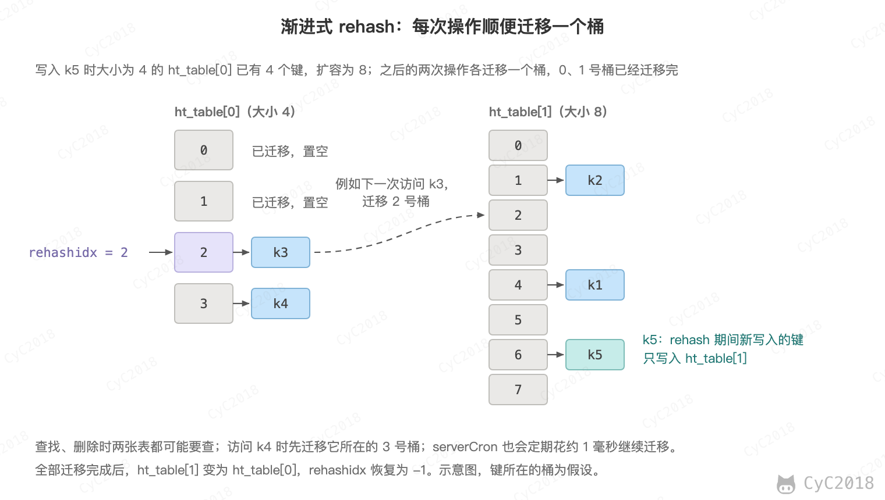
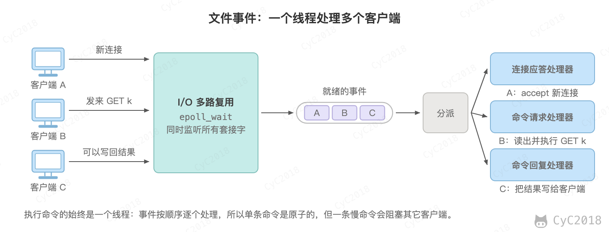
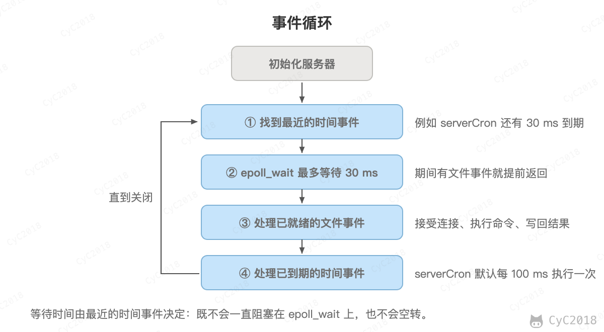

# Redis - 进阶
<!-- GFM-TOC -->
* [Redis - 进阶](#redis---进阶)
    * [四、数据结构](#四数据结构)
        * [对象编码](#对象编码)
        * [字典](#字典)
    * [十、事件](#十事件)
        * [文件事件](#文件事件)
        * [时间事件](#时间事件)
        * [事件的调度与执行](#事件的调度与执行)
    * [附录：实测](#附录实测)
        * [A1 SDS 的空间预分配](#a1-sds-的空间预分配)
    * [参考资料](#参考资料)
<!-- GFM-TOC -->


## 四、数据结构

### 对象编码

主线见[Redis · 对象编码](Redis.md#对象编码)，这里接着 SDS 的空间预分配，看追加时实际分配了多少内存。

例如对 60 字节、没有剩余空间的字符串再 APPEND 1 字节，SDS 按 2 × 61 = 122 字节申请（内存分配器向上取整为 128 字节），追加后剩余 63 字节；对 2040000 字节的字符串追加后剩余约 1 MB（Redis 7.4 实测，见[附录 A1](#a1-sds-的空间预分配)）。

### 字典

主线见[Redis · 字典](Redis.md#字典)，这里展开渐进式 rehash 的具体过程：

- 字典中有两张哈希表 ht_table[0] 和 ht_table[1]，平时只用 ht_table[0]；
- 键的数量达到桶数时扩容，ht_table[1] 的大小为不小于键数加 1 的 2 的幂；有子进程在执行 BGSAVE 或 AOF 重写时，为了减少写时复制的内存页，要达到桶数的 4 倍才扩容；
- 键的数量不超过桶数的 1/8 时缩容，过程相同；
- rehashidx 记录迁移到了哪个桶，之后每次对这个字典增删改查，都顺便把一个桶中的所有键迁移到 ht_table[1]，serverCron 也会定期花不超过 1 毫秒继续迁移；
- 迁移期间新写入的键只放入 ht_table[1]，查找和删除时两张表都可能要查；
- 全部迁移完成后，ht_table[1] 变为 ht_table[0]，rehashidx 恢复为 -1。

<div align="center">  </div><br>

以上依据 Redis 7.4 的 dict.c。Redis 7.0 之前的两张表是 dict 中的 dictht ht[2]，渐进式 rehash 的过程相同。

## 十、事件

主线见[Redis · 十、事件](Redis.md#十事件)，以下三节讲 Redis 的事件循环是怎样实现的；单线程的 Redis 为什么快，见主线的[单线程为什么快](Redis.md#单线程为什么快)。

### 文件事件

服务器通过套接字与客户端或者其它服务器进行通信，文件事件就是对套接字操作的抽象。

Redis 基于 Reactor 模式开发了自己的网络事件处理器，使用 I/O 多路复用程序来同时监听多个套接字，并将到达的事件传送给文件事件分派器，分派器会根据套接字产生的事件类型调用相应的事件处理器。

<div align="center">  </div><br>

### 时间事件

服务器有一些操作需要在给定的时间点执行，时间事件是对这类定时操作的抽象。

时间事件又分为：

- 定时事件：是让一段程序在指定的时间之内执行一次；
- 周期性事件：是让一段程序每隔指定时间就执行一次。

Redis 将所有时间事件都放在一个无序链表中，通过遍历整个链表查找出已到达的时间事件，并调用相应的事件处理器。

### 事件的调度与执行

服务器需要不断监听文件事件的套接字才能得到待处理的文件事件，但是不能一直监听，否则时间事件无法在规定的时间内执行，因此监听时间应该根据距离现在最近的时间事件来决定。

事件调度与执行由 aeProcessEvents 函数负责，伪代码如下：

```python
def aeProcessEvents():
    # 获取到达时间离当前时间最接近的时间事件
    time_event = aeSearchNearestTimer()
    # 计算最接近的时间事件距离到达还有多少毫秒
    remaind_ms = time_event.when - unix_ts_now()
    # 如果事件已到达，那么 remaind_ms 的值可能为负数，将它设为 0
    if remaind_ms < 0:
        remaind_ms = 0
    # 根据 remaind_ms 的值，创建 timeval
    timeval = create_timeval_with_ms(remaind_ms)
    # 阻塞并等待文件事件产生，最大阻塞时间由传入的 timeval 决定
    aeApiPoll(timeval)
    # 处理所有已产生的文件事件
    processFileEvents()
    # 处理所有已到达的时间事件
    processTimeEvents()
```

将 aeProcessEvents 函数置于一个循环里面，加上初始化和清理函数，就构成了 Redis 服务器的主函数，伪代码如下：

```python
def main():
    # 初始化服务器
    init_server()
    # 一直处理事件，直到服务器关闭为止
    while server_is_not_shutdown():
        aeProcessEvents()
    # 服务器关闭，执行清理操作
    clean_server()
```

从事件处理的角度来看，服务器运行流程如下：

<div align="center">  </div><br>

## 附录：实测

以下实验的环境为 Apple M1 Pro（10 核）、macOS，客户端和服务器在同一台机器上，Redis 7.4.1 从源码编译，使用默认配置，不开启持久化。

### A1 SDS 的空间预分配

Redis 7.4.1（内存分配器为 libc），启动时加 --enable-debug-command yes，用 DEBUG SDSLEN 查看值的 len、avail（剩余空间）和实际分配的内存：

```text
SET s（50 字节）              val_sds_len:50, val_sds_avail:10, val_zmalloc: 64       encoding raw
APPEND s 10 字节              val_sds_len:60, val_sds_avail:0, val_zmalloc: 64
APPEND s 1 字节               val_sds_len:61, val_sds_avail:63, val_zmalloc: 128
SET big（2000000 字节）       val_sds_len:2000000, val_sds_avail:31606, val_zmalloc: 2031616
APPEND big 40000 字节         val_sds_len:2040000, val_sds_avail:1072950, val_zmalloc: 3112960
SET 44 字节 encoding embstr，SET 45 字节 encoding raw
```

对应的源码在 sds.c 的 _sdsMakeRoomFor()：剩余空间足够时直接返回；否则新长度小于 SDS_MAX_PREALLOC（1 MB）时乘以 2，不小于时加上 1 MB。SET 50 字节时的 10 字节、SET 大字符串时的 31606 字节剩余空间来自内存分配器的取整和协议缓冲区，不是预分配。

## 参考资料

- [黄健宏. Redis 设计与实现 [M]. 机械工业出版社, 2014.](http://redisbook.com/index.html)
- [Redis 7.4.1 源码 dict.c](https://github.com/redis/redis/blob/7.4.1/src/dict.c)
- [Redis 7.4.1 源码 sds.c](https://github.com/redis/redis/blob/7.4.1/src/sds.c)
