# Redis
<!-- GFM-TOC -->
* [Redis](#redis)
    * [一、概述](#一概述)
        * [与 MySQL 的区别](#与-mysql-的区别)
    * [二、数据类型](#二数据类型) 🔥🔥
        * [STRING](#string)
        * [LIST](#list)
        * [SET](#set)
        * [HASH](#hash)
        * [ZSET](#zset)
        * [BITMAP](#bitmap)
        * [HyperLogLog 与 GEO](#hyperloglog-与-geo)
    * [三、使用场景](#三使用场景) 🔥
        * [计数器](#计数器)
        * [缓存](#缓存)
        * [查找表](#查找表)
        * [消息队列](#消息队列)
        * [会话缓存](#会话缓存)
        * [分布式锁实现](#分布式锁实现)
        * [排行榜](#排行榜)
        * [其它](#其它)
    * [四、数据结构](#四数据结构)
        * [对象编码](#对象编码) 🔥🔥
        * [字典](#字典)
        * [跳跃表](#跳跃表)
    * [五、Redis 与 Memcached](#五redis-与-memcached)
        * [数据类型](#数据类型)
        * [数据持久化](#数据持久化)
        * [分布式](#分布式)
        * [内存管理机制](#内存管理机制)
    * [六、键的过期时间](#六键的过期时间)
    * [七、数据淘汰策略](#七数据淘汰策略) 🔥
    * [八、持久化](#八持久化) 🔥🔥
        * [RDB 持久化](#rdb-持久化)
        * [AOF 持久化](#aof-持久化)
    * [九、事务](#九事务)
        * [Lua 脚本](#lua-脚本) 🔥
    * [十、事件](#十事件)
        * [单线程为什么快](#单线程为什么快) 🔥
    * [十一、复制](#十一复制)
        * [连接过程](#连接过程)
        * [主从链](#主从链)
    * [十二、Sentinel](#十二sentinel)
    * [十三、分片](#十三分片)
        * [Redis Cluster](#redis-cluster) 🔥
    * [十四、一个简单的论坛系统分析](#十四一个简单的论坛系统分析)
        * [文章信息](#文章信息)
        * [点赞功能](#点赞功能)
        * [对文章进行排序](#对文章进行排序)
    * [附录：实测](#附录实测)
        * [A1 MySQL 与 Redis 的主键查询](#a1-mysql-与-redis-的主键查询)
        * [A2 排行榜](#a2-排行榜)
        * [A3 单线程的吞吐量和 CPU 时间](#a3-单线程的吞吐量和-cpu-时间)
        * [A4 Redis Cluster](#a4-redis-cluster)
        * [A5 Sentinel 故障转移](#a5-sentinel-故障转移)
        * [A6 热点计数](#a6-热点计数)
        * [A7 Bitmap 的签到和日活](#a7-bitmap-的签到和日活)
        * [A8 HyperLogLog 的误差和内存](#a8-hyperloglog-的误差和内存)
        * [A9 过期删除](#a9-过期删除)
        * [A10 LFU 计数器](#a10-lfu-计数器)
        * [A11 持久化与脚本的默认配置](#a11-持久化与脚本的默认配置)
        * [A12 长时间运行的 Lua 脚本](#a12-长时间运行的-lua-脚本)
        * [A13 槽迁移与 ASK 重定向](#a13-槽迁移与-ask-重定向)
        * [A14 HASH 编码的转换](#a14-hash-编码的转换)
        * [A15 主从复制的全量复制与部分重同步](#a15-主从复制的全量复制与部分重同步)
        * [A16 字符串的 int 与 embstr 编码](#a16-字符串的-int-与-embstr-编码)
        * [A17 AOF 文件的内容与快照失败](#a17-aof-文件的内容与快照失败)
        * [A18 写满内存后的淘汰](#a18-写满内存后的淘汰)
    * [参考资料](#参考资料)
<!-- GFM-TOC -->


## 一、概述

Redis 是速度非常快的非关系型（NoSQL）内存键值数据库。键的类型只能为字符串，值支持五种基本数据类型：字符串、列表、集合、哈希、有序集合，此外还有位图、HyperLogLog、地理空间、流（Stream）等类型。

Redis 支持很多特性，例如将内存中的数据持久化到硬盘中，使用复制来扩展读性能，使用分片来扩展写性能。

### 与 MySQL 的区别

- 数据位置：Redis 的数据全部在内存中，容量受内存大小限制；MySQL 的数据在磁盘上，内存中的缓冲池只缓存经常访问的页；
- 查询方式：Redis 只能按键访问，值是字符串、哈希、有序集合等数据结构；MySQL 用 SQL 按任意条件查询、联表和聚合，靠索引加速；
- 事务：MySQL 的事务满足 ACID，出错可以回滚；Redis 的事务只保证一组命令依次执行、不被其它客户端的命令插入，其中一条命令执行出错时，其它命令不会回滚，见 [九、事务](#九事务)；
- 持久性：MySQL 默认在事务提交时把 redo log 刷到磁盘，提交成功的数据不会因为宕机丢失；Redis 即使开启 AOF 并设置为 everysec，宕机时也可能丢失最近一秒左右的写入。

数据都在内存中时，MySQL 按主键查询也很快。用 50 个连接分别执行 20 万次同一条主键查询和同一个键的 GET，两者每秒都能处理 13 万～17 万次，但 MySQL 用了约 6 个 CPU 核心，每次查询消耗约 36 微秒的 CPU 时间；Redis 只用 1 个核心，每次约 7 微秒（MySQL 8.0、Redis 7.4 实测，见[附录 A1](#a1-mysql-与-redis-的主键查询)）。Redis 的优势在于开销小、延迟稳定，以及计数器、排行榜这类 MySQL 不擅长的数据结构；需要持久保存、按多种条件查询的业务数据仍然放在 MySQL 中。两者通常一起使用，Redis 作为缓存，见 [缓存与数据库的一致性](缓存.md#缓存一致性)。

与本地缓存（例如 Caffeine）相比，本地缓存在应用进程内，读取不需要网络往返，但每个实例各存一份，更新后难以保持一致，容量也受单机内存限制；Redis 由所有实例共享同一份数据，还能实现分布式锁、全局计数这类需要多个实例协调的功能。两者常组合成[多级缓存](缓存.md#多级缓存)。

## 二、数据类型 🔥🔥

| 数据类型 | 可以存储的值 | 操作 |
| :--: | :--: | :--: |
| STRING | 字符串、整数或者浮点数 | 对整个字符串或者字符串的其中一部分执行操作<br> 对整数和浮点数执行自增或者自减操作 |
| LIST | 列表 | 从两端压入或者弹出元素 <br> 对单个或者多个元素进行修剪，<br> 只保留一个范围内的元素 |
| SET | 无序集合 | 添加、获取、移除单个元素<br> 检查一个元素是否存在于集合中<br> 计算交集、并集、差集<br> 从集合里面随机获取元素 |
| HASH | 包含键值对的无序哈希表 | 添加、获取、移除单个键值对<br> 获取所有键值对<br> 检查某个键是否存在|
| ZSET | 有序集合 | 添加、获取、删除元素<br> 根据分值范围或者成员来获取元素<br> 计算一个键的排名 |

选择类型时看要对值做什么操作，常见的用法如下：

- STRING：缓存序列化后的对象、计数器、分布式锁，见 [计数器](#计数器)、[分布式锁实现](#分布式锁实现)；
- LIST：按插入顺序保存，两端读写，例如最新的 N 条消息、简单的消息队列，见 [消息队列](#消息队列)；
- SET：去重和求交集、并集，例如文章的标签、共同好友、点过赞的用户，见 [点赞功能](#点赞功能)；
- HASH：一个对象的多个字段，可以单独读写某个字段，例如用户信息、购物车中每件商品的数量；
- ZSET：按分值排序和按范围查找，例如排行榜、按时间排序的 Feed、滑动窗口限流，见 [排行榜](#排行榜) 和 [限流算法](系统设计基础.md#1-限流算法)。

签到、日活和独立访客数这类统计用 BITMAP 和 HyperLogLog，附近的门店用 GEO，需要消费者组和确认的消息用 Stream。

需要注意的是，LIST、SET、HASH、ZSET 的元素只增不减时会变成大 Key，对它执行 HGETALL、DEL 会阻塞其它命令，见 [大 Key 与热 Key](缓存.md#大-key-与热-key)。

### STRING

<div align="center"> 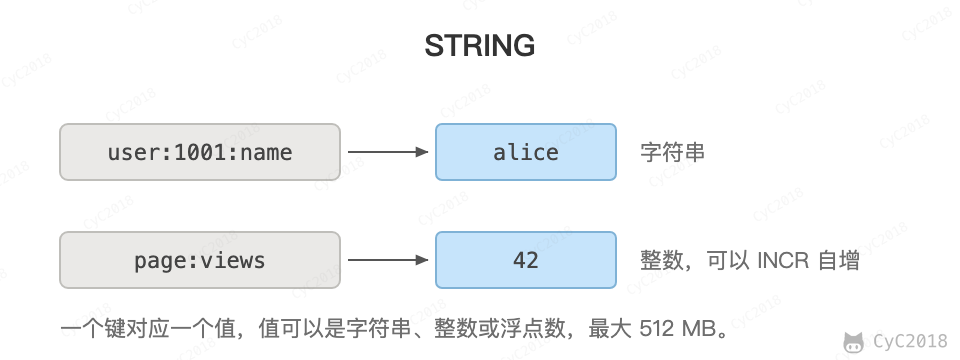 </div><br>

```text
> set user:1001:name alice
OK
> get user:1001:name
"alice"
> set page:views 41
OK
> incr page:views
(integer) 42
> del user:1001:name
(integer) 1
> get user:1001:name
(nil)
```

### LIST

<div align="center"> 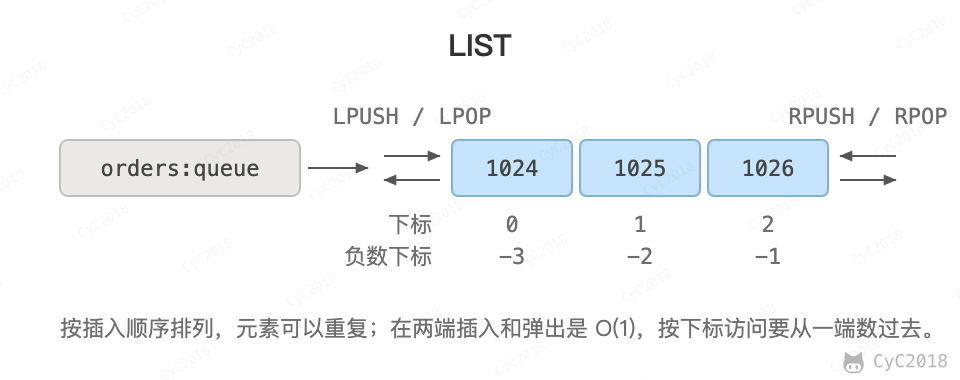 </div><br>

```text
> rpush orders:queue 1024 1025 1026
(integer) 3
> lpush orders:queue 1023
(integer) 4
> lrange orders:queue 0 -1
1) "1023"
2) "1024"
3) "1025"
4) "1026"
> lindex orders:queue -1
"1026"
> lpop orders:queue
"1023"
> lrange orders:queue 0 -1
1) "1024"
2) "1025"
3) "1026"
```

### SET

<div align="center"> 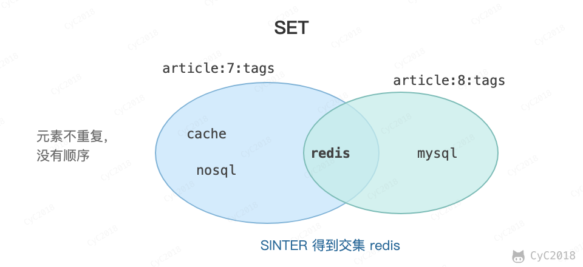 </div><br>

```text
> sadd article:7:tags redis cache nosql redis
(integer) 3
> smembers article:7:tags
1) "redis"
2) "cache"
3) "nosql"
> sismember article:7:tags mysql
(integer) 0
> sismember article:7:tags redis
(integer) 1
> srem article:7:tags nosql
(integer) 1
> sadd article:8:tags redis mysql
(integer) 2
> sinter article:7:tags article:8:tags
1) "redis"
```

### HASH

<div align="center"> 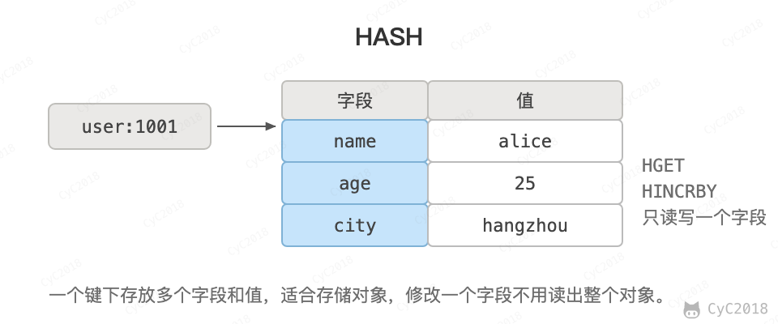 </div><br>

```text
> hset user:1001 name alice age 25 city hangzhou
(integer) 3
> hget user:1001 name
"alice"
> hincrby user:1001 age 1
(integer) 26
> hdel user:1001 city
(integer) 1
> hgetall user:1001
1) "name"
2) "alice"
3) "age"
4) "26"
```

### ZSET

<div align="center"> 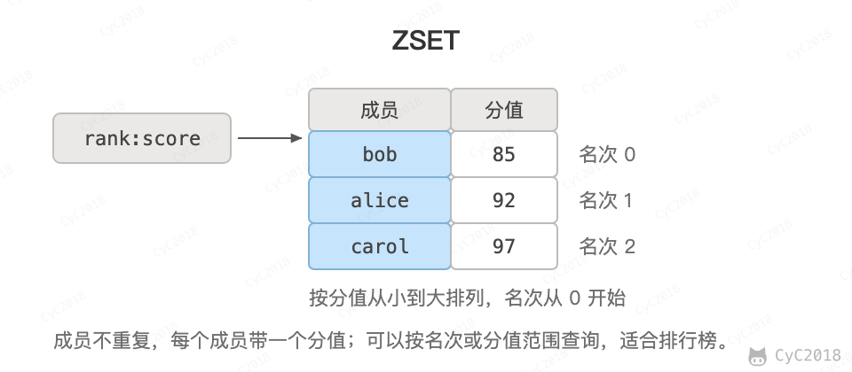 </div><br>

```text
> zadd rank:score 92 alice 85 bob 97 carol
(integer) 3
> zrange rank:score 0 -1 withscores
1) "bob"
2) "85"
3) "alice"
4) "92"
5) "carol"
6) "97"
> zrange rank:score 0 1 rev withscores
1) "carol"
2) "97"
3) "alice"
4) "92"
> zrangebyscore rank:score 90 100
1) "alice"
2) "carol"
> zincrby rank:score 10 bob
"95"
> zrange rank:score 0 -1 rev withscores
1) "carol"
2) "97"
3) "bob"
4) "95"
5) "alice"
6) "92"
```

### BITMAP

位图（Bitmap）不是一种独立的数据类型，而是 STRING 上按位读写的一组命令：值仍然是 SDS 中的字节数组，TYPE 返回 string，第 offset 位表示整数 offset 是否在集合中。STRING 最大 512 MB，所以 offset 的范围是 0～2<sup>32</sup> − 1。

它适合成员能编号为 0～N 的整数、并且只需要记录“是或否”的场景，例如某个用户某天是否签到、某个用户今天是否访问过。主要有以下命令：

- SETBIT key offset 0|1：设置一位并返回这一位原来的值，字符串不够长时自动扩展，新增的位为 0；
- GETBIT key offset：读取一位，超出字符串长度的位当作 0；
- BITCOUNT key [start end [BYTE|BIT]]：统计值为 1 的位数，范围默认按字节，Redis 7.0 起可以按位指定；
- BITPOS key 0|1：查找第一个 0 或 1 所在的位置；
- BITOP AND|OR|XOR|NOT destkey key [key ...]：对多个位图做位运算，结果写入 destkey；
- BITFIELD：把一段连续的位当作整数读写，例如 GET u28 0 把前 28 位读成一个无符号整数，也可以用 INCRBY 把每几位当作一个小计数器。

#### 1. 签到

每个用户每月一个键 sign:{用户 ID}:{年月}，第 n 号签到就把 offset n − 1 置为 1，一个月最多 31 位，只占 4 个字节。下图是用户 1001 十月 1 号到 28 号的签到情况：

<div align="center"> 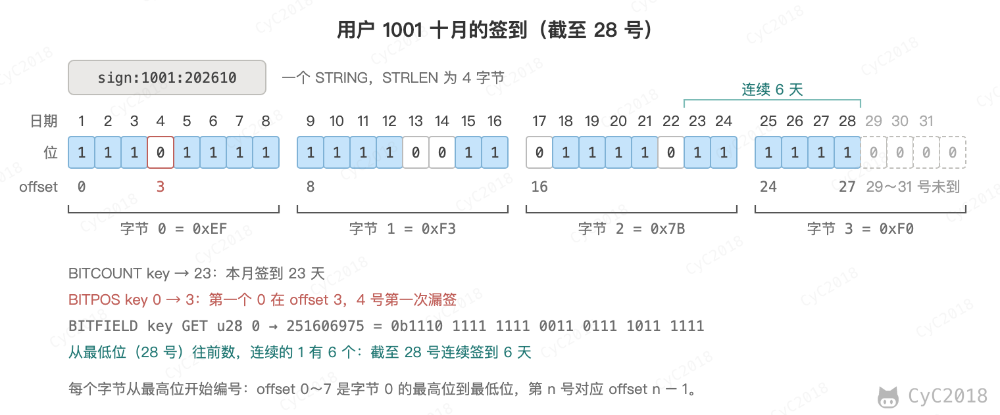 </div><br>

```text
> setbit sign:1001:202610 27 1          -- 28 号签到，返回原来的值 0
(integer) 0
> setbit sign:1001:202610 27 1          -- 重复签到，返回 1
(integer) 1
> getbit sign:1001:202610 3             -- 4 号是否签到
(integer) 0
> bitcount sign:1001:202610             -- 本月签到天数
(integer) 23
> bitpos sign:1001:202610 0             -- 第一次漏签的位置
(integer) 3
> bitfield sign:1001:202610 get u28 0   -- 1～28 号的 28 位
1) (integer) 251606975
```

SETBIT 返回 1 说明今天已经签过，可以据此避免重复发放签到奖励。

连续签到天数用 BITFIELD 一次读出 1 号到今天的位。每个字节从最高位开始编号，所以今天对应整数的最低位，在应用中从最低位开始数连续的 1，遇到 0 停止：251606975 的二进制末尾是 0111111，截至 28 号连续签到 6 天。“连续签到 7 天送优惠券”就是判断这个数是否达到 7，跨月时还要接着读上个月的键。

内存方面，每人一年 365 位只有 46 字节，但每个键还有键名、对象头和字典项的开销。每人每年一个键时，实测平均每个键约 150 字节，1 亿用户一年约 15 GB，其中位图本身只有 4.6 GB（Redis 7.4 实测，见[附录 A7](#a7-bitmap-的签到和日活)）。

#### 2. 日活统计

用户 ID 是从 1 开始连续分配的整数时，也可以反过来每天一个键 active:{日期}，offset 是用户 ID，所有用户当天的状态放在同一个位图中。100 万个用户只需要 10<sup>6</sup> / 8 = 125000 字节，约 122 KB：

```text
> setbit active:20261028 1000 1         -- 用户 1000 今天访问过
(integer) 0
> bitcount active:20261028              -- 当天活跃人数
(integer) 369445
> bitop and active:7d:and active:20261022 active:20261023 ... active:20261028
(integer) 125001
> bitcount active:7d:and                -- 7 天每天都活跃的人数
(integer) 100184
> bitop or active:7d:or active:20261022 active:20261023 ... active:20261028
(integer) 125001
> bitcount active:7d:or                 -- 7 天内活跃过的人数（周活）
(integer) 925445
```

BITOP 返回结果的字节数。100 万用户的位图上，BITCOUNT 的服务器执行时间约 15 微秒，对 7 天的位图做 BITOP AND 约 84 微秒；同一天的 36.9 万个活跃用户如果用 SET 保存，要占 14 MB（Redis 7.4 实测，见[附录 A7](#a7-bitmap-的签到和日活)）。

签到也可以这样存，每天一个键记录所有用户。两种键各有所长：按用户分键，查一个人一个月的情况只读一个键；按日期分键，统计一天的人数、多天的交集和并集只需一两条命令，并且没有大量小键的开销，1 亿用户一年是 365 × 12.5 MB ≈ 4.6 GB。

#### 3. 用户 ID 稀疏

SETBIT 会把字符串扩展到 offset 所在的字节，中间的内存一次分配完。用户 ID 从 1 亿开始时，第一个用户就要分配 12.5 MB；offset 为 40 亿时要分配 500 MB，这次 SETBIT 耗时约 100 毫秒，之后对它执行一次 BITCOUNT 约 92 毫秒，这期间服务器不能处理其它命令。64 位的雪花 ID 超过了 2<sup>32</sup> − 1，根本不能直接作为 offset。

解决方案：

- 先把 ID 转换成从 0 开始的连续序号，例如减去起始值，或者为用户另外分配一个自增序号；
- 位图很大时按序号分段拆成多个键，键名为序号 / M，offset 为序号 mod M，避免单个大 Key；
- 活跃的 ID 很少时改用 SET 或 HyperLogLog：1000 个分布在 1 亿以内的 ID，位图要 12.5 MB，SET 只要 30 KB。按实测每个整数成员在 SET 中约占 38 字节（304 位），活跃 ID 不到 ID 范围的 1/300 时 SET 更省内存。

#### 4. 与布隆过滤器的区别

Bitmap 与布隆过滤器的区别在于映射方式：Bitmap 一个整数对应一位，结果是精确的，但成员必须能编号成范围不大的整数；布隆过滤器用多个哈希函数把任意字符串映射到位数组的多个位置，可以保存 URL、手机号这类无法编号的 Key，代价是存在误判，见 [缓存穿透](缓存.md#缓存穿透)。所以 ID 是自增整数时，可以直接用 Bitmap 记录哪些 ID 存在来拦截不存在的请求；其它 Key 需要布隆过滤器，它的位数组可以存放在 Redis 的位图中，由客户端算出各个位置后用 SETBIT 写入、GETBIT 检查；Redis 8 起也可以直接用内置的 BF.ADD、BF.EXISTS。

### HyperLogLog 与 GEO

HyperLogLog（HLL）用于估计一个集合中不同元素的个数，例如页面的独立访客数（Unique Visitor, UV）：PFADD 添加元素，PFCOUNT 返回估计值，PFMERGE 合并多个 HLL，例如把 7 天的 UV 合并成周 UV。

它不保存元素本身：每个元素的 64 位哈希值按低 14 位分到 16384 个寄存器之一，寄存器用 6 位记录剩余位中第一个 1 出现位置的最大值。连续的 0 越长的哈希值越少见，这些最大值就大致反映了不同元素的个数。寄存器共 16384 × 6 位 = 12 KB，这就是每个键占用内存的上限，标准误差为 1.04 / √16384 ≈ 0.81%。代价是结果只是估计值，也不能判断某个元素是否存在或者取出元素。

例如 100 万个不同的元素，PFCOUNT 返回 999674（误差 −0.03%），HLL 占 12 KB，同样的元素用 SET 保存要 30 MB；30 组各 100 万个元素的误差均方根为 0.80%，最大为 2.0%（Redis 7.4 实测，见[附录 A8](#a8-hyperloglog-的误差和内存)）。

GEO 用于“附近的门店”这类查询：GEOADD 保存经纬度，GEOSEARCH 查找某个点一定半径或矩形内的成员（加 ASC 时按距离由近到远排序），GEODIST 计算两点间的距离。它底层就是一个 ZSET，经纬度交错编码成 52 位的 Geohash 整数作为分值。同一个格子里的点分值落在一段连续的区间内，但格子边界两侧的点即使相距很近，分值也可能相差很远，所以查询时要查中心格和周围 8 个格子（最多 9 个分值区间），再逐个计算距离过滤；代价是有误差：距离按球面模型计算，官方文档说明由此产生的误差最坏可达 0.5%，经纬度编码成整数时也有精度损失。

## 三、使用场景 🔥

### 计数器

可以对字符串执行 INCR、INCRBY 等命令实现计数器，例如文章的阅读数、接口的调用次数。

命令在服务器上原子执行，多个客户端同时加 1 不会丢失更新；数据在内存中，也适合这种频繁读写的场景。

如果直接在数据库中计数，所有请求都要更新同一行，行锁让这些更新只能一个接一个地执行。对同一行执行 UPDATE counter SET cnt = cnt + 1，MySQL 用 1、8、50 个连接时每秒都只有 5000～7000 次；Redis 的 INCR 用 50 个连接每秒约 10 万次（MySQL 8.0、Redis 7.4 实测，见[附录 A6](#a6-热点计数)）。

常用的做法是在 Redis 中计数，再定期把计数写回数据库。单个计数仍然太热时，可以拆成多个键，例如 views:1024:0～views:1024:9，每次随机给其中一个加 1，读取时求和。点赞这类每个用户只能计一次的计数，还要记录点过赞的用户，见下文的 [点赞功能](#点赞功能)。

### 缓存

将热点数据放到内存中，设置内存的最大使用量以及淘汰策略来保证缓存的命中率，见 [七、数据淘汰策略](#七数据淘汰策略)。缓存与数据库的一致性，以及缓存穿透、击穿和雪崩的处理，见 [缓存](缓存.md)。

### 查找表

例如 DNS 记录就很适合使用 Redis 进行存储。

查找表和缓存类似，也是利用了 Redis 快速的查找特性。但是查找表的内容不能失效，而缓存的内容可以失效，因为缓存不作为可靠的数据来源。

### 消息队列

List 可以用 LPUSH 写入消息，用 BRPOP 阻塞地读取消息。但消息被取出后就从列表中删除，消费者处理失败时消息会丢失，也不能让多个消费者组各自消费一遍。

Redis 5.0 加入的流（Stream）支持消费者组和确认：XREADGROUP 读取的消息在 XACK 确认之前一直保存在待处理列表中，消费者宕机后可以由其它消费者认领。对可靠性和消息堆积量要求高的场景，仍然使用 Kafka、RocketMQ 等消息中间件，见 [消息队列](消息队列.md)。

### 会话缓存

多台应用服务器把会话统一存储在 Redis 中，应用服务器本身不再具有状态，一个用户可以请求任意一台服务器，从而更容易实现高可用性以及可伸缩性。

例如用户 1001 登录后，服务器生成随机令牌 9f2c7a41（缩写，实际用安全随机数生成至少 128 位）返回给客户端，并执行 SET session:9f2c7a41 1001 EX 1800。之后的请求都带上这个令牌，服务器用 GETEX session:9f2c7a41 EX 1800 查出用户 ID 并把有效期顺延 30 分钟，查不到就要求重新登录。

多设备登录时，可以用 HSET user:1001:sessions phone 9f2c7a41 按设备类型记录令牌。每类设备只能登录一台时，新手机登录先删除旧令牌对应的 session 键再写入新令牌，并发登录时用 [WATCH](#九事务) 防止两个新令牌都生效。退出所有设备或封禁账号时，删除 HASH 中每个令牌对应的 session 键，会话立即失效，这是它相对 [JWT](HTTP.md#11-jwt) 的优势。

### 分布式锁实现

在分布式场景下，无法使用单机环境下的锁来对多个节点上的进程进行同步。

可以使用 SET 命令的 NX 和 PX 选项实现单实例的分布式锁，见 [Redis 的 SET NX 指令](分布式.md#redis-的-set-nx-指令)；除此之外，还可以使用官方提出的 RedLock 算法在多个独立实例上实现分布式锁，见 [Redis 的 RedLock 算法](分布式.md#redis-的-redlock-算法)。

### 排行榜

有序集合按分值排序，正好用来实现排行榜：成员是文章或用户的 ID，分值是点赞数或销量。

```text
ZINCRBY rank:likes 1 article:1001                  -- 点赞一次，分值加 1
ZREVRANGE rank:likes 0 9 WITHSCORES                -- 前 10 名
ZREVRANK rank:likes article:1001                   -- 第几名，从 0 开始
```

向一个有序集合写入 100 万个成员，占用约 105 MB 内存；查前 10 名、查某个成员的排名和加分都是 O(logN) 的操作，SLOWLOG 记录的服务器执行时间只有几微秒（Redis 7.4 实测，见[附录 A2](#a2-排行榜)）。

分值相同时，Redis 按成员名的字典序排列，而业务上通常要求先达到这个分数的排在前面。可以把时间编进分值：分值 = 点赞数 × 10<sup>10</sup> + (10<sup>10</sup> − 达到这个点赞数的秒级时间戳)。例如 article:1001 和 article:1002 都是 520 个赞，时间戳分别为 1793000000 和 1793000300，分值为 5208207000000 和 5208206999700，先达到的 article:1001 排在前面。需要注意的是，分值是双精度浮点数，只能精确表示 2<sup>53</sup> 以内的整数，这种写法下点赞数不能超过约 90 万，更大时要缩短时间部分的位数。

排行榜被大量用户同时查看时，前 10 名这个键会成为热点。前几名的变化不需要实时反映给每个用户，可以在应用的本地缓存中保存 1 秒，大部分请求不再访问 Redis，见 [多级缓存](缓存.md#多级缓存)。

### 其它

Set 可以实现交集、并集等操作，从而实现共同好友等功能。

签到、日活这类只需记录“是或否”的统计可以用 Bitmap，独立访客数这类允许少量误差的去重计数可以用 HyperLogLog，见 [BITMAP](#bitmap) 和 [HyperLogLog 与 GEO](#hyperloglog-与-geo)。

## 四、数据结构

### 对象编码 🔥🔥

同一种数据类型会根据元素的数量和大小选择不同的底层结构，称为编码，可以用 OBJECT ENCODING 查看。元素少时使用 listpack，它把所有元素连续地存放在一块内存中，节省内存，查找时虽然要逐个比较，但元素很少时并不慢；元素增多后转换为查找更快的结构。以下是在 Redis 7.4 上用默认配置验证的结果：

| 类型 | 元素少时 | 超过阈值后 | 阈值 |
| --- | --- | --- | --- |
| STRING | int（整数）、embstr | raw | 44 字节 |
| LIST | listpack | quicklist（多个 listpack 组成的链表） | 单个 listpack 超过 8 KB |
| HASH | listpack | hashtable | 512 个字段，或者有字段名、值超过 64 字节 |
| SET | intset（全是整数）、listpack | hashtable | 整数 512 个；其它 128 个，或者有成员超过 64 字节 |
| ZSET | listpack | skiplist（跳跃表 + 字典） | 128 个成员，或者有成员超过 64 字节 |

例如一个 HASH 有 512 个字段时编码为 listpack，再写入一个字段就变为 hashtable。ZSET 转换后同时使用跳跃表和字典：字典按成员查分数，跳跃表按分数排序和范围查询。

<div align="center"> 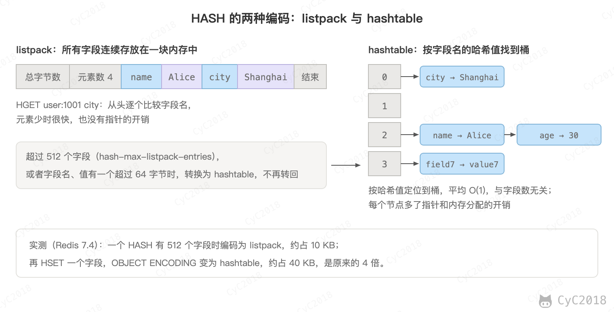 </div><br>

转换后内存明显增加：512 个字段的 HASH 用 listpack 约占 10 KB，再写入一个字段转为 hashtable 后约占 40 KB（Redis 7.4 实测，见[附录 A14](#a14-hash-编码的转换)）。

Redis 7.0 之前，HASH、ZSET 和 quicklist 的节点用的是压缩列表（ziplist），每个元素要记录前一个元素的长度，这个长度占 1 或 5 个字节，在中间插入或删除元素时可能让后面的元素依次变长，称为连锁更新；listpack 的每个元素只记录自己的长度，不会连锁更新，但在中间插入时仍要移动后面的数据。小的 LIST 直接用 listpack、SET 的 listpack 编码是 7.2 起才有的。旧的配置名（例如 hash-max-ziplist-entries）在 7.x 中仍可作为新配置名的别名使用。

字符串的内容保存在简单动态字符串（Simple Dynamic String, SDS）中，它在字符数组前面记录了已用的长度 len 和分配的容量 alloc：

- 取长度是 O(1)，不用像 C 字符串那样遍历到 \0；
- 按 len 而不是 \0 判断结尾，可以保存任意二进制数据；
- 追加时空间不够才重新分配，并且多分配一些：新长度小于 1 MB 时分配新长度的 2 倍，否则多分配 1 MB，连续追加时不用每次都重新分配内存。

embstr 编码把对象头和 SDS 放在同一块内存中，只需分配一次，44 字节的上限正好让两者一起放进 64 字节；它是只读的，APPEND 等修改会先把它转为 raw。追加时实际分配的内存见[进阶：对象编码](Redis%20-%20进阶.md#对象编码)。

值能无损转换为 64 位有符号整数时使用 int 编码（001234、+5 这类写法除外，APPEND 后变为 raw），整数直接存放在对象头的指针字段中，不再分配 SDS，0～9999 还默认共用启动时创建好的对象。所以 1234 比 abcd 省内存，MEMORY USAGE 分别为 56 和 72 字节，其中包括键名和字典项（Redis 7.4 实测，见[附录 A16](#a16-字符串的-int-与-embstr-编码)）。

### 字典

键空间、HASH 和 SET 的 hashtable 编码、ZSET 中按成员查分数的部分，都是用字典（dict）实现的。字典是一个哈希表，用拉链法解决哈希冲突：桶的数量是 2 的幂，键的哈希值与桶数减 1 做位与得到桶的下标，落在同一个桶的键用链表连起来。

键越来越多时链表变长，查找变慢，需要扩大桶数组并把所有键重新放一遍，称为 rehash。Redis 用一个线程执行命令，一个有几百万个键的字典一次性 rehash 会让服务器停顿很久，所以采用渐进式 rehash：同时保留新旧两张哈希表，每次对字典增删改查时顺便迁移一个桶，把迁移的开销分摊到之后的操作中。两张表的使用规则和扩容、缩容的条件见[进阶：字典](Redis%20-%20进阶.md#字典)。

### 跳跃表

跳跃表（skiplist）是有序集合在成员较多时的底层结构，它在一条有序链表上增加了多层索引。

最底层是包含所有成员、按分值排序的链表。每个节点插入时随机决定层数：以 1/4 的概率升高一层，最多 32 层。所以大约每 4 个节点有 1 个出现在第 2 层，每 16 个节点有 1 个出现在第 3 层，平均每个节点约 1.33 个指针。这只是期望值，好处是插入节点时不需要调整其它节点的层数。

查找时从最高层开始向右走，下一个节点比目标大时下降一层，直到最底层。每层平均只走几步，查找、插入和删除的期望时间复杂度都是 O(logN)。下图演示了查找 26 的过程。

<div align="center"> 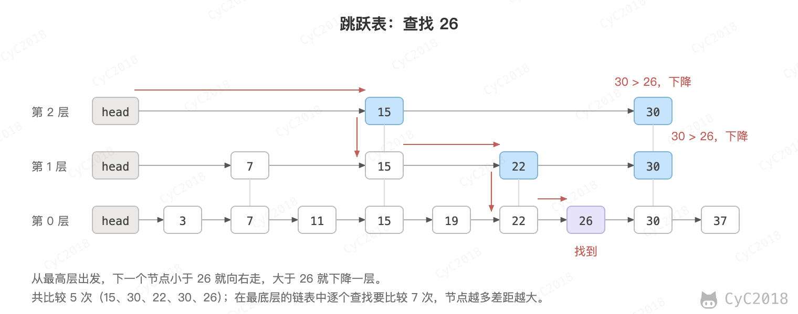 </div><br>

与红黑树等平衡树相比，跳跃表有以下优点：

- 插入和删除只需要修改每一层前驱节点的指针，不需要旋转等操作来维护平衡；
- 范围查询方便，找到起点后沿最底层链表向后遍历即可，ZRANGEBYSCORE 就是这样实现的；
- 实现和调试更简单。

MySQL 的索引用 B+ 树，是因为 B+ 树的一个节点存放很多个键，每次读磁盘都取回一整页，减少 I/O 次数；有序集合全部在内存中，没有这个需要。Redis 的作者解释选择跳跃表时还提到：调整升层的概率就能控制内存，按 1/4 升层时每个节点平均只有 1.33 个指针；ZRANGE 这类范围遍历沿底层链表进行，缓存局部性不比平衡树差。跳跃表的代价是性能依赖随机数，最坏情况下退化为 O(N)，只是概率极小。

插入时先像查找一样从最高层往下走，记下每一层最后一个排在新成员前面的节点（先比分值，分值相同再比成员名），再随机决定新节点的层数，把它接在这些节点的后面。例如在上图中插入 24，三层记下的节点依次是 15、22、22；随机得到 2 层时，新节点接在第 0 层和第 1 层的 22 之后，第 2 层不变。

删除时同样先记下每一层的前驱，在被删节点所在的各层让前驱指向它的后继，其它层只把跨度减 1。ZINCRBY 修改分值后位置不变时直接改值，否则先删除再插入。

Redis 的跳跃表还在每个指针上记录了跨度，即这一步跳过了多少个节点，查找时把经过的跨度相加就得到排名，所以 ZRANK 也是 O(logN)。

## 五、Redis 与 Memcached

两者都是非关系型内存键值数据库，主要有以下不同：

### 数据类型

Memcached 仅支持字符串类型，而 Redis 支持五种不同的数据类型，可以更灵活地解决问题。

### 数据持久化

Redis 支持两种持久化策略：RDB 快照和 AOF 日志，而 Memcached 不支持持久化。

### 分布式

Memcached 不支持分布式，只能通过在客户端使用[一致性哈希](缓存.md#六一致性哈希)来实现分布式存储，这种方式在存储和查询时都需要先在客户端计算一次数据所在的节点。

Redis Cluster 实现了分布式的支持。

### 内存管理机制

- Redis 和 Memcached 的数据都一直存储在内存中。Redis 曾经支持把很久没用的 value 交换到磁盘（虚拟内存），但是该特性已经在 2.6 版本移除；
- Memcached 将内存分割成特定长度的块来存储数据，避免了频繁分配和释放造成的内存碎片。但是这种方式会使得内存的利用率不高，例如块的大小为 128 字节，只存储 100 字节的数据，那么剩下的 28 字节就浪费掉了。

## 六、键的过期时间

Redis 可以为每个键设置过期时间，过期时间保存在一个单独的字典中（键 → 过期的时间戳）。为每个键设置定时器的开销太大，所以过期的键不会在过期的瞬间被删除，而是通过两种策略清除：

- 惰性删除：访问键时检查它是否过期，过期就删除并当作不存在，不额外占用 CPU，但不再被访问的过期键会一直占用内存；
- 定期删除：后台每秒执行 10 次（由 hz 配置），每次从设置了过期时间的键中取 20 个检查，删除其中已经过期的；过期的超过 10% 时说明过期键还很多，继续检查下一批，但每次最多占用 25% 的 CPU 时间（hz 为 10 时是 25 毫秒）。

两者互相补充：惰性删除保证读不到过期的数据，定期删除回收没人访问的过期键，并且限制了自己占用的 CPU。例如关闭定期删除后，10 万个已经过期的键仍然留在内存中，DBSIZE 为 100000；GET 其中一个返回 nil，DBSIZE 变为 99999；重新打开定期删除，372 毫秒后全部删除。

需要注意的是，过期的键只占少数时，每批 20 个中过期的不到 10%，定期删除不会连续检查：100 万个键中有 5 万个过期，20 秒内只删除了 228 个（Redis 7.4 实测，见[附录 A9](#a9-过期删除)）。所以过期的键可能长时间占用内存，内存紧张时还要依靠下一节的淘汰策略。

主从复制时，从服务器不自己删除过期的键，而是等待主服务器发来的 DEL，避免两边的数据不一致；在从服务器上读取已经过期、但还没有收到 DEL 的键时，返回的是空。

对于 HASH 这种容器，Redis 7.4 之前只能为整个键设置过期时间，7.4 开始可以使用 HEXPIRE 等命令为单个字段设置过期时间。

## 七、数据淘汰策略 🔥

过期删除只清理已经过期的键；内存淘汰是在内存达到上限时删除一部分键来腾出空间，被删除的键可能还没有过期。

上限由 maxmemory 设置，默认为 0，在 64 位系统上表示不限制，内存会一直增长到用上 swap 或被操作系统杀掉，所以作缓存时要设置它。设置之后，Redis 在执行每条命令之前检查内存，超出上限就先按 maxmemory-policy 淘汰键，再执行命令。

Redis 4.0 之后具体有 8 种淘汰策略：

| 策略 | 描述 |
| :--: | :--: |
| volatile-lru | 从已设置过期时间的数据集中挑选最久未使用的数据淘汰 |
| volatile-ttl | 从已设置过期时间的数据集中挑选将要过期的数据淘汰 |
| volatile-random | 从已设置过期时间的数据集中任意选择数据淘汰 |
| allkeys-lru | 从所有数据集中挑选最久未使用的数据淘汰 |
| allkeys-random | 从所有数据集中任意选择数据进行淘汰 |
| volatile-lfu | 从已设置过期时间的数据集中挑选最不经常使用的数据淘汰 |
| allkeys-lfu | 从所有数据集中挑选最不经常使用的数据淘汰 |
| noeviction | 不淘汰数据 |

Redis 8.6 又增加了 allkeys-lrm 和 volatile-lrm，按最近一次修改的时间淘汰，读取不更新这个时间。

默认策略是 noeviction：内存超过上限后，SET 这类可能增加内存的命令返回 OOM 错误，GET、DEL 等命令照常执行。volatile 开头的策略只淘汰设置了过期时间的键，没有这样的键时，表现得和 noeviction 一样。例如 maxmemory 为 10 MB 时连续写入 10 万个 1 KB 的值：allkeys-lru 下全部成功，最后剩下 5733 个键，最早的 k:0 已被淘汰；noeviction 下从第 5759 次 SET 开始返回 OOM 错误；键都没有过期时间时，volatile-lru 与 noeviction 相同（Redis 7.4 实测，见[附录 A18](#a18-写满内存后的淘汰)）。

Redis 的 LRU 和 LFU 都是近似实现。精确的 LRU 要用双向链表维护所有键的访问顺序（见 [LRU](缓存.md#七lru)），每个键多两个指针，每次访问都要移动节点。Redis 只在每个对象中用 24 位记录最近一次访问的时间（秒级），淘汰时随机抽取 maxmemory-samples（默认 5）个键，按空闲时间放入一个大小为 16 的候选池，淘汰池中空闲时间最长的键。候选池在多次淘汰之间保留，之前抽到的冷键继续参与比较，所以比每次只看 5 个键更准。抽样数调到 10 时更接近精确的 LRU，代价是多耗一些 CPU。

LFU 复用这 24 位：高 16 位是上次访问的时间（分钟），低 8 位是对数计数器，最大为 255。新键的计数为 5，每次访问以 1 / (max(计数 − 5, 0) × lfu-log-factor + 1) 的概率加 1，计数越大越难增长；距离上次访问每过 lfu-decay-time 分钟（默认 1），计数减 1，最低减到 0，过去的热点会逐渐冷却。衰减不靠定时遍历，而是在访问或淘汰比较这个键时按经过的分钟数一次算出。例如对一个键执行 10、100、1000、1 万、10 万、100 万次 GET 后，OBJECT FREQ 依次为 6、10、20、52、146、255（Redis 7.4 实测，见[附录 A10](#a10-lfu-计数器)）。

选择策略时：

- 只作缓存时用 allkeys-lru，并把内存上限设置为热点数据占用的内存量；访问频率的差异比较稳定，或者偶尔有批量读取冷数据时用 allkeys-lfu，一次性的访问不会把高频的键挤出去；
- 同一个实例既存缓存又存不能丢的数据时，给缓存设置过期时间并用 volatile-lru，只淘汰缓存，官方文档更建议把两类数据放到两个实例中；
- 当作数据库使用、数据不能被淘汰时用 noeviction，内存满时写入报错，由应用发现并处理。

## 八、持久化 🔥🔥

Redis 是内存型数据库，为了保证数据在断电后不会丢失，需要将内存中的数据持久化到硬盘上。

### RDB 持久化

将某个时间点的所有数据都存放到硬盘上。

save 配置的默认值为 3600 1 300 100 60 10000，表示 1 小时内至少有 1 次修改、5 分钟内至少 100 次、1 分钟内至少 1 万次，满足任意一个条件就自动生成一次快照（Redis 7.4 实测，见[附录 A11](#a11-持久化与脚本的默认配置)）。SAVE 命令在主进程中生成快照，期间不处理其它命令，所以一般使用 BGSAVE。

执行 BGSAVE 或满足 save 配置的条件时，Redis fork 一个子进程把内存中的数据写入 RDB 文件，主进程继续处理命令。fork 之后父子进程共享同一份内存页，主进程修改某一页时操作系统才复制这一页（写时复制），所以子进程写出的是 fork 那一刻的数据，代价是快照期间写入越多，额外占用的内存越多。

<div align="center"> 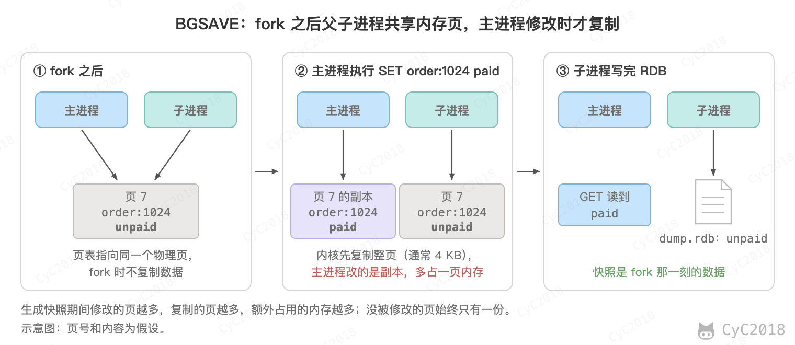 </div><br>

RDB 文件是紧凑的二进制文件，便于备份，全量复制发送的也是 RDB 快照。系统发生故障时，最后一次快照之后的写入都会丢失。

需要注意的是，磁盘满、目录没有写权限时快照会失败。stop-writes-on-bgsave-error 默认开启，配置了 save 条件时，最近一次 BGSAVE 失败后 Redis 拒绝写命令并返回 MISCONF 错误，读命令照常执行，直到下一次快照成功，让应用立刻发现持久化出了问题（Redis 7.4 实测，见[附录 A17](#a17-aof-文件的内容与快照失败)）。

### AOF 持久化

将写命令添加到 AOF 文件（Append Only File）的末尾。AOF 默认关闭，需要配置 appendonly yes 开启。

写命令先执行，成功后才追加到内存中的 AOF 缓冲区，执行出错的命令不会进入 AOF。之后主线程在每轮事件循环回复客户端之前，用 write() 把缓冲区写入 AOF 文件。write() 返回时数据只到了操作系统的页缓存，调用 fsync 才写到磁盘，同步选项 appendfsync 决定 fsync 的时机：

| 选项 | 同步频率 |
| :--: | :--: |
| always | 每个写命令都同步 |
| everysec | 每秒同步一次 |
| no | 让操作系统来决定何时同步 |

- always 选项会严重降低服务器的性能；
- everysec 选项比较合适，Redis 每秒执行一次同步对服务器性能几乎没有任何影响，系统崩溃时通常只丢失一秒左右的数据，磁盘繁忙时可能更多；
- no 选项并不能给服务器性能带来多大的提升，而且也会增加系统崩溃时数据丢失的数量。

<div align="center"> 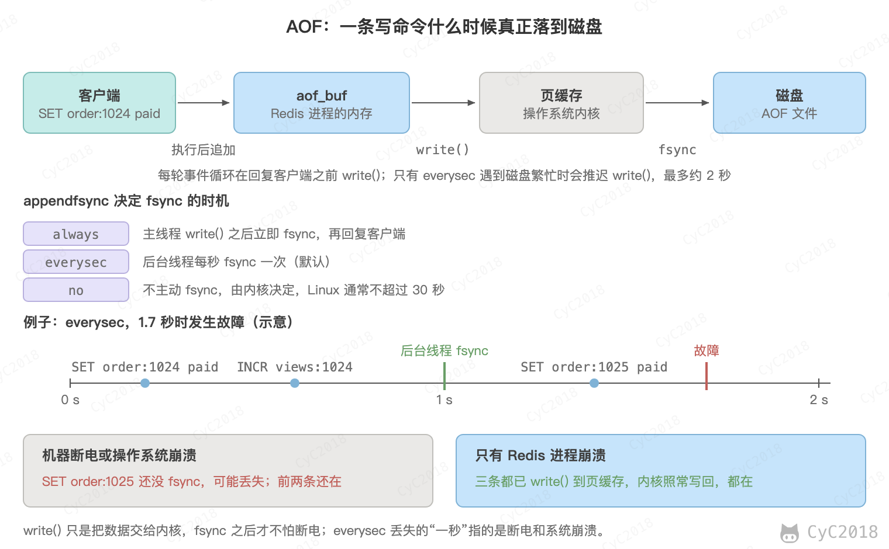 </div><br>

需要注意的是，丢失一秒左右指的是机器断电或操作系统崩溃。只有 Redis 进程崩溃时，已经 write() 的数据还在页缓存中，由操作系统写回磁盘，不会丢失；但 everysec 因磁盘繁忙推迟 write()（最多约 2 秒）时，还在 AOF 缓冲区中的写入会丢失。

随着服务器写请求的增多，AOF 文件会越来越大。Redis 提供了一种将 AOF 重写的特性，能够去除 AOF 文件中的冗余写命令。

重写同样由子进程完成，它不读取旧的 AOF 文件，而是按内存中的当前数据生成新的基础文件，默认使用 RDB 格式，见下文的混合持久化。AOF 文件比上次重写后增长一倍（auto-aof-rewrite-percentage 100），并且不小于 64 MB（auto-aof-rewrite-min-size）时自动重写，也可以执行 BGREWRITEAOF。

Redis 7.0 起 AOF 由多个文件组成：重写生成的基础文件，以及之后追加写命令的增量文件，由一个清单文件（manifest）记录。重写期间主进程仍在处理写命令：它在开始重写时打开一个新的增量文件，之后的写命令都追加到这里；子进程写完新的基础文件后，主进程生成新的清单文件，原子地替换旧的，再删除旧的基础文件和增量文件。重写失败时，旧的文件加上新打开的增量文件仍是完整的数据。7.0 之前只有一个 AOF 文件，重写期间的写命令先保存在内存的重写缓冲区中，子进程完成后再追加到新文件的末尾。

<div align="center"> 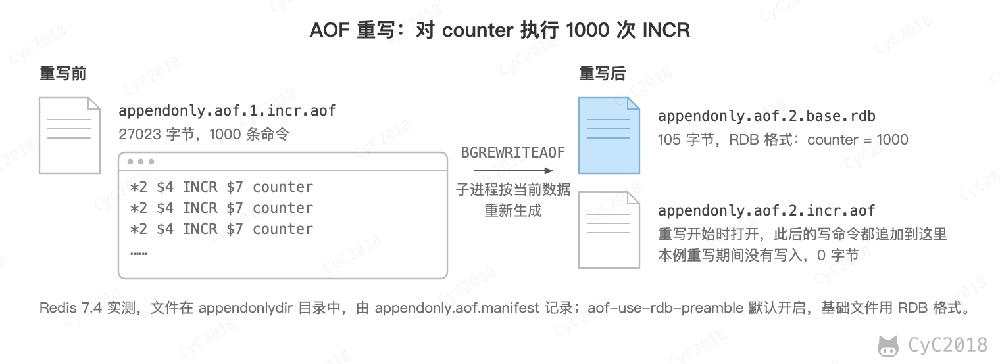 </div><br>

配置项 aof-use-rdb-preamble 在 4.0 引入、5.0 起默认开启，重写生成的基础文件使用 RDB 格式，称为混合持久化：重启时先载入 RDB 部分，再重放增量文件中的命令，兼顾了 RDB 恢复快和 AOF 丢失数据少的优点。两种持久化都开启时，重启后使用 AOF 恢复，因为它的数据通常更完整。

两种方式的对比：

- 丢失的数据：RDB 丢失最后一次快照之后的写入，按 save 配置可能是几分钟；AOF 使用 everysec 时约丢失 1 秒；
- 文件和恢复：RDB 是紧凑的二进制快照，适合备份，数据量大时恢复也快；AOF 的增量文件按协议格式记录文本命令，文件通常更大，但可以直接编辑：误执行 FLUSHALL 后，只要还没有重写，停止服务、备份 AOF 文件，删掉增量文件中的 FLUSHALL 及之后的命令再重启，就能恢复数据；
- 开销：RDB 只在生成快照时 fork 子进程，数据量大时 fork 本身可能让主进程停顿；AOF 每次写入都要追加，并且需要定期重写。

能接受丢失几分钟数据时只用 RDB 即可；数据重要时两种都开启。官方文档不建议只用 AOF，因为定期的 RDB 快照便于备份，重启时恢复也更快。只作缓存、数据可以从数据库重建时，也可以都不开启。

## 九、事务

Redis 的事务用 MULTI 和 EXEC 把多个命令包围起来：MULTI 之后的命令先放入队列，EXEC 时依次执行，执行期间不会插入其它客户端的命令。

流水线（Pipelining）是另一个概念，指客户端不等待响应就连续发送多条命令，从而减少网络往返次数，事务通常和流水线一起使用。

Redis 的事务不支持回滚：EXEC 时某条命令执行出错，其它命令照常执行。例如 name 的值是字符串 alice，对它执行 INCR 会出错，但同一事务中的两条 SET 都生效：

```text
> multi
OK
> set city hangzhou
QUEUED
> incr name
QUEUED
> set age 25
QUEUED
> exec
1) OK
2) (error) ERR value is not an integer or out of range
3) OK
```

命令入队时就能发现的错误（例如命令不存在），EXEC 会放弃整个事务，返回 EXECABORT。

WATCH 可以实现乐观锁：EXEC 之前被 WATCH 的键被其它客户端修改，EXEC 返回 nil，事务中的命令都不执行，由客户端决定是否重试。

按 ACID 衡量，Redis 的事务满足隔离性，相当于串行执行；原子性只做到入队出错时都不执行，执行出错时不回滚；持久性取决于[持久化](#八持久化)的配置。

### Lua 脚本 🔥

事务中的命令在 EXEC 时才一起执行，不能根据前一条命令的结果决定下一条做什么。Lua 脚本可以做到这一点，并且整个脚本原子执行：Redis 用一个线程执行命令，执行脚本时不处理其它客户端的命令，整个脚本就像一条命令。用事务实现“先读后写”时，只能用 WATCH 检测冲突后重试；流水线只是减少网络往返，几条命令之间仍可能插入其它客户端的命令。

这里的原子性指的是执行期间不被打断，而不是出错时全部回滚，见下文的注意事项。

例如每个用户每天最多领 3 张券，键为 coupon:1001:20261030，键名带上日期，第二天自然换成新的键，过期时间只用于清理：

```lua
local n = tonumber(redis.call('GET', KEYS[1]) or '0')
if n >= tonumber(ARGV[1]) then
  return 0
end
redis.call('INCR', KEYS[1])
if n == 0 then
  redis.call('EXPIRE', KEYS[1], ARGV[2])
end
return n + 1
```

用 redis-cli --eval coupon.lua coupon:1001:20261030 , 3 86400 连续执行 4 次，返回值依次为 1、2、3、0。如果在客户端先 GET 再 INCR，两个请求可能同时读到 2，都领到第 3 张。释放分布式锁时判断并删除、秒杀时判断并扣减库存也是这种用法，见 [Redis 的 SET NX 指令](分布式.md#redis-的-set-nx-指令) 和 [秒杀系统](系统设计基础.md#六秒杀系统)。

需要注意的是：

- 脚本中途出错时，之前执行的写命令不会回滚，之后的命令不再执行，所以参数、键的类型和业务前提要在第一条写命令之前校验完，尽量不在写入后才出错；
- 脚本执行期间服务器不处理其它命令，其它客户端的请求一直等待。脚本运行超过 busy-reply-threshold（默认 5 秒）后，服务器才开始处理请求，但除了 SCRIPT KILL 和 SHUTDOWN NOSAVE 都返回 BUSY 错误。SCRIPT KILL 只能终止还没有执行写命令的脚本；已经写过数据的脚本只能等它结束，或者用 SHUTDOWN NOSAVE 关闭服务器并丢弃上次持久化之后的写入（Redis 7.4 实测，见[附录 A12](#a12-长时间运行的-lua-脚本)）。所以脚本要短，不要在其中遍历大集合；
- 脚本用到的键要通过 KEYS 传入，集群模式下这些键必须在同一个槽中，否则报错 CROSSSLOT，可以用[哈希标签](#redis-cluster)让它们落到同一个槽；
- 可以先用 SCRIPT LOAD 把脚本缓存在服务器上，之后用 EVALSHA 加脚本的 SHA1 调用，不用每次发送脚本内容。

## 十、事件

Redis 服务器是一个事件驱动程序：主线程在一个循环中用 I/O 多路复用等待套接字上的读写事件（文件事件），处理完这些事件后再执行到期的定时任务（时间事件）。事件的分类和调度过程见[进阶：事件](Redis%20-%20进阶.md#十事件)。

### 单线程为什么快 🔥

Redis 用一个线程执行所有命令，仍然很快，原因主要有以下几点：

- 数据在内存中，一条 GET 只需要查一次[哈希表](#字典)；
- 单线程执行命令，不需要加锁，也没有线程切换的开销；
- [I/O 多路复用](Socket.md#二io-复用)让一个线程同时处理大量连接；
- 按数据的大小选择不同的编码，例如元素少时用紧凑的 listpack。

用 redis-benchmark 测试，50 个连接逐条发送 GET，每秒约 16 万次；每次连续发送 16 条命令（流水线）时，每秒约 160 万次。逐条发送 100 万次 GET 时，服务器消耗的 CPU 时间中内核态 5.1 秒、用户态 1.0 秒：大部分时间花在网络读写的系统调用上，平均每条命令的用户态时间只有约 1 微秒（Redis 7.4 实测，见[附录 A3](#a3-单线程的吞吐量和-cpu-时间)）。

<div align="center"> 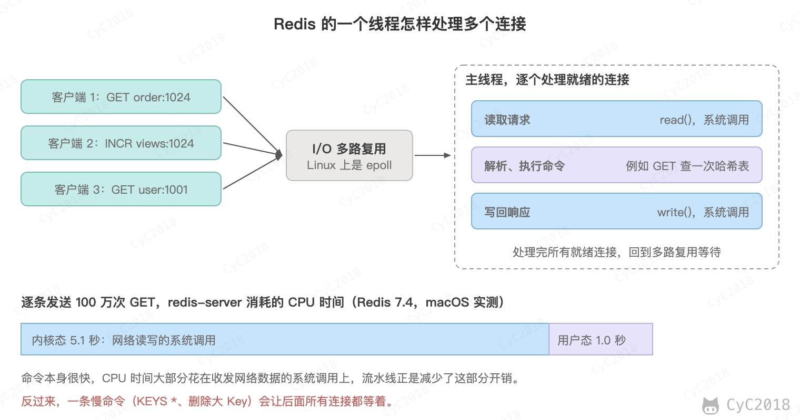 </div><br>

所以执行命令本身很少成为瓶颈，开销主要在网络读写上：流水线减少了系统调用的次数，吞吐量就提高到原来的 10 倍。

Redis 6.0 加入的 I/O 多线程（io-threads，默认关闭）分担的也是这部分开销：多个 I/O 线程并行读取、解析请求和写回响应，命令仍由主线程逐条执行，不会有两个线程同时修改一个键。6.0 和 7.x 默认只把写回交给 I/O 线程，读取和解析还要打开 io-threads-do-reads；8.0 重新实现后三者都由 I/O 线程负责。

<div align="center"> 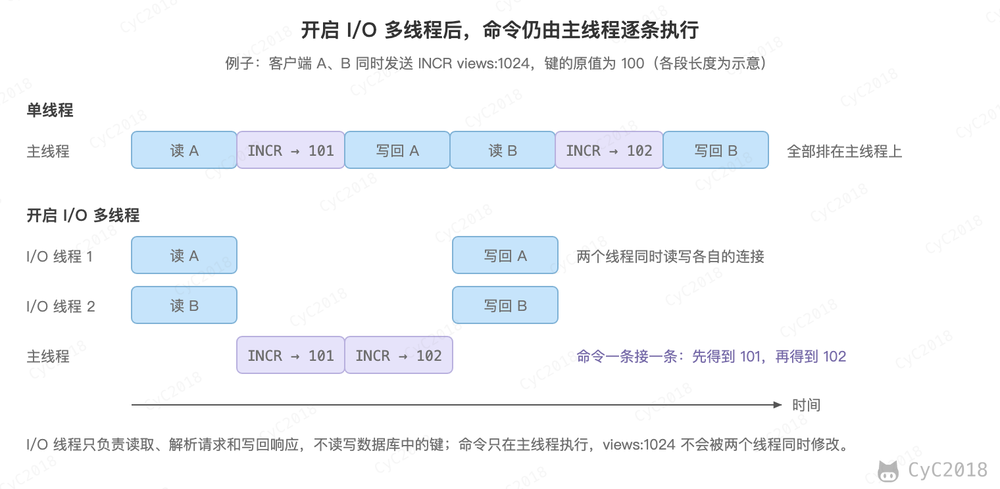 </div><br>

除了主线程和 I/O 线程，关闭文件、AOF 刷盘和 UNLINK 释放大 Key 的内存这些耗时操作由后台线程完成，BGSAVE 生成 RDB 快照和重写 AOF 由 fork 出的子进程完成。

需要注意的是，单线程也意味着一条慢命令会让所有客户端等待：执行 KEYS *、对大 Key 执行 HGETALL 或 DEL、运行很长的 Lua 脚本时，其它命令都在排队，见 [大 Key 与热 Key](缓存.md#大-key-与热-key)。

## 十一、复制

通过使用 REPLICAOF host port 命令来让一个服务器成为另一个服务器的从服务器（5.0 之前为 SLAVEOF，现已弃用）。

一个从服务器只能有一个主服务器，并且不支持主主复制。

### 连接过程

从服务器第一次连接时进行全量复制：

1. 从服务器发送 PSYNC，主服务器 fork 一个子进程生成 RDB 快照发给从服务器，并在这期间把新执行的写命令记在缓冲区中。Redis 7.0 起默认不写磁盘文件，子进程直接把快照通过网络发送（repl-diskless-sync yes）。Redis 8.0 起从服务器默认另开一条连接接收快照，期间新的写命令直接发给从服务器、由从服务器先缓存，载入快照后再执行，减轻了主服务器的内存压力；
2. 从服务器清空旧数据，载入快照，再执行缓冲区中的写命令；
3. 之后主服务器每执行一条写命令，就把它发给从服务器。

全量复制的代价很大，所以主服务器把最近发出的写命令保存在复制积压缓冲区（默认 1 MB）中，并给复制流中的每个字节编号，称为偏移量。从服务器断线重连后，发送 PSYNC 时带上复制 ID 和需要的下一个偏移量（已经复制到的偏移量加 1）：复制 ID 与主服务器一致（故障转移后，新的主服务器也接受旧主服务器的复制 ID），并且这个偏移量还在积压缓冲区中，就只发送缺少的部分，称为部分重同步；否则重新进行全量复制。下图是三次连接的结果（Redis 7.4 实测，见[附录 A15](#a15-主从复制的全量复制与部分重同步)）：

<div align="center"> 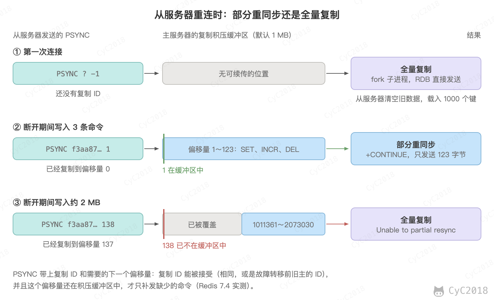 </div><br>

积压缓冲区的大小可以按“最长断线时间 × 每秒写入的字节数”估算，例如每秒写入 1 MB、要容忍 60 秒的断线，repl-backlog-size 至少设为 60 MB，避免断线后频繁全量复制。

### 主从链

随着负载不断上升，主服务器可能无法很快地更新所有从服务器，或者重新连接和重新同步从服务器将导致系统超载。为了解决这个问题，可以创建一个中间层来分担主服务器的复制工作。中间层的服务器是最上层服务器的从服务器，又是最下层服务器的主服务器。

<div align="center"> 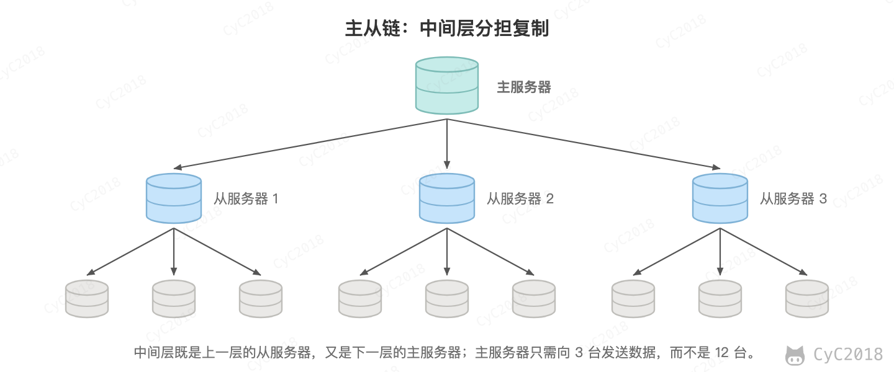 </div><br>

## 十二、Sentinel

Sentinel（哨兵）可以监听集群中的服务器，并在主服务器进入下线状态时，自动从从服务器中选举出新的主服务器。

哨兵只需要配置主服务器的地址：向它发送 INFO 得到从服务器的列表，通过主从服务器上的 `__sentinel__:hello` 频道发现其它哨兵。

通常部署 3 个或以上的哨兵，因为故障转移要得到多数哨兵的授权：只有 2 个时，一个和主服务器一起宕机，剩下的一个得不到多数票；只有 1 个时哨兵自身成了单点。故障转移的过程如下：

1. 主观下线：某个哨兵在 down-after-milliseconds 内没有收到主服务器的有效回复，认为它下线；
2. 客观下线：认为主服务器下线的哨兵数达到配置的 quorum，确认它下线；
3. 选出领头哨兵：发起选举的哨兵把纪元（epoch，相当于 [Raft](分布式.md#单个-candidate-的竞选) 的任期号）加 1 后请求投票，每个哨兵在一个纪元中只投一票、先到先得，得票过半并且不少于 quorum 的哨兵负责这次故障转移，没有选出时用新的纪元重试；
4. 选择新的主服务器：排除断线太久的从服务器，再依次比较优先级（replica-priority，越小越优先）、复制偏移量（数据越新越好）和运行 ID；
5. 切换：让选中的从服务器执行 REPLICAOF NO ONE，其它从服务器改为复制它，客户端从哨兵查询到新的地址；原来的主服务器恢复后成为从服务器。

<div align="center"> 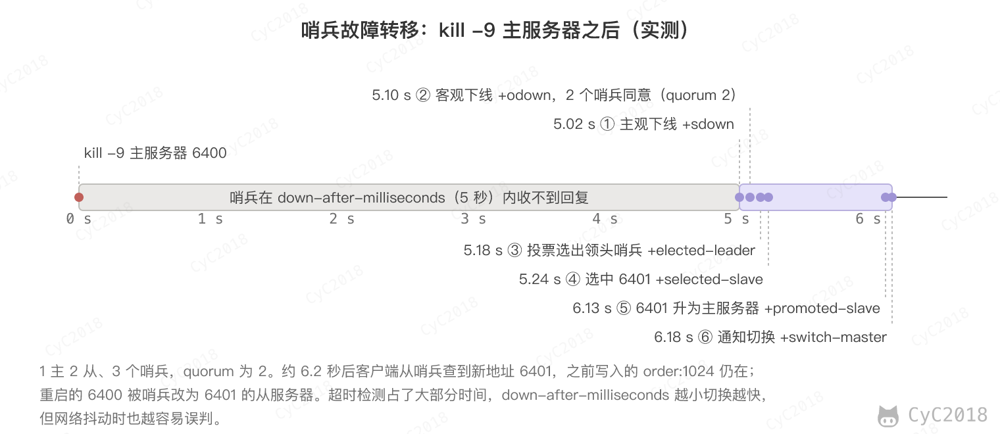 </div><br>

down-after-milliseconds 为 5 秒时，从主服务器宕机到客户端查到新地址约 6 秒，其中 5 秒是超时检测。新的主服务器保留了旧的复制 ID，另一个从服务器转向它时只需要部分重同步，只发送了 156 字节的积压数据；重启的旧主服务器复制 ID 不匹配，只能全量复制（Redis 7.4 实测，见[附录 A5](#a5-sentinel-故障转移)）。

需要注意的是，主从之间是异步复制，切换时还没有复制到从服务器的写入会丢失。网络分区时，旧的主服务器还可能继续接受写入（脑裂），恢复后它变为从服务器，这段时间的写入也会丢失。可以配置 min-replicas-to-write 1 和 min-replicas-max-lag 10：延迟不超过 10 秒的从服务器少于 1 个时，主服务器拒绝写入并返回 NOREPLICAS，旧的主服务器与所有从服务器断开后最多再接受约 10 秒的写入；它不保证每次写入都已复制，分区后还有从服务器和旧主在同一侧时也挡不住写入。分布式锁同样会因此丢失，见 [Redis 的 SET NX 指令](分布式.md#redis-的-set-nx-指令)。

## 十三、分片

分片是将数据划分为多个部分的方法，可以将数据存储到多台机器里面。

假设有 4 个 Redis 实例 R0，R1，R2，R3，还有很多表示用户的键 user:1，user:2，... ，有不同的方式来选择一个指定的键存储在哪个实例中。

- 最简单的方式是范围分片（即[顺序分布](缓存.md#顺序分布)），例如用户 id 从 0\~1000 的存储到实例 R0 中，用户 id 从 1001\~2000 的存储到实例 R1 中，等等。但是这样需要维护一张映射范围表，维护操作代价很高。
- 还有一种方式是哈希分片，使用 CRC32 哈希函数将键转换为一个数字，再对实例数量求模就能知道应该存储的实例。缺点是实例数量变化时，大部分键对应的实例都会改变，见 [哈希分布](缓存.md#哈希分布)。

根据执行分片的位置，可以分为三种分片方式：

- 客户端分片：客户端使用[一致性哈希](缓存.md#六一致性哈希)等算法决定键应当分布到哪个节点；
- 代理分片：将客户端请求发送到代理上，由代理转发请求到正确的节点上；
- 服务器分片：Redis Cluster，使用 CRC16(key) % 16384 计算键所属的哈希槽，再把 16384 个哈希槽分配给各个节点。

### Redis Cluster 🔥

Redis 有三种常见的部署方式，解决的问题不同：

- 主从复制：从服务器复制主服务器的数据，分担读请求，主服务器宕机后需要手动切换；
- Sentinel：在主从复制的基础上自动监控和故障转移，但仍然只有一个主服务器负责写入，数据量受单机内存限制；
- Redis Cluster：把数据分散到多个主节点上，每个主节点有自己的从节点，同时解决容量和高可用的问题。

Redis Cluster 把键空间分为 16384 个哈希槽，每个主节点负责一部分槽。槽的数量固定，键所在的槽不随节点数变化，增删节点时只迁移一部分槽。取 16384 是因为节点每次心跳都带着一张 16384 位（2 KB）的槽位图，65536 个槽就要 8 KB；而集群建议不超过约 1000 个主节点，16384 个槽已经够分。下图是一个 3 主 3 从的集群（Redis 7.4 实测，见[附录 A4](#a4-redis-cluster)）：

<div align="center"> 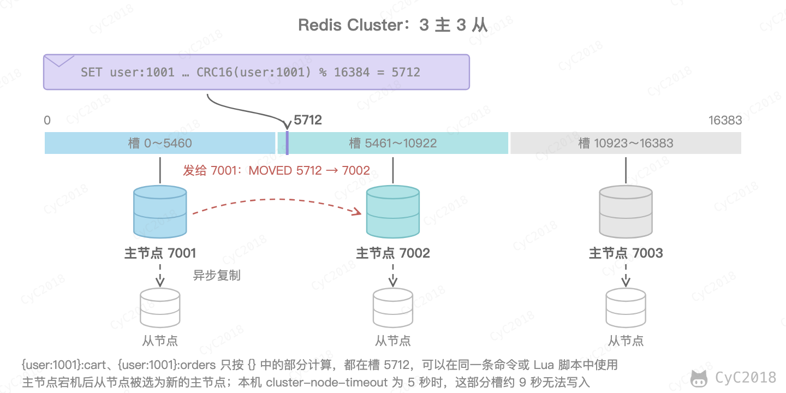 </div><br>

- 客户端向不负责这个槽的节点发送命令时，会收到 MOVED 重定向。例如 user:1001 所在的槽 5712 属于 7002，发给 7001 会收到 MOVED 5712 127.0.0.1:7002。客户端会缓存槽与节点的对应关系，之后直接访问正确的节点；
- 一条命令涉及多个键时，这些键必须在同一个槽中，否则报错 CROSSSLOT，Lua 脚本也是如此。可以用哈希标签（hash tag）让相关的键落到同一个槽：只有 {} 中的部分参与计算，{user:1001}:cart 和 {user:1001}:orders 都在槽 5712，但大量键共用同一个哈希标签时会集中到同一个槽，造成数据倾斜；
- 主节点宕机后，它的一个从节点会被选为新的主节点。cluster-node-timeout 为 5 秒时，停掉一个主节点后约 7～9 秒才恢复写入。主节点被判定下线后、从节点接替之前，整个集群都返回 CLUSTERDOWN，因为 cluster-require-full-coverage 默认为 yes，有槽没有节点负责时所有节点都停止服务，设为 no 后其它槽可以继续读写。

Redis Cluster 不需要哨兵，节点之间通过集群总线（端口号加 10000）定期互发 PING、PONG，消息中带着自己负责的槽和所知道的其它节点的状态（Gossip 协议），由此完成故障检测和选举。以停掉 7002 为例：

1. 其它节点超过 cluster-node-timeout 没有收到 7002 的回复，各自把它标记为 PFAIL（疑似下线）；
2. 某个节点通过 Gossip 得知多数主节点都认为 7002 疑似下线，把它标记为 FAIL 并广播；
3. 7002 的从节点按复制偏移量排名，数据最新的等待最短（500～1000 毫秒加上排名 × 1 秒），最先发起选举；
4. 从节点把纪元加 1 后请求投票，每个主节点在一个纪元中只投一票，得到多数主节点的票后接管 7002 的槽。所以集群至少要有 3 个主节点，只有 2 个时一个宕机，剩下的一个得不到多数票。

需要注意的是，主从之间是异步复制，主节点宕机前刚写入、还没有复制到从节点的数据会丢失，所以 Redis Cluster 不保证[强一致性](分布式.md#一致性)。网络分区时，少数派一侧的主节点超过 cluster-node-timeout 后拒绝写入，所以它在这之前接受的写入可能丢失；默认配置下读请求也会被拒绝（cluster-allow-reads-when-down 默认为 no）。

扩容时要把一部分槽迁移到新节点。迁移以键为单位进行，期间一个槽的键一部分在源节点、一部分在目标节点，客户端靠 ASK 重定向找到它们。Redis 8.4 起还可以用 CLUSTER MIGRATION 整槽迁移：先复制整个槽的快照和增量写入，追上后短暂暂停这些槽的写入，一次性切换归属，下面以键为单位的流程仍然可用。以把槽 5712 从 7002 迁移到 7003 为例（Redis 7.4 实测，见[附录 A13](#a13-槽迁移与-ask-重定向)）：

- 先把 7003 上的槽 5712 标记为 IMPORTING、7002 上的标记为 MIGRATING，再用 MIGRATE 把键一批批搬到 7003，每个键在同一时刻只存在于其中一个节点；
- 客户端仍然先访问 7002：键还在 7002 就直接处理，例如 {user:1001}:cart 正常返回；键已经迁走或者不存在，返回 ASK 5712 127.0.0.1:7003；
- 客户端收到 ASK 后，先向 7003 发送 ASKING，再发送原来的命令；不发 ASKING 直接访问 7003，会收到 MOVED 被重定向回 7002；
- 一条命令的多个键分散在两个节点上时，返回 TRYAGAIN，客户端稍后重试；
- 所有键迁移完后，用 CLUSTER SETSLOT 5712 NODE 把槽分配给 7003，之后访问 7002 收到 MOVED 5712 127.0.0.1:7003。

<div align="center"> 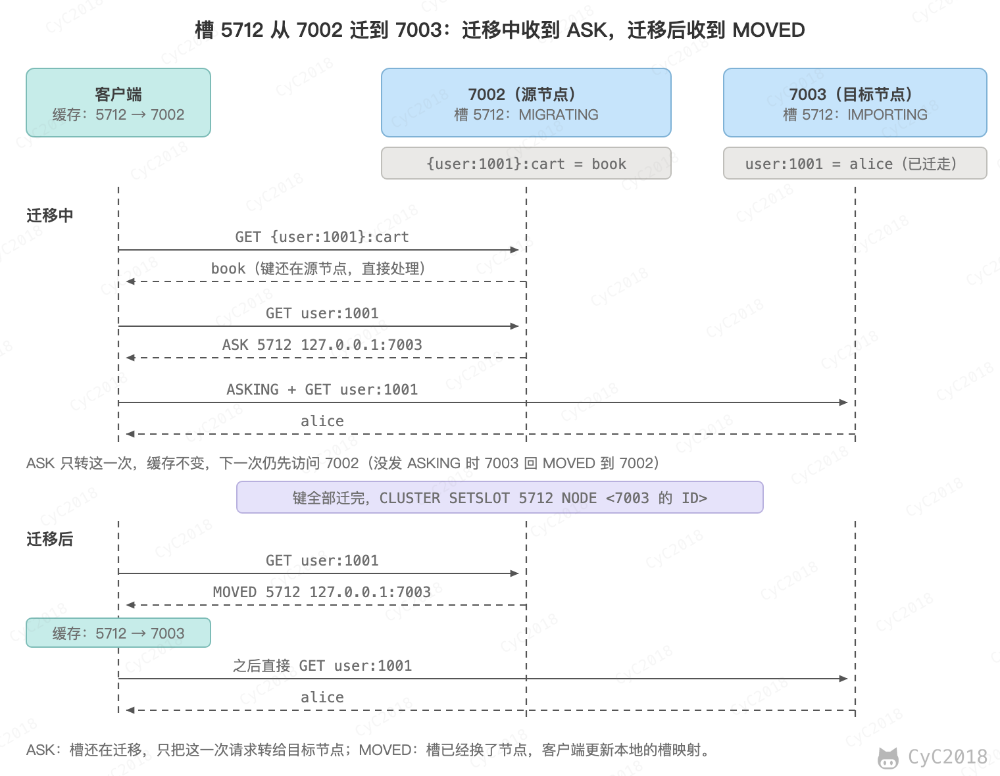 </div><br>

MOVED 与 ASK 的区别在于：MOVED 表示槽已经归属新的节点，客户端更新本地缓存的槽映射；ASK 只把这一次请求转到新节点，下一次仍然先访问源节点，因为槽中其它的键可能还没有迁走。所以迁移期间请求仍然可以处理，只是多了一次重定向；迁移大 Key 时 MIGRATE 耗时较长，期间两个节点都会阻塞。

## 十四、一个简单的论坛系统分析

该论坛系统功能如下：

- 可以发布文章；
- 可以对文章进行点赞；
- 在首页可以按文章的发布时间或者文章的点赞数进行排序显示。

### 文章信息

文章包括标题、作者、赞数等信息，在关系型数据库中很容易构建一张表来存储这些信息，在 Redis 中可以使用 HASH 来存储每种信息以及其对应的值的映射。

Redis 没有关系型数据库中的表这一概念来将同种类型的数据存放在一起，而是使用命名空间的方式来实现这一功能。键名的前面部分存储命名空间，后面部分的内容存储 ID，通常使用 : 来进行分隔。例如下面的 HASH 的键名为 article:1001，其中 article 为命名空间，ID 为 1001。

<div align="center"> 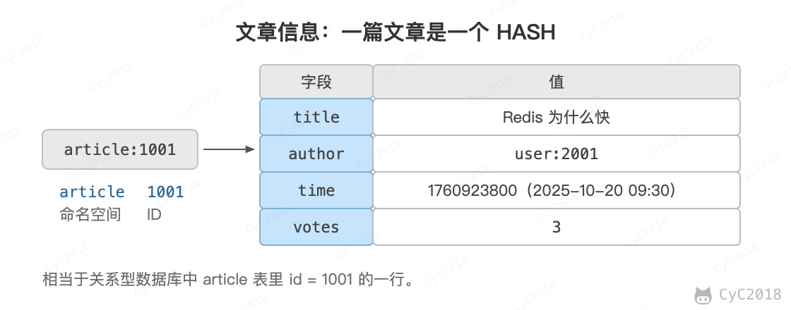 </div><br>

### 点赞功能

当有用户为一篇文章点赞时，除了要对该文章的 votes 字段进行加 1 操作，还必须记录该用户已经对该文章进行了点赞，防止用户点赞次数超过 1。可以建立文章的已投票用户集合来进行记录。

为了节约内存，规定一篇文章发布满一周之后，就不能再对它进行投票，文章的已投票集合也随之删除：发布文章时为已投票集合设置一周的过期时间，到期由 Redis 自动删除。集合被删除后 SADD 会重新创建它，所以点赞前还要用 ZSCORE 检查发布时间。

<div align="center"> 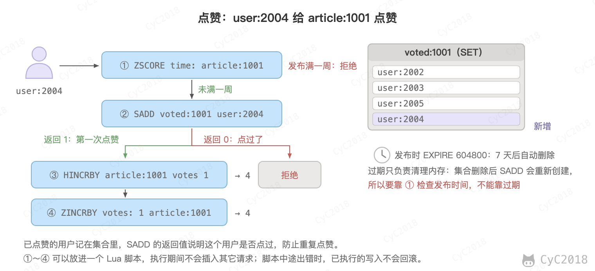 </div><br>

### 对文章进行排序

为了按发布时间和点赞数进行排序，可以建立一个文章发布时间的有序集合和一个文章点赞数的有序集合。两个有序集合的成员都是文章 ID，分值分别是发布时间和点赞数，按分值倒序取前 10 个就是首页要显示的文章。

<div align="center"> 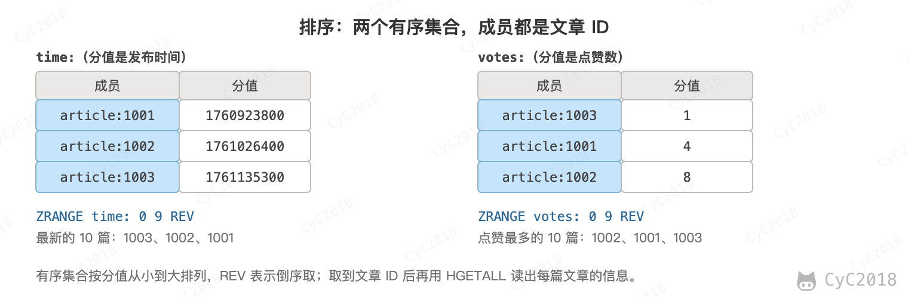 </div><br>

## 附录：实测

以下实验的环境均为 Apple M1 Pro（10 核）、macOS，客户端和服务器在同一台机器上，Redis 7.4.1 从源码编译，使用默认配置，不开启持久化。macOS 上编译默认使用 libc 的内存分配器（INFO 中 mem_allocator 为 libc），Linux 上默认是 jemalloc，内存占用的数字会有差别。

### A1 MySQL 与 Redis 的主键查询

MySQL 8.0.44，orders 表有 200 万行，要查的行已在缓冲池中。两边都用 50 个连接执行 20 万次，各做 3 轮。MySQL 的 CPU 时间是 mysqld 进程执行前后的 CPU 时间之差，Redis 的是 INFO cpu 中 used_cpu_sys 与 used_cpu_user 之和的差。

```bash
mysqlslap -uroot --concurrency=50 --iterations=1 --number-of-queries=200000 \
  --create-schema=demo --query="SELECT * FROM orders WHERE id = 1024"
redis-benchmark -c 50 -n 200000 -q GET order:1024
```

```text
== 第 1 轮 MySQL
  Average number of seconds to run all queries: 1.155 seconds
墙钟 1.21 s，mysqld CPU 7.20 s，QPS 165707，每次 36.0 us，平均占用 6.0 核
== 第 1 轮 Redis
GET order:1024: 165425.97 requests per second, p50=0.231 msec
redis-server CPU 1.21 s，每次 6.0 us
== 第 2 轮 MySQL
  Average number of seconds to run all queries: 1.111 seconds
墙钟 1.16 s，mysqld CPU 7.34 s，QPS 172026，每次 36.7 us，平均占用 6.3 核
== 第 2 轮 Redis
GET order:1024: 153727.91 requests per second, p50=0.247 msec
redis-server CPU 1.30 s，每次 6.5 us
== 第 3 轮 MySQL
  Average number of seconds to run all queries: 1.101 seconds
墙钟 1.15 s，mysqld CPU 7.16 s，QPS 173683，每次 35.8 us，平均占用 6.2 核
== 第 3 轮 Redis
GET order:1024: 131926.12 requests per second, p50=0.287 msec
redis-server CPU 1.49 s，每次 7.4 us
```

### A2 排行榜

用 redis-py 写入同分排序的例子和 100 万个成员，分值是 0～100 万的随机整数，用流水线每 1 万条提交一次：

```python
def score(likes, ts):
    return likes * 10**10 + (10**10 - ts)

r.zadd('rank:likes', {'article:1001': score(520, 1793000000),
                      'article:1002': score(520, 1793000300),
                      'article:1003': score(980, 1793000600)})
print(r.zrevrange('rank:likes', 0, 2, withscores=True))

pipe = r.pipeline(transaction=False)
for i in range(1_000_000):
    pipe.zadd('rank:big', {f'u:{i}': random.randint(0, 10**6)})
    if i % 10000 == 9999:
        pipe.execute()
pipe.execute()
```

内存是写入前后 INFO memory 中 used_memory 的差。之后执行 CONFIG SET slowlog-log-slower-than 0，让 SLOWLOG 记录所有命令，再把 ZREVRANGE rank:big 0 9 WITHSCORES、ZREVRANK rank:big u:123456、ZINCRBY rank:big 1 u:123456 各执行 5 次：

```text
[('article:1003', 9808206999400.0), ('article:1001', 5208207000000.0), ('article:1002', 5208206999700.0)]
100 万成员内存 104.7 MB
OBJECT ENCODING rank:big -> skiplist
SLOWLOG 中的执行时间（微秒）
zrevrange [5, 3, 2, 3, 4]
zrevrank [4, 3, 3, 3, 3]
zincrby [5, 5, 4, 6, 7]
```

### A3 单线程的吞吐量和 CPU 时间

```bash
redis-benchmark -c 50 -n 1000000 -t get -P 1 -q
redis-benchmark -c 50 -n 1000000 -t get -P 16 -q
# 每次测试前后各执行一次 INFO cpu，取 used_cpu_sys、used_cpu_user 的差
```

```text
== -P 1
GET: 162522.34 requests per second, p50=0.231 msec
服务器 CPU：used_cpu_sys +5.13 s，used_cpu_user +1.00 s
== -P 16
GET: 1618123.00 requests per second, p50=0.415 msec
服务器 CPU：used_cpu_sys +0.28 s，used_cpu_user +0.34 s
```

### A4 Redis Cluster

6 个节点 7001～7006 都以 --cluster-enabled yes --cluster-node-timeout 5000 启动，然后创建 3 主 3 从的集群：

```bash
redis-cli --cluster create 127.0.0.1:7001 127.0.0.1:7002 127.0.0.1:7003 \
  127.0.0.1:7004 127.0.0.1:7005 127.0.0.1:7006 --cluster-replicas 1 --cluster-yes
```

槽的分配为 7001：0～5460，7002：5461～10922，7003：10923～16383。

```text
> redis-cli -p 7001 cluster keyslot user:1001
5712
> redis-cli -p 7001 cluster keyslot {user:1001}:cart
5712
> redis-cli -p 7001 cluster keyslot {user:1001}:orders
5712
> redis-cli -p 7001 set user:1001 alice
MOVED 5712 127.0.0.1:7002
> redis-cli -p 7002 set user:1001 alice
OK
> redis-cli -p 7002 mset user:1001:cart a user:1001:orders b
CROSSSLOT Keys in request don't hash to the same slot
> redis-cli -p 7002 mset {user:1001}:cart a {user:1001}:orders b
OK
> redis-cli -p 7002 eval "return redis.call('mset', KEYS[1], 'a', KEYS[2], 'b')" 2 user:1001:cart user:1001:orders
CROSSSLOT Keys in request don't hash to the same slot
```

然后 kill -9 7002，每 100 毫秒向它的从节点写一次 user:1001，直到返回 OK。下面是第 3 次实验的输出，3 次实验分别在 7.1、8.7、8.8 秒后恢复写入：

```text
== 7002 的从节点：7006
8.8 s 后写入成功，之前失败 73 次，最后一次失败前的返回为 CLUSTERDOWN The cluster is down
* FAIL message received from ... about ...
* Start of election delayed for 738 milliseconds (rank #0, offset 138).
* Starting a failover election for epoch 7.
* Failover election won: I'm the new master.
> redis-cli -p 7006 get user:1001
bob
```

### A5 Sentinel 故障转移

1 主 6400、2 从 6401 和 6402，3 个哨兵 26400～26402，哨兵的配置：

```text
sentinel monitor mymaster 127.0.0.1 6400 2
sentinel down-after-milliseconds mymaster 5000
sentinel failover-timeout mymaster 60000
```

向 6400 写入 order:1024 后 kill -9 6400，每 100 毫秒用 SENTINEL get-master-addr-by-name mymaster 查询主服务器地址。下面的时间相对于 kill -9，日志取自 3 个哨兵中最先记录该事件的一个：

```text
== kill -9 6400 后 6.20 s，SENTINEL get-master-addr-by-name 返回 127.0.0.1:6401
 5.02 s  哨兵 26402  # +sdown master mymaster 127.0.0.1 6400
 5.10 s  哨兵 26400  # +odown master mymaster 127.0.0.1 6400 #quorum 2/2
 5.18 s  哨兵 26400  # +elected-leader master mymaster 127.0.0.1 6400
 5.24 s  哨兵 26400  # +selected-slave slave 127.0.0.1:6401 127.0.0.1 6401 @ mymaster 127.0.0.1 6400
 6.13 s  哨兵 26400  # +promoted-slave slave 127.0.0.1:6401 127.0.0.1 6401 @ mymaster 127.0.0.1 6400
 6.18 s  哨兵 26401  # +switch-master mymaster 127.0.0.1 6400 127.0.0.1 6401
> GET order:1024（新的主服务器 6401）
paid
```

重启 6400 后，新的主服务器 6401 的日志：

```text
* Partial resynchronization request from 127.0.0.1:6402 accepted. Sending 156 bytes of backlog starting from offset 2495.
* Partial resynchronization not accepted: Replication ID mismatch (Replica asked for 'f16e5fc0...', my replication IDs are 'ac108f0e...' and '48696b86...')
> 6400 的角色
role:slave
master_port:6401
> CONFIG SET min-replicas-to-write 3 后写入（只有 2 个从服务器）
NOREPLICAS Not enough good replicas to write.
```

### A6 热点计数

MySQL 8.0.44（innodb_flush_log_at_trx_commit 和 sync_binlog 都为 1），Redis 7.4.1，Apple M1 Pro。MySQL 用多个进程同时执行自动提交的 UPDATE counter SET cnt = cnt + 1 WHERE id = 1，最后核对 cnt；Redis 用 redis-benchmark 对同一个键执行 INCR：

```text
MySQL 1 个连接共更新 5000 次：0.92 s，5437 次/秒，cnt = 5000
MySQL 8 个连接共更新 16000 次：2.21 s，7251 次/秒，cnt = 16000
MySQL 50 个连接共更新 20000 次：3.72 s，5383 次/秒，cnt = 20000

$ redis-benchmark -p 6395 -c <连接数> -n 200000 --csv incr counter:1
1 个连接   "incr counter:1","11020.50",...
8 个连接   "incr counter:1","50213.41",...
50 个连接  "incr counter:1","101368.47",...
```

### A7 Bitmap 的签到和日活

Redis 7.4.1（内存分配器为 libc），键加了实验用的前缀，下面的输出中已去掉。内存是写入前后 INFO memory 中 used_memory 的差，服务器执行时间取自 SLOWLOG（slowlog-log-slower-than 设为 0）。

签到的例子先对 1～27 号中签到的日期执行 SETBIT，再执行正文中的命令：

```text
> setbit sign:1001:202610 27 1
0
> setbit sign:1001:202610 27 1
1
> getbit sign:1001:202610 3
0
> bitcount sign:1001:202610
23
> bitpos sign:1001:202610 0
3
> bitfield sign:1001:202610 get u28 0
251606975
> strlen sign:1001:202610
4
> type sign:1001:202610
string
> setbit t 0 1 之后 get t
"\x80"
> setbit t 7 1 之后 get t
"\x81"
```

每人每年一个键：对 10 万个键 sign:{用户 ID}:2026 各执行 SETBIT 364 1：

```text
STRLEN 46，MEMORY USAGE 136，10 万个键 used_memory 增加 15433696，平均每个键 154 字节
```

日活：用户 ID 为 1～100 万，模拟 10 月 22 日～28 日 7 天，每 10 个用户有 1 个每天都活跃，其余用户每天以 30% 的概率活跃，用 Python 集合计算的真实值核对：

```text
active:20261028 STRLEN 125001，MEMORY USAGE 131144，7 个键 used_memory 增加 903024
BITCOUNT active:20261028 -> 369445（真实值 369445），服务器执行 15 us
BITOP AND（7 个键） -> BITCOUNT 100184（真实值 100184），BITOP 服务器执行 84 us
BITOP OR（7 个键） -> BITCOUNT 925445（真实值 925445）
同一天的 369445 个用户 ID 用 SADD 写入 SET：used_memory 增加 14120832，编码 hashtable
```

用户 ID 稀疏：

```text
SETBIT offset 100000000：客户端耗时 1.3 ms，STRLEN 12500001，used_memory 增加 12501072
SETBIT offset 4000000000：客户端耗时 99.4 ms，STRLEN 500000001，used_memory 增加 500007296
  对它执行 BITCOUNT：服务器执行 91777 us
SETBIT offset 4294967295：客户端耗时 74.6 ms，STRLEN 536870912，used_memory 增加 536887680
SETBIT offset 4294967296 -> ERR bit offset is not an integer or out of range
1000 个随机 ID 分布在 1～1 亿：位图 used_memory 增加 12501056，SET 增加 30048（编码 hashtable）
```

### A8 HyperLogLog 的误差和内存

Redis 7.4.1，向一个 HLL 写入 n 个不同的字符串 user:0～user:{n − 1}：

```text
1000 个不同元素：PFCOUNT 1007，误差 +0.70%，STRLEN 1910，MEMORY USAGE 2616
100000 个不同元素：PFCOUNT 99471，误差 -0.53%，STRLEN 12304，MEMORY USAGE 12856
1000000 个不同元素：PFCOUNT 999674，误差 -0.03%，STRLEN 12304，MEMORY USAGE 12856
同样 100 万个 user:i 用 SET 保存：used_memory 增加 30080144
```

元素少时 STRLEN 为 1910 字节，是稀疏编码；转为密集编码后是 12288 字节的寄存器加 16 字节的头部。再写入 30 组、每组 100 万个不同的字符串：

```text
30 组误差(%) [1.41, 0.33, 0.19, -0.7, -0.19, -0.02, 0.84, 0.73, -1.02, -0.42, 0.59, -1.79, 0.32, -0.71, -0.48, -0.25, 0.25, 0.72, 0.57, 1.29, -0.35, 0.06, -0.17, 0.33, -0.63, 1.07, -0.37, 0.23, -1.05, -2.02]
均方根 0.80%，绝对值最大 2.02%，绝对值不超过 0.81% 的组数 22
```

GEO 的键类型：

```text
> geoadd shops 120.1551 30.2741 shop:1 120.1620 30.2799 shop:2 120.2100 30.2460 shop:3
3
> type shops
zset
> geosearch shops fromlonlat 120.1560 30.2750 byradius 2 km asc withdist
shop:1
0.1321
shop:2
0.7932
```

### A9 过期删除

用流水线写入键，过期时间为 1 秒。DEBUG SET-ACTIVE-EXPIRE 0 关闭定期删除（服务器以 --enable-debug-command yes 启动），键的数量取自 INFO keyspace：

```python
r.execute_command('DEBUG', 'SET-ACTIVE-EXPIRE', 0)
for i in range(100000): pipe.set(f'session:{i}', 'x', px=1000)
time.sleep(2)
print(stat()); print(r.get('session:7')); print(stat())   # stat() 返回 keys、expires 和 expired_keys
r.execute_command('DEBUG', 'SET-ACTIVE-EXPIRE', 1)   # 每 5 毫秒查询一次，直到 keys 为 0
```

```text
关闭定期删除，10 万个键过期 1 秒后：keys, expires, expired_keys = (100000, 100000, 0)
GET session:7 -> None
访问一个键后： (99999, 99999, 1)
打开定期删除后 372 ms 清理完： (0, 0, 100000)
```

再写入 95 万个过期时间为 1 小时的键和 5 万个过期时间为 1 秒的键，不关闭定期删除，hz 为 10，统计剩余的过期键：

```text
到期后  0.0 s 剩余过期键 49996
到期后  4.1 s 剩余过期键 49947
到期后  8.1 s 剩余过期键 49901
到期后 12.2 s 剩余过期键 49845
到期后 16.2 s 剩余过期键 49809
到期后 20.0 s 已清理 228/50000，expired_stale_perc=4.8
```

### A10 LFU 计数器

maxmemory-policy 设为 allkeys-lfu，lfu-log-factor 和 lfu-decay-time 为默认的 10 和 1，对同一个键反复执行 GET，再用 OBJECT FREQ 读取计数器：

```text
新写入：OBJECT FREQ = 5
GET 10 次后：OBJECT FREQ = 6
GET 100 次后：OBJECT FREQ = 10
GET 1000 次后：OBJECT FREQ = 20
GET 10000 次后：OBJECT FREQ = 52
GET 100000 次后：OBJECT FREQ = 146
GET 1000000 次后：OBJECT FREQ = 255
```

### A11 持久化与脚本的默认配置

不带配置文件启动 redis-server，用 CONFIG GET 读取：

```text
save = 3600 1 300 100 60 10000
appendonly = no
appendfsync = everysec
auto-aof-rewrite-percentage = 100
auto-aof-rewrite-min-size = 67108864
aof-use-rdb-preamble = yes
maxmemory-policy = noeviction
maxmemory-samples = 5
busy-reply-threshold = 5000
io-threads = 1
io-threads-do-reads = no
hz = 10
```

### A12 长时间运行的 Lua 脚本

一个客户端执行死循环脚本，另一个客户端在 1 秒时发送 PING：

```bash
redis-cli eval "local i = 0 while true do i = i + 1 end" 0
```

```text
脚本开始后 1.0 s 发出 PING，5.08 s 收到：BUSY Redis is busy running a script. You can only call SCRIPT KILL or SHUTDOWN NOSAVE.
> SCRIPT KILL
OK
（执行脚本的客户端）ERR Script killed by user with SCRIPT KILL...
> PING
PONG
```

脚本先写入再进入死循环：

```bash
redis-cli eval "redis.call('SET', KEYS[1], 'paid') while true do end" 1 order:1024
```

```text
> SCRIPT KILL
UNKILLABLE Sorry the script already executed write commands against the dataset. You can either wait the script termination or kill the server in a hard way using the SHUTDOWN NOSAVE command.
> SHUTDOWN NOSAVE
（执行脚本的客户端）Error: Server closed the connection
```

### A13 槽迁移与 ASK 重定向

3 个主节点 7001～7003，槽的分配与 A4 相同，把槽 5712 从 7002 迁移到 7003（IDA、IDB 是两个节点的 ID）：

```text
7002> set user:1001 alice
OK
7002> set {user:1001}:cart book
OK
7003> cluster setslot 5712 importing IDA
OK
7002> cluster setslot 5712 migrating IDB
OK
7002> migrate 127.0.0.1 7003 "" 0 5000 keys user:1001
OK
7002> get user:1001
ASK 5712 127.0.0.1:7003
7002> get {user:1001}:cart
book
7002> set {user:1001}:orders o1
ASK 5712 127.0.0.1:7003
7002> mget user:1001 {user:1001}:cart
TRYAGAIN Multiple keys request during rehashing of slot
7003> get user:1001
MOVED 5712 127.0.0.1:7002
7003> asking
OK
7003> get user:1001
alice
$ redis-cli -c -p 7002 get user:1001
alice
7002> migrate 127.0.0.1 7003 "" 0 5000 keys {user:1001}:cart
OK
（在 3 个节点上执行 cluster setslot 5712 node IDB）
7002> get user:1001
MOVED 5712 127.0.0.1:7003
```

### A14 HASH 编码的转换

默认配置下 hash-max-listpack-entries 为 512、hash-max-listpack-value 为 64。用 redis-py 的流水线写入字段 field1～fieldN、值 value1～valueN，记录写入前后 INFO memory 中 used_memory 的差，并用 MEMORY USAGE 对照：

```python
def used(): return r.info('memory')['used_memory']
for n in (3, 512, 513):
    key = f'user:1001:h{n}'
    before = used()
    p = r.pipeline(transaction=False)
    for i in range(1, n + 1): p.hset(key, f'field{i}', f'value{i}')
    p.execute()
    print(f'{n} 个字段：{r.object("encoding", key)}，used_memory 增加 {used() - before} 字节，MEMORY USAGE {r.memory_usage(key, samples=0)} 字节')
key = 'user:1001:h512'
print('对 512 个字段的键再 HSET 一个字段：')
before = r.memory_usage(key, samples=0); b2 = used()
r.hset(key, 'field513', 'value513')
print(f'  编码 {r.object("encoding", key)}，MEMORY USAGE {before} → {r.memory_usage(key, samples=0)} 字节，used_memory 增加 {used() - b2} 字节')
r.hset('user:1001', mapping={'name': 'Alice', 'city': 'Shanghai'})
print('user:1001', r.object('encoding', 'user:1001'))
r.hset('user:1001', 'bio', 'x' * 65)
print('写入 65 字节的值后', r.object('encoding', 'user:1001'))
```

```text
hash-max-listpack-entries {'hash-max-listpack-entries': '512'} hash-max-listpack-value {'hash-max-listpack-value': '64'}
3 个字段：listpack，used_memory 增加 74288 字节，MEMORY USAGE 120 字节
512 个字段：listpack，used_memory 增加 10304 字节，MEMORY USAGE 10296 字节
513 个字段：hashtable，used_memory 增加 41120 字节，MEMORY USAGE 37032 字节
对 512 个字段的键再 HSET 一个字段：
  编码 hashtable，MEMORY USAGE 10296 → 37032 字节，used_memory 增加 30848 字节
user:1001 listpack
写入 65 字节的值后 hashtable
```

3 个字段那一行的 used_memory 增量包含了客户端缓冲区等一次性的分配，不代表这个键的大小。

SET 的成员同样以 64 字节为界（set-max-listpack-value 默认为 64），用 redis-cli 验证：

```text
> sadd s1 a b c
(integer) 3
> object encoding s1
"listpack"
> sadd s1 xxxxxxxxxxxxxxxxxxxxxxxxxxxxxxxxxxxxxxxxxxxxxxxxxxxxxxxxxxxxxxxxx   -- 65 字节
(integer) 1
> object encoding s1
"hashtable"
```

### A15 主从复制的全量复制与部分重同步

主服务器 6620 先写入 1000 个键，再启动从服务器 6621 并指定 --replicaof 127.0.0.1 6620，两边都是默认配置。之后两次断开复制连接、在主服务器上写入数据，再让从服务器重连：

```bash
kill -STOP <从服务器的 pid>                 # 暂停从服务器，它收不到数据，也不会立即重连
redis-cli -p 6620 client kill type replica   # 断开复制连接
redis-cli -p 6620 set order:1024 shipped     # 断开期间的写入，第 3 次改为写入约 2 MB
kill -CONT <从服务器的 pid>                 # 从服务器发现连接断开，重新发送 PSYNC
```

下面是主服务器的日志和 INFO replication（有删减）：

```text
== 1. 第一次连接
* Full resync requested by replica 127.0.0.1:6621
* Delay next BGSAVE for diskless SYNC
* Starting BGSAVE for SYNC with target: replicas sockets
* Synchronization with replica 127.0.0.1:6621 succeeded
从服务器 master_replid:f3aa870bbc674fa3dafd7bf8d12fb79eefa6461f，dbsize 1000

== 2. 断开后写入 SET order:1024 shipped、INCR views:1024、DEL order:1
master_repl_offset:123
repl_backlog_size:1048576
repl_backlog_first_byte_offset:1
repl_backlog_histlen:123
* Partial resynchronization request from 127.0.0.1:6621 accepted. Sending 123 bytes of backlog starting from offset 1.

== 3. 断开后写入 2000 个 1000 字节的值
master_repl_offset:2073030
repl_backlog_first_byte_offset:1011361
repl_backlog_histlen:1061670
* Unable to partial resync with replica 127.0.0.1:6621 for lack of backlog (Replica request was: 138).
* Starting BGSAVE for SYNC with target: replicas sockets
```

第 2 次重连后从服务器的偏移量为 137，多出的 14 字节是主服务器定期发送的 PING。

### A16 字符串的 int 与 embstr 编码

Redis 7.4.1，默认配置（maxmemory 为 0），macOS arm64。

```text
> set a abcd
> set b 1234
> set c 123456789012
> set d 12345678901234567890
```

```text
键  值                     OBJECT ENCODING  MEMORY USAGE  OBJECT REFCOUNT
a   abcd                   embstr           72            1
b   1234                   int              56            2147483647
c   123456789012           int              56            1
d   12345678901234567890   embstr           88            1
```

b 的引用计数为 INT_MAX，表示它是共享的整数对象；d 超出 64 位有符号整数的范围，按字符串保存。另外，SET p 001234、SET r +5 的编码为 embstr；SET q 12 后执行 APPEND q 34，值为 1234，编码为 raw。

### A17 AOF 文件的内容与快照失败

Redis 7.4.1，appendonly yes，执行 SET user:1001 Tom、INCR pv、DEL user:1001 后查看 appendonlydir，再把数据目录改为只读执行 BGSAVE：

```text
$ ls appendonlydir
appendonly.aof.1.base.rdb  appendonly.aof.1.incr.aof  appendonly.aof.manifest
$ cat appendonlydir/appendonly.aof.1.incr.aof
*2
$6
SELECT
$1
0
*3
$3
SET
$9
user:1001
$3
Tom
...（INCR pv、DEL user:1001 两条，格式相同）
$ head -c 9 appendonlydir/appendonly.aof.1.base.rdb
REDIS0012

> BGSAVE
Background saving started
> INFO persistence
rdb_last_bgsave_status:err
> SET k v
(error) MISCONF Redis is configured to save RDB snapshots, but it's currently unable to persist to disk. ...
（恢复目录权限后再执行 BGSAVE）
> SET k v
OK
```

### A18 写满内存后的淘汰

不带配置文件启动 redis-server，maxmemory 的默认值为 0。设置 maxmemory 为 10mb，分别使用三种策略，清空数据库后用一个连接逐条执行 10 万次 SET k:i <1 KB 的值>（都不设过期时间），再执行 GET k:0：

```text
maxmemory 默认 = 0
[allkeys-lru]  SET 成功 100000，失败 0；GET k:0 -> nil；DBSIZE 5733；used_memory 10484656
[noeviction]   SET 成功 5758，失败 94242，第一次失败在第 5759 次：
               OOM command not allowed when used memory > 'maxmemory'.
               GET k:0 -> 1024 字节的值；DBSIZE 5758；evicted_keys 0
[volatile-lru] 与 noeviction 相同：SET 成功 5758，失败 94242；evicted_keys 0
```

## 参考资料

- Carlson J L. Redis in Action [M]. Manning, 2013.
- 黄健宏. Redis 设计与实现 [M]. 机械工业出版社, 2014.
- [REDIS IN ACTION](https://web.archive.org/web/20210421115011/https://redislabs.com/ebook/foreword/)
- [Skip Lists: Done Right](https://ticki.github.io/blog/skip-lists-done-right/)
- [论述 Redis 和 Memcached 的差异](http://www.cnblogs.com/loveincode/p/7411911.html)
- [Redis 3.0 中文版- 分片](http://wiki.jikexueyuan.com/project/redis-guide)
- [Redis 应用场景](http://www.scienjus.com/redis-use-case/)
- [Key eviction | Redis](https://redis.io/docs/latest/develop/reference/eviction/)
- [EXPIRE | Redis](https://redis.io/docs/latest/commands/expire/)
- [Redis Streams](https://redis.io/docs/latest/develop/data-types/streams/)
- [Redis bitmaps](https://redis.io/docs/latest/develop/data-types/strings/bitmaps/)
- [SETBIT | Redis](https://redis.io/docs/latest/commands/setbit/)
- [BITCOUNT | Redis](https://redis.io/docs/latest/commands/bitcount/)
- [BITFIELD | Redis](https://redis.io/docs/latest/commands/bitfield/)
- [HyperLogLog | Redis](https://redis.io/docs/latest/develop/data-types/probabilistic/hyperloglogs/)
- [GEOADD | Redis](https://redis.io/docs/latest/commands/geoadd/)
- [Redis: Scale with Redis Cluster](https://redis.io/docs/latest/operate/oss_and_stack/management/scaling/)
- [High availability with Redis Sentinel](https://redis.io/docs/latest/operate/oss_and_stack/management/sentinel/)
- [Redis replication](https://redis.io/docs/latest/operate/oss_and_stack/management/replication/)
- [Redis persistence](https://redis.io/docs/latest/operate/oss_and_stack/management/persistence/)
- [Transactions | Redis](https://redis.io/docs/latest/develop/interact/transactions/)
- [Scripting with Lua | Redis](https://redis.io/docs/latest/develop/interact/programmability/eval-intro/)
- [Redis 7.4.1 源码 dict.c](https://github.com/redis/redis/blob/7.4.1/src/dict.c)
- [Redis 7.4.1 源码 t_zset.c](https://github.com/redis/redis/blob/7.4.1/src/t_zset.c)
- [Redis 7.4.1 源码 sds.c](https://github.com/redis/redis/blob/7.4.1/src/sds.c)
- [Redis 7.4.1 源码 hyperloglog.c](https://github.com/redis/redis/blob/7.4.1/src/hyperloglog.c)
- [Redis 7.4.1 源码 expire.c](https://github.com/redis/redis/blob/7.4.1/src/expire.c)
- [Redis 7.4.1 源码 evict.c](https://github.com/redis/redis/blob/7.4.1/src/evict.c)
- [Redis 8.0.0 redis.conf](https://github.com/redis/redis/blob/8.0.0/redis.conf)
- [Redis cluster specification](https://redis.io/docs/latest/operate/oss_and_stack/reference/cluster-spec/)
- [Why Redis uses skip lists (antirez, Hacker News)](https://news.ycombinator.com/item?id=1171423)
