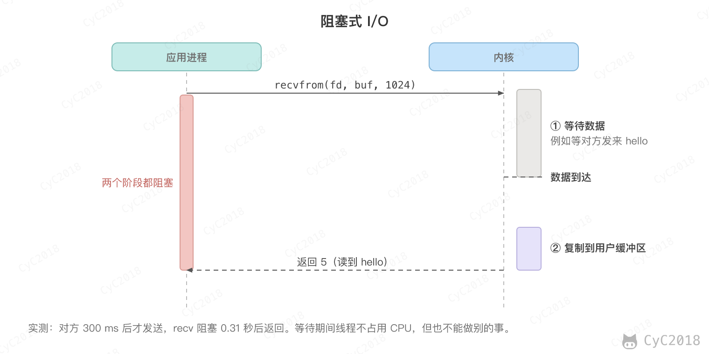
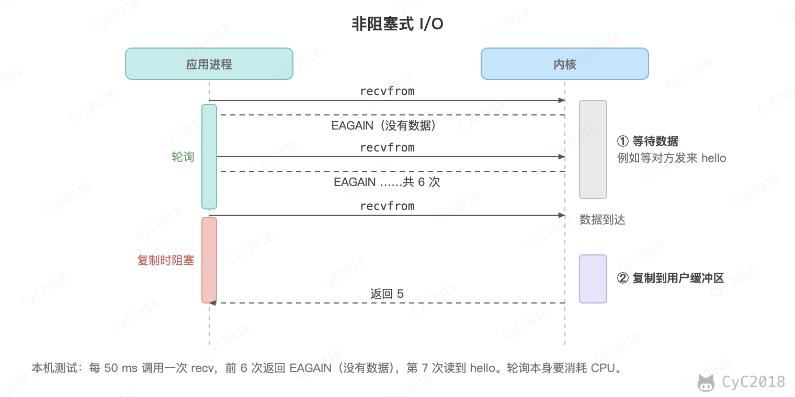
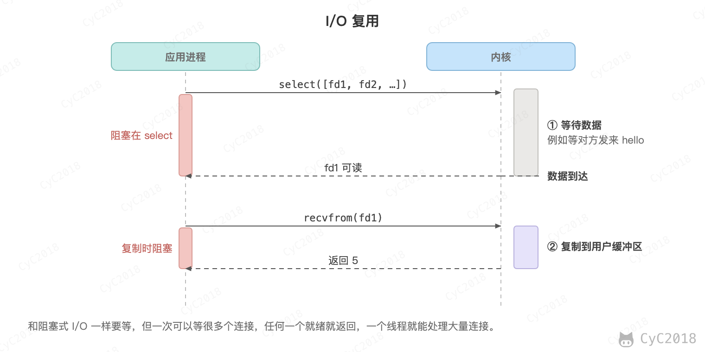
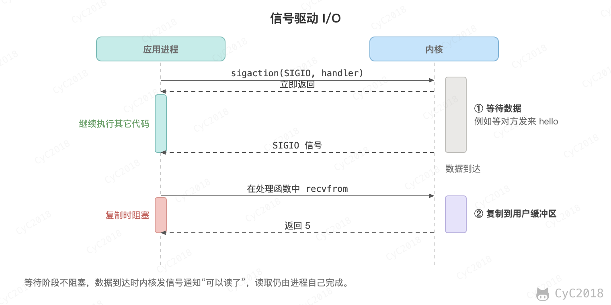
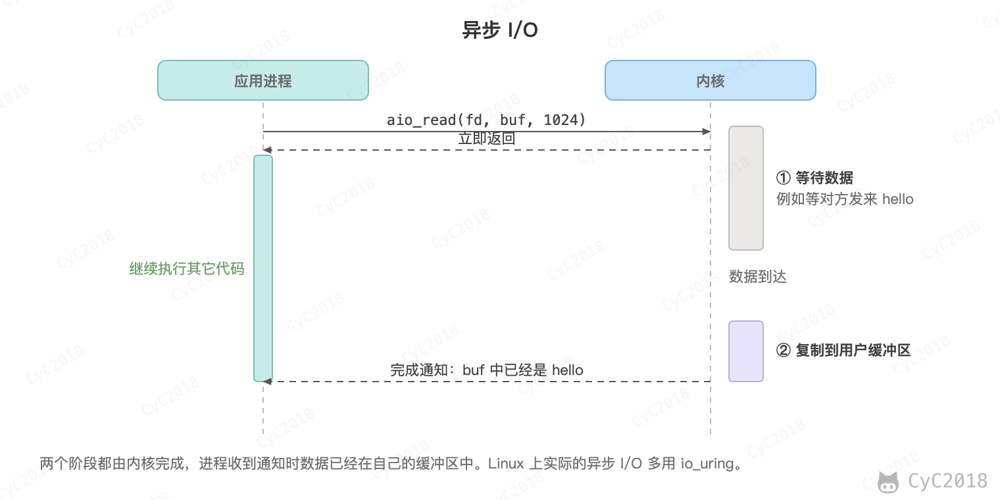
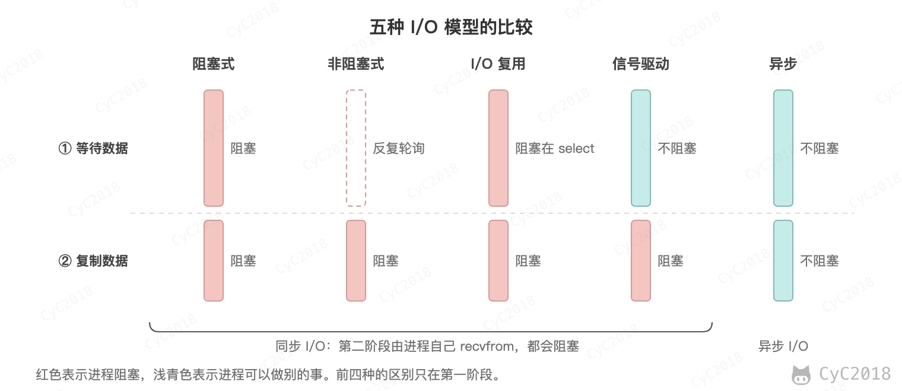
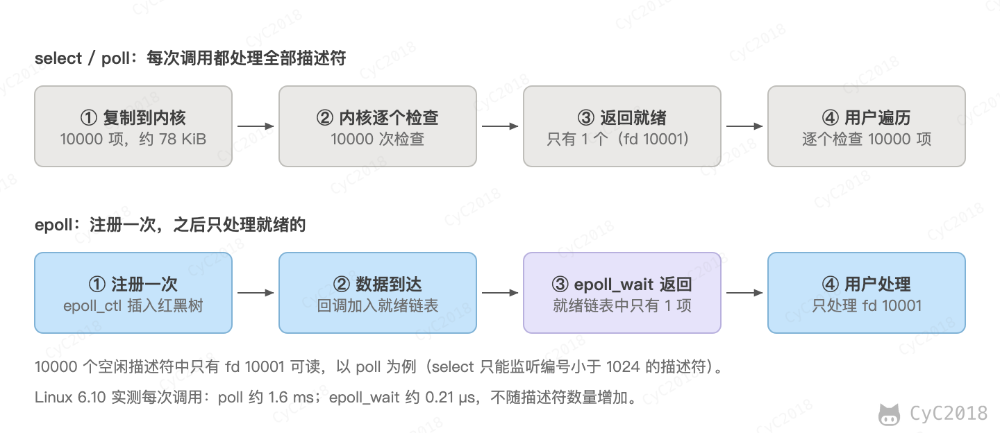
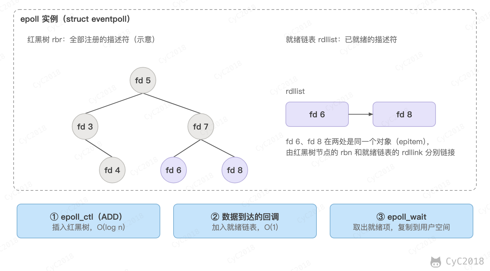

# Socket
<!-- GFM-TOC -->
* [Socket](#socket)
    * [一、I/O 模型](#一io-模型)
        * [阻塞式 I/O](#阻塞式-io)
        * [非阻塞式 I/O](#非阻塞式-io)
        * [I/O 复用](#io-复用)
        * [信号驱动 I/O](#信号驱动-io)
        * [异步 I/O](#异步-io)
        * [五大 I/O 模型比较](#五大-io-模型比较)
    * [二、I/O 复用](#二io-复用)
        * [select](#select)
        * [poll](#poll)
        * [比较](#比较)
        * [epoll](#epoll)
        * [工作模式](#工作模式)
        * [应用场景](#应用场景)
    * [附录：实测](#附录实测)
        * [A1 每次调用的耗时](#a1-每次调用的耗时)
        * [A2 LT 与 ET 的读取过程](#a2-lt-与-et-的读取过程)
        * [A3 select 与 poll 示例的运行结果](#a3-select-与-poll-示例的运行结果)
    * [参考资料](#参考资料)
<!-- GFM-TOC -->


## 一、I/O 模型

一个输入操作通常包括两个阶段：

- 等待数据准备好
- 从内核向进程复制数据

对于一个套接字上的输入操作，第一步通常涉及等待数据从网络中到达。当所等待数据到达时，它被复制到内核中的某个缓冲区。第二步就是把数据从内核缓冲区复制到应用进程缓冲区。

Unix 有五种 I/O 模型：

- 阻塞式 I/O
- 非阻塞式 I/O
- I/O 复用（select、poll 和 epoll）
- 信号驱动式 I/O（SIGIO）
- 异步 I/O（AIO）

### 阻塞式 I/O

应用进程被阻塞，直到数据从内核缓冲区复制到应用进程缓冲区中才返回。

需要注意的是，阻塞的只是当前进程，其它应用进程还可以执行，因此阻塞不意味着整个操作系统都被阻塞。被阻塞的进程不消耗 CPU 时间，CPU 可以去执行其它进程，因此这种模型的 CPU 利用率比较高。

下图中，recvfrom() 用于接收 Socket 传来的数据，并复制到应用进程的缓冲区 buf 中。这里把 recvfrom() 当成系统调用。

```c
ssize_t recvfrom(int sockfd, void *buf, size_t len, int flags, struct sockaddr *src_addr, socklen_t *addrlen);
```

<div align="center">  </div><br>

### 非阻塞式 I/O

应用进程执行系统调用之后，如果数据还没有准备好，内核立即返回错误码 EAGAIN（也写作 EWOULDBLOCK）。应用进程可以继续执行，但是需要不断的执行系统调用来获知 I/O 是否完成，这种方式称为轮询（polling）。

由于 CPU 要处理更多的系统调用，因此这种模型的 CPU 利用率比较低。

<div align="center">  </div><br>

### I/O 复用

使用 select、poll 或 epoll 等待数据，并且可以等待多个套接字中的任何一个变为可读。这一过程会被阻塞，当某一个套接字可读时返回，之后再使用 recvfrom 把数据从内核复制到进程中。

它可以让单个进程具有处理多个 I/O 事件的能力。又被称为 Event Driven I/O，即事件驱动 I/O。

如果一个 Web 服务器没有 I/O 复用，那么每一个 Socket 连接都需要创建一个线程去处理。如果同时有几万个连接，那么就需要创建相同数量的线程。相比于多进程和多线程技术，I/O 复用不需要进程线程创建和切换的开销，系统开销更小。

<div align="center">  </div><br>

### 信号驱动 I/O

应用进程使用 sigaction 系统调用，内核立即返回，应用进程可以继续执行，也就是说等待数据阶段应用进程是非阻塞的。内核在数据到达时向应用进程发送 SIGIO 信号，应用进程收到之后在信号处理程序中调用 recvfrom 将数据从内核复制到应用进程中。

相比于非阻塞式 I/O 的轮询方式，信号驱动 I/O 的 CPU 利用率更高。

<div align="center">  </div><br>

### 异步 I/O

应用进程执行 aio_read 系统调用会立即返回，应用进程可以继续执行，不会被阻塞，内核会在所有操作完成之后向应用进程发送信号。

异步 I/O 与信号驱动 I/O 的区别在于，异步 I/O 的信号是通知应用进程 I/O 完成，而信号驱动 I/O 的信号是通知应用进程可以开始 I/O。

<div align="center">  </div><br>

### 五大 I/O 模型比较

- 同步 I/O：将数据从内核缓冲区复制到应用进程缓冲区的阶段（第二阶段），应用进程会阻塞。
- 异步 I/O：第二阶段应用进程不会阻塞。

同步 I/O 包括阻塞式 I/O、非阻塞式 I/O、I/O 复用和信号驱动 I/O ，它们的主要区别在第一个阶段。

非阻塞式 I/O 、信号驱动 I/O 和异步 I/O 在第一阶段不会阻塞。

<div align="center">  </div><br>

## 二、I/O 复用

I/O 复用（I/O multiplexing）指用一个系统调用同时等待多个描述符，其中任何一个就绪就返回。Linux 上的实现依次为 select、poll 和 epoll，epoll 解决了前两者在描述符数量很多时的性能问题。

这里的多路复用指内核对描述符的事件通知，与 HTTP/2 在一个 TCP 连接上并发多个流不是同一个概念，见 [HTTP/2.0](HTTP.md#七http20)。

下面用一个例子贯穿全节：服务器维护 10000 个空闲连接，任意时刻只有 1 个连接可读。

### select

select 的函数原型如下：

```c
int select(int nfds, fd_set *readfds, fd_set *writefds, fd_set *exceptfds, struct timeval *timeout);
```

select 等待 readfds、writefds 和 exceptfds 三个集合中的描述符就绪。timeout 为 NULL 时一直阻塞，为 0 时立即返回。返回值大于 0 表示就绪的描述符个数，0 表示超时，-1 表示出错。

fd_set 是位图，第 n 位表示描述符 n 是否在集合中。FD_SETSIZE 在 Linux 中为 1024，因此 select 只能监听编号小于 1024 的描述符（[select(2)](https://man7.org/linux/man-pages/man2/select.2.html)）。

select 返回时会修改传入的集合，只保留就绪的描述符，因此每次调用前都要重新设置集合。下面的代码监听 sock1 和 sock2 的可读事件：

```c
fd_set rset;
FD_ZERO(&rset);
FD_SET(sock1, &rset);
FD_SET(sock2, &rset);
int maxfd = sock1 > sock2 ? sock1 : sock2;
struct timeval tv = {10, 0};
int n = select(maxfd + 1, &rset, NULL, NULL, &tv);
if (n > 0) {
    if (FD_ISSET(sock1, &rset)) { /* sock1 可读 */ }
    if (FD_ISSET(sock2, &rset)) { /* sock2 可读 */ }
}
```

### poll

poll 的函数原型和参数结构如下：

```c
int poll(struct pollfd *fds, nfds_t nfds, int timeout);

struct pollfd {
    int   fd;        /* 描述符 */
    short events;    /* 关注的事件，由应用设置 */
    short revents;   /* 实际发生的事件，由内核返回 */
};
```

poll 用结构体数组代替位图，数组长度由 nfds 指定，没有 FD_SETSIZE 的限制。timeout 以毫秒为单位，负数表示一直阻塞。revents 由内核在每次调用时重新写入，应用不需要清零。下面的代码监听的事件与 select 的例子相同：

```c
struct pollfd fds[2];
fds[0].fd = sock1;  fds[0].events = POLLIN;
fds[1].fd = sock2;  fds[1].events = POLLIN;
int n = poll(fds, 2, 10000);
if (n > 0) {
    if (fds[0].revents & POLLIN) { /* sock1 可读 */ }
    if (fds[1].revents & POLLIN) { /* sock2 可读 */ }
}
```

### 比较

#### 1. 功能

- select 会修改传入的集合，poll 把结果写入 revents，events 保持不变，因此 pollfd 数组可以反复使用；
- select 只能监听编号小于 1024 的描述符，poll 没有这个限制，但 nfds 不能超过 RLIMIT_NOFILE（Linux）；
- select 只能按读、写、异常三个集合区分事件，poll 的 events 可以直接指定 POLLIN、POLLOUT、POLLPRI 等事件。

#### 2. 速度

select 和 poll 每次调用都要做三件事（Linux 6.12 的 fs/select.c，do_select 与 do_poll）：

- 把描述符集合从用户空间复制到内核；
- 对描述符逐个调用 poll 方法检查是否就绪，在找到就绪的描述符之前，把等待项挂到每个描述符的等待队列上；
- 返回前把等待项从所有等待队列上摘下，再把结果返回给用户空间。

这些工作的开销与描述符数量 n 成正比，与就绪的数量无关。返回后，应用还要遍历 n 个描述符，才能找出就绪的那一个。以 10000 个描述符为例，poll 每次复制 10000 个 8 字节的 pollfd，约 78 KiB。

实测结果与此一致（Linux 6.10，见[附录 A1](#a1-每次调用的耗时)）：只有 1 个描述符就绪时，监听 1000 个描述符的 select 和 poll 每次调用都约 34 µs，poll 监听 1 万个约 1.6 ms、10 万个约 22 ms；epoll_wait 无论注册了多少个描述符，每次调用都约 0.21 µs。

<div align="center">  </div><br>

#### 3. 可移植性

select 几乎被所有系统支持；poll 是 POSIX 标准中的接口，类 Unix 系统都支持；epoll 只能在 Linux 上使用。

### epoll

epoll 的接口由三个系统调用组成：

```c
int epoll_create(int size);
int epoll_ctl(int epfd, int op, int fd, struct epoll_event *event);
int epoll_wait(int epfd, struct epoll_event *events, int maxevents, int timeout);
```

epoll_create 创建一个 epoll 实例；epoll_ctl 对描述符执行 EPOLL_CTL_ADD、EPOLL_CTL_MOD 或 EPOLL_CTL_DEL，即注册、修改关注的事件或删除；epoll_wait 返回就绪的事件。epoll_wait 与 read 一样会让调用线程睡眠，区别在于它等待的是注册的任意一个描述符就绪，并且带有超时参数。

epoll 实例在内核中是 struct eventpoll，其中有两个结构（Linux 6.12 的 fs/eventpoll.c）：

- 红黑树 rbr 保存所有注册的描述符（兴趣列表），插入、查找和删除都是 O(log n)；
- 就绪链表 rdllist 保存已经就绪的描述符，追加和取出都是 O(1)。

epoll_ctl 在 EPOLL_CTL_ADD 时把描述符插入红黑树，并在它的等待队列上挂一个回调 ep_poll_callback。之后描述符变为可读，内核调用回调，把它加入就绪链表，应用不需要做任何事。epoll_wait 只检查就绪链表：链表为空就阻塞；否则把其中的事件（最多 maxevents 个）复制到用户空间。

<div align="center">  </div><br>

回到前面的例子：10000 个连接只有 1 个可读时，epoll_wait 只返回这 1 个事件，每次调用约 0.21 µs，而 poll 约 1.6 ms。与 select 和 poll 相比，epoll 有三点不同：

- 描述符只在 epoll_ctl 时复制一次，之后每次 epoll_wait 不再复制整个集合；
- 就绪由回调通知，内核不需要在每次调用时检查所有描述符；
- epoll_wait 只返回就绪的事件，应用不需要遍历全部描述符。

红黑树用于快速定位。epoll_ctl 的 MOD 和 DEL 操作只给出描述符编号，内核需要找到对应的节点，链表只能顺序查找，时间是 O(n)，而树可以保证 O(log n)。就绪链表只做追加和取出，用链表即可。

epoll 没有 select 的 1024 限制。实际上限取决于三个因素：进程的文件描述符上限（RLIMIT_NOFILE，即 ulimit -n，很多系统的默认软限制较小，需要调大）；每个用户能注册的描述符总数 max_user_watches，默认约为可用低端内存的 4%，再除以每个注册项的成本（epoll(7)）；以及内存。每个注册项在 64 位内核中约占 160 字节，因此 100 万个注册约占 150 MiB 内核内存，还不包括套接字本身的缓冲区。在 16 GiB 内存的机器上，max_user_watches 的默认值估算约为 430 万。

使用 epoll 时还有两点需要注意：

- 关闭描述符不会立即从兴趣列表中移除，只有引用同一个打开文件的所有描述符都关闭后才会移除（epoll(7)）。描述符编号可能被新连接复用，事件缓存中残留的旧事件就会误指向新连接，因此应在关闭前用 EPOLL_CTL_DEL 移除，并在事件缓存中标记该连接已关闭；
- 非阻塞 connect 返回 EINPROGRESS 后，可写事件只表示连接过程结束，成功与否要用 getsockopt(SO_ERROR) 判断，结果为 0 才表示成功（connect(2)）。

### 工作模式

epoll 有两种触发模式：水平触发（level-triggered, LT）和边缘触发（edge-triggered, ET）。LT 只要描述符仍然可读，每次 epoll_wait 都会报告它；ET 只在有新数据到达时报告一次。

#### 1. LT 模式

LT 是默认模式，语义与 poll 相同（epoll(7)）。epoll_wait 返回描述符后，内核会把它放回就绪链表，下一次调用时再检查一次。因此应用没有读完数据，下一次 epoll_wait 还会返回它。LT 模式下，描述符可以是阻塞的，也可以是非阻塞的。

关注写事件要按需进行。发送缓冲区通常是可写的，如果一直关注 EPOLLOUT，每次 epoll_wait 都会立即返回。应用只在 write 返回 EAGAIN（发送缓冲区已满）时注册 EPOLLOUT，数据发完后用 EPOLL_CTL_MOD 取消。

#### 2. ET 模式

ET 减少了重复通知，但要求应用一次把数据处理完。下面的例子中，客户端一次发送 3000 字节的请求，服务端每次 read 最多读 1024 字节：

| 步骤 | LT | ET，每次事件只 read 一次 | ET，循环 read 到 EAGAIN |
| --- | --- | --- | --- |
| 3000 字节到达，epoll_wait 返回，read 读 1024 字节 | 缓冲区剩 1976 字节 | 缓冲区剩 1976 字节 | 缓冲区剩 1976 字节 |
| 下一次 epoll_wait | 立即返回，仍然可读 | 阻塞，没有新数据就不会产生事件 | 不会走到这一步，先继续读 |
| 之后的读取 | 每次返回后读 1024、952 字节 | 无，1976 字节一直留在缓冲区 | 继续读 1024、952 字节，再 read 返回 EAGAIN |
| 结果 | 全部读完，之后阻塞 | 客户端等待响应，连接停住 | 全部读完，然后回到 epoll_wait |

表中的过程与实测一致（Linux 6.10，见[附录 A2](#a2-lt-与-et-的读取过程)）。

ET 模式下，描述符必须是非阻塞的，并且每次事件都要读到 EAGAIN（epoll(7)）。EAGAIN 表示缓冲区已经空了，这时才能回到 epoll_wait。如果描述符是阻塞的，最后一次 read 在缓冲区为空时会一直等待，整个事件循环停在这里，其它描述符也得不到处理。下面是伪代码：

```c
/* 伪代码：ET 模式下处理一个可读事件 */
for (;;) {
    n = read(fd, buf, sizeof(buf));
    if (n > 0) {
        handle(buf, n);                 /* 处理读到的数据 */
        continue;
    }
    if (n == 0) {                       /* 对端关闭 */
        close_connection(fd);
        break;
    }
    if (errno == EAGAIN) {              /* 缓冲区已空，回到 epoll_wait */
        break;
    }
    close_connection(fd);               /* 其它错误 */
    break;
}
```

ET 还可能造成饥饿：如果某个连接的数据源源不断，循环读取会长时间占用线程，其它连接得不到处理。常见的做法是每次事件只读固定次数，剩下的数据留给下一轮处理；epoll(7) 建议用就绪链表在描述符之间轮流处理。如果读取后没有读到 EAGAIN，剩下的数据不会再产生事件，连接会一直停住，这种情况更接近永久饿死。

EPOLLONESHOT 可以与 ET 一起使用：描述符触发一次事件后会被禁用，直到用 EPOLL_CTL_MOD 重新启用。多个线程处理同一个连接时，可以避免两个线程同时处理该描述符的事件（epoll_ctl(2)）。

### 应用场景

#### 1. select 应用场景

select 的 timeout 精度为微秒（struct timeval），poll 和 epoll_wait 为毫秒。需要更高精度时可以使用 pselect、ppoll，或 Linux 5.11 引入的 epoll_pwait2，它们的超时参数精确到纳秒。select 可移植性最好，几乎所有平台都支持，适合描述符编号较小、数量很少的跨平台程序。

#### 2. poll 应用场景

poll 没有 1024 的限制，在平台支持且描述符数量不多时可以代替 select。poll 每次调用仍要遍历全部描述符，描述符数量很多时应使用 epoll。

#### 3. epoll 应用场景

epoll 只能在 Linux 上使用，适合同时监听大量描述符、且多数是长连接的服务器。描述符只有几十、几百个时，select 和 poll 的开销很小，监听 100 个描述符的 poll 每次约 3 µs（见[附录 A1](#a1-每次调用的耗时)），epoll 的优势不明显。

如果描述符的状态变化很频繁、每次活跃的时间很短，epoll 的收益会被抵消：兴趣列表保存在内核中，每次修改都要一次 epoll_ctl 系统调用。

Reactor 模式（反应器模式）把事件循环和事件处理分开：线程通过 epoll 等待事件，就绪后调用对应的处理函数，处理函数不能长时间阻塞。Redis 的文件事件处理器基于 Reactor 模式，事件循环在主线程中运行，在 Linux 上封装 epoll，注册时只使用 EPOLLIN 和 EPOLLOUT，即水平触发，见 [Redis](Redis.md#十事件)。多路复用让一个线程同时处理多个连接，因此单线程的 Redis 也能处理大量连接；命令仍由主线程逐个执行。

Netty 的 NioEventLoop 基于 Java NIO 的 Selector，在 Linux 上由 JDK 的 epoll 实现，注册时不使用 EPOLLET，因此是水平触发（OpenJDK 的 EPoll 类）。Netty 的原生 epoll 传输（io.netty.channel.epoll）则使用 EPOLLET。Selector 的用法见 [Java IO](Java%20IO.md#选择器)。

多线程 Reactor 中，主 Reactor 通常只注册监听套接字，负责 accept；新连接按轮询或哈希分配给某个子 Reactor，由该子 Reactor 的 epoll 注册并处理读写。一个连接的描述符只注册到一个 epoll 实例中，读写都由同一个线程完成，连接的状态不需要加锁。Netty 的 BossGroup 与 WorkerGroup 就是这种主从结构。

如果多个线程的 epoll 同时监听同一个监听套接字，一个新连接会唤醒所有等待的线程，这称为惊群（thundering herd）。EPOLLEXCLUSIVE（Linux 4.5 起）让内核只唤醒其中的一个或部分等待者；SO_REUSEPORT（Linux 3.9 起）让每个线程绑定各自的监听套接字，由内核把新连接分配给其中一个（epoll_ctl(2)、socket(7)）。

Proactor 模式与 Reactor 不同：Reactor 通知描述符已经就绪，由应用执行读写；Proactor 由内核执行 I/O，完成后通知应用，例如 Windows 的 IOCP。Linux 上的 epoll 属于 Reactor。

io_uring 与 epoll 的思路不同：epoll 只通知描述符就绪，之后仍要调用 read、write；io_uring 由应用把读写等操作放入提交队列（submission queue, SQ），内核完成后把结果放入完成队列（completion queue, CQ），两个队列都是用户空间与内核共享的环形缓冲区（io_uring_setup(2)）。SQPOLL 模式由内核线程轮询提交队列，省去提交时的系统调用；内核线程空闲一段时间后会停止轮询，等待应用唤醒，负载不高时并不一定比 epoll 快。

Go 的运行时网络轮询器在 Linux 上也基于 epoll，并且使用 EPOLLET（Go 源码 runtime/netpoll_epoll.go）。协程在 I/O 未就绪时挂起，就绪后被唤醒，因此业务代码可以写成同步的形式，epoll 只是运行时底层的事件通知。

## 附录：实测

以下实验在 Docker Desktop 的 Linux 虚拟机中运行：Ubuntu 24.04 容器，内核 6.10.14-linuxkit（aarch64，宿主为 Apple M1 Pro），gcc 13.3.0，编译选项 -O2。

### A1 每次调用的耗时

方法：n 个描述符中，n - 1 个是各自独立的 UDP 套接字（没有数据，不可读），1 个是管道的读端（已写入 1 字节，可读）。超时为 0，每次调用返回 1 个就绪描述符。select 和 poll 每次调用都传入全部描述符；epoll 只在开始时用 epoll_ctl 注册一次，之后每次调用 epoll_wait 不传入描述符。迭代次数按每次测量至少 50 ms 校准，每个数量重复 5 次取中位数，整个程序运行两次。容器的描述符上限设为 200000（docker run --ulimit nofile=200000:200000）。

核心代码（省略了计时和错误处理）：

```c
struct pollfd *pfd = malloc(sizeof(*pfd) * n);
for (int i = 0; i < n; i++) { pfd[i].fd = fds[i]; pfd[i].events = POLLIN; }
for (int k = 0; k < iters; k++) poll(pfd, n, 0);                 /* 返回 1 */

int ep = epoll_create1(0);
for (int i = 0; i < n; i++) {
    struct epoll_event ev = {.events = EPOLLIN, .data.fd = fds[i]};
    epoll_ctl(ep, EPOLL_CTL_ADD, fds[i], &ev);                   /* 只注册一次 */
}
for (int k = 0; k < iters; k++) epoll_wait(ep, &out, 1, 0);      /* 返回 1 */
```

select 的 FD_SETSIZE 为 1024，编号超过的描述符不能用 select，因此 n = 10000 和 100000 时没有 select 的结果。

结果（单位 µs，每格为第一次运行 / 第二次运行）：

| n | select | poll | epoll |
| --- | --- | --- | --- |
| 1 | 0.258 / 0.258 | 0.224 / 0.257 | 0.211 / 0.213 |
| 10 | 0.474 / 0.471 | 0.431 / 0.436 | 0.218 / 0.214 |
| 100 | 3.110 / 3.069 | 3.198 / 3.164 | 0.212 / 0.213 |
| 1000 | 33.894 / 33.867 | 34.078 / 35.432 | 0.217 / 0.212 |
| 10000 | - / - | 1681.729 / 1548.770 | 0.211 / 0.211 |
| 100000 | - / - | 22946.635 / 22109.146 | 0.211 / 0.211 |

select 和 poll 的耗时随描述符数量增长，1000 个以内每个描述符约 0.03 µs，更多时每个约 0.16～0.23 µs；epoll 与描述符数量无关。

### A2 LT 与 ET 的读取过程

方法：用 socketpair 建立一对 UNIX 域流套接字，读端设为非阻塞并注册到 epoll；对端一次写入 3000 字节，每次 read 最多 1024 字节，epoll_wait 的超时为 100 ms。

核心代码：

```c
struct epoll_event ev = {.events = EPOLLIN | extra, .data.fd = sv[0]};  /* extra 为 0 或 EPOLLET */
epoll_ctl(ep, EPOLL_CTL_ADD, sv[0], &ev);
write(sv[1], buf, 3000);
for (int round = 1; round <= 4; round++) {
    int n = epoll_wait(ep, &out, 1, 100);
    if (n == 0) break;
    for (;;) {
        ssize_t r = read(sv[0], buf, 1024);
        if (r < 0 || !loop) break;                                  /* loop 为 0 时每次事件只读一次 */
    }
}
```

运行结果：

```text
== LT，每次事件 read 一次
epoll_wait #1 -> 1
  read -> 1024
epoll_wait #2 -> 1
  read -> 1024
epoll_wait #3 -> 1
  read -> 952
epoll_wait #4 -> 0（100 ms 超时）
结束时缓冲区剩余 0 字节
== ET，每次事件 read 一次
epoll_wait #1 -> 1
  read -> 1024
epoll_wait #2 -> 0（100 ms 超时）
结束时缓冲区剩余 1976 字节
== ET，循环 read 到 EAGAIN
epoll_wait #1 -> 1
  read -> 1024
  read -> 1024
  read -> 952
  read -> -1 EAGAIN
epoll_wait #2 -> 0（100 ms 超时）
结束时缓冲区剩余 0 字节
```

### A3 select 与 poll 示例的运行结果

用两个管道的读端模拟 sock1 和 sock2，只向 sock2 写入 1 字节，然后运行正文中的 select 与 poll 代码（加上输出语句）：

```c
int p1[2], p2[2];
pipe(p1); pipe(p2);
int sock1 = p1[0], sock2 = p2[0];
write(p2[1], "x", 1);
```

运行结果：

```text
select 返回 1
select: sock2 可读
poll 返回 1
poll: sock2 可读
```

## 参考资料

- Stevens W R, Fenner B, Rudoff A M. UNIX network programming[M]. Addison-Wesley Professional, 2004.
- [select(2) — Linux manual page](https://man7.org/linux/man-pages/man2/select.2.html)
- [poll(2) — Linux manual page](https://man7.org/linux/man-pages/man2/poll.2.html)
- [epoll(7) — Linux manual page](https://man7.org/linux/man-pages/man7/epoll.7.html)
- [epoll_ctl(2) — Linux manual page](https://man7.org/linux/man-pages/man2/epoll_ctl.2.html)
- [epoll_wait(2) — Linux manual page](https://man7.org/linux/man-pages/man2/epoll_wait.2.html)
- [io_uring_setup(2) — Linux manual page](https://man7.org/linux/man-pages/man2/io_uring_setup.2.html)
- [connect(2) — Linux manual page](https://man7.org/linux/man-pages/man2/connect.2.html)
- [socket(7) — Linux manual page](https://man7.org/linux/man-pages/man7/socket.7.html)
- [Linux 6.12 fs/eventpoll.c](https://github.com/torvalds/linux/blob/v6.12/fs/eventpoll.c)、[fs/select.c](https://github.com/torvalds/linux/blob/v6.12/fs/select.c)
- [Redis 7.4.1 src/ae_epoll.c](https://github.com/redis/redis/blob/7.4.1/src/ae_epoll.c)
- [Netty 4.1 AbstractEpollChannel](https://github.com/netty/netty/blob/4.1/transport-classes-epoll/src/main/java/io/netty/channel/epoll/AbstractEpollChannel.java)
- [Go runtime netpoll_epoll.go](https://github.com/golang/go/blob/master/src/runtime/netpoll_epoll.go)
- [OpenJDK EPoll.java](https://github.com/openjdk/jdk/blob/master/src/java.base/linux/classes/sun/nio/ch/EPoll.java)
- [Boost application performance using asynchronous I/O](https://www.ibm.com/developerworks/linux/library/l-async/)
- [Synchronous and Asynchronous I/O](https://msdn.microsoft.com/en-us/library/windows/desktop/aa365683(v=vs.85).aspx)
