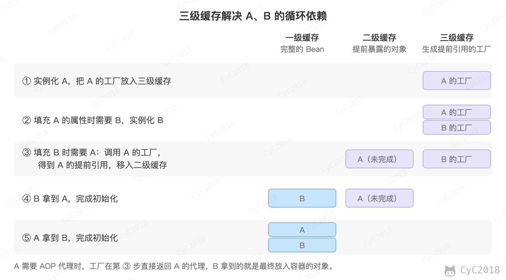
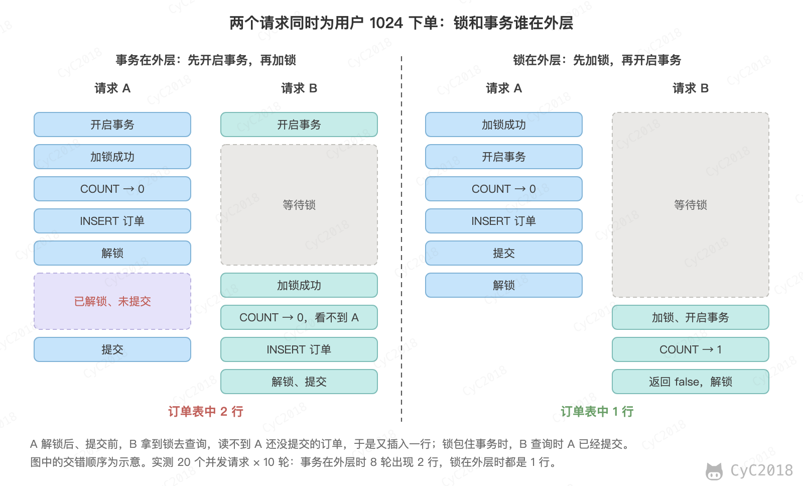
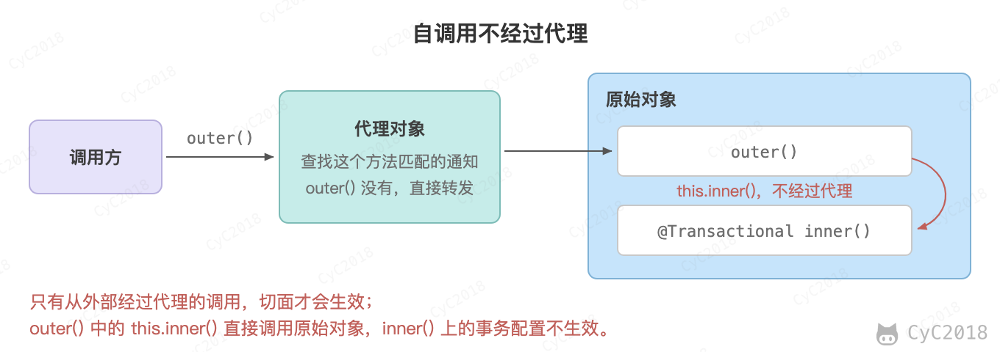
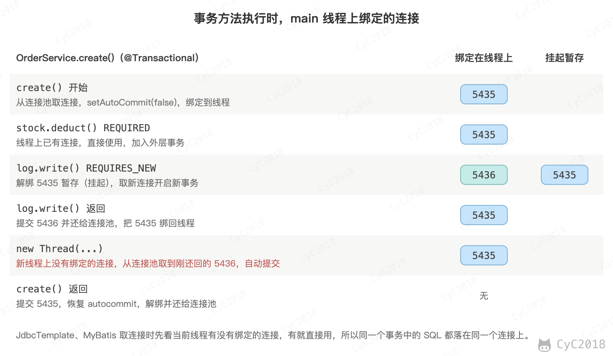
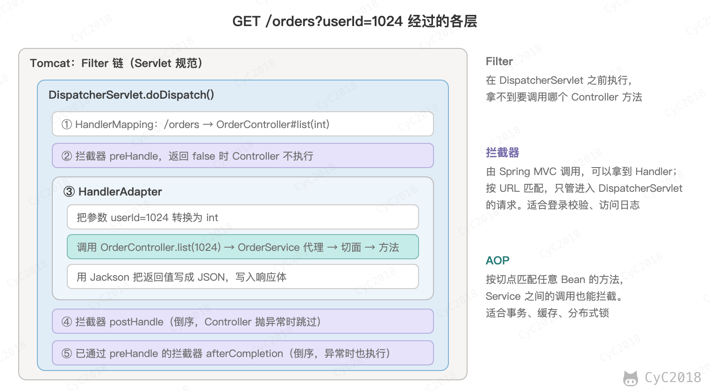

# Spring
<!-- GFM-TOC -->
* [Spring](#spring)
    * [一、IoC 与 Bean](#一ioc-与-bean)
        * [IoC 与依赖注入](#ioc-与依赖注入) 🔥
        * [Bean 的生命周期](#bean-的生命周期) 🔥
        * [Bean 的作用域与线程安全](#bean-的作用域与线程安全)
        * [循环依赖](#循环依赖) 🔥
    * [二、AOP](#二aop) 🔥🔥
        * [动态代理](#动态代理)
        * [代理的创建与通知的执行](#代理的创建与通知的执行)
        * [自调用](#自调用)
    * [三、事务](#三事务)
        * [声明式事务](#声明式事务)
        * [事务的实现原理](#事务的实现原理)
        * [传播行为](#传播行为)
        * [事务失效](#事务失效)
    * [四、Spring Boot 自动配置](#四spring-boot-自动配置) 🔥
        * [启动流程](#启动流程)
    * [五、Spring MVC](#五spring-mvc)
        * [请求的处理过程](#请求的处理过程) 🔥
    * [六、MyBatis](#六mybatis)
        * [#{} 和 ${} 的区别](#-和--的区别)
        * [Mapper 接口为什么不需要实现类](#mapper-接口为什么不需要实现类)
        * [动态 SQL](#动态-sql)
        * [缓存](#缓存)
    * [七、Spring 中的设计模式](#七spring-中的设计模式)
    * [附录：实测](#附录实测)
        * [A1 单例 Bean 的成员变量](#a1-单例-bean-的成员变量)
        * [A2 锁与事务的先后](#a2-锁与事务的先后)
        * [A3 Bean 创建的调用栈](#a3-bean-创建的调用栈)
        * [A4 代理的创建与通知的顺序](#a4-代理的创建与通知的顺序)
        * [A5 事务与数据库连接](#a5-事务与数据库连接)
        * [A6 @Async 与 @Lazy 的循环依赖](#a6-async-与-lazy-的循环依赖)
        * [A7 Spring Boot 的启动过程](#a7-spring-boot-的启动过程)
        * [A8 @Autowired 的多个候选](#a8-autowired-的多个候选)
        * [A9 事务的传播与事件监听](#a9-事务的传播与事件监听)
        * [A10 MyBatis 的参数与拦截器的回调](#a10-mybatis-的参数与拦截器的回调)
        * [A11 无法被代理的方法](#a11-无法被代理的方法)
        * [A12 MyBatis 的结果映射、重载与二级缓存](#a12-mybatis-的结果映射重载与二级缓存)
        * [A13 注解声明 Bean 与集合注入](#a13-注解声明-bean-与集合注入)
        * [A14 Spring MVC 的映射与参数解析](#a14-spring-mvc-的映射与参数解析)
    * [参考资料](#参考资料)
<!-- GFM-TOC -->


## 一、IoC 与 Bean

### IoC 与依赖注入 🔥

控制反转（Inversion of Control, IoC）指的是对象不再自己创建所依赖的对象，而是由容器创建好之后交给它。例如 OrderService 需要 OrderRepository，它不在内部 new 一个，而是声明自己需要，由 Spring 容器把创建好的对象传进来，这个过程称为依赖注入（Dependency Injection, DI）。

```java
@Service
public class OrderService {
    private final OrderRepository repository;

    public OrderService(OrderRepository repository) {   // 构造器注入
        this.repository = repository;
    }
}
```

这样做的好处：

- 对象只依赖接口，替换实现、在测试中注入模拟对象都不需要修改代码；
- 对象的创建、作用域和生命周期由容器统一管理，事务、缓存这类功能也是容器在创建对象时织入的。

容器通过注解知道要创建哪些对象：类上标注 @Component 或者它的派生注解 @Service、@Repository、@Controller，启动时由组件扫描发现；第三方库中的类无法修改源码，就在 @Configuration 类中写一个返回该对象的方法，并标注 @Bean。

@Service 等派生注解本身标注了 @Component（称为元注解），所以自定义的注解标上 @Component 也能声明 Bean。

依赖注入有构造器注入、Setter 注入和字段注入（把 @Autowired 加在字段上）三种方式。Spring 官方推荐构造器注入：依赖可以声明为 final，对象创建出来就是完整可用的，缺少依赖时启动就会失败。

@Autowired 和 @Resource 都能注入依赖，区别在于查找的顺序：

- @Autowired 是 Spring 的注解，先按类型查找，找到多个时依次看 @Primary、字段名或参数名、@Priority（Spring 6.1 及以前 @Priority 先于名称），仍然无法确定就报错，可以用 @Qualifier 指定 Bean 的名称；
- @Resource 是 Jakarta EE（原 JSR-250）的注解，指定了 name 时按名称查找，否则先按字段名查找，找不到再按类型查找。它只能用在字段和 Setter 上，不能用在构造器上。

例如容器中有两个 PayService 类型的 Bean，名称分别是 alipay 和 wechat：

```java
@Resource PayService wechat;      // 注入名称为 wechat 的 Bean
@Autowired PayService alipay;     // 按类型找到两个，再按字段名匹配到 alipay
@Autowired PayService payService; // 字段名匹配不上，启动失败
```

第三行启动时报错 NoUniqueBeanDefinitionException: expected single matching bean but found 2: alipay,wechat。给 wechat 加上 @Primary 后，后两行注入的都是 wechat（见[附录 A8](#a8-autowired-的多个候选)）。

需要按条件选择实现时，可以注入 `Map<String, PayService>`，按 Bean 的名称取出，例如 `services.get("wechat").pay()`，新增渠道只需再写一个实现类，这是策略模式在 Spring 中的常见写法（见[附录 A13](#a13-注解声明-bean-与集合注入)）。

常用的注解按用途分为以下几类：

- 声明 Bean：@Component、@Service、@Repository、@Controller，@Configuration 与 @Bean；
- 注入：@Autowired、@Resource、@Qualifier、@Primary，@Value 注入配置项；
- 作用域与生命周期：@Scope、@Lazy、@PostConstruct、@PreDestroy；
- AOP 与事务：@Aspect、@Around、@Transactional、@Async；
- Spring Boot：@SpringBootApplication、@ConfigurationProperties、@ConditionalOnClass；
- Spring MVC：@RestController、@GetMapping、@PathVariable、@RequestParam、@RequestBody。

### Bean 的生命周期 🔥

一个单例 Bean 从创建到销毁分为实例化、属性填充、初始化、销毁四个阶段，第 3～6 步属于初始化：

1. 实例化：调用构造函数创建对象；
2. 属性填充：注入依赖；
3. Aware 回调：例如 BeanNameAware 把 Bean 的名字传给它；
4. BeanPostProcessor 的 postProcessBeforeInitialization()；
5. 初始化：依次调用 @PostConstruct 方法、InitializingBean 的 afterPropertiesSet() 和配置的 init-method，其中 @PostConstruct 实际由内置的 BeanPostProcessor 在第 4 步调用，排在自定义的之后；
6. BeanPostProcessor 的 postProcessAfterInitialization()，AOP 就是在这一步把 Bean 替换为代理对象的；
7. 容器关闭时销毁：依次调用 @PreDestroy 方法、DisposableBean 的 destroy() 和配置的 destroy-method。

让一个 Bean 实现上面所有的回调，实际运行打印的顺序如下（Spring Boot 3.3）：

```text
1 构造函数
2 依赖注入
3 BeanNameAware: orderService
4 BeanPostProcessor before
5 @PostConstruct
6 afterPropertiesSet
7 init-method
8 BeanPostProcessor after
9 @PreDestroy
10 DisposableBean.destroy
11 destroy-method
```

容器启动时，AbstractApplicationContext 的 refresh() 分两步创建 Bean。第一步解析配置：扫描 @Component，解析 @Bean 方法和自动配置类，把每个 Bean 的类名、作用域、依赖等信息保存为 BeanDefinition，这时还没有创建任何对象。这一步由 ConfigurationClassPostProcessor 完成，它是一个 BeanFactoryPostProcessor，这类扩展点在创建对象之前读取或修改 BeanDefinition；BeanPostProcessor 则在之后处理创建出来的每个 Bean（上面的第 4、6 步），可以返回代理替换原来的对象。

第二步在 finishBeanFactoryInitialization() 中，按 BeanDefinition 依次创建所有非懒加载的单例，创建过程依靠反射。在一个 Bean 的构造函数和带 @Autowired 的 Setter 方法中打印调用栈，按调用顺序整理如下（Spring Boot 3.3 实测，见[附录 A3](#a3-bean-创建的调用栈)，最后一行 initializeBean 来自源码）：

```text
AbstractApplicationContext.refresh()
└─ finishBeanFactoryInitialization() → preInstantiateSingletons()     遍历 BeanDefinition
   └─ getBean() → doGetBean()                                         先查单例缓存，没有再创建
      └─ createBean() → doCreateBean()
         ├─ createBeanInstance() → Constructor.newInstance()          实例化：反射调用构造函数
         ├─ populateBean() → AutowiredAnnotationBeanPostProcessor
         │     .postProcessProperties() → Method.invoke()             属性填充：反射调用 Setter
         └─ initializeBean()                                          Aware 回调、初始化、AOP 代理
```

@Autowired 加在字段上时，同样由 postProcessProperties() 处理，区别是用 Field.set() 反射赋值。static 字段上的 @Autowired 会被忽略。

### Bean 的作用域与线程安全

Bean 默认是单例（singleton）的，整个容器中只有一个对象，所有请求共用它。其它常用的作用域：

- prototype：每次从容器获取都创建一个新对象，容器创建之后就不再管理它，不会调用它的销毁方法；
- request、session：每个 HTTP 请求或会话一个对象，只能在 Web 应用中使用。

多个线程同时使用一个单例 Bean 时，Spring 不做任何同步，它是否线程安全取决于有没有可变的成员变量。Controller、Service 通常只持有其他 Bean 的引用，不保存与请求有关的数据，所以是安全的；一旦把请求中的数据存到成员变量里，不同请求就会互相覆盖。例如：

```java
@RestController
public class CounterController {
    private int count = 0;                    // 所有请求共享

    @GetMapping("/count")
    public int count() { return ++count; }    // ++ 不是原子操作
}
```

用 64 个线程并发请求 1 万次，多次运行中每轮丢失的更新从 0 次到 67 次不等（Spring Boot 3.3 实测，见[附录 A1](#a1-单例-bean-的成员变量)）。是否丢失、丢失多少取决于线程执行的时序，这类问题在测试中很难稳定复现。解决方法是不在单例中保存状态，把数据放在方法的局部变量中；确实需要共享时使用 AtomicInteger 等线程安全的类，每个线程各自的数据放在 ThreadLocal 中。

需要注意的是，把 prototype 的 Bean 注入到单例中，只会在创建单例时注入一次，之后每次使用的都是同一个对象。需要每次得到新对象时，注入 ObjectProvider 并在使用时调用 getObject()。

### 循环依赖 🔥

循环依赖指的是两个 Bean 互相依赖，例如 A 依赖 B，B 又依赖 A。

对于通过字段或者 Setter 注入的单例 Bean，Spring 通过提前暴露还没有初始化完成的对象来解决。DefaultSingletonBeanRegistry 中有三个缓存：

- 一级缓存 singletonObjects：初始化完成的 Bean；
- 二级缓存 earlySingletonObjects：提前暴露的、还没有初始化完成的 Bean；
- 三级缓存 singletonFactories：用于生成提前引用的工厂。

<div align="center">  </div><br>

需要三级缓存而不是两级，是因为 A 可能需要被 AOP 代理，而代理正常是在初始化的最后一步才创建的。如果只有两级，A 实例化后就要决定提前暴露什么：暴露原始对象，B 拿到的与最终放入容器的代理不是同一个；暴露代理，则不管有没有循环依赖都要提前创建代理。三级缓存中的工厂只在 B 来取 A 时才调用（图中第 ③ 步），A 需要代理就由它提前创建，没有循环依赖时不会被调用；结果移入二级缓存，A 同时被 B、C 依赖时工厂只调用一次。

以下情况无法解决，启动时抛出 BeanCurrentlyInCreationException：

- 构造器注入的循环依赖：创建 A 时必须先有 B，A 还没有实例化，没有可以提前暴露的对象；
- 原型（prototype）作用域的 Bean：每次获取都创建新对象，不会放入缓存。

另一种无法解决的情况与 @Async 有关。@Async 的代理由 AsyncAnnotationBeanPostProcessor 创建，它只在初始化之后生成代理，没有实现提前引用的 getEarlyBeanReference()，三级缓存中的工厂不会为它提前创建代理：B 拿到的是原始的 A，A 初始化完成后却被替换成了代理，B 中的引用与容器中的对象不一致。Spring 检查到这种情况时启动失败，提示 A 已经以原始版本注入到了 B 中、最终却被包装了；同样的结构把 @Async 换成 @Transactional 则可以正常启动，B 中注入的就是最终的代理（Spring Boot 3.3 实测，见[附录 A6](#a6-async-与-lazy-的循环依赖)）。

构造器注入的循环依赖可以在其中一个参数上加 @Lazy 解开：Spring 先注入一个延迟解析的代理，第一次调用它的方法时才从容器中取出真正的 Bean。

需要注意的是，Spring Boot 2.6 起默认禁止循环依赖，出现时直接启动失败，设置 spring.main.allow-circular-references=true 才能恢复。循环依赖通常说明职责划分有问题，更好的做法是调整依赖关系，例如把互相调用的逻辑抽到新的 Bean C 中。

## 二、AOP 🔥🔥

### 动态代理

面向切面编程（Aspect-Oriented Programming, AOP）用于把日志、事务、权限校验这类分散在各处的逻辑从业务代码中抽离出来。Spring AOP 基于动态代理实现：容器中保存的不是原始对象，而是代理对象，调用方法时先执行代理中的切面逻辑，再调用原始对象的方法。

两种代理方式：

- JDK 动态代理：目标类实现了接口时可以使用，代理类实现同样的接口，只能代理接口中的方法；
- CGLIB：在运行时生成目标类的子类，通过重写方法来代理，因此 final 类，以及 final、static 和 private 方法无法被代理。

Spring Framework 在目标类实现了接口时默认使用 JDK 动态代理；Spring Boot 默认使用 CGLIB，可以通过 spring.aop.proxy-target-class 修改。

动态代理在运行时生成代理类，不必像[静态代理](设计模式%20-%20代理.md)那样为每个接口手写，同一段增强逻辑可以复用到不同的类上。JDK 动态代理的原理可以用下面的代码说明，切面逻辑写在 InvocationHandler 中：

```java
public interface OrderService {
    void create();
}

OrderService target = () -> System.out.println("创建订单");
OrderService proxy = (OrderService) Proxy.newProxyInstance(
        OrderService.class.getClassLoader(),
        new Class<?>[]{OrderService.class},
        (p, method, args) -> {
            System.out.println("开启事务");
            Object result = method.invoke(target, args);
            System.out.println("提交事务");
            return result;
        });
proxy.create();
```

```text
开启事务
创建订单
提交事务
```

生成的代理类 jdk.proxy1.$Proxy0 的父类是 java.lang.reflect.Proxy。Java 不支持多继承，代理类已经继承了 Proxy，就只能通过实现接口与目标类关联，这就是 JDK 动态代理只能代理接口的原因，没有实现接口的类要用 CGLIB 生成子类（JDK 21 实测）。

动态代理与反射是两个概念：反射指的是在运行时获取类的信息、调用方法和读写字段，例如 method.invoke(target, args)；动态代理指的是在运行时生成新的类，例如上面的 Proxy.newProxyInstance() 生成了一个实现 OrderService 接口的类。JDK 动态代理依赖反射：代理类把每次调用都交给 InvocationHandler，传入表示被调用方法的 Method 对象，再由 method.invoke() 调用目标对象。

实际开发中不需要自己创建代理，用 @Aspect 声明切面，Spring 在创建 Bean 时生成代理。常见的做法是自定义一个注解，让切面拦截带有这个注解的方法。例如给下单方法加分布式锁：

```java
@Target(ElementType.METHOD)
@Retention(RetentionPolicy.RUNTIME)
public @interface DistributedLock {
    String prefix();                       // 锁的 key 为 prefix 加第一个参数
}

@Aspect
@Component
@Order(1)                                  // 比事务切面先执行，锁包在事务外面
public class DistributedLockAspect {
    private final StringRedisTemplate redis;   // 构造器注入，省略构造函数

    @Around("@annotation(lock)")           // 拦截带有 @DistributedLock 的方法
    public Object around(ProceedingJoinPoint pjp, DistributedLock lock) throws Throwable {
        String key = lock.prefix() + pjp.getArgs()[0];
        String value = UUID.randomUUID().toString();
        while (!Boolean.TRUE.equals(redis.opsForValue().setIfAbsent(key, value, Duration.ofSeconds(30)))) {
            Thread.onSpinWait();           // 简化：自旋重试
        }
        try {
            return pjp.proceed();          // 调用原方法
        } finally {
            redis.execute(UNLOCK, List.of(key), value);   // 是自己的锁才删除
        }
    }
}

@Service
public class OrderService {
    @Transactional
    @DistributedLock(prefix = "lock:order:user:")
    public boolean createOrder(int userId, int skuId) {
        // 查询这个用户是否已经买过这个商品，没有就插入订单，完整代码见附录 A2
    }
}
```

@Around 中的 @annotation(lock) 表示拦截所有带 @DistributedLock 的方法，并把注解对象作为参数 lock 传入；pjp.proceed() 调用原方法。UNLOCK 是先比较再删除的 Lua 脚本，原理见 [Redis 的 SET NX 指令](分布式.md#redis-的-set-nx-指令)。记录日志、限流、幂等校验也都是这种写法。

需要注意的是，createOrder() 上同时有事务和锁两个切面，它们的先后决定了锁是否包住事务。锁必须在外层：如果事务在外层，锁释放之后事务才提交，这期间另一个请求拿到锁，查不到还没有提交的订单，就会再创建一个。20 个请求同时为同一个用户下单，锁在事务外时 10 轮都只创建了 1 个订单；锁在事务内时 10 轮中有 8 轮创建了 2 个（Spring Boot 3.3、MySQL 8.0 实测，见[附录 A2](#a2-锁与事务的先后)）。

<div align="center">  </div><br>

两个切面都没有指定顺序时，执行的先后是不确定的。@Order 的值越小越先执行、越靠外层，事务切面的默认值是 Ordered.LOWEST_PRECEDENCE，所以上面给锁的切面加上了 @Order(1)。

### 代理的创建与通知的执行

AOP 的几个术语可以和上面的分布式锁切面对应起来：

- 切面（Aspect）：DistributedLockAspect 这个类，它把“拦截哪些方法”和“做什么”组织在一起；
- 切点（Pointcut）：@annotation(lock)，描述要拦截哪些方法；
- 通知（Advice）：around() 方法，即在被拦截的方法前后执行的逻辑；
- 连接点（Join Point）：被拦截的一次方法执行，例如某次 createOrder(1024, 10086)，Spring AOP 只支持方法执行这一种连接点。

通知按执行的时机分为五种：@Before、@AfterReturning（正常返回后）、@AfterThrowing（抛出异常后）、@After（无论是否抛出异常，类似 finally）和 @Around（包住整个调用，可以决定是否调用原方法，也能修改参数和返回值）。

代理是在 [Bean 的生命周期](#bean-的生命周期) 中初始化之后的那一步创建的。引入 AOP 后，容器中会注册一个 BeanPostProcessor：AnnotationAwareAspectJAutoProxyCreator。每个 Bean 初始化完成后，它找出所有切面中与这个 Bean 的方法匹配的通知，有匹配的就创建代理，用代理代替原始对象放入容器，没有匹配的原样返回。在另一个 BeanPostProcessor 中打印，orderService 在初始化前的类型是 OrderService，初始化后变成了 OrderService$$SpringCGLIB$$0。存在循环依赖时代理会提前创建，见[循环依赖](#循环依赖)。

调用代理的方法时，代理把匹配这个方法的通知排成一条链，依次调用，每个通知通过 proceed() 进入下一个，最后一个之后才是目标方法，这是[责任链](设计模式%20-%20责任链.md)模式。例如给 OrderService 加日志 @Order(1) 和鉴权 @Order(2) 两个切面，各有四种通知，调用 create(1024) 的输出如下（Spring Boot 3.3 实测，见[附录 A4](#a4-代理的创建与通知的顺序)）：

```text
日志 @Around 前
  日志 @Before
    鉴权 @Around 前
      鉴权 @Before
        目标方法 create(1024)
      鉴权 @AfterReturning
      鉴权 @After
    鉴权 @Around 后
  日志 @AfterReturning
  日志 @After
日志 @Around 后
```

@Order 值小的切面在外层，先进入、后退出。同一个切面内的顺序是：@Around 的前半段、@Before、目标方法、@AfterReturning 或 @AfterThrowing、@After、@Around 的后半段。

Spring AOP 与 AspectJ 的区别：Spring AOP 在运行时生成代理，只能拦截 Spring Bean 的方法调用，自调用不会被拦截；AspectJ 在编译时或类加载时修改字节码（称为织入），能拦截构造函数、字段访问和自调用，但需要专门的编译器或 Java Agent。Spring 只借用了 AspectJ 的注解和切点表达式的解析，织入仍然靠代理，所以用 @Aspect 写的切面也是 Spring AOP。

需要注意的是，@Transactional 不依赖 AspectJ。去掉 spring-boot-starter-aop 后，容器中的自动代理创建器变为 InfrastructureAdvisorAutoProxyCreator，它只处理事务这类框架内置的通知，事务仍然生效（见[附录 A5](#a5-事务与数据库连接)）。

### 自调用

代理只能拦截从外部经过代理的调用。在目标对象内部调用自己的另一个方法时，等价于 this.inner()，调用的是原始对象，不经过代理，切面不会生效：

<div align="center">  </div><br>

```java
@Service
public class OrderService {
    public void outer() {
        inner();             // 自调用，inner() 上的事务不生效
    }

    @Transactional
    public void inner() {
    }
}
```

这是 @Transactional、@Async、@Cacheable 等注解失效最常见的原因。解决方法是把被调用的方法移到另一个 Bean 中，或者注入自身的代理，通过代理调用。

outer() 本身有事务时，自调用的 inner() 即使声明了 REQUIRES_NEW 也不会开启新事务，外层回滚时一起回滚（Spring 6.1 实测，见[附录 A9](#a9-事务的传播与事件监听)）。

切面失效的其它原因见[事务失效](#事务失效)。其中 final 方法在 CGLIB 代理下容易出问题：调用直接在没有注入依赖的代理对象上执行，@Autowired 的字段为 null（Spring Boot 3.3 实测，见[附录 A11](#a11-无法被代理的方法)）。

## 三、事务

### 声明式事务

@Transactional 同样基于 AOP 实现：代理在方法执行前开启事务，方法正常返回时提交，抛出异常时回滚。

需要注意的是，默认只有 RuntimeException 和 Error 会触发回滚，受检异常（例如 IOException）不会回滚，需要通过 rollbackFor 指定。

除了声明式事务，还可以用 TransactionTemplate 编程式地使用事务，事务的范围就是传入的回调：

```java
transactionTemplate.execute(status -> {
    jdbc.update("UPDATE goods SET stock = stock - 1 WHERE id = ?", 1001);
    jdbc.update("INSERT INTO orders (user_id, goods_id) VALUES (?, ?)", 1024, 1001);
    if (riskCheckFailed) {
        status.setRollbackOnly();          // 不抛异常也能回滚
    }
    return null;
});
```

回调正常返回时提交，抛出异常或者调用了 setRollbackOnly() 时回滚。它不依赖代理，不会因为自调用而失效，事务的范围也可以只是方法中的一段，适合只有一小段操作需要事务、或者要按条件决定回滚的场景，其余情况用 @Transactional 更简洁。

### 事务的实现原理

数据库的事务建立在一个连接上：同一个连接在开始事务之后执行的 SQL 才属于这个事务。@Transactional 要解决的问题是，Service 中通过 JdbcTemplate、MyBatis 执行的多条 SQL 怎样用上同一个连接，又不需要把连接作为参数层层传递。

调用带 @Transactional 的方法时，代理中的 TransactionInterceptor 按以下步骤执行：

1. 读取方法上的事务属性：传播行为、隔离级别、超时、是否只读和回滚规则；
2. 调用事务管理器开启事务，使用 JDBC 和 MyBatis 时是 DataSourceTransactionManager：从连接池取一个连接，执行 setAutoCommit(false)，需要时设置隔离级别，再把连接绑定到当前线程（TransactionSynchronizationManager 中的 ThreadLocal）；
3. 调用目标方法。JdbcTemplate 和 MyBatis 获取连接时先查看当前线程有没有绑定的连接，有就直接使用，所以方法中的所有 SQL 都在这个连接上执行；
4. 方法正常返回时提交，抛出符合回滚规则的异常时回滚；最后恢复连接的自动提交和隔离级别，解除绑定，把连接还给连接池。

在事务方法中查询 MySQL 的连接 ID，可以看到这个过程（Spring Boot 3.3、MySQL 8.0 实测，见[附录 A5](#a5-事务与数据库连接)）：

```text
create() 的第 1、2 条 SQL           连接 5435，autocommit=0
  调用 StockService（REQUIRED）     连接 5435，autocommit=0
  调用 LogService（REQUIRES_NEW）   连接 5436，autocommit=0
  方法中新建的线程                  连接 5436，autocommit=1，不在事务中
report()（READ_COMMITTED）          连接 5435，隔离级别 READ-COMMITTED
事务结束后                          连接 5435，autocommit=1，隔离级别 REPEATABLE-READ
```

REQUIRED 的内层方法加入了外层的事务，用的是同一个连接。REQUIRES_NEW 先挂起外层事务，即把外层的连接从线程上解绑、暂存起来，再取一个新连接开启新事务，结束后把外层的连接绑回去，所以两个事务互不影响。新线程上没有绑定连接，它的 SQL 自动提交，不属于这个事务，这就是[事务失效](#事务失效)中“在新线程中操作数据库”的原因。新线程用到的 5436 是 LogService 用完后还给连接池的连接，autocommit 已经恢复为 1。

<div align="center">  </div><br>

隔离级别默认是 Isolation.DEFAULT，即使用数据库自己的设置（MySQL 默认为可重复读）；指定了其它级别时，事务管理器只对这个连接、这一个事务设置，结束后恢复。

需要注意的是，连接在整个事务方法执行期间都被占用。方法中有调用外部接口这类耗时的操作时，连接会被长时间占用，并发高时连接池很快耗尽，所以事务方法中只放必须在事务中完成的数据库操作。

### 传播行为

传播行为指的是一个事务方法调用另一个事务方法时，事务如何传递。常用的有以下三种：

- REQUIRED：默认值，当前有事务就加入，没有就新建。内外两个方法属于同一个事务，一起提交或者一起回滚；
- REQUIRES_NEW：挂起当前事务，新建一个独立的事务，两个事务分别提交和回滚，例如无论业务成功与否都要保存的操作日志；
- NESTED：在当前事务中创建一个保存点，内层回滚时只回滚到保存点，外层回滚时内层也一起回滚。

其余四种用得较少：SUPPORTS 有事务就加入，没有就非事务执行；NOT_SUPPORTED 挂起事务后非事务执行；MANDATORY 没有事务就抛出异常；NEVER 有事务就抛出异常。

REQUIRED 有一个常见的问题：内层方法（另一个 Bean 的事务方法）抛出 RuntimeException 时不能单独回滚，只能把整个事务标记为只能回滚（rollback-only），即使外层捕获了这个异常，方法结束时仍然回滚，并抛出 UnexpectedRollbackException（Spring 6.1 实测，见[附录 A9](#a9-事务的传播与事件监听)）。内层失败不应影响外层时，改用 REQUIRES_NEW 或 NESTED。

### 事务失效

事务不生效的常见原因：

- 自调用：同一个类中的方法互相调用，不经过代理；
- 方法无法被代理：CGLIB 无法重写 final、static 和 private 方法，JDK 动态代理只拦截接口中声明的方法；Spring 6.0 之前，非 public 方法上的注解也会被忽略；
- 异常被吞掉：方法内部捕获了异常而没有重新抛出，代理认为方法正常结束，提交了事务；
- 抛出的是受检异常，而没有配置 rollbackFor；
- 对象不是由 Spring 管理的，例如自己 new 出来的对象；
- 在新线程中操作数据库：事务绑定在当前线程上，其它线程（包括 @Async 方法使用的线程池线程）中的操作不属于这个事务；
- 数据库不支持事务，例如 MySQL 的 MyISAM 引擎。

## 四、Spring Boot 自动配置 🔥

Spring Boot 在 Spring 的基础上提供了自动配置和 starter：starter 把一组常用的依赖打包在一起，例如 spring-boot-starter-web 引入了 Spring MVC、内嵌的 Tomcat 和 JSON 库；自动配置则根据引入的依赖自动创建所需的 Bean，不需要手动配置就能启动一个 Web 应用。

Spring Boot 并不是新的框架，容器、AOP、事务仍然是 Spring 提供的。除了 starter 和自动配置，它还能把应用连同内嵌的服务器打包成一个 jar，用 java -jar 直接运行，不再需要把 war 包部署到单独安装的 Tomcat 中。

自动配置的过程：

1. 启动类上的 @SpringBootApplication 组合了三个注解：@SpringBootConfiguration（相当于 @Configuration，启动类中也可以定义 @Bean）、@ComponentScan（扫描启动类所在的包及其子包）和 @EnableAutoConfiguration（开启自动配置）；
2. @EnableAutoConfiguration 通过 @Import 引入 AutoConfigurationImportSelector，它读取所有 jar 包中的 META-INF/spring/org.springframework.boot.autoconfigure.AutoConfiguration.imports 文件，得到自动配置类的列表，Spring Boot 2.7 之前写在 META-INF/spring.factories 中。思路与 Java 的 SPI 相同，区别在于读到的类不直接实例化，而是作为配置类交给容器解析；
3. 自动配置类大多带有条件注解，条件满足时才生效。例如 @ConditionalOnClass 要求类路径上存在某个类，@ConditionalOnMissingBean 要求用户没有定义同类型的 Bean，@ConditionalOnProperty 根据配置项决定。

例如引入 spring-boot-starter-jdbc 和数据库驱动后，数据源的自动配置类就会生效，按配置文件中的地址创建一个 DataSource；如果用户自己定义了 DataSource，由于 @ConditionalOnMissingBean，自动配置不再创建。因此用户的配置总是优先于自动配置。

启动时加上 --debug 会打印条件评估报告，列出每个自动配置类生效或跳过的原因，例如只引入 spring-boot-starter-web 时，152 个中只有 22 个生效（Spring Boot 3.3 实测，见[附录 A7](#a7-spring-boot-的启动过程)）。

自定义 starter 也是同样的做法。例如把公司内部的短信客户端做成 starter，自动配置类如下：

```java
@AutoConfiguration
@EnableConfigurationProperties(SmsProperties.class)
public class SmsAutoConfiguration {
    @Bean
    @ConditionalOnMissingBean                  // 用户自己定义了 SmsClient 时不再创建
    public SmsClient smsClient(SmsProperties props) {
        return new SmsClient(props.sign());
    }
}

@ConfigurationProperties("sms")               // 绑定配置文件中 sms.* 的配置
public record SmsProperties(String sign) {}
```

再在 jar 包的 META-INF/spring/org.springframework.boot.autoconfigure.AutoConfiguration.imports 文件中写上 SmsAutoConfiguration 的全名。其它项目引入这个 jar、配置 sms.sign 之后，就能直接注入 SmsClient；自己定义了 SmsClient 时，注入的是自己定义的那个。

需要注意的是，自动配置类要放在不会被组件扫描到的包中，只通过 imports 文件加载。自动配置类在用户定义的 Bean 都注册之后才处理，@ConditionalOnMissingBean 才能看到用户的 Bean；如果它被组件扫描到，就会和普通的配置类一起提前处理，条件可能判断错误。第三方 starter 按约定命名为 xxx-spring-boot-starter，spring-boot-starter-xxx 留给 Spring Boot 官方使用。

### 启动流程

启动类的 main 方法调用 SpringApplication.run(BootApp.class, args)，它先创建一个 SpringApplication 对象，再执行这个对象的 run()。以一个只引入了 spring-boot-starter-web 的应用为例，在各个步骤中打印耗时，并监听启动过程中发布的事件（Spring Boot 3.3 实测，见[附录 A7](#a7-spring-boot-的启动过程)，有删减）：

```text
  146 ms  new SpringApplication()，应用类型 SERVLET
  187 ms  事件 ApplicationStartingEvent
  417 ms  事件 ApplicationEnvironmentPreparedEvent
  494 ms  ApplicationContextInitializer，上下文类型 AnnotationConfigServletWebServerApplicationContext，BeanDefinition 5 个
  527 ms  事件 ApplicationPreparedEvent
  811 ms  BeanFactoryPostProcessor，BeanDefinition 157 个，含 DispatcherServlet 自动配置：true
  897 ms  创建内嵌 Tomcat 的工厂：TomcatServletWebServerFactory
 1182 ms  创建单例 Bean OrderService，8097 连接被拒绝
 1356 ms  事件 ServletWebServerInitializedEvent
 1359 ms  事件 ContextRefreshedEvent
 1360 ms  事件 ApplicationStartedEvent
 1363 ms  CommandLineRunner 执行，8097 可以连接
 1363 ms  事件 ApplicationReadyEvent
```

对照输出，启动分为以下几步：

1. 创建 SpringApplication：根据类路径上的类判断应用类型，有 Servlet 和 Spring Web 的类时是 SERVLET，只有 WebFlux 时是 REACTIVE，都没有时是 NONE；再从各个 jar 包的 META-INF/spring.factories 中加载 ApplicationContextInitializer、ApplicationListener 等扩展；
2. 准备环境：把命令行参数、系统属性、环境变量和 application.properties（或 application.yml）合并到 Environment 中，之后 @Value 和 @ConfigurationProperties 都从这里取值；
3. 创建并准备容器：按应用类型创建 AnnotationConfigServletWebServerApplicationContext，执行各个 ApplicationContextInitializer（这时容器中只有 5 个内部组件的 BeanDefinition），再把启动类注册为 BeanDefinition；
4. 刷新容器：执行 Spring 容器的 refresh()，Bean 都在这一步创建，见 [Bean 的生命周期](#bean-的生命周期)。与 Spring Boot 有关的有三处，见下文；
5. 执行 Runner：依次调用容器中的 ApplicationRunner 和 CommandLineRunner，然后发布 ApplicationReadyEvent，run() 返回。

refresh() 中与 Spring Boot 有关的三处：

- 解析配置类：从启动类开始做组件扫描、解析 @Bean 方法，并按上文的过程加载自动配置类，BeanDefinition 从 5 个增加到 157 个；
- onRefresh()：创建内嵌的 Tomcat，把 DispatcherServlet 注册到其中，这时还不监听端口；
- 创建所有非懒加载的单例 Bean，之后在 finishRefresh() 中启动 Tomcat 的连接器，开始监听端口。所以创建 OrderService 时 8097 端口还连不上，执行 CommandLineRunner 时已经可以连接。

启动完成后要执行的逻辑，例如缓存预热，可以放在 ApplicationRunner、CommandLineRunner 中，或者监听 ApplicationReadyEvent。Runner 抛出异常会导致启动失败。需要注意的是，执行 Runner 时 Tomcat 已经在接收请求，预热还没完成的请求可能直接落到数据库上。部署在 Kubernetes 中时，Spring Boot 在发布 ApplicationReadyEvent 之后才把就绪状态设为 ACCEPTING_TRAFFIC，[就绪探针](Docker.md#七kubernetes) 检查 /actuator/health/readiness 时，流量要等 Runner 执行完才会进来。

用 java -jar 启动打包好的 jar 时，jar 的 Main-Class 是 Spring Boot 的 JarLauncher，它从 jar 中的 BOOT-INF/classes 和 BOOT-INF/lib 加载应用和依赖，再调用 Start-Class 指定的启动类的 main 方法。

启动太慢时，可以设置 spring.main.lazy-initialization=true，让单例 Bean 在第一次使用时才创建，代价是配置错误要到第一次使用时才暴露，第一个请求也更慢。

## 五、Spring MVC

Spring MVC 是 Spring Framework 中基于 Servlet 的 Web 模块，按模型-视图-控制器（Model-View-Controller, MVC）的方式组织代码：Controller 接收请求、调用业务逻辑，Model 是要展示的数据，View 把数据渲染成页面。前后端分离后，Controller 通常直接把数据写成 JSON 返回，没有 View。

### 请求的处理过程 🔥

所有请求都先交给一个 DispatcherServlet，由它的 doDispatch 方法完成分发：

1. 通过 HandlerMapping 找到处理这个请求的方法（Handler），以及要经过的拦截器，组成 HandlerExecutionChain，找不到时返回 404；
2. 依次执行拦截器的 preHandle，任何一个返回 false 就不再继续，Controller 不会被调用；
3. 通过 HandlerAdapter 调用 Controller 的方法，调用前把请求参数转换为方法参数，调用后把返回值转换为响应，例如用 Jackson 把对象写成 JSON；
4. 倒序执行拦截器的 postHandle，Controller 抛出异常时跳过这一步；
5. 返回的是视图名时，由 ViewResolver 找到视图并渲染；@RestController 直接把返回值写入响应体，没有这一步；
6. 倒序执行 preHandle 已经返回 true 的拦截器的 afterCompletion，即使前面发生了异常也会执行，常用于清理资源，返回 false 的拦截器则要在返回前自己清理（见[附录 A10](#a10-mybatis-的参数与拦截器的回调)）。

HandlerMapping 按路径和 HTTP 方法等条件匹配 @GetMapping 等注解的方法，多个都匹配时选最具体的，例如 /orders/latest 优先于 /orders/{id}；路径匹配而方法不匹配时返回 405。处理器还可以是实现 Controller 等接口的类，DispatcherServlet 为每种处理器找到支持它的 HandlerAdapter 来调用。

参数由 HandlerMethodArgumentResolver 解析，@RequestBody 和返回值由 HttpMessageConverter 按 Content-Type、Accept 读写，转换失败时 GET /orders/abc 返回 400，用 text/plain 提交 JSON 返回 415（见[附录 A14](#a14-spring-mvc-的映射与参数解析)）。

拦截器实现 HandlerInterceptor 接口，在 WebMvcConfigurer 的 addInterceptors 中注册。在 Spring Boot 3.3（Spring MVC 6.1）中注册一个打印日志的拦截器，请求 GET /orders?userId=1024 时依次输出：

```text
[interceptor] preHandle /orders handler=demo.App$OrderController#list(int)
[controller] OrderController.list(1024)
[interceptor] postHandle
[interceptor] afterCompletion status=200
```

<div align="center">  </div><br>

拦截器与过滤器（Filter）的区别：过滤器是 Servlet 规范定义的，在请求进入 DispatcherServlet 之前执行，拿不到要调用哪个 Controller 方法；拦截器由 Spring MVC 调用，可以拿到 Handler，并且能使用 Spring 容器中的 Bean。

拦截器与 Spring AOP 的区别：拦截器按 URL 匹配，只作用于进入 DispatcherServlet 的请求；AOP 按切点匹配任意 Spring Bean 的方法，Service 之间的调用也能拦截。因此登录校验、访问日志这类与请求有关的处理用拦截器，事务、缓存、分布式锁这类与业务方法有关的处理用 AOP。

## 六、MyBatis

MyBatis 是半自动的 ORM 框架：SQL 由开发者写在 XML 或注解中，MyBatis 负责绑定参数、把结果集映射成对象。Hibernate 则按实体的映射自动生成 SQL，复杂查询和调优时不容易控制。MyBatis-Plus 在 MyBatis 之上提供通用的 BaseMapper 和条件构造器，单表操作不用写 SQL。

### #{} 和 ${} 的区别

MyBatis 中 #{} 会被替换为占位符 ?，参数通过 PreparedStatement 单独传给数据库；${} 则是把参数直接拼接到 SQL 字符串中。用 ${} 时，传入的参数会改变 SQL 的结构，造成 SQL 注入：

```java
@Select("SELECT id, user_id AS userId, status FROM orders WHERE user_id = #{userId} ORDER BY id LIMIT 3")
List<Order> byUser(@Param("userId") String userId);

@Select("SELECT id, user_id AS userId, status FROM orders WHERE user_id = ${userId} ORDER BY id LIMIT 3")
List<Order> byUserUnsafe(@Param("userId") String userId);
```

参数传入 1024 OR 1=1 时，MyBatis 输出的 SQL 分别为：

```text
==>  Preparing: SELECT ... WHERE user_id = ? ORDER BY id LIMIT 3
==> Parameters: 1024 OR 1=1(String)

==>  Preparing: SELECT ... WHERE user_id = 1024 OR 1=1 ORDER BY id LIMIT 3
==> Parameters:
```

第一条语句的结构没有变，整个字符串只是一个参数值；第二条语句的条件恒为真，返回了其他用户的订单（见[附录 A10](#a10-mybatis-的参数与拦截器的回调)）。${} 只用于表名、列名、ORDER BY 的字段这类不能使用占位符的地方，并且要用白名单校验参数。

### Mapper 接口为什么不需要实现类

MyBatis 在启动时为每个 Mapper 接口生成 JDK 动态代理，例如上面的 OrderMapper 注入的对象类型是 jdk.proxy2.$Proxy63，调用处理器是 MapperProxy。调用接口方法时，MapperProxy 按“接口全名 + 方法名”找到对应的 SQL，绑定参数后交给 SqlSession 执行，再把结果映射成返回类型。

由于 SQL 只按方法名查找，Mapper 接口中的方法不能重载，两个同名方法都写了 SQL 时启动报错（见[附录 A12](#a12-mybatis-的结果映射重载与二级缓存)）。

结果映射按列名匹配属性名，所以前面的 SQL 写成 user_id AS userId，也可以开启 mapUnderscoreToCamelCase 或用 resultMap 指定。对不上的列默认被忽略、不报错，属性保留初始值。

Mapper 的代理对象是通过 FactoryBean 放进容器的。FactoryBean 是一种特殊的 Bean，容器按名称获取它时，得到的是它的 getObject() 返回的对象，名称前加 & 才能取到 FactoryBean 本身。MyBatis-Spring 为每个 Mapper 接口注册一个 MapperFactoryBean：getBean("orderMapper") 得到的是上面的代理对象，getBean("&orderMapper") 得到的是 MapperFactoryBean（Spring Boot 3.3、mybatis-spring 3.0 实测）。BeanFactory 则是容器本身的根接口，负责创建和管理所有 Bean，两者只是名称相近。

### 动态 SQL

XML 中可以用 if、where、foreach 等标签按参数拼接 SQL：

```xml
<select id="search" resultType="demo.App$Order">
  SELECT id, user_id AS userId, status FROM orders
  <where>
    <if test="userId != null">AND user_id = #{userId}</if>
    <if test="status != null">AND status = #{status}</if>
  </where>
</select>
```

只传 status 时生成 WHERE status = ?，两个都传时生成 WHERE user_id = ? AND status = ?，where 标签会去掉开头多余的 AND。

foreach 用于拼接 IN 列表。方法有多个参数时用 @Param 给参数命名，XML 中按名称引用：

```java
List<Order> byStatuses(@Param("userId") Integer userId, @Param("statuses") List<Integer> statuses);
```

```xml
<select id="byStatuses" resultType="demo.App$Order">
  SELECT id, user_id AS userId, status FROM orders
  WHERE user_id = #{userId} AND status IN
  <foreach collection="statuses" item="s" open="(" separator="," close=")">#{s}</foreach>
</select>
```

传入 1024 和 [0, 3] 时，生成的 SQL 和参数为：

```text
==>  Preparing: SELECT id, user_id AS userId, status FROM orders WHERE user_id = ? AND status IN ( ? , ? )
==> Parameters: 1024(Integer), 0(Integer), 3(Integer)
```

列表中的每个元素仍然是一个占位符。需要注意的是，列表为空时 foreach 不输出任何内容，括号也没有，SQL 变成 status IN 后面直接结束，执行时报语法错误，所以调用前要先判断列表是否为空。

### 缓存

- 一级缓存：默认开启，作用范围是一个 SqlSession，同一个会话中相同的查询只执行一次，执行增删改或提交后清空。与 Spring 集成时，不在事务中的每次调用都会使用新的 SqlSession，一级缓存基本不起作用；
- 二级缓存：作用范围是一个 Mapper 的命名空间，多个会话共享，在 Mapper XML 中加 `<cache/>` 或在接口上加 @CacheNamespace 开启，结果对象要实现 Serializable。查询结果在会话提交后才写入（只有查询的会话关闭时也会写入，回滚时丢弃），同一命名空间的增删改提交后清空。缓存在单个应用的内存中，多个实例之间不一致，实际项目中很少使用，通常用 Redis 等缓存代替。

## 七、Spring 中的设计模式

| 模式 | Spring 中的例子 | 解决的问题 |
| --- | --- | --- |
| [简单工厂](设计模式%20-%20简单工厂.md)、[工厂方法](设计模式%20-%20工厂方法.md) | BeanFactory 的 getBean()（简单工厂）；FactoryBean 的 getObject()（工厂方法） | 使用者只按名称或类型获取对象，不关心对象怎样创建 |
| [单例](设计模式%20%20-%20单例.md) | 默认的 singleton 作用域，由 DefaultSingletonBeanRegistry 保存 | 每个 Bean 在容器中只有一个对象，不是通过私有构造函数实现的 |
| [代理](设计模式%20-%20代理.md) | AOP 的 JdkDynamicAopProxy、CglibAopProxy | 在不修改原类的情况下加入事务、日志等逻辑，见 [动态代理](#动态代理) |
| [模板方法](设计模式%20-%20模板方法.md) | AbstractApplicationContext 的 refresh()；JdbcTemplate、TransactionTemplate | 固定的步骤由框架完成，变化的部分由子类重写（例如 onRefresh() 创建 Tomcat）或以回调传入 |
| [观察者](设计模式%20-%20观察者.md) | ApplicationEvent、ApplicationListener、@EventListener | 发布方不需要知道有哪些接收方 |
| [适配器](设计模式%20-%20适配器.md) | Spring MVC 的 HandlerAdapter | DispatcherServlet 用同一个接口调用不同形式的处理器，见 [请求的处理过程](#请求的处理过程) |
| [责任链](设计模式%20-%20责任链.md) | HandlerExecutionChain 中的拦截器、AOP 的 ReflectiveMethodInvocation | 多个拦截器或通知依次处理同一个请求 |
| [策略](设计模式%20-%20策略.md) | InstantiationStrategy、Resource 的多种实现 | 同一件事有多种做法，运行时选择其中一种 |

以观察者模式为例，订单支付成功后需要加积分、发短信，用事件解耦后，订单服务只负责发布事件：

```java
public record OrderPaidEvent(long orderId) {}

publisher.publishEvent(new OrderPaidEvent(1024));      // 订单服务，publisher 是注入的 ApplicationEventPublisher

@EventListener
public void on(OrderPaidEvent e) { ... }               // 积分服务、短信服务各写一个监听方法
```

需要注意的是，监听方法默认在发布事件的线程中同步执行。在 Spring Boot 3.3 中让短信服务的监听方法抛出异常，输出如下：

```text
[main] 订单 1024 支付成功，发布事件
[main] 短信服务：发送失败
[main] 发布方收到异常：短信网关超时
```

两个监听方法都在 main 线程中执行；短信服务先执行并抛出异常后，积分服务的监听方法没有被调用，异常还传回了订单服务。监听方法之间的顺序默认不确定，可以用 @Order 指定；不希望互相影响时，加上 @Async（配置类要加 @EnableAsync）让监听方法在线程池中异步执行，或者用 @TransactionalEventListener 在订单的事务提交之后再处理。后者在发布时没有事务就不会执行（Spring 6.1 实测，见[附录 A9](#a9-事务的传播与事件监听)）；执行时原事务已经提交，监听方法中写数据库要调用另一个 Bean 中 REQUIRES_NEW 的事务方法。

## 附录：实测

### A1 单例 Bean 的成员变量

Spring Boot 3.3.5、JDK 21，Apple M1 Pro。CounterController 与正文相同，用 Python 的线程池以 64 个线程请求 /count，每轮 1 万次，用请求前后 /count 的返回值计算增加了多少，应用启动后连续运行 3 轮：

```text
第 1 轮：64 个线程并发请求 10000 次，计数增加 9987，丢失 13 次更新
第 2 轮：64 个线程并发请求 10000 次，计数增加 10000，丢失 0 次更新
第 3 轮：64 个线程并发请求 10000 次，计数增加 10000，丢失 0 次更新
```

2026-10-28 重新启动应用后再运行两组：

```text
== 启动后第 1 组
第 1 轮：64 个线程并发请求 10000 次，计数增加 9933，丢失 67 次更新
第 2 轮：64 个线程并发请求 10000 次，计数增加 9986，丢失 14 次更新
第 3 轮：64 个线程并发请求 10000 次，计数增加 9997，丢失 3 次更新
== 启动后第 2 组
第 1 轮：64 个线程并发请求 10000 次，计数增加 9999，丢失 1 次更新
第 2 轮：64 个线程并发请求 10000 次，计数增加 9997，丢失 3 次更新
第 3 轮：64 个线程并发请求 10000 次，计数增加 9998，丢失 2 次更新
```

### A2 锁与事务的先后

Spring Boot 3.3.5（spring-boot-starter-aop、spring-boot-starter-data-redis）、JDK 21，MySQL 8.0.44（默认的可重复读），Redis 7.4.1，Apple M1 Pro。切面和 OrderService 与正文相同，createOrder() 的方法体为：

```java
Integer n = jdbc.queryForObject(
        "SELECT COUNT(*) FROM t3_order WHERE user_id = ? AND sku_id = ?", Integer.class, userId, skuId);
if (n > 0) {
    return false;                          // 一人一单
}
jdbc.update("INSERT INTO t3_order (user_id, sku_id) VALUES (?, ?)", userId, skuId);
return true;
```

每轮先清空 t3_order，再用 20 个线程同时调用 createOrder(1024, 10086)，统计返回 true 的次数和表中的行数。对照组加一个配置类 @EnableTransactionManagement(order = 0)，让事务切面比锁的切面（@Order(1)）更靠外：

```text
锁在事务外（锁 @Order(1)，事务切面为默认的 LOWEST_PRECEDENCE）
第 1～10 轮：20 个并发请求，返回成功 1 次，订单表中 1 行
锁在事务内（事务切面 order = 0）
第 1 轮：20 个并发请求，返回成功 2 次，订单表中 2 行
第 2 轮：20 个并发请求，返回成功 2 次，订单表中 2 行
第 3 轮：20 个并发请求，返回成功 1 次，订单表中 1 行
第 4 轮：20 个并发请求，返回成功 2 次，订单表中 2 行
第 5 轮：20 个并发请求，返回成功 1 次，订单表中 1 行
第 6 轮：20 个并发请求，返回成功 2 次，订单表中 2 行
第 7 轮：20 个并发请求，返回成功 2 次，订单表中 2 行
第 8 轮：20 个并发请求，返回成功 2 次，订单表中 2 行
第 9 轮：20 个并发请求，返回成功 2 次，订单表中 2 行
第 10 轮：20 个并发请求，返回成功 2 次，订单表中 2 行
```

### A3 Bean 创建的调用栈

环境同 A2。在一个 @Component 的构造函数和带 @Autowired 的 Setter 方法中 new Throwable().getStackTrace()，只保留 org.springframework.beans、org.springframework.context 和反射的帧（从栈顶到栈底）：

```text
== 构造函数
  DirectConstructorHandleAccessor.newInstance
  Constructor.newInstanceWithCaller
  Constructor.newInstance
  BeanUtils.instantiateClass
  SimpleInstantiationStrategy.instantiate
  AbstractAutowireCapableBeanFactory.instantiateBean
  AbstractAutowireCapableBeanFactory.createBeanInstance
  AbstractAutowireCapableBeanFactory.doCreateBean
  AbstractAutowireCapableBeanFactory.createBean
  AbstractBeanFactory.lambda$doGetBean$0
  DefaultSingletonBeanRegistry.getSingleton
  AbstractBeanFactory.doGetBean
  AbstractBeanFactory.getBean
  DefaultListableBeanFactory.preInstantiateSingletons
  AbstractApplicationContext.finishBeanFactoryInitialization
  AbstractApplicationContext.refresh
== Setter 注入
  DirectMethodHandleAccessor.invoke
  Method.invoke
  AutowiredAnnotationBeanPostProcessor$AutowiredMethodElement.inject
  InjectionMetadata.inject
  AutowiredAnnotationBeanPostProcessor.postProcessProperties
  AbstractAutowireCapableBeanFactory.populateBean
  AbstractAutowireCapableBeanFactory.doCreateBean
  （以下与构造函数相同）
```

### A4 代理的创建与通知的顺序

Spring Boot 3.3.5（spring-boot-starter-aop，AspectJ Weaver 1.9.22.1）、JDK 21。OrderService.create() 只打印一行；LogAspect（@Order(1)）和 AuthAspect（@Order(2)）的切点都是 execution(* lab.AopDemo.OrderService.*(..))，各有 @Around、@Before、@AfterReturning、@After 四个通知，按缩进打印。另写一个普通的 BeanPostProcessor，在初始化前后打印 orderService 的类型：

```java
public Object postProcessBeforeInitialization(Object bean, String name) {
    if (bean instanceof OrderService) System.out.println("[初始化前] " + name + " 的类型：" + bean.getClass().getSimpleName());
    return bean;
}
// postProcessAfterInitialization 同理
```

输出（省略了包名，通知列表只保留类名和所属的切面）：

```text
[初始化前] orderService 的类型：OrderService
[初始化后] orderService 的类型：AopDemo$OrderService$$SpringCGLIB$$0
BeanPostProcessor 列表：
  ApplicationContextAwareProcessor
  ImportAwareBeanPostProcessor
  BeanPostProcessorChecker
  ConfigurationPropertiesBindingPostProcessor
  AnnotationAwareAspectJAutoProxyCreator
  PersistenceExceptionTranslationPostProcessor
  Probe
  CommonAnnotationBeanPostProcessor
  AutowiredAnnotationBeanPostProcessor
  ApplicationListenerDetector
代理中的通知（Advisor）：
  ExposeInvocationInterceptor
  AspectJAroundAdvice          LogAspect.around
  AspectJMethodBeforeAdvice    LogAspect.before
  AspectJAfterAdvice           LogAspect.after
  AspectJAfterReturningAdvice  LogAspect.ret
  AspectJAroundAdvice          AuthAspect.around
  AspectJMethodBeforeAdvice    AuthAspect.before
  AspectJAfterAdvice           AuthAspect.after
  AspectJAfterReturningAdvice  AuthAspect.ret
---- 调用 create(1024)
日志 @Around 前
  日志 @Before
    鉴权 @Around 前
      鉴权 @Before
        目标方法 create(1024)
      鉴权 @AfterReturning
      鉴权 @After
    鉴权 @Around 后
  日志 @AfterReturning
  日志 @After
日志 @Around 后
返回 OK
```

Probe 是上面打印类型的 BeanPostProcessor，它排在 AnnotationAwareAspectJAutoProxyCreator 之后，所以在“初始化后”看到的已经是代理。

### A5 事务与数据库连接

环境同 A2。conn() 在当前线程上用 JdbcTemplate 依次查询 CONNECTION_ID()、@@autocommit、@@transaction_isolation，并用 TransactionSynchronizationManager.isActualTransactionActive() 判断是否在事务中：

```java
@Transactional public void create() throws Exception {          // OrderService
    System.out.println("  OrderService.create() 第 1 条 SQL：" + conn());
    System.out.println("  OrderService.create() 第 2 条 SQL：" + conn());
    System.out.println("  绑定在当前线程上的资源：" + TransactionSynchronizationManager.getResourceMap().values().stream()
            .map(v -> v.getClass().getSimpleName()).toList());
    stock.deduct();              // StockService，@Transactional
    log.write();                 // LogService，@Transactional(propagation = Propagation.REQUIRES_NEW)
    Thread t = new Thread(() -> System.out.println("  新线程中：" + conn()));
    t.start(); t.join();
}

@Transactional(isolation = Isolation.READ_COMMITTED) public void report() {
    System.out.println("  report()（READ_COMMITTED）：" + conn());
}
```

```text
自动代理：AnnotationAwareAspectJAutoProxyCreator
事务外：连接 5435，autocommit=1，隔离级别 REPEATABLE-READ，不在事务中
调用 create()：
  OrderService.create() 第 1 条 SQL：连接 5435，autocommit=0，隔离级别 REPEATABLE-READ，在事务中
  OrderService.create() 第 2 条 SQL：连接 5435，autocommit=0，隔离级别 REPEATABLE-READ，在事务中
  绑定在当前线程上的资源：[ConnectionHolder]
  StockService.deduct()（REQUIRED）：连接 5435，autocommit=0，隔离级别 REPEATABLE-READ，在事务中
  LogService.write()（REQUIRES_NEW）：连接 5436，autocommit=0，隔离级别 REPEATABLE-READ，在事务中
  新线程中：连接 5436，autocommit=1，隔离级别 REPEATABLE-READ，不在事务中
调用 report()：
  report()（READ_COMMITTED）：连接 5435，autocommit=0，隔离级别 READ-COMMITTED，在事务中
事务结束后：连接 5435，autocommit=1，隔离级别 REPEATABLE-READ，不在事务中
```

事务外的连接 5435 是连接池复用的同一个连接。去掉 spring-boot-starter-aop（类路径上没有 AspectJ）后重新运行，第一行变为“自动代理：InfrastructureAdvisorAutoProxyCreator”，其余结果相同（连接 ID 为 5437、5438）。

### A6 @Async 与 @Lazy 的循环依赖

环境同 A2，使用 AnnotationConfigApplicationContext（默认允许循环依赖）：

```java
public static class AsyncA { @Autowired AsyncB b; @Async public void notifyUser() {} }
public static class AsyncB { @Autowired AsyncA a; }
@Configuration @EnableAsync static class AsyncCfg {
    @Bean AsyncA asyncA() { return new AsyncA(); } @Bean AsyncB asyncB() { return new AsyncB(); }
}

// 对照：结构相同，A 的方法换成 @Transactional，配置类加 @EnableTransactionManagement

public static class CA { final CB b; CA(CB b) { this.b = b; } public CB b() { return b; } }
public static class CB { final CA a; CB(@Lazy CA a) { this.a = a; } }
@Configuration static class LazyCfg {
    @Bean CA ca(CB b) { return new CA(b); }
    @Bean CB cb(@Lazy CA a) { return new CB(a); }
}
```

```text
@Async 的 Bean 参与循环依赖：启动失败，BeanCurrentlyInCreationException: Error creating bean with name 'asyncA': Bean with name 'asyncA' has been injected into other beans [asyncB] in its raw version as part of a circular reference, but has eventually been wrapped. This means that said other beans do not use the final version of the bean. ...
@Transactional 的 Bean 参与循环依赖：启动成功
  TxB 中注入的是容器中的代理：true
构造器循环依赖，一侧加 @Lazy：启动成功
  CB 中注入的 CA 是代理：true（CircularDemo$CA$$SpringCGLIB$$0）
  通过它调用 b() 得到的 CB 就是容器中的 CB：true
```

### A7 Spring Boot 的启动过程

Spring Boot 3.3.5（spring-boot-starter-web）、JDK 21，Apple M1 Pro。application.properties 中设置 server.port=8097、关闭 Banner，日志级别为 WARN，只保留 Tomcat 的启动日志。在各个扩展点中打印距 JVM 加载启动类的毫秒数，用 java -jar 运行（代码有删减）：

```java
@SpringBootApplication
public class BootApp {
    static final long T0 = System.nanoTime();
    static void log(String s) { System.out.printf("%5d ms  %s%n", (System.nanoTime() - T0) / 1_000_000, s); }
    static String port() {                       // 尝试连接自己的端口
        try (Socket ignored = new Socket("127.0.0.1", 8097)) { return "8097 可以连接"; }
        catch (Exception e) { return "8097 连接被拒绝"; }
    }

    public static void main(String[] args) {
        SpringApplication app = new SpringApplication(BootApp.class);
        log("new SpringApplication()，应用类型 " + app.getWebApplicationType());
        app.addListeners(e -> log("事件 " + e.getClass().getSimpleName()));   // AvailabilityChangeEvent 另外打印状态
        app.addInitializers(ctx -> log("ApplicationContextInitializer，上下文类型 " + ctx.getClass().getSimpleName()
                + "，BeanDefinition " + ctx.getBeanFactory().getBeanDefinitionCount() + " 个"));
        ConfigurableApplicationContext ctx = app.run(args);
        log("run() 返回，BeanDefinition " + ctx.getBeanDefinitionCount() + " 个");
        ctx.close();
    }

    @Bean static BeanFactoryPostProcessor countDefinitions() {
        return bf -> log("BeanFactoryPostProcessor，BeanDefinition " + bf.getBeanDefinitionCount() + " 个，含 DispatcherServlet 自动配置："
                + bf.containsBeanDefinition("org.springframework.boot.autoconfigure.web.servlet.DispatcherServletAutoConfiguration$DispatcherServletConfiguration"));
    }
    @Bean WebServerFactoryCustomizer<ConfigurableServletWebServerFactory> tomcatCustomizer() {
        return f -> log("创建内嵌 Tomcat 的工厂：" + f.getClass().getSimpleName());
    }
    // 另有一个 BeanPostProcessor，在名为 dispatcherServlet 的 Bean 初始化后打印
    @Bean CommandLineRunner warmUp() { return args -> log("CommandLineRunner 执行，" + port()); }
}

@Component
class OrderService {
    OrderService() { BootApp.log("创建单例 Bean OrderService，" + BootApp.port()); }
}
```

```text
  146 ms  new SpringApplication()，应用类型 SERVLET
  187 ms  事件 ApplicationStartingEvent
  417 ms  事件 ApplicationEnvironmentPreparedEvent
  494 ms  ApplicationContextInitializer，上下文类型 AnnotationConfigServletWebServerApplicationContext，BeanDefinition 5 个
  495 ms  事件 ApplicationContextInitializedEvent
  527 ms  事件 ApplicationPreparedEvent
  811 ms  BeanFactoryPostProcessor，BeanDefinition 157 个，含 DispatcherServlet 自动配置：true
  897 ms  创建内嵌 Tomcat 的工厂：TomcatServletWebServerFactory
  918 ms  创建 DispatcherServlet，8097 连接被拒绝
[INFO] 15202 --- [           main] o.s.b.w.embedded.tomcat.TomcatWebServer  : Tomcat initialized with port 8097 (http)
 1182 ms  创建单例 Bean OrderService，8097 连接被拒绝
[INFO] 15202 --- [           main] o.s.b.w.embedded.tomcat.TomcatWebServer  : Tomcat started on port 8097 (http) with context path '/'
 1356 ms  事件 ServletWebServerInitializedEvent
 1359 ms  事件 ContextRefreshedEvent
 1360 ms  事件 ApplicationStartedEvent
 1361 ms  事件 AvailabilityChangeEvent CORRECT
 1363 ms  CommandLineRunner 执行，8097 可以连接
 1363 ms  事件 ApplicationReadyEvent
 1363 ms  事件 AvailabilityChangeEvent ACCEPTING_TRAFFIC
 1363 ms  run() 返回，BeanDefinition 158 个
 1364 ms  事件 AvailabilityChangeEvent REFUSING_TRAFFIC
 1364 ms  事件 ContextClosedEvent
```

加上 -Dstack=true 时，每一行之后打印当时调用栈中 SpringApplication 和容器 refresh() 的方法（从外到内，节选）：

```text
ApplicationContextInitializer：SpringApplication.run > prepareContext > applyInitializers
BeanFactoryPostProcessor：SpringApplication.run > refreshContext > AbstractApplicationContext.refresh > invokeBeanFactoryPostProcessors
创建内嵌 Tomcat 的工厂、创建 DispatcherServlet：AbstractApplicationContext.refresh > ServletWebServerApplicationContext.onRefresh > createWebServer
创建单例 Bean OrderService：AbstractApplicationContext.refresh > finishBeanFactoryInitialization
CommandLineRunner：SpringApplication.run > callRunners
```

打包出的 jar 中 META-INF/MANIFEST.MF 的相关内容：

```text
Main-Class: org.springframework.boot.loader.launch.JarLauncher
Start-Class: lab.BootApp
Spring-Boot-Classes: BOOT-INF/classes/
Spring-Boot-Lib: BOOT-INF/lib/
```

同一个 jar 加上 --debug 启动，日志中的条件评估报告（CONDITIONS EVALUATION REPORT，节选）：

```text
Positive matches:
   DispatcherServletAutoConfiguration matched:
      - @ConditionalOnClass found required class 'org.springframework.web.servlet.DispatcherServlet' (OnClassCondition)
      - found 'session' scope (OnWebApplicationCondition)
Negative matches:
   DataSourceAutoConfiguration:
      Did not match:
         - @ConditionalOnClass did not find required class 'org.springframework.jdbc.datasource.embedded.EmbeddedDatabaseType' (OnClassCondition)
Unconditional classes:
    org.springframework.boot.autoconfigure.context.ConfigurationPropertiesAutoConfiguration
    ...
```

spring-boot-autoconfigure 3.3.5 的 imports 文件中共 152 个自动配置类：类级别条件满足的 16 个，没有条件的 6 个，条件不满足的 130 个，其中 122 个是 OnClassCondition。

### A8 @Autowired 的多个候选

Spring Framework 6.1.14、JDK 21，Apple M1 Pro，使用 AnnotationConfigApplicationContext。容器中有 alipay、wechat 两个 PayService，wechat 标了 @Primary：

```java
@Configuration
static class Cfg {
    @Bean PayService alipay() { return () -> "alipay"; }
    @Bean @Primary PayService wechat() { return () -> "wechat"; }
    @Bean Client client() { return new Client(); }
}

static class Client {
    @Autowired PayService alipay;        // 字段名与 alipay 相同
    @Autowired PayService payService;    // 字段名不匹配任何 Bean
}
```

```text
字段 alipay 注入：wechat
字段 payService 注入：wechat
```

换成 Spring Framework 6.2.19 运行，结果相同。

去掉 @Primary，改为 Alipay 类标 @Priority(1)、Wechat 类标 @Priority(2)（数字越小优先级越高），字段名为 wechat：

```text
6.1.14 注入 Alipay    # @Priority 先于字段名
6.2.19 注入 Wechat    # 字段名先于 @Priority
```

### A9 事务的传播与事件监听

Spring Framework 6.1.14、JDK 21，Apple M1 Pro。事务管理器是一个不连数据库的 AbstractPlatformTransactionManager 子类，在开启、提交、回滚和标记 rollback-only 时打印一行，用来观察 Spring 做出的决定。Inner 和 Outer 是两个 Bean：

```java
static class Inner {
    @Transactional public void failRuntime() { throw new IllegalStateException("库存不足"); }
    @Transactional public void failChecked() throws Exception { throw new Exception("受检异常"); }
}

static class Outer {
    final Inner inner;                     // 构造器注入，省略构造函数

    @Transactional public void catchRuntime() {
        try { inner.failRuntime(); } catch (RuntimeException e) { System.out.println("外层捕获：" + e.getMessage()); }
    }
    @Transactional public void catchChecked() {
        try { inner.failChecked(); } catch (Exception e) { System.out.println("外层捕获：" + e.getMessage()); }
    }
    @Transactional public void selfCallRequiresNew() { requiresNew(); }   // 自调用
    @Transactional(propagation = Propagation.REQUIRES_NEW) public void requiresNew() {
        System.out.println("requiresNew() 执行，当前事务名：" + TransactionSynchronizationManager.getCurrentTransactionName());
    }
}
```

```text
== 1. 内层（另一个 Bean，REQUIRED）抛 RuntimeException，外层捕获
[tx1] begin
参与者回滚：把外层事务标记为 rollback-only
外层捕获：库存不足
[tx1] rollback
调用方收到：UnexpectedRollbackException: Transaction rolled back because it has been marked as rollback-only
== 2. 内层抛受检异常（未配 rollbackFor），外层捕获
[tx2] begin
外层捕获：受检异常
[tx2] commit
== 3. 外层事务中自调用 REQUIRES_NEW 方法
[tx3] begin
requiresNew() 执行，当前事务名：lab.TxProp$Outer.selfCallRequiresNew
[tx3] commit
```

第 3 项只有一次 begin，requiresNew() 看到的事务名是外层方法，没有开启新事务。

事件监听使用同一个事务管理器，监听方法标注 @TransactionalEventListener（默认 AFTER_COMMIT），分别在事务方法和普通方法中发布事件：

```java
@Transactional public void payInTx() { publisher.publishEvent(new OrderPaidEvent(1024)); System.out.println("事务方法结束"); }
public void payNoTx() { publisher.publishEvent(new OrderPaidEvent(1025)); System.out.println("非事务方法结束"); }

@TransactionalEventListener
public void on(OrderPaidEvent e) { System.out.println("短信监听收到订单 " + e.orderId()); }
```

```text
== 在事务中发布
[tx] begin
事务方法结束
[tx] commit
短信监听收到订单 1024
== 不在事务中发布
非事务方法结束
```

### A10 MyBatis 的参数与拦截器的回调

Spring Boot 3.3.5、MyBatis-Spring 3.0、MySQL 8.0.44、JDK 21，Apple M1 Pro。orders 表 200 万行，user_id 上有索引。两个 Mapper 方法的参数都是 String，分别用 #{userId} 和 ${userId}，传入 1024 OR 1=1：

```text
==>  Preparing: SELECT id, user_id AS userId, status FROM orders WHERE user_id = ? ORDER BY id LIMIT 3
==> Parameters: 1024 OR 1=1(String)
<==        Row: 1024, 1024, 3
<==        Row: 101024, 1024, 0
<==        Row: 201024, 1024, 0

==>  Preparing: SELECT id, user_id AS userId, status FROM orders WHERE user_id = 1024 OR 1=1 ORDER BY id LIMIT 3
==> Parameters: 
<==        Row: 1, 1, 1
<==        Row: 2, 2, 2
<==        Row: 3, 3, 3
```

按顺序注册拦截器 A、B，请求参数 deny=1 时 B 的 preHandle 返回 false，/r2/boom 的 Controller 方法抛出 IllegalStateException，没有配置处理它的 @ExceptionHandler（异常被处理时 afterCompletion 收到的 ex 为 null）。三种请求的输出：

```text
# 正常完成，200
A.preHandle -> true
B.preHandle -> true
controller
B.postHandle
A.postHandle
B.afterCompletion ex=null
A.afterCompletion ex=null

# B 拒绝，403
A.preHandle -> true
B.preHandle -> false
A.afterCompletion ex=null

# Controller 抛出异常，500
A.preHandle -> true
B.preHandle -> true
controller 抛出异常
B.afterCompletion ex=IllegalStateException
A.afterCompletion ex=IllegalStateException
```

### A11 无法被代理的方法

Spring Boot 3.3.5（spring-aop 6.1.14，AspectJ Weaver 1.9.22.1）、JDK 21。切面拦截 Svc 的所有方法，在通知中打印方法名；Svc 中通过 @Autowired 注入了 Dep：

```java
@Component public static class Svc {
    @Autowired Dep dep;
    public String normal() { return "normal " + dep.name(); }
    public final String fin() { return "final " + (dep == null ? "dep=null" : dep.name()); }
    public static String stat() { return "static"; }
    public String callsPrivate() { return priv(); }
    private String priv() { return "private"; }
}

@Around("execution(* lab.AopFail.Svc.*(..))")
public Object around(ProceedingJoinPoint pjp) throws Throwable {
    System.out.println("  [切面] " + pjp.getSignature().getName());
    return pjp.proceed();
}
```

输出：

```text
代理类：AopFail$Svc$$SpringCGLIB$$0
  [切面] normal
normal() -> normal dep
fin() -> final dep=null
stat() -> static
  [切面] callsPrivate
callsPrivate() -> private
```

final 方法和 static 方法都没有经过切面，fin() 在代理对象上执行，dep 为 null；private 方法 priv() 只在 callsPrivate() 内部被调用，同样没有经过切面。

### A12 MyBatis 的结果映射、重载与二级缓存

MyBatis 3.5.14（不使用 Spring）、MySQL 8.0.44、JDK 21，Apple M1 Pro。orders 表中 id = 1 的行为 (1, 1024, 0)，Order 的属性为 id、userId、status，SQL 为 SELECT id, user_id, status FROM orders WHERE id = #{id}，日志有删减。

列名 user_id 不起别名，分别关闭和开启 mapUnderscoreToCamelCase：

```text
mapUnderscoreToCamelCase=false -> Order{id=1, userId=null, status=0}
mapUnderscoreToCamelCase=true -> Order{id=1, userId=1024, status=0}
```

接口中有两个同名的 find 方法。两个都加 @Select 时，注册 Mapper 失败；只有 find(int) 加 @Select 时，调用 find("2") 执行的是 find(int) 的 SQL：

```text
IllegalArgumentException: Mapped Statements collection already contains key demo.Main$Overload.find. ...

==>  Preparing: SELECT id, user_id, status FROM orders WHERE id = ?
find("2") -> PersistenceException: class java.lang.String cannot be cast to class java.lang.Integer ...
```

Mapper 加 @CacheNamespace，依次打开会话 s1～s5 查询 id = 1，s4 中先把 status 改为 5：

```text
s1 查询                    -> 查数据库
s2 查询（s1 未关闭）       -> 查数据库
s3 查询（s1 已关闭）       -> Cache Hit Ratio 0.33，未查数据库
s4 UPDATE 后查询           -> 查数据库，status=5
s5 查询（s4 已提交）       -> Cache Hit Ratio 0.6，未查数据库，status=5
```

### A13 注解声明 Bean 与集合注入

Spring Framework 6.1.14、JDK 21，Apple M1 Pro，使用 AnnotationConfigApplicationContext 和组件扫描。自定义注解 @PayChannel 上标注 @Component，Alipay、Wechat 两个实现类只标 @PayChannel：

```java
@Target(ElementType.TYPE) @Retention(RetentionPolicy.RUNTIME)
@Component
@interface PayChannel {
    @AliasFor(annotation = Component.class)       // value 作为 Bean 的名称
    String value() default "";
}

@PayChannel("alipay") static class Alipay implements PayService { ... }
@PayChannel("wechat") static class Wechat implements PayService { ... }

@Service static class Checkout {
    @Autowired Map<String, PayService> services;
    @Autowired List<PayService> list;
    @Value("${sms.sign:默认签名}") String sign;      // 冒号后是没有配置时的默认值
}
```

```text
Service 上的 @Component: @org.springframework.stereotype.Component("")
Map keys: [alipay, wechat]
List size: 2
pay(wechat): wechat
@Value: 默认签名
```

### A14 Spring MVC 的映射与参数解析

Spring Boot 3.3.5（Spring MVC 6.1.14、Tomcat 10.1.31）、JDK 21，Apple M1 Pro。Controller 中有三个方法，启动后从 RequestMappingHandlerMapping 和 RequestMappingHandlerAdapter 中读出映射表与解析器：

```java
@GetMapping("/orders/{id}")  public Order get(@PathVariable long id) { ... }
@GetMapping("/orders/latest") public Order latest() { ... }
@PostMapping("/orders")       public Order create(@RequestBody Order o) { ... }
```

```text
[mapping] {POST [/orders]} => create
[mapping] {GET [/orders/{id}]} => get
[mapping] {GET [/orders/latest]} => latest
[resolvers] 27
[HandlerAdapter bean] requestMappingHandlerAdapter RequestMappingHandlerAdapter
[HandlerAdapter bean] handlerFunctionAdapter HandlerFunctionAdapter
[HandlerAdapter bean] httpRequestHandlerAdapter HttpRequestHandlerAdapter
[HandlerAdapter bean] simpleControllerHandlerAdapter SimpleControllerHandlerAdapter
```

用 curl 发送请求，拦截器的 preHandle 打印匹配到的方法：

```text
GET /orders/1024           200  preHandle -> OrderController#get
GET /orders/latest         200  preHandle -> OrderController#latest
DELETE /orders/1024        405  Request method 'DELETE' is not supported
GET /nope                  404
GET /orders/abc            400  preHandle -> OrderController#get，之后 MethodArgumentTypeMismatchException
POST /orders（JSON）       200  {"id":1024,"userId":1001}
POST /orders（text/plain） 415  Content-Type 'text/plain;charset=UTF-8' is not supported
```

## 参考资料

- [Spring Framework: Dependency Injection](https://docs.spring.io/spring-framework/reference/core/beans/dependencies/factory-collaborators.html)
- [Spring Framework: Fine-tuning Annotation-based Autowiring with Qualifiers](https://docs.spring.io/spring-framework/reference/core/beans/annotation-config/autowired-qualifiers.html)
- [Spring Framework: Customizing the Nature of a Bean](https://docs.spring.io/spring-framework/reference/core/beans/factory-nature.html)
- [Spring Framework: Container Extension Points](https://docs.spring.io/spring-framework/reference/core/beans/factory-extension.html)
- [Spring Framework: Proxying Mechanisms](https://docs.spring.io/spring-framework/reference/core/aop/proxying.html)
- [Spring Framework: Using @Transactional](https://docs.spring.io/spring-framework/reference/data-access/transaction/declarative/annotations.html)
- [Spring Framework: Transaction Propagation](https://docs.spring.io/spring-framework/reference/data-access/transaction/declarative/tx-propagation.html)
- [Spring Framework: Transaction-bound Events](https://docs.spring.io/spring-framework/reference/data-access/transaction/event.html)
- [Spring Framework 源码：DefaultSingletonBeanRegistry](https://github.com/spring-projects/spring-framework/blob/main/spring-beans/src/main/java/org/springframework/beans/factory/support/DefaultSingletonBeanRegistry.java)
- [Spring Boot: Creating Your Own Auto-configuration](https://docs.spring.io/spring-boot/reference/features/developing-auto-configuration.html)
- [Spring Boot: Using the @SpringBootApplication Annotation](https://docs.spring.io/spring-boot/reference/using/using-the-springbootapplication-annotation.html)
- [Spring Boot: SpringApplication](https://docs.spring.io/spring-boot/reference/features/spring-application.html)
- [Spring Boot 源码：SpringApplication](https://github.com/spring-projects/spring-boot/blob/v3.3.5/spring-boot-project/spring-boot/src/main/java/org/springframework/boot/SpringApplication.java)
- [Spring Boot: The Executable Jar Format](https://docs.spring.io/spring-boot/specification/executable-jar/index.html)
- [Spring Framework: Programmatic Transaction Management](https://docs.spring.io/spring-framework/reference/data-access/transaction/programmatic.html)
- [Spring Framework: Declaring Advice（Advice Ordering）](https://docs.spring.io/spring-framework/reference/core/aop/ataspectj/advice.html)
- [Spring Framework 源码：AbstractApplicationContext](https://github.com/spring-projects/spring-framework/blob/6.1.x/spring-context/src/main/java/org/springframework/context/support/AbstractApplicationContext.java)
- [Spring Boot 2.6 Release Notes](https://github.com/spring-projects/spring-boot/wiki/Spring-Boot-2.6-Release-Notes)
- [Spring Boot 2.7 Release Notes](https://github.com/spring-projects/spring-boot/wiki/Spring-Boot-2.7-Release-Notes)
- [MyBatis 3 文档](https://mybatis.org/mybatis-3/zh_CN/index.html)
- [MyBatis 3: Dynamic SQL](https://mybatis.org/mybatis-3/dynamic-sql.html)
- [DispatcherServlet | Spring Framework 文档](https://docs.spring.io/spring-framework/reference/web/webmvc/mvc-servlet.html)
- [Spring Framework: Mapping Requests](https://docs.spring.io/spring-framework/reference/web/webmvc/mvc-controller/ann-requestmapping.html)
- [Spring Framework 源码：DispatcherServlet](https://github.com/spring-projects/spring-framework/blob/6.1.x/spring-webmvc/src/main/java/org/springframework/web/servlet/DispatcherServlet.java)
- [Spring Framework: Spring AOP Capabilities and Goals](https://docs.spring.io/spring-framework/reference/core/aop/introduction-spring-defn.html)
- [Spring Framework: Using the "auto-proxy" Facility](https://docs.spring.io/spring-framework/reference/core/aop-api/autoproxy.html)
- [Spring Framework: Understanding the Spring Framework's Declarative Transaction Implementation](https://docs.spring.io/spring-framework/reference/data-access/transaction/declarative/tx-decl-explained.html)
- [Spring Framework: Synchronizing Resources with Transactions](https://docs.spring.io/spring-framework/reference/data-access/transaction/tx-resource-synchronization.html)
- [Spring Framework 源码：DataSourceTransactionManager](https://github.com/spring-projects/spring-framework/blob/6.1.x/spring-jdbc/src/main/java/org/springframework/jdbc/datasource/DataSourceTransactionManager.java)
- [Spring Framework 源码：AbstractAutowireCapableBeanFactory](https://github.com/spring-projects/spring-framework/blob/6.1.x/spring-beans/src/main/java/org/springframework/beans/factory/support/AbstractAutowireCapableBeanFactory.java)
