# 分布式
<!-- GFM-TOC -->
* [分布式](#分布式)
    * [一、分布式锁](#一分布式锁) 🔥🔥
        * [数据库的唯一索引](#数据库的唯一索引)
        * [Redis 的 SET NX 指令](#redis-的-set-nx-指令)
        * [Redis 的 RedLock 算法](#redis-的-redlock-算法)
        * [ZooKeeper 的有序节点](#zookeeper-的有序节点)
        * [三种实现的对比](#三种实现的对比)
    * [二、分布式事务](#二分布式事务) 🔥
        * [2PC](#2pc)
        * [TCC](#tcc)
        * [Saga](#saga)
        * [本地消息表](#本地消息表)
        * [几种做法的对比](#几种做法的对比)
    * [三、CAP](#三cap)
        * [一致性](#一致性)
        * [可用性](#可用性)
        * [分区容忍性](#分区容忍性)
        * [权衡](#权衡)
    * [四、BASE](#四base)
        * [基本可用](#基本可用)
        * [软状态](#软状态)
        * [最终一致性](#最终一致性)
    * [五、Paxos](#五paxos)
        * [执行过程](#执行过程)
        * [约束条件](#约束条件)
    * [六、Raft](#六raft)
        * [单个 Candidate 的竞选](#单个-candidate-的竞选)
        * [多个 Candidate 竞选](#多个-candidate-竞选)
        * [日志复制](#日志复制)
    * [七、RPC](#七rpc) 🔥
        * [调用过程](#调用过程)
        * [服务发现](#服务发现)
        * [RPC 与 HTTP](#rpc-与-http)
        * [超时与重试](#超时与重试)
    * [八、分布式 ID](#八分布式-id) 🔥
        * [雪花算法](#雪花算法)
    * [九、幂等](#九幂等) 🔥🔥
    * [十、分布式定时任务](#十分布式定时任务) 🔥
        * [只执行一次](#只执行一次)
        * [调度中心](#调度中心)
        * [分片](#分片)
        * [失败与宕机](#失败与宕机)
        * [定时扫描与延迟消息](#定时扫描与延迟消息)
    * [附录：实测](#附录实测)
        * [A1 自增主键与 UUID 主键](#a1-自增主键与-uuid-主键)
        * [A2 雪花算法](#a2-雪花算法)
        * [A3 Redisson 的可重入与看门狗](#a3-redisson-的可重入与看门狗)
        * [A4 重复提交与唯一索引](#a4-重复提交与唯一索引)
        * [A5 定时任务的重复执行与加锁](#a5-定时任务的重复执行与加锁)
        * [A6 分片与按分片重试](#a6-分片与按分片重试)
        * [A7 MySQL 行锁实现的分布式锁](#a7-mysql-行锁实现的分布式锁)
    * [参考资料](#参考资料)
<!-- GFM-TOC -->


## 一、分布式锁 🔥🔥

在单机场景下，可以使用语言的内置锁来实现进程同步。但是在分布式场景下，需要同步的进程可能位于不同的节点上，那么就需要使用分布式锁。

分布式锁把“锁是否被占用”保存在所有节点都能访问的地方，例如数据库中的一行、Redis 中的一个键、ZooKeeper 中的一个节点。下面的几种实现都要解决同样的几个问题：

- 互斥：同一时刻只有一个客户端能拿到锁；
- 不会死锁：持有锁的客户端崩溃后，锁最终能被释放；
- 不误删：只有持有锁的客户端才能释放锁；
- 按需要支持阻塞等待和可重入。

### 数据库的唯一索引

获得锁时向表中插入一条记录，释放锁时删除这条记录。唯一索引可以保证该记录只被插入一次，那么就可以用这个记录是否存在来判断是否处于锁定状态。

存在以下几个问题：

- 锁没有失效时间，如果持有锁的进程崩溃导致解锁失败，其它进程就无法再获得该锁；
- 只能是非阻塞锁，插入失败直接就报错了，需要等待锁时只能由调用方循环重试；
- 不可重入，已经获得锁的进程也必须重新获取锁。

也可以用 InnoDB 的行锁：为每个要保护的资源预先插入一行，加锁时在事务中执行 SELECT ... FOR UPDATE，业务执行完提交事务，锁随之释放：

```sql
BEGIN;
SELECT * FROM distributed_lock WHERE name = 'order:1024' FOR UPDATE;
-- 执行业务
COMMIT;
```

其它客户端执行同一条语句时阻塞，超过 innodb_lock_wait_timeout（默认 50 秒）返回错误；加上 NOWAIT 时拿不到锁立即返回错误，相当于非阻塞锁。持有锁的进程崩溃后连接断开，事务回滚，锁立即释放：kill -9 持有锁的进程后，等待中的客户端马上拿到了锁（MySQL 8.0 实测，见[附录 A7](#a7-mysql-行锁实现的分布式锁)）。

需要注意的是，持有锁的机器宕机或网络中断时，MySQL 收不到断开的通知，要等这个空闲连接超过 wait_timeout（默认 8 小时）才回滚。可以为持有锁的连接调小 wait_timeout，但要大于持锁期间连接空闲的最长时间（例如调用远程服务），否则业务还没执行完锁就被释放了。

代价是持有锁期间一直占用一个数据库连接和一个未提交的事务，并发高时会耗尽连接池。

### Redis 的 SET NX 指令

SETNX（SET if Not eXists）命令在键不存在时写入并返回 1，键已经存在时什么也不做并返回 0。它和数据库的唯一索引类似，可以用这个键是否存在来判断是否处于锁定状态。

EXPIRE 命令可以为键设置过期时间，从而避免了释放锁失败的问题。但是 SETNX 和 EXPIRE 是两条命令，不具有原子性，如果执行完 SETNX 之后进程崩溃，那么这个锁就永远不会过期。因此应该使用 SET 命令的 NX 和 PX 选项一次性完成加锁和设置过期时间（Redis 2.6.12 起官方也把 SETNX 视为弃用）：

```text
SET lock_key unique_value NX PX 30000
```

还需要注意以下几点：

- 释放锁：value 设置为客户端的唯一标识，释放锁时先判断 value 是否为自己设置的再删除，避免误删其它客户端的锁。判断和删除要在一个 [Lua 脚本](Redis.md#lua-脚本)中完成：分成 GET 和 DEL 两条命令时，GET 确认是自己的锁之后、DEL 执行之前，锁可能恰好过期并被其它客户端拿到，DEL 删掉的就是别人的锁；
- 锁续期：如果业务执行时间超过了过期时间，锁会被提前释放；过期时间太长，持有者崩溃后其它客户端又要等很久。过期时间通常取业务正常耗时的几倍，耗时难以估计时使用后台线程定时延长过期时间，例如下文 Redisson 的看门狗；
- 主从切换：Redis 的主从复制是异步的，如果主节点加锁后还未同步到从节点就宕机，从节点经[故障转移](Redis.md#十二sentinel)晋升为主节点之后锁就丢失了。

<div align="center"> 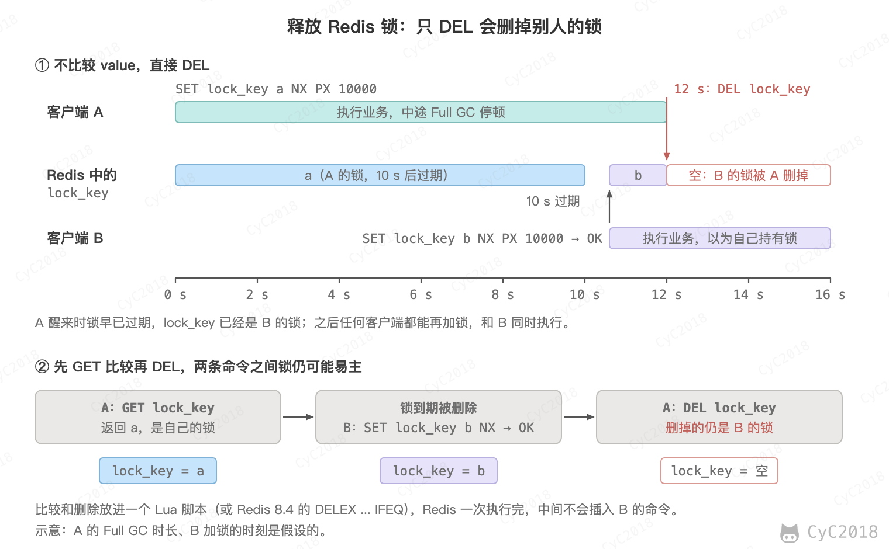 </div><br>

释放锁的 Lua 脚本：

```lua
if redis.call("get", KEYS[1]) == ARGV[1] then
    return redis.call("del", KEYS[1])
else
    return 0
end
```

Redis 8.4 新增了 `DELEX lock_key IFEQ unique_value` 命令，可以直接原子地完成比较并删除的操作，不再需要 Lua 脚本。

实际项目中通常使用 Redisson 的 RLock，它在 SET NX 的基础上解决了可重入、等待和续期三个问题。以锁 lock:order:1024 为例（Redisson 4.8、Redis 7.4 实测，见[附录 A3](#a3-redisson-的可重入与看门狗)）：

- 可重入：锁是一个哈希，字段是“客户端 UUID:线程 ID”，值是加锁次数。加锁的 Lua 脚本在键不存在、或者字段就是自己时，把次数加 1 并设置过期时间，否则返回锁的剩余过期时间。同一个线程加锁两次后 HGETALL 返回 [uuid:1, 2]，解锁一次变为 1，再解锁一次才删除这个键；
- 等待：加锁失败的线程订阅这把锁对应的频道，持有者释放锁时向频道发布一条消息，等待的线程收到后再去加锁，而不是不停地轮询。lock() 一直等到拿到锁为止，tryLock(3, TimeUnit.SECONDS) 最多等待 3 秒，拿不到就返回 false；
- 看门狗：调用 lock() 时不指定过期时间，Redisson 先把过期时间设为 lockWatchdogTimeout（默认 30 秒），再启动一个定时任务，每 10 秒（30 秒的 1/3）检查一次，锁仍是自己的就把过期时间重置为 30 秒，解锁时取消这个任务。

<div align="center"> 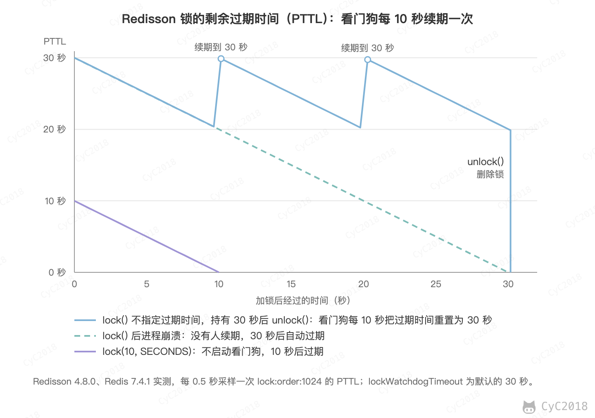 </div><br>

看门狗运行在持有锁的进程中，只在这个进程存活时续期。进程崩溃后没有人续期，锁最多 30 秒后自动过期，其它客户端就能拿到锁。反过来，如果持有锁的线程卡住（例如等待一个没有设置超时的远程调用）而进程还活着，看门狗会一直续期，其它客户端一直拿不到锁，所以锁内的操作都要设置超时。

续期也可能失败，例如持有者与 Redis 之间的网络中断超过 30 秒：看门狗只记录日志并重试，不通知业务线程，锁过期后被其它客户端拿到，原持有者却还在执行，只能靠栅栏令牌或数据库约束兜底。之后原持有者解锁时，脚本发现字段“客户端 UUID:线程 ID”不存在，不会删掉别人的锁，unlock() 抛出 IllegalMonitorStateException。

调用 lock(10, TimeUnit.SECONDS) 指定了过期时间时，Redisson 不启动看门狗，10 秒后锁被自动删除，即使业务还没有执行完。需要注意的是，Redisson 的锁仍然保存在一个 Redis 主节点上。有从节点时，它加锁后默认执行 WAIT 等从节点确认，能缩小丢锁的窗口；但故障转移不一定选中收到这把锁的从节点，仍不能保证不丢。对正确性要求高的场景，资源端用下文 [RedLock](#redis-的-redlock-算法) 一节的栅栏令牌或 ZooKeeper，并以数据库的唯一约束、条件更新兜底。

<div align="center"> 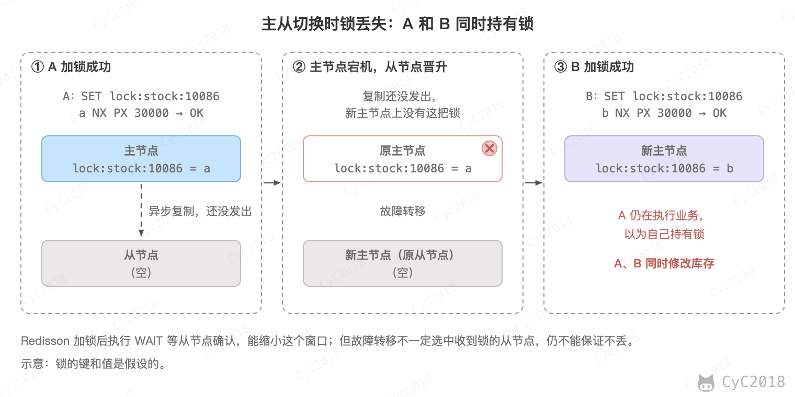 </div><br>

### Redis 的 RedLock 算法

RedLock 使用多个互相独立的 Redis 实例（通常是 5 个）实现分布式锁，避免单个主节点宕机或主从切换时丢锁。

- 用同一个键和随机值，并行地向 N 个互相独立的 Redis 实例加锁，每次请求的超时时间远小于锁的过期时间；
- 计算获取锁消耗的时间，只有时间小于锁的过期时间，并且从大多数（N / 2 + 1）实例上获取了锁，才认为获取锁成功；
- 如果获取锁失败，就到每个实例上释放锁。

RedLock 不要求各节点的时钟同步，但假设各节点的时钟走速大致相同，时钟跳变（例如被 NTP 大幅校正）会让锁提前过期，这是它存在争议的原因之一。

更根本的问题在于，所有带过期时间的锁都可能同时被两个客户端持有：持有锁的客户端发生长时间的进程暂停（例如 GC），或者它发出的请求在网络中延迟了很久，锁过期后另一个客户端已经拿到了锁，前一个客户端的写入却仍然会到达资源。

解决方法是让锁服务每次加锁时返回一个单调递增的栅栏令牌（Fencing Token），客户端访问资源时带上令牌，资源拒绝令牌比已处理过的更小的请求。

<div align="center"> 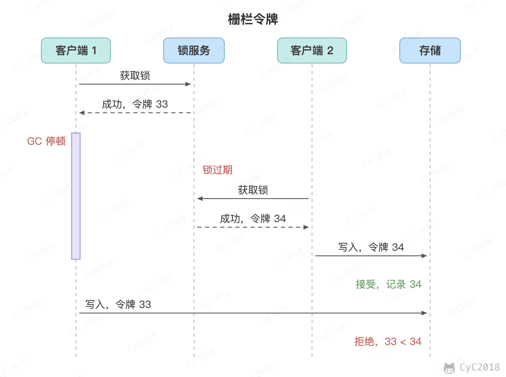 </div><br>

例如订单服务 A 拿到令牌 7 后发生了 12 秒的 Full GC，锁在 10 秒后过期，订单服务 B 拿到令牌 8 并完成写入；A 恢复后带着令牌 7 写入，就会被拒绝。

资源是 MySQL 中的一行时，可以把处理过的最大令牌保存在这一行的 fence 列中，用条件更新完成检查。B 执行下面的语句后 fence 变为 8，A 带着令牌 7 执行同样的语句（条件为 fence <= 7）时影响 0 行：

```sql
UPDATE inventory SET stock = 97, fence = 8 WHERE sku_id = 10086 AND fence <= 8;
```

RedLock 使用的随机值不是递增的，算法本身无法提供栅栏令牌；ZooKeeper 则可以使用加锁时创建的节点的事务 ID（czxid），它在整个集群中单调递增。有序节点的序号不适合作令牌：序号的计数器属于父节点，Curator 把锁的父节点建成容器节点，锁空闲后父节点会被删除，序号又从 0 开始。

Redisson 已把 RedLock 标为弃用，改为推荐 RLock 加上主从同步检查；需要令牌时用 RFencedLock，它在加锁时对一个计数键执行 INCR，返回值作为令牌。这个计数键和锁在同一个主节点上，主从复制是异步的，故障转移后计数可能回退，令牌不再严格递增，所以它同样不能完全排除旧持有者的写入。

### ZooKeeper 的有序节点

#### 1. ZooKeeper 抽象模型

ZooKeeper 提供了一种树形结构的命名空间，/app1/p_1 节点的父节点为 /app1。

<div align="center"> 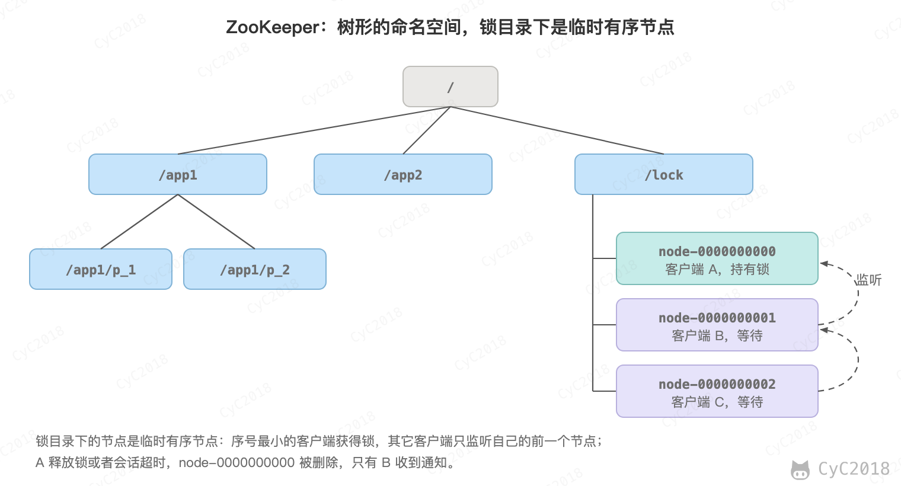 </div><br>

#### 2. 节点类型

- 永久节点：不会因为会话结束或者超时而消失；
- 临时节点：如果会话结束或者超时就会消失；
- 有序节点：会在节点名的后面加一个数字后缀，并且是有序的，例如生成的有序节点为 /lock/node-0000000000，它的下一个有序节点则为 /lock/node-0000000001，以此类推。

#### 3. 监听器

为一个节点注册监听器，在节点状态发生改变时，会给客户端发送消息。监听是一次性的，触发之后需要重新注册（3.6 起也支持触发后不删除的持久监听）。

#### 4. 分布式锁实现

- 创建一个锁目录 /lock；
- 当一个客户端需要获取锁时，在 /lock 下创建临时的且有序的子节点；
- 客户端获取 /lock 下的子节点列表，判断自己创建的子节点是否为当前子节点列表中序号最小的子节点，如果是则认为获得锁；否则监听自己的前一个子节点，获得子节点的变更通知后重复此步骤直至获得锁；
- 执行业务代码，完成后，删除对应的子节点。

例如上图中客户端 A、B、C 依次创建了 node-0000000000、node-0000000001、node-0000000002，A 的序号最小，获得锁；B 监听 node-0000000000，C 监听 node-0000000001。A 执行完删除自己的节点后，只有 B 收到通知，B 重新获取子节点列表，发现自己的序号最小，获得锁。

#### 5. 会话超时

如果一个已经获得锁的会话超时了，因为创建的是临时节点，所以该会话对应的临时节点会被删除，其它会话就可以获得锁了。这种实现方式不会出现数据库的唯一索引实现方式释放锁失败的问题。

但是如果客户端因为 GC 等原因长时间没有发送心跳，也会导致会话超时，因此同样可能出现两个客户端都认为自己持有锁的情况，需要配合上文的栅栏令牌。

#### 6. 羊群效应

一个节点未获得锁，只需要监听自己的前一个子节点，这是因为如果监听所有的子节点，那么任意一个子节点状态改变，其它所有子节点都会收到通知（羊群效应，一只羊动起来，其它羊也会一哄而上），而实际上只需要通知它的后一个子节点。

### 三种实现的对比

- 数据库：实现简单，但是性能低；
- Redis：性能最高，适合高并发场景，但是在主从切换、进程暂停等极端情况下可能出现两个客户端同时持有锁；
- ZooKeeper：写操作需要同步到大多数节点，性能较低，但是可靠性更高，还能提供栅栏令牌，适合一致性要求高、并发量不大的场景。

实际使用中一般直接采用 Redisson、Curator 等成熟的客户端实现。

锁的粒度应该和要保护的资源一致：限制一人一单就锁 lock:order:user:1024，扣减某个商品的库存就锁 lock:stock:10086，不要让整个下单接口共用一把锁，否则不相关的请求也要排队。

所有请求都争抢同一个资源时，例如秒杀同一件商品，分布式锁会让请求排队串行执行，每个请求还要多两次访问 Redis，吞吐量受限，锁的键也成了热点。判断库存并扣减这类可以在一次原子操作中完成的逻辑，更适合直接用 Redis 的 Lua 脚本或者数据库的条件更新，见 [秒杀系统](系统设计基础.md#六秒杀系统)。

锁与本地事务一起使用时，锁要包住事务，在事务提交之后再释放，否则后来的请求拿到锁时还看不到前一个请求的修改，见 [Spring 中用自定义注解加锁](Spring.md#动态代理)。

## 二、分布式事务 🔥

指事务的操作位于不同的节点上，需要保证事务的 ACID 特性。

例如在下单场景下，库存和订单如果不在同一个节点上，就涉及分布式事务。

严格满足 ACID 的代价很高，参与者要一直持有锁，等所有节点都确认。下面的做法中，2PC 让所有参与者一起提交或一起回滚；TCC、Saga 和本地消息表则让各个参与者先提交自己的本地事务，中间状态对其它事务可见，只保证最终一致，也就是下文 [BASE](#四base) 的思路。

分布式锁和分布式事务区别：

- 锁解决的是互斥，例如多个进程同时修改同一个账户的余额；
- 事务解决的是一组操作要么都执行、要么都不执行。

下面介绍的几种做法，常用的分布式事务框架 Seata 都提供了实现。Seata 中有三个角色：事务协调者（Transaction Coordinator, TC）是单独部署的服务，记录全局事务和各个分支事务的状态，驱动它们提交或回滚；事务管理器（Transaction Manager, TM）在发起全局事务的服务中，负责开始、提交或回滚全局事务；资源管理器（Resource Manager, RM）在每个参与的服务中，负责注册分支事务、报告状态并执行提交或回滚。它提供四种模式：

- XA：即下文的 2PC，由数据库执行 XA PREPARE，锁一直持有到第二阶段；
- AT：第一阶段直接提交本地事务，同时记录修改前后的数据，失败时按记录生成反向的 SQL 回滚，对业务代码没有侵入，过程见 [微服务中的 Seata](微服务.md#七服务保护与分布式事务)；
- TCC、Saga：即下文的两种做法，需要业务自己实现预留、确认、取消或补偿的接口。

### 2PC

两阶段提交（Two-phase Commit，2PC），通过引入协调者（Coordinator）来协调参与者的行为，并最终决定这些参与者是否要真正执行事务。

#### 1. 运行过程

##### 1.1 准备阶段

协调者询问每个参与者能否提交。参与者先执行事务，确认在任何情况下都能提交（数据已经写入磁盘、约束检查已经通过）才回复同意，否则回复中止。询问可以看成一种投票，需要参与者都同意才能提交。

<div align="center"> 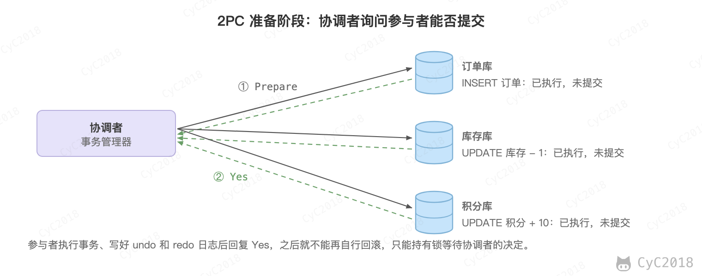 </div><br>

##### 1.2 提交阶段

如果事务在每个参与者上都执行成功，事务协调者发送通知让参与者提交事务；否则，协调者发送通知让参与者回滚事务。

需要注意的是，在准备阶段，参与者执行了事务（写入了 Undo 和 Redo 日志，并且持有锁），但是还未提交。只有在提交阶段接收到协调者发来的通知后，才进行提交或者回滚。参与者一旦回复同意，就不能再自行回滚，必须等待协调者的决定。

协调者在发送通知之前，必须先把决定写入日志，这样崩溃恢复后才知道该继续提交还是回滚。发送失败或者超时时，协调者会不断重试。

<div align="center"> 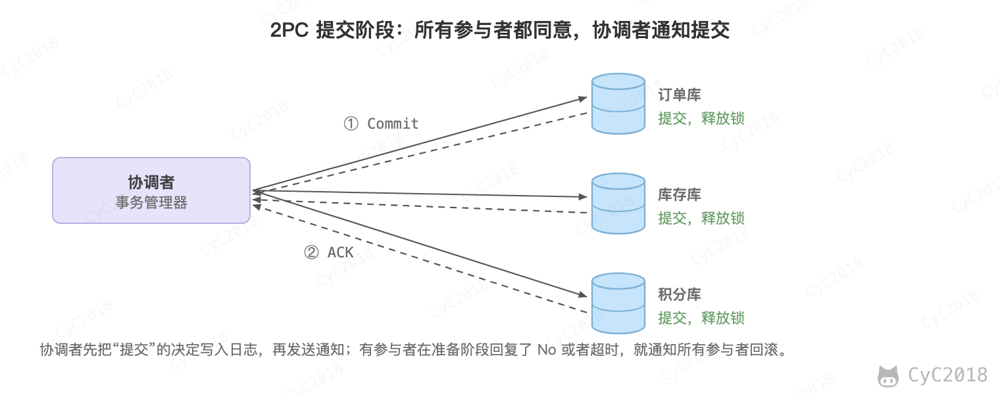 </div><br>

#### 2. 存在的问题

##### 2.1 同步阻塞

所有事务参与者在等待其它参与者响应的时候都处于同步阻塞等待状态，并且一直持有锁，无法进行其它操作。

锁要经过两轮网络往返才释放，并发高时吞吐量下降明显；而且用数据库的 XA 实现时，每个参与者都要支持 XA，Redis、Kafka、RocketMQ 和一般的 HTTP 接口都无法直接参与。这是互联网业务很少直接使用 2PC 的主要原因。

##### 2.2 单点问题

协调者在 2PC 中起到非常大的作用，发生故障将会造成很大影响。特别是在提交阶段发生故障，已经回复同意的参与者既不能提交也不能回滚（称为存疑事务），只能一直阻塞等待协调者恢复。

##### 2.3 数据不一致

在提交阶段，如果协调者只发送了部分 Commit 消息就崩溃，那么只有部分参与者提交了事务，其它参与者处于存疑状态，在协调者恢复并重发通知之前，系统数据不一致。

##### 2.4 太过保守

准备阶段任意一个参与者失败、回复中止或者超时，整个事务都要回滚，没有完善的容错机制。

三阶段提交（3PC）在 2PC 的基础上增加了一个询问阶段（CanCommit），并且在参与者端也引入了超时机制：参与者收到预提交（PreCommit）之后，如果等待最终通知超时，就默认提交，从而减少了阻塞。但是它假设网络延迟和节点的响应时间都有上界，而现实系统中存在无界的网络延迟和进程暂停，超时并不能说明对方已经失效，因此仍然可能出现数据不一致。实践中更常见的做法是用共识算法把协调者的决定复制到多个节点上，避免单点。

两阶段提交也用在单机的数据库内部：MySQL 用它保证 redo log 和 binlog 一致，见 [MySQL 的两阶段提交](MySQL.md#两阶段提交)。

### TCC

TCC（Try-Confirm-Cancel）是在业务层面实现的两阶段提交，每个操作都需要实现三个接口：

- Try：检查业务并预留资源，例如冻结库存；
- Confirm：使用预留的资源真正执行业务，例如扣减冻结的库存；
- Cancel：释放预留的资源，例如解冻库存。

如果所有参与者的 Try 都执行成功，就执行 Confirm，否则执行 Cancel。

Try 成功后资源已经预留，Confirm 失败只会是超时、宕机这类临时故障；其它参与者可能已经 Confirm，所以不能改为 Cancel，只能不断重试，多次失败后告警人工处理。Cancel 失败同样重试，因此两者都必须实现 [幂等](#九幂等)。

相比于 2PC，TCC 不需要长时间持有数据库的锁，性能更好，但是对业务的侵入性较强。它适合扣库存、扣余额这类一致性要求高、能提供预留和取消接口的资源操作。

实现时还需要处理两个问题：

- 空回滚：Try 没有执行，协调者超时后就调用了 Cancel，Cancel 需要识别出这种情况并直接返回成功；
- 悬挂：Cancel 执行之后，被延迟的 Try 才到达并预留了资源，这些资源再也不会被释放，因此 Try 执行前需要检查该事务是否已经被 Cancel。

通常用一张事务控制表记录每个分支的执行状态来解决这两个问题，幂等也可以通过它实现。例如 Seata 的 tcc_fence_log 以（全局事务 ID，分支 ID）为主键，和业务操作在同一个本地事务中写入：Cancel 查不到 Try 的记录时，只插入一条状态为 suspended 的记录并返回成功，这就是空回滚；之后延迟的 Try 再插入同一个主键时冲突，不再预留资源。

<div align="center"> 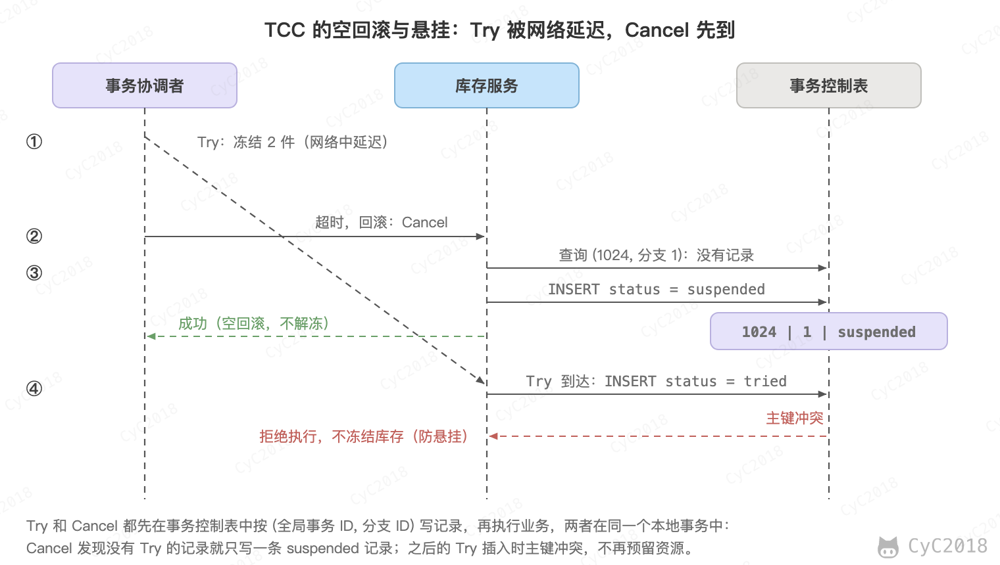 </div><br>

### Saga

Saga 将一个分布式事务拆分为多个本地事务，每个本地事务直接提交，并且都有一个对应的补偿操作。依次执行各个本地事务，如果某一个失败，就逆序执行前面已经提交的本地事务的补偿操作。

<div align="center"> 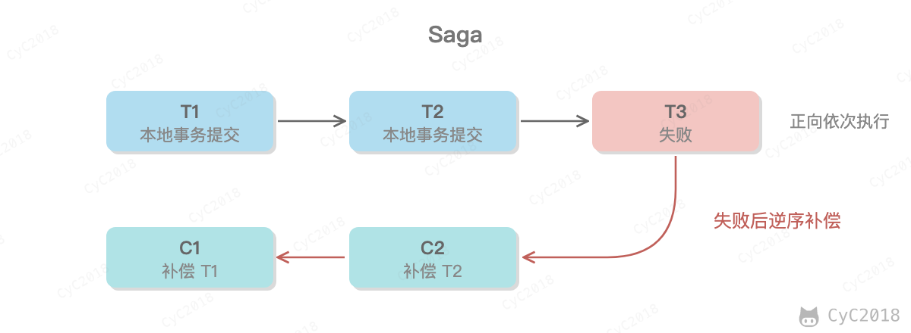 </div><br>

Saga 没有预留资源的 Try 阶段，中间状态对其它事务可见，因此没有隔离性。它适合流程长、无法长时间锁定资源的业务，正向操作和补偿操作同样需要实现幂等。

### 本地消息表

本地消息表与业务数据表放在同一个数据库中，用本地事务保证业务数据和消息一起写入，再通过消息队列把消息送到另一个服务。

不在本地事务提交后直接发送消息，是因为提交之后、发送之前进程崩溃，订单有了，消息却丢了；反过来先发送再提交，事务回滚时消息已经发出，积分服务会给不存在的订单加积分。把消息作为一行数据和订单一起提交，“写订单”和“要发消息”就成了一个原子操作。以下单后给用户加积分为例：

1. 订单服务在同一个本地事务中插入订单 1024 和一条待发送的消息，两行要么都写入，要么都不写入；
2. 定时任务扫描待发送的消息，转发到消息队列，发送成功后把消息标记为已发送（或者删除），失败就在下次扫描时重新转发；
3. 积分服务从消息队列中读取消息，给用户加积分。

<div align="center"> 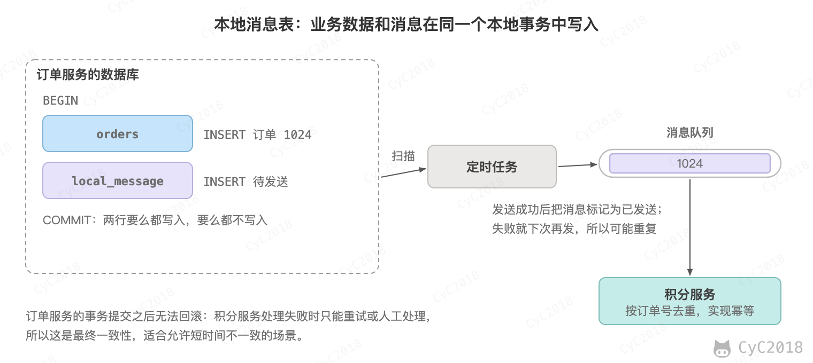 </div><br>

实践中常在事务提交后立即异步发送一次，定时任务只转发超过一定时间仍未发送的消息，作为兜底；已发送的消息定期删除或归档。消息表很大、扫描开销高时，也可以用 Canal 等工具读取 binlog，消息一写入就转发，但同样可能重复发送。

由于重新转发会导致消息被重复投递，积分服务要按订单号加事件类型去重，实现幂等，做法见 [接收端的可靠性](消息队列.md#接收端的可靠性)。订单服务的事务已经提交，无法回滚，积分服务执行失败时只能不断重试或者人工介入处理。所以它适合发券、加积分这类能接受最终一致、失败后可以重试的后续操作。

RocketMQ 的事务消息把本地消息表的工作交给了消息队列：生产者先发送一条对消费者不可见的半消息，再执行本地事务，然后根据执行结果通知 Broker 提交或者回滚这条消息。如果 Broker 长时间没有收到通知，会主动回查生产者的本地事务状态。

先发半消息，是为了先确认 Broker 可用，并让 Broker 一直持有这条消息：之后生产者无论在哪一步崩溃，Broker 都能通过回查得到结果。回查返回未知时会继续回查，默认最多 15 次，超过后半消息被转入系统主题 TRANS_CHECK_MAX_TIME_TOPIC，不再投递，需要人工处理。

<div align="center"> 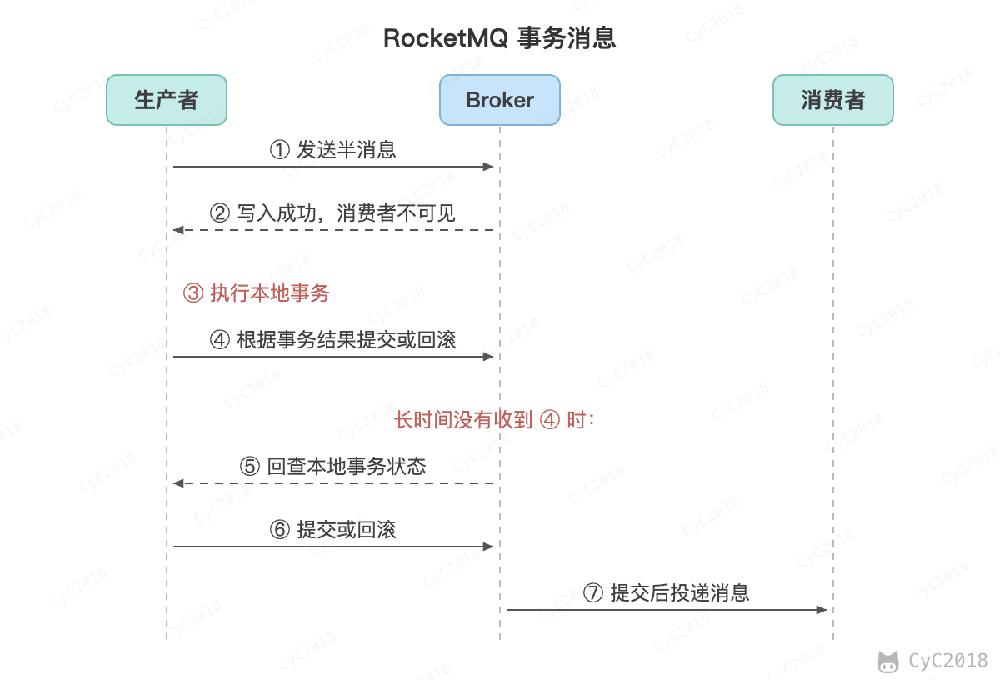 </div><br>

### 几种做法的对比

| 做法 | 一致性 | 资源的锁定 | 业务改造 | 适合的场景 |
| --- | --- | --- | --- | --- |
| 2PC（XA） | 所有参与者一起提交或回滚 | 从准备到提交一直持有数据库的锁 | 少，由数据库和协调者完成 | 参与者少、并发不高 |
| Seata AT | 最终一致，回滚靠反向 SQL，默认可能读到全局事务未提交的修改 | 本地事务立即提交，修改过的行持有全局锁直到第二阶段 | 几乎没有 | 普通的增删改，希望少改代码 |
| TCC | 最终一致，Try 阶段预留资源 | 只锁定预留的资源，不持有数据库的锁 | 每个操作写 Try、Confirm、Cancel 三个接口 | 扣库存、扣余额等资源操作 |
| Saga | 最终一致，没有隔离性 | 不锁定 | 每一步写补偿操作 | 流程长、跨多个服务 |
| 本地消息表、事务消息 | 最终一致，只能重试，不能回滚 | 不锁定 | 写消息和重试，消费方实现幂等 | 发券、加积分等后续操作 |

同一个业务中常把几种做法组合使用，例如下单时用 TCC 冻结库存，支付成功后用事务消息通知积分服务加积分。

## 三、CAP

分布式系统不可能同时满足一致性（C：Consistency）、可用性（A：Availability）和分区容忍性（P：Partition Tolerance）。常见的“三选二”说法有误导性，因为网络分区是无法避免的故障，不是可以选择的选项。

<div align="center"> 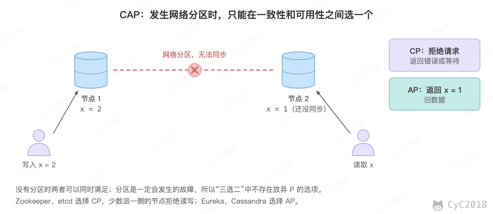 </div><br>

### 一致性

CAP 中的一致性指的是线性一致性（Linearizability），也称为强一致性：系统看起来就像只有一个数据副本，每个操作都在某个时刻原子地生效。

一个数据更新成功之后，所有用户都能读到新值；并且只要有一个读请求读到了新值，之后的读请求就都不能再读到旧值，即使这时写操作还没有返回。

例如订单 1024 的状态从“待支付”改为“已支付”，写入还在多个副本之间同步时，客服 A 查询看到了“已支付”并告诉客服 B，B 随后查询却看到“待支付”。两次查询分别落在已同步和未同步的副本上，这在线性一致的系统中是不允许的。

注意它和 ACID 中的一致性不是同一个概念，ACID 中的一致性指的是事务执行前后，数据都满足完整性约束。

### 可用性

可用性指的是每一个发送给未故障节点的请求，都能够在有限的时间内得到非错误的响应，但是不保证响应的是最新的数据。

平时所说的 4 个 9 的可用性（系统 99.99% 的时间是可用的），是衡量系统可用程度的指标，和 CAP 中的可用性并不完全相同。

### 分区容忍性

网络分区指分布式系统中的节点被划分为多个区域，每个区域内部可以通信，但是区域之间无法通信。

分区容忍性指的是在出现网络分区，也就是节点之间的消息丢失或者延迟的情况下，系统仍然能够继续运行。

### 权衡

在分布式系统中，分区容忍性必不可少，因为需要总是假设网络是不可靠的。因此，CAP 理论实际上是在发生网络分区时，要在可用性和一致性之间做权衡。而在没有发生网络分区时，一致性和可用性是可以同时满足的。

例如两个节点之间发生分区后，一个节点完成了写入，另一个节点收到读请求时，要么返回旧数据（放弃一致性），要么拒绝响应（放弃可用性），不存在第三种选择。

- 为了保证一致性（CP），无法和其它节点同步的节点需要拒绝请求，也就失去了部分可用性，例如 ZooKeeper、etcd；
- 为了保证可用性（AP），所有节点都继续提供服务，但是读取到的数据可能不一致，例如 Eureka、按默认一致性级别使用的 Cassandra。

需要注意的是，ZooKeeper 只保证写入是线性一致的，读请求由客户端连接的节点直接返回，可能读到旧值，需要读到最新值时通常先调用 sync() 再读，但 sync() 不经过多数节点确认，严格来说也不能保证读到最新值；etcd 从 v3 起默认提供线性一致的读。

Nacos 则两种都有：临时实例使用自研的 Distro 协议，优先保证可用性；持久化实例使用基于 Raft 的 JRaft，优先保证一致性。

CAP 只讨论了线性一致性这一种一致性模型和网络分区这一种故障，没有涉及网络延迟、节点宕机等更常见的问题。很多系统既不提供线性一致性，也不满足 CAP 中严格定义的可用性，因此既不是 CP 也不是 AP。例如 [Redis Cluster](Redis.md#redis-cluster) 的主从之间异步复制，故障转移时可能丢失已经确认的写入，不是线性一致的；分区超过 cluster-node-timeout 后，少数派一侧的主节点拒绝写入，也不满足 CAP 的可用性。与其给系统贴上 CP 或 AP 的标签，不如直接说明它在分区时的行为。

PACELC 是对 CAP 的扩展：发生分区（P）时在可用性（A）和一致性（C）之间权衡，没有分区（E）时则在延迟（L）和一致性（C）之间权衡，因为保证强一致性需要等待节点之间同步数据，会增加响应延迟。

## 四、BASE

BASE 是基本可用（Basically Available）、软状态（Soft State）和最终一致性（Eventually Consistent）三个短语的缩写。

BASE 理论是对 CAP 中一致性和可用性权衡的结果，它的核心思想是：即使无法做到强一致性，但每个应用都可以根据自身业务特点，采用适当的方式来使系统达到最终一致性。

### 基本可用

指分布式系统在出现故障的时候，保证核心可用，允许损失部分可用性。

例如，电商在做促销时，为了保证购物系统的稳定性，部分消费者可能会被引导到一个降级的页面。

### 软状态

指允许系统中的数据存在中间状态，并认为该中间状态不会影响系统整体可用性，即允许系统不同节点的数据副本之间进行同步的过程存在时延。

### 最终一致性

最终一致性强调的是系统中所有的数据副本，在经过一段时间的同步后，最终能达到一致的状态。“最终”没有时间上限，因此通常还会提供读己之写（用户能读到自己刚写入的数据）和单调读（不会读到比上次更旧的数据）等保证来减少不一致带来的困扰。

按保证的强弱，常说的一致性分为三类：

- 强一致性：即上文的线性一致性，写入成功之后，所有读请求都能读到新值；
- 弱一致性：写入之后不保证马上能读到新值；
- 最终一致性：弱一致性的一种，保证不再有新的写入时，所有副本最终都会相同。

例如订单 1024 支付成功后，主库中已经是“已支付”，从库在复制完成之前仍返回“待支付”。强一致的系统不允许出现这种情况，最终一致的系统允许，但复制完成后必须读到“已支付”。强一致和最终一致之间还有因果一致性等模型，它只保证有因果关系的写入按先后被看到，例如看到订单 1024“已发货”的用户，一定也能看到它“已支付”。

ACID 要求每个事务结束时数据都满足约束，并且事务之间相互隔离，通常运用在传统的数据库系统上。而 BASE 允许数据在一段时间内处于中间状态，只要求最终一致，通过牺牲强一致性来达到可用性，通常运用在大型分布式系统中。

在实际的分布式场景中，不同业务单元和组件对一致性的要求是不同的，因此 ACID 和 BASE 往往会结合在一起使用。

## 五、Paxos

用于解决共识问题，即让多个节点对某个值达成一致。该算法能保证只会选出唯一一个值，并且一旦选定就不会再改变。

主要有三类节点：

- 提议者（Proposer）：提议一个值；
- 接受者（Acceptor）：对每个提议进行投票；
- 学习者（Learner）：被告知投票的结果，不参与投票过程。

一个节点可以同时担任多种角色。

<div align="center"> 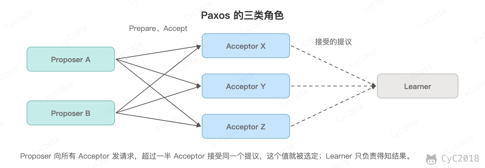 </div><br>

### 执行过程

规定一个提议包含两个字段：[n, v]，其中 n 为序号（全局唯一并且递增），v 为提议值。

#### 1. Prepare 阶段

Proposer 选择一个序号 n，向所有 Acceptor 发送 Prepare(n) 请求，该请求不需要包含提议值。

Acceptor 接收到 Prepare(n) 请求时：

- 如果 n 大于它之前响应过的所有 Prepare 请求的序号，那么就承诺以后不会再接受序号小于 n 的提议，并发送 Prepare 响应。如果它之前已经接受（Accept）过提议，那么响应中需要包含其中序号最大的那个提议；
- 否则，丢弃该请求。

#### 2. Accept 阶段

当一个 Proposer 接收到超过一半 Acceptor 的 Prepare 响应时，就可以发送 Accept(n, v) 请求，其中 v 的取值规则为：

- 如果响应中包含已经被接受过的提议，那么 v 取其中序号最大的提议对应的值；
- 否则，v 可以取 Proposer 自己的提议值。

Acceptor 接收到 Accept(n, v) 请求时，只要它没有对序号大于 n 的 Prepare 请求做过承诺，就接受该提议。

如果 Proposer 没有得到大多数 Acceptor 的接受，就使用更大的序号重新开始 Prepare 阶段。

#### 3. Learn 阶段

Acceptor 接受一个提议之后，会将该提议发送给所有的 Learner。当 Learner 发现有大多数的 Acceptor 接受了同一个提议，那么该提议的提议值就被 Paxos 选择出来。

#### 4. 示例

考虑两个 Proposer A、B 和三个 Acceptor X、Y、Z：

- A 发送 Prepare(2)，X 和 Y 做出承诺并响应。A 得到大多数响应之后发送 Accept(2, 8)，X 和 Y 接受该提议，此时值 8 已经被选定；
- 之后 B 发送 Prepare(4)，它收到的大多数响应中至少有一个来自 X 或 Y，响应中包含已经接受过的提议 [2, 8]，因此 B 只能发送 Accept(4, 8)，而不能使用自己的提议值，从而保证了选定的值不会改变。

<div align="center"> 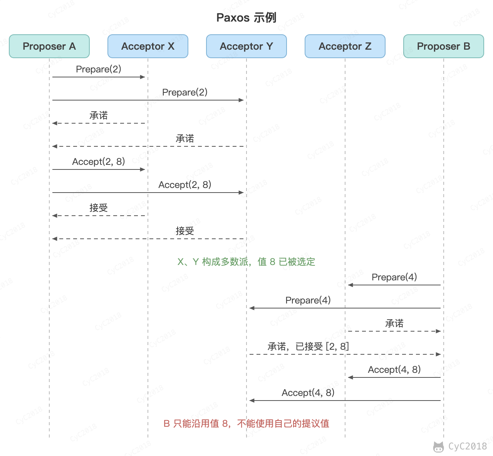 </div><br>

### 约束条件

#### 1\. 正确性

指只有一个提议值会生效。

任意两个大多数集合之间至少有一个公共的 Acceptor。一旦某个提议值被大多数 Acceptor 接受，之后的任何 Proposer 在 Prepare 阶段都一定会从这个公共的 Acceptor 得知该值，从而只能继续提议该值，因此可以保证正确性。

#### 2\. 可终止性

指最后总会有一个提议生效。

Paxos 并不能严格保证可终止性：如果两个 Proposer 交替地使用更大的序号发送 Prepare 请求，那么双方的 Accept 请求都会一直被拒绝，形成活锁。实际中通常会选出一个主 Proposer，只由它来发起提议（Multi-Paxos 的做法），或者在重试前随机等待一段时间。

## 六、Raft

Raft 也是分布式共识算法，相比于 Paxos 更容易理解和实现。它将共识问题分解为 Leader 选举、日志复制和安全性三个子问题，etcd、Consul 等系统都使用了 Raft。

### 单个 Candidate 的竞选

有三种节点：Follower、Candidate 和 Leader。Raft 把时间划分为多个任期（Term），任期号单调递增，每个任期从一次选举开始，并且每个任期内最多只有一个 Leader。任期号的作用和 Paxos 中的提议序号相同，发生冲突时任期号大的一方说了算。

Leader 会周期性的发送心跳包给 Follower。每个 Follower 都设置了一个随机的竞选超时时间，论文中的例子是 150ms\~300ms，如果在这个时间内没有收到 Leader 的心跳包，就会变成 Candidate，将任期号加 1 并给自己投一票，进入竞选阶段。

- 系统刚启动时只有 Follower 没有 Leader。Node A 的随机竞选超时最短，到期时没收到 Leader 发来的心跳包，因此进入竞选阶段，发送投票请求给其它所有节点。

- 每个节点在一个任期内最多只能投一票，先到先得，并且只会投给日志至少和自己一样新的 Candidate（比较双方最后一条日志：任期大的更新，任期相同时日志更长的更新），这保证了新的 Leader 一定包含所有已提交的日志。如果 Candidate 获得超过一半节点的选票，就会变成 Leader。

- 之后 Leader 会周期性地发送心跳包给 Follower，Follower 接收到心跳包，会重新开始计时。

<div align="center"> 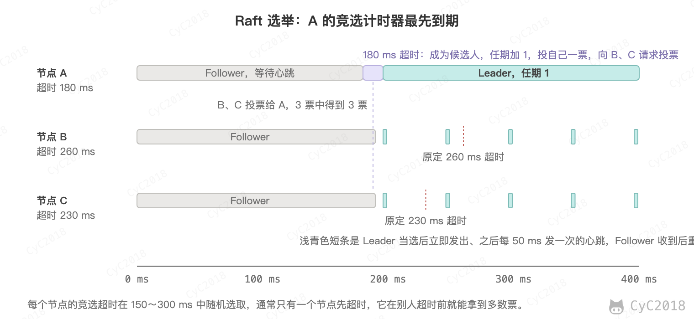 </div><br>

### 多个 Candidate 竞选

- 如果有多个 Follower 同时成为 Candidate，选票可能会被瓜分，导致没有 Candidate 获得超过一半的选票，那么等待竞选超时之后进入下一个任期重新开始投票。例如下图中 Node B 和 Node D 都获得两票，需要重新开始投票。

- 由于每个节点设置的随机竞选超时时间不同，因此下一次再次出现多个 Candidate 并获得同样票数的概率很低。

<div align="center"> 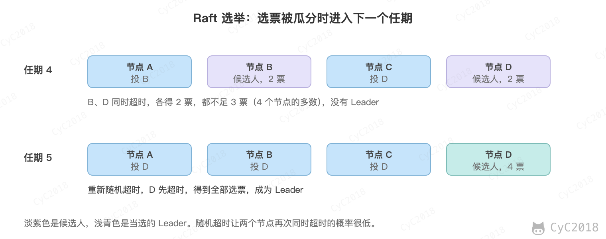 </div><br>

- 如果 Candidate 在竞选过程中收到了任期号不小于自己的 Leader 发来的心跳包，就会承认该 Leader 并变回 Follower。

### 日志复制

- 来自客户端的修改都会被传入 Leader。注意该修改还未被提交，只是写入日志中。
- Leader 会把修改复制到所有 Follower。
- Leader 会等待大多数的节点都写入了该日志，然后才将修改提交，并向客户端返回结果。
- 此时 Leader 会在之后的心跳包中通知所有 Follower 让它们也提交修改，此时所有节点的值达成一致。

<div align="center"> 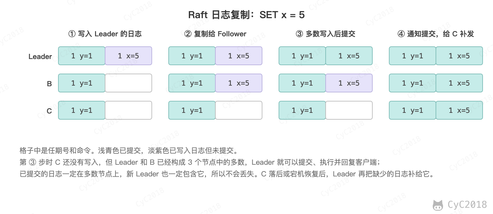 </div><br>

如果 Follower 的日志和 Leader 不一致，Leader 会找到两者最后一致的位置，然后用自己的日志覆盖 Follower 在该位置之后的日志。

发生网络分区时，少数派一侧的旧 Leader 得不到大多数节点的确认，无法提交日志，多数派一侧会选出新的 Leader。分区恢复后，旧 Leader 发现更大的任期号就会退回 Follower，它未提交的日志被覆盖，因此写入不会出现脑裂。

读请求则要另外处理：旧 Leader 如果直接用本地数据回答读请求，可能返回旧数据，所以 Raft 要求 Leader 在处理只读请求前，先与大多数节点交换一次心跳，确认自己仍是 Leader。另外，新 Leader 刚上任时还不知道哪些日志已经提交，要先提交一条当前任期的空日志，之后才能处理只读请求。

需要注意的是，Leader 只对当前任期的日志按“大多数节点已写入”判断是否提交。之前任期留下的日志即使已经复制到大多数节点，也可能被之后的 Leader 覆盖，要等当前任期的一条日志提交后才随之提交。这也是上文新 Leader 要先提交一条空日志的原因。

Raft 与 Paxos 达成的结果是等价的，区别在于对 Leader 的依赖程度：

- Paxos 中任何一个 Proposer 都可以发起提议，选出一个主 Proposer 只是性能上的优化（也用来避免上文的活锁）。Multi-Paxos 中日志的每个位置各自独立地确定，新的主节点还要先找回自己缺少的日志；
- Raft 中选主是协议的一部分，只有 Leader 能追加日志，日志只从 Leader 流向 Follower，投票规则又保证当选的节点包含所有已提交的日志，新 Leader 不需要从其它节点补日志，因此更容易理解和实现。代价是所有写入都要经过 Leader，选举期间不能写入。

ZooKeeper 使用的 ZAB 协议同样以 Leader 为中心，纪元编号（epoch）的作用相当于 Raft 的任期号。不同的是恢复方式：ZAB 选出见过最大 zxid 的节点当 Leader，新 Leader 先同步日志，使包括自己在内的大多数节点状态一致，再开始处理新的写请求；Raft 不设单独的同步阶段，靠追加日志时的一致性检查边复制边覆盖。ZAB 还假设节点之间是 TCP 这样的先进先出通道。

## 七、RPC 🔥

远程过程调用（Remote Procedure Call, RPC）指的是像调用本地方法一样调用另一台机器上的服务。例如订单服务调用库存服务扣减库存：

```java
boolean ok = inventoryService.deduct(10086, 2);
```

### 调用过程

调用方写的是普通的方法调用，RPC 框架在背后完成了网络通信：

<div align="center"> 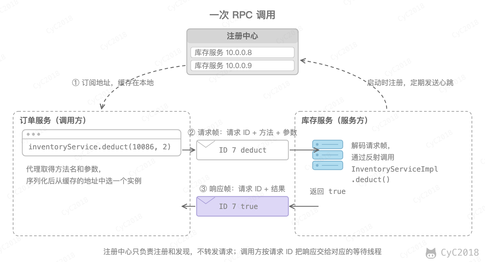 </div><br>

1. inventoryService 是框架用动态代理生成的对象，调用它的方法时，代理拿到接口名、方法名和参数；
2. 把这些信息序列化成字节，加上请求 ID 等首部组成请求帧，从注册中心获取的地址列表中按负载均衡选出一个实例，通过长连接发送；
3. 服务方解码请求，找到对应的实现类，通过反射调用 deduct()，再把返回值按同样的方式发回；
4. 一个连接上可能同时有多个请求在等待响应，调用方根据响应中的请求 ID 把结果交给对应的调用。

去掉工程上的细节，核心只有两部分：调用方用动态代理把方法调用转成网络请求，服务方用反射把网络请求转成方法调用。

```java
// 调用方：生成接口的代理对象，调用方法时把方法名和参数发给服务方
@SuppressWarnings("unchecked")
static <T> T refer(Class<T> api, String host, int port) {
    return (T) Proxy.newProxyInstance(api.getClassLoader(), new Class<?>[]{api}, (proxy, method, args) -> {
        try (Socket socket = new Socket(host, port)) {
            ObjectOutputStream out = new ObjectOutputStream(socket.getOutputStream());
            out.writeUTF(method.getName());
            out.writeObject(method.getParameterTypes());
            out.writeObject(args);
            out.flush();
            return new ObjectInputStream(socket.getInputStream()).readObject();
        }
    });
}

// 服务方：读出方法名和参数，通过反射调用本地的实现
static void export(Object impl, int port) throws Exception {
    try (ServerSocket server = new ServerSocket(port)) {
        while (true) {
            try (Socket socket = server.accept()) {
                ObjectInputStream in = new ObjectInputStream(socket.getInputStream());
                Method method = impl.getClass().getMethod(in.readUTF(), (Class<?>[]) in.readObject());
                Object result = method.invoke(impl, (Object[]) in.readObject());
                ObjectOutputStream out = new ObjectOutputStream(socket.getOutputStream());
                out.writeObject(result);
                out.flush();
            }
        }
    }
}
```

```java
// 服务方
export(new InventoryServiceImpl(), 20880);

// 调用方
InventoryService inventoryService = refer(InventoryService.class, "10.0.0.8", 20880);
inventoryService.deduct(10086, 2);   // 实际执行的是服务方的 InventoryServiceImpl.deduct()
```

这段代码每次调用都新建连接，使用 Java 自带的序列化，也没有超时处理。Dubbo、gRPC 等框架在此基础上实现了连接复用、高效的序列化、服务发现、负载均衡、超时重试和熔断，设计一个 RPC 框架时也是从这几个模块考虑。

复用连接之后，要在 TCP 的字节流中分出一个个请求。TCP 不保留消息的边界，所以协议都在消息前写明长度。例如 Dubbo 协议的首部固定为 16 字节：2 字节魔数 0xdabb、1 字节标志（请求还是响应、是否需要返回值、序列化方式）、1 字节响应状态、8 字节请求 ID、4 字节正文长度。接收方先读 16 字节的首部，再按长度读出正文，用请求 ID 找到对应的调用。

### 服务发现

服务的实例会扩容、缩容或者宕机，地址不能写死在调用方。注册中心（例如 Nacos、ZooKeeper）保存每个服务当前可用的实例：

- 服务方启动时把自己的地址注册到注册中心，之后靠定期的心跳（Eureka）或者长连接（Nacos 2.x 的临时实例）保持在线，心跳超时或者连接断开的实例会被删除（Eureka 进入自我保护时暂停删除）；
- 调用方订阅需要的服务，把地址列表缓存在本地，实例变化时由注册中心推送通知，或者由调用方定期拉取（Eureka 每 30 秒一次）；
- 每次调用都从本地缓存的列表中选择实例，注册中心不转发请求。Dubbo 默认按权重随机选择：例如两个实例的权重为 3 和 1，在 [0, 4) 中取一个随机数，小于 3 选第一个，否则选第二个；其它算法见 [负载均衡算法](集群.md#负载均衡算法)。

因此注册中心全部宕机时，调用方仍然可以按缓存的地址继续调用，只是新上线的实例无法被发现，新启动且本地没有缓存地址的调用方也无法调用。某个实例宕机后、调用方本地的列表更新之前，发往它的请求会失败，需要调用方重试其它实例。

用 ZooKeeper 作注册中心时，每个实例在 /services/inventory-service 下创建一个保存地址的 [临时节点](#2-节点类型)，会话超时后节点自动删除，调用方 [监听](#3-监听器) 这个目录的子节点变化；etcd 的做法类似，用绑定租约（lease）的键代替临时节点。

Nacos、Eureka、ZooKeeper 的区别，与客户端负载均衡的配合，以及 [实例下线后多久能感知](微服务.md#实例下线后多久能感知)、[注册中心宕机](微服务.md#注册中心宕机) 时的表现，见 [微服务](微服务.md#三注册中心)。

### RPC 与 HTTP

HTTP 是一种协议，RPC 是一种调用方式，两者不是同一层面的概念：RPC 框架和它使用的协议都属于应用层，可以在 TCP 上使用自定义的协议，例如 Dubbo 协议；也可以基于 HTTP，例如 gRPC 基于 HTTP/2，Spring Cloud 的 OpenFeign 用动态代理把接口调用转换成 HTTP 请求。

面试中通常问的是：为什么对外接口常用 HTTP + JSON，内部服务之间却常用 RPC 框架。这是因为内部调用量大、对延迟敏感，RPC 框架在这些方面做得更好：

- 序列化更紧凑：例如参数 {"skuId":10086,"count":2}，JSON 需要 25 字节；Protobuf 不传字段名，只传字段编号和值，编码为 08 E6 4E 10 02，共 5 字节，其中 08 表示字段 1，E6 4E 是 10086 的变长编码，10 02 表示字段 2 的值为 2；
- 连接复用：在少量长连接上同时发送多个请求，用请求 ID 区分响应。HTTP/1.1 也能复用连接，但同一个连接上的响应必须按请求的顺序返回，前面一个慢请求会挡住后面的请求；
- 服务治理：内置服务发现、负载均衡、超时重试和熔断，使用 HTTP 时则要由 Spring Cloud 这类框架另外提供；
- 接口约定：用 Java 接口或者 IDL 文件定义服务，自动生成调用方的代码，参数类型在编译期就能检查。跨语言时双方共用一份 IDL，例如 Go 程序用同一个 .proto 文件生成客户端，就能调用 Java 实现的 gRPC 服务。

HTTP + JSON 的优势在于通用：浏览器和各种语言都能直接调用，报文可读，便于调试，适合对外开放的接口。

gRPC 选择 HTTP/2 是因为它的 [多路复用](HTTP.md#二进制分帧层)：每次调用是一个流（Stream），请求路径为 /包名.服务名/方法名，例如 /inventory.InventoryService/Deduct；多个调用的帧在同一个连接上交错发送，用流 ID 区分，不需要自己设计请求 ID。参数编码成 Protobuf 后，前面加 1 字节的压缩标志和 4 字节的长度，放在 DATA 帧中。上面的参数在 DATA 帧中就是 00 00 00 00 05 08 E6 4E 10 02，前 5 个字节表示不压缩、长度为 5。

### 超时与重试

- 每次调用都要设置超时时间，否则下游变慢时，调用方的线程会一直等待，最终被耗尽；
- 调用方超时不代表服务方没有执行：请求可能在网络中延迟，或者在服务方的线程池中排队、遇到 GC 停顿，这些时间都计入了调用方的耗时，却不在服务方记录的处理时间里，于是调用方超时了，服务方却执行成功了；
- 因此只有幂等的接口才能自动重试，例如查询；扣库存这类写操作要带上请求 ID，由服务方去重（见 [幂等](#九幂等)），否则重试会扣减两次。需要注意的是，有的框架默认就会重试，例如 Dubbo 默认的集群容错方式是 failover，失败或超时后换一台服务器重试 2 次，一次调用最多执行 3 次，写操作要改为 failfast 或者带上请求 ID；
- 调用链较长时，下游的超时时间应该比上游短。gRPC 会把截止时间（deadline）随请求传给服务方，超时后调用方收到 DEADLINE_EXCEEDED，服务方的框架也会取消这次调用，但正在执行的业务代码不会被中断，耗时的处理要自己检查是否已被取消；服务方调用下游时沿用这次请求的上下文，Java 和 Go 的 gRPC 会自动把剩余的时间传下去。

<div align="center"> 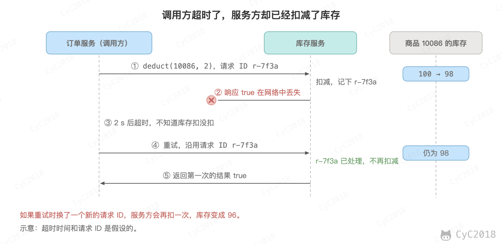 </div><br>

## 八、分布式 ID 🔥

单库时用数据库的自增主键就能生成 ID，分库分表之后，各个库默认的自增序列会重复，需要一个全局唯一的 ID。一般有以下要求：

- 全局唯一；
- 大体按时间递增，作为 InnoDB 的主键时能顺序插入；
- 生成快、可用性高，不能成为瓶颈；
- 有时还要求不能从 ID 推测出业务量，例如订单号不能是连续的数字。

常用的方案如下：

| 方案 | 做法 | 缺点 |
| --- | --- | --- |
| 随机 UUID（v4） | 本地生成 128 位随机数，例如 Java 的 UUID.randomUUID() | 无序，作主键时随机插入、页分裂多；36 个字符太长 |
| 数据库步长 | 每个库设置相同的步长和不同的起始值，例如两个库分别生成奇数和偶数 | 扩容时要重新规划步长，ID 只在单库内递增 |
| 数据库号段 | 用一张表记录当前最大 ID，每次用 UPDATE 把它加 1000，取走这一段放在内存中慢慢用，美团 Leaf 在当前号段用掉 10% 时就异步取下一段 | 依赖数据库，服务重启会浪费没用完的号段 |
| Redis INCR | 用 INCR 得到递增的整数 | 依赖 Redis 的可用性和[持久化](Redis.md#八持久化)，宕机后可能重复 |
| 雪花算法 | 本地用时间戳、机器 ID 和序号拼成 64 位整数 | 依赖时钟，需要分配机器 ID |

例如分别以自增整数和随机 UUID 为主键插入 100 万行，自增主键用时 3.2 秒、数据 133 MB，随机 UUID 主键用时 10.1 秒、数据 264 MB（MySQL 8.0 实测，见[附录 A1](#a1-自增主键与-uuid-主键)）。这是因为随机的值每次都插入到 B+ 树中间的随机位置，频繁的页分裂让页的填充率变低。另外，二级索引中保存的是主键，主键越长，二级索引也越大。

需要注意的是，MySQL 的 UUID() 生成的是基于时间的 v1，时间戳的低位在最前面，短时间内连续生成的值几乎是递增的，接近顺序插入：同样插入 100 万行用时 5.1 秒、数据 164 MB，多出的部分主要来自 36 个字符的长度。

### 雪花算法

雪花算法（Snowflake）把 64 位整数分成四部分，最高位固定为 0，使 ID 总是正数：

<div align="center"> 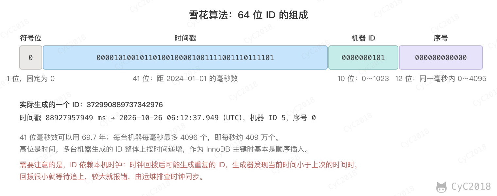 </div><br>

```java
public synchronized long nextId() {
    long now = System.currentTimeMillis();
    if (now < lastTime) {                        // 时钟回拨
        throw new IllegalStateException("clock moved backwards");
    }
    if (now == lastTime) {
        seq = (seq + 1) & 4095;                  // 同一毫秒内序号加 1
        if (seq == 0) {                          // 4096 个用完，等到下一毫秒
            while ((now = System.currentTimeMillis()) <= lastTime) { }
        }
    } else {
        seq = 0;
    }
    lastTime = now;
    return ((now - EPOCH) << 22) | (workerId << 12) | seq;
}
```

用 8 个线程共生成 400 万个 ID，耗时 1.2 秒，全部不重复，每个线程得到的 ID 都是递增的；去掉“序号用完就等到下一毫秒”这一步，400 万个 ID 中只有约 240 万个不重复（JDK 21 实测，见[附录 A2](#a2-雪花算法)）。

需要注意的是，同一个实例生成的 ID 是递增的，但不同实例的时钟之间存在偏差，两个实例生成的 ID 只能大致反映生成的先后顺序。

雪花 ID 不重复依赖三个条件：各实例的机器 ID 不同，同一毫秒内的序号不同，时钟不倒退。第二个由加锁的 nextId() 保证；机器 ID 可以在启动时从 ZooKeeper、数据库或配置中心领取。

时钟回拨指的是校时等原因让系统时间倒退。回拨后已经用过的毫秒会再出现一次，序号又从 0 开始，生成的 ID 与之前的相同（模拟见[附录 A2](#a2-雪花算法)）。常见的处理：

- 回拨几毫秒时等时钟追上，例如美团的 Leaf 在 5 ms 以内时等待两倍的差值后重试；
- 回拨较大时报错，摘除这个实例并报警；
- lastTime 只保存在内存中，重启后发现不了回拨，要把时间持久化，例如 Leaf 每 3 秒把本机时间写入 ZooKeeper，启动时本机时间比记录的还早就不启动；上报有间隔，最后一次上报之后用过的时间仍可能被重复使用。

雪花 ID 还有两个容易忽略的问题：

- 它远大于 JavaScript 的安全整数上限 2<sup>53</sup> − 1，前端把它当作数字解析 JSON 时会丢失精度，例如 372990889737342977 解析后变成 372990889737343000，接口中要把 ID 作为字符串返回；
- 并发低时每毫秒只生成一个 ID，序号总是 0，按 ID 对 16 取模分表会全部落到第 0 张表；Leaf 把每个新毫秒的序号初值设为 0～99 的随机数，同样的测试中 16 张表各分到 45～76 个（JDK 21 实测，见[附录 A2](#a2-雪花算法)）。

## 九、幂等 🔥🔥

幂等指的是同一个操作执行一次和执行多次的效果相同。分布式系统中重复的请求很常见：调用超时后重试、用户重复点击、[消息队列重复投递](消息队列.md#接收端的可靠性)，都会让同一个操作执行多次。查询和删除天然幂等，新增和扣减不是，例如支付回调被调用两次，订单就可能被处理两次。HTTP 规范中各个方法是否幂等，见 [HTTP 的幂等性](HTTP.md#幂等性)。

实现方法：

- 唯一索引：为每个请求生成唯一的请求 ID，在去重表的主键或唯一索引上插入，重复的请求插入失败（ERROR 1062 Duplicate entry）就直接返回之前的结果；
- 状态机：更新时带上前置状态，例如 UPDATE orders SET status = 'PAID' WHERE id = 1024 AND status = 'UNPAID'，第一次影响 1 行，重复执行影响 0 行；
- 版本号：更新时带上读到的版本号，版本号不匹配就不更新，即乐观锁。重试时要沿用第一次读到的版本号，重新查询后再更新就会再执行一次；
- Token：提交前先从服务端获取一个 Token 存入 Redis，提交时用 DEL 删除，返回 1 才处理，重复提交时返回 0。

需要注意的是，“先查询是否处理过、再处理”分成两步时，两个并发的重复请求可能同时查到“未处理”。判断和处理必须是原子的，要么依靠数据库的唯一索引或条件更新，要么把判断和写入放在同一个 [Lua 脚本](Redis.md#lua-脚本)中。

去重记录要和业务数据在同一个本地事务中写入，处理失败时一起回滚，重试还能正常执行。如果单独写入去重记录（例如用 Redis 的 SET NX 记下请求 ID），业务失败后要删掉它，否则重试会被挡掉；进程崩溃时来不及删除，所以记录要分两种状态：

- 处理中：期间到达的重复请求返回“处理中”（例如 HTTP 409），让客户端稍后再查；过期时间要长于处理的最长耗时，崩溃后等它过期就能重试；
- 已完成：保存第一次的结果，保留到上游不再重试之后，例如微信支付的回调失败后会在约 24 小时内反复重发。

业务已经提交、记录还没改为“已完成”时崩溃，重试仍会再执行一次，所以业务写入本身仍要靠唯一约束或状态条件兜底，调用外部服务时让下游按同一个业务键去重。

实现幂等首先要定义什么算同一个请求，也就是幂等键怎么来。以用户狂点“提交订单”为例：

- 客户端在打开确认页时生成一个 request_id，用 UUID 这类随机串，各个客户端各自生成也不会重复。之后的每次点击和重试都带着它，下单成功或者用户修改了订单内容之后才换一个新的。如果每次点击都生成一个新的 ID，服务端就无法识别重复；
- 服务端在订单表的 (user_id, request_id) 上建唯一索引，插入订单时重复的请求报错 1062，返回第一次的结果。同一个 request_id 并发提交 10 次，先查后插的写法 5 轮中每轮都创建了 2～3 个订单，唯一索引每轮只创建 1 个（MySQL 8.0 实测，见[附录 A4](#a4-重复提交与唯一索引)）。索引中不带 user_id 时，另一个用户带着同一个 ID 提交会被当成重复请求，拿到别人的订单；
- 前端把按钮置灰、网关限流可以减少重复请求，但请求仍可能来自重试、脚本或者网络重发，只能作为辅助，最终要靠数据库的约束兜底。

<div align="center"> 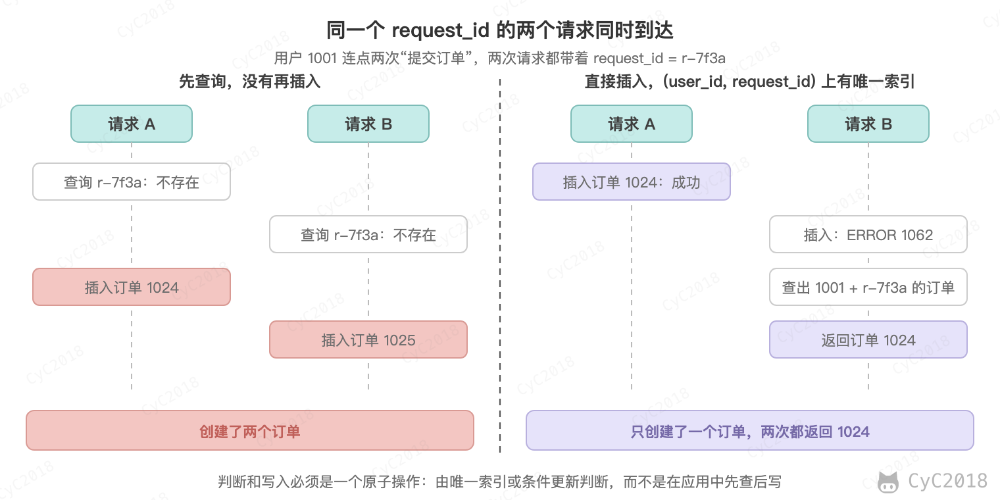 </div><br>

没有客户端参与的场景，幂等键用业务上的唯一标识。例如支付回调用支付平台的交易号，再配合上面的状态机：重复的回调影响 0 行时，同样要返回成功，否则支付平台会继续重试。

分布式锁不能代替幂等。锁只保证同一时刻只有一个请求在处理，第一个请求完成并释放锁之后，重试的请求拿到锁仍会再执行一次。锁的作用是挡住并发的重复请求，减轻数据库的冲突，是否已经处理过还是要靠唯一索引或者状态机判断。

用 Token 实现时，Token 的过期时间按用户在页面上停留的时长设置，例如 30 分钟。DEL 返回 1 之后处理失败时，这个 Token 已经删除，客户端要重新获取 Token 再提交。需要注意的是，DEL 和之后的业务处理不是一个原子操作：处理成功但响应丢失时，客户端分不清是否已经处理，换一个新 Token 重试就会再执行一次。所以 Token 只能挡住页面上的重复点击，最终的去重仍要靠订单号这类业务唯一约束。

## 十、分布式定时任务 🔥

定时任务指的是按时间规则自动执行的任务，例如每月 1 日凌晨 2 点给所有用户发送上月的账单。只有一个实例时，用 Spring 的 `@Scheduled(cron = "0 0 2 1 * ?")` 就能实现。

问题在于服务部署多个实例之后，每个实例都有自己的调度器，到点时各自执行一次。账单服务的两个实例 A、B 同时触发，100 个用户每人收到了两条账单短信（MySQL 8.0 实测，见[附录 A5](#a5-定时任务的重复执行与加锁)）。多个实例定时扫描 [本地消息表](#本地消息表) 时也一样，同一条消息会被转发多次。

分布式定时任务要解决三个问题：

- 同一次触发只执行一次；
- 数据量大时由多个实例分摊；
- 执行失败或者实例宕机时能够补上。

### 只执行一次

最简单的做法是到点时所有实例都去抢一把 [分布式锁](#一分布式锁)，抢到的执行，抢不到的直接跳过，不等待。

锁的键要对应“这一次触发”，并且执行完也不删除，等它自然过期：

```text
SET lock:job:bill:2026-11 10.0.0.11 NX EX 3600
```

这是因为各实例的时钟存在偏差。如果用固定的键 lock:job:bill 并在执行完立即删除，任务只要几十毫秒，A 执行完删除了锁，时钟慢 300 ms 的 B 才触发，照样能拿到锁再发一遍；键中带上账单月份并且不删除，B 就拿不到锁（Redis 7.4 实测，各 3 轮，见[附录 A5](#a5-定时任务的重复执行与加锁)）。给 @Scheduled 加锁的 ShedLock 库提供了 lockAtLeastFor（锁至少持有的时长），解决的也是这个问题。

<div align="center"> 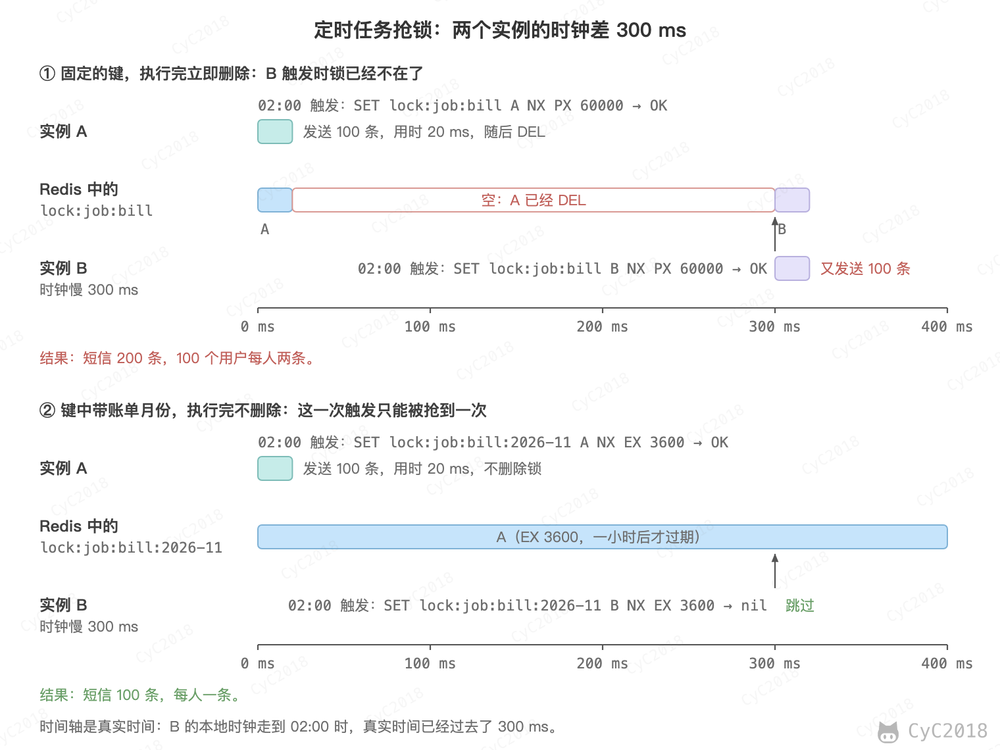 </div><br>

用数据库时，可以在执行记录表的 (job_name, fire_time) 上建唯一索引，插入成功的实例执行，报错 1062 的实例跳过，原理与 [数据库的唯一索引](#数据库的唯一索引) 相同，还顺便留下了执行记录。

抢锁的做法不需要额外部署，一个实例宕机时其它实例照常触发。缺点是每次只有一个实例在工作；拿到锁的实例中途崩溃时，锁还没有过期，其它实例也不会接手；执行记录、失败告警和手动重跑都要自己实现。

### 调度中心

XXL-JOB 等框架把“什么时候触发”和“执行什么”拆开（以下以 XXL-JOB 3.5 的文档和源码为准）：

- 调度中心：独立部署，保存任务配置，按 Cron 表达式计算下次触发时间，到点时发出调度请求，本身不执行业务代码；
- 执行器：嵌入在业务服务中，启动时按应用名（AppName）把自己的地址注册到调度中心，之后每 30 秒发一次心跳，超过 90 秒没有心跳就被移出注册表；收到调度请求后运行任务代码，结束后把结果回调给调度中心。

调度请求、心跳和回调都是 HTTP 请求。

调度中心本身也部署多个节点，它们共用一个 MySQL。每轮扫描前先用 SELECT ... FOR UPDATE 锁住 xxl_job_lock 表中的一行，拿到锁的节点才查询 5 秒内到期的任务，并在同一个事务中更新它们的下次触发时间。其它节点等事务提交后才能拿到锁，查到的已经是更新后的时间，所以同一次触发只会被发出一次。

执行器有多个实例时，调度中心按任务的路由策略选择实例：第一个、轮询、一致性哈希、故障转移等策略每次只发给一个实例，分片广播则发给全部实例。需要注意的是，官方文档也提到集群中仍有小概率重复触发，任务本身还是要做到 [幂等](#九幂等)。

### 分片

只有一个实例执行时，100 万个用户的账单可能要发几个小时。分片指的是把数据按规则分成几份，每个实例只处理其中一份。

XXL-JOB 的分片广播把一次触发发给执行器的每个在线实例，并带上分片序号 index（从 0 开始）和分片总数 total（在线实例数）。任务代码用 XxlJobHelper.getShardIndex() 和 getShardTotal() 取得这两个参数，按 ID 取模只查询自己的那一份：

```sql
SELECT id FROM users WHERE id % 2 = 0;   -- 执行器 A，分片 0/2
SELECT id FROM users WHERE id % 2 = 1;   -- 执行器 B，分片 1/2
```

<div align="center"> 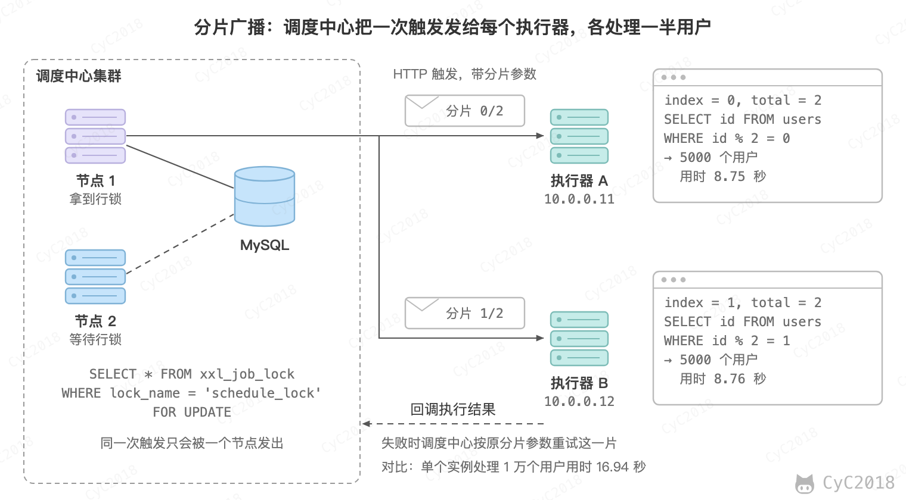 </div><br>

1 万个用户、每条短信模拟 1 ms 的外部调用时，单个实例用时 16.9 秒；两个实例各处理 5000 个，用时 8.8 秒，没有遗漏和重复（MySQL 8.0 实测，见[附录 A6](#a6-分片与按分片重试)）。

total 取的是触发时的在线实例数，扩容后下一次触发自动分成更多份。取模时每个分片都要扫描全部 ID，数据量很大时可以改为按 ID 范围分片，每个分片只扫描自己的区间。

不用框架时，也可以由一个实例扫描出待处理的用户 ID，发送到 [消息队列](消息队列.md)，由所有实例一起消费，适合每条数据处理较慢、需要削峰的场景。

### 失败与宕机

一次任务分为调度和执行两个阶段，失败的处理方式不同：

- 调度时实例宕机：故障转移策略按顺序向各个实例发送心跳检测，把请求发给第一个响应的实例；
- 执行失败：任务可以配置失败重试次数，调度中心发现执行失败后再触发一次。分片任务只重试失败的那一片，沿用原来的分片参数，例如 0/2；
- 执行中宕机：执行器不会再回调结果，调度中心发现一条调度记录处于“运行中”超过 10 分钟、对应的执行器也已经不在线，就把它标记为失败，再按执行失败处理。

单机的 @Scheduled 没有这些机制，触发时间只保存在进程的内存中，实例停机期间错过的触发不会补执行。

重试的前提是任务可以重复执行。账单任务每发送一个用户就记录下来，例如在账单表的 (user_id, month) 上建唯一索引，重试时跳过已经发送过的用户，做法见 [幂等](#九幂等)。实例 A 发送 2000 条后崩溃，按分片参数 0/2 重试，只补发了剩下的 3000 条，1 万个用户每人一条（见[附录 A6](#a6-分片与按分片重试)）。需要注意的是，写记录和发短信不是一个原子操作，两步之间崩溃会漏发或重发一个用户。要做到不漏不重，记录先写成“待发送”，发送成功后再标记完成，做法与 [本地消息表](#本地消息表) 相同，短信服务再按 (user_id, month) 去重。

处理条件也要写成“所有待处理的数据”，例如关闭所有超时未支付的订单，而不是关闭上一分钟创建的订单，这样某一次执行失败，下一次触发也能补上。

### 定时扫描与延迟消息

定时任务适合按周期批量处理的场景，例如月度账单、日终对账、清理过期数据和补偿扫描。每条数据各有到期时间的场景，例如下单 30 分钟未支付自动关闭，定时扫描有两个问题：

- 精度取决于扫描间隔：每分钟扫描一次，订单最晚要到第 31 分钟才关闭；
- 扫描间隔越短，查询越频繁，而每次只有少量订单到期。

这类场景更适合 [延迟消息](消息队列.md#延迟消息)：下单时发送一条 30 分钟后投递的消息，到期只处理这一个订单。实际使用时常把两者结合，延迟消息负责按时关闭，低频的定时扫描兜底，处理消息丢失的订单。

## 附录：实测

环境为 Apple M1 Pro、macOS，MySQL 8.0.44，JDK 21。

### A1 自增主键与 UUID 主键

每张表插入 100 万行，v 列为 100 个字符：

```sql
create table t_auto (id bigint primary key auto_increment, v char(100)) engine=innodb;
create table t_uuid (id char(36) primary key, v char(100)) engine=innodb;
create table t_rand (id char(36) primary key, v char(100)) engine=innodb;
insert into t_auto (v) with recursive n(i) as (select 1 union all select i + 1 from n where i < 1000000) select repeat('x', 100) from n;
insert into t_uuid with recursive n(i) as (select 1 union all select i + 1 from n where i < 1000000) select uuid(), repeat('x', 100) from n;
insert into t_rand with recursive n(i) as (select 1 union all select i + 1 from n where i < 1000000) select bin_to_uuid(random_bytes(16)), repeat('x', 100) from n;
select uuid() union all select uuid() union all select uuid();
```

t_uuid 用 MySQL 的 UUID()，t_rand 用 16 个随机字节格式化成同样 36 个字符的 UUID。两轮的用时相差不到 5%，下面是第一轮：

```text
auto_sec  3.189367
uuid_sec  5.067726
rand_sec  10.106084
TABLE_NAME  data_mb
t_auto      133
t_rand      264
t_uuid      164
4deea432-d3d0-11f1-a990-57c9e93345c1
4deea43c-d3d0-11f1-a990-57c9e93345c1
4deea43d-d3d0-11f1-a990-57c9e93345c1
```

### A2 雪花算法

正文中的 nextId() 补齐字段后，8 个线程各生成 50 万个 ID，检查是否重复、每个线程内是否递增；第二行是去掉“序号用完就等到下一毫秒”之后的结果：

```text
generated 4000000 unique=4000000 increasingPerThread=true ms=1166
generated 4000000 unique=2404324 increasingPerThread=false ms=712
```

时钟回拨：去掉回拨检查，时钟读数为 1000 ms 时生成 3 个 ID，然后拨回 5 ms，每毫秒生成一个，走回 1000 ms 时与第一个 ID 重复；保留检查时直接抛出异常：

```text
t=1000 id=4194324480 worker=5 seq=0
t=1000 id=4194324481 worker=5 seq=1
t=1000 id=4194324482 worker=5 seq=2
t=995  id=4173352960 worker=5 seq=0
...
t=999  id=4190130176 worker=5 seq=0
t=1000 id=4194324480 worker=5 seq=0  DUPLICATE
with check: clock moved backwards
```

低并发：每 2 ms 生成一个 ID，共 1000 个，按 ID 对 16 取模统计各表的数量；第二行是每个新毫秒的序号从 0～99 的随机数开始：

```text
note        [1000, 0, 0, 0, 0, 0, 0, 0, 0, 0, 0, 0, 0, 0, 0, 0]
leaf-random [76, 65, 72, 65, 49, 58, 58, 56, 62, 64, 63, 74, 57, 73, 63, 45]
```

### A3 Redisson 的可重入与看门狗

Redisson 4.8.0，Redis 7.4.1。三个程序分别加锁 lock:order:1024，用 redis-cli 查看哈希的内容和 PTTL：

```java
RLock lock = redisson.getLock("lock:order:1024");
// 程序一：lock() 两次，持有 30 秒，再 unlock() 两次
// 程序二：lock(10, TimeUnit.SECONDS)，之后不解锁
// 程序三：lock() 之后立即 Runtime.getRuntime().halt(1)，模拟进程崩溃
```

```text
== 程序一
  0.0s lock()         HGETALL=[0fb9b3a2-f60d-4d48-b081-ccbdacb0b4b6:1 1] PTTL=29979
  0.0s 再次 lock()    HGETALL=[0fb9b3a2-f60d-4d48-b081-ccbdacb0b4b6:1 2] PTTL=29991
  6.1s 持有中         HGETALL=[0fb9b3a2-f60d-4d48-b081-ccbdacb0b4b6:1 2] PTTL=23973
 12.1s 持有中         HGETALL=[0fb9b3a2-f60d-4d48-b081-ccbdacb0b4b6:1 2] PTTL=27977
 18.1s 持有中         HGETALL=[0fb9b3a2-f60d-4d48-b081-ccbdacb0b4b6:1 2] PTTL=21961
 24.1s 持有中         HGETALL=[0fb9b3a2-f60d-4d48-b081-ccbdacb0b4b6:1 2] PTTL=25955
 30.1s 持有中         HGETALL=[0fb9b3a2-f60d-4d48-b081-ccbdacb0b4b6:1 2] PTTL=29966
 30.1s unlock() 一次  HGETALL=[0fb9b3a2-f60d-4d48-b081-ccbdacb0b4b6:1 1] PTTL=29987
 30.2s unlock() 两次  HGETALL=[] PTTL=-2
== 程序二
  0.0s lock(10s)      HGETALL=[f6be60e4-44c3-4086-bc03-2cd44ddd0459:1 1] PTTL=9988
  4.0s 持有中         HGETALL=[f6be60e4-44c3-4086-bc03-2cd44ddd0459:1 1] PTTL=5971
  8.1s 持有中         HGETALL=[f6be60e4-44c3-4086-bc03-2cd44ddd0459:1 1] PTTL=1950
 12.1s 持有中         HGETALL=[] PTTL=-2
== 程序三
  0.0s lock()，随后 halt  PTTL=29985
崩溃后 25s PTTL=4480
崩溃后 30s PTTL=-2
（另一个客户端 tryLock(0, SECONDS) 返回 true）
```

配图中的曲线是另外运行一次、每 0.5 秒采样一次 PTTL 得到的。

在 1 主 1 从上 lock(10, TimeUnit.SECONDS) 时，MONITOR 中加锁脚本之后紧跟着 WAIT；把从节点用 SIGSTOP 冻结后再加锁，约 17.6 秒后失败，根异常为 NoSyncedSlavesException：

```text
"EVALSHA" "149c5a8bf18676fd99e9e6e24923bd64d9b62f94" "1" "lock:order:1024" "10000" "b516124e-8fa9-4da6-8fd7-48ca5058ac86:1"
"WAIT" "1" "1000"
```

### A4 重复提交与唯一索引

MySQL 8.0.44，Python 3 + pymysql。两张订单表结构相同，只是 orders_uk 在 request_id 上有唯一索引。每轮用 10 个线程同时提交同一个 request_id，先查后插的写法先 SELECT，没有记录再 INSERT；唯一索引的写法直接 INSERT，捕获 1062 错误：

```text
先查后插 第 1 轮：同一个 request_id 并发提交 10 次，创建订单 2 个
先查后插 第 2 轮：同一个 request_id 并发提交 10 次，创建订单 2 个
先查后插 第 3 轮：同一个 request_id 并发提交 10 次，创建订单 3 个
先查后插 第 4 轮：同一个 request_id 并发提交 10 次，创建订单 2 个
先查后插 第 5 轮：同一个 request_id 并发提交 10 次，创建订单 2 个
唯一索引 第 1～5 轮：同一个 request_id 并发提交 10 次，创建订单 1 个，其余 9 次报错 1062
```

把唯一索引改为 (user_id, request_id) 后，用户 1001 并发提交 10 次的结果相同。再让用户 1002 带着用户 1001 用过的 request_id 下单，重复时按幂等键查出第一次的订单返回：

```text
唯一索引 (request_id)：         1002 的插入报错 1062，查出的是 1001 的订单 (1, 1001, 10086)
唯一索引 (user_id, request_id)：1002 的订单正常创建
```

### A5 定时任务的重复执行与加锁

Redis 7.4.1，MySQL 8.0.44，Python 3 + redis-py、pymysql。users 中有 100 个用户，两个进程 A、B 模拟账单服务的两个实例，在同一时刻触发（B 的时钟慢 300 ms 时，B 晚 0.3 秒触发）。任务查询全部用户，每个用户向 bill_sms 插入一条短信记录：

```python
if mode == 'release':   # 固定的键，执行完删除
    if not r.set('lock:job:bill', name, nx=True, px=60000): skip()
elif mode == 'period':  # 键中带账单月份，执行完不删除
    if not r.set('lock:job:bill:2026-11', name, nx=True, ex=3600): skip()
for uid in select_ids():   # SELECT id FROM users
    insert_sms(uid, '2026-11', name)   # INSERT INTO bill_sms (user_id, month, instance) ...
if mode == 'release' and r.get('lock:job:bill') == name.encode():
    r.delete('lock:job:bill')
```

每种情况运行 3 轮，结果相同（固定键、时钟一致时，拿到锁的实例各轮不同），下面是第 1 轮：

```text
== 不加锁，两个实例时钟一致
    A 触发 +0.001s 查到 100 人，发送 100 条，用时 0.02s
    B 触发 +0.001s 查到 100 人，发送 100 条，用时 0.02s
    短信 200 条，覆盖用户 100 个，收到两条及以上的用户 100 个
== 固定键加锁、执行完删除，时钟一致
    A 触发 +0.001s 查到 100 人，发送 100 条，用时 0.02s
    B 触发 +0.001s 未拿到锁，跳过
    短信 100 条，覆盖用户 100 个，收到两条及以上的用户 0 个
== 固定键加锁、执行完删除，B 的时钟慢 300ms
    A 触发 +0.000s 查到 100 人，发送 100 条，用时 0.02s
    B 触发 +0.300s 查到 100 人，发送 100 条，用时 0.02s
    短信 200 条，覆盖用户 100 个，收到两条及以上的用户 100 个
== 键中带账单月份、执行完不删除，B 的时钟慢 300ms
    A 触发 +0.001s 查到 100 人，发送 100 条，用时 0.02s
    B 触发 +0.300s 未拿到锁，跳过
    短信 100 条，覆盖用户 100 个，收到两条及以上的用户 0 个
```

### A6 分片与按分片重试

环境同 A5。users 中有 1 万个用户，每发送一条短信先等待 1 ms，模拟调用短信服务。发送前先向 bill_sent 插入 (user_id, month)，它是主键，插入失败说明已经发送过，跳过这个用户：

```python
for uid in select_ids(total, index):   # SELECT id FROM users WHERE id % total = index
    if execute('INSERT IGNORE INTO bill_sent (user_id, month) VALUES (%s, %s)', (uid, '2026-11')) == 0:
        continue
    time.sleep(0.001)
    insert_sms(uid, '2026-11', name)
```

这个写法在插入之后、发送之前崩溃时会漏发一个用户，实验中的崩溃点在发送之后。

```text
== 单个实例处理全部用户
    A 分片 0/1 查到 10000 人，发送 10000 条，用时 16.94s
== 两个实例按 id % 2 分片
    A 分片 0/2 查到 5000 人，发送 5000 条，用时 8.75s
    B 分片 1/2 查到 5000 人，发送 5000 条，用时 8.76s
    短信 10000 条，覆盖用户 10000 个，收到两条及以上的用户 0 个
== 分片 0 发送 2000 条后崩溃（os._exit），之后按原分片参数 0/2 重试
    A 分片 0/2 发送 2000 条后崩溃
    B 分片 1/2 查到 5000 人，发送 5000 条，用时 8.72s
    短信 7000 条，覆盖用户 7000 个，收到两条及以上的用户 0 个
    A2 分片 0/2 查到 5000 人，发送 3000 条，用时 4.92s
    重试后 短信 10000 条，覆盖用户 10000 个，收到两条及以上的用户 0 个
```

### A7 MySQL 行锁实现的分布式锁

表 distributed_lock(name VARCHAR(64) PRIMARY KEY, owner VARCHAR(64)) 中预先插入 order:1024 这一行（实验用的表名加了前缀，下面已去掉）。一个进程在事务中执行 SELECT ... FOR UPDATE 后一直持有，另一个客户端依次尝试 NOWAIT、等待 2 秒超时、正常等待（1 秒后 kill -9 持有锁的进程）：

```python
bc.execute("SELECT * FROM distributed_lock WHERE name = 'order:1024' FOR UPDATE NOWAIT")
bc.execute('SET innodb_lock_wait_timeout = 2')
bc.execute("SELECT * FROM distributed_lock WHERE name = 'order:1024' FOR UPDATE")
```

```text
innodb_lock_wait_timeout = 50
NOWAIT：0.1 ms 返回 (3572, 'Statement aborted because lock(s) could not be acquired immediately and NOWAIT is set.')
阻塞等待：2.00 s 后返回 (1205, 'Lock wait timeout exceeded; try restarting transaction')
1 s 后 kill -9 持有锁的进程
第二个客户端等待 1.01 s 后拿到锁： (('order:1024', None),)
```

再模拟持有锁的机器宕机：持有锁的客户端经一个 TCP 转发进程连接 MySQL，加锁后把两个进程一起 SIGSTOP，服务端收不到断开连接的通知，只看到一个空闲连接（第二组中等待方的 innodb_lock_wait_timeout 设为 10 秒）：

```text
@@global.wait_timeout = 28800
持有锁的会话 wait_timeout = 5：等待方 3.59 s 后拿到锁
持有锁的会话 wait_timeout = 28800：等待方 10.12 s 后返回 (1205, 'Lock wait timeout exceeded; try restarting transaction')
```

## 参考资料

- [Apache Dubbo: Architecture](https://dubbo.apache.org/docs/v2.7/user/preface/architecture/)
- [Protocol Buffers: Encoding](https://protobuf.dev/programming-guides/encoding/)
- [gRPC: Core concepts](https://grpc.io/docs/what-is-grpc/core-concepts/)
- [gRPC on HTTP/2](https://grpc.io/blog/grpc-on-http2/)
- 倪超. 从 Paxos 到 ZooKeeper : 分布式一致性原理与实践 [M]. 电子工业出版社, 2015.
- [Designing Data-Intensive Applications 中文版](https://github.com/vonng/ddia)
- [Distributed Locks with Redis](https://redis.io/docs/latest/develop/clients/patterns/distributed-locks/)
- [MySQL 8.0: Locking Reads](https://dev.mysql.com/doc/refman/8.0/en/innodb-locking-reads.html)
- [How to do distributed locking](https://martin.kleppmann.com/2016/02/08/how-to-do-distributed-locking.html)
- [ZooKeeper Programmer's Guide](https://zookeeper.apache.org/doc/current/zookeeperProgrammers.html)
- [etcd: KV API guarantees](https://etcd.io/docs/v3.5/learning/api_guarantees/)
- [Nacos 的 Distro 一致性协议](https://nacos.io/en/news/article-nacos-distro-mechanism/)
- [Locks and synchronizers - Redisson](https://redisson.pro/docs/data-and-services/locks-and-synchronizers/)
- [Redisson 源码：RedissonLock](https://github.com/redisson/redisson/blob/master/redisson/src/main/java/org/redisson/RedissonLock.java)
- [Redis: WAIT](https://redis.io/docs/latest/commands/wait/)
- [MySQL 8.0: Server System Variables（wait_timeout）](https://dev.mysql.com/doc/refman/8.0/en/server-system-variables.html#sysvar_wait_timeout)
- [MySQL 8.0: Replication Source Options（auto_increment_increment）](https://dev.mysql.com/doc/refman/8.0/en/replication-options-source.html#sysvar_auto_increment_increment)
- [Seata 是什么](https://seata.apache.org/zh-cn/docs/overview/what-is-seata/)
- [Seata 术语](https://seata.apache.org/zh-cn/docs/overview/terminology/)
- [Seata XA 模式](https://seata.apache.org/zh-cn/docs/user/mode/xa/)
- [Seata AT 模式](https://seata.apache.org/zh-cn/docs/dev/mode/at-mode/)
- [Eventually Consistent - Revisited](https://www.allthingsdistributed.com/2008/12/eventually_consistent.html)
- [gRPC over HTTP2](https://github.com/grpc/grpc/blob/master/doc/PROTOCOL-HTTP2.md)
- [Dubbo 协议详解](https://cn.dubbo.apache.org/zh-cn/blog/2018/10/05/dubbo-%E5%8D%8F%E8%AE%AE%E8%AF%A6%E8%A7%A3/)
- [深度剖析 Seata TCC 模式](https://seata.apache.org/zh-cn/blog/seata-tcc/)
- [Seata TCC 模式的空回滚、幂等与悬挂（tcc-fence）](https://seata.apache.org/zh-cn/blog/seata-tcc-fence/)
- [Seata Saga 模式](https://seata.apache.org/zh-cn/docs/user/mode/saga/)
- [事务消息 | RocketMQ](https://rocketmq.apache.org/zh/docs/featureBehavior/04transactionmessage/)
- [An Illustrated Proof of the CAP Theorem](https://mwhittaker.github.io/blog/an_illustrated_proof_of_the_cap_theorem/)
- [浅谈分布式锁](http://www.linkedkeeper.com/detail/blog.action?bid=1023)
- [基于 Zookeeper 的分布式锁](https://web.archive.org/web/20221129202405/http://www.dengshenyu.com/java/%E5%88%86%E5%B8%83%E5%BC%8F%E7%B3%BB%E7%BB%9F/2017/10/23/zookeeper-distributed-lock.html)
- [聊聊分布式事务，再说说解决方案](https://www.cnblogs.com/savorboard/p/distributed-system-transaction-consistency.html)
- [分布式系统的事务处理](https://coolshell.cn/articles/10910.html)
- [深入理解分布式事务](https://juejin.im/entry/577c6f220a2b5800573492be)
- [What is CAP theorem in distributed database system?](https://web.archive.org/web/20170428094507/http://www.colooshiki.com/index.php/2017/04/20/what-is-cap-theorem-in-distributed-database-system/)
- [Paxos Made Simple](https://lamport.azurewebsites.net/pubs/paxos-simple.pdf)
- [NEAT ALGORITHMS - PAXOS](https://web.archive.org/web/20260307090655/http://harry.me/blog/2014/12/27/neat-algorithms-paxos/)
- [In Search of an Understandable Consensus Algorithm](https://raft.github.io/raft.pdf)
- [Raft: Understandable Distributed Consensus](http://thesecretlivesofdata.com/raft)
- [Leaf——美团点评分布式 ID 生成系统](https://tech.meituan.com/2017/04/21/mt-leaf.html)
- [分布式任务调度平台 XXL-JOB](https://www.xuxueli.com/xxl-job/)
- [XXL-JOB 源码：JobScheduleHelper](https://github.com/xuxueli/xxl-job/blob/3.5.0/xxl-job-admin/src/main/java/com/xxl/job/admin/business/scheduler/thread/JobScheduleHelper.java)
- [ShedLock](https://github.com/lukas-krecan/ShedLock)
- [The Idempotency-Key HTTP Header Field](https://datatracker.ietf.org/doc/draft-ietf-httpapi-idempotency-key-header/)
- [微信支付：支付成功回调通知](https://pay.weixin.qq.com/wiki/doc/apiv3/apis/chapter3_1_5.shtml)
