# 大模型应用
<!-- GFM-TOC -->
* [大模型应用](#大模型应用)
    * [一、大模型基础](#一大模型基础)
        * [Token 与分词](#token-与分词)
        * [Transformer 结构](#transformer-结构)
        * [注意力机制](#注意力机制)
        * [自回归生成与 KV Cache](#自回归生成与-kv-cache)
        * [采样参数](#采样参数)
        * [训练过程](#训练过程)
        * [微调](#微调)
        * [量化](#量化)
        * [幻觉](#幻觉)
        * [推理模型](#推理模型)
    * [二、提示词与上下文](#二提示词与上下文)
        * [提示词](#提示词)
        * [结构化输出](#结构化输出)
        * [上下文工程](#上下文工程)
    * [三、检索增强生成](#三检索增强生成)
        * [流程](#流程)
        * [文档解析](#文档解析)
        * [切片](#切片)
        * [Embedding 与相似度](#embedding-与相似度)
        * [向量索引](#向量索引)
        * [向量数据库](#向量数据库)
        * [混合检索](#混合检索)
        * [重排](#重排)
        * [Top-K 与阈值](#top-k-与阈值)
        * [查询改写](#查询改写)
        * [评测与优化](#评测与优化)
        * [长上下文与 Agentic RAG](#长上下文与-agentic-rag)
        * [GraphRAG](#graphrag)
        * [多模态 RAG](#多模态-rag)
    * [四、Agent](#四agent)
        * [Agent 是什么](#agent-是什么)
        * [工具调用](#工具调用)
        * [Agent 循环](#agent-循环)
        * [Agent 与工作流](#agent-与工作流)
        * [意图识别与路由](#意图识别与路由)
        * [规划](#规划)
        * [记忆](#记忆)
        * [多轮对话](#多轮对话)
        * [MCP](#mcp)
        * [Skills](#skills)
        * [多 Agent](#多-agent)
        * [AI 编程助手](#ai-编程助手)
        * [Harness](#harness)
        * [开发框架](#开发框架)
        * [可靠性与评测](#可靠性与评测)
    * [五、工程实践](#五工程实践)
        * [流式输出](#流式输出)
        * [延迟与成本](#延迟与成本)
        * [推理服务部署](#推理服务部署)
        * [稳定性](#稳定性)
        * [安全](#安全)
    * [附录：实测](#附录实测)
        * [A1 Embedding 相似度与 BM25](#a1-embedding-相似度与-bm25)
        * [A2 提示词对工具调用的影响](#a2-提示词对工具调用的影响)
        * [A3 客服请求的 Token 构成](#a3-客服请求的-token-构成)
        * [A4 普通摘要与结构化摘要](#a4-普通摘要与结构化摘要)
        * [A5 长期记忆的提取与更新](#a5-长期记忆的提取与更新)
        * [A6 意图路由的三种做法](#a6-意图路由的三种做法)
        * [A7 工具出错时 Agent 的表现](#a7-工具出错时-agent-的表现)
        * [A8 LangGraph 的 checkpoint 与人工确认](#a8-langgraph-的-checkpoint-与人工确认)
        * [A9 Spring AI 的工具调用循环](#a9-spring-ai-的工具调用循环)
        * [A10 模型裁判的位置偏差与长度偏差](#a10-模型裁判的位置偏差与长度偏差)
        * [A11 PDF 文本层与扫描件 OCR](#a11-pdf-文本层与扫描件-ocr)
        * [A12 切片方式、Top-K 与相似度阈值](#a12-切片方式top-k-与相似度阈值)
        * [A13 IVF 与 PQ 的召回率](#a13-ivf-与-pq-的召回率)
        * [A14 忠实度与答案相关性](#a14-忠实度与答案相关性)
        * [A15 向量索引的内存估算与 NDCG 核对](#a15-向量索引的内存估算与-ndcg-核对)
        * [A16 Qwen2.5-7B 与 Qwen3-30B-A3B 的参数量](#a16-qwen25-7b-与-qwen3-30b-a3b-的参数量)
        * [A17 SFT 样本的损失掩码](#a17-sft-样本的损失掩码)
        * [A18 权重量化的误差与困惑度](#a18-权重量化的误差与困惑度)
        * [A19 Agent 中的工具幻觉](#a19-agent-中的工具幻觉)
        * [A20 Agent 任务的 Token 数与前缀缓存](#a20-agent-任务的-token-数与前缀缓存)
        * [A21 batch 大小与吞吐、延迟](#a21-batch-大小与吞吐延迟)
        * [A22 模型输出 JSON 的修复、校验与重试](#a22-模型输出-json-的修复校验与重试)
    * [参考资料](#参考资料)
<!-- GFM-TOC -->


本篇面向准备 AI 应用、Agent 开发岗位，但之前没有接触过大模型开发的程序员。建议的阅读顺序：

1. 先读“Agent 是什么”和“工具调用”，理解两件最基本的事：模型只会输出文本，调用工具、读写数据都是应用代码做的；模型不保存状态，每次调用都要把需要的信息重新发过去；
2. 再读“Agent 循环”和“上下文工程”，看懂一个 Agent 每一步发送了什么、为什么步数越多越贵；
3. 然后按需要读检索增强生成、记忆、MCP、Skills 和多 Agent，它们都是在这两件基本事实之上解决具体问题；
4. 第一部分的模型原理（注意力、KV Cache、训练）在面试中常被追问，可以最后补。

## 一、大模型基础

### Token 与分词

大语言模型（Large Language Model, LLM）的输入和输出都以 Token 为单位。Token 是分词器切出来的文本片段，可能是一个单词、单词的一部分、一个汉字或者几个汉字。模型内部只处理 Token 在词表中的编号。

常用的分词方法是字节对编码（Byte Pair Encoding, BPE）：从单个字符开始，反复把语料中出现次数最多的相邻片段合并成一个新 Token，直到词表达到预定的大小。例如语料中 cat、cats、car、card 分别出现 5、3、4、2 次：

```text
初始                          c a t ×5   c a t s ×3   c a r ×4   c a r d ×2
第 1 次合并 c + a（14 次）    ca t       ca t s       ca r       ca r d
第 2 次合并 ca + t（8 次）    cat        cat s        ca r       ca r d
第 3 次合并 ca + r（6 次）    cat        cat s        car        car d
第 4 次合并 cat + s（3 次）   cat        cats         car        car d
```

高频词最终成为一个 Token，低频词被拆成几个片段，例如没见过的 cart 会被拆成 car 和 t，因此任何文本都能被表示。目前的大模型大多在字节上做 BPE，汉字按 UTF-8 编码之后同样可以切分。

Token 数决定了两件事：

- 上下文窗口（Context Window）：模型一次能处理的 Token 总数，输入和输出都计算在内；
- 费用：接口按输入和输出的 Token 数计费。

同样的文字在不同模型中对应的 Token 数不同，例如 DeepSeek 的文档给出的估算是 1 个中文字符约 0.6 个 Token，1 个英文字符约 0.3 个 Token。准确的数量以接口返回的 usage 字段为准。

### Transformer 结构

#### 1. 整体结构

最初的 Transformer 用于机器翻译，由编码器和解码器组成：编码器双向地读取原文，解码器逐个生成译文。BERT 只保留了编码器，常用于文本分类和 Embedding；GPT 系列只保留了解码器，目前的大模型基本都采用这种结构（Decoder-only）。

只用解码器的好处是训练目标统一：任何一段文本都可以直接用来训练“预测下一个 Token”，不需要成对的输入和输出；理解问题和生成回答也由同一个结构完成，生成时前文的计算结果可以缓存复用，见下文的 KV Cache。

<div align="center">  </div><br>

1. 词嵌入（Embedding）把每个 Token 编号转换为一个向量，Qwen2.5-7B 中是 3584 维；
2. 向量依次经过几十个结构相同的层，Qwen2.5-7B 有 28 层。每层先用注意力从前文收集信息，再用前馈网络（Feed-Forward Network, FFN）对每个位置单独加工；
3. 最后一个位置的向量经过线性层，得到词表中每个 Token 的分数（logits），再经过 softmax 转为概率。

每个子层都带有残差连接和归一化。残差连接把子层的输入直接加到输出上，使几十层的网络也能稳定训练；归一化把每个向量的数值缩放到稳定的范围。最初的 Transformer 在残差相加之后做归一化，目前的大模型大多改为在每个子层之前做（Pre-Norm），并使用只按均方根缩放、计算更简单的 RMSNorm，Qwen2 系列就是这样。

#### 2. 参数都在哪里

模型的参数几乎都在每层的几个矩阵中。按 Qwen2.5-7B 的 config.json 逐个计算：

<div align="center"> 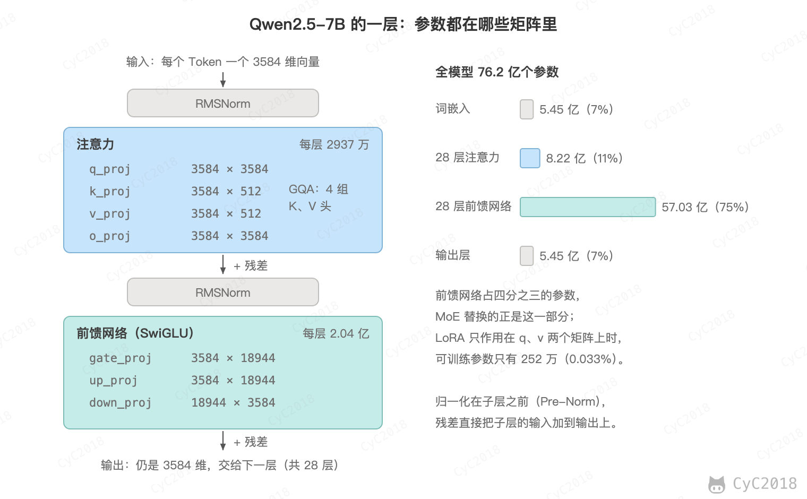 </div><br>

- 前馈网络先把向量从 3584 维放大到 18944 维，再压回 3584 维，三个矩阵占了全部参数的 75%。Qwen2.5 的前馈网络使用 SwiGLU：gate_proj 的输出经过激活函数后与 up_proj 的输出逐元素相乘，再交给 down_proj；
- 注意力的 k_proj、v_proj 只有 q_proj 的七分之一，这是因为 28 个查询头共享 4 组 K、V，见下文的 GQA；
- 加起来共 7,615,616,512 个参数，与模型权重文件中记录的大小（15,231,233,024 字节，每个参数 2 字节）一致（见[附录 A16](#a16-qwen25-7b-与-qwen3-30b-a3b-的参数量)）。

下文的 LoRA 和量化，处理的都是这些矩阵。

#### 3. 混合专家

普通的稠密（Dense）模型中，每个 Token 都要经过全部参数。混合专家（Mixture of Experts, MoE）把每层的前馈网络换成多个结构相同、参数独立的前馈网络，称为专家，再加一个路由器。路由器是一个线性层，为每个专家打分，每个 Token 只交给得分最高的 k 个专家处理，输出按分数加权求和：

<div align="center"> 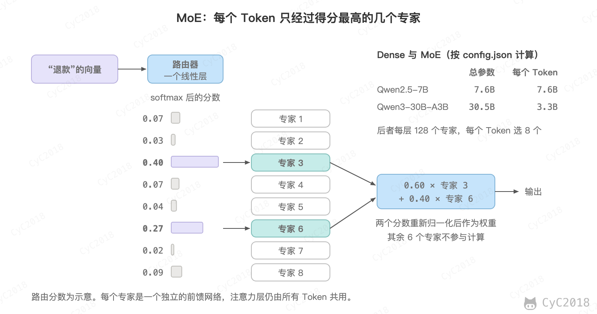 </div><br>

这样做的目的是用更多的参数存储知识，而每个 Token 的计算量不随之增加。例如 Qwen3-30B-A3B 有 48 层，每层 128 个专家，每个 Token 选 8 个，总参数 30.5B，每个 Token 实际用到的参数只有 3.3B（按 config.json 计算，与模型卡一致，见[附录 A16](#a16-qwen25-7b-与-qwen3-30b-a3b-的参数量)）。

MoE 与参数量相同的 Dense 模型相比：

- 计算量取决于激活的参数，生成一个 Token 的计算量接近 3B 的 Dense 模型；
- 显存取决于总参数，所有专家都要加载，Qwen3-30B-A3B 的 BF16 权重约 61 GB，是 Qwen2.5-7B 的 4 倍；
- 训练时需要负载均衡：路由器可能总是选中少数几个专家，其它专家得不到训练。Switch Transformer 等模型在损失函数中加一项辅助损失，各专家处理的 Token 数越不均匀，这一项越大；DeepSeek-V3 改为给每个专家的路由分数加一个只用于选择专家的偏置，某个专家负载过高时调低它的偏置，不再使用辅助损失。

### 注意力机制

注意力（Attention）用于让每个 Token 从其它 Token 中收集信息。例如在“小猫很饿”中，处理“饿”时需要知道饿的是谁，就要把注意力集中到“小猫”上。

每个 Token 的向量分别乘以三个参数矩阵，得到三个向量：

- 查询（Query, Q）：当前 Token 要找什么样的信息；
- 键（Key, K）：自己能被什么样的查询找到；
- 值（Value, V）：被找到之后提供的信息。

计算公式为 softmax(QK<sup>T</sup> / √d) V。以“饿”为例：

<div align="center">  </div><br>

1. 用“饿”的 Q 与每个 Token 的 K 做点积得到相关性分数，再除以 √d，d 是向量的维度；
2. 对分数做 softmax 得到权重，权重之和为 1，其中“小猫”的权重最大，为 0.70；
3. 按权重对所有 Token 的 V 求和，得到“饿”这个位置的输出，它的大部分信息来自“小猫”。

除以 √d 是因为：当向量的各个分量相互独立、均值为 0、方差为 1 时，点积的方差等于 d。维度越大分数之间的差距越大，softmax 的结果几乎全部集中到一个 Token 上，梯度接近 0，训练变得困难。除以 √d 之后，点积的方差恢复为 1。

生成文本时，一个 Token 只能看到它自己和前面的 Token，这称为因果掩码（Causal Mask）。实现方法是把“后面的 Token”对应的分数设为负无穷，softmax 之后权重为 0，即图中分数矩阵的右上角。

其它要点：

- 多头注意力（Multi-Head Attention, MHA）：把向量分成多份，每份独立计算注意力再拼接起来，不同的头可以关注不同的关系，例如指代关系、相邻的词；
- 位置编码：注意力本身不区分 Token 的先后顺序，需要额外加入位置信息。目前常用旋转位置编码（Rotary Position Embedding, RoPE），它按位置把 Q 和 K 旋转不同的角度，使注意力分数只取决于两个 Token 的内容和相对距离；
- 计算量：每个 Token 都要与前面所有 Token 计算分数，序列长度为 n 时，分数矩阵的大小与 n<sup>2</sup> 成正比，这是长上下文成本高的根本原因。FlashAttention 把计算分块放在 GPU 的片上缓存中完成，避免把 n × n 的矩阵写入显存，结果与标准注意力完全相同，但速度更快、占用的显存更少。

### 自回归生成与 KV Cache

模型每次只预测下一个 Token：把已有的 Token 序列输入模型，得到下一个 Token 的概率分布，按采样参数选出一个追加到序列末尾，再继续预测，直到生成结束标记。这种生成方式称为自回归（Autoregressive）。

<div align="center">  </div><br>

由于因果掩码，前文 Token 的 K 和 V 在后续步骤中不会再变化，可以缓存起来重复使用，这就是 KV Cache。因此一次请求分为两个阶段：

- 预填充（Prefill）：一次性并行处理整个输入，计算并缓存所有输入 Token 的 K 和 V，决定了首个 Token 的延迟；
- 解码（Decode）：每一步只为新 Token 计算 Q、K、V，再与缓存中的 K、V 计算注意力，逐个生成，决定了后续的输出速度。

<div align="center">  </div><br>

KV Cache 是用显存换计算。每个 Token 要在每一层缓存 K 和 V 两个向量，占用的显存为：

```text
2 × 层数 × KV 头数 × 每个头的维度 × 每个数值的字节数
```

以 Qwen2.5-7B 为例，28 层、4 个 KV 头、每个头 128 维，使用 BF16（2 字节），每个 Token 占用 2 × 28 × 4 × 128 × 2 = 56 KB，一个 32K Token 的请求占用 1.75 GB。模型权重本身约 14 GB，几个长上下文请求的 KV Cache 就能和权重一样大，所以 KV Cache 的大小直接决定了一张显卡能同时服务多少个请求。

减少 KV Cache 的方法：

- 分组查询注意力（Grouped-Query Attention, GQA）：多个查询头共享一组 K、V。Qwen2.5-7B 有 28 个查询头、4 组 K、V，如果每个查询头都有自己的 K、V，每个 Token 要占用 392 KB。极端情况是所有查询头共享一组 K、V，称为多查询注意力（Multi-Query Attention, MQA），缓存最小，但效果下降更明显；
- PagedAttention：推理框架 vLLM 把 KV Cache 切成固定大小的块按需分配，不再按最大长度预留连续的显存，相同前缀的请求还可以共享块，见[推理服务部署](#4-pagedattention)；
- 量化：用 8 位甚至更少的位数存储 K、V。

<div align="center">  </div><br>

### 采样参数

模型输出的是下一个 Token 的概率分布，最终选哪个 Token 由采样参数决定：

- 贪心解码：总是选概率最高的 Token，结果确定，但容易陷入重复；
- 温度（Temperature）：把每个 Token 的分数 z 除以温度 T 之后再做 softmax，T < 1 时高概率的 Token 更突出，T > 1 时分布变平；
- Top-k：只在概率最高的 k 个 Token 中采样；
- Top-p：按概率从高到低累加，只在累计概率刚达到 p 的那些 Token 中采样，候选数量随分布自动变化。

<div align="center">  </div><br>

例如原始分布为 0.50、0.22、0.16、0.07、0.05，温度为 0.5 时最高的概率升到 0.75，温度为 1.5 时降到 0.40。Top-p 为 0.8 时，累加到第 3 个 Token 达到 0.88，后两个 Token 被排除，剩下的重新归一化。

抽取字段、生成代码、调用工具等需要稳定结果的场景使用较低的温度，写作类场景可以适当调高。

### 训练过程

#### 1. 三个阶段

一个可以对话的大模型通常经过三个阶段的训练：

<div align="center">  </div><br>

- 预训练（Pre-training）：在海量文本上学习预测下一个 Token，模型获得语言能力和世界知识，但只会续写文本；
- 监督微调（Supervised Fine-Tuning, SFT）：用人工编写的指令和回答继续训练，模型学会按对话的格式回答问题、遵循指令，数据怎样构造见下文的微调；
- 偏好对齐：让回答更符合人的偏好，例如更有帮助、拒绝有害的请求。

SFT 之后还要做偏好对齐，是因为 SFT 只告诉模型“这个回答是对的”，偏好数据告诉模型“两个回答中哪个更好”。有用、安全这类目标很难写出标准答案，但比较两个回答的好坏要容易得多。

#### 2. RLHF 与 PPO

基于人类反馈的强化学习（Reinforcement Learning from Human Feedback, RLHF）是最早用于大模型的对齐方法，InstructGPT 分三步完成：

1. SFT：约 1.3 万条提示词和人工编写的回答；
2. 训练奖励模型：对同一个提示词，标注员把模型生成的 4～9 个回答按好坏排序，每两个回答组成一对，9 个回答可以组成 36 对；
3. 强化学习：用近端策略优化（Proximal Policy Optimization, PPO）算法，让模型对提示词生成回答，奖励模型打分，再根据分数更新模型。

奖励模型输入提示词和回答，输出一个分数，训练目标是让较好回答的分数高于较差回答，损失为 -log σ(r<sub>w</sub> - r<sub>l</sub>)。例如两个分数分别为 1.2 和 0.3，损失为 -log σ(0.9) ≈ 0.34，分差越大损失越小。

PPO 更新模型时不直接使用奖励的高低，而是使用优势（Advantage）：一个回答的实际得分比预期高多少。预期由价值模型（Critic）给出，它估计“从当前位置继续生成，平均能得多少分”。只看奖励时，简单的题目每个回答都得高分，模型分不清哪个回答真正更好；减去预期之后，比预期好的回答被强化，比预期差的被抑制。

奖励模型只是人类偏好的近似，模型可能找到它的漏洞，生成得分高但没有意义的回答。所以 PPO 在奖励中减去新模型与参考模型（冻结的 SFT 模型）之间的 KL 散度，限制模型偏离太远。

PPO 还把每次更新时新旧模型生成同一个 Token 的概率之比限制在 [1 - ε, 1 + ε] 之内，ε 通常取 0.2，超出的部分不再提供梯度，避免一次更新的步子太大。

因此 PPO 训练时要同时加载 4 个模型：策略模型（正在训练的模型）、价值模型、奖励模型和参考模型，其中策略模型和价值模型都要训练。后来的 DPO 和 GRPO 都减少了模型的数量：

<div align="center"> 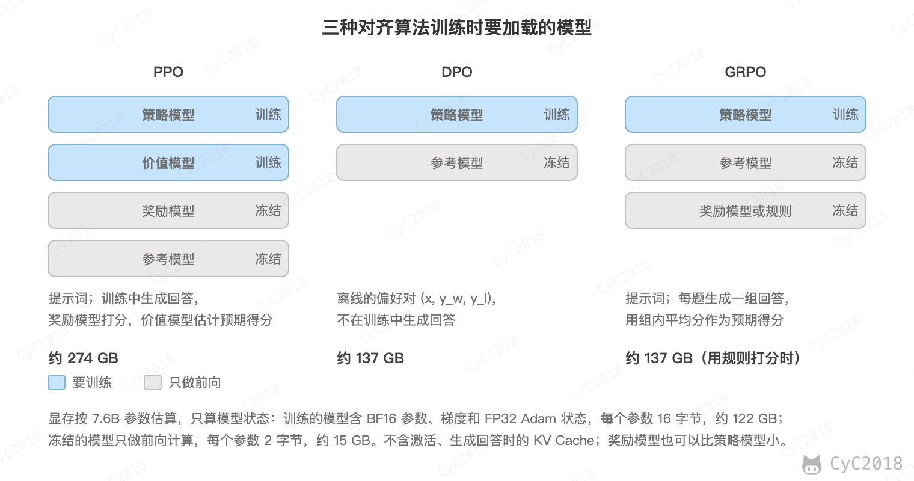 </div><br>

#### 3. DPO

直接偏好优化（Direct Preference Optimization, DPO）不训练奖励模型，也不在训练中生成回答，直接用标注好的偏好对 (提示词, 较好的回答, 较差的回答) 训练，只需要策略模型和参考模型。

不需要单独的奖励模型，是因为它的推导表明，最优的策略模型本身就隐含了一个奖励：r(x, y) = β log (π(y|x) / π<sub>ref</sub>(y|x))，即回答在新模型中的对数概率比参考模型高出多少。

把这个隐式奖励代入奖励模型的损失，就得到 DPO 的损失函数，其中 y<sub>w</sub>、y<sub>l</sub> 分别是较好和较差的回答，β 控制偏离参考模型的程度：

```text
loss = -log σ( β × [ (log π(y_w|x) - log π_ref(y_w|x)) - (log π(y_l|x) - log π_ref(y_l|x)) ] )
```

训练开始时模型与参考模型相同，括号内为 0，损失是 log 2 ≈ 0.693。取 β = 0.1，如果训练后较好回答的对数概率比参考模型高了 2，较差回答的低了 1，括号内为 3，损失降为 -log σ(0.3) ≈ 0.554。也就是说，DPO 在拉高较好回答概率的同时压低较差回答的概率，是一个二分类问题。

参考模型和 β 起到了 PPO 中 KL 散度的作用，所以 DPO 不需要再单独加 KL 项。

DPO 的损失只取决于两个回答的概率之差，需要注意的是：

- 训练中较好回答的概率也可能下降，只要较差回答下降得更多，损失仍在减小，两个回答只差几个 Token 时更明显；
- 偏好数据中较好的回答普遍更长时，模型会学到“越长越好”，输出越来越长，构造数据时要控制两个回答的长度差异。

#### 4. GRPO 与三者的选择

组相对策略优化（Group Relative Policy Optimization, GRPO）由 DeepSeekMath 提出，DeepSeek-R1 也使用了它。它去掉了价值模型：对同一个问题生成一组回答，用组内的平均分作为预期，比平均分高的回答得到正的优势，低的得到负的优势。

例如对一道数学题生成 4 个回答，答对得 1 分、答错得 0 分，得分为 [1, 0, 0, 1]，平均分 0.5、标准差 0.5，每个回答的优势 (得分 - 平均分) / 标准差 为 [1, -1, -1, 1]，答对的回答被强化，答错的被抑制。

如果 4 个回答全对或全错，优势都是 0，这道题对训练没有贡献，所以题目的难度要适中。数学、代码这类能自动判断对错的任务可以直接用规则打分，不需要奖励模型。

GRPO 把 KL 散度直接加在损失中，概率之比的限制与 PPO 相同。代价是每道题要生成一组回答，DeepSeekMath 中每题采样 64 个，生成的开销很大。

| | PPO | DPO | GRPO |
| --- | --- | --- | --- |
| 训练数据 | 提示词，奖励模型打分 | 离线的偏好对 | 提示词，奖励模型或规则打分 |
| 训练中生成回答 | 是 | 否 | 是，每题一组 |
| 预期得分的来源 | 价值模型 | 不需要 | 组内平均分 |
| 加载的模型 | 4 个，训练 2 个 | 2 个，训练 1 个 | 2～3 个，训练 1 个 |
| 7B 模型状态的显存（不含激活） | 约 274 GB | 约 137 GB | 约 137～152 GB |

三者的选择：DPO 实现简单、训练稳定，适合已有偏好数据的对齐；PPO 和 GRPO 在训练中生成新的回答，能探索出训练数据之外的更好回答，推理能力的训练通常使用 GRPO 这类强化学习方法。

### 微调

微调指的是用特定任务的数据继续训练模型，最常见的形式是 SFT。它改变的主要是模型的行为：按什么格式回答、用什么语气、怎样完成某种专门的任务，而不是让模型记住新的知识。

#### 1. 什么时候微调

RAG、微调和提示词解决的是不同的问题：

| 需求 | 方案 |
| --- | --- |
| 回答需要用到私有资料或者经常更新的知识 | RAG |
| 固定输出风格和格式，或者学会某种专业任务 | 微调 |
| 调整任务要求，补充少量规则和示例 | 提示词 |

以电商客服为例：

- 退货政策、商品参数经常变化，回答还要给出依据，用 RAG；
- 要求每次都按公司的话术回复，并输出固定字段的 JSON 工单，提示词和少样本示例仍然经常出错时，用微调；
- 只有 200 组固定的问答，按每组 100 个 Token 估算共约 2 万个 Token，可以直接放进提示词，配合前缀缓存降低成本，没有必要微调。

通常先尝试提示词，再考虑 RAG，最后才考虑微调。微调需要准备训练数据，基座模型升级后要重新训练，而且写入参数的知识难以更新，也无法给出来源。

用微调灌输新知识的效果也不好。有实验表明，SFT 数据中包含模型预训练时不知道的事实时，这些样本学得明显更慢，而一旦被学会，模型编造答案的倾向随之增加。LIMA 只用 1000 条精选的样本微调 65B 的模型就得到了很好的对话效果，说明知识主要来自预训练，SFT 只需要少量数据教会模型回答的方式。

#### 2. SFT 数据

SFT 的样本是一段完整的对话，通常每行一条 JSON：

```json
{"messages": [
  {"role": "system", "content": "你是电商客服助手，回答要简短。"},
  {"role": "user", "content": "拆封的耳机能退吗？"},
  {"role": "assistant", "content": "不影响二次销售的话，签收 7 天内可以退。"}
]}
```

训练时按模型的对话模板把消息拼成一段文本，训练目标仍然是预测下一个 Token，但只对助手回答的部分计算损失：

<div align="center"> 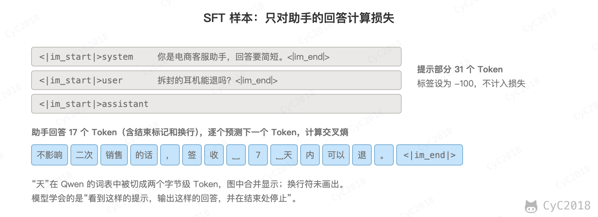 </div><br>

这条样本共 48 个 Token，前 31 个是系统消息、用户消息和助手回答的开头，标签设为 -100，不计入损失；后 17 个是回答和结束标记（Qwen2.5 分词器实测，见[附录 A17](#a17-sft-样本的损失掩码)）。

如果提示部分也计入损失，模型会花力气学习复述用户的问题。结束标记一定要计入，否则模型学不会在哪里停止。多轮对话的样本中，每一轮助手的回答都计入损失。

构造数据时，质量和多样性比数量更重要：

- 数量级：LIMA 用 1000 条，InstructGPT 的 SFT 数据约 1.3 万条提示词。LIMA 的消融实验中，只增加数量而不增加问题的多样性，收益很快递减；
- 来源：从线上真实的对话中挑选，脱敏之后由人工修改成标准的回答；线上发现的错误回答（Badcase）修正后补充进训练集，形成闭环；
- 覆盖：常见问题、边界情况和应该拒绝或转人工的情况都要有，回答的风格保持一致，否则模型学到的是混乱的风格；
- 评测：单独留一份不参与训练的评测集，同时准备一份通用能力的评测集，检查下文的灾难性遗忘。

#### 3. LoRA

全参数微调要更新所有参数。混合精度训练时，每个参数要保存 BF16 的参数和梯度、FP32 的参数副本和 Adam 优化器的两个状态，共 16 字节，Qwen2.5-7B 只算这部分就需要 7.6B × 16 ≈ 122 GB 显存，还不包括激活。

低秩适配（Low-Rank Adaptation, LoRA）冻结原有的参数矩阵 W，只训练两个小矩阵 B 和 A，用它们的乘积 BA 表示参数的变化量。它基于这样的观察：微调时参数的变化量通常是低秩的，用很少的参数就能表示。

<div align="center">  </div><br>

输出为 h = Wx + (α / r) · BAx：

- 秩 r 决定 B、A 的大小，也就是可训练参数的多少。一个 d<sub>in</sub> × d<sub>out</sub> 的矩阵增加 r × (d<sub>in</sub> + d<sub>out</sub>) 个参数；
- α 是缩放系数，实际起作用的是 α / r。LoRA 论文把 α 设为第一次尝试的 r 之后就不再调整，改变 r 时 α / r 的缩放可以减少重新调学习率的需要；
- 初始化：A 随机初始化，B 初始化为 0，所以训练开始时 BA = 0，模型与原模型完全相同。如果两个矩阵都随机初始化，训练一开始模型的输出就被打乱了。

按 Qwen2.5-7B 的真实维度计算（见[附录 A16](#a16-qwen25-7b-与-qwen3-30b-a3b-的参数量)）：

| 作用的矩阵 | r | 可训练参数 | 占全部参数 |
| --- | --- | --- | --- |
| q_proj、v_proj | 8 | 252 万 | 0.033% |
| 注意力的 4 个矩阵 | 16 | 1009 万 | 0.13% |
| 全部 7 个线性层 | 16 | 4037 万 | 0.53% |
| 全部 7 个线性层 | 64 | 1.61 亿 | 2.12% |

以 q_proj 为例，3584 × 3584 的矩阵有 1284 万个参数，r = 8 时只增加 8 × (3584 + 3584) = 57,344 个。

LoRA 论文只在注意力的 q、v 上实验；QLoRA 的实验发现，要达到全参数微调的效果，LoRA 要作用在所有线性层上，这比 r 取多大更重要，所以目前常用的做法是作用在全部线性层（PEFT 中设置 `target_modules="all-linear"`），r 取 8、16 这样较小的值（PEFT 的默认值为 8）。

LoRA 的优点：

- 显存少：梯度和优化器状态只为可训练参数保存。上表第三行的配置中，冻结的权重 15.2 GB，可训练部分连同优化器状态只有 0.65 GB；GPT-3 175B 的训练显存从 1.2 TB 降到了 350 GB；
- 推理无额外开销：训练完成后把 (α / r) · BA 直接加到 W 上，模型结构不变；
- 便于切换：同一个基座模型可以保存多份 LoRA 参数，用于不同的任务，上表第三行的配置以 BF16 保存只有约 81 MB。

需要注意的是，LoRA 减少的主要是显存，而不是计算量：前向和反向传播仍然要经过完整的 W，梯度也要穿过每一层传回去，只是不为 W 计算和保存参数的梯度。

#### 4. QLoRA 与全参数微调

QLoRA 进一步把冻结的原始参数量化为 4 位存储，计算时临时还原为 BF16，梯度只流向 LoRA 参数：

- 4 位 NormalFloat（NF4）：按正态分布设计的 16 个取值，比均匀分布的 INT4 更贴合权重的分布，每 64 个参数共用一个缩放系数；
- 双重量化：把缩放系数本身再量化一次，平均每个参数再节省约 0.37 位；
- 分页优化器：显存不足时把优化器状态临时换出到内存。

Qwen2.5-7B 的权重在 4 位下约 4 GB，比 BF16 的 15.2 GB 少了 11 GB 左右；论文中 65B 的模型可以在一张 48 GB 的显卡上微调。

全参数微调与 LoRA 的取舍：在代码和数学上的对比实验中，LoRA 在目标领域的效果明显不如全参数微调，但更好地保留了原有的能力；全参数微调学到的变化量的秩是常见 LoRA 配置的 10～100 倍。因此：

- 数据多、与预训练差异大的任务，例如学习一门新的编程语言、大量的领域语料，并且有足够的显卡，用全参数微调；
- 只调整格式、风格或者某个具体任务，数据只有几千条，或者要同时维护多个任务，用 LoRA；
- 显卡显存不够放下 BF16 的权重时，用 QLoRA。

#### 5. 灾难性遗忘

灾难性遗忘（Catastrophic Forgetting）指的是模型在新数据上训练之后，原有的能力明显下降，例如只用客服对话微调之后，写代码和多轮推理的能力变差，也就是常说的“微调之后变傻了”。对 1B 到 7B 模型的持续微调实验中普遍出现了遗忘，而且模型越大遗忘越严重。

缓解方法：

- 在训练数据中混入一部分通用的指令数据；InstructGPT 在 PPO 阶段混入预训练数据，减少了公开评测集上的退化；
- 用 LoRA 代替全参数微调，使用较小的学习率和较少的轮数，在验证集的损失不再下降时停止；
- 训练前后都在通用评测集上评测，与业务评测集一起作为是否上线的依据。

### 量化

量化（Quantization）指的是用更少的位数存储模型的参数，例如把 BF16（16 位）的权重转为 INT8 或 INT4。Qwen2.5-7B 的权重在 BF16 下约 15.2 GB，INT8 约 7.6 GB，INT4 约 3.8 GB（本节的 GB 按 10<sup>9</sup> 字节计算，按 2<sup>30</sup> 字节计算时 BF16 权重约 14.2 GB）。

量化不仅省显存，还能加快生成。这是因为解码阶段每生成一个 Token，都要把全部权重从显存读一遍，而计算量很小，速度受显存带宽限制，权重越小读得越快。推理服务的整体显存怎样估算，见[延迟与成本](#延迟与成本)。

#### 1. 怎样量化

权重能够量化，是因为它们的数值集中在很小的范围内。Qwen2.5-7B 第 14 层的 q_proj 中，权重绝对值的平均值只有 0.0124，最大的也只有 0.332（见[附录 A18](#a18-权重量化的误差与困惑度)）。

最简单的是对称量化：取一组权重中绝对值的最大值，除以整数能表示的最大值作为缩放系数 s，每个权重除以 s 后取整。INT8 能表示 -127～127，INT4 只能表示 -7～7。使用时乘以 s 还原，还原后与原值的差就是量化误差。

一组权重共用一个缩放系数，这组权重取多大，称为量化的粒度。下面是 q_proj 中真实的 16 个权重，其中有一个离群值：

<div align="center"> 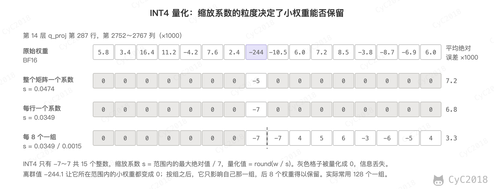 </div><br>

- 整个矩阵一个系数：s 由整个矩阵中最大的权重决定，普通的权重除以 s 都小于 0.5，全部变成 0；
- 每行（每个输出通道）一个系数：好一些，但这一行的最大值正好是这个离群值，同一行的其它权重仍然全部变成 0；
- 每组一个系数：离群值只影响它所在的组，另一组的权重得以保留。实际常用 128 个一组，每组多存一个 FP16 的缩放系数，平均每个权重多 0.125 位，7B 模型约多 0.12 GB。

把 Qwen2.5-7B 28 层中的全部线性层按不同的方式量化，在一段约 6600 个 Token 的中文技术文本上测量困惑度（越低越好）：

<div align="center"> 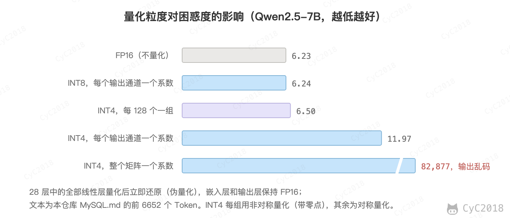 </div><br>

INT8 按通道量化几乎没有损失；INT4 必须按组量化，困惑度从 6.23 升到 6.50，按通道量化则升到 11.97，整个矩阵一个系数时模型只能输出乱码（见[附录 A18](#a18-权重量化的误差与困惑度)）。INT4 按组量化时也常用非对称量化：用每组的最小值和最大值确定范围，多存一个零点，0～15 的 16 个整数都能用上。

#### 2. 只量化权重与连同激活一起量化

只量化权重时（例如 W4A16，权重 4 位、激活 16 位），权重以 INT4 存储，计算前还原为 FP16，再与 FP16 的激活相乘。它节省显存和带宽，适合一次生成一个 Token、受带宽限制的解码阶段，是本地部署和小批量服务最常用的方式，GPTQ、AWQ 都属于这一类。

连同激活一起量化时（例如 W8A8），矩阵乘法直接在 INT8 上完成，能利用显卡的整数计算单元，适合计算量大的预填充和大批量推理。

难点在于激活中有离群的通道：Qwen2.5-7B 第 27 层注意力的输入中，2718 号通道的最大绝对值为 115.8，而所有通道的中位数只有 1.22。按 Token 量化时，缩放系数被这个通道拉大，其它通道的精度都下降了。

- LLM.int8()：把离群的通道单独用 FP16 计算，其余用 INT8；
- SmoothQuant：把激活的离群通道除以一个系数，同时把权重对应的通道乘以这个系数，乘积不变，量化的难度从激活转移到了权重上。

#### 3. GPTQ 与 AWQ

直接对每个权重四舍五入，称为 RTN（Round-To-Nearest）。GPTQ 和 AWQ 都用一小批校准数据计算出各层的输入，在此基础上减小量化后每层输出的误差，而不只是权重本身的误差。

GPTQ 逐层量化，每层按列逐个量化权重：每量化一列，就根据校准数据算出的二阶信息（输入的 XX<sup>T</sup>），调整还没有量化的那些列，抵消这一列产生的输出误差。论文中 175B 的模型在一张显卡上约 4 小时就能量化到 3～4 位。

AWQ（Activation-aware Weight Quantization）基于这样的观察：权重的重要程度不同，与较大的激活相乘的那部分权重对输出影响最大，只保护其中 1% 就能明显减小误差。但为个别通道保留 FP16 会形成混合精度，硬件上效率不高。AWQ 的做法是：

1. 用校准数据统计每个输入通道激活的平均大小 s<sub>X</sub>；
2. 量化之前把权重的第 j 个输入通道乘以 s<sub>j</sub> = s<sub>X,j</sub><sup>α</sup>，推理时把输入的第 j 个通道除以 s<sub>j</sub>，乘积不变；
3. 重要的通道被放大之后，相对的量化误差变小；在 [0, 1] 中搜索使输出误差最小的 α。

对 Qwen2.5-7B 第 14 层 q_proj 做每 128 个一组的 INT4 量化，这样缩放之后输出的相对误差从 8.98% 降到 7.86%（α = 0.3，见[附录 A18](#a18-权重量化的误差与困惑度)）。两者的区别：GPTQ 通过修改未量化的权重来补偿误差；AWQ 只做通道的缩放，不需要反向传播和重建，对校准数据的依赖更小。

#### 4. KV Cache 量化

KV Cache 也可以量化。Qwen2.5-7B 每个 Token 的 KV Cache 在 BF16 下占 56 KB，改用 FP8 存储后为 28 KB，同样的显存能放下两倍的 Token，见[自回归生成与 KV Cache](#自回归生成与-kv-cache)。vLLM 中设置 `kv_cache_dtype="fp8"` 即可开启。

量化都会损失一些精度，不同任务受到的影响不同，量化之后要在自己的任务上重新评测。

### 幻觉

#### 1. 什么是幻觉

幻觉（Hallucination）指的是模型生成了看似合理、但与事实或者给定资料不符的内容。可以分为两类：

- 事实性幻觉：与客观事实不符，例如编造不存在的论文、API；
- 忠实性幻觉：与给定的资料或指令不符，例如资料里写的是 5 天，回答却是 7 天。

#### 2. 为什么会产生

根本原因在于训练目标：模型学的是生成通顺的下一个 Token，而不是核对事实，不知道的内容也会被“合理地”补全。评测也在鼓励这种行为。多数评测只按答对的比例打分，回答“不知道”得 0 分，猜一个答案还有机会得分，所以倾向于猜测的模型在评测上分数更高，训练和挑选模型时也就偏向了猜测，而不是承认不确定。

其它原因：

- 知识缺失：训练数据有截止时间，也可能包含错误，出现次数很少的事实更容易记错。用微调灌输新知识还会加重这个问题，见上文的微调；
- 解码：采样带有随机性，一旦生成了错误的 Token，后面的内容会顺着它继续生成；
- 上下文：上下文过长或者检索到的资料有噪声时，模型可能用错资料。

#### 3. 检测与缓解

有参考资料时（例如 RAG），检测的是忠实性：把回答拆成一条条结论，逐条检查能否在资料中找到依据，见[评测与优化](#评测与优化)中的忠实度。引用的原文是否真的出现在资料中、数字和实体是否与数据库一致，这些可以直接用代码检查，比让模型判断更可靠。

没有参考资料时，可以对同一个问题多次采样再比较。模型真正知道的事实，多次回答的内容基本一致；编造的内容每次都不一样，例如问一个冷门开源库中某个函数的参数，三次可能给出三套不同的参数。

用另一个模型判断回答是否有幻觉时，这个模型同样可能出错。让它只回答“这条结论是否被这段资料支持”这样范围很窄的问题，并用一批人工标注的样本测出它判断的准确率，才知道它的结果能否信任。

缓解方法：

- 输入：通过 RAG 提供可靠的资料，资料不足时让模型明确回答不知道；
- 生成：降低温度，要求回答逐条引用资料；
- 校验：用程序检查引用的内容和关键数字，或者让另一个模型判断回答是否被资料支持；
- 产品：展示来源，高风险的结果由人工确认。

#### 4. Agent 中的幻觉

Agent 的幻觉除了回答错误，还会出现在工具调用的过程中。仍以“订单 1024 到哪了”为例：

- 编造参数：用户只问“我的包裹到哪了”，模型自己编一个订单号去查询；
- 编造或误读工具结果：物流接口超时，模型仍然回答“包裹正在运输中”；或者工具结果中没有的信息，模型自己补上；
- 声称做了没做的事：没有调用退款工具，却回答“已为您提交退款”。

用 Qwen2.5-7B-Instruct 实测，每种配置运行 10 次（见[附录 A19](#a19-agent-中的工具幻觉)）。用户没有给出订单号时，模型每次都先询问，没有编造订单号；物流接口超时时，系统提示词只写查询流程，有 3 次回答“包裹正在运输中”；加上“工具返回错误时如实告知”之后为 0 次。物流接口返回的结果中没有预计送达时间，用户却问“订单 1024 什么时候能到？”时：

| 工具结果 | 系统提示词 | 回答中给出了送达时间 |
| --- | --- | --- |
| 只有 location、updated_at | 只写查询流程 | 10 / 10，例如“预计 24 小时内送达” |
| 同上 | 加上“没有某项信息时如实告知，不要猜测” | 9 / 10，其中 8 次把 updated_at 当成了送达时间 |
| 改为 location_updated_at，并给出 `"eta": null` 和说明 | 以上两种 | 0 / 10，回答“承运商暂未提供预计送达时间” |

可见只在提示词中要求“不要编造”作用有限，模型会把含义不清的字段当成它需要的信息；把工具结果写清楚之后，这组实验中就不再出现编造。所以更可靠的做法是在工具和代码上约束：

- 工具结果写清楚：字段名表达准确的含义，没有的信息明确给出，例如 `"eta": null` 并附上说明，而不是省略这个字段；
- 参数来源校验：订单号必须出现在用户消息或之前的工具结果中，并且属于当前用户，否则返回错误让模型先询问用户；
- 结果核对：最终回答中的时间、金额、单号等关键信息，用代码检查是否出现在本轮的工具结果中；“已退款”这类操作结论，以退款工具是否真的返回成功为准，由代码生成确认消息；
- 多 Agent：子 Agent 之间传递结构化的结果和来源，关键结论回到原始数据核对，避免一个子 Agent 的错误被其它 Agent 当成事实继续使用。

幻觉无法完全消除，工程上的目标是降低出现的概率，并让错误能被发现。

### 推理模型

推理模型（Reasoning Model）在给出回答之前，会先生成一段思考过程，把复杂问题拆成多步解决。例如 DeepSeek-R1 通过大规模强化学习获得这种能力：对于数学、代码这类答案可以自动验证的题目，按最终答案是否正确给予奖励，模型在训练中自发地学会了更长的思考、检查和修正。

思考过程同样消耗 Token，更高的准确率是用更长的延迟和更高的成本换来的，简单问题没有必要使用推理模型。

## 二、提示词与上下文

### 提示词

对话接口的输入是一组带角色的消息：系统（system）消息设定模型的身份和规则，用户（user）消息是具体的请求，助手（assistant）消息是模型之前的回答，工具（tool）消息是工具的执行结果。

一个清晰的提示词通常包含任务、约束、输出格式和示例。例如从客服消息中提取工单：

```text
你是客服工单助手，从用户消息中提取工单信息。

要求：
- 只根据用户消息提取，没有提到的字段填 null，不要猜测；
- category 只能是 退款、物流、账号、其它 之一。

输出 JSON：{"category": ..., "order_id": ..., "summary": ...}

示例：
用户：订单 1024 三天了还没发货
输出：{"category": "物流", "order_id": "1024", "summary": "订单未发货"}
```

- 要求越具体越好，“简洁一些”不如“不超过 100 字”；
- 说明信息不足时怎么处理，否则模型倾向于编造；
- 给出几组输入和期望的输出，称为少样本（Few-shot）提示，示例比文字描述更能说明格式；
- 让模型先写出推理步骤再给出答案，称为思维链（Chain of Thought, CoT），可以提高多步推理问题的准确率。

提示词和代码一样需要版本管理，每次修改后都在固定的评测集上回归，对比修改前后的效果。

### 结构化输出

程序需要解析模型的输出时，要求模型按照 JSON Schema 返回结果。只在提示词中要求输出 JSON 是不够的，模型仍可能多说一句解释、漏掉字段或者少写一个括号。

#### 1. 约束解码

约束解码（Constrained Decoding）可以保证输出符合 Schema：每生成一个 Token 之前，先根据 Schema 算出哪些 Token 能让输出仍然是合法的前缀，把其它 Token 的概率置为 0，再进行采样。

<div align="center">  </div><br>

例如 Schema 规定 temp 是整数，已经生成了 `{"city": "杭州", "temp": ` 时，只有数字和负号是合法的，“晴”这类 Token 都会被屏蔽。vLLM 等推理框架和很多模型接口都支持这种方式，代价是 Schema 只能使用推理服务支持的子集。

需要注意的是，只保证输出是 JSON 的“JSON 模式”与约束解码不同。例如 DeepSeek 的 JSON Output（response_format 为 json_object）只保证输出合法的 JSON，有哪些字段仍要靠提示词中的样例约束；输出达到 max_tokens 时同样会被截断。

字段的顺序也有影响：约束解码按 Schema 中的顺序逐个生成字段，需要推理的任务应把 reason 这类解释字段放在结论字段前面，否则模型要先给出结论，再为它找理由。

#### 2. 输出无法解析时

不支持约束解码时，模型的输出可能无法解析。最常见的是 JSON 前后多了内容，例如包在 ```` ```json ```` 代码块里；其次是输出达到 max_tokens 被截断（接口返回的 finish_reason 为 length），以及语法合法但不符合 Schema，例如枚举值写成了同义词、金额写成“59 元”这样的字符串。

处理方法按代价从低到高：

- 修复：去掉代码块标记，截取第一个 { 到最后一个 } 之间的内容再解析。不需要再调用模型，但只能处理多出来的内容和简单的语法问题；
- 校验后带着错误重试：解析后用 JSON Schema 校验，失败时把原来的输出和具体的错误发回模型，例如“字段 intent 的值必须是 查物流、退货退款、修改地址、其它 之一”。能修正内容层面的问题，代价是多一次调用，所以要限制次数。

用 Qwen2.5-3B 从 20 条客服消息中提取订单号、意图和金额，每条采样 2 次：40 次输出中有 14 次包在代码块里，直接 json.loads 只成功 26 次；修复后 40 次都能解析，38 次通过 Schema 校验。剩下的 2 次都来自“订单 5120 和 5121 能一起发吗”，模型把两个订单号写进了一个字段，带着错误重试后仍然一样（实测，见[附录 A22](#a22-模型输出-json-的修复校验与重试)）。

可见多数格式问题靠修复就能解决；而输入超出了 Schema 的设计时，重试没有用，应该修改 Schema（例如把订单号改为数组）。实际使用时依次组合：先修复，再校验，失败后带着错误重试 1～2 次，仍然失败就返回默认值或者转人工处理。

#### 3. 格式正确不等于内容正确

约束解码和 Schema 校验只能保证格式。订单是否属于当前用户、退款金额是否超过实付金额这类业务规则无法写进 Schema，要在代码中校验。JSON 合法但业务仍然出错时，先看 finish_reason 是否为 length，再对比字段类型是否与代码中的类一致，例如订单号是字符串 "1024" 还是数字 1024。

流式输出时，JSON 要等生成结束才能完整解析。需要边生成边显示时，可以只流式显示其中的文本字段。

### 上下文工程

模型只能看到上下文窗口里的内容，回答的质量很大程度上取决于窗口里放了什么。上下文工程（Context Engineering）指的是在每次调用之前，决定把哪些内容、以什么顺序放进窗口，包括系统规则、工具定义、检索到的资料、对话历史和当前问题。

<div align="center">  </div><br>

#### 1. 放什么、按什么顺序

上下文并不是越多越好：

- 窗口有上限，输入越长，延迟和成本越高；
- 输入越长，模型对其中信息的利用越差，关键信息位于中间时更容易被忽略，这个现象称为 Lost in the Middle。

因此只放入与当前任务相关的内容，重要的规则放在开头或者结尾。

内容的顺序还会影响成本。模型服务普遍支持前缀缓存：两次请求的开头完全相同时，相同部分不需要重新计算，并按更低的价格计费。所以系统规则、工具定义这些不变的内容放在前面，每次都变化的内容放在后面，例如在系统提示词的开头插入当前时间，后面的内容就全部无法命中缓存，详见[让前缀缓存命中](#3-让前缀缓存命中)。

#### 2. Token 预算

窗口中的每一部分都占用 Token，先算清楚各占多少，才知道该限制和压缩哪一部分。以前文的客服 Agent 为例，用户在一次会话中先后查了物流、退了一件商品、改了地址，第 12 次发言时问发票多久能开好。用 Qwen2.5-7B-Instruct 的分词器和对话模板统计这次请求：

<div align="center"> 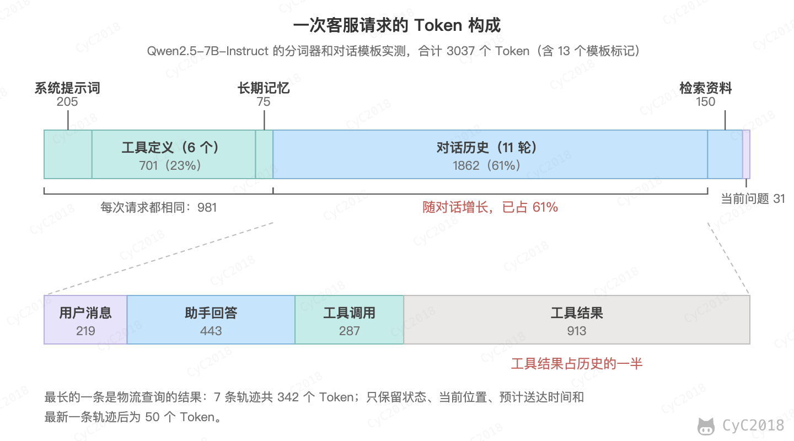 </div><br>

- 系统提示词、工具定义和长期记忆每次请求都相同，共 981 个 Token，其中 6 个工具的定义就占了 701 个。工具越多这部分越大，所以要按需加载工具；
- 对话历史只有 11 轮，已经占了 61%，而且会随对话一直增长，其中一半是工具返回的结果；
- 中文大约每个字符 0.6 个 Token，例如系统提示词 332 个字符，对应 205 个 Token（Qwen2.5 实测，见[附录 A3](#a3-客服请求的-token-构成)）。

分配预算时，先扣除每次都要放的部分，剩下的留给对话历史：

```text
历史可用 = 窗口 − 预留的输出 − 系统提示词 − 工具定义 − 长期记忆 − 检索资料的上限 − 当前问题
```

例如 Qwen2.5-7B-Instruct 默认的窗口是 32K，预留 2K 给输出，固定部分约 1K，检索资料限制在 4K 以内，历史最多可以用约 25K。预算通常要比窗口的上限小得多，这是因为上下文越长越贵，效果也越差，窗口能放下不代表应该放满。

#### 3. 压缩的方法与时机

对话或者 Agent 运行的时间很长时，历史会超出预算，需要压缩：

<div align="center">  </div><br>

- 截断：只保留最近的 N 轮或者最近的若干 Token，也称为滑动窗口。实现简单，不需要额外调用模型，代价是更早的内容全部丢失；
- 摘要：把较早的对话交给模型总结成一段摘要，保留已确定的结论、未解决的问题和用户的要求，丢弃寒暄和重复的内容。代价是多一次模型调用，细节可能被漏掉或者改写，而且摘要中的错误会一直传下去；
- 清理工具结果：较早的工具调用返回的大段原始数据很少再被用到，可以替换为一句说明，需要时重新获取。原始数据随时可以重新查询，所以这是风险最小的一种；
- 外置：把计划、中间结果写到文件或数据库中，上下文中只保留路径，需要时再读取，代价是模型要知道什么时候去读。

需要注意的是，截断历史时工具调用和它的结果要成对保留或者成对删除。只剩下结果而缺少对应的调用时，很多接口会直接报错。删掉之后，模型也不知道已经查过什么，可能重复调用，所以摘要中要写明查过什么、结果是什么，例如“已查询订单 1024 的物流：在杭州转运中心，预计 10 月 27 日送达”。

只有闲聊这类前后轮关系不大的对话，用滑动窗口就够了。客服对话中，用户在第 6 轮说的“取件前发短信，别打电话”到第 30 轮仍然有效；Agent 执行长任务时，早期做出的决定和用户提出的约束一直有用，这些场景适合摘要加外置。实际系统常把几种方法组合起来：上下文由“系统提示词 + 摘要 + 最近几轮的原文 + 当前问题”组成，更早的消息不断并入摘要，并且先清理工具结果，不够时再做摘要。

压缩的时机按 Token 数判断，而不是按轮数。上面的对话中，每轮新增的 Token 从 33 到 611 不等，查了物流的一轮是简单问答的十几倍。上一次请求的准确 Token 数可以从接口返回的 usage 中得到，再用分词器或者按字数估算新增的消息，超过阈值就压缩。常见的做法是设两道线：历史达到预算的约 70% 时在后台生成摘要，不影响当前的回答；达到上限时必须先压缩才能继续调用。MemGPT 就采用这种方式，在 70% 时提醒模型把重要的信息保存到外部，在 100% 时移出一部分消息，并把它们和原有的摘要合并成新的摘要。

#### 4. 压缩后不丢关键事实

摘要最容易丢掉的是订单号、金额、时间、地址这类精确的事实，而后面的对话恰恰要用到它们。下面比较两种摘要提示词，一种只要求“用一段话总结这段对话”，另一种要求按订单、已办理、承诺、用户要求、待办分项输出，并且照原文抄写编号、金额和地址。用 Qwen2.5-3B 把上面 11 轮的对话（1654 个 Token）各压缩 3 次，检查 14 条关键事实是否保留，再只根据摘要回答 5 个依赖早期对话的问题，例如“快递员什么时候上门取件”：

<div align="center"> 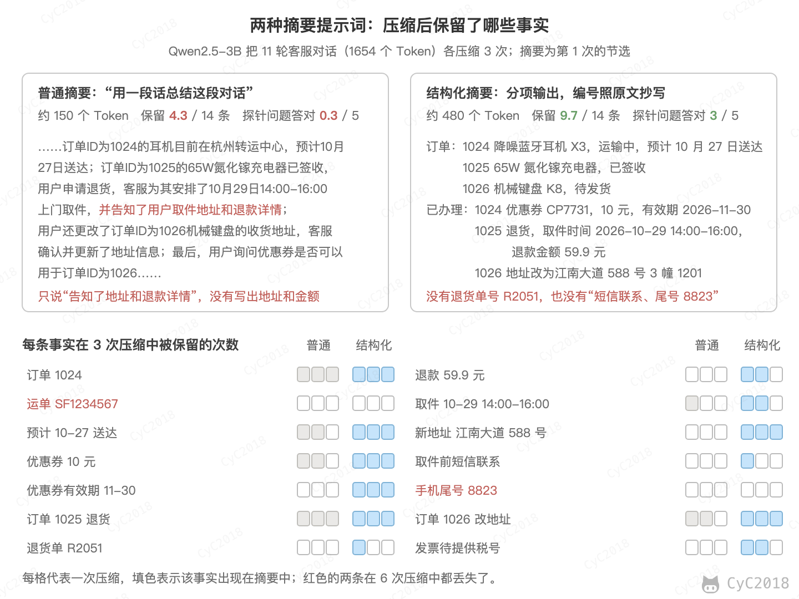 </div><br>

3B 的普通摘要平均只保留了 4.3 条事实，5 个问题平均答对 0.3 个；结构化摘要平均保留 9.7 条，每次都答对 3 个，代价是长度从约 150 个 Token 增加到约 480 个。即使是结构化摘要，用户只说过一次的要求，例如取件前发短信、手机尾号 8823，仍然经常丢失。换成 Qwen2.5-7B 各压缩 2 次，结构化摘要平均保留 11.5 条；普通摘要两次分别保留 12 条和 4 条，结果很不稳定（Qwen2.5 实测，见[附录 A4](#a4-普通摘要与结构化摘要)）。

因此关键的事实不能只依靠模型的摘要：

- 由代码维护任务状态：订单号、退货单号、金额、地址这些字段，直接从工具调用的参数和结果中提取，单独保存，不经过模型的改写；
- 让承诺通过工具留下记录：例如“取件前短信联系”应该调用备注工具写进订单，而不是只在回答中说一句；
- 摘要分项输出，要求编号、金额、时间照原文抄写；
- 生成新摘要时在旧摘要的基础上合并，而不是只总结新移出的消息，否则早期的内容会在多次压缩后消失。

压缩有没有丢掉关键信息，可以用两种方法检查，上面的实验就是这样做的：

- 关键事实覆盖：由代码从原始对话中找出订单号、单号、金额、电话等，检查它们是否出现在压缩后的上下文中，缺少的直接补回；
- 探针问题：准备一组依赖早期对话才能回答的问题，例如“用户一开始要求的输出格式是什么”，分别用压缩前和压缩后的上下文回答，比较正确率。

上线之后，模型重复调用已经调用过的工具、用户重复提供已经说过的信息，都说明压缩丢了东西，可以作为监控指标。

## 三、检索增强生成

检索增强生成（Retrieval-Augmented Generation, RAG）指的是先从知识库中检索与问题相关的资料，再把资料和问题一起交给模型生成回答。它用于解决模型不了解私有数据和最新数据的问题，也能减少幻觉，回答还可以附上来源。

### 流程

RAG 分为离线建立索引和在线检索生成两个阶段：

<div align="center">  </div><br>

- 离线：解析文档，切成小段，用 Embedding 模型把每一段转为向量存入向量数据库，同时建立关键词索引；
- 在线：改写用户的问题，向量检索和关键词检索同时召回候选，合并之后重排，把最相关的几段资料和问题一起放进提示词，生成带引用的回答。

每一环都会影响最终的效果：文档解析错了，后面检索得再准也没用；正确的资料没被召回，模型就只能编造。下面各节按这个顺序展开，最后的评测与优化一节给出效果不好时的排查顺序。

文档更新时，按文档 ID 和内容的哈希值找出发生变化的文档，只重新切片和计算这些文档的向量，并删除旧版本的切片，不需要重建整个索引。删除和更新在向量数据库中的开销见下文的向量数据库。

### 文档解析

文档解析指的是把 PDF、Word、网页、图片等文件转为带结构的文本，包括标题层级、段落和表格，同时提取页码、版本等元数据。后面的切片、检索和引用都以解析结果为准，解析阶段丢失或打乱的信息，后面无法补回来。

#### 1. PDF 为什么难解析

Word、HTML、Markdown 文件本身记录了标题样式、表格和列表，按结构读取即可。PDF 则不同，它只记录“在某个坐标画某个字”，没有段落、表格的概念；扫描件更进一步，每页只是一张图片，连文字都没有，必须先用光学字符识别（Optical Character Recognition, OCR）识别出文字和位置。

用一页员工手册对比两种读取方式。页面上有页眉页脚、两级标题、一段正文和一个住宿标准表格：

<div align="center"> 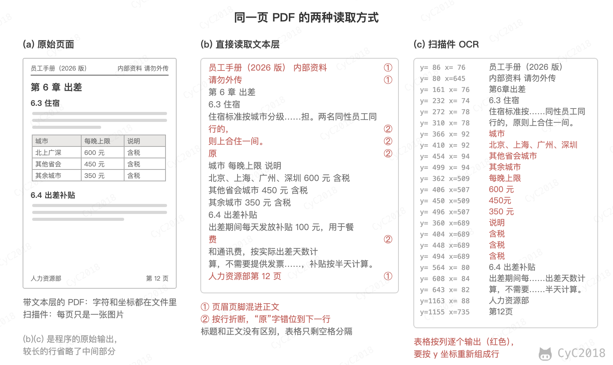 </div><br>

直接读取文本层得到的是按行排列的文字：页眉页脚混进了正文，一句话在折行处断开，“原”字还被排到了下一行，标题和正文也没有区别。把这一页转成图片模拟扫描件后，文本层为空，OCR 能正确识别大部分文字，但表格是一列一列输出的，先输出全部城市，再输出全部价格（macOS PDFKit 与 Vision 实测，见[附录 A11](#a11-pdf-文本层与扫描件-ocr)）。

#### 2. 版面分析

版面分析（Layout Analysis）根据每段文字的位置、字号和对齐方式，识别出页眉页脚、标题、正文、表格和图片区域，并确定阅读顺序，例如双栏排版要先读完左栏再读右栏。开源工具（例如 MinerU、Docling）用模型完成这些步骤，输出 Markdown 或 JSON。

用几条简单的规则就能看出原理：把 OCR 结果中 y 坐标相差不超过 12 像素的文字归为一行，同一行有多个文字块的就是表格行；顶部和底部 10% 的区域是页眉页脚，从中取出页码后丢弃；按“第 N 章”“N.N”的格式识别标题。对上面的扫描件，这几条规则的输出如下：

```markdown
## 第 6 章 出差

### 6.3 住宿

住宿标准按城市分级，超出标准的部分由员工自行承担。两名同性员工同行的，原则上合住一间。

| 城市 | 每晚上限 | 说明 |
| --- | --- | --- |
| 北京、上海、广州、深圳 | 600 元 | 含税 |
| 其他省会城市 | 450元 | 含税 |
| 其余城市 | 350 元 | 含税 |

### 6.4 出差补贴

出差期间每天发放补贴 100元，用于餐费和通讯费，按实际出差天数计算，不需要提供发票。当天往返的出差，补贴按半天计算。
```

标题层级恢复之后，切片可以按小节进行，每个切片也能带上“第 6 章 出差 > 6.3 住宿”这样的路径，见下一节。

表格转为 Markdown 后保留了行列关系。表格很大、需要按行切分时，每行都要带上表头，例如“城市：其他省会城市；每晚上限：450 元”，否则单独一行“450 元 含税”看不出是什么。图片中的文字同样用 OCR 提取，图片表达的含义可以交给多模态模型生成文字描述，见下文的多模态 RAG。

解析结果需要抽样与原文对比，OCR 置信度低的页面交给人工复核，上面的 OCR 把标题识别为 `第6章出差`，置信度只有 0.30。

#### 3. 元数据

解析时同时提取元数据：文档 ID、版本、标题路径、页码、所属部门和权限。元数据作为字段存放在每个切片上，有三个用途：

- 回答时给出“员工手册第 12 页”这样可以核对的来源；
- 检索时只查当前版本、只查用户有权限的资料，见下文的向量数据库；
- 文档更新时按文档 ID 删除它的全部旧切片。

### 切片

切片（Chunking）指的是把长文档拆成适合检索的小段。

#### 1. 为什么要切片

即使一篇制度文档只有几千字，也需要切片：

- 一个向量只能表示一段文字整体的意思，一段里包含年假、病假、婚假多个主题时，它的向量与哪个具体问题都不够接近；
- Embedding 模型有最大长度，bge-small-zh-v1.5 最多 512 个 Token，超出的部分直接被截断，800 字的中文约 680 个 Token；
- 放进提示词的内容越少，成本越低，引用的来源也越精确。

但切片也不能太小。例如“工作满 1 年不满 10 年的”和“每年 5 天”被切到两段，单独召回哪一段都无法回答问题。切片太大，向量不够准确，无关的内容还会占用上下文。

#### 2. 常用做法

- 按标题、段落等文档结构切分，表格和代码块保持完整，而不是按固定字数硬切；
- 相邻切片之间保留一部分重叠，避免关键句子被切断；
- 给切片加上文档标题、章节路径等信息，例如“员工手册 > 第 3 章 年假”，使切片单独拿出来也能看懂；
- 用小切片检索，命中之后返回它所在的完整段落，称为父子切片。

<div align="center">  </div><br>

#### 3. 对比实验

用一个小实验比较不同的切法。知识库是一份员工手册的 2026 版和 2023 版（除标题和施行日期外，两个版本只有 6 处数字不同）以及一份错误码说明，共约 1.3 万字；40 个问题都是员工的口语化提问，例如“老婆生孩子，我能休几天假？”。每个问题标注了回答所需的原句，检索出的前 K 个切片完整包含这些原句就算找到，找到的问题所占的比例记为 Recall@K（见[附录 A12](#a12-切片方式top-k-与相似度阈值)）：

| 切法 | 切片数 | Recall@1 | Recall@3 | 前 3 个切片的字数 |
| --- | --- | --- | --- | --- |
| 固定 100 字 | 51 | 0.50 | 0.73 | 296 |
| 固定 100 字，重叠 20 字 | 63 | 0.65 | 0.80 | 295 |
| 固定 200 字 | 26 | 0.55 | 0.83 | 590 |
| 固定 200 字，重叠 40 字 | 32 | 0.70 | 0.93 | 575 |
| 固定 400 字 | 13 | 0.55 | 0.83 | 1163 |
| 固定 800 字，重叠 160 字 | 9 | 0.75 | 0.98 | 2065 |
| 按小节切 | 52 | 0.85 | 0.98 | 278 |
| 按小节切，单句检索、返回小节（父子切片） | 133 | 0.83 | 0.95 | 361 |

按小节切的效果最好，放进提示词的字数也最少，因为固定长度的切片会把一句话切成两半，或者把两节的内容拼在一起。重叠对固定长度的切片帮助明显，200 字的 Recall@3 从 0.83 提高到 0.93，代价是切片数多了约四分之一。

800 字的切片召回率也高，但主要是因为放进去的字多：前 3 个切片共约 2000 字，已经是知识库的六分之一，而且每个切片超过 512 Token 的部分没有参与向量计算。父子切片在这里没有优势，因为每个小节本身只有一两百字，小节很长、问题只对应其中一两句时它才有用。

需要注意的是，40 个问题中一个问题就是 0.025，这组数字只说明趋势。另外，两个版本的同一节几乎一样，38 个问题的前 3 个结果里同时出现了新旧两个版本，加标题路径也区分不开，需要按版本过滤，见下文的向量数据库。

#### 4. 怎么确定切片大小

切片大小没有通用的最优值：先按文档结构切，用 Embedding 模型的最大长度给出上限；事实类的问题（几天、多少钱）适合小切片，需要综合理解的问题适合大一些的切片；最后在自己的评测集上对比不同大小和重叠的召回率。

### Embedding 与相似度

#### 1. 向量与余弦相似度

Embedding 模型把一段文本转为一个固定长度的向量，例如 1024 维。训练时让意思相近的文本的向量互相靠近、无关的文本的向量互相远离，因此向量之间的距离可以衡量语义的相似程度。

常用余弦相似度衡量两个向量方向的接近程度：cos(a, b) = a · b / (|a| |b|)，取值范围是 -1 到 1。用二维向量示意：

```text
a = “怎么申请年假”     (0.8, 0.6)
b = “休假的流程是什么”  (0.6, 0.8)     cos(a, b) = 0.48 + 0.48 = 0.96
c = “今天股价上涨了”    (0.6, -0.8)    cos(a, c) = 0.48 - 0.48 = 0
```

a 和 b 几乎没有相同的字，相似度却很高，这正是向量检索相比关键词检索的优势。向量通常会归一化为长度 1，这时余弦相似度等于点积，计算更快。

用真实的模型计算，结论相同但数值没有这么极端：用 bge-small-zh-v1.5（512 维）编码这三句话，“怎么申请年假”与“休假的流程是什么”的余弦相似度为 0.603，与“今天股价上涨了”为 0.194（见[附录 A1](#a1-embedding-相似度与-bm25)）。实际系统中不同句子的相似度大多落在一个不太宽的区间里，判断是否相关要看排名和阈值，而不是期望不相关的结果接近 0。

#### 2. Top-K 检索

检索时把问题也转为向量，找出与它最相似的 K 个切片，称为 Top-K 检索。问题和切片必须使用同一个 Embedding 模型，更换模型后所有切片都要重新计算向量。K 怎么取见下文的 Top-K 与阈值。

#### 3. 选择模型

选择模型时先看语言和领域是否匹配、最大长度是否够用，维度则决定了存储成本：1 亿个向量从 512 维换成 1024 维，原始向量的内存从 205 GB 变为 410 GB。公开榜单只能作初筛，业务资料的措辞与公开数据集差别很大，最终以候选模型在自己的评测集上的召回率为准。

还要按模型的说明使用。例如 bge 中文模型建议检索时在问题前加上“为这个句子生成表示以用于检索相关文章：”，切片不加；在切片实验的数据上，加前缀后 Recall@3 从 0.975 提高到 1.0，Recall@1 不变（见[附录 A12](#a12-切片方式top-k-与相似度阈值)）。

### 向量索引

#### 1. 为什么需要近似检索

最简单的检索方法是把问题向量与所有切片向量逐个比较。100 万个 1024 维的向量，每次查询需要约 10 亿次乘加运算，数据量和并发量大时太慢。向量数据库使用近似最近邻（Approximate Nearest Neighbor, ANN）索引，用少量精度换取速度，可能会漏掉个别真正最近的向量。

索引的召回率指的是返回的结果中有多少是逐个比较得到的真正 Top-K，衡量的是近似带来的误差；它与切片实验中“相关的资料有没有被找到”的召回率不是一回事。

#### 2. HNSW

HNSW 把向量组织成多层的图，每个向量与附近的若干个向量相连。插入时每个向量随机分配一个最高层，层数越高概率越低，所以上层的向量少、连线跨度大，最下层包含所有向量。查询时从最上层的入口开始，每层贪心地走向离查询更近的节点，走不动时下降一层，思路与 [跳跃表](Redis.md#跳跃表) 类似。

<div align="center">  </div><br>

HNSW 查询快、召回率高，不需要训练。它的三个参数都在速度、内存和召回率之间权衡：

- M：每个节点连接的邻居数，越大召回率越高、占用内存越多，最下层的邻居数是 2M；
- efConstruction：建图时每个节点搜索的候选数，越大图的质量越好、建索引越慢；
- efSearch（Milvus 中叫 ef）：查询时保留的候选数，越大召回率越高、查询越慢，一般不小于 K。

#### 3. IVF 与 PQ

HNSW 的问题是内存：原始向量和图都要放在内存中。IVF 和 PQ 分别从减少比较次数和压缩向量两个方向解决规模问题，两者常一起使用，称为 IVF-PQ：

<div align="center"> 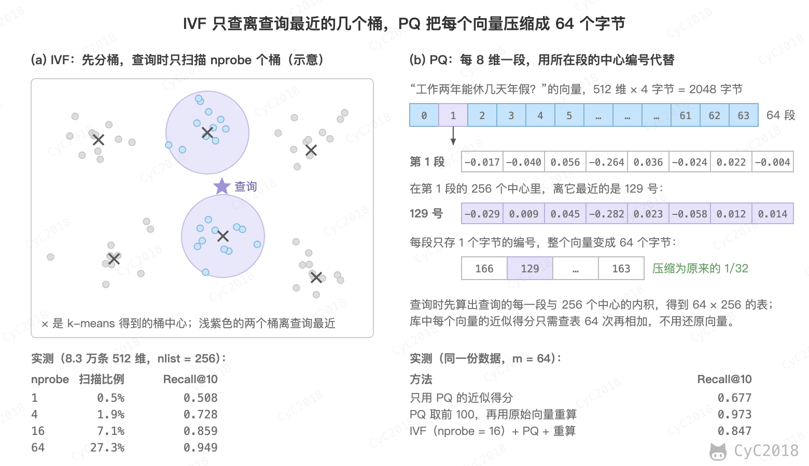 </div><br>

IVF 先用 k-means 把向量分到 nlist 个桶中，查询时只比较离查询最近的 nprobe 个桶。在 8.3 万个 512 维的真实文本向量上，nlist = 256、nprobe = 16 时只扫描 7.1% 的向量，Recall@10 为 0.859；nprobe = 64 时扫描 27.3%，Recall@10 为 0.949（numpy 实现，见[附录 A13](#a13-ivf-与-pq-的召回率)）。

乘积量化（Product Quantization, PQ）把 512 维的向量按 8 维一段切成 64 段，每段在训练好的 256 个中心中找最近的一个，只存它的编号，2048 字节压缩为 64 字节。查询时先算出查询的每一段与 256 个中心的内积，得到一张 64 × 256 的表，库中每个向量的近似得分只需查表 64 次再相加。

压缩是有损的，同一份数据上只用 PQ 的近似得分，Recall@10 只有 0.677。补救方法是先用 PQ 取出前 100 个候选，再用原始向量重新计算排序，Recall@10 提高到 0.973。原始向量可以放在磁盘上，每次只读取这 100 个。

#### 4. 按内存选择索引

按 FAISS 文档给出的每个向量占用的字节数，估算 1 亿个 512 维 float32 向量需要的内存（见[附录 A15](#a15-向量索引的内存估算与-ndcg-核对)）：

| 索引 | 每个向量 | 1 亿个向量 |
| --- | --- | --- |
| 原始向量（暴力检索） | 512 × 4 = 2048 字节 | 204.8 GB |
| HNSW，M = 32 | 2048 + 32 × 2 × 4 = 2304 字节 | 230.4 GB |
| IVF，不压缩 | 2048 + 8 字节 ID = 2056 字节 | 205.6 GB |
| IVF-PQ，64 段 × 8 位 | 64 + 8 = 72 字节 | 7.2 GB |

HNSW 在原始向量之外还要多占 10% 以上的内存，IVF-PQ 只需要原来的 1/28。所以数据量不大、内存充足时用 HNSW；内存受限时用 IVF-PQ，配合原始向量重排弥补精度；数据量超过内存时用基于磁盘的索引，例如 DiskANN 把图和原始向量放在 SSD 上，只在内存中保存 PQ 编码，论文中单机 64 GB 内存可以检索 10 亿个向量。

### 向量数据库

FAISS 这类向量检索库只负责在内存中建立索引和检索。实际系统中，切片会不断增删改，检索时要按版本、权限过滤，数据还可能多到一台机器放不下，向量数据库在索引之上解决这些问题。数据只有几千条、很少变化时，把向量放在内存中直接计算余弦相似度就够了。

#### 1. 过滤

检索时往往要同时满足标量条件。如果先检索 Top-K 再过滤，结果可能远少于 K 个。例如 pgvector 的 HNSW 索引默认每次查询只保留 40 个候选，过滤条件只有 10% 的行满足时，平均只剩 4 条结果。

因此向量数据库一般在检索的过程中过滤：Milvus 先根据过滤条件生成一个位图，检索时跳过不满足条件的向量；Elasticsearch 的 knn 查询中的 filter 也在近似检索的过程中生效；pgvector 0.8.0 起支持迭代扫描，结果不够时自动继续扫描。

过滤还能直接提高效果。在切片一节的实验中，新旧两个版本的员工手册同时在库中，模型可能读到“次年 6 月底”这样的旧规定；检索时加上 version = 2026 的条件后，Recall@1 从 0.85 提高到 0.93（见[附录 A12](#a12-切片方式top-k-与相似度阈值)）。多租户的系统同理，可以把租户 ID 设为分区键，查询时只搜索对应的分区。

#### 2. 更新与删除

向量索引的修改比普通数据库贵。HNSW 插入一个向量相当于做一次检索，再为它和邻居建立连接；删除更麻烦，从图中删掉一个节点会破坏其他节点的连接，所以一般只做标记，检索时跳过，之后再统一清理；更新等于删除加插入。

以 Milvus 为例，新写入的数据先进入可写的段（Growing Segment），持久化之后变为不可修改的段（Sealed Segment），再在这个段上建立索引；删除只是在位图中标记，后台的压缩（Compaction）合并小段时才真正去掉。所以频繁的小批量更新会产生大量的小段和被标记删除的数据，它们仍然占用内存、拖慢检索，更新应该尽量批量进行。

文档修改后，按文档 ID 删除它的全部旧切片再写入新切片，只追加新切片会让旧内容继续被召回。文档的原文和元数据一般以关系数据库为准，向量库按切片 ID 幂等写入，失败时重试，并定期对账两边的数据。

#### 3. 大规模数据

按上一节的估算，1 亿个 512 维的向量用 IVF-PQ 只需要约 7 GB 内存，单机可以放下。1000 亿个向量即使压缩到每个 72 字节也需要 7.2 TB，只能分片：数据按主键或分区键分到几十台机器上，查询时每个分片各自检索出 Top-K，再合并成全局的 Top-K。在此基础上，用分区键或时间范围缩小每次查询的范围，选择维度更低的模型或更短的编码，或者换用 DiskANN 这类基于磁盘的索引，都能进一步降低成本。

#### 4. 选型

选型主要看数据量、写入频率和已有的技术栈。已经在用 PostgreSQL 或 Elasticsearch、数据量不大时，直接用它们的向量功能（pgvector、dense_vector），向量和业务数据或全文索引放在一起，少维护一个系统；数据量大、写入频繁时，用 Milvus 这类专门的分布式向量数据库。各产品的功能变化较快，以官方最新文档为准。

### 混合检索

向量检索擅长匹配意思相近但措辞不同的内容，却不擅长精确匹配。例如查询“错误码 E1024”，E1024 和 E1025 的向量非常接近，向量检索可能把 E1025 的文档排在前面。关键词检索正好相反，常用的算法是 BM25，它给文档打分时主要考虑三点：

- 词频：查询词在文档中出现的次数越多分数越高，但增长逐渐放缓，出现 10 次并不比出现 5 次重要一倍；
- 逆文档频率：越少见的词权重越高，E1024 只出现在少数文档中，权重远高于“错误码”；
- 文档长度：词频相同时，较短文档的分数更高，避免长文档仅仅因为字数多而得分高。

Elasticsearch 中 BM25 的参数 k1 和 b 默认为 1.2 和 0.75，分别控制词频的饱和速度和文档长度的影响程度。

用同一个例子对比两种检索。查询“错误码 E1024 是什么意思”，候选文档是“错误码 E1024：库存不足”和“错误码 E1025：支付超时”：bge-small-zh 给出的相似度分别为 0.762 和 0.743，几乎分不开；BM25 中“错误码”出现在每篇文档里，逆文档频率很低，E1024 只出现在一篇文档中，权重高得多。在这两篇加一篇“常见错误码说明”组成的小语料上，按 k1 = 1.2、b = 0.75 计算，第一篇得 1.088 分，第二篇只有 0.130 分（见[附录 A1](#a1-embedding-相似度与-bm25)）。

因此通常两路同时召回，再合并结果。两路的分数不能直接相加，BM25 的分数没有上限，余弦相似度在 -1 到 1 之间。倒数排名融合（Reciprocal Rank Fusion, RRF）只看排名：文档的得分是它在各路结果中排名的倒数之和，即 Σ 1 / (k + rank)，k 通常取 60。例如：

| 文档 | 向量检索排名 | BM25 排名 | RRF 得分 |
| --- | --- | --- | --- |
| A | 1 | 2 | 1/61 + 1/62 = 0.0325 |
| C | 3 | 1 | 1/63 + 1/61 = 0.0323 |
| B | 2 | - | 1/62 = 0.0161 |
| E | - | 3 | 1/63 = 0.0159 |
| D | 4 | - | 1/64 = 0.0156 |

两路结果中都排名靠前的 A 和 C 排在最前面。也可以把两路的分数分别归一化到 0 到 1 之后按权重相加，权重需要在评测集上调整。

### 重排

重排（Rerank）用来对召回的几十条候选重新打分排序，只保留最相关的几条。向量检索已经计算过相似度，还需要重排，是因为两种模型的计算方式不同：

<div align="center">  </div><br>

- Embedding 模型分别编码问题和文档，文档的向量可以提前计算并建立索引，速度快；但问题和文档在编码时互相看不到，细节的对应关系在压缩成一个向量时丢失了；
- 重排模型把问题和文档拼成一个输入一起编码，称为交叉编码器（Cross-Encoder），注意力可以在问题和文档的每个词之间计算，判断更准确；但每一对都要重新计算，只能处理少量候选。

所以先用速度快的检索从海量数据中召回几十条，再用准确的重排模型选出最终的几条，与搜索和推荐系统中先召回、后排序的分层思路一致。

### Top-K 与阈值

#### 1. 两个 K

RAG 中有两个 K：召回的 K 是每路检索取多少个候选交给重排，例如 50；放进提示词的 K 是重排之后保留几个，例如 3～5。前者影响能不能找到资料，后者影响模型能不能用好资料。

#### 2. 召回的 K

召回的 K 在评测集上确定：计算不同 K 下的召回率，取召回率不再明显上升的位置。在切片一节的实验中，按小节切时 Recall@1 到 Recall@4 依次为 0.85、0.93、0.98、1.0，之后不再变化（见[附录 A12](#a12-切片方式top-k-与相似度阈值)）。有重排时召回的 K 可以取大一些，排序交给重排模型。

#### 3. 放进提示词的 K

放进提示词的 K 不是越大越好。Token 越多，成本和延迟越高；排名靠后的切片大多是无关或者半相关的内容，也可能是旧版本、互相矛盾的规定，模型可能用错资料；上下文越长，模型越容易忽略中间的信息，见[上下文工程](#上下文工程)。

K 太小，需要多个切片才能回答的问题又会答不全，例如“几点以后算迟到”需要同时用到工作时间和迟到的定义两节。所以这个 K 要用端到端的回答正确率来确定，并受上下文预算的约束。

#### 4. 相似度阈值

阈值用于丢掉不相关的结果，并识别资料中没有答案的问题。但向量相似度的绝对值很难设定阈值。在同一份数据上加入 10 个资料中没有答案的问题，其中“离职需要提前几天申请”与年假的“3.2 申请”一节的相似度为 0.688，比部分有答案的问题还高：

| 阈值 | 有答案的问题被误拒 | 没有答案的问题被放行 |
| --- | --- | --- |
| 0.50 | 0% | 40% |
| 0.55 | 2.5% | 20% |
| 0.60 | 10% | 10% |

可见向量相似度的阈值只能在误拒和放行之间折中，适合用较低的值过滤明显无关的结果。判断有没有答案，更多依靠重排模型的分数（它直接判断问题与切片是否相关，阈值同样要在评测集上确定），以及在提示词中要求资料不足时回答不知道。更换模型后阈值要重新确定，不同模型的分数分布不同。

### 查询改写

用户的原始问题往往不适合直接检索：

- 指代：先问“Java 8 的 HashMap 怎么扩容”，再问“那 ConcurrentHashMap 呢”，第二个问题单独检索找不到有用的内容，需要结合历史改写为“Java 8 的 ConcurrentHashMap 怎么扩容”；
- 问题太短：问题只有几个字，切片有几百字，两者的向量不容易靠近。HyDE 的做法是先让模型写一段假设的回答，再用这段回答去检索，因为回答在形式上更接近文档；
- 包含多个子问题：拆成多个查询分别检索，再合并结果。

改写需要多调用一次模型，会增加延迟。

### 评测与优化

RAG 需要分别评测检索和生成，这样才能定位问题出在哪一步：资料没找到是检索的问题，资料找到了但回答错了是生成的问题。

#### 1. 检索指标

最常用的三个指标：

- 召回率（Recall@K）：相关的切片有多少出现在前 K 个结果中；
- 平均倒数排名（Mean Reciprocal Rank, MRR）：第一个相关结果排名的倒数的平均值，衡量相关结果是否排得靠前；
- 归一化折损累计增益（Normalized Discounted Cumulative Gain, NDCG）：相关程度可以分级，排名越靠后的结果，贡献按 1 / log₂(排名 + 1) 打折扣，再除以理想排序下的值，取值在 0 到 1 之间。

例如 3 个问题各有 1 个相关切片，在前 5 个结果中的排名分别是 1、3 和未出现，则 Recall@5 = 2 / 3，MRR = (1 + 1/3 + 0) / 3 = 0.44。一个问题需要多个切片、并且切片的重要程度不同时，三个指标的区别更明显：

<div align="center"> 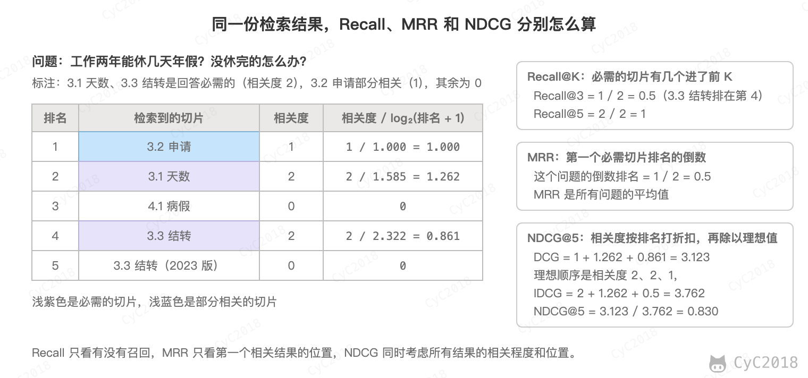 </div><br>

只关心资料有没有找全，看 Recall；用户通常只看第一条结果的场景，看 MRR；有分级标注、要评价整体排序质量时，看 NDCG。上面的 NDCG 用 scikit-learn 的 ndcg_score 核对过（见[附录 A15](#a15-向量索引的内存估算与-ndcg-核对)）。

#### 2. 生成指标

生成的质量主要看两点：

- 忠实度（Faithfulness）：回答中的每个结论是否都能在检索到的资料中找到依据；
- 答案相关性（Answer Relevance）：回答是否回应了问题，不考虑对错。

这两个指标难以用规则计算，通常让另一个模型来打分（LLM-as-a-Judge）。RAGAS 的做法是把打分拆成模型容易做对的小步骤：计算忠实度时，先让模型把回答拆成若干条独立的陈述，再逐条判断能否从资料中推出，得分为被支持的陈述数除以陈述总数；计算答案相关性时，让模型根据回答反推出几个问题，再计算它们与原问题的 Embedding 余弦相似度的平均值，答非所问时反推出的问题与原问题差别大，得分低。

用 Qwen2.5-7B-Instruct 作评判模型，对“工作两年能休几天年假？没休完的怎么办？”的三个回答打分，资料是 2026 版的 3.1 天数和 3.3 结转两节（见[附录 A14](#a14-忠实度与答案相关性)）：

| 回答 | 忠实度 | 答案相关性 |
| --- | --- | --- |
| 5 天；可以延到次年 3 月底前，逾期作废 | 2 / 3 | 0.711 |
| 5 天；可以延到次年 6 月底前 | 0 / 2 | 0.713 |
| 年假以半天为单位，3 天以内提前 3 个工作日申请 | 0 / 2 | 0.665 |

第二个回答把 3 月底写成了 6 月底，忠实度能发现，答案相关性发现不了，所以两个指标要一起看。评判模型本身也会出错：“工作两年有 5 天年假”需要从“满 1 年不满 10 年”推出来，7B 模型判为不支持，使正确的回答只得了 2 / 3。因此评判模型要选能力较强的，并抽样人工核对它的打分。

#### 3. 评测集

指标要在一批固定的问题上计算。问题优先从真实的用户问题中抽样，不够时让模型根据文档生成，再人工改写措辞，因为模型生成的问题往往照抄原文的词语，会高估向量检索的效果。除了常见问题，还要包含资料中没有答案的问题、需要多个切片的问题和新旧版本冲突的问题。

每个问题标注标准答案和回答所需的原文片段，而不是切片 ID，这样改变切片方式之后标注仍然可用，切片一节的实验就是这样判断是否找到的。几十到几百个问题就可以比较不同的方案，每次调整解析、切片、模型或参数之后都重新评测；线上发现的错误回答持续补充进来，避免评测集与真实的问题分布脱节。

#### 4. 排查顺序

回答效果不好时，按数据流动的顺序从前往后排查，因为前面的错误后面无法弥补：

| 步骤 | 怎么检查 | 常见问题与优化 |
| --- | --- | --- |
| 解析 | 打开相关文档的解析结果，与原文对比 | 表格错乱、页眉混入、扫描件没有 OCR：改用版面分析，表格转 Markdown |
| 切片 | 找到包含答案的切片，看答案是否完整地在一个切片中 | 答案被切断或者和无关内容混在一起：按结构切、加重叠、加标题路径 |
| Embedding 与检索 | 看相关切片在向量检索和 BM25 中分别排第几 | 措辞差异大：查询改写、换模型；专有名词、编号：混合检索；旧版本、无权限：元数据过滤；排名在 K 之外：增大 K |
| 重排 | 对比重排前后相关切片的排名 | 召回了但被排到后面：换重排模型，调整保留的数量 |
| 生成 | 把正确的资料直接交给模型，看能否答对 | 资料对但回答错：减少放入的切片，要求逐条引用，换更强的模型 |

最后一步也可以先做：把正确的资料直接交给模型，答不对说明问题在生成，答得对说明问题在前面的检索。

### 长上下文与 Agentic RAG

模型的上下文窗口越来越大，资料量不大时可以把全部资料直接放进上下文，不需要 RAG。但知识库很大时，RAG 仍然是必要的：

- 每次请求都处理大量 Token，成本高、延迟大；
- 上下文越长，模型对其中信息的利用越差；
- 检索时可以按用户的权限过滤资料，全部放进上下文就做不到这一点。

普通的 RAG 每个问题只检索一次。问题需要多步查找时，例如“负责支付系统的团队的负责人是谁”，要先查到团队，再查负责人。这时可以把检索作为一个工具交给 Agent，由模型决定检索什么、检索几次，称为 Agentic RAG。它更灵活，但调用次数和延迟都会增加，问题简单时固定流程的 RAG 更可控。

RAG 解决的是模型缺少知识的问题，固定输出风格或者学习专门的任务需要微调，两者的选择见[微调](#微调)。

### GraphRAG

按切片检索有两类问题处理不好。一类是多跳问题，例如上一节的“负责支付系统的团队的负责人是谁”，“支付系统由交易平台组维护”和“交易平台组的负责人是王磊”在两份文档里，问题与第二句的相似度很低；另一类是全局问题，例如“今年的制度主要改了哪些地方”，答案分散在整个知识库中，取几个切片覆盖不了。

GraphRAG 在建索引时让模型从每个切片中抽取实体和关系，组成知识图谱：

```text
(支付系统, 维护团队, 交易平台组)    来自《系统清单》
(交易平台组, 负责人, 王磊)          来自《组织架构》
```

查询时先找到问题中的实体“支付系统”，沿着边走两步就得到答案，再把相关的原文交给模型生成回答。对于全局问题，微软的 GraphRAG 用社区检测算法把联系紧密的实体分组，为每组生成一段摘要；回答时先让每个摘要分别给出部分回答，再汇总成最终的回答。

代价是建索引要对每个切片调用大模型，比计算 Embedding 贵得多，抽取的错误会进入图中，文档更新后还要重新抽取。所以它适合实体和关系密集的资料，例如组织架构、系统依赖、条款之间的引用；普通的问答用向量检索加关键词检索就够了。

### 多模态 RAG

资料中常有流程图、截图和图表。最常用的做法是先把图片转为文字：用 OCR 提取图中的文字，再让多模态模型为图片生成一段描述，之后按普通文本切片和检索，整个流程不需要改动，但描述中可能丢失图里的细节。

不转文字的做法是让文字和图片共用一个向量空间。CLIP 用大量的图片和文字说明训练两个编码器，使配对的图片和文字的向量互相靠近，这样文字的问题可以直接检索图片；ColPali 进一步把每页文档的截图直接编码为多个向量（每个图块一个），省去 OCR 和版面分析，适合排版复杂、图表多的文档。

检索到图片之后，生成用的是多模态模型时，可以把图片直接放进上下文让它读图回答；只能用文本模型时，就只能使用图片的文字描述，模型并没有看到图片本身。

## 四、Agent

### Agent 是什么

普通的大模型调用是一问一答：模型根据输入生成一段文本。它无法查询数据库、调用接口，也就拿不到训练数据以外的信息，更不能替用户执行操作。

Agent（智能体）指的是让大模型通过调用工具来完成任务的系统。模型负责决定下一步做什么，应用程序负责执行，并把结果交还给模型，如此循环，直到任务完成。例如用户问“订单 1024 到哪了”：

<div align="center">  </div><br>

需要注意的是，模型始终只输出文本，查询数据库、调用接口都是应用代码完成的。模型的作用是在每一步做出决策，应用的作用是执行决策、控制整个循环。

一个 Agent 通常由以下几部分组成，后面各节分别介绍：

- 模型：理解任务，决定下一步做什么；
- 工具：模型可以使用的函数或接口，用于获取信息和执行操作；
- 记忆：保存对话历史、用户偏好等信息，需要时放进上下文；
- 规划：把复杂的任务拆成多个步骤；
- 控制循环：应用代码中反复调用模型、执行工具的循环，同时负责限制步数、校验参数和权限。

### 工具调用

工具调用（Function Calling）指的是模型按照约定的格式给出要调用的函数名和参数，由应用程序执行。模型能够“调用工具”，过程如下：

<div align="center">  </div><br>

1. 应用在请求中附上工具定义，包括名称、用途和参数的 JSON Schema；
2. 推理服务按照模型的对话模板，把工具定义和调用格式的说明拼进提示词；
3. 模型在训练时学习过这种格式，判断需要调用工具时，会生成一段特定格式的文本，而不是直接回答；
4. 推理服务识别出这段文本，把它解析为结构化的 tool_calls 返回给应用。

可见工具调用本质上仍然是生成文本，所以模型可能写错参数、调用不存在的工具，应用必须先校验再执行。很多服务提供严格模式，用约束解码保证参数符合 Schema。

以 OpenAI 兼容的接口为例，用户问“订单 1024 到哪了”，请求中这样描述查询订单的工具（省略了查询物流的 get_logistics）：

```json
"tools": [{
  "type": "function",
  "function": {
    "name": "get_order",
    "description": "按订单号查询订单状态和运单号。用户询问订单、发货情况时使用",
    "parameters": {
      "type": "object",
      "properties": {
        "order_id": {"type": "string", "description": "订单号，例如 1024"}
      },
      "required": ["order_id"]
    }
  }
}]
```

模型决定调用工具时，返回的消息中带有 tool_calls，其中 arguments 是一个 JSON 字符串：

```json
{"role": "assistant", "tool_calls": [{
  "id": "call_1", "type": "function",
  "function": {"name": "get_order", "arguments": "{\"order_id\": \"1024\"}"}
}]}
```

应用执行函数后，用 tool 角色的消息把结果发回。一次回复中可能包含多个调用，tool_call_id 用于对应是哪一次调用：

```json
{"role": "tool", "tool_call_id": "call_1", "content": "{\"status\": \"已发货\", \"tracking_no\": \"SF1234567\"}"}
```

这些结构化的字段只存在于接口中。用 Qwen2.5-7B-Instruct 和 Hugging Face Transformers 运行“订单 1024 到哪了”这个例子，可以直接看到模型收到和输出的原始文本：

<div align="center"> 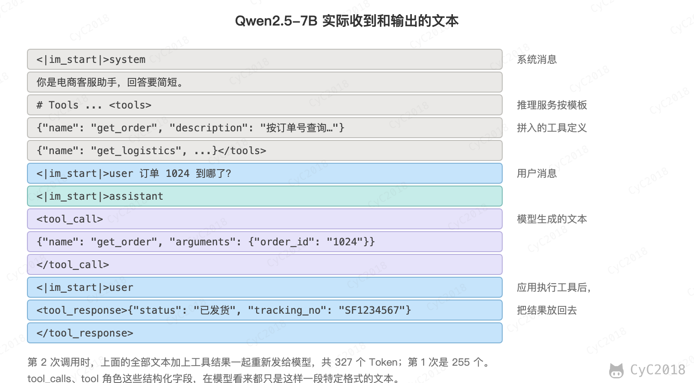 </div><br>

工具定义被拼进了系统消息，模型输出的是包在 &lt;tool_call&gt; 标签里的一段 JSON，应用用正则把它解析出来；工具结果则被包在 &lt;tool_response&gt; 中，作为下一条消息发回。不同模型的标签不同，但原理相同，OpenAI 兼容接口中的 tool_calls 字段就是推理服务从这段文本中解析出来的。

工具结果使用单独的角色，模型能区分这是工具返回的数据而不是用户的指令，但这并不能防止结果中藏有恶意指令，见下文的安全。

模型只能根据工具的名称、描述和参数说明来决定是否调用、怎么填参数，所以工具的设计直接影响调用的准确率：

- 描述写清楚用途和使用时机，参数给出格式和示例；
- 一个工具只做一件事，工具之间的职责不要重叠，否则模型容易选错；
- 返回结果要精简，只返回模型需要的字段，大段的原始数据会占用上下文；
- 出错时返回能指导模型修正的信息，例如“日期格式应为 2026-01-01”，而不是只返回“参数错误”。

描述写得是否清楚，对结果的影响很大。在上面的例子中，系统提示词只写“你是电商客服助手，回答要简短”时，7B 模型查到运单号就直接回答“已发货，运单号是 SF1234567”，没有继续查物流；采样运行 10 次，1 次也没有答出包裹的位置。在系统提示词中写明“用户问包裹到哪了时，先查订单拿到运单号，再查物流，告诉用户当前位置和预计送达时间”后，10 次全部依次调用了两个工具，回答“您的包裹目前位于杭州转运中心，预计明天送达”。同样的提示词换成 3B 模型，20 次都只调用了一个工具，可见模型能力不足时，提示词也弥补不了（Qwen2.5 实测，见[附录 A2](#a2-提示词对工具调用的影响)）。

工具很多时，全部的工具定义会占用大量上下文，模型也更容易选错。可以只加载与当前任务相关的工具，例如先根据问题检索出最相关的十几个工具，或者把工具分组交给不同的子 Agent。

### Agent 循环

把工具调用放进一个循环，就得到了 Agent。大多数 Agent 按照 ReAct（Reasoning and Acting）的方式运行：模型先思考下一步做什么，然后调用工具，把工具返回的结果作为观察放回上下文，再进入下一轮思考，直到信息足够给出最终回答。

<div align="center">  </div><br>

从接口的角度看，应用每次调用模型时发送的消息如下：

<div align="center">  </div><br>

- 模型不保存状态，每次调用都要发送完整的消息历史，所以步数越多，发送的消息越长，Token 消耗也越多；
- 每一步新增两条消息：模型的调用请求，以及应用执行工具得到的结果；
- 第 3 次调用时模型返回的是文本而不是调用请求，说明它认为信息已经足够，循环结束。

用代码表示这个循环：

```java
String run(String question) {
    List<Message> messages = new ArrayList<>();
    messages.add(Message.system(SYSTEM_PROMPT));
    messages.add(Message.user(question));
    for (int step = 0; step < MAX_STEPS; step++) {
        Message reply = llm.chat(messages, tools);    // 每次都发送完整的历史
        messages.add(reply);
        if (reply.toolCalls().isEmpty()) {
            return reply.content();                   // 不再调用工具，得到最终回答
        }
        for (ToolCall call : reply.toolCalls()) {
            String result = execute(call);            // 由应用执行，出错时返回错误信息
            messages.add(Message.tool(call.id(), result));
        }
    }
    return "超过最大步数，转人工处理";
}
```

什么时候结束由模型判断，但模型可能一直不停，或者反复调用同一个工具，所以代码中必须限制最大步数，见下文的可靠性与评测。

### Agent 与工作流

与 Agent 相对的是工作流（Workflow）：执行哪些步骤、按什么顺序执行都由代码事先写好，大模型只负责其中的某些步骤，例如对用户的消息分类。

<div align="center">  </div><br>

- 工作流可预测、成本可控，适合步骤固定的业务；
- Agent 更灵活，适合无法事先确定步骤的开放任务，代价是成本更高，错误会在多个步骤之间累积。

例如每一步的成功率是 95%，连续 10 步都成功的概率只有 0.95<sup>10</sup> ≈ 60%。因此应该先尝试单次调用或者工作流，确实需要时再引入 Agent，也可以只在工作流的某一步中使用 Agent。

实际的客服系统大多是两者的组合：先用意图路由把请求分到退款、物流等流程，退款这类涉及资金、步骤固定的流程写成工作流，商品咨询这类开放的问题交给带检索工具的 Agent。路由见下一节，流程的编排见[开发框架](#开发框架)。

### 意图识别与路由

意图识别指的是判断用户想做什么，路由指的是根据判断结果把请求交给对应的流程、提示词、工具集或者模型。例如“订单 1024 到哪了”交给物流查询，“衣服尺码不合适想退”交给退款流程。

不把所有请求交给同一个 Agent，是因为不同类别的处理方式差别很大：退款要查订单、校验金额、请求确认，商品咨询要检索商品资料。全部写进一个提示词、提供全部工具，各类请求之间会互相干扰，工具越多也越容易选错；分开之后每个流程可以单独优化、单独评测，还能只给它需要的工具和权限，简单的类别交给更小、更便宜的模型。

#### 1. 三种做法

- 规则：关键词、正则表达式，例如消息中有“退款”就进入退款流程。速度快、没有成本、结果可解释，但用户换个说法就匹配不到，不同类别的关键词还会撞车；
- 分类模型：用标注数据训练一个小模型，例如 BERT 类的文本分类模型，或者 Embedding 加一个简单的分类器。延迟在毫秒级，输出的概率可以作为置信度，但需要标注数据，增加类别要重新训练；
- 让大模型输出类别：在提示词中写清楚每个类别的定义，让模型只输出类别名。不需要训练数据，能理解没见过的说法，但每次请求多一次模型调用，输出还可能不在类别列表中。

用 60 条客服消息比较这三种做法（5 个类别各 12 条，其中 10 条含有其它类别的关键词，例如“钱退到哪了”含有“到哪”）：

<div align="center"> 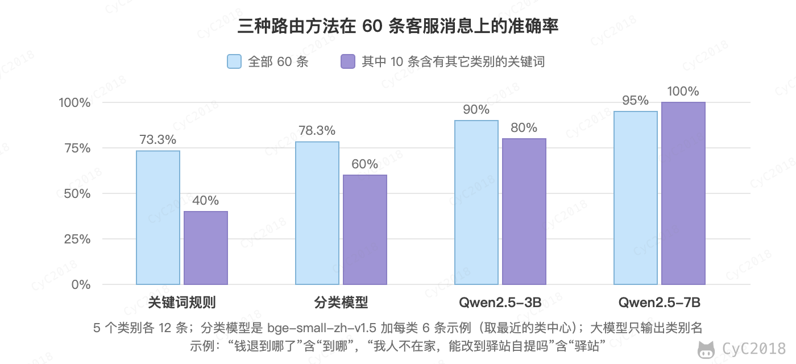 </div><br>

- 关键词规则的准确率是 73.3%。它判为退款、改地址的消息全部正确，但 12 条退款消息只找到 7 条，“收到的杯子碎了，怎么处理”没有命中任何关键词，“快递还没到，但我不想要了”因为“快递”被分到了物流；
- 分类模型（bge-small-zh-v1.5 加每类 6 条示例）的准确率是 78.3%，示例太少时容易被字面相似误导，例如把“保修多久”分到退款；
- Qwen2.5-7B 的准确率是 95%，10 条含有其它类别关键词的消息全部分对。

需要注意的是，7B 模型把“快递员态度太差了，我要投诉”的类别输出成了“投诉”，这个类别并不存在（Qwen2.5 实测，见[附录 A6](#a6-意图路由的三种做法)）。

#### 2. 怎样保证路由准确

<div align="center"> 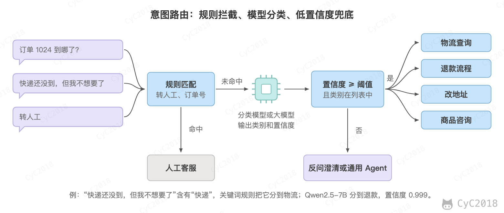 </div><br>

- 类别定义互斥，并写明边界，例如“退款进度属于退款，不属于物流”“购买前问发货时间属于商品咨询”。分错的消息大多落在两个类别的边界上，补充定义比换模型更有效；
- 校验输出：类别名必须在列表中，用[结构化输出](#结构化输出)把输出限制为枚举值，不在列表中的按“其它”处理；
- 分层：规则只处理精确率高的情况，例如“转人工”、消息中带有订单号格式的查询，其余的交给模型；
- 低置信度兜底：置信度低于阈值时不硬分，而是反问澄清（“您是想查物流还是申请退款？”），或者交给通用的 Agent、转人工；
- 看上下文：多轮对话中的“那退了吧”单独看无法分类，要把最近几轮对话一起交给分类器，或者先把它改写成完整的问题；一句话包含多个意图时，拆成多个请求，或者交给能分派任务的主 Agent。

置信度阈值的效果取决于置信度是否可靠。上面的分类模型把阈值设为 0.7 时，48% 的消息自动路由，其中准确率 96.6%，其余转入兜底流程；而 7B 模型分错的 3 条中有 2 条的置信度高于 0.93，阈值几乎拦不住。大模型的输出概率往往过于自信，可以改用多次采样看结论是否一致，或者在类别中加入“不确定”，让模型自己选择。

路由的准确率要靠评测集来衡量和守住：

- 按类别收集样本，每类数量接近，特别要包含容易混淆的消息和不属于任何类别的消息；
- 除了总准确率，还要看混淆矩阵，即每个类别被错分到了哪里，例如本例中规则的 16 个错误有 9 个是没有命中任何关键词、落入“其它”，5 个是被“快递”“到哪”这类词误导、分到了物流；
- 线上转人工、用户改口重说的会话说明路由可能错了，定期抽查后加入评测集；
- 修改类别定义、提示词或者模型之后，在同一个评测集上回归，确认没有让其它类别变差。

即使换成能力更强的模型，路由仍然有用：它决定了每个流程能用哪些工具和权限，简单问题可以走更便宜的模型，按类别统计的效果数据也是优化的依据。

### 规划

规划要解决的是一个任务分几步、按什么顺序做、做错了怎么办。常见的几种方式的区别在于：推理是否与行动交替，是否先给出完整的计划，是否同时探索多条思路，失败后是否总结经验再试。

#### 1. 思维链

思维链（Chain-of-Thought, CoT）指的是让模型先写出中间的推理步骤，再给出答案。例如“3 件 59.9 元的 T 恤，满 150 减 20，实付多少”，模型先写出 3 × 59.9 = 179.7，超过 150，再减 20 得 159.7。写出步骤之后，后面的每个 Token 都能参考前面算出的中间结果，多步计算和推理的准确率明显提高。

实现上，可以在少样本示例中写出推理过程，或者在提示词中要求“先逐步分析，再给出答案”；推理模型在训练中已经学会了这种方式，见[推理模型](#推理模型)。

思维链只发生在一次调用之内，所用的信息全部来自上下文和模型自身的知识。如果某个事实记错了，后面的推理会顺着错误继续推下去。ReAct 论文在 HotpotQA 问答上做过人工分析：思维链的失败案例中 56% 是编造的事实，ReAct 为 0%。思维链适合信息已经在上下文中的推理和计算。

#### 2. ReAct

ReAct 把推理和行动交替进行：每一步先思考，再调用工具，工具返回的真实结果作为观察放回上下文，再进行下一步思考，过程见 [Agent 循环](#agent-循环)。它与思维链的区别在于事实来自外部，而不是模型的记忆。

论文中的 ReAct 让模型按 Thought、Action、Observation 的文本格式输出，再由代码解析；现在的实现直接使用模型原生的工具调用，思考写在回复的文本或推理内容中。

ReAct 适合下一步取决于上一步结果、步数不多的任务，例如先查订单拿到运单号，再查物流。它的问题是每一步都要调用一次模型，步骤只能串行；长任务中容易偏离最初的目标，或者反复执行同一个步骤，上面的分析中 ReAct 的失败有 47% 是推理错误，其中包括陷入重复的步骤。

#### 3. 先规划后执行

先规划后执行（Plan-and-Execute）指的是先让模型把任务拆成步骤列表，再逐个执行。

<div align="center">  </div><br>

实现时通常分为三个角色：

- 规划器：调用一次模型，按结构化输出生成计划，每个步骤带编号和依赖，例如 {"id": 5, "task": "汇总对比", "depends_on": [1, 2, 3, 4]}，代码检查步骤数、用到的工具是否存在、依赖有没有成环；
- 执行器：按依赖顺序执行，没有依赖关系的步骤并行，每个步骤内部可以是一个小的 ReAct 循环，也可以使用更便宜的模型；
- 重规划：每完成一步，把原计划和已有结果交给模型，判断是继续、修改剩余的步骤还是结束。某一步失败、结果与计划的假设不符（例如查不到 B 的续航）时触发。

计划保存在状态中，可以向用户展示进度，中断后也能从未完成的步骤继续。重规划的次数要设上限，例如 3 次，超过后返回已完成的部分并说明原因，避免模型一直规划失败、无限循环。

两种方式的比较：

- 先规划后执行：互不依赖的步骤可以并行，进度容易展示和恢复；但计划可能与实际情况不符，需要重规划；
- ReAct：可以根据中间结果随时调整方向；但每一步都要调用一次大模型，长任务中容易偏离最初的目标。

实际系统常把两者结合：先生成一份计划，执行每个步骤时使用 ReAct，并在执行过程中更新计划。

#### 4. 思维树和反思

<div align="center"> 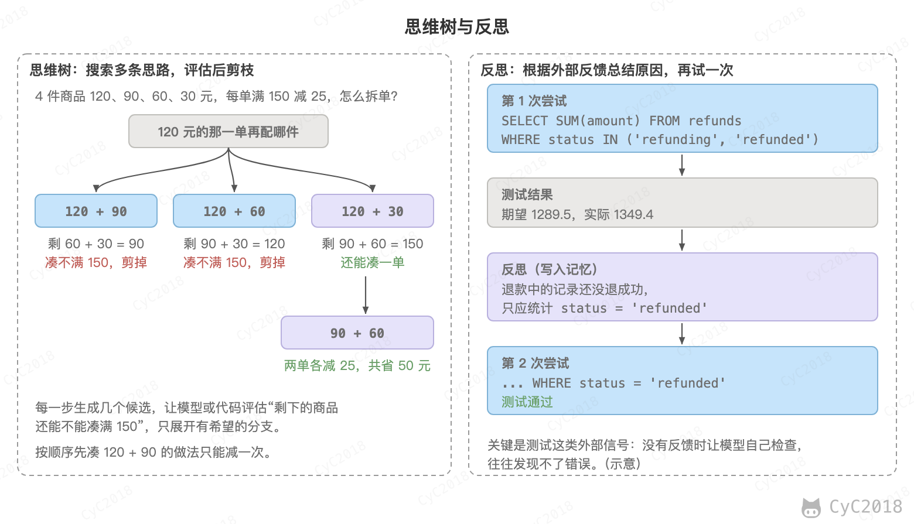 </div><br>

思维树（Tree of Thoughts, ToT）指的是每一步生成多个候选思路，评估每个候选的前景，只展开有希望的，走不通时回溯到别的分支。例如 4 件商品 120、90、60、30 元，每单满 150 减 25，按顺序把 120 和 90 凑成一单，剩下的 90 元凑不满第二单，只能减 25；如果在第一步列出三种搭配，评估“剩下的商品还能不能凑满 150”，就能找到 120 + 30 和 90 + 60 两单，共减 50。

搜索的框架由代码实现：每一步让模型生成 k 个候选，由模型打分或者代码校验，保留得分最高的几个继续展开。这种方式成本很高，论文中用 GPT-4 玩 24 点游戏，思维链的成功率为 4%，思维树为 74%，但每道题生成约 5500 个 Token，接近 100 次思维链的用量。它适合有明确评估标准、需要试探和回溯的问题，客服问答这类任务很少用到。

反思（Reflexion）指的是任务失败后，让模型根据反馈写一段反思，说明错在哪、下次怎么做，保存到记忆中，下一次尝试时放进上下文。论文在 HumanEval 代码生成上用自己生成的单元测试作为反馈，pass@1 达到 91%，同期 GPT-4 为 80%。

反思是否有效，关键在于反馈是否来自外部，例如测试结果、工具报错、校验规则。没有外部反馈时，让模型检查自己的答案往往发现不了错误，有研究发现在推理任务上这样做甚至会把对的答案改错。因此工程上的反思通常由失败信号触发，例如测试不通过或者参数校验失败，并限制重试次数；反复出现的经验可以写进提示词或者 Skill，变成长期的规则，见 [Harness](#harness)。

#### 5. 怎样选择

- 信息都在上下文中的推理和计算：思维链，或者直接使用推理模型；
- 步数少、下一步依赖上一步的结果：ReAct；
- 步骤多、可以事先拆分、需要并行或者展示进度：先规划后执行，每个步骤内部使用 ReAct；
- 有明确的评估标准、需要搜索和回溯：思维树；
- 有可靠的外部反馈、允许多次尝试：反思；
- 步骤固定不变：不需要模型规划，直接写成工作流。

### 记忆

模型本身不保存任何状态。模型服务的对话接口一般是无状态的，服务端不记录之前的请求，每次调用都要把需要的历史重新发过去。聊天应用看起来“记得”之前说过的话，是因为应用把这些信息保存了下来，在下一次调用时放回了上下文。

所以记忆和上下文是两回事：上下文是一次调用的输入，调用结束就没有了；记忆是应用保存的数据，每次调用前从中挑出一部分放进上下文。记忆要解决的是保存什么、存在哪里，以及什么时候取出来。

- 短期记忆：当前会话的消息、工具调用和结果、摘要和任务状态，存放在 Redis 或数据库中，会话结束后过期；
- 长期记忆：跨会话保存的用户偏好、事实和过去的经验，存放在数据库或者向量库中，直到被更新或者遗忘。

长期记忆还可以按内容细分：关于用户和外部世界的事实称为语义记忆，例如“用户住在滨江”；过去的经历称为情景记忆，例如“上次退货时用户嫌上门时间太早”；做事的方法称为程序记忆，系统提示词和 [Skills](#skills) 就属于这一类。

#### 1. 短期记忆

短期记忆保存的是让当前会话继续下去所需要的一切。以前文的客服对话为例，分开保存三样东西：

- 原始消息：用户消息、助手回答，以及工具调用和结果。工具调用也要保存，缺少它们时模型不知道已经查过什么，可能重复查询；
- 摘要：历史超出预算后，较早的消息被压缩成的摘要，见[上下文工程](#上下文工程)；
- 任务状态：当前在处理哪个订单、用户已经确认了什么、还有哪些待办，由代码维护的结构化字段。

每次请求时放进上下文的是“摘要 + 最近几轮的原文 + 任务状态”，原始消息则完整保留，用于审计、排查问题和重新生成摘要。

常见的实现是以会话 ID 为键，存放在 Redis 中：

```text
RPUSH  session:7f3a:messages '{"role": "user", "content": "订单 1024 到哪了？"}'
LRANGE session:7f3a:messages -20 -1
HSET   session:7f3a:state current_order 1024 todo "等待用户提供发票税号"
EXPIRE session:7f3a:messages 86400
```

- 消息用 List，RPUSH 在末尾追加，LRANGE 按顺序取出最近的若干条；
- 任务状态用 Hash，每个字段可以单独更新；
- 设置过期时间，长时间不活跃的会话自动清理，需要长期保留的对话再异步写入数据库。

#### 2. 长期记忆的写入

长期记忆分为写入和读取：

<div align="center">  </div><br>

由谁决定写入，有两种做法：

- 后台提取：会话结束后或者每隔几轮，由应用调用模型从对话中提取，不影响回答的延迟，但新的记忆要等提取完成后才能用到；
- 模型主动写入：给 Agent 提供一个 save_memory 工具，由模型在对话中决定是否调用。记忆立即生效，还可以告诉用户“已记住”，代价是每一轮都要额外做判断，模型也可能记下不该记的内容。

值得写入的内容要同时满足三个条件：用户明确说过、以后的会话中还会用到、业务系统中查不到。在前面的客服对话中，“搬到了滨江，以后都寄江南大道 588 号 3 幢 1201”“取件前发短信，别打电话”值得保存；“订单 1024 在杭州转运中心”“退货单 R2051”不应该保存，它们以订单系统为准，写进记忆很快就会过时。

这些规则要写进提取的提示词中，提取的是事实而不是原始对话：

```text
从下面的对话中提取关于用户的、以后的对话中可能用到的事实。
只提取用户明确说过的内容；订单状态、物流进度这类可以从业务系统查到或者很快会过期的信息不要提取。
每条一句话，以 JSON 数组输出，没有则输出 []。

用户：我对花生过敏，推荐个早餐
助手：推荐燕麦粥和鸡蛋……

输出：["用户对花生过敏"]
```

提取的结果要经过评测，模型同样会出错。用 Qwen2.5-7B 从前面的客服对话中提取：只要求“提取关于用户的信息”时，结果中既有已经过时的旧地址，还有一个用户从没说过的电话号码 1388823；写明“只提取用户明确说过的、以后仍然有用的信息，订单和物流进度不要提取”之后，提取出了新地址和手机尾号，却漏掉了“取件前发短信”这条偏好（Qwen2.5 实测，见[附录 A5](#a5-长期记忆的提取与更新)）。

每条记忆连同以下信息一起保存：用户 ID、内容、向量、类型、来源（哪一次会话，用户亲口说的还是模型推断的）、写入时间、最近被用到的时间，以及可选的过期时间。

#### 3. 长期记忆的检索

检索分三步：

1. 按用户 ID 过滤，这个条件由代码写进查询中，不能依靠模型，否则可能取到其他用户的记忆；
2. 按与当前问题的相似度排序，方法与 RAG 中的向量检索相同；
3. 结合时间和重要性调整顺序。例如 Generative Agents 把三项分数归一化后相加：与当前问题的相关度，按指数衰减的时间分数（每过一小时乘以 0.995），以及写入时由模型打出的重要性分数。

不是每条记忆都要检索：称呼、回答风格这类每次都用得到的少量信息，可以固定放在系统提示词中；其它的按当前问题检索最相关的几条。也可以把检索做成一个 search_memory 工具，由模型判断什么时候需要，适合记忆很多、而大部分问题用不到记忆的场景。

即使模型的窗口能放下全部记忆，也只放相关的几条，原因与上下文工程中的相同：上下文越长越贵，无关的内容还会干扰回答。

#### 4. 更新、冲突与遗忘

新的事实写入之前，要先和已有的记忆比较，否则同一件事会存成多条，甚至互相矛盾。Mem0 的做法是先检索出最相似的几条旧记忆，把它们和新事实一起交给模型，由模型选择四种操作之一：新增（ADD）、更新（UPDATE）、删除（DELETE）或者不做处理（NOOP，下图的提示词中写作 NONE）。例如用户搬了家：

<div align="center"> 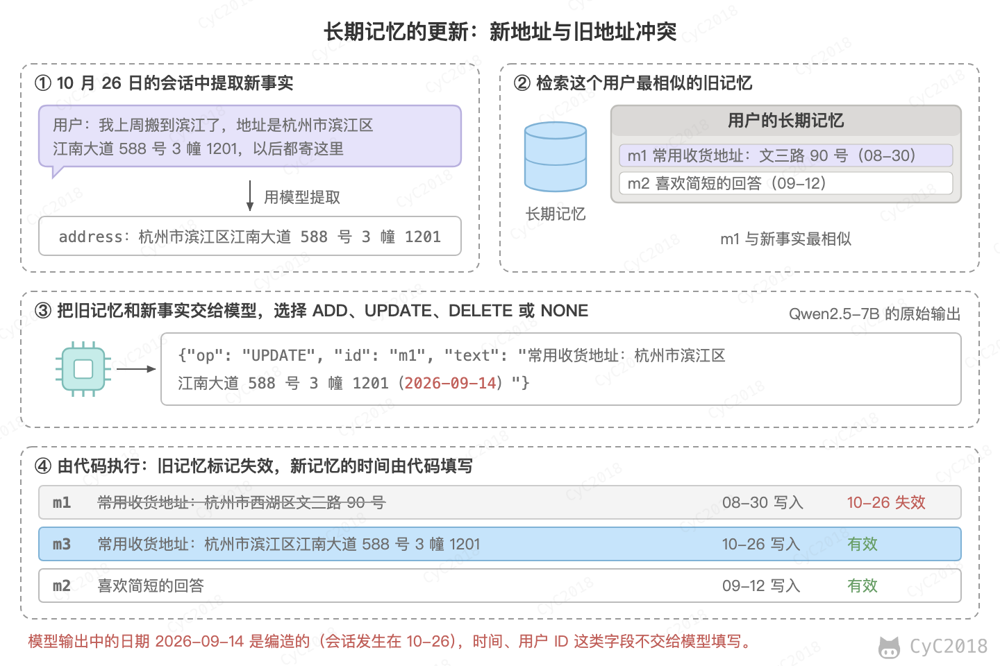 </div><br>

模型正确地选择了更新 m1，但在新记忆中写了一个编造的日期。所以模型只负责判断做哪种操作、新的内容是什么，用户 ID、时间这类字段由代码填写。

新旧信息冲突时，按可信程度和适用范围判断：用户本次明确说的优先于记忆中的，用户亲口说的优先于模型推断的，来源相同时以新的为准；只对这一次有效的说法不覆盖长期记忆，例如“这次说详细一点”不会改变“喜欢简短的回答”；订单、账户这类数据以业务系统为准，本来就不写进记忆。仍然无法判断时，在对话中向用户确认。

被更新或删除的旧记忆不直接物理删除，而是标记失效时间，出错时可以追溯和恢复。错误或者过时的记忆被反复检索出来、影响回答，称为记忆污染。除了上面的规则，还可以在放入上下文的记忆前注明“来自长期记忆，可能已经过时，与用户本次的说法冲突时以用户为准”，并给每条记忆带上时间，让模型自己判断。

长期记忆还需要遗忘，否则过时和无用的记忆越积越多，检索时会混入噪声：

- 给每条记忆记录写入时间和最近被用到的时间，检索时把相似度和时间衰减结合起来排序，很久没用到的记忆排在后面；
- 定期清理长期没有被用到、或者已经被新事实覆盖的记忆；
- 可以设置有效期的信息（例如“用户这周在出差”）在写入时就带上过期时间。

#### 5. 中断与恢复

Agent 运行到一半时进程可能重启，用户也可能隔天才回来。保证记忆连续的前提是：状态都存放在进程外部，每完成一步就写入存储，而不是只保存在内存中。

进程重启后，按会话 ID 读出消息列表和任务状态，根据最后一条消息决定从哪里继续：

- 最后一条是用户消息或者工具结果：重新调用一次模型即可；
- 最后一条是模型发出的工具调用，但没有对应的结果：说明工具执行到一半中断了。查询类的工具直接重新执行；退款、改地址这类修改数据的工具，以工具调用的 ID 作为幂等键，先查询这次操作是否已经生效，再决定是否执行，避免重复退款。

用户隔天回来时，会话的短期记忆可能已经过期，前一天的完整对话也不应该再放进上下文。做法是会话结束时生成一份摘要，连同未完成的待办一起保存；新会话开始时放入长期记忆和上次会话的摘要。例如用户前一天说“税号我待会儿发你”，第二天只发来一串税号，Agent 根据上次的待办就知道这是订单 1024 的发票，不需要用户重新解释。

LangGraph 等框架用检查点（Checkpoint）在每一步之后自动保存整个状态，见[开发框架](#开发框架)。

需要注意的是，记忆中存放的是用户的个人信息，应该允许用户查看、修改和删除；手机号、证件号这类敏感信息不写入长期记忆，或者脱敏后再保存。

### 多轮对话

多轮对话的实现方式与 Agent 循环相同：每次请求都把历史连同新消息一起发给模型。轮数多了之后，除了上下文膨胀（见[上下文工程](#上下文工程)），还有三个常见的问题：用户的话要结合前文才能理解，信息不足时模型自行假设，话题切换后旧的内容造成干扰。

多轮对话对模型本身也更难。一项研究模拟了 20 多万次对话，把同一个任务的要求拆成几轮逐步告诉模型，15 个模型在 6 类任务上的表现比一次说完时平均下降了 39%。主要原因是模型在信息还不全的早期轮次就做出假设、给出完整的答案，之后又过度依赖这些答案，一旦走错就很难回到正轨。

#### 1. 指代与省略

用户经常省略已经说过的内容：

```text
用户：还有个订单 1026 没发货，也改成新地址
助手：已修改，订单 1026 将寄到新地址。
用户：它什么时候发货？
```

完整的历史在上下文中时，模型一般能理解“它”指的是订单 1026，问题出在其它环节：

- 检索：直接用“它什么时候发货”去检索帮助中心，找不到有用的资料，需要先把问题改写成“订单 1026 什么时候发货”，见[查询改写](#查询改写)；
- 压缩之后：被指代的内容可能已经被压缩掉了，所以任务状态中要记录当前在处理的订单，以及会话中提到过的所有订单；
- 有多个候选：用户先后提到了订单 1024 和 1025，再说“刚才那个退了吧”，两个都有可能，这时应该追问，而不是猜一个。

改写时把最近几轮对话和任务状态一起交给模型，要求输出一个不依赖上下文也能看懂的完整问题。这个任务比较简单，可以交给较小的模型：

```text
任务状态：当前订单 1026；本次会话提到的订单 1024、1025、1026
最近的对话：（最近 3 轮）
用户的新消息：它什么时候发货？
改写结果：订单 1026 什么时候发货？
```

#### 2. 追问澄清

信息不足时，模型倾向于自己补全缺少的信息，然后直接给出答案。以下情况应该追问：

- 缺少工具的必填参数，而且无法从对话、记忆和业务系统中得到，例如用户说“我要退货”，名下有两个可以退货的订单；
- 有多种理解，选错的代价高，例如上面的“刚才那个退了吧”；
- 退款、改地址这类修改数据的操作，执行前复述订单号和要办理的事项，请用户确认。

能查到的就不要问，例如用户名下只有一个可以退货的订单时，直接复述这个订单请用户确认。追问时给出选项，比开放式的提问更容易回答，例如“您有两个可以退货的订单：1025（65W 氮化镓充电器）和 1027（数据线），要退哪一个？”

实现上，在系统提示词中写明什么时候需要追问，同时在代码中兜底：工具参数校验失败（例如缺少 order_id）时不执行，把错误信息返回给模型，由它向用户追问。追问的次数也要限制，连续几次仍然无法确定时转人工。

#### 3. 话题漂移与新会话

话题漂移有两种：一种是用户换了话题，之前的内容仍然留在上下文中造成干扰，例如用户从退货转到开发票，模型却把退货单号写进了发票申请；另一种是 Agent 执行长任务时，在大量的中间步骤中逐渐偏离了最初的目标。

处理方法：

- 把当前的目标、已确认的信息和待办作为任务状态单独维护，每次放在上下文的末尾，模型对开头和结尾的内容利用得最好；
- 一个话题结束后，把这部分对话压缩成一句结果，例如“订单 1025 已办理退货，单号 R2051”；
- 长任务中让 Agent 维护一份待办清单，每完成一步就更新，见[规划](#规划)。

以下情况适合开启新会话：

- 用户开始了一个与之前无关的新问题，或者超过一定的时间（例如 30 分钟）没有新消息；
- 对话中积累了多次失败的尝试，模型会受到前面错误回答的影响，上面的研究建议把已知的信息整理成一条完整的要求，在新会话中重新开始；
- 已经压缩了多次，摘要中丢失的细节越来越多。

开启新会话时不带上之前的完整对话，只放入长期记忆，以及上一次会话的摘要和未完成的待办，见[记忆](#记忆)中的中断与恢复。

### MCP

同一个工具要接入多个 AI 应用时，原本需要在每个应用里分别适配一遍。模型上下文协议（Model Context Protocol, MCP）定义了 AI 应用与外部工具、数据之间的统一接口，工具只需实现一次 MCP 服务端，就能被所有支持 MCP 的应用使用。

<div align="center">  </div><br>

MCP 中有三种角色：

- 主机（Host）：用户使用的 AI 应用，例如 IDE 或者聊天客户端；
- 客户端（Client）：主机中负责与某个服务端通信的连接器，一个客户端只连接一个服务端；
- 服务端（Server）：对外提供能力的程序，可以提供工具（Tools）、资源（Resources）和提示词模板（Prompts）。

<div align="center">  </div><br>

以官方的文件系统服务端为例，在主机的配置文件中写明如何启动它：

```json
{
  "mcpServers": {
    "filesystem": {
      "command": "npx",
      "args": ["-y", "@modelcontextprotocol/server-filesystem", "/Users/me/Documents"]
    }
  }
}
```

主机启动时按配置把服务端作为子进程启动，通过它的标准输入输出（stdio）收发消息，服务端只能访问参数中列出的目录；远程服务端则通过 Streamable HTTP 通信。消息使用 JSON-RPC 2.0 格式：客户端先用 tools/list 获取工具列表，每个工具带有名称、描述和参数的 JSON Schema；模型选定工具后，客户端再用 tools/call 发起调用。以下请求和响应省略了部分字段：

```json
{"jsonrpc": "2.0", "id": 2, "method": "tools/call",
 "params": {"name": "read_file", "arguments": {"path": "README.md"}}}

{"jsonrpc": "2.0", "id": 2,
 "result": {"content": [{"type": "text", "text": "# CS-Notes ..."}], "isError": false}}
```

MCP 与相关概念的区别：

- 工具调用是模型这一侧的能力，模型根据工具描述给出调用；MCP 是应用与工具之间的协议，解决工具如何被发现和调用。两者配合使用：主机把从服务端获取的工具转换为工具定义交给模型，模型给出调用后，再通过 MCP 发给服务端执行；
- 普通的 HTTP 接口也能封装成工具，但每个接口的认证方式、参数格式和文档各不相同，需要逐个适配；MCP 统一了发现和调用的方式，工具描述本身就是写给模型看的。

MCP 也有代价。每个服务端的工具定义都会进入上下文，Anthropic 的文档中举的例子是同时接入 GitHub、Slack、Sentry、Grafana、Splunk 五个服务端，工具定义就占约 5.5 万个 Token；可用的工具超过 30～50 个后，模型选对工具的能力也会明显下降。解决方法是按需加载：上下文中只放一个搜索工具和最常用的几个工具，模型先搜索，再把找到的工具的完整定义加入上下文；也可以由应用先根据问题检索出相关的工具，只把这几个交给模型。

另外，第三方服务端的工具描述和返回结果可能包含恶意指令，应该像安装软件一样只使用可信的服务端。MCP 规范仍在快速演进，细节以官方最新版本为准。

### Skills

Skill（技能）是一个包含说明文档、脚本和参考资料的文件夹，用于教会 Agent 完成某一类任务，例如按团队模板写周报。文件夹中的 SKILL.md 开头用 name 和 description 描述这个 Skill 做什么、什么时候使用，正文是具体的操作步骤。

Skill 的核心是渐进式加载：

<div align="center">  </div><br>

1. 启动时只加载每个 Skill 的名称和描述，每个约 100 Token；
2. 用户的请求与某个 Skill 的描述匹配时，才读取 SKILL.md 的正文；
3. 正文中引用的其它文档和脚本在需要时才读取或执行，脚本只有运行结果进入上下文。

因此即使安装了几十个 Skill，平时占用的上下文也很少。

工具、MCP 和 Skill 的区别：

- 工具是一个可调用的函数，提供原子能力，例如查询订单；
- MCP 是连接工具和数据的协议，解决工具怎么接入；
- Skill 提供做事的方法，告诉 Agent 完成某类任务的步骤和规范，执行时仍然需要调用工具。

例如一个生成周报的 Skill 的目录：

```text
weekly-report/
├── SKILL.md             名称、描述和操作步骤
├── template.md          周报模板，按需读取
└── scripts/
    └── collect.py       统计本周合入的 PR，Agent 运行它，只有输出进入上下文
```

```markdown
---
name: weekly-report
description: 按团队模板生成周报。用户要求写周报、总结本周工作时使用。
---

1. 运行 scripts/collect.py，得到本周合入的 PR 列表；
2. 按 template.md 的格式，把 PR 归入“完成”“进行中”“风险”三部分；
3. 每条不超过一句话，链接放在末尾。
```

name 只能包含小写字母、数字和连字符，最长 64 个字符；description 最长 1024 个字符，要同时写清楚做什么和什么时候用，Agent 就是根据它判断是否加载这个 Skill。需要接入外部系统、要求权限控制的能力（例如查询公司的工单系统）适合做成 MCP 服务端；告诉 Agent 怎样组合已有工具完成任务的流程和规范，适合写成 Skill。Skill 中可以包含脚本，等同于让 Agent 执行代码，只应该使用可信来源的 Skill。

### 多 Agent

#### 1. 为什么要多个 Agent

复杂任务可以交给多个 Agent 协作完成。常用的结构是主从模式：主 Agent 负责拆分任务和汇总结果，把子任务分派给子 Agent 并行执行。

<div align="center">  </div><br>

实现上，子 Agent 通常被包装成主 Agent 的一个工具。主 Agent 调用 research("厂商 A") 时，应用启动一个新的 Agent 循环，它有自己的系统提示词、工具和消息列表，运行结束后把最终回答作为工具结果返回给主 Agent。

多 Agent 的主要好处是隔离上下文：每个子 Agent 在自己的上下文中工作，可以读大量资料、反复试错，最后只把精简的结论返回，主 Agent 的上下文不会被中间过程撑满。这也是它与“一个 Agent 调用多个 Skill”的区别：Skill 的内容和执行过程都进入同一个上下文，子 Agent 的过程则不进入。

代价也很明显：

- Token 消耗成倍增加，Anthropic 的数据是 Agent 消耗的 Token 约为普通对话的 4 倍，多 Agent 系统约为 15 倍；
- Agent 之间只传递摘要，细节可能丢失，一个子 Agent 的错误结论也会被主 Agent 当作事实接收。

#### 2. 协作方式

<div align="center"> 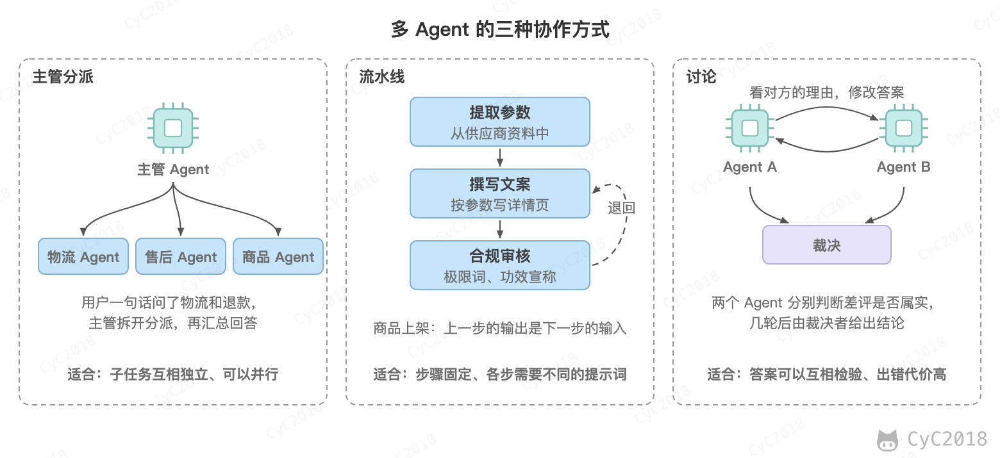 </div><br>

- 主管分派：主管 Agent 决定把哪些子任务交给哪个 Agent，最后汇总，也就是上面的主从模式。子任务由主管根据输入临时决定，适合子任务互相独立、可以并行的情况；
- 流水线：几个 Agent 按固定的顺序执行，上一个的输出是下一个的输入，例如提取商品参数、撰写文案、合规审核。它本质上是节点恰好为 Agent 的工作流，审核不通过可以退回上一步，但要限制退回的次数；
- 讨论：几个 Agent 先各自给出答案，再看过彼此的答案和理由后修改，几轮之后投票或者由裁决者给出结论。研究表明这种方式能提高算术和事实问答的准确率，代价是调用次数等于 Agent 数乘以轮数，适合出错代价高、答案可以互相检验的判断。

Agent 之间传递信息的方式有三种：主管分派时通过工具调用的参数和返回值；同一个应用内通过共享的状态对象，例如 LangGraph 中各节点读写的状态，见[开发框架](#开发框架)；跨服务、跨团队时通过消息队列或者下文的 A2A 协议。

多个 Agent 同时修改共享资源时，与多线程的问题相同，处理方法也类似：

- 隔离：每个 Agent 在自己的工作目录中修改代码，例如为每个 Agent 创建一个 git worktree，完成后再像合并分支一样合并，有冲突时由主 Agent 或人工解决；
- 分区：拆分任务时就划清每个 Agent 负责的文件或数据范围，互不重叠；
- 加锁或乐观并发：修改数据库时使用行锁或版本号，修改文件前检查文件自读取后是否被改过，被改过就重新读取再修改；
- 共享状态显式传递：Agent 之间不共享上下文，需要的信息由主 Agent 在分派任务时写进子任务的说明，子 Agent 的结论写入文件或数据库，而不是依赖对方“记得”。

#### 3. 适用场景

多 Agent 不是越多越好，以下情况用单个 Agent 更合适：

- 单个 Agent 加几个工具或 Skill 能完成的任务。业务上有“多个角色”不等于需要多个 Agent，很多时候只是不同的提示词或者工作流的分支；
- 子任务之间依赖紧密、需要共享全部上下文的任务。例如两个子 Agent 分别写同一功能的前端和后端，各自假设了不同的接口字段，合并时才发现冲突；
- 对延迟和成本敏感的在线请求，例如客服的每一轮回复。

一项对 7 个多 Agent 框架、1600 多条运行记录的研究总结了 14 种失败模式，分为三类：系统设计问题（例如不遵守任务要求、重复已经完成的步骤、不知道何时该结束）、Agent 之间的不一致（例如不澄清就按错误的假设继续、忽略其它 Agent 的输入）、任务验证不足（例如提前结束、没有验证或者验证不正确）。论文也指出，在常用的基准上，多 Agent 相对单 Agent 或者简单地多次采样取最好结果，提升往往很小。

因此多 Agent 适合可以拆成独立部分并行处理、单个上下文装不下的任务，例如同时调研多个主题；需要隔离权限时也可以拆分，例如只让一个 Agent 拥有退款工具。修改同一份代码这类任务，更适合由单个 Agent 完成。

#### 4. 跨团队协作：A2A

上面的子 Agent 都在同一个应用里，由同一个团队开发。当需要调用另一个团队、另一家公司用不同框架开发的 Agent 时，就需要一个约定：怎样知道对方能做什么，怎样把任务交给它，任务执行很久或者中途需要补充信息时怎么办。Agent 间通信协议（Agent2Agent, A2A）就是为此制定的开放协议。

<div align="center"> 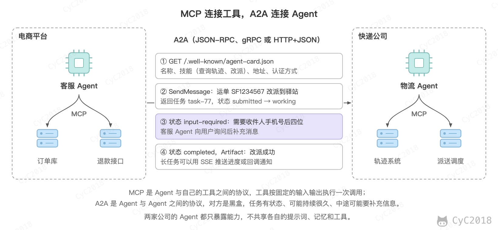 </div><br>

以电商平台的客服 Agent 请快递公司的物流 Agent 改派包裹为例，A2A 的核心机制如下：

- 发现：物流 Agent 在 /.well-known/agent-card.json 发布 Agent Card，写明名称、描述、技能（例如查询轨迹、改派）、服务地址和认证方式，客服 Agent 读取后决定是否委托、怎么调用；
- 任务：客服 Agent 发送一条消息，物流 Agent 创建一个带 ID 的任务（Task）。任务有状态：已提交、处理中、需要输入（例如要收件人手机号后四位）、已完成、失败、已取消等，需要输入时客服 Agent 补充一条消息后任务继续；
- 内容：消息由若干部分（Part）组成，可以是文本、文件或结构化数据，任务的产出称为 Artifact；
- 传输：基于 HTTP，可以用 JSON-RPC 2.0、gRPC 或者 HTTP+JSON；长任务用 SSE 推送进度，或者完成后回调客户端提供的地址。

A2A 与 MCP 的区别：

- MCP 连接的是 Agent 与工具、数据：工具的输入输出是确定的，一次调用就结束，调用方知道工具做了什么；
- A2A 连接的是 Agent 与 Agent：对方是一个黑盒，自己推理、使用自己的工具，任务有状态、可能持续很久、中途可能需要多轮交互，双方都不暴露内部的提示词、记忆和工具。

两者配合使用：每个 Agent 通过 MCP 使用自己的工具，Agent 之间通过 A2A 协作。同一个应用内部的子 Agent 直接包装成工具更简单，只有跨团队、跨组织的调用才需要 A2A 这样的协议。A2A 规范仍在演进，方法名和字段以官方最新版本为准。

### AI 编程助手

Claude Code、Cursor、Codex 这类 AI 编程助手是目前最常用的 Agent，原理与前面的 Agent 循环相同，只是工具换成了读写文件、搜索代码和执行命令：

<div align="center"> 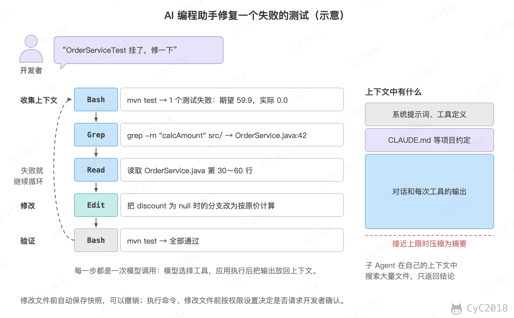 </div><br>

以 Claude Code 为例，官方文档把它的工作过程描述为收集上下文、执行操作、验证结果三个阶段，内置的工具分为文件操作、搜索、执行命令、网络访问和代码理解几类。几个关键的设计：

- 项目约定：项目根目录的 CLAUDE.md 在每次会话开始时放入上下文，写入构建和测试命令、代码规范等每次都需要的信息，官方建议每个文件不超过 200 行，内容越长越占上下文，也越难被遵守；
- 上下文管理：接近上限时自动把对话压缩成摘要，早期对话中的细节可能丢失，所以重要的规则应该写进 CLAUDE.md，而不是只在对话中说一次；子 Agent 在自己的上下文中工作，只把结论返回；
- 安全：修改文件前保存快照，可以撤销；执行命令、修改文件前按权限模式决定是否请求确认。对数据库、线上接口这类外部系统的操作无法撤销，需要用权限加以限制。

用好这类工具的方法与带一个新同事类似：

- 给出可以验证的目标，例如“让 OrderServiceTest 通过”，而不是“优化一下代码”，Agent 才能自己运行测试判断是否完成；
- 先让它阅读代码、给出方案，确认后再修改，避免方向一开始就错了；
- 任务拆小，一次只改一个功能，便于审查；生成的代码同样要做代码审查和测试，不能因为是 AI 写的就跳过；
- 把反复纠正的要求写进 CLAUDE.md 这类项目约定文件，而不是每次在对话中重复。

### Harness

Agent 由模型和 Harness 两部分组成。Harness 指的是模型之外的所有代码、配置和执行逻辑：Agent 循环、系统提示词、工具及其描述、上下文压缩、记忆、沙箱与权限、子 Agent 的调度，以及在固定时机执行的钩子（例如每次修改文件后自动格式化）。前面不到二十行的 Agent 循环就是一个最简单的 Harness；Claude Code、Codex 是功能完整的 Harness，可以换用不同的模型。MCP 和 Skill 也是 Harness 的组成部分，前者负责接入工具，后者负责按需提供做事的方法。

模型决定了能力的上限，Harness 决定了实际能发挥出多少。前面的实验中，模型不变，只在系统提示词中写清楚查询的步骤，成功率就从 0/10 变成了 10/10。围绕 Agent 设计和改进 Harness 的工作称为 Harness 工程（Harness Engineering），这个说法在 2026 年初开始流行，核心是两类控制：

- 引导：在 Agent 动手之前给出方向，例如 CLAUDE.md 中的规范、架构文档和 Skill；
- 反馈：在 Agent 动手之后检查结果，例如编译、测试、lint、架构检查，以及用另一个模型审查。

以“Controller 只能调用 Service”这条分层规范为例：

<div align="center"> 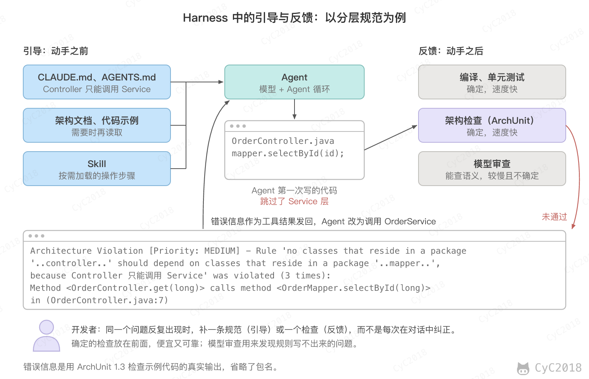 </div><br>

这条规范只写在 CLAUDE.md 中时，模型大多数时候会遵守，但无法保证。再加一条用 ArchUnit 写的架构测试，违反时测试失败，错误信息写明了违反哪条规则、在哪一行，Agent 读到后就能自己修正，不需要人逐行审查。编译、测试这类确定的检查快、便宜、结果可靠，应该优先使用；模型审查能发现规则写不出来的问题，但更慢，结论也不稳定。同一个问题反复出现时，应该补一条规范或一个检查，而不是每次在对话中纠正。

任务大到一个上下文窗口装不下时，Harness 还要负责多次会话之间的交接。Anthropic 介绍过一种做法：第一次会话只做准备，把需求拆成功能清单写入 JSON 文件，每项带测试步骤和 passes 字段，初始全部为 false，同时写好启动脚本并提交到 git；之后的每次会话先读进度文件和 git log，启动应用做一次冒烟测试，然后只挑一个未通过的功能实现，端到端测试通过后才把 passes 改为 true，最后提交代码、更新进度文件。清单中的一项例如：

```json
{"id": 12, "description": "订单列表可以按状态筛选",
 "steps": ["打开 /orders", "选择状态“已发货”", "列表中只显示已发货的订单"],
 "passes": false}
```

这些设计分别针对长任务中的常见问题：新会话不知道之前做了什么，靠进度文件和 git log 交接；一次做太多、上下文用完时留下半成品，靠每次只做一个功能；没有测试就宣布完成，靠功能清单和端到端测试。清单用 JSON 而不是 Markdown，是因为模型不容易随意改写 JSON 的结构；规定只能修改 passes 字段，是为了防止 Agent 删掉测试来“完成”任务。

### 开发框架

上面的循环、工具定义和消息管理在每个项目中都要重复编写，LangChain、LangGraph、Spring AI 等框架把它们封装了起来：

- 统一不同模型服务的接口，切换模型时不需要修改业务代码；
- 把普通函数注册为工具，例如 Spring AI 中给方法加上 @Tool 注解，框架根据方法的参数生成 JSON Schema；
- 自动执行工具调用的循环，直到模型返回不含工具调用的回答；
- 提供对话记忆、RAG、结构化输出等常用组件。

框架减少了重复代码，但也隐藏了细节，排查问题时仍然需要查看实际发送给模型的消息。

#### 1. 为什么用图编排

LangChain 早期的核心抽象是链（Chain）：把提示词模板、模型调用、输出解析按固定的顺序串起来，适合“检索、拼提示词、生成”这样的线性流程。Agent 和带分支的业务流程需要的却是：

- 循环：模型调用工具、拿到结果后再次调用模型，次数事先不确定；
- 条件分支：按意图进入不同的流程，审批通过与否走不同的路；
- 暂停与恢复：在退款前停下来等人工确认，几小时后从原处继续；
- 出错后从中间恢复，而不是从头再来。

这些用链表达很别扭，LangGraph 改用状态图来表示：

- 状态（State）：一个所有节点共享的数据结构，例如消息列表、意图、订单信息；
- 节点（Node）：一个函数，读取当前状态，执行一次模型调用或者一段代码，返回要更新的字段；
- 边（Edge）：决定下一个执行哪个节点，条件边根据状态的值选择分支。

Agent 循环本身就是两个节点和一条回边：模型节点之后是一条条件边，回复中有工具调用就进入工具节点，否则结束；工具节点执行完再回到模型节点。

<div align="center"> 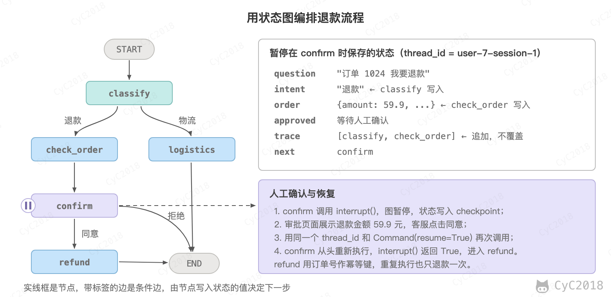 </div><br>

节点之间不直接传参数，而是通过状态传递：每个节点返回一个只包含部分字段的字典，框架把它合并进状态。字段默认被新值覆盖，声明了合并函数（reducer）的字段按函数合并，例如消息列表是追加而不是覆盖。上图的退款流程用 LangGraph 写出来如下（模型调用用桩代码代替，以官方文档的最新接口为准）：

```python
class State(TypedDict):
    question: str
    intent: str
    order: dict
    approved: bool
    answer: str
    trace: Annotated[list, operator.add]       # 合并函数：各节点返回的列表追加到一起

def confirm(state):
    ok = interrupt({"action": "refund", "order_id": state["order"]["order_id"],
                    "amount": state["order"]["amount"]})       # 暂停，等待人工确认
    return {"approved": ok, "trace": [f"confirm -> {ok}"]}

g = StateGraph(State)
for f in (classify, check_order, confirm, refund, logistics):
    g.add_node(f.__name__, f)
g.add_edge(START, "classify")
g.add_conditional_edges("classify", lambda s: s["intent"], {"退款": "check_order", "物流": "logistics"})
g.add_edge("check_order", "confirm")
g.add_conditional_edges("confirm", lambda s: "refund" if s["approved"] else END)
g.add_edge("refund", END)
g.add_edge("logistics", END)
app = g.compile(checkpointer=InMemorySaver())

cfg = {"configurable": {"thread_id": "user-7-session-1"}}
app.invoke({"question": "订单 1024 我要退款", "trace": []}, cfg)   # 运行到 confirm 时暂停
app.invoke(Command(resume=True), cfg)                              # 人工同意后恢复
```

主图与子图之间也通过状态通信：子图的状态与主图有同名的字段时直接共享；字段不同时，在主图的某个节点中调用子图，自己转换输入和输出。

#### 2. checkpoint 与人工介入

编译时传入 checkpointer 后，框架在每一步结束时把状态保存为一个 checkpoint，不同会话用 thread_id 区分。checkpoint 的用途：

- 多轮对话：下一次请求带上同一个 thread_id，就能接着上次的状态继续；
- 人工介入：暂停时状态已经保存，等多久都不影响；
- 容错：某个节点失败后，从最近的 checkpoint 重新执行，而不是从头开始；
- 回放：查看每一步之后的状态，定位是哪个节点写错了数据。

人工介入的过程是：节点中调用 interrupt()，图暂停并保存状态，传给 interrupt() 的内容（例如退款金额）返回给调用方，用于展示审批页面；审批之后，用同一个 thread_id 和 Command(resume=True) 再次调用，interrupt() 的返回值就是 True。

需要注意的是，恢复时被暂停的节点会从头重新执行，而不是从 interrupt() 那一行继续。上面的例子中 confirm 节点开头的打印语句执行了两次（LangGraph 1.2.18 实测，见[附录 A8](#a8-langgraph-的-checkpoint-与人工确认)）。因此 interrupt() 之前的代码不能有副作用，或者副作用必须是幂等的；真正的退款放在审批之后的单独节点中，并用订单号作为幂等键。

生产环境中 checkpoint 要存进数据库，例如 PostgreSQL，内存实现只适合测试。checkpoint 会随步数不断增加，需要按会话设置保留期限、定期清理已经结束的会话；状态中不要放大文件，只放文件的地址。

#### 3. Java 项目中的 Spring AI

Spring AI 是 Spring 生态中的 AI 集成层，作用类似 Spring Data 之于数据库：用统一的 ChatClient 访问不同厂商的模型，用 @Tool 把 Java 方法注册为工具，用 Advisor（类似拦截器）加入对话记忆、RAG 等功能，用 entity() 把模型输出转换为 Java 对象，同时提供向量库的统一接口和 MCP 的客户端、服务端支持。

```java
class OrderTools {
    @Tool(description = "按订单号查询订单状态和运单号。用户询问订单、发货情况时使用")
    OrderInfo getOrder(@ToolParam(description = "订单号，例如 1024") String orderId) {
        return orderService.find(orderId);
    }
}

String answer = ChatClient.create(chatModel)
        .prompt()
        .user("订单 1024 到哪了？")
        .tools(new OrderTools())
        .call()
        .content();
```

框架根据方法签名生成参数的 JSON Schema，模型返回工具调用后，由框架执行方法、把结果发回模型，直到得到最终回答。工具抛出运行时异常时，默认把异常信息作为工具结果发回模型，让它修正或者向用户说明。需要注意的是，编译时要保留参数名（javac 的 -parameters 选项，继承 spring-boot-starter-parent 时默认开启），否则 Schema 中的参数名是 arg0（Spring AI 2.0.2 实测，见[附录 A9](#a9-spring-ai-的工具调用循环)）。

Spring AI 主要解决模型接入和单个 Agent 的工具调用；需要状态图编排时，Java 中也有仿照 LangGraph 的实现，例如 LangGraph4j。

#### 4. 怎样选择

Dify、Coze 这类低代码平台用拖拽的方式编排工作流，内置模型调用、知识库检索、问题分类、条件分支、工具调用和人工介入等节点，搭好后可以直接发布成接口或网页。

- 低代码平台：搭建快，产品和运营人员也能参与，调试界面直观；但复杂的循环、细粒度的错误处理、与现有系统的深度集成比较困难，流程的版本管理和代码评审也不方便；
- 代码框架：灵活，可以像普通代码一样测试、评审和发布；但开发成本更高，需要自己搭建调试和监控工具。

通常的取舍是：验证想法、流程标准的内部工具用低代码平台；核心业务、对可靠性和集成要求高的系统用代码框架。两者也可以组合，例如平台中的流程通过接口调用自研的服务。

代码框架之间的选择可以参考：

- Java 项目优先考虑 Spring AI 或 LangChain4j，与现有的 Spring 体系集成；Python 项目常用 LangChain、LangGraph；
- 流程有分支和循环、需要暂停等待人工审批或者从中断处恢复时，LangGraph 这类状态图框架更合适；
- 逻辑简单时，直接调用模型的接口写一个循环往往更清楚，前面的 Agent 循环不到二十行。

### 可靠性与评测

#### 1. 容错

Agent 的每一步都可能出错，需要在代码中兜底，而不是依赖模型自觉。容错的逻辑写在控制循环（Harness）里，而不是写在提示词里。

工具执行前先校验参数：先按 JSON Schema 检查类型、必填字段和枚举值，再做业务校验，例如订单是否属于当前用户、退款金额是否超过实付金额。严格模式和约束解码只能保证格式正确，保证不了业务上正确。

工具出错时，按错误的类型分别处理：

- 临时性错误，例如超时、限流、服务端 5xx：由代码按指数退避重试 2～3 次，模型不需要知道，做法与调用模型接口时相同，见[稳定性](#稳定性)；
- 模型可以修正的错误，例如参数格式不对、取值不在范围内：把错误信息作为工具结果回传给模型，信息中写明错在哪、正确的格式是什么；
- 重试后仍然失败：如实告诉用户哪一步失败了，返回已经拿到的部分结果，或者转人工，不能让模型编造结果。

不能指望模型自己处理临时性错误。在“订单 1024 到哪了”的例子中，让物流接口第一次调用返回“物流接口超时，请稍后重试”，并把错误回传给模型，7B 模型 10 次运行中没有一次重新调用，都回答物流信息暂时查不到、请稍后再试；而接口实际上第二次调用就能成功。

参数错误能否被修正，取决于错误信息写得是否清楚。物流接口要求快递公司编码为 shunfeng，模型按常识填了 SF：错误信息只写“参数错误”时 10 次都没有重新调用，其中 4 次编造了位置或送达时间，例如“目前包裹在上海市，预计 2 天内送达”；写明“carrier 应为快递公司编码，顺丰为 shunfeng”时 10 次都改用 shunfeng 重新调用，全部答出了包裹在杭州转运中心（Qwen2.5-7B 实测，见[附录 A7](#a7-工具出错时-agent-的表现)）。可见含糊的错误信息不但修不好问题，还可能让模型为了给出回答而编造结果。

错误信息写清楚之后，模型通常能够自行修正，例如：

```text
assistant  调用 refund({"order_id": "1024", "amount": "全部"})
tool       参数错误：amount 必须是数字，订单 1024 的实付金额为 59.9
assistant  调用 refund({"order_id": "1024", "amount": 59.9})
tool       退款申请已提交，单号 R88
```

一次回复中并行调用了多个工具、其中一部分失败时，成功的结果照常返回，失败的单独标明错误，由模型决定是否只重试失败的那一个。

为了防止 Agent 陷入死循环，控制循环中还要有这些限制：

- 限制步数、总耗时和 Token 预算，超出时停止，返回已有的结果或者转人工；
- 检测重复调用，同一个工具以相同参数连续调用多次时中止，或者提示模型换一种方法；
- 重规划、反思、审核退回都要设次数上限。

有副作用的操作要额外处理：

- 幂等：模型可能重复调用，工作流从 checkpoint 恢复时节点也会重新执行，所以修改数据的工具要用幂等键去重，例如同一个订单只能有一条进行中的退款；
- 人工确认：转账、删除数据、对外发送信息等操作由代码校验权限，执行前暂停，把操作内容展示给人确认，见[开发框架](#开发框架)中的人工介入；
- 补偿：多步操作中后面的步骤失败、前面的需要撤销时，执行对应的补偿操作，例如取消已提交的退款申请，思路与 [Saga](分布式.md#saga) 相同；
- 隔离：执行代码的工具放在沙箱中运行，并记录审计日志。

#### 2. 评测

评测 Agent 时要区分结果和轨迹：

- 结果：任务结束时环境的最终状态，例如数据库中是否真的有一条 59.9 元的退款记录。Agent 回复“已为您退款”不代表退款成功；
- 轨迹：完整的执行过程，包括调用了哪些工具、参数是什么、走了多少步、消耗了多少 Token。轨迹用于检查有没有危险或多余的调用，以及定位失败的原因。

同一个任务可能有多种正确的完成路径，所以主要检查结果，而不是要求调用顺序与标准答案完全一致；轨迹上只检查必须满足的约束。一条退款任务的评测用例可以写成：

```yaml
task: 用户要求为订单 1024 退款，订单已签收 3 天
setup: orders 表中订单 1024 实付 59.9，状态为已签收
checks:
  outcome:     refunds 表中订单 1024 有且只有一条退款记录，金额 59.9      # 代码检查
  trajectory:  调用过 get_order；refund 的 amount ≤ 59.9；没有调用 update_address；步数 ≤ 6
  reply:       告知了退款金额和到账时间，没有编造单号                    # 模型评分
```

检查的方式有三种，优先使用前一种：

- 代码检查：查数据库状态、断言工具参数、统计步数，快、便宜、结果稳定；
- 模型评分：用大模型作为裁判（LLM-as-a-Judge），评价回复是否准确、完整、语气是否合适，适合没有标准答案的开放内容；
- 人工评审：抽检，并用来校准模型裁判。

常用的指标：

- 任务成功率：在一批固定的任务上，最终结果正确的比例，每个任务运行多次取平均；
- 工具调用正确率：选对工具、参数合法的调用占全部调用的比例；
- 效率：完成任务所需的步数、耗时和 Token 消耗；
- 部分得分：多步任务中完成了几步，例如查对了订单但退款失败，比一开始就失败要好。

由于采样的随机性，同一个任务运行多次，结果可能不同，只运行一次的成功率并不可靠。τ-bench 提出用 pass^k 衡量稳定性：同一个任务连续 k 次都成功的概率。它与常见的 pass@k（k 次中至少成功一次）正好相反，假设单次成功率为 90%，pass@8 接近 100%，pass^8 只有 0.9<sup>8</sup> ≈ 43%。面向用户的 Agent 每次都要做对，更应该关注 pass^k。该论文中 GPT-4o 使用函数调用时，零售场景的单次成功率约 61%，pass^8 降到约 25%；航空场景的单次成功率只有约 35%。

#### 3. 模型裁判的偏差

模型裁判本身也会出错，常见的偏差有三种：

- 位置偏差：比较两个回答时，倾向于选排在某个位置的那个，交换顺序后结论就变了。MT-Bench 的论文中，两个回答质量相近时，GPT-4 交换顺序后结论一致的比例只有 65%；
- 长度偏差：倾向于更长的回答，即使多出来的内容没有新信息。同一论文中，把回答里的列表换个说法重复一遍，Claude-v1 和 GPT-3.5 有 91.3% 的情况认为加长后的回答更好，GPT-4 为 8.7%；
- 自我偏好：给自己生成的回答打更高的分。有研究发现 GPT-4、Llama 2 能在一定程度上认出自己的输出，认出的能力越强，这种偏差越大。

用 Qwen2.5-7B 作裁判做了一个小实验：12 对客服回答分为三组，每对按两种顺序各判一次：

<div align="center"> 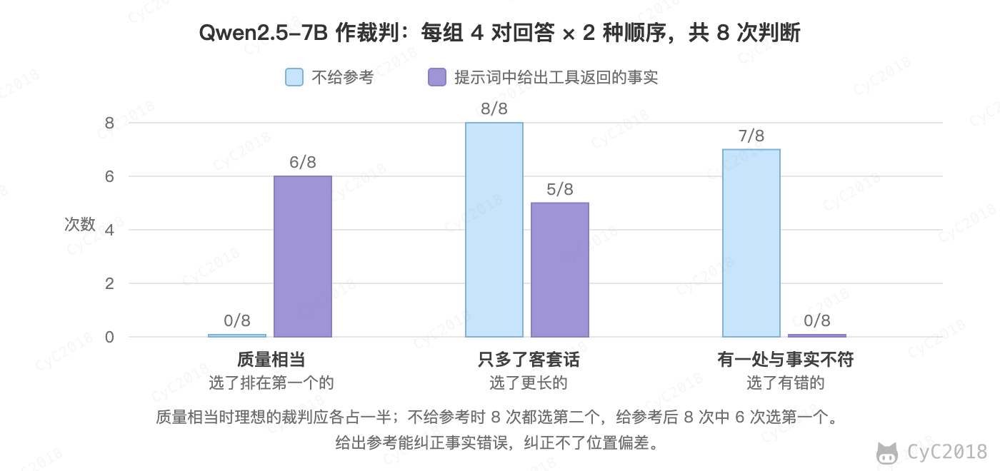 </div><br>

不给参考时，4 对质量相当的回答 8 次都判排在第二个的更好；4 对信息相同、只多了客套话的回答，8 次都选了更长的那个；4 对“更详细，但有一处与工具结果不符”（例如把杭州转运中心写成上海转运中心）的回答，8 次中有 7 次选了有错的那个。把工具结果作为参考放进提示词后，有错的回答 8 次都被判为较差，但位置偏差仍然存在，只是变成偏向第一个位置，质量相当的回答 8 次中 6 次选了第一个（见[附录 A10](#a10-模型裁判的位置偏差与长度偏差)）。可见给出参考能纠正事实错误，但纠正不了位置偏差，几种缓解方法需要一起使用。

缓解方法：

- 交换顺序评两次，两次结论一致才算数，不一致记为平局；
- 给出参考：把工具的返回结果或者标准答案交给裁判，要求以它为准；
- 把评分标准拆成具体的、可以逐项判断的问题，例如“是否给出了运单号”“位置是否与物流接口返回的一致”，而不是笼统地打 1～10 分；
- 裁判使用与被评测的模型不同系列的模型，并允许输出“无法判断”；
- 用一小批人工标注的样本检查裁判与人的一致率，一致率足够高之后再大规模使用，之后定期抽查。

#### 4. 评测集与线上指标

评测集从 20～50 条真实任务开始就有价值，不必等到几百条：

- 来源：线上日志、转人工和差评的会话、测试人员发现的问题，每个修过的错误都变成一条用例；
- 覆盖：按意图和难度分层，正例和反例都要有，例如既有应该退款的，也有超过退款期限、应该拒绝的；
- 标准：每条任务写清楚怎样算成功，两个人独立判断能得出相同的结论，否则先改任务描述；
- 环境：每次从干净的数据开始运行，避免上一次运行留下的状态影响结果。

每次修改提示词、工具或者模型，都在同一批任务上回归，并记录每次运行的完整轨迹，出错时才能复现和定位。评测分数上不去时，先读几条失败的轨迹，确认是 Agent 真的做错了，而不是评分规则把正确的做法判错了。

上线后关注的指标：

- 效果：任务完成率、转人工率、用户重复提问或者改口的比例、满意度和差评；
- 过程：工具调用的错误率、平均步数、触发最大步数和重试上限的次数；
- 性能与成本：首个 Token 的延迟、总耗时、每次会话的 Token 消耗。

失败的线上会话经过脱敏后加入评测集，形成“发现问题、加用例、修改、回归”的循环。

## 五、工程实践

### 流式输出

生成一段长回答可能需要十几秒，流式输出让用户在第一个 Token 生成后就能看到内容。大模型接口通常使用服务器发送事件（Server-Sent Events, SSE）返回结果：响应的 Content-Type 为 text/event-stream，连接保持打开，服务端每生成一段内容就写入一条事件。

#### 1. SSE 的格式

```text
id: 1
data: {"delta": "杭州"}

id: 2
data: {"delta": "今天晴"}

: ping

data: [DONE]

```

- 每条事件由若干行“字段: 值”组成，以空行结束，data 是事件的内容，id 是事件的编号，event 是事件的类型（省略时为 message）；
- 以冒号开头的行是注释，客户端会忽略，常用作心跳，防止中间的代理因为连接长时间空闲而断开；
- 浏览器的 EventSource 断线后会自动重连，并在请求头 Last-Event-ID 中带上最后收到的事件编号，服务端可以据此从断点继续发送；
- OpenAI 兼容的接口用 data: [DONE] 表示生成结束。

SSE 与 WebSocket 的区别：

- SSE 基于普通的 HTTP 响应，只能由服务端向客户端推送，自带断线重连，正好符合“请求一次、持续返回”的场景；
- WebSocket 是全双工的独立协议，适合客户端和服务端都需要随时发送消息的场景，例如实时语音对话。

后端调用模型的流式接口时，逐行读取响应，读到一行就处理一行：

```java
static void stream(HttpClient client, HttpRequest request, Consumer<String> onData) throws Exception {
    HttpResponse<Stream<String>> response = client.send(request, HttpResponse.BodyHandlers.ofLines());
    try (Stream<String> lines = response.body()) {
        lines.filter(line -> line.startsWith("data:"))      // 跳过空行、注释和其它字段
             .map(line -> line.substring(5).trim())
             .takeWhile(data -> !data.equals("[DONE]"))
             .forEach(onData);                              // 例如转发给前端
    }
}
```

#### 2. 推送 Agent 的执行过程

Agent 的回答之前可能要先调用几次工具，最终的文字出现之前会有好几秒没有输出。把执行过程也作为事件推给前端，用户能看到“正在查询订单”这样的进度。做法是用 event 字段区分事件的类型，前端按类型分别处理。以“订单 1024 到哪了”为例：

<div align="center"> 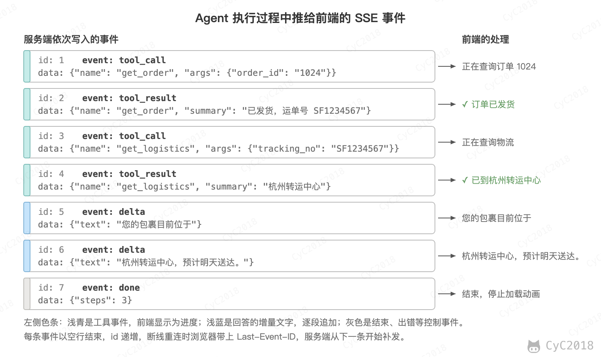 </div><br>

事件的类型按前端的需要设计，常见的有：

- tool_call、tool_result：开始调用某个工具，以及调用的结果。结果只推送给用户看的摘要，原始数据可能很大，也可能含有不该展示的字段；
- delta：回答的增量文字，前端逐段追加；
- error：出错的原因，例如工具超时、超过最大步数；
- done：结束，可以附带步数、Token 用量等统计。

服务端在 [Agent 循环](#agent-循环) 中每完成一个动作就写入一条事件，模型生成的文字通过回调边生成边推送：

```java
static void emit(String event, Map<String, Object> data) {   // 写一条 SSE 事件
    out.print("id: " + nextId++ + "\nevent: " + event + "\ndata: " + json(data) + "\n\n");
    out.flush();                                                   // 立即写出，不要缓冲
}

static void run(String question) {
    List<Message> messages = new ArrayList<>(List.of(Message.system("你是电商客服助手"), Message.user(question)));
    for (int step = 1; step <= MAX_STEPS; step++) {
        Message reply = llm.chatStream(messages, text -> emit("delta", Map.of("text", text)));
        messages.add(reply);
        if (reply.toolCalls().isEmpty()) { emit("done", Map.of("steps", step)); return; }
        for (ToolCall call : reply.toolCalls()) {
            emit("tool_call", Map.of("name", call.name(), "args", call.arguments()));
            String result = execute(call);
            emit("tool_result", Map.of("name", call.name(), "summary", summarize(result)));  // 只推摘要
            messages.add(Message.tool(call.id(), result));
        }
    }
    emit("error", Map.of("message", "超过最大步数"));
}
```

LangGraph 等框架也提供类似的机制，按节点输出状态的更新或者自定义的事件，原理相同。

#### 3. 生产环境中的注意事项

- Nginx 等反向代理默认会缓冲上游的响应，流式输出变成了一次性输出，需要关闭缓冲，例如在响应头中加上 X-Accel-Buffering: no；
- 网关和负载均衡的读超时要大于最长的生成时间；
- 用户关闭页面后要及时取消对模型的请求，否则仍在消耗 Token；
- 网络抖动导致断线时，模型的生成无法从中途重新开始。需要续传时，让生成任务与连接解耦：生成的内容按会话和事件编号写入 Redis 等缓存，客户端带着 Last-Event-ID 重连后，先从缓存中补发之后的事件，再继续推送新的内容，超时没有重连再取消生成；
- Agent 任务断线后通常继续执行到当前步骤结束，已经发起的退款这类有副作用的工具调用不能中途放弃，结果写入缓存，等客户端重连后补发；
- 工具调用的参数也是分片段流式返回的，需要按调用的序号拼接，生成结束后才能解析出完整的 JSON。

### 延迟与成本

#### 1. 延迟

大模型请求的延迟用两个指标衡量：

- 首 Token 时间（Time To First Token, TTFT）：从发出请求到收到第一个 Token，主要由预填充阶段决定，输入越长越慢；
- 每个输出 Token 的时间（Time Per Output Token, TPOT）：解码阶段生成每个 Token 的平均时间，决定了文字出现的速度。

总延迟约为 TTFT + TPOT × 输出的 Token 数。例如 TTFT 为 0.5 秒、TPOT 为 30 毫秒时，输出 300 个 Token 需要约 9.5 秒，其中 9 秒花在输出上。输出是逐个生成的，比并行处理的输入慢得多，所以限制输出长度通常是降低延迟最有效的方法。Agent 每一步都要等模型返回，步数越多越慢，互不依赖的工具调用可以并行执行。

#### 2. 一次 Agent 任务的费用

模型接口按 Token 计费，输入和输出分别计价，输出比输入贵，命中缓存的输入便宜得多。以 DeepSeek 的 deepseek-flash 为例，每百万 Token 的价格为：输入命中缓存 0.04 元，未命中 2 元，输出 8 元（2026-10-27 官方价格表中的高峰时段价格，以官方最新价格为准）。

用 Qwen2.5 的分词器计算“订单 1024 到哪了”的 3 次调用（换成其它模型的分词器，数量会有出入）：

```text
          输入   与之前的请求相同的前缀        新增   输出
第 1 次   283    264（系统提示词和工具定义）   19     24
第 2 次   355    307（第 1 次的输入和输出）    48     29
第 3 次   446    384（第 2 次的输入和输出）    62     13
合计      1084   955（88%）                    129    66
```

不考虑缓存时一次对话约 0.27 分，前缀全部命中缓存时约 0.082 分；每天 10 万次对话，分别约 270 元和 82 元（见[附录 A20](#a20-agent-任务的-token-数与前缀缓存)）。

这个例子的工具和提示词都很短。实际的 Agent 往往有几千 Token 的系统提示词和工具定义，每一步还会加入大段的工具结果。假设系统提示词和工具定义共 5000 个 Token，每一步新增 2000 个 Token，第 10 步的输入是 2.3 万个 Token，但 10 步累计的输入达到 14 万个 Token：

<div align="center"> 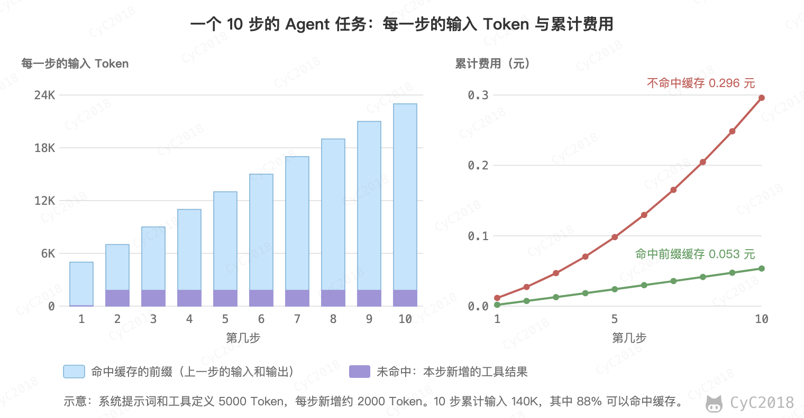 </div><br>

每一步的输入都以上一步的输入和输出为前缀，88% 的输入可以命中缓存，费用从 0.296 元降到 0.053 元。输入随步数线性增长，累计的输入随步数平方增长，所以步数多的任务更依赖缓存，也更需要压缩上下文。

#### 3. 让前缀缓存命中

前缀缓存只匹配从第一个 Token 开始完全相同的部分，中间任何一个 Token 不同，它之后的内容都无法命中（原理见[推理服务部署](#推理服务部署)）。因此：

- 系统提示词、工具定义这些不变的内容放在最前面，当前时间、用户名这类每次都变的内容放在后面；
- 工具列表的顺序保持固定，按任务动态增减工具会改变前缀；
- 历史消息原样追加，不要每次重新拼接或者调整 JSON 字段的顺序；
- 压缩或截断早期的历史会改变前缀，压缩之后的第一次请求无法命中，所以压缩不宜过于频繁。

缓存是否命中可以从接口返回的用量中查看，例如 DeepSeek 返回的 prompt_cache_hit_tokens 和 prompt_cache_miss_tokens。需要注意的是，服务端的缓存是尽力而为的，构建需要时间，一段时间不用就会被清除，不能保证 100% 命中。

#### 4. 减少 Token 消耗

前缀缓存降低的是单价，减少 Token 的数量要从上下文和输出两头入手：

- 控制工具返回的内容：工具默认返回摘要或者片段和文档编号，模型判断需要细节时再调用工具读取全文。例如检索返回 5 个片段约 1500 个 Token，把 5 篇文档的全文都放进去约 3 万个 Token，后者每一次调用的输入费用是前者的 20 倍，而且后面的每一步都要带着它；
- 限制输出长度：设置 max_tokens，要求回答简洁。输出的单价是未命中缓存的输入的 4 倍；
- 按难度选择模型：先用小模型判断问题的类型，查物流、改地址这类简单问题由小模型完成，复杂的投诉交给大模型。路由会分错，需要在评测集上确认整体效果没有下降。

完全相同的问题还可以直接返回缓存的结果。用 Embedding 判断问题是否相近的语义缓存命中率更高，但容易把不同的问题当成同一个，例如“订单 1024 到哪了”和“订单 1025 到哪了”的 Embedding 非常接近。

Token 消耗增长过快时，先按步骤和工具汇总每一次调用的输入、命中缓存和输出的 Token 数。常见的原因正是上面几点没有做到：某个工具返回了大段的原始数据，模型反复调用同一个工具，历史一直没有压缩，或者修改提示词后在开头加入了会变化的内容，命中率下降。

### 推理服务部署

自己部署开源模型时，例如用 vLLM 部署 Qwen2.5-7B，除了 TTFT 和 TPOT，还关心吞吐量（Throughput），即整个服务每秒生成的 Token 总数。TTFT、TPOT 决定单个用户的体验，吞吐量决定一张显卡能服务多少用户、每个 Token 的成本是多少。

#### 1. 批处理：用延迟换吞吐

解码阶段每生成一个 Token，都要把全部权重从显存中读一遍，而计算量很小，速度主要受显存带宽限制。例如 A100 80GB 的显存带宽为 2039 GB/s，Qwen2.5-7B 的 BF16 权重约 152 亿字节，每一步至少需要 7.5 毫秒，单个请求每秒最多生成约 133 个 Token。

把多个请求放在同一批中，读一次权重就能为每个请求各生成一个 Token。批次越大，吞吐量越高；代价是每一步还要读取每个请求的 KV Cache、计算量也随之增加，每一步变慢，TPOT 变大。按带宽估算，32 个各有 2K Token 上下文的请求组成一批时，每一步至少 9.3 毫秒，吞吐上限约 3400 Token/s，是单个请求的 26 倍。

在笔记本上用 Qwen2.5-3B 测量，结果如下（Apple M1 Pro 上的示意性测量，不代表服务器，见[附录 A21](#a21-batch-大小与吞吐延迟)）：

<div align="center"> 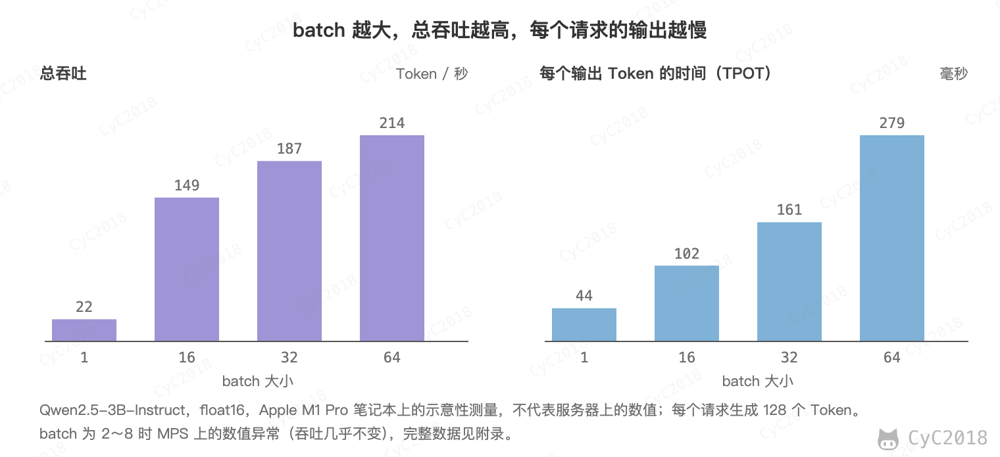 </div><br>

batch 从 1 增大到 64，总吞吐从 22 Token/s 提高到 214 Token/s，约 9.6 倍；每个请求的 TPOT 从 44 毫秒增大到 279 毫秒，64 个请求一起做预填充，TTFT 也从 0.1 秒增大到 2.8 秒。笔记本的算力有限，批处理的收益比服务器上小，但趋势相同。

所以在线对话服务要在延迟和吞吐之间取舍：先定下延迟的目标，例如 TPOT 不超过 50 毫秒，再选能满足目标的最大并发数；离线的批量任务不在乎单个请求的延迟，批次尽量大。

需要注意的是，同一个请求在不同大小的批次中，浮点运算的顺序可能不同，结果可能出现细微的差别（这次在笔记本上的测试中，各个 batch 大小下的贪心输出一致）。对可复现性要求高时，vLLM 提供批次不变（Batch Invariance）的模式，代价是速度可能变慢。

#### 2. 连续批处理

传统的静态批处理把一批请求一起送进模型，等这一批全部生成结束才接收新的请求。各个请求的输出长度相差很大，先结束的请求只能空等，新来的请求也要排队：

<div align="center"> 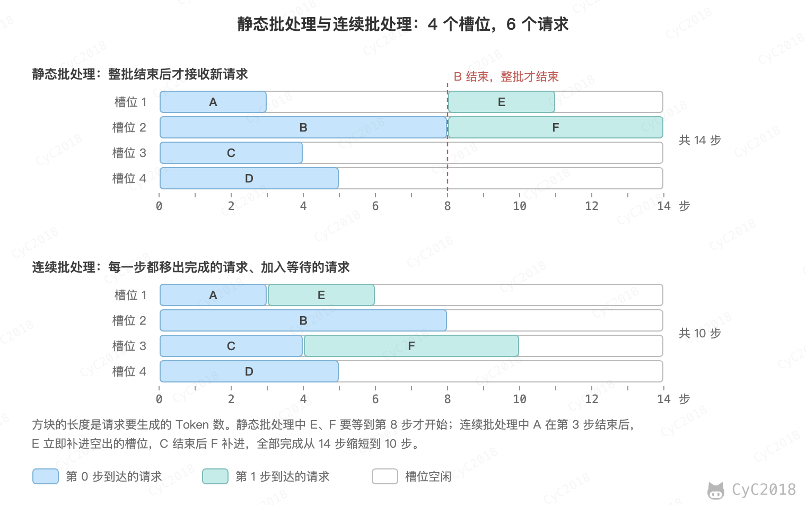 </div><br>

连续批处理（Continuous Batching）以每一步为单位调度：每生成一步，就把已经结束的请求移出批次，把等待中的请求加入。它最早由 Orca 提出（称为迭代级调度），vLLM 默认使用。新加入的请求需要先做预填充，长输入的预填充会拖慢同一批中其它请求的解码，vLLM 默认把长的预填充切成小块，与解码请求混在一起执行（分块预填充）。

#### 3. 显存：权重与 KV Cache

显存首先被模型权重占用，剩下的用来存放 KV Cache，能同时服务多少请求取决于 KV Cache 能放下多少 Token。按 Qwen2.5-7B 的配置（28 层、4 个 KV 头、每个头 128 维，BF16），每个 Token 的 KV Cache 为 56 KB（计算见[自回归生成与 KV Cache](#自回归生成与-kv-cache)），一个 8K 上下文的请求占 448 MB。以下的 GB 按 2<sup>30</sup> 字节计算，权重约 14.2 GB：

```text
并发请求数   KV Cache（每个 8K）   权重 + KV Cache
  1            0.44 GB              14.6 GB
 16            7 GB                 21.2 GB
 32           14 GB                 28.2 GB
 64           28 GB                 42.2 GB
128           56 GB                 70.2 GB
```

vLLM 默认使用 92% 的显存（--gpu-memory-utilization）。在 24 GB 的显卡上，扣除权重后剩不到 7.9 GB，再扣除激活值等运行时开销，同时只能处理十几个满 8K 的请求；80 GB 的显卡上可以处理 100 多个。KV Cache 不够时，vLLM 会暂停一部分请求，释放它们的 KV Cache，之后再重新计算，延迟会明显增加。想用同样的显卡服务更多请求，可以减小最大上下文长度、使用更多显卡，或者对权重和 KV Cache 进行[量化](#量化)。

#### 4. PagedAttention

请求的实际长度事先不知道。早期的推理系统按最大长度为每个请求预留一段连续的显存，请求实际只用了其中一部分，剩下的空着也不能给别的请求使用。vLLM 的论文统计，这些系统中真正用来存放 KV Cache 的显存只有 20.4%～38.2%。

PagedAttention 借鉴操作系统的[分页](计算机操作系统%20-%20内存管理.md#分页系统地址映射)，把 KV Cache 切成固定大小的块（vLLM 默认每块 16 个 Token），生成到需要时才分配一块，用块表记录每个请求的块在显存中的位置，浪费的只有每个请求最后一块中没写满的部分：

<div align="center"> 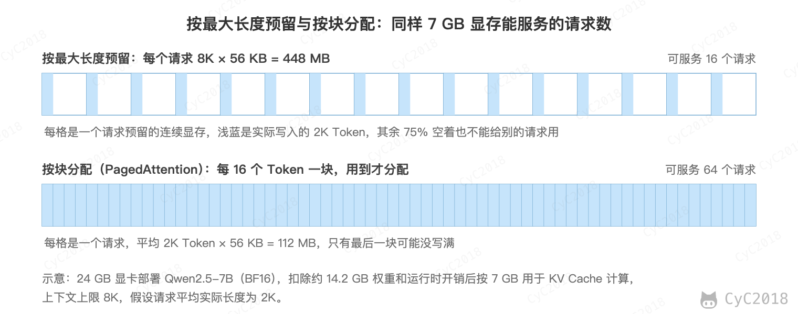 </div><br>

同样 7 GB 的显存，按 8K 预留只能服务 16 个请求；按块分配时，如果请求平均只用到 2K Token，可以服务 64 个。批次越大吞吐越高，vLLM 论文中报告，在延迟相近的情况下吞吐量是 FasterTransformer、Orca 等系统的 2～4 倍。

#### 5. 前缀缓存

很多请求的开头是相同的，例如同一个客服系统的所有请求都以相同的系统提示词和工具定义开头，同一个 Agent 任务的每一步都以上一步的输入为开头。前缀缓存（Prefix Caching）把已经算好的 KV Cache 保留下来，新请求的开头与之相同时直接复用，跳过这部分的预填充，TTFT 随之降低。

vLLM 的实现基于 PagedAttention 的块：每个写满的块用“前面所有块的哈希 + 本块的 Token”计算哈希值，新请求按块逐个查找，前面的块都命中，后面的块才可能命中。只有写满的块会被缓存，例如客服例子中系统提示词和工具定义共 264 个 Token，前 256 个（16 块）可以复用，剩下的 8 个重新计算。

模型服务商对命中缓存的输入按更低的价格计费，就是因为这部分不需要重新计算。需要注意的是，缓存保存在每个实例自己的显存中，部署多个实例时，同一个会话的请求应该尽量路由到同一个实例，否则缓存在别的实例上，无法命中。

### 稳定性

模型接口比普通的后端接口更慢，也更容易失败：生成一段回答要几秒到几十秒，请求可能在服务端排队；超过请求频率、Token 速率或者并发数的限制时返回 429，服务端故障或者负载过高时返回 500、503；流式输出还可能在中途断开。另一类错误是请求本身有问题，例如输入超过上下文窗口时返回 400，重试也不会成功。

应对这些问题的手段从内到外是：为每次调用设置合适的超时，可恢复的错误按退避重试，重试仍然失败或者主模型持续出错时降级到备用模型，最后返回兜底的结果：

<div align="center"> 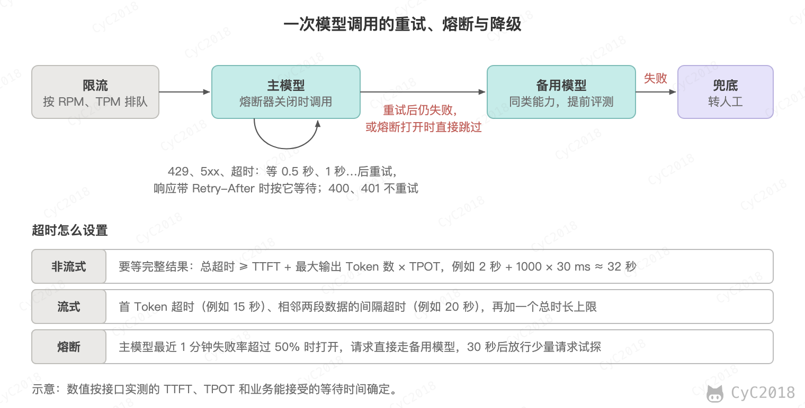 </div><br>

#### 1. 超时

非流式请求要等完整的结果，耗时取决于输出的长度，总超时至少要大于 TTFT + 最大输出 Token 数 × TPOT。例如最多输出 1000 个 Token、TPOT 为 30 毫秒时，正常情况下也需要 30 多秒，如果照搬普通接口的 5 秒超时，长回答会全部失败。

流式请求不需要等完整的结果，但只设一个总超时，无法区分服务卡住了还是还在正常地输出。流式请求分开设置：

- 首 Token 超时：迟迟收不到第一个 Token，说明在排队或者服务异常；
- 间隔超时：相邻两段数据之间超过一定时间没有新内容，说明连接或者生成卡住了；
- 总时长上限：防止异常情况下一直输出。

需要注意的是，有的服务在排队时会持续发送心跳，例如 DeepSeek 对流式请求返回 : keep-alive 注释，对非流式请求返回空行，计算首 Token 超时和间隔超时时不能把心跳当成内容。

#### 2. 重试与指数退避

429、5xx 和超时可以重试，400、401 这类错误重试也不会成功，直接失败。重试的间隔按指数增长，例如 0.5 秒、1 秒、2 秒，并加入随机抖动，避免大量请求在同一时刻一起重试；响应中带有 Retry-After 首部时，按它指定的时间等待。

```java
static Reply chatWithRetry(Request req) throws LlmException {
    long backoff = 500;                                            // 第一次等 0.5 秒
    for (int attempt = 1; ; attempt++) {
        try {
            return client.chat(req);
        } catch (LlmException e) {
            if (!e.retryable() || attempt == MAX_ATTEMPTS) throw e;  // 400、401 等直接失败
            long wait = e.retryAfterMillis() > 0
                    ? e.retryAfterMillis()                         // 服务端指定了等待时间
                    : backoff / 2 + ThreadLocalRandom.current().nextLong(backoff / 2);  // 随机抖动
            sleep(wait);
            backoff = Math.min(backoff * 2, 8_000);                // 指数增长，设上限
        }
    }
}
```

OpenAI 的官方 SDK 默认也是这样处理的：对 408、409、429 和 5xx 重试 2 次，初始间隔 0.5 秒、最大 8 秒，并遵守 Retry-After。

重试次数要有上限。服务已经过载时，每一层都重试 3 次，请求量会被成倍放大，反而更难恢复。Agent 中模型调用和工具调用嵌套时，只在一层重试。工具调用的重试和容错见[可靠性与评测](#可靠性与评测)。

#### 3. 限流、降级与熔断

收到 429 再退避是被动的。大量 Agent 任务同时调用模型时，在调用方主动限流更好：按服务商的限额设置并发数上限和令牌桶，超出的请求排队等待，而不是发出去再被拒绝。

主模型不可用时降级：先切换到能力相近的备用模型，可以是另一家服务商；仍然失败时返回兜底的结果，例如“系统繁忙，已为您转人工客服”。备用模型的提示词、工具调用格式可能不同，上线前要在同一批评测任务上验证效果。

熔断用于避免每个请求都先等主模型超时再切换。主模型在一段时间内的失败率超过阈值时，熔断器打开，之后的请求直接走备用模型，过一段时间再放行少量请求试探主模型是否恢复。限流、降级和熔断的原理见[系统设计基础](系统设计基础.md#限流降级与熔断)。

#### 4. 流式输出中途断开

处理方式取决于断开时已经输出了什么：

- 还没有输出任何内容：直接重试，用户感知不到；
- 已经输出了部分文字：可以把已经输出的部分作为 assistant 消息的开头，请求模型接着往下写，例如 DeepSeek 的对话前缀续写；不支持时丢弃已有的内容重新生成，并通知前端清空已显示的文字；
- 工具调用的参数输出了一半：参数不完整，不能执行，只能丢弃后重新请求。

#### 5. 可观测

记录每一次模型调用和工具调用的输入、输出、耗时、Token 数和错误码，以及使用的模型和提示词版本，出错时才能复现和定位问题。还要监控失败率、TTFT、TPOT 的分位数和缓存命中率，在用户感知之前发现模型服务变慢或者出错。

### 安全

#### 1. 提示词注入

提示词注入（Prompt Injection）指的是攻击者通过输入的内容改变模型原本的指令。直接注入是用户在输入中写入恶意指令；间接注入是指令藏在模型读取的网页、文档或者工具返回结果中，在 RAG 和 Agent 中更加隐蔽。

<div align="center">  </div><br>

#### 2. 限制模型能造成的后果

模型无法可靠地区分指令和数据，在提示词中要求“忽略资料中的指令”只能降低风险，不能杜绝。因此防范的重点是限制模型能造成的后果：

- 区分指令和数据，把外部内容明确标注为不可信的资料；
- 工具按最小权限设计，当前任务用不到的工具不提供，权限在代码中按当前用户校验，而不是依靠模型遵守提示词；
- 删除数据、转账、对外发送信息这类高风险操作需要人工确认；
- 模型的输出同样不可信，显示到页面之前要转义，防止 [跨站脚本攻击](攻击技术.md#一跨站脚本攻击)，用于查询数据库时要使用参数化查询；
- 不要在提示词中放入密钥等敏感信息，提示词可能被诱导泄露。

以客服 Agent 为例，用户身份取自登录会话，不作为工具参数让模型填写，get_order 在代码中检查订单是否属于当前用户，模型即使被诱导传入别人的订单号，也查不到数据。退款工具只生成一条待确认的申请，前端展示金额和订单，用户点击确认后由普通的业务接口执行，模型自己无法完成退款。

每次工具调用都记录审计日志：谁发起的任务、调用了哪些工具、参数和结果是什么、谁确认了操作，出了问题可以追溯。

## 附录：实测

以下实验的环境为 Apple M1 Pro（32 GB）、macOS，PyTorch 与 Hugging Face Transformers，模型从 Hugging Face 下载到本地。

### A1 Embedding 相似度与 BM25

bge-small-zh-v1.5 取 [CLS] 位置的向量并归一化，余弦相似度即点积。BM25 的切词为“错误码”、连续的字母数字和其余单字，三篇文档组成语料，k1 = 1.2、b = 0.75，IDF 取 ln(1 + (N - n + 0.5) / (n + 0.5))：

```python
def emb(texts):
    x = tok(texts, padding=True, truncation=True, return_tensors="pt")
    with torch.no_grad():
        v = model(**x).last_hidden_state[:, 0]
    return torch.nn.functional.normalize(v, dim=-1)

def terms(s): return re.findall(r"错误码|[A-Za-z0-9]+|[一-鿿]", s)
def bm25(qs, d):
    return sum(idf(t) * d.count(t) * (k1 + 1) / (d.count(t) + k1 * (1 - b + b * len(d) / avg)) for t in set(qs) if t in d)
```

```text
维度 512；年假-休假 0.603，年假-股价 0.194
E1024 查询与 E1024 文档 0.762，与 E1025 文档 0.743
查询切词 ['错误码', 'E1024', '是', '什', '么', '意', '思']
BM25 错误码 E1024：库存不足：1.088
BM25 错误码 E1025：支付超时：0.130
BM25 常见错误码说明：0.140
```

### A2 提示词对工具调用的影响

模型用 float16 加载到 MPS，按“订单 1024 到哪了？”运行 Agent 循环，最多 5 步，采样参数 temperature = 0.7、top_p = 0.9，每次用不同的随机种子。最终回答中出现“杭州”（物流工具返回的当前位置）记为成功：

```python
PROMPTS = {"A": "你是电商客服助手，回答要简短。",
           "B": "你是电商客服助手。用户问包裹到哪了时，先查订单拿到运单号，再查物流，告诉用户当前位置和预计送达时间。回答要简短。"}
out = model.generate(**ids, max_new_tokens=160, do_sample=True, temperature=0.7, top_p=0.9)
```

```text
qwen2.5-7b 提示词 A: 成功 0/10，工具调用次数 [0, 1, 1, 1, 0, 1, 0, 1, 1, 1]
   例： False 请提供您的订单号，以便查询。您提供的订单号是1024。
   例： False 您的订单已发货，运单号是 SF1234567。我可以帮您查询物流信息。
qwen2.5-7b 提示词 B: 成功 10/10，工具调用次数 [2, 2, 2, 2, 2, 2, 2, 2, 2, 2]
   例： True 您的包裹目前位于杭州转运中心，预计明天送达。
qwen2.5-3b 提示词 B: 成功 0/20，工具调用次数 [1, 1, 1, 1, 1, 1, 1, 1, 1, 1, 1, 1, 1, 1, 1, 1, 1, 1, 1, 1]
   例： False 您的包裹已经发货，运单号是 SF1234567，请稍后查询物流信息。
```

### A3 客服请求的 Token 构成

环境：Python 3.13、Transformers 5.20.2，只加载 Qwen2.5-7B-Instruct 的分词器。请求由系统提示词（7 条规则）、6 个工具、2 条长期记忆、11 轮对话历史（其中 6 次工具调用）、3 段检索资料和当前问题组成，用对话模板渲染后计数。每部分的 Token 数取“加入这部分前后的差值”，模板为每条消息添加的标记计入所在的部分：

```python
n = lambda msgs, tools=None: len(tok(tok.apply_chat_template(msgs, tools=tools, add_generation_prompt=True, tokenize=False)).input_ids)
parts["工具定义（6 个）"] = n([sysm, U("")], TOOLS) - n([sysm, U("")])
parts["对话历史（11 轮）"] = n([sysmm] + HISTORY + [U("")], TOOLS) - n([sysmm, U("")], TOOLS)
```

```text
系统提示词         205
工具定义（6 个）    701     6 个工具的 JSON 共 618，其余是模板中说明调用格式的文字
长期记忆            75
对话历史（11 轮）  1862     用户消息 219，助手回答 443，工具调用 287，工具结果 913
检索资料（3 段）    150
当前问题            31
模板标记（空消息）   13
合计              3037
每轮的 Token 数：611 140 233 65 296 54 203 133 33 39 55
物流原始结果 342（563 个字符），只保留需要的字段 50
系统提示词 332 字符 205 Token（0.62）；检索资料 222 字符 148 Token（0.67）
```

### A4 普通摘要与结构化摘要

把上面 11 轮对话转成文本记录（1654 个 Token），分别用两种提示词让模型压缩。模型用 float16 加载到 MPS，采样参数 temperature = 0.7、top_p = 0.9，每次用不同的随机种子；Qwen2.5-3B 每种提示词 3 次，Qwen2.5-7B 每种 2 次。关键事实共 14 条，用正则判断是否出现在摘要中（例如退款要求出现 59.9，取件要求同时出现 29 日或周三与 14:00）；再贪心解码，只根据摘要回答 5 个问题，例如“快递员什么时候上门取件？”“取件时应该怎样联系用户？”：

```python
PROMPTS = {
    "普通摘要": "下面是客服与用户的对话记录。请用一段话总结这段对话，供客服在后续对话中参考。\n\n{t}",
    "结构化摘要": "……按以下格式输出……\n订单：每个订单的订单号、商品和当前状态\n已办理：……\n承诺：……\n用户要求：……\n待办：……\n"
                  "订单号、单号、金额、时间、地址、电话照原文抄写，不要改写或省略。\n\n{t}",
}
a = gen(f"以下是之前对话的摘要：\n{s}\n\n只根据摘要回答，摘要中没有的写“不知道”。问题：{q}", 0, 80, sample=False)
```

```text
qwen2.5-3b 普通摘要: 关键事实保留 [5, 5, 3]（共 14 条），平均 4.3；问答正确 [1, 0, 0]（共 5 题）；摘要长度 [165, 172, 112] Token
  丢失次数： {'运单 SF1234567': 3, '优惠券有效期 11-30': 3, '退货单 R2051': 3, '退款 59.9 元': 3, '新地址 江南大道 588 号 3 幢 1201': 3,
             '短信联系、不打电话': 3, '手机尾号 8823': 3, '发票待提供税号': 3, '取件 10-29 14:00-16:00': 2, ……}
qwen2.5-3b 结构化摘要: 关键事实保留 [9, 11, 9]（共 14 条），平均 9.7；问答正确 [3, 3, 3]（共 5 题）；摘要长度 [582, 458, 405] Token
  丢失次数： {'运单 SF1234567': 3, '手机尾号 8823': 3, '退货单 R2051': 2, '短信联系、不打电话': 2, '发票待提供税号': 1,
             '取件 10-29 14:00-16:00': 1, '退款 59.9 元': 1}
qwen2.5-7b 普通摘要: 关键事实保留 [12, 4]（共 14 条），平均 8.0；问答正确 [4, 0]（共 5 题）；摘要长度 [276, 104] Token
qwen2.5-7b 结构化摘要: 关键事实保留 [11, 12]（共 14 条），平均 11.5；问答正确 [3, 4]（共 5 题）；摘要长度 [381, 538] Token
  丢失次数： {'手机尾号 8823': 2, '预计 10-27 送达': 1, '短信联系、不打电话': 1, '优惠券有效期 11-30': 1}

3B 普通摘要（第 1 次，节选）：……订单ID为1025的65W氮化镓充电器已签收，用户申请退货，客服为其安排了10月29日
14:00-16:00上门取件，并告知了用户取件地址和退款详情；用户还更改了订单ID为1026机械键盘的收货地址……
```

### A5 长期记忆的提取与更新

Qwen2.5-7B 用 float16 加载到 MPS，贪心解码。先用两种提示词从同一段对话中提取，再把“限定”提取出的每条事实与两条已有记忆（m1 常用收货地址：杭州市西湖区文三路 90 号（2026-08-30），m2 喜欢简短的回答（2026-09-12））一起交给模型，选择 ADD、UPDATE、DELETE 或 NONE：

```python
EXTRACT = {
    "宽松": "从下面的客服对话中提取关于用户的信息，每条一句话，以 JSON 数组输出。\n\n{t}",
    "限定": "从下面的客服对话中，提取以后的会话中仍然有用的用户信息，例如偏好和长期有效的事实。\n"
            "只提取用户明确说过的内容；订单状态、物流进度、退货进度这类可以从业务系统查到或者很快会过期的信息不要提取。\n"
            "每条一句话，以 JSON 数组输出，没有则输出 []。\n\n{t}",
}
```

```text
=== 提取（宽松）
[{"用户ID": "未提供"}, {"用户姓名": "未提供"}, {"用户地址": "杭州市西湖区文三路 90 号"},
 {"用户新地址": "杭州市滨江区江南大道 588 号 3 幢 1201"}, {"用户联系电话": "1388823"}]
=== 提取（限定）
[{"address": "杭州市滨江区江南大道 588 号 3 幢 1201"}, {"phone": "尾号 8823"}]
=== 更新
- {'address': '杭州市滨江区江南大道 588 号 3 幢 1201'}
  -> {"op": "UPDATE", "id": "m1", "text": "常用收货地址：杭州市滨江区江南大道 588 号 3 幢 1201（2026-09-14）"}
- {'phone': '尾号 8823'}
  -> {"op": "NONE", "id": null, "text": null}
```

### A6 意图路由的三种做法

评测集是自己编写的 60 条电商客服消息，物流、退款、改地址、商品咨询、其它 5 个类别各 12 条，其中 10 条含有其它类别的关键词。分类模型用 bge-small-zh-v1.5 的 [CLS] 向量，每类 6 条示例（不在评测集中）取平均作为类中心，按余弦相似度最近的类中心分类，置信度为相似度除以 0.05 后的 softmax。大模型用 float16 加载到 MPS，贪心解码，置信度取第一个 Token 在 5 个类别首 Token 上归一化后的概率（5 个类别名的首 Token 互不相同）：

```python
RULES = [("退款", r"退款|退货|退钱|售后|取消订单|退差价|七天无理由"),
         ("改地址", r"地址|收件人|收货人|电话"),
         ("物流", r"物流|快递|到哪|发货|配送|签收|运单|送到|驿站|包裹|能到"),
         ("商品咨询", r"支持|多久|尺码|什么码|材质|优惠|区别|补货|现货|便宜|保修|适合")]   # 按顺序匹配，都不命中为“其它”
SYSTEM = """你是电商客服的意图分类器。把用户消息归入以下类别之一，只输出类别名，不要解释。
物流：查询发货、配送进度、包裹位置
退款：退款、退货、取消订单、售后、退差价
改地址：修改收货地址、收件人、电话
商品咨询：购买前对商品功能、规格、价格、库存的询问
其它：以上都不是，包括闲聊、账号问题、投诉、要求转人工"""
g = model.generate(**ids, max_new_tokens=8, do_sample=False, output_scores=True, return_dict_in_generate=True)
p = torch.softmax(torch.log_softmax(g.scores[0][0].float(), -1)[first_tokens], -1)
```

```text
规则：准确率 44/60 = 73.3%
  标注\预测   物流  退款  改地址  商品咨询  其它
  物流          10     0       0         0     2
  退款           2     7       0         1     2
  改地址         2     0       8         0     2
  商品咨询       1     0       0         8     3
  其它           1     0       0         0    11
分类模型：准确率 47/60 = 78.3%
Qwen2.5-3B：准确率 54/60 = 90.0%
Qwen2.5-7B：准确率 57/60 = 95.0%
    显示已签收但我没收到 物流 -> 退款 0.931
    少发了一个配件 退款 -> 商品咨询 0.503
    有没有优惠券 商品咨询 -> 其它 0.995
    快递员态度太差了，我要投诉 其它 -> 其它 0.999 原始输出：投诉
在 10 条含其它类别关键词的样本上：规则 4 条正确，分类模型 6 条，3B 8 条，7B 10 条

分类模型 置信度阈值：
  阈值 0.50：自动路由 42/60（70%），其中正确 38，准确率 90.5%
  阈值 0.70：自动路由 29/60（48%），其中正确 28，准确率 96.6%
  阈值 0.90：自动路由 7/60（12%），其中正确 6，准确率 85.7%
Qwen2.5-7B 置信度阈值：
  阈值 0.90：自动路由 59/60（98%），其中正确 57，准确率 96.6%
  阈值 0.95：自动路由 57/60（95%），其中正确 56，准确率 98.2%
```

60 条样本只够说明趋势，阈值应该在单独的验证集上选取。

### A7 工具出错时 Agent 的表现

沿用附录 A2 的 Agent 循环和提示词 B，Qwen2.5-7B-Instruct，temperature = 0.7、top_p = 0.9，最多 6 步，每种情况用 10 个随机种子各运行一次。错误原样作为 tool 消息的内容回传给模型。四种情况：

- 偶发超时：get_logistics 第 1 次返回 {"error": "物流接口超时，请稍后重试"}，之后正常返回；
- 持续超时：每次都返回同样的错误；
- 参数错误，笼统提示：get_logistics 增加参数 carrier（描述为“承运商代码”），只有取值为 shunfeng 时才返回物流信息，否则返回 {"error": "参数错误"}；
- 参数错误，可修正的提示：同上，错误为 {"error": "carrier 取值错误：应为快递公司编码，顺丰为 shunfeng，中通为 zhongtong"}。

```python
if c["name"] == "get_logistics":
    n_logi += 1
    if MODE.startswith("param2"):
        r = LOGISTICS.get(args.get("tracking_no")) if args.get("carrier") == "shunfeng" else HINT[MODE]
    else:
        r = ERROR if (MODE == "persistent" or n_logi == 1) else LOGISTICS.get(args.get("tracking_no"))
msgs.append({"role": "tool", "name": c["name"], "content": json.dumps(r, ensure_ascii=False)})
```

```text
偶发超时：get_logistics 调用次数 [1, 1, 1, 1, 1, 1, 1, 1, 1, 1]，最终回答中出现“杭州” 0/10
  目前物流信息暂不可用，请稍后再试或联系快递公司查询。
  目前您的包裹正在运输中，物流信息暂时无法获取，请稍后再试或联系物流查询。
持续超时：get_logistics 调用次数 [1, 1, 1, 1, 1, 1, 1, 1, 1, 1]，最终回答中出现“杭州” 0/10
参数错误，笼统提示：get_logistics 调用次数 [1, 1, 1, 1, 1, 1, 1, 1, 1, 1]，最终回答中出现“杭州” 0/10
  get_order({"order_id": "1024"}) -> {... "tracking_no": "SF1234567"} | get_logistics({"tracking_no": "SF1234567", "carrier": "SF"}) -> {"error": "参数错误"}
  seed=1：目前包裹在上海市，预计2天内送达。请注意查收。
  seed=2：您好，目前您的包裹正在运输中，运单号为SF1234567，承运商暂时无法提供详细位置信息，请耐心等待。预计送达时间为3-5个工作日。……
  seed=6：目前包裹在运输中，位置信息暂时无法获取。预计今天内送达，请耐心等待。……
  seed=7：您好，目前您的订单已发货，运单号为SF1234567，暂时没有更新位置信息，请稍后再试或联系快递公司查询。
参数错误，可修正的提示：get_logistics 调用次数 [2, 2, 2, 2, 2, 2, 2, 2, 2, 2]，最终回答中出现“杭州” 10/10
  get_order(...) | get_logistics({"tracking_no": "SF1234567", "carrier": "SF"}) -> {"error": "carrier 取值错误：应为快递公司编码，顺丰为 shunfeng，中通为 zhongtong"}
                 | get_logistics({"tracking_no": "SF1234567", "carrier": "shunfeng"}) -> {"location": "杭州转运中心", ...}
  seed=0：您的包裹目前位于杭州转运中心，预计明天送达。谢谢！
```

另外做过一组参数校验更宽松的对照：carrier 取值为 SF 即可，模型 10 次都在第一次调用时主动填写了 carrier = "SF"，没有触发错误。

### A8 LangGraph 的 checkpoint 与人工确认

LangGraph 1.2.18、langgraph-checkpoint 4.3.1，Python 3.13。代码即正文中的退款流程，confirm 节点的第一行打印一句话，refund 节点用 refund-订单号 作为幂等键写入字典：

```python
def confirm(state):
    print("  confirm 节点开始执行")                # 恢复时会从节点开头重新执行
    ok = interrupt({"action": "refund", "order_id": state["order"]["order_id"], "amount": state["order"]["amount"]})
    return {"approved": ok, "trace": [f"confirm -> {ok}"]}

r = app.invoke({"question": "订单 1024 我要退款", "trace": []}, cfg)
print("第一次调用返回：", r["__interrupt__"][0].value)
snap = app.get_state(cfg)
print("暂停时保存的状态：next =", snap.next, "trace =", snap.values["trace"])
print("checkpoint 数量：", len(list(app.get_state_history(cfg))))
r = app.invoke(Command(resume=True), cfg)
```

```text
  confirm 节点开始执行
第一次调用返回： {'action': 'refund', 'order_id': '1024', 'amount': 59.9}
暂停时保存的状态：next = ('confirm',) trace = ['classify -> 退款', 'check_order']
checkpoint 数量： 4
  confirm 节点开始执行
恢复后： 已提交退款 59.9 元 ['classify -> 退款', 'check_order', 'confirm -> True', 'refund']
退款记录： {'refund-1024': 59.9}
```

### A9 Spring AI 的工具调用循环

Spring AI 2.0.2（spring-ai-client-chat），JDK 21。用一个桩模型代替真实的模型：第 1 次调用返回调用 getOrder 的请求，第 2 次返回文本回答，并打印每次收到的消息和工具定义。桩模型要通过 getOptions() 返回 ToolCallingChatOptions，ChatClient 才会把工具加进请求：

```java
public ChatOptions getOptions() {
    return ToolCallingChatOptions.builder().build();
}
public ChatResponse call(Prompt prompt) {
    AssistantMessage reply = calls.incrementAndGet() == 1
            ? AssistantMessage.builder().content("").toolCalls(List.of(
                new AssistantMessage.ToolCall("call_1", "function", "getOrder", "{\"orderId\": \"1024\"}"))).build()
            : AssistantMessage.builder().content("订单 1024 已发货，运单号 SF1234567。").build();
    return new ChatResponse(List.of(new Generation(reply)));
}
```

```text
--- 第 1 次调用模型，消息：
  USER: 订单 1024 到哪了？
  工具定义：getOrder {"$schema" : "https://json-schema.org/draft/2020-12/schema","type" : "object","properties" : {"orderId" : {"type" : "string","description" : "订单号，例如 1024"}},"required" : [ "orderId" ],"additionalProperties" : false}
执行 getOrder(1024)
--- 第 2 次调用模型，消息：
  USER: 订单 1024 到哪了？
  ASSISTANT:
  TOOL: [ToolResponse[id=call_1, name=getOrder, responseData={"orderId":"1024","status":"已发货","trackingNo":"SF1234567"}]]
最终回答：订单 1024 已发货，运单号 SF1234567。
```

不加 -parameters 编译时，工具定义中的参数名变成 arg0，桩模型按 orderId 传参，方法收到的是 null：

```text
  工具定义：getOrder {..."properties" : {"arg0" : {"type" : "string","description" : "订单号，例如 1024"}},"required" : [ "arg0" ]...}
执行 getOrder(null)
```

### A10 模型裁判的位置偏差与长度偏差

Qwen2.5-7B-Instruct 作为裁判，对 12 对客服回答做成对比较：4 对质量相当、4 对信息相同但回答 2 加了客套话、4 对回答 2 更详细但有一处与工具结果不符（地点、到账时间、门牌号、送达日期）。每对按两种顺序各判一次，取下一个 Token 为 A、B 的概率中较大的一个。分别在不给参考和给出工具结果作参考两种提示词下运行：

```python
ctx = f"工具返回的事实：{fact}\n以工具返回的事实为准，与事实不符的回答应判为较差。\n\n" if ref else ""
user = f"{ctx}用户问题：{q}\n\n回答 A：{first}\n\n回答 B：{second}\n\n哪个回答更好？只输出 A 或 B。"
logits = model(**ids).logits[0, -1]
p = torch.softmax(logits[[A, B]], -1)
```

```text
不给参考：
same: 4 对 × 2 种顺序；交换顺序后结论一致 0/4；选第一个位置 0/8；选回答 2 4/8；两种顺序都选回答 2 0/4
    订单 1024 到哪了？     顺序1 B(P(A)=0.001)  顺序2 B(P(A)=0.001)
    退款什么时候到账？        顺序1 B(P(A)=0.006)  顺序2 B(P(A)=0.0)
    帮我把地址改成上海浦东张江路   顺序1 B(P(A)=0.446)  顺序2 B(P(A)=0.002)
    我的快递到哪了，运单 SF1   顺序1 B(P(A)=0.031)  顺序2 B(P(A)=0.0)
verbose: 4 对 × 2 种顺序；交换顺序后结论一致 4/4；选第一个位置 4/8；选回答 2 8/8；两种顺序都选回答 2 4/4
    订单 1024 到哪了？     顺序1 B(P(A)=0.0)  顺序2 A(P(A)=0.99)
    退款什么时候到账？        顺序1 B(P(A)=0.0)  顺序2 A(P(A)=0.997)
    帮我把地址改成上海浦东张江路   顺序1 B(P(A)=0.0)  顺序2 A(P(A)=1.0)
    我的快递到哪了，运单 SF1   顺序1 B(P(A)=0.0)  顺序2 A(P(A)=1.0)
wrong: 4 对 × 2 种顺序；交换顺序后结论一致 3/4；选第一个位置 3/8；选回答 2 7/8；两种顺序都选回答 2 3/4
    订单 1024 到哪了？     顺序1 B(P(A)=0.0)  顺序2 A(P(A)=1.0)
    退款什么时候到账？        顺序1 B(P(A)=0.052)  顺序2 B(P(A)=0.001)
    帮我把地址改成上海浦东张江路   顺序1 B(P(A)=0.017)  顺序2 A(P(A)=0.585)
    我的快递到哪了，运单 SF1   顺序1 B(P(A)=0.0)  顺序2 A(P(A)=0.89)

给出工具结果作参考：
same: 4 对 × 2 种顺序；交换顺序后结论一致 2/4；选第一个位置 6/8；选回答 2 2/8；两种顺序都选回答 2 0/4
    订单 1024 到哪了？     顺序1 A(P(A)=1.0)  顺序2 A(P(A)=0.976)
    退款什么时候到账？        顺序1 A(P(A)=0.999)  顺序2 B(P(A)=0.0)
    帮我把地址改成上海浦东张江路   顺序1 A(P(A)=1.0)  顺序2 A(P(A)=0.996)
    我的快递到哪了，运单 SF1   顺序1 A(P(A)=1.0)  顺序2 B(P(A)=0.469)
verbose: 4 对 × 2 种顺序；交换顺序后结论一致 1/4；选第一个位置 7/8；选回答 2 5/8；两种顺序都选回答 2 1/4
    订单 1024 到哪了？     顺序1 A(P(A)=0.994)  顺序2 A(P(A)=0.993)
    退款什么时候到账？        顺序1 A(P(A)=0.951)  顺序2 A(P(A)=1.0)
    帮我把地址改成上海浦东张江路   顺序1 A(P(A)=0.999)  顺序2 A(P(A)=1.0)
    我的快递到哪了，运单 SF1   顺序1 B(P(A)=0.008)  顺序2 A(P(A)=1.0)
wrong: 4 对 × 2 种顺序；交换顺序后结论一致 4/4；选第一个位置 4/8；选回答 2 0/8；两种顺序都选回答 2 0/4
    订单 1024 到哪了？     顺序1 A(P(A)=1.0)  顺序2 B(P(A)=0.003)
    退款什么时候到账？        顺序1 A(P(A)=1.0)  顺序2 B(P(A)=0.0)
    帮我把地址改成上海浦东张江路   顺序1 A(P(A)=1.0)  顺序2 B(P(A)=0.378)
    我的快递到哪了，运单 SF1   顺序1 A(P(A)=1.0)  顺序2 B(P(A)=0.0)
（A 表示排在第一个的回答；P(A) 是 A 在 A、B 两个 Token 上归一化后的概率）
```

### A11 PDF 文本层与扫描件 OCR

用 HTML 排出一页 A5 的员工手册（页眉页脚、两级标题、正文和 3 行的表格），用 Microsoft Edge 无头模式打印为 PDF；用 macOS 的 PDFKit 读取文本层；再把这一页渲染为 150 dpi 的灰度图片，旋转 0.6° 模拟扫描，生成只含图片的 PDF，用 Vision 框架识别文字（macOS 15，Swift 5.8）：

```swift
let s = PDFDocument(url: URL(fileURLWithPath: path))!.page(at: 0)?.string ?? ""   // 文本层
let req = VNRecognizeTextRequest()
req.recognitionLevel = .accurate; req.recognitionLanguages = ["zh-Hans", "en-US"]
try VNImageRequestHandler(cgImage: cg).perform([req])                              // OCR
```

```text
== 带文本层的 PDF，PDFKit 的输出
员工手册（2026 版） 内部资料
请勿外传
第 6 章 出差
6.3 住宿
住宿标准按城市分级，超出标准的部分由员工自行承担。两名同性员工同
行的，
则上合住一间。
原
城市 每晚上限 说明
北京、上海、广州、深圳 600 元 含税
……
人力资源部第 12 页
== 扫描件，PDFKit 的输出
（没有文本层）
== 扫描件，Vision OCR 的输出（按识别顺序，坐标单位为像素）
y=  86 x=  76 conf=0.50  员工手册（2026 版）
y= 161 x=  76 conf=0.30  第6章出差
y= 366 x=  92 conf=0.50  城市
y= 410 x=  92 conf=1.00  北京、上海、广州、深圳
y= 454 x=  94 conf=1.00  其他省会城市
y= 499 x=  94 conf=1.00  其余城市
y= 362 x= 509 conf=0.50  每晚上限
y= 406 x= 507 conf=0.50  600 元
……
y=1155 x= 735 conf=0.50  第12页
```

版面还原的规则：y 坐标相差不超过 12 像素的文字块归为一行，一行有多个块的作为表格行；顶部和底部 10% 的区域作为页眉页脚，从中提取页码；匹配“第 N 章”和“N.N ”的行作为二级和三级标题；不以句号结尾的行与下一行合并。输出见正文，提取的元数据为 {"doc": "员工手册（2026 版）", "page": 12}。

### A12 切片方式、Top-K 与相似度阈值

环境：Apple M1 Pro，PyTorch 2.8，Transformers 5.20，bge-small-zh-v1.5 取 [CLS] 向量并归一化，最大长度 512，问题不加指令前缀（单独比较前缀时除外）。知识库为员工手册 2026 版（6317 字）、2023 版（6 处数字不同）和错误码说明（550 字）。固定长度切片把 Markdown 去掉标题符号后按字符滑动切分；按小节切时每个三级标题一个切片，加标题路径时在切片开头加“员工手册（2026 版） > 第 3 章 年假 > 3.3 结转”。40 个问题各标注 1～2 句原文，召回的切片中包含全部原句才算命中：

```python
hit = [all(any(e in chunks[j] for j in top[i]) for e in ev) for i, (_, ev) in enumerate(Q)]
```

```text
800 字的纯文本 = 679 个 Token（bge-small-zh 最多 512，超出部分被截断）
方式                         切片数  R@1   R@3   R@5   top3字数
固定 100 字，重叠 0               51  0.500 0.725 0.750     296
固定 100 字，重叠 20              63  0.650 0.800 0.875     295
固定 200 字，重叠 0               26  0.550 0.825 0.825     590
固定 200 字，重叠 40              32  0.700 0.925 0.950     575
固定 400 字，重叠 0               13  0.550 0.825 0.950    1163
固定 400 字，重叠 80              17  0.675 0.875 0.900    1128
固定 800 字，重叠 0                7  0.625 0.875 0.950    2281
固定 800 字，重叠 160              9  0.750 0.975 1.000    2065
按小节切                        52  0.850 0.975 0.975     278
按小节切，加标题路径                  52  0.850 0.975 1.000     355
父子切片（子 = 单句，返回小节）          133  0.825 0.950 0.975     361
按小节切，加标题路径，过滤 2023 版        27  0.925 1.000 1.000     351
Top-K 曲线（按小节切，加标题路径）: K=1:0.850 K=2:0.925 K=3:0.975 K=4:1.000 K=5:1.000 ……
有答案的问题 top1 相似度: min 0.537 median 0.655 max 0.774
无答案的问题 top1 相似度: min 0.404 median 0.481 max 0.688
阈值 0.5: 有答案的问题被拒 0.000，无答案的问题被放行 0.400
阈值 0.55: 有答案的问题被拒 0.025，无答案的问题被放行 0.200
阈值 0.6: 有答案的问题被拒 0.100，无答案的问题被放行 0.100
top3 同时含 2023 版和 2026 版同一小节的问题数: 38
问题加“为这个句子生成表示以用于检索相关文章：”前缀（按小节切，加标题路径）:
不加前缀: Recall@1 0.850 Recall@3 0.975
加前缀: Recall@1 0.850 Recall@3 1.000
```

### A13 IVF 与 PQ 的召回率

数据为本地收集的 83514 条中文短句（本地收集的问题文本，去重），用 bge-small-zh-v1.5 编码为 512 维向量；随机取 1000 条作查询，其余 82514 条作库，以暴力检索的 Top-10 为准计算 Recall@10。IVF 用 numpy 实现的 k-means（在 3 万条样本上训练 20 轮，nlist = 256）；PQ 分 64 段，每段 256 个中心（训练 15 轮），用查表的方式计算内积。numpy 的下标取值开销大，耗时不代表 FAISS 等库的速度，只比较扫描比例：

```python
probe = np.argsort(-(C @ q))[:nprobe]; cand = np.concatenate([lists[j] for j in probe])
found = cand[np.argsort(-(B[cand] @ q))[:10]]
table = np.stack([books[s] @ q[s * 8:(s + 1) * 8] for s in range(64)])      # 64 × 256
approx = table[np.arange(64), codes[ids]].sum(1)
```

```text
库 82514 条，512 维，查询 1000 条，Recall@10 以暴力检索的 Top-10 为准
暴力检索: 每次查询 11.19 ms，扫描 82514 条，内存 161 MiB
IVF 训练与分桶 2.9 s，nlist=256，桶大小 中位数 289 最大 965
IVF nprobe=  1: Recall@10 0.508，扫描 0.5%
IVF nprobe=  4: Recall@10 0.728，扫描 1.9%
IVF nprobe= 16: Recall@10 0.859，扫描 7.1%
IVF nprobe= 64: Recall@10 0.949，扫描 27.3%
PQ 训练与编码 36.2 s，m=64，每条 64 字节（原始 2048 字节），压缩 32 倍，库 5.0 MiB
PQ 全库扫描: Recall@10 0.677
PQ 取前 100 再用原始向量重算: Recall@10 0.973
IVF-PQ nprobe=16 + 重算前 100: Recall@10 0.847
“工作两年能休几天年假？”的第 1 段 [-0.017, -0.040, 0.056, -0.264, 0.036, -0.024, 0.022, -0.004]
  -> 中心 129 [-0.029, 0.009, 0.045, -0.282, 0.023, -0.058, 0.012, 0.014]
```

### A14 忠实度与答案相关性

按 RAGAS 论文的方法实现：Qwen2.5-7B-Instruct（float16，MPS，贪心解码）先把回答拆成陈述，再逐条判断能否从资料中推出；然后根据回答反推 3 个问题，用 bge-small-zh-v1.5 计算它们与原问题的余弦相似度：

```python
stmts = as_json(chat(f"把下面的回答拆成若干条独立的陈述，每条只包含一个事实。只输出 JSON 字符串数组。\n问题：{Q}\n回答：{a}"))
ok = [chat(f"资料：\n{CTX}\n\n陈述：{st}\n\n这条陈述能否从资料中直接推出？只回答“是”或“否”。", 5).startswith("是") for st in stmts]
gq = as_json(chat(f"根据下面的回答，写出 3 个这个回答可能在回答的问题。只输出 JSON 字符串数组。\n回答：{a}", 200))
```

```text
== A 正确：工作两年每年有 5 天年假。当年没休完的可以延到次年 3 月底前使用，逾期作废。
   陈述 ✗ 工作两年每年有5天年假。
   陈述 ✓ 当年没休完的年假可以延到次年3月底前使用。
   陈述 ✓ 逾期未使用的年假作废。
   忠实度 2/3 = 0.67
   答案相关性（平均余弦相似度）0.711
== B 不忠实：工作两年每年有 5 天年假。当年没休完的可以延到次年 6 月底前使用。
   陈述 ✗ 工作两年每年有5天年假。
   陈述 ✗ 当年没休完的年假可以延到次年6月底前使用。
   忠实度 0/2 = 0.00
   答案相关性（平均余弦相似度）0.713
== C 答非所问：年假以半天为最小单位，连续休假 3 天以内的要提前 3 个工作日在 OA 系统提交申请。
   陈述 ✗ 年假以半天为最小单位
   陈述 ✗ 连续休假3天以内需要提前3个工作日在OA系统提交申请
   忠实度 0/2 = 0.00
   生成的问题 0.620 公司的年假政策是如何规定的？
   生成的问题 0.761 员工如何申请连续休假3天以内的年假？
   生成的问题 0.615 关于年假的申请流程是怎样的？
   答案相关性（平均余弦相似度）0.665
```

### A15 向量索引的内存估算与 NDCG 核对

每个向量的字节数按 FAISS wiki：HNSW,Flat 为 4d + M × 2 × 4，IVF,Flat 为 4d + 8，IVF,PQ 为 ⌈M × nbits / 8⌉ + 8。NDCG 按 Σ rel / log₂(i + 1) 计算，并用 scikit-learn 1.7.2 的 ndcg_score 核对：

```text
== 1e+08 条 512 维
Flat float32                  2048 字节/条     204.8 GB   1000 亿条   204.8 TB
HNSW,Flat M=32                2304 字节/条     230.4 GB   1000 亿条   230.4 TB
IVF,Flat                      2056 字节/条     205.6 GB   1000 亿条   205.6 TB
IVF,PQ64（m=64, nbits=8）         72 字节/条       7.2 GB   1000 亿条     7.2 TB
IVF 中心 nlist=65536：134 MB；PQ 码本 64×256×8 维：0.52 MB
== 评测指标示例
DCG 各项 [1.0, 1.2619, 0.0, 0.8614, 0.0] DCG=3.1232
IDCG 各项 [2.0, 1.2619, 0.5, 0.0, 0.0] IDCG=3.7619 NDCG@5=0.8302
sklearn ndcg_score: 0.8302
```

### A16 Qwen2.5-7B 与 Qwen3-30B-A3B 的参数量

按 Hugging Face 上的 config.json 逐个矩阵计算。Qwen2.5-7B 的 q、k、v 带偏置，输入嵌入和输出层不共享参数；LoRA 在每个 d<sub>in</sub> × d<sub>out</sub> 的矩阵上增加 r × (d<sub>in</sub> + d<sub>out</sub>) 个参数：

```python
mats = {"q_proj": (H, H), "k_proj": (H, kv), "v_proj": (H, kv), "o_proj": (H, H),
        "gate_proj": (H, I), "up_proj": (H, I), "down_proj": (I, H)}
layer = sum(a * b for a, b in mats.values()) + (H + 2 * kv) + 2 * H   # 矩阵 + 偏置 + 两个 RMSNorm
total = L * layer + 2 * V * H + H
lora = lambda r, names: L * sum(r * sum(mats[n]) for n in names)
# Qwen3-30B-A3B：每层 E 个专家，每个专家 3 个 H × moe_inter 的矩阵，每个 Token 只经过 k 个
moe_total  = L3 * (attn3 + E * 3 * H3 * mi + H3 * E + 2 * H3) + 2 * V3 * H3 + H3
moe_active = L3 * (attn3 + k * 3 * H3 * mi + H3 * E + 2 * H3) + 2 * V3 * H3 + H3
```

```text
Qwen2.5-7B: hidden=3584 inter=18944 layers=28 vocab=152064 heads=28 kv_heads=4 head_dim=128 kv_dim=512
每层 注意力 29,364,736  FFN 203,685,888  归一化 7,168  合计 233,057,792
28 层 6,525,618,176（注意力 0.82B，FFN 5.70B）；嵌入 544,997,376 ×2；总计 7,615,616,512 = 7.616B
safetensors total_size 15,231,233,024 字节 / 2 = 7,615,616,512 个 BF16 参数
LoRA 可训练参数
  r=8   q+v                             2,523,136  占 0.033%
  r=16  q+k+v+o                        10,092,544  占 0.133%
  r=16  q+k+v+o+gate+up+down           40,370,176  占 0.530%
  r=64  q+k+v+o+gate+up+down          161,480,704  占 2.120%
全参数微调（16 字节/参数，不含激活）：122 GB
权重  FP16/BF16 15.23 GB  INT8 7.62 GB  INT4 3.81 GB；INT4 每 128 个一组的 FP16 缩放系数另需 0.12 GB
Qwen3-30B-A3B: hidden=2048 layers=48 experts=128 top-k=8 expert_inter=768
  总参数 30.53B，每个 Token 激活 3.35B（含输入、输出嵌入）；模型卡为 30.5B、3.3B；safetensors total_size 61,064,245,248 字节
```

### A17 SFT 样本的损失掩码

只加载 Qwen2.5-7B-Instruct 的分词器，提示部分用 add_generation_prompt=True 生成，长度之外的部分作为标签：

```python
full = tok.apply_chat_template(msgs, tokenize=False)
prompt = tok.apply_chat_template(msgs[:-1], tokenize=False, add_generation_prompt=True)
ids = tok(full).input_ids
n_prompt = len(tok(prompt).input_ids)
labels = [-100] * n_prompt + ids[n_prompt:]
```

```text
'<|im_start|>system\n你是电商客服助手，回答要简短。<|im_end|>\n<|im_start|>user\n拆封的耳机能退吗？<|im_end|>\n<|im_start|>assistant\n不影响二次销售的话，签收 7 天内可以退。<|im_end|>\n'
总 Token 48，提示部分 31，计入损失 17
计入损失的 Token： ['不影响', '二次', '销售', '的话', '，', '签', '收', ' ', '7', ' �', '�', '内', '可以', '退', '。', '<|im_end|>', '\n']
```

### A18 权重量化的误差与困惑度

Qwen2.5-7B-Instruct 用 float16 加载到 MPS（PyTorch 2.8.0、Transformers 5.20.2）。量化采用伪量化：权重量化后立即乘以缩放系数还原为 FP16，只模拟精度损失，不测速度。

单层误差：记录第 14 层 q_proj、gate_proj、down_proj 的输入激活，校准文本 5 段（212 个 Token），评测文本另取 3 段（100 个 Token）；输出相对误差为 ‖XW<sub>q</sub><sup>T</sup> - XW<sup>T</sup>‖ / ‖XW<sup>T</sup>‖。AWQ 式缩放按论文的 s = s<sub>X</sub><sup>α</sup>，α 在校准集上搜索，误差在评测文本上计算：

```python
def qsym(w, bits, group=None, per_channel=True):
    qmax = 2 ** (bits - 1) - 1
    if group:
        x = w.reshape(w.shape[0], -1, group)
        s = x.abs().amax(-1, keepdim=True) / qmax
        return (torch.clamp(torch.round(x / s), -qmax, qmax) * s).reshape(w.shape)
    s = w.abs().amax(1, keepdim=True) / qmax if per_channel else w.abs().max() / qmax
    return torch.clamp(torch.round(w / s), -qmax, qmax) * s

sx = x_calib.abs().mean(0)                        # 每个输入通道激活的平均大小
for a in [i / 10 for i in range(11)]:
    s = sx.pow(a); s = s / (s.max() * s.min()).sqrt()
    wq = qasym(w * s, 4, 128) / s                 # 推理时输入除以 s，等价于把 s 还原到权重上
```

```text
== q_proj (3584, 3584)  |w| 最大 0.332，平均 0.0124
   INT8 整个矩阵一个系数     权重相对误差   4.52%  输出相对误差   3.72%
   INT8 每个输出通道一个系数  权重相对误差   1.18%  输出相对误差   0.97%
   INT4 整个矩阵一个系数     权重相对误差  71.23%  输出相对误差  58.39%
   INT4 每个输出通道一个系数  权重相对误差  21.34%  输出相对误差  17.40%
   INT4 每 128 个一组       权重相对误差  13.39%  输出相对误差  10.89%
激活的离群通道（各层 q_proj 的输入）
   第 14 层：中位数   1.36，最大 3 个 [608, 2718, 1288] = [25.5, 18.3, 17.5]
   第 27 层：中位数   1.22，最大 3 个 [2718, 458, 392] = [115.8, 93.3, 31.7]
INT4 每 128 个一组，输出相对误差
q_proj     对称 10.89%  非对称 8.98%  非对称 + 缩放(α=0.3) 7.86%
gate_proj  对称 8.25%   非对称 6.93%  非对称 + 缩放(α=0.2) 6.78%
down_proj  对称 10.99%  非对称 9.16%  非对称 + 缩放(α=0.3) 9.10%
```

困惑度：28 层中的全部线性层（q、k、v、o、gate、up、down）分别伪量化，嵌入层和输出层保持 FP16；文本为本仓库 MySQL.md 正文的前 12000 个字符（去掉图片和代码块标记，6653 个 Token），每 1024 个 Token 一段计算交叉熵；再用贪心解码回答“用一句话解释 MySQL 的回表是什么。”：

```text
fp16           困惑度    6.231  回答：MySQL的回表是指在执行查询时，已经通过索引找到部分条件匹配的记录，但还需要再次访问数据表（非索引页）以获取剩余列的数据。
int8-channel   困惑度    6.235  回答：（与 fp16 完全相同）
int4-channel   困惑度   11.972  回答：MySQL 中的回表是指在执行复杂查询时，为了访问到关联列的数据需要再次扫描基表的过程。
int4-group128  困惑度    6.503  回答：MySQL 的回表是指在使用索引扫描后，根据索引查询到的记录ID再去表中找到对应的完整记录数据的过程。
int4-tensor    困惑度 82876.996  回答：:<?_stylesheetInMillis strugg strugg strugg ……
```

### A19 Agent 中的工具幻觉

沿用附录 A2 的工具和 Agent 循环（Qwen2.5-7B-Instruct，float16，MPS），temperature = 0.7、top_p = 0.9，每种配置 10 个随机种子，最多 4 步。get_order 正常返回运单号，get_logistics 按场景替换：

```python
FLOW = "你是电商客服助手。用户问包裹到哪了时，先查订单拿到运单号，再查物流，告诉用户当前位置和预计送达时间。回答要简短。"
HONEST = FLOW + "只根据工具返回的内容回答；工具返回错误或没有某项信息时，如实告诉用户暂时查不到，不要猜测。"
timeout = lambda tracking_no: {"error": "物流接口超时，请稍后重试"}
no_eta = lambda tracking_no: {"location": "杭州转运中心", "updated_at": "2026-10-26 09:12"}
explicit = lambda tracking_no: {"location": "杭州转运中心", "location_updated_at": "2026-10-26 09:12",
                                "eta": None, "eta_note": "承运商暂未提供预计送达时间"}
```

```text
场景一 用户问“我的包裹到哪了？”（没有订单号）
   只写“你是电商客服助手，回答要简短。”：10 次都没有调用工具，回答“请提供您的运单号，我帮您查询。”
   加上“工具参数只能来自用户消息或工具结果，缺少订单号时先询问用户”：10 次都回答“请提供您的订单号”
（只写身份时，订单 1024 的问题中模型查到运单号就直接回答，没有调用物流工具，与附录 A2 一致，所以场景二、三改用写明流程的 FLOW）
场景二 物流接口超时，问“订单 1024 到哪了？”
   FLOW：10 次都调用了两个工具；3 次回答“目前您的包裹正在运输中，物流信息暂时无法查询到……”，7 次只说暂时查不到
   HONEST：10 次都回答“暂时查不到包裹的位置，请稍后再试。”
场景三 物流结果没有预计送达时间，问“订单 1024 什么时候能到？”
   FLOW：10 次都给出了送达时间
      当前您的包裹位于杭州转运中心，预计今天送达。……
      您的包裹当前位于杭州转运中心，预计将在24小时内送达。谢谢！
      当前包裹位于杭州转运中心，预计送达时间为2026年10月26日09点12分左右，请耐心等待。
   HONEST：9 次给出了送达时间，其中 8 次为“预计送达时间为2026年10月26日09:12”；1 次回答“预计送达时间暂时无法确定”
场景三' 物流结果改为 {"location": "杭州转运中心", "location_updated_at": "2026-10-26 09:12", "eta": null, "eta_note": "承运商暂未提供预计送达时间"}
   FLOW：10 次都没有给出送达时间，例如“当前您的包裹位于杭州转运中心，承运商暂未提供预计送达时间。”
   HONEST：10 次都没有给出送达时间
```

### A20 Agent 任务的 Token 数与前缀缓存

用 Qwen2.5-7B-Instruct 的分词器和对话模板（带工具定义）渲染“订单 1024 到哪了”的 3 次调用。模型的输出按[附录 A2](#a2-提示词对工具调用的影响) 中 7B 模型在提示词 B 下的实际格式构造，输出数加上结束标记 &lt;|im_end|&gt;。“相同的前缀”指本次输入与上一次的输入加输出逐个 Token 比较得到的公共前缀；第 1 次与只含系统提示词和工具定义的部分比较。价格为 DeepSeek deepseek-flash 高峰时段价格（2026-10-27 访问）。

```python
def common(a, b):                       # 两段文本分词后的公共前缀长度
    a, b = tok(a).input_ids, tok(b).input_ids
    k = 0
    while k < min(len(a), len(b)) and a[k] == b[k]: k += 1
    return k

p = tok.apply_chat_template(msgs, tools=TOOLS, add_generation_prompt=True, tokenize=False)
hit = common(prev, p)                   # prev = 上一次的输入 + 输出 + "<|im_end|>"
```

```text
系统提示词 + 工具定义： 264 个 Token（其中系统提示词正文 38 个）
第 1 次调用：输入 283，其中与之前请求相同的前缀 264（只有系统提示词和工具定义，可被其它用户的请求复用），新增 19，输出 24
   模板重新渲染的调用消息与模型原始输出一致： True
第 2 次调用：输入 355，其中与之前请求相同的前缀 307（上一次的输入 + 输出），新增 48，输出 29
   模板重新渲染的调用消息与模型原始输出一致： True
第 3 次调用：输入 446，其中与之前请求相同的前缀 384（上一次的输入 + 输出），新增 62，输出 13
合计：输入 1084，可命中缓存 955（88%），输出 66
一次对话的费用：不考虑缓存 0.270 分，命中缓存后 0.082 分；每天 10 万次对话分别为 270 元、82 元
```

### A21 batch 大小与吞吐、延迟

Qwen2.5-3B-Instruct 以 float16 加载到 MPS。同一个提示词复制 b 份组成一批（避免填充的影响），手动执行预填充和逐步解码，每个请求贪心生成 128 个 Token。TTFT 为预填充并得到第 1 个 Token 的耗时，TPOT 为之后每一步的平均耗时，吞吐量 = b × 128 / 总耗时；每个 batch 大小运行 2 次，取总耗时较短的一次。

```python
x = ids.repeat(b, 1)
out = model(input_ids=x, use_cache=True)                       # 预填充
nxt = out.logits[:, -1].argmax(-1, keepdim=True)
for _ in range(N - 1):                                         # 解码：每步为 b 个请求各生成 1 个 Token
    out = model(input_ids=nxt, past_key_values=out.past_key_values, use_cache=True)
    nxt = out.logits[:, -1].argmax(-1, keepdim=True)
```

```text
输入 27 个 Token，每个请求生成 128 个 Token
batch  TTFT(ms)  TPOT(ms)    总耗时(s)   吞吐(tok/s)
    1        98      44.2      5.72        22.4  与 batch=1 输出一致：True
    2       130      81.6     10.50        24.4  与 batch=1 输出一致：True
    4       212     153.1     19.65        26.1  与 batch=1 输出一致：True
    8       400     295.5     37.93        27.0  与 batch=1 输出一致：True
   16       746     102.1     13.72       149.3  与 batch=1 输出一致：True
   32      1410     161.0     21.86       187.4  与 batch=1 输出一致：True
   64      2773     279.2     38.23       214.3  与 batch=1 输出一致：True
输出前 40 个 Token： '退货运费的承担通常取决于商品销售的具体条款和条件，以及买家和卖家之间的协议。在大多数情况下，退货运费是由买家承担的。这是因为买家在购买商品时，'
```

### A22 模型输出 JSON 的修复、校验与重试

Qwen2.5-3B-Instruct 以 float16 加载到 MPS，系统提示词要求从客服消息中提取 order_id、intent（4 个枚举值之一）、amount 三个字段并以 JSON 格式输出，没有要求“只输出 JSON”。20 条消息各采样 2 次（temperature = 0.7、top_p = 0.9）。修复指去掉代码块标记、截取第一个 { 到最后一个 }；Schema 要求三个字段齐全、order_id 为纯数字字符串或 null、amount 为数字或 null、不允许其它字段。校验失败时把原输出和错误信息作为下一轮消息发回，重试 1 次。

```python
def repair(s):
    s = re.sub(r"^```(?:json)?\s*|\s*```$", "", s.strip())
    i, j = s.find("{"), s.rfind("}")
    return s[i:j + 1] if i >= 0 and j > i else s

obj = json.loads(repair(raw))
jsonschema.validate(obj, SCHEMA)
# 失败时：
msgs += [{"role": "assistant", "content": raw},
         {"role": "user", "content": f"上面的输出无法解析：{err}。请只输出修正后的 JSON，不要输出其它内容。"}]
```

```text
共 40 次输出，耗时 76 秒
以 ``` 代码块标记开头：14/40；JSON 前后带有解释文字：0/40
直接 json.loads 成功：26/40
去掉代码块标记、截取 {...} 后解析成功：40/40
通过 JSON Schema 校验：38/40
校验失败的 2 次带着错误重试 1 次后通过：0/2

校验失败的例子：
消息： '订单 5120 和 5121 能一起发吗'
  第一次输出： '```json\n{\n  "order_id": "5120,5121",\n  "intent": "其它",\n  "amount": null\n}\n```'
  错误： 字段 order_id 不符合要求：'5120,5121' does not match '^[0-9]+$'
  重试输出： '```json\n{\n  "order_id": "5120,5121",\n  "intent": "其它",\n  "amount": null\n}\n```' 仍失败
```

## 参考资料

- [Attention Is All You Need](https://arxiv.org/abs/1706.03762)
- [Neural Machine Translation of Rare Words with Subword Units](https://arxiv.org/abs/1508.07909)
- [RoFormer: Enhanced Transformer with Rotary Position Embedding](https://arxiv.org/abs/2104.09864)
- [FlashAttention: Fast and Memory-Efficient Exact Attention with IO-Awareness](https://arxiv.org/abs/2205.14135)
- [GQA: Training Generalized Multi-Query Transformer Models from Multi-Head Checkpoints](https://arxiv.org/abs/2305.13245)
- [Efficient Memory Management for Large Language Model Serving with PagedAttention](https://arxiv.org/abs/2309.06180)
- [Qwen2.5-7B-Instruct 模型配置](https://huggingface.co/Qwen/Qwen2.5-7B-Instruct/blob/main/config.json)
- [The Curious Case of Neural Text Degeneration](https://arxiv.org/abs/1904.09751)
- [Training Language Models to Follow Instructions with Human Feedback](https://arxiv.org/abs/2203.02155)
- [Direct Preference Optimization: Your Language Model is Secretly a Reward Model](https://arxiv.org/abs/2305.18290)
- [DeepSeekMath: Pushing the Limits of Mathematical Reasoning in Open Language Models](https://arxiv.org/abs/2402.03300)
- [AWQ: Activation-aware Weight Quantization for LLM Compression and Acceleration](https://arxiv.org/abs/2306.00978)
- [GPTQ: Accurate Post-Training Quantization for Generative Pre-trained Transformers](https://arxiv.org/abs/2210.17323)
- [LoRA: Low-Rank Adaptation of Large Language Models](https://arxiv.org/abs/2106.09685)
- [QLoRA: Efficient Finetuning of Quantized LLMs](https://arxiv.org/abs/2305.14314)
- [DeepSeek-R1: Incentivizing Reasoning Capability in LLMs via Reinforcement Learning](https://arxiv.org/abs/2501.12948)
- [Chain-of-Thought Prompting Elicits Reasoning in Large Language Models](https://arxiv.org/abs/2201.11903)
- [Efficient Guided Generation for Large Language Models](https://arxiv.org/abs/2307.09702)
- [Lost in the Middle: How Language Models Use Long Contexts](https://arxiv.org/abs/2307.03172)
- [Effective Context Engineering for AI Agents](https://www.anthropic.com/engineering/effective-context-engineering-for-ai-agents)
- [DeepSeek API 文档：Token 用量计算](https://api-docs.deepseek.com/zh-cn/quick_start/token_usage)
- [DeepSeek API 文档：上下文硬盘缓存](https://api-docs.deepseek.com/zh-cn/guides/kv_cache)
- [Retrieval-Augmented Generation for Knowledge-Intensive NLP Tasks](https://arxiv.org/abs/2005.11401)
- [Efficient and Robust Approximate Nearest Neighbor Search Using Hierarchical Navigable Small World Graphs](https://arxiv.org/abs/1603.09320)
- [Elasticsearch: Similarity settings](https://www.elastic.co/docs/reference/elasticsearch/index-settings/similarity)
- [Reciprocal Rank Fusion Outperforms Condorcet and Individual Rank Learning Methods](https://plg.uwaterloo.ca/~gvcormac/cormacksigir09-rrf.pdf)
- [Sentence-BERT: Sentence Embeddings using Siamese BERT-Networks](https://arxiv.org/abs/1908.10084)
- [Precise Zero-Shot Dense Retrieval without Relevance Labels](https://arxiv.org/abs/2212.10496)
- [RAGAS: Automated Evaluation of Retrieval Augmented Generation](https://arxiv.org/abs/2309.15217)
- [ReAct: Synergizing Reasoning and Acting in Language Models](https://arxiv.org/abs/2210.03629)
- [LLM Powered Autonomous Agents](https://lilianweng.github.io/posts/2023-06-23-agent/)
- [Building Effective Agents](https://www.anthropic.com/engineering/building-effective-agents)
- [Effective Harnesses for Long-Running Agents](https://www.anthropic.com/engineering/effective-harnesses-for-long-running-agents)
- [Harness Engineering for Coding Agent Users](https://martinfowler.com/articles/harness-engineering.html)
- [The Anatomy of an Agent Harness](https://www.langchain.com/blog/the-anatomy-of-an-agent-harness)
- [ArchUnit User Guide](https://www.archunit.org/userguide/html/000_Index.html)
- [Claude Docs: Tool Search Tool](https://platform.claude.com/docs/en/agents-and-tools/tool-use/tool-search-tool)
- [How We Built Our Multi-Agent Research System](https://www.anthropic.com/engineering/multi-agent-research-system)
- [DeepSeek API 文档：Tool Calls](https://api-docs.deepseek.com/zh-cn/guides/tool_calls)
- [Qwen2.5-7B-Instruct 对话模板](https://huggingface.co/Qwen/Qwen2.5-7B-Instruct/blob/main/tokenizer_config.json)
- [Spring AI: Tool Calling](https://docs.spring.io/spring-ai/reference/api/tools.html)
- [LangGraph Overview](https://docs.langchain.com/oss/python/langgraph/overview)
- [Model Context Protocol Specification](https://modelcontextprotocol.io/specification/latest)
- [MCP: Connect to Local MCP Servers](https://modelcontextprotocol.io/docs/develop/connect-local-servers)
- [Agent Skills](https://platform.claude.com/docs/en/agents-and-tools/agent-skills/overview)
- [HTML Standard: Server-sent events](https://html.spec.whatwg.org/multipage/server-sent-events.html)
- [Nginx: proxy_buffering](https://nginx.org/en/docs/http/ngx_http_proxy_module.html#proxy_buffering)
- [Orca: A Distributed Serving System for Transformer-Based Generative Models](https://www.usenix.org/conference/osdi22/presentation/yu)
- [OWASP Top 10 for LLM Applications: Prompt Injection](https://genai.owasp.org/llmrisk/llm01-prompt-injection/)
- [τ-bench: A Benchmark for Tool-Agent-User Interaction in Real-World Domains](https://arxiv.org/abs/2406.12045)
- [How Claude Code works](https://code.claude.com/docs/en/how-claude-code-works)
- [How Claude remembers your project](https://code.claude.com/docs/en/memory)
- [LLMs Get Lost In Multi-Turn Conversation](https://arxiv.org/abs/2505.06120)
- [MemGPT: Towards LLMs as Operating Systems](https://arxiv.org/abs/2310.08560)
- [Mem0: Building Production-Ready AI Agents with Scalable Long-Term Memory](https://arxiv.org/abs/2504.19413)
- [Generative Agents: Interactive Simulacra of Human Behavior](https://arxiv.org/abs/2304.03442)
- [Cognitive Architectures for Language Agents](https://arxiv.org/abs/2309.02427)
- [LangChain Docs: Memory overview](https://docs.langchain.com/oss/python/concepts/memory)
- [LangGraph Docs: Persistence](https://docs.langchain.com/oss/python/langgraph/persistence)
- [DeepSeek API 文档：多轮对话](https://api-docs.deepseek.com/zh-cn/guides/multi_round_chat)
- [Tree of Thoughts: Deliberate Problem Solving with Large Language Models](https://arxiv.org/abs/2305.10601)
- [Reflexion: Language Agents with Verbal Reinforcement Learning](https://arxiv.org/abs/2303.11366)
- [Large Language Models Cannot Self-Correct Reasoning Yet](https://arxiv.org/abs/2310.01798)
- [Plan-and-Solve Prompting: Improving Zero-Shot Chain-of-Thought Reasoning by Large Language Models](https://arxiv.org/abs/2305.04091)
- [Improving Factuality and Reasoning in Language Models through Multiagent Debate](https://arxiv.org/abs/2305.14325)
- [Why Do Multi-Agent LLM Systems Fail?](https://arxiv.org/abs/2503.13657)
- [Agent2Agent (A2A) Protocol Specification](https://a2a-protocol.org/latest/specification/)
- [A2A and MCP](https://a2a-protocol.org/latest/topics/a2a-and-mcp/)
- [LangGraph: Graph API Overview](https://docs.langchain.com/oss/python/langgraph/graph-api)
- [LangGraph: Persistence](https://docs.langchain.com/oss/python/langgraph/persistence)
- [LangGraph: Interrupts](https://docs.langchain.com/oss/python/langgraph/interrupts)
- [LangGraph: Subgraphs](https://docs.langchain.com/oss/python/langgraph/use-subgraphs)
- [LangGraph4j](https://github.com/langgraph4j/langgraph4j)
- [Spring AI: Chat Client API](https://docs.spring.io/spring-ai/reference/api/chatclient.html)
- [Spring AI: Advisors API](https://docs.spring.io/spring-ai/reference/api/advisors.html)
- [Dify 文档：问题分类器](https://docs.dify.ai/zh/cloud/use-dify/nodes/question-classifier)
- [Dify 文档：人工介入](https://docs.dify.ai/zh/cloud/use-dify/nodes/human-input)
- [Judging LLM-as-a-Judge with MT-Bench and Chatbot Arena](https://arxiv.org/abs/2306.05685)
- [Large Language Models are not Fair Evaluators](https://arxiv.org/abs/2305.17926)
- [LLM Evaluators Recognize and Favor Their Own Generations](https://arxiv.org/abs/2404.13076)
- [Demystifying Evals for AI Agents](https://www.anthropic.com/engineering/demystifying-evals-for-ai-agents)
- [Writing Effective Tools for Agents](https://www.anthropic.com/engineering/writing-tools-for-agents)
- [Product Quantization for Nearest Neighbor Search](https://doi.org/10.1109/TPAMI.2010.57)
- [DiskANN: Fast Accurate Billion-point Nearest Neighbor Search on a Single Node](https://papers.nips.cc/paper_files/paper/2019/hash/09853c7fb1d3f8ee67a61b6bf4a7f8e6-Abstract.html)
- [Faiss Wiki: Guidelines to Choose an Index](https://github.com/facebookresearch/faiss/wiki/Guidelines-to-choose-an-index)
- [Faiss Wiki: Faiss Indexes](https://github.com/facebookresearch/faiss/wiki/Faiss-indexes)
- [Milvus: Data Processing](https://milvus.io/docs/data_processing.md)
- [Milvus: Filtered Search](https://milvus.io/docs/filtered-search.md)
- [Milvus: Bitset](https://milvus.io/docs/bitset.md)
- [Milvus: DISKANN](https://milvus.io/docs/diskann.md)
- [Milvus: Use Partition Key](https://milvus.io/docs/use-partition-key.md)
- [pgvector](https://github.com/pgvector/pgvector)
- [Elasticsearch: kNN query](https://www.elastic.co/docs/reference/query-languages/query-dsl/query-dsl-knn-query)
- [BAAI/bge-small-zh-v1.5 模型说明](https://huggingface.co/BAAI/bge-small-zh-v1.5)
- [Cumulated Gain-Based Evaluation of IR Techniques](https://doi.org/10.1145/582415.582418)
- [Ragas: Faithfulness](https://docs.ragas.io/en/stable/concepts/metrics/available_metrics/faithfulness/)
- [Ragas: Answer Relevancy](https://docs.ragas.io/en/stable/concepts/metrics/available_metrics/answer_relevance/)
- [From Local to Global: A Graph RAG Approach to Query-Focused Summarization](https://arxiv.org/abs/2404.16130)
- [Learning Transferable Visual Models From Natural Language Supervision](https://arxiv.org/abs/2103.00020)
- [ColPali: Efficient Document Retrieval with Vision Language Models](https://arxiv.org/abs/2407.01449)
- [MinerU](https://github.com/opendatalab/MinerU)
- [Docling](https://github.com/docling-project/docling)
- [Qwen2 Technical Report](https://arxiv.org/abs/2407.10671)
- [Root Mean Square Layer Normalization](https://arxiv.org/abs/1910.07467)
- [GLU Variants Improve Transformer](https://arxiv.org/abs/2002.05202)
- [Mixtral of Experts](https://arxiv.org/abs/2401.04088)
- [Switch Transformers: Scaling to Trillion Parameter Models with Simple and Efficient Sparsity](https://arxiv.org/abs/2101.03961)
- [DeepSeek-V3 Technical Report](https://arxiv.org/abs/2412.19437)
- [Qwen3-30B-A3B 模型卡](https://huggingface.co/Qwen/Qwen3-30B-A3B)
- [Proximal Policy Optimization Algorithms](https://arxiv.org/abs/1707.06347)
- [Smaug: Fixing Failure Modes of Preference Optimisation with DPO-Positive](https://arxiv.org/abs/2402.13228)
- [Disentangling Length from Quality in Direct Preference Optimization](https://arxiv.org/abs/2403.19159)
- [LIMA: Less Is More for Alignment](https://arxiv.org/abs/2305.11206)
- [Does Fine-Tuning LLMs on New Knowledge Encourage Hallucinations?](https://arxiv.org/abs/2405.05904)
- [ZeRO: Memory Optimizations Toward Training Trillion Parameter Models](https://arxiv.org/abs/1910.02054)
- [LoRA Learns Less and Forgets Less](https://arxiv.org/abs/2405.09673)
- [An Empirical Study of Catastrophic Forgetting in Large Language Models During Continual Fine-tuning](https://arxiv.org/abs/2308.08747)
- [PEFT: LoRA](https://huggingface.co/docs/peft/main/en/developer_guides/lora)
- [TRL: SFT Trainer](https://huggingface.co/docs/trl/sft_trainer)
- [LLM.int8(): 8-bit Matrix Multiplication for Transformers at Scale](https://arxiv.org/abs/2208.07339)
- [SmoothQuant: Accurate and Efficient Post-Training Quantization for Large Language Models](https://arxiv.org/abs/2211.10438)
- [vLLM: Quantized KV Cache](https://docs.vllm.ai/en/latest/features/quantization/quantized_kvcache.html)
- [A Survey on Hallucination in Large Language Models: Principles, Taxonomy, Challenges, and Open Questions](https://arxiv.org/abs/2311.05232)
- [Why Language Models Hallucinate](https://arxiv.org/abs/2509.04664)
- [SelfCheckGPT: Zero-Resource Black-Box Hallucination Detection for Generative Large Language Models](https://arxiv.org/abs/2303.08896)
- [DeepSeek API 文档：模型 & 价格](https://api-docs.deepseek.com/zh-cn/quick_start/pricing)
- [DeepSeek API 文档：限速与隔离](https://api-docs.deepseek.com/zh-cn/quick_start/rate_limit)
- [DeepSeek API 文档：错误码](https://api-docs.deepseek.com/zh-cn/quick_start/error_codes)
- [DeepSeek API 文档：JSON Output](https://api-docs.deepseek.com/zh-cn/guides/json_mode)
- [DeepSeek API 文档：对话前缀续写](https://api-docs.deepseek.com/zh-cn/guides/chat_prefix_completion)
- [vLLM: Automatic Prefix Caching](https://docs.vllm.ai/en/latest/design/prefix_caching.html)
- [vLLM: Optimization and Tuning](https://docs.vllm.ai/en/latest/configuration/optimization.html)
- [vLLM: Engine Arguments](https://docs.vllm.ai/en/latest/configuration/engine_args.html)
- [vLLM: Structured Outputs](https://docs.vllm.ai/en/latest/features/structured_outputs.html)
- [vLLM: Batch Invariance](https://docs.vllm.ai/en/latest/features/batch_invariance.html)
- [NVIDIA A100 Tensor Core GPU](https://www.nvidia.com/en-us/data-center/a100/)
- [openai-python: _base_client.py](https://github.com/openai/openai-python/blob/main/src/openai/_base_client.py)
- [Google SRE Book: Addressing Cascading Failures](https://sre.google/sre-book/addressing-cascading-failures/)
- [LangGraph: Streaming](https://docs.langchain.com/oss/python/langgraph/streaming)
- [OWASP Top 10 for LLM Applications: Excessive Agency](https://genai.owasp.org/llmrisk/llm062025-excessive-agency/)
