# 学习路线 - 零基础
<!-- GFM-TOC -->
* [学习路线 - 零基础](#学习路线---零基础)
    * [一、总览：一次下单经过了什么](#一总览一次下单经过了什么)
        * [学习安排](#学习安排)
    * [二、数据的表示](#二数据的表示)
        * [二进制与字节](#二进制与字节)
        * [整数](#整数)
        * [小数](#小数)
        * [文字](#文字)
        * [一个订单在内存中的样子](#一个订单在内存中的样子)
        * [练习](#练习)
    * [三、程序怎样运行](#三程序怎样运行)
        * [CPU、内存与磁盘](#cpu内存与磁盘)
        * [指令](#指令)
        * [存储器的速度](#存储器的速度)
        * [编译与解释](#编译与解释)
        * [从程序到进程](#从程序到进程)
        * [练习](#练习-1)
    * [四、操作系统](#四操作系统)
        * [为什么需要操作系统](#为什么需要操作系统)
        * [进程](#进程)
        * [线程](#线程)
        * [系统调用](#系统调用)
        * [文件](#文件)
        * [在终端中查看进程](#在终端中查看进程)
        * [练习](#练习-2)
    * [五、计算机网络](#五计算机网络)
        * [IP 地址与端口](#ip-地址与端口)
        * [域名与 DNS](#域名与-dns)
        * [分层](#分层)
        * [TCP](#tcp)
        * [UDP](#udp)
        * [HTTP](#http)
        * [HTTPS](#https)
        * [把过程连起来](#把过程连起来)
        * [练习](#练习-3)
    * [六、数据库](#六数据库)
        * [为什么需要数据库](#为什么需要数据库)
        * [表](#表)
        * [SQL](#sql)
        * [索引](#索引)
        * [事务](#事务)
        * [练习](#练习-4)
    * [七、数据结构与算法](#七数据结构与算法)
        * [数组](#数组)
        * [链表](#链表)
        * [栈和队列](#栈和队列)
        * [哈希表](#哈希表)
        * [二分查找](#二分查找)
        * [树](#树)
        * [排序](#排序)
        * [时间复杂度](#时间复杂度)
        * [练习](#练习-5)
    * [八、Git](#八git)
        * [练习](#练习-6)
    * [九、下一步](#九下一步)
        * [练习](#练习-7)
    * [附录：实测](#附录实测)
        * [A1 字符编码与浮点数](#a1-字符编码与浮点数)
        * [A2 订单在内存中的字节](#a2-订单在内存中的字节)
        * [A3 机器指令](#a3-机器指令)
        * [A4 存储器的访问延迟](#a4-存储器的访问延迟)
        * [A5 进程、线程与系统调用](#a5-进程线程与系统调用)
        * [A6 DNS 与往返时间](#a6-dns-与往返时间)
        * [A7 HTTP 请求与 TCP 报文](#a7-http-请求与-tcp-报文)
        * [A8 建表、插入与查询](#a8-建表插入与查询)
        * [A9 索引](#a9-索引)
        * [A10 事务](#a10-事务)
        * [A11 比较次数](#a11-比较次数)
    * [参考资料](#参考资料)
<!-- GFM-TOC -->

适合没有学过计算机课程的读者，不需要会编程。全篇用一次手机下单的例子，讲数据怎样表示、程序怎样运行、操作系统做什么、请求怎样通过网络送达、订单怎样存进数据库，以及常用的数据结构。文中的命令可以在 macOS 和 Ubuntu 的终端中直接运行，每章末尾链接了讲得更深入的笔记。

## 一、总览：一次下单经过了什么

用户 1001 在手机 App 上打开“小王饭馆”，点了一份宫保鸡丁，价格 28.50 元，点击“提交订单”，一秒之内 App 显示“下单成功，订单号 1024”。

这一秒内发生的事情大致如下：

<div align="center"> 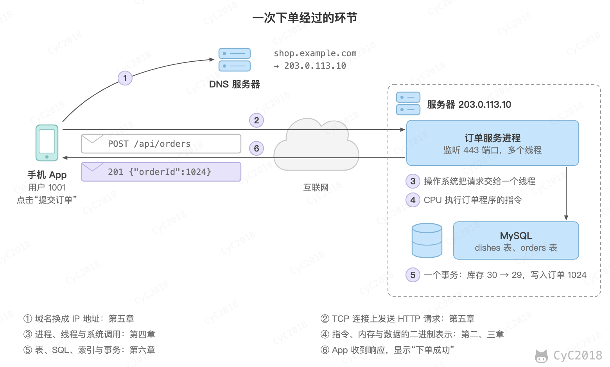 </div><br>

1. App 只知道服务器的名字 shop.example.com，先向 DNS 服务器查询它对应的 IP 地址 203.0.113.10；
2. App 与服务器建立 TCP 连接，在连接上发送一个 HTTP 请求，内容是“用户 1001 要 1 份 17 号菜（宫保鸡丁）”；
3. 服务器上运行着订单服务进程，操作系统收到网络数据后，把请求交给进程中的一个线程处理；
4. 线程执行订单程序的指令，CPU 从内存中读取数据、计算，再把结果写回内存；
5. 订单程序请求 MySQL 数据库在一个事务中完成两件事：宫保鸡丁的库存从 30 减为 29，写入订单 1024；
6. 服务器把结果放进 HTTP 响应发回，App 收到后显示“下单成功”。

### 学习安排

每天约 1 小时，读完当天的小节后做章末的练习，答完展开参考要点核对，动手的结果对照预期。

| 天 | 阅读 | 练习 |
| :-: | --- | --- |
| 1 | [总览：一次下单经过了什么](#一总览一次下单经过了什么)、[二进制与字节](#二进制与字节)、[整数](#整数) | [练习](#第-1-天) |
| 2 | [小数](#小数)、[文字](#文字)、[一个订单在内存中的样子](#一个订单在内存中的样子) | [练习](#第-2-天) |
| 3 | [程序怎样运行](#三程序怎样运行) | [练习](#第-3-天) |
| 4 | [为什么需要操作系统](#为什么需要操作系统)、[进程](#进程)、[线程](#线程) | [练习](#第-4-天) |
| 5 | [系统调用](#系统调用)、[文件](#文件)、[在终端中查看进程](#在终端中查看进程) | [练习](#第-5-天) |
| 6 | Linux 常用命令 | [练习](#第-6-天) |
| 7 | [IP 地址与端口](#ip-地址与端口)、[域名与 DNS](#域名与-dns)、[分层](#分层) | [练习](#第-7-天) |
| 8 | [TCP](#tcp)、[UDP](#udp) | [练习](#第-8-天) |
| 9 | [HTTP](#http)、[HTTPS](#https)、[把过程连起来](#把过程连起来) | [练习](#第-9-天) |
| 10 | [为什么需要数据库](#为什么需要数据库)、[表](#表)、[SQL](#sql) | [练习](#第-10-天) |
| 11 | 分组与连接 | [练习](#第-11-天) |
| 12 | [索引](#索引)、[事务](#事务) | [练习](#第-12-天) |
| 13 | [数据结构与算法](#七数据结构与算法)、[数组](#数组)、[链表](#链表) | [练习](#第-13-天) |
| 14 | [栈和队列](#栈和队列) | [练习](#第-14-天) |
| 15 | [哈希表](#哈希表) | [练习](#第-15-天) |
| 16 | [二分查找](#二分查找)、[树](#树) | [练习](#第-16-天) |
| 17 | [排序](#排序)、[时间复杂度](#时间复杂度) | [练习](#第-17-天) |
| 18 | Git | [练习](#第-18-天) |
| 19 | 复习全篇 | [练习](#第-19-天) |

## 二、数据的表示

### 二进制与字节

计算机中的所有数据，包括数字、文字、图片和程序本身，最终都是一串 0 和 1。这是因为电路最容易可靠地区分两种状态，例如电压的高和低，用它们分别表示 1 和 0。

一个 0 或 1 称为一位（bit），8 位组成一个字节（Byte），字节是存储和传输数据的基本单位。1 个字节有 2⁸ = 256 种取值，可以表示 0～255。更大的单位按 1024 进位：1 KB = 1024 字节，1 MB = 1024 KB，1 GB = 1024 MB。

二进制和十进制一样是按位计数，只是逢二进一：从右往左每一位代表 1、2、4、8、16……，例如 101 = 4 + 1 = 5。订单号 1024 等于 2¹⁰，写成二进制是 1 后面跟 10 个 0：

```bash
echo 'obase=2; 1024' | bc
```

```text
10000000000
```

macOS 自带 bc；Ubuntu 上提示找不到 bc 时，先执行 sudo apt install bc 安装。

二进制写起来太长，所以常用十六进制（0～9 和 a～f，a～f 表示 10～15，逢十六进一）表示，每个十六进制数字正好对应 4 位，两个数字对应一个字节。1024 的二进制按 4 位一组是 0100 0000 0000，十六进制是 0x400（前缀 0x 表示十六进制），一个字节的取值范围写成 00～ff。

### 整数

程序在保存整数之前要先决定用几个字节，这决定了能表示的范围：

- 4 个字节（32 位）的整数类型，例如 Java、C 中的 int，最大约 21 亿（2147483647）；
- 8 个字节（64 位）的整数类型，例如 long，最大约 922 亿亿。

订单号 1024 只需要 11 位，用 4 个字节就够了。但订单号会一直增长，大型平台的订单总数会超过 21 亿，所以订单号通常用 8 个字节保存。超出范围时数值会“溢出”，例如 Java 的 int 2147483647 再加 1，结果变成负数 -2147483648（C 语言不保证这个结果）。

负数用补码（Two's Complement）表示：把正数的各位取反再加 1。以 1 个字节的 -5 为例，5 是 00000101，取反得 11111010，加 1 得 11111011，这就是 -5。这样设计的好处是加法电路不用区分正负：00000101 + 11111011 = 1 00000000，进位溢出最高位后正好得到 0。退款 -2850 分按同样的方法得到，在 4 个字节中是 ff ff f4 de。4 字节共有 2³² 种取值，补码把最高位为 1 的一半分给负数，所以最大值是 2³¹ − 1 = 2147483647，最小值是 −2³¹。前面的溢出也由此而来：2147483647 是 0x7fffffff，加 1 得到 0x80000000，最高位变成 1，按补码解读就是 −2³¹ = −2147483648。

### 小数

宫保鸡丁的价格 28.50 元带有小数。计算机中最常用的小数格式是浮点数（Floating-Point Number），按 IEEE 754 标准保存二进制小数：Java、C 中的 double 占 8 个字节，float 占 4 个字节、精度更低。

问题在于很多十进制小数无法用二进制精确表示。二进制小数点后的各位依次代表 1/2、1/4、1/8……，28.5 = 16 + 8 + 4 + 1/2，写成二进制是 11100.1，可以精确保存；0.1 却无法由有限个 1/2、1/4、1/8……相加得到，写成二进制是 0.000110011001100…，后面无限循环，只能保存一个近似值。假设这单再加打包费 1.10 元和配送费 2.20 元，用浮点数计算：

```bash
awk 'BEGIN { printf "%.17g\n", 1.10 + 2.20 }'
awk 'BEGIN { print (1.10 + 2.20 == 3.30) }'
```

```text
3.3000000000000003
0
```

结果比 3.30 多了一点点，与 3.30 比较也不相等（输出 0 表示假，macOS 15 与 Ubuntu 24.04 实测，见[附录 A1](#a1-字符编码与浮点数)）。一笔订单的误差很小，但对账时成千上万笔累加、比较，就会出现“差一分钱”的问题。

所以金额不用浮点数保存，常见的做法有两种：

- 以分为单位用整数保存，28.50 元存为 2850，加减乘都是精确的整数运算，显示时再除以 100；
- 使用十进制定点数，例如 MySQL 的 DECIMAL(10, 2)、Java 的 BigDecimal，它们按十进制保存每一位，不产生二进制的舍入误差。

本篇后面都按第一种做法，把金额写成 2850 分。

### 文字

文字也要先变成数字才能保存。字符集（Character Set）给每个字符分配一个编号，例如 Unicode 给“宫”分配的编号是 U+5BAB（十六进制 5BAB）。编码（Encoding）规定怎样把编号写成字节，最常用的是 UTF-8：

- 英文字母、数字等 ASCII 字符占 1 个字节，例如 K 是 0x4b；
- 常用汉字占 3 个字节；
- 表情符号等占 4 个字节。

查看“宫保鸡丁”在 UTF-8 中的字节：

```bash
printf '宫保鸡丁' | od -An -tx1
```

```text
 e5 ae ab e4 bf 9d e9 b8 a1 e4 b8 81
```

4 个汉字共 12 个字节，每 3 个字节对应一个字。以“宫”为例，编号 0x5BAB 的二进制是 0101 1011 1010 1011，UTF-8 把这 16 位依次填进 1110xxxx 10xxxxxx 10xxxxxx 的空位，得到 11100101 10101110 10101011，即 e5 ae ab。每个字节开头的几位说明了它是一个字的开始还是中间，程序据此把字节流切分成一个个字。

<div align="center"> 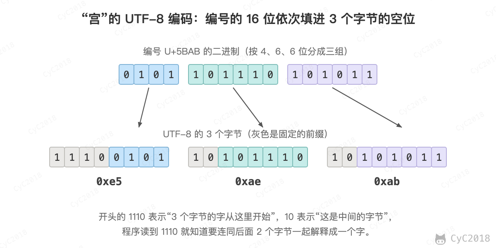 </div><br>

同一段文字用不同的编码保存，字节也不同。例如用 GBK 编码，“宫保鸡丁”只有 8 个字节（b9 ac b1 a3 bc a6 b6 a1）。如果写入时用 UTF-8、读取时按 GBK 解释，12 个字节会被切成另外几个字，在 macOS 上显示为“瀹繚楦′竵”，这就是乱码。避免乱码的办法是全程使用同一种编码，现在通常统一为 UTF-8。

### 一个订单在内存中的样子

把上面几种数据放在一起：订单程序在内存中用 8 个字节保存订单号，4 个字节保存以分为单位的金额，再用一段空间保存 UTF-8 编码的菜名。实际打印出这 32 个字节（macOS 与 Ubuntu 实测，见[附录 A2](#a2-订单在内存中的字节)）：

<div align="center"> 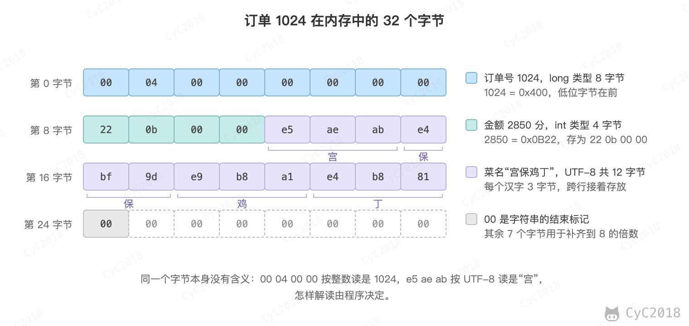 </div><br>

- 订单号 1024 = 0x400，补满 8 个字节是 00 00 00 00 00 00 04 00，内存中却存为 00 04 00 00 00 00 00 00：低位的字节放在前面，称为小端序（Little-Endian），常见的 x86 和 ARM 处理器都是这样；高位在前的称为大端序（Big-Endian），网络传输中的整数通常用大端序；
- 金额 2850 等于 0x0B22，同样低位在前，存为 22 0b 00 00；
- 菜名的 12 个字节后面跟一个 00，表示字符串结束；
- 最后 7 个字节不保存数据，用于把总长度补齐到 8 的倍数，处理器按这样对齐的地址读取更快。

字节本身没有含义：00 04 00 00 按整数解读是 1024，e5 ae ab 按 UTF-8 解读是“宫”，怎样解读由程序决定。

知道每个数据占多少字节，就能估算数据量。按每个订单 32 字节计算，100 万个订单在内存中约占 32 MB，一台服务器的内存完全放得下；实际的订单还有地址、备注等字段，每个可能有几百字节，100 万个就是几百 MB。

图片同样是一串字节。App 中宫保鸡丁的照片由一个个像素组成，每个像素用红、绿、蓝 3 个字节表示颜色，一张 800 × 600 的照片不压缩就要 800 × 600 × 3 = 144 万字节，约 1.4 MB。JPEG 等格式利用相邻像素颜色相近的特点压缩，通常能缩小到十分之一以下。

整数、浮点数在 Java 中的类型和取值范围见 [Java 基础：基本类型](Java%20基础.md#基本类型)和 [float 与 double](Java%20基础.md#float-与-double)；MySQL 中的数据类型见 [MySQL：数据类型](MySQL.md#四数据类型)。

### 练习

#### 第 1 天

自测：

1. 1 个字节能表示多少种取值？订单号为什么通常用 8 个字节保存？（见[二进制与字节](#二进制与字节)、[整数](#整数)）
2. 负数在计算机中怎样表示？什么是补码？（见[整数](#整数)）

<details>
<summary>参考要点</summary>

1. 1 个字节是 8 位，有 2⁸ = 256 种取值，可以表示 0～255；4 字节整数最大约 21 亿（2147483647），大平台的订单总数会超过它，超出后数值溢出，例如 Java 的 int 会变成负数；8 字节整数最大约 922 亿亿，订单号一直增长也够用。
2. 负数用补码表示：把对应正数的每一位取反（0 变 1、1 变 0）再加 1；例如 -2850 在 4 个字节中是 ff ff f4 de；这样加法电路不用区分正负，-2850 + 2850 直接按二进制相加，进位溢出最高位后正好得到 0。

</details>

动手：执行 echo 'obase=2; 1024' | bc 和 echo 'obase=16; 2850' | bc，把订单号和金额换成二进制和十六进制，再对照[整数](#整数)一节说出 4 字节整数的最大值为什么是 2147483647。

预期：1024 的二进制是 10000000000（1 后面跟 10 个 0），2850 的十六进制是 B22（即 0x0B22）；4 字节共 32 位、2³² 种取值，补码把一半分给负数，0 和正数占另一半，所以最大值是 2³¹ − 1 = 2147483647。

明天：第 2 天，读[小数](#小数)、[文字](#文字)、[一个订单在内存中的样子](#一个订单在内存中的样子)。

#### 第 2 天

自测：

1. 金额为什么不能用 float、double 保存？应该怎样保存？（见[小数](#小数)）
2. UTF-8 中一个汉字占几个字节？为什么会出现乱码？（见[文字](#文字)）
3. 什么是大端和小端？常见的 x86、ARM 处理器用哪一种？（见[一个订单在内存中的样子](#一个订单在内存中的样子)）

<details>
<summary>参考要点</summary>

1. float、double 是二进制浮点数，0.1、1.10 这类小数在二进制中无限循环，只能存近似值；1.10 + 2.20 得到 3.3000000000000003，与 3.30 不相等，大量订单累加对账时会差一分钱；金额应以分为单位存成整数（28.50 元存为 2850），或用 MySQL 的 DECIMAL、Java 的 BigDecimal 这类十进制定点数。
2. UTF-8 中常用汉字占 3 个字节，“宫保鸡丁”共 12 个字节；乱码是因为写入和读取用了不同的编码，例如按 UTF-8 写入、按 GBK 读取，字节被切成另外几个字，显示为“瀹繚楦′竵”；全程统一使用 UTF-8 即可避免。
3. 小端序（Little-Endian）把多字节数据的低位字节放在前面，大端序（Big-Endian）把高位字节放在前面；例如 8 字节的 1024，小端序是 00 04 00 00 00 00 00 00，大端序是 00 00 00 00 00 00 04 00；x86 和 ARM 处理器都用小端序。

</details>

动手：执行 printf '宫保鸡丁' | od -An -tx1 查看 4 个汉字的 UTF-8 字节，再换成自己的名字试一试；执行 awk 'BEGIN { printf "%.17g\n", 1.10 + 2.20 }'，观察浮点数的误差。

预期：“宫保鸡丁”输出 e5 ae ab e4 bf 9d e9 b8 a1 e4 b8 81，每个汉字 3 个字节，换成自己的名字时字节数通常是汉字个数的 3 倍；awk 输出 3.3000000000000003，比 3.30 多了一点。

明天：第 3 天，读[程序怎样运行](#三程序怎样运行)。

## 三、程序怎样运行

### CPU、内存与磁盘

一台服务器和一部手机在结构上是一样的，最核心的是三个部件：

- 中央处理器（Central Processing Unit, CPU）：执行程序的指令，做计算和判断；
- 内存（Memory）：存放正在运行的程序和它用到的数据，读写快，但断电后内容丢失；
- 磁盘（Disk）：包括固态硬盘（SSD）和机械硬盘，长期保存文件，断电不丢失，但比内存慢得多。

内存可以看成一长排编了号的格子，每个格子放一个字节，格子的编号称为地址（Address）。CPU 读写内存时要给出地址，例如“读地址 0x1000 开始的 8 个字节”。一台 32 GB 内存的机器约有 343 亿个这样的格子。[一个订单在内存中的样子](#一个订单在内存中的样子)中订单的 32 个字节，就是放在连续的 32 个格子中。

订单程序平时以文件的形式保存在磁盘上，运行时先被复制到内存中，CPU 再从内存中逐条取出指令执行。订单数据也一样：数据库把订单永久保存在磁盘上，需要查询时读入内存处理。

### 指令

指令（Instruction）是 CPU 能直接执行的最小操作，例如“从内存某个地址读一个数到寄存器”“两个寄存器相加”“把寄存器的值写回内存”“如果结果为 0 就跳到某条指令”。每条指令本身也是几个字节的二进制数据，和订单数据一样放在内存中。

寄存器（Register）是 CPU 内部的少量存储单元，每个只能放一个数，但读写不到 1 纳秒。CPU 中还有一个程序计数器（Program Counter, PC），记录下一条要执行的指令的地址。CPU 的工作就是不断重复：按 PC 取出指令，执行，PC 指向下一条。

以扣库存为例，假设订单程序在内存中记着宫保鸡丁的库存 stock，程序中的一行 stock = stock - 1，编译（翻译成 CPU 指令，见[编译与解释](#编译与解释)）后变成 4 条 ARM 指令（Ubuntu 24.04、gcc 13.3 实测，见[附录 A3](#a3-机器指令)）：

<div align="center"> 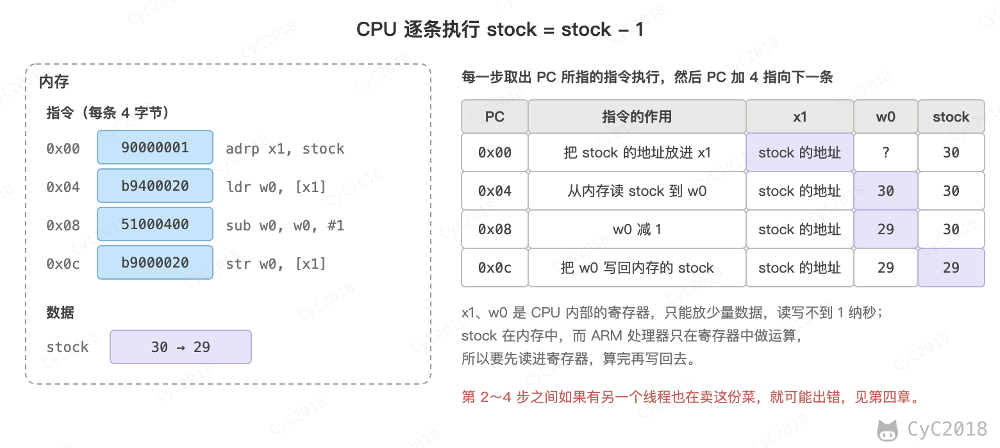 </div><br>

1. adrp：把变量 stock 所在内存页（4 KB 的一段内存）的起始地址放进寄存器 x1；
2. ldr：按 x1 中的地址加上 stock 在页内的偏移，从内存读出 stock 的值 30，放进寄存器 w0；
3. sub：w0 减 1，变成 29；
4. str：把 w0 写回内存中 stock 的位置。

一行代码要拆成“读、算、写”几步，这一点在[多线程](#线程)中很重要：两个线程可能都在第 2 步读到 30，各自减 1 后都写回 29，卖出两份菜库存却只少了一份。

CPU 按时钟的节拍工作，每一拍称为一个时钟周期。每秒能执行多少条指令，主要取决于时钟频率和每个时钟周期能完成几条指令。例如 3.2 GHz 表示每秒 32 亿个时钟周期，现代 CPU 每个周期还能同时执行多条指令，所以每秒能执行几十亿条以上。

### 存储器的速度

CPU 很快，但数据要从内存或磁盘中取来。为了少等，CPU 内部有几级缓存（Cache），把最近用过的内存数据复制一份放在离 CPU 更近的地方：一级缓存最小最快，二级缓存大一些、慢一些。

不同存储器的速度相差几个数量级，在 Apple M1 Pro 上实测随机读取一次数据的时间（见[附录 A4](#a4-存储器的访问延迟)）。括号中是实验反复读取的数据量：16 KB 能全部放进一级缓存；1 MB 放不进一级缓存（128 KB），但放得进二级缓存（12 MB），测到的主要是二级缓存的速度；64 MB 两级都放不下，只能读内存：

```text
存储器                               随机读取一次的时间
CPU 一级缓存（在 16 KB 范围内读）    约 1 ns
CPU 二级缓存（在 1 MB 范围内读）     约 6 ns
内存（在 64 MB 范围内读）            约 130 ns
SSD（每次读 4 KB）                   约 70 μs，即 70000 ns
```

1 纳秒（ns）是十亿分之一秒，1 微秒（μs）等于 1000 纳秒。读一次内存大约相当于读一级缓存的 100 多倍，随机读一次 SSD 又相当于读内存的 500 倍左右。机械硬盘还要更慢：它要等盘片转到数据所在的位置，7200 转/分的硬盘平均等半圈就要 60 ÷ 7200 ÷ 2 ≈ 4.17 ms，再加上移动磁头的时间，一次随机读取要几毫秒。

同样的道理，操作系统和数据库会把常用的磁盘数据留在内存中。对订单服务来说，这意味着：

- 能在内存中完成的操作尽量在内存中完成，例如把热门菜的信息缓存起来；
- 访问磁盘时尽量一次读一大块，而不是零散地读很多次，[数据库索引](#索引)就是按这个思路设计的。

### 编译与解释

程序员写的程序称为源代码（Source Code），例如：

```text
如果 库存 > 0:
    库存 = 库存 - 1
    创建订单
否则:
    返回 "已售罄"
```

CPU 不认识这种文字，只能执行指令。把源代码变成指令有两种方式：

- 编译（Compile）：运行之前由编译器一次性翻译成机器指令，生成可执行文件，例如 C、Go；
- 解释（Interpret）：不生成可执行文件，运行时由解释器边翻译边执行，例如 Python、JavaScript。

Java 介于两者之间：先编译成与具体 CPU 无关的字节码，运行时由 Java 虚拟机解释执行，并把执行频繁的部分即时编译（Just-In-Time, JIT）成机器指令。编译型的程序启动后直接执行指令，通常更快；解释型的程序改完不用重新编译，同一份代码可以在不同的 CPU 上运行。

可执行文件本身也是磁盘上的一串字节。例如 Ubuntu 中 ls 命令的程序文件开头 4 个字节是 7f 45 4c 46，后三个字节正是字母 ELF，表示这是 Linux 的可执行文件格式：

```bash
od -A x -t x1 -N 16 /bin/ls
```

```text
000000 7f 45 4c 46 02 01 01 00 00 00 00 00 00 00 00 00
```

在 macOS 上执行同一条命令，开头是 ca fe ba be，表示这是一个多架构文件，里面装着 x86 和 ARM 两份 macOS 的 Mach-O 格式程序。不同系统的可执行文件格式不同，不同 CPU 的指令也不同，所以同一个程序要分别为不同的系统和 CPU 编译。

### 从程序到进程

程序（Program）是磁盘上的一个文件，进程（Process）是程序的一次运行。启动订单服务时，操作系统把程序文件中的指令和初始数据装入内存，为它分配一个编号（进程号，PID），然后让 CPU 从程序的第一条指令开始执行。

同一个程序可以同时运行多次，产生多个进程，例如在一台服务器上启动两个订单服务，它们执行相同的指令，但各有一份数据。

源代码怎样经过编译、链接变成可执行文件见[计算机操作系统 - 链接](计算机操作系统%20-%20链接.md#编译系统)；CPU 缓存见[缓存：CPU 多级缓存](缓存.md#cpu-多级缓存)；机械硬盘的结构见[计算机操作系统 - 设备管理](计算机操作系统%20-%20设备管理.md#磁盘结构)。

### 练习

#### 第 3 天

选读：[编译系统](计算机操作系统%20-%20链接.md#编译系统)。

自测：

1. CPU 缓存、内存、SSD 的访问速度大概各是多少，相差几个数量级？（见[存储器的速度](#存储器的速度)）
2. CPU 是怎样执行指令的？一行 stock = stock - 1 为什么不是一步完成的？（见[指令](#指令)）
3. 编译型语言和解释型语言有什么区别？Java 属于哪一种？（见[编译与解释](#编译与解释)）

<details>
<summary>参考要点</summary>

1. Apple M1 Pro 上实测：一级缓存约 1 ns，二级缓存约 6 ns，内存约 130 ns，SSD 随机读 4 KB 约 70 μs（70000 ns）；内存比一级缓存慢 100 多倍，SSD 又比内存慢约 500 倍，机械硬盘还要几毫秒；一级缓存到 SSD 相差约 7 万倍，即四五个数量级。
2. CPU 用程序计数器（PC）记住下一条指令的地址，不断重复“按 PC 取指令、执行、PC 指向下一条”；stock = stock - 1 编译成 4 条指令：adrp 取 stock 所在内存页的地址，ldr 加上页内偏移从内存读出 30 放进寄存器（CPU 内部的小存储单元），sub 减 1 得 29，str 写回内存；读、算、写分几步完成，中间可能被别的线程插进来。
3. 编译型语言在运行前由编译器一次性翻译成机器指令，例如 C、Go，启动后直接执行，通常更快；解释型语言不生成可执行文件，运行时由解释器边翻译边执行，例如 Python、JavaScript，改完不用重新编译，同一份代码能在不同 CPU 上运行；Java 介于两者之间：先编译成字节码，由 Java 虚拟机解释执行，频繁执行的部分再即时编译（JIT）成机器指令。

</details>

动手：执行 od -A x -t x1 -N 16 /bin/ls 查看可执行文件开头的 16 个字节，对照[编译与解释](#编译与解释)一节说出它是哪种格式。

预期：Ubuntu 上开头是 7f 45 4c 46，后三个字节是字母 ELF，即 Linux 的可执行文件格式；macOS 上输出的地址和间距略有不同，开头是 ca fe ba be，表示多架构文件，里面装着 x86 和 ARM 两份 Mach-O 格式的程序。

综合题：订单 1024 的金额 28.50 元和菜名“宫保鸡丁”在内存中各占几个字节、是什么样子？服务器上的订单程序从磁盘上的一个文件，到 CPU 执行扣库存的指令，经过了哪些步骤？（见[一个订单在内存中的样子](#一个订单在内存中的样子)、[CPU、内存与磁盘](#cpu内存与磁盘)、[从程序到进程](#从程序到进程)）

<details>
<summary>答题思路</summary>

1. 金额按分保存为整数 2850，占 4 个字节，2850 = 0x0B22，按小端序（低位字节在前）存为 22 0b 00 00；
2. 菜名按 UTF-8 编码，4 个汉字各 3 个字节，共 12 个字节（e5 ae ab ……），后面跟一个 00 表示字符串结束；
3. 订单程序平时是磁盘上的可执行文件，Linux 上是开头为 7f 45 4c 46 的 ELF 文件；
4. 启动时操作系统把文件中的指令和初始数据装入内存，分配进程号（PID），程序变成进程；
5. CPU 按程序计数器从内存中逐条取出指令执行，扣库存一行代码是 adrp、ldr、sub、str 4 条指令：读出 30、减 1、写回 29。

</details>

明天：第 4 天，读[为什么需要操作系统](#为什么需要操作系统)、[进程](#进程)、[线程](#线程)。

## 四、操作系统

### 为什么需要操作系统

一台服务器上同时运行着订单服务、数据库、日志收集等很多程序，它们共用同一套 CPU、内存、磁盘和网卡。如果每个程序都直接操作硬件，就会出现两个程序写同一块内存、同时往网卡发数据这样的冲突，一个程序出错也可能把整台机器搞垮。

操作系统（Operating System, OS）就是管理硬件、为程序提供服务的软件，例如 Linux、Windows、macOS、Android。它主要做三件事：

- 分配资源：决定哪个程序使用 CPU、分给它多少内存；
- 隔离：一个进程不能读写另一个进程的内存，出错时只影响它自己；
- 提供统一的接口：程序不需要了解磁盘、网卡的型号，只需要请求操作系统“打开文件”“发送数据”。

操作系统中直接管理硬件的核心部分称为内核（Kernel）。

### 进程

[从程序到进程](#从程序到进程)中说过，进程是正在运行的程序。操作系统为每个进程维护一份档案，记录它的进程号、内存、打开的文件，以及暂停时 CPU 寄存器的值。

一台机器上的进程远多于 CPU 核心。例如在一台 10 核的 Mac 上，`top` 显示同时有 1091 个进程（macOS 15 实测，见[附录 A5](#a5-进程线程与系统调用)）。它们能“同时”运行，是因为操作系统让每个进程轮流使用 CPU 一小段时间（通常是几毫秒）。时间到了，或者进程要等待数据，操作系统就保存它的寄存器，再恢复下一个进程的寄存器让它运行，称为上下文切换。切换得足够快，看起来就像所有进程在同时运行，这称为并发；多个核心真正在同一时刻各运行一个进程，称为并行。

进程在运行过程中会在几种状态之间切换：

- 运行：正在某个 CPU 核心上执行；
- 就绪：万事俱备，只是在排队等 CPU；
- 阻塞：在等待某件事完成，例如等数据库返回结果、等网络数据到达，这时即使有空闲的 CPU 也无法运行。

订单服务处理一个请求时，大部分时间处于阻塞状态：向数据库发出查询后，要等几毫秒才有结果。操作系统不会让 CPU 空等，而是把它交给其它就绪的进程或线程，结果到达后再把等待者改为就绪。

每个进程看到的都是自己独立的一片内存地址，称为虚拟内存（Virtual Memory）。两个进程中同样的地址 0x1000 对应着不同的物理内存，由操作系统和 CPU 一起完成翻译，所以一个进程无法直接读写另一个进程的数据。订单服务和 MySQL 是两个进程，它们之间交换数据要借助操作系统提供的进程间通信方式，例如管道、共享内存和网络连接（套接字），其中网络连接还能跨机器使用。

### 线程

订单服务在午餐高峰时每秒要处理几百个下单请求。如果一个进程一次只处理一个请求，用户 1002 就得等用户 1001 的请求处理完；而处理请求的大部分时间花在等待数据库和网络上，CPU 其实是空闲的。

线程（Thread）是进程中的一条执行路线。一个进程可以有多个线程，每个线程有自己的程序计数器、寄存器和栈（保存函数调用过程中的临时数据），但它们共享进程的代码、数据和打开的文件。操作系统调度的基本单位是线程：一个线程等待数据库时，CPU 可以去执行另一个线程。

在实验中让订单服务同时处理 3 个下单请求，用 ps 查看，进程 7 中除了等待新连接的主线程，又多了 3 个线程（Ubuntu 24.04 实测，见[附录 A5](#a5-进程线程与系统调用)）。SPID 列是线程号，主线程的线程号与进程号相同：

```text
  PID  SPID TTY          TIME CMD
    7     7 ?        00:00:00 python3
    7    15 ?        00:00:00 python3
    7    16 ?        00:00:00 python3
    7    17 ?        00:00:00 python3
```

<div align="center"> 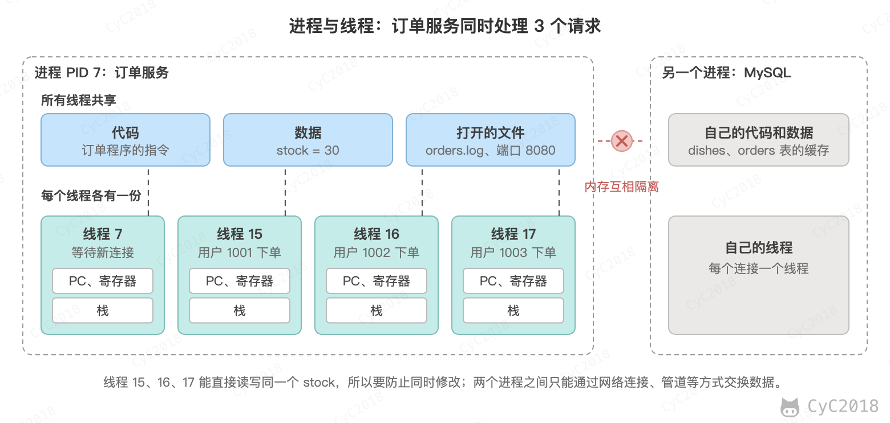 </div><br>

进程与线程的区别可以归纳为：

- 进程是资源分配的单位，拥有独立的内存；线程是 CPU 调度的单位，同一进程的线程共享内存；
- 创建和切换线程比进程开销小，因为不用切换内存的映射；
- 一个线程出错（例如非法访问内存）可能导致整个进程退出，而一个进程崩溃不影响其它进程。

线程虽然比进程轻，但创建和销毁仍有开销，每个线程还要占用一份栈的内存。所以实际的服务程序通常预先创建一组线程反复使用，称为线程池：请求到达时交给一个空闲的线程，处理完后线程回到池中等待下一个请求，请求多于线程数时在队列中排队。

共享内存让线程之间交换数据很方便，但也带来了问题。回到[指令](#指令)一节扣库存的读、算、写三步，两个线程同时卖最后一份宫保鸡丁时可能这样交错执行：

```text
线程 15（用户 1001）       线程 16（用户 1002）       内存中的 stock
读 stock 到寄存器：1                                  1
                           读 stock 到寄存器：1       1
寄存器减 1：0
                           寄存器减 1：0
写回 stock：0                                         0
                           写回 stock：0              0
```

两个线程都认为还有库存，卖出了两份，库存却只减了 1。解决办法是加锁（Lock）：一个线程在“读、算、写”期间持有锁，另一个线程必须等它释放锁之后才能开始，从而保证这几步作为一个整体执行。持有锁的线程还要先判断库存大于 0 再扣减，这样线程 16 拿到锁时读到 0，就会提示售罄。数据库也用类似的机制保护库存，见[事务](#事务)。

### 系统调用

普通程序不能直接操作硬件。CPU 有两种运行状态：

- 用户态（User Mode）：普通程序运行在这种状态下，只能执行计算、读写自己内存这类普通指令；
- 内核态（Kernel Mode）：操作系统内核运行在这种状态下，可以执行所有指令，直接操作磁盘、网卡等硬件。

程序需要读写文件、收发网络数据、创建线程时，要通过系统调用（System Call）请求内核代为完成：程序把要做的事和参数放进约定的寄存器，执行一条特殊的指令，CPU 切换到内核态，跳转到内核中对应的代码；内核完成后把结果放进寄存器，切换回用户态，程序继续执行。

在 Linux 上可以用 strace 命令查看一个程序发出的系统调用。例如 echo 命令输出一行文字，实际是调用了 write：

```bash
strace -e trace=write echo "order 1024"
```

```text
write(1, "order 1024\n", 11order 1024
)            = 11
```

write 的第一个参数 1 表示标准输出（屏幕），第二个是要写的内容，返回值 11 表示写入了 11 个字节。中间的 order 1024 是 echo 真正输出到屏幕的内容，和 strace 打印的记录交错在了一起。

处理一次下单请求时，订单服务的系统调用如下（Ubuntu 24.04 实测，见[附录 A5](#a5-进程线程与系统调用)）：

<div align="center"> 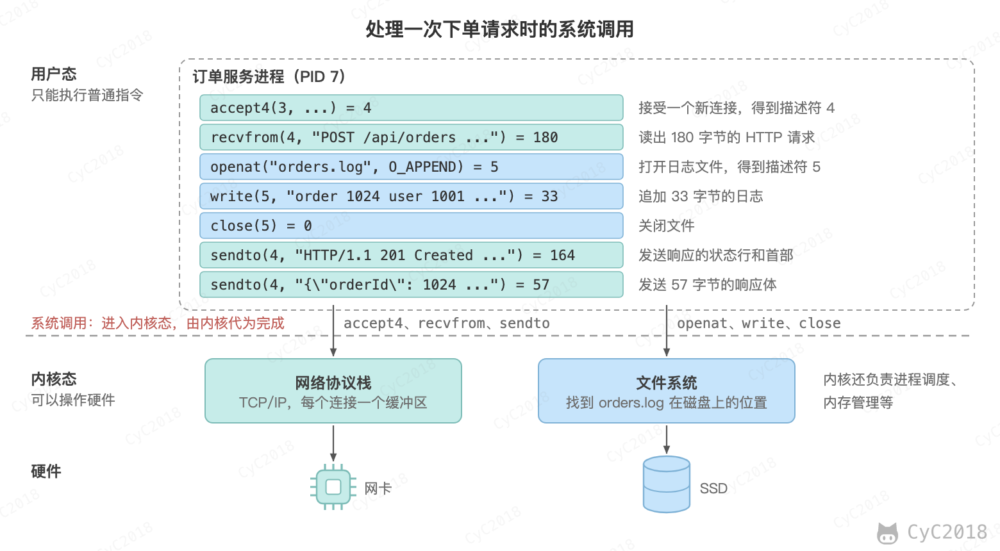 </div><br>

收发网络数据的 accept4、recvfrom、sendto 交给内核的网络协议栈，读写文件的 openat、write、close 交给文件系统。订单程序自己只做计算，凡是和外界打交道的事情都要经过内核。系统调用要切换 CPU 的状态，比普通的函数调用开销大，所以程序会尽量把数据攒成一批再读写，减少调用次数。

### 文件

文件（File）是保存在磁盘上、有名字的一串字节。操作系统用目录把文件组织成一棵树，例如 /var/log/orders.log 表示根目录下 var 目录中 log 目录里的 orders.log 文件。

程序先用 open 打开文件（上图中实际出现的系统调用是 openat），内核返回一个小整数，称为文件描述符（File Descriptor），之后的读写都用这个数指代文件。每个进程启动时默认打开 0、1、2 三个文件描述符，分别是标准输入、标准输出和标准错误。上图中 openat 返回 5，后面的 write(5, ...) 就是往这个文件写。Linux 中很多东西都用文件描述符表示，例如网络连接：accept4 返回的 4 就是与 App 之间的连接，sendto(4, ...) 把响应发给 App。

文件适合保存日志这类只追加、按顺序读的数据。订单则需要按条件查询、多人同时修改、出错时撤销，单靠文件很难做到，所以要用[数据库](#为什么需要数据库)。

### 在终端中查看进程

列出当前运行的进程：

```bash
ps -ef | head -5
```

输出中 PID 是进程号，PPID 是父进程的进程号（由谁启动），CMD 是启动的命令。查看进程占用 CPU 和内存的实时情况：

```bash
top
```

Ubuntu 的 top 默认按 CPU 占用从高到低排序，macOS 默认按进程号排序，要用 top -o cpu。按 q 退出。在 macOS 上，top 第一行显示进程总数和线程总数，例如“Processes: 1091 total ... 11019 threads”；在 Linux 上可以用 `ps -T -p 进程号` 列出一个进程的所有线程。

进程、线程、调度和同步的细节见[计算机操作系统 - 进程管理](计算机操作系统%20-%20进程管理.md#进程与线程)；系统调用与用户态、内核态见[计算机操作系统 - 概述](计算机操作系统%20-%20概述.md#系统调用)；虚拟内存见[计算机操作系统 - 内存管理](计算机操作系统%20-%20内存管理.md#虚拟内存)；多线程和锁在 Java 中的用法见 [Java 并发](Java%20并发.md#四互斥同步)；常用的进程命令见 [Linux：进程管理](Linux.md#十进程管理)。

### 练习

#### 第 4 天

选读：[进程与线程](计算机操作系统%20-%20进程管理.md#进程与线程)、[进程状态的切换](计算机操作系统%20-%20进程管理.md#进程状态的切换)。

自测：

1. 进程和线程有什么区别？（见[线程](#线程)）
2. 什么是上下文切换？并发和并行有什么区别？（见[进程](#进程)）
3. 两个线程同时扣减库存为什么会出错？怎样避免？（见[线程](#线程)）

<details>
<summary>参考要点</summary>

1. 进程是资源分配的单位，有独立的内存；线程是 CPU 调度的单位，同一进程的线程共享代码、数据和打开的文件，各自只有程序计数器、寄存器和栈（保存函数调用中的临时数据）；创建、切换线程比进程开销小，因为不用切换内存的映射；一个线程出错可能导致整个进程退出，一个进程崩溃不影响其它进程。
2. 上下文切换指进程的时间片用完或要等待数据时，操作系统保存它的寄存器，恢复下一个进程的寄存器让它运行，靠它让进程轮流使用 CPU，每个运行几毫秒；并发是靠快速切换让很多进程看起来同时运行，并行是多个 CPU 核心在同一时刻真正各运行一个。
3. stock = stock - 1 分为读、算、写几条指令，两个线程卖最后一份时可能都读到 1，各自减为 0 后写回，卖出两份库存只减了 1；解决办法是加锁（Lock）：一个线程在读、算、写期间持有锁，另一个线程等它释放后才能开始，让这几步作为一个整体执行；持有锁时先判断库存大于 0 再扣减，后拿到锁的线程读到 0 就提示售罄。

</details>

动手：执行 ps -ef | head -5 和 top（macOS 上用 top -o cpu），找出占用 CPU 最多的进程；在 top 开头找到进程总数（macOS 在第一行，Ubuntu 在第二行的 Tasks），对照[进程](#进程)一节理解为什么进程数远多于 CPU 核心数。

预期：ps -ef 每行一个进程，PID 是进程号，PPID 是父进程号，CMD 是启动命令；按 CPU 排序后排在最前的就是占用最多的进程；macOS 的 top 第一行显示一千多个进程、一万多个线程（笔记实测 10 核的机器上 1091 个进程、11019 个线程），其中只有几个在运行，其余在休眠，靠轮流使用 CPU 共享少数核心。

明天：第 5 天，读[系统调用](#系统调用)、[文件](#文件)、[在终端中查看进程](#在终端中查看进程)。

#### 第 5 天

选读：[系统调用](计算机操作系统%20-%20概述.md#系统调用)、[进程通信](计算机操作系统%20-%20进程管理.md#进程通信)。

自测：

1. 什么是用户态和内核态？为什么读写文件要通过系统调用？（见[系统调用](#系统调用)）
2. 进程之间有哪些通信方式？（见[进程](#进程)）
3. 什么是文件描述符？（见[文件](#文件)）

<details>
<summary>参考要点</summary>

1. 用户态是普通程序的运行状态，只能执行计算、读写自己内存这类普通指令；内核态是操作系统内核的运行状态，可以执行所有指令、直接操作磁盘和网卡；读写文件要操作磁盘，普通程序没有这个权限，要通过系统调用请内核代办：CPU 切换到内核态执行内核代码，完成后切回用户态；这样由内核统一分配硬件、隔离进程，避免程序之间互相冲突。
2. 每个进程有独立的虚拟内存，不能直接读写别的进程的数据，要借助操作系统提供的进程间通信方式：管道、共享内存和网络连接（套接字）；网络连接还能跨机器使用，订单服务和 MySQL 就通过网络连接交换数据。
3. 文件描述符是程序打开文件时内核返回的一个小整数，之后的读写都用它指代这个文件；例如 openat 返回 5，write(5, ...) 就是写这个文件；网络连接也用文件描述符表示，accept4 返回的 4 就是与 App 之间的连接。

</details>

动手：在 Ubuntu 上执行 strace -e trace=write echo "order 1024"（没有 strace 时用 sudo apt install strace 安装），说明 write 的第一个参数和返回值的含义；再执行 ls -l /proc/self/fd，看看一个进程默认打开了哪些文件描述符。macOS 没有 strace 和 /proc，strace 部分对照[系统调用](#系统调用)一节的输出回答，文件描述符改用 ls -l /dev/fd 查看。

预期：输出 write(1, "order 1024\n", 11) = 11：第一个参数 1 表示标准输出（屏幕），返回值 11 表示写入了 11 个字节；/proc/self/fd 中通常有 0、1、2 三个（标准输入、标准输出、标准错误，在终端中都指向 /dev/pts/0 这类终端设备），以及 ls 读取这个目录时自己打开的 3；macOS 上能看到名为 0、1、2 的三个条目，分别是标准输入、标准输出和标准错误，后面的 3、4 是 ls 自己打开的。

明天：第 6 天，Linux 常用命令。

#### 第 6 天

阅读：[文件与目录的基本操作](Linux.md#文件与目录的基本操作)、[文件属性](Linux.md#文件属性)、[修改权限](Linux.md#修改权限)、[获取文件内容](Linux.md#获取文件内容)、[指令与文件搜索](Linux.md#指令与文件搜索)、[管道指令](Linux.md#八管道指令)、[查看进程](Linux.md#查看进程)、[端口与磁盘](Linux.md#端口与磁盘)、[日志分析](Linux.md#日志分析)。

选读：[文件系统](Linux.md#四文件系统)、[Bash](Linux.md#七bash)、[正则表达式](Linux.md#九正则表达式)。

自测：

1. chmod 755 表示什么权限？（见[修改权限](Linux.md#修改权限)）
2. 怎样查看某个端口被哪个进程占用？（见[端口与磁盘](Linux.md#端口与磁盘)）
3. 怎样统计日志中出现次数最多的 10 个 IP？（见[日志分析](Linux.md#日志分析)）

<details>
<summary>参考要点</summary>

1. 755 对应 rwxr-xr-x：r、w、x 分别表示读、写、执行，权值为 4、2、1，三位数字依次是拥有者、所属群组和其他人的权限；7 = 4 + 2 + 1，拥有者可读、写、执行；5 = 4 + 1，群组和其他人只能读和执行。
2. 用 ss -lntp 列出正在监听的 TCP 端口和对应的进程，或用 lsof -i :8080 查看某一个端口；例如输出 users:(("java",pid=911,fd=4)) 表示 8080 端口被进程号 911 的 java 进程占用。
3. awk '{print $1}' access.log | sort | uniq -c | sort -rn | head -10；awk 取每行第 1 列的 IP，sort 让相同的 IP 挨在一起，uniq -c 计数，sort -rn 按次数从大到小排，head -10 取前 10 个。

</details>

动手：用 cut、sort 和 uniq 统计 /etc/passwd 中每种登录 shell 的用户数。

预期：命令为 cut -d: -f7 /etc/passwd | sort | uniq -c，每行输出“用户数 shell”，例如 Ubuntu 24.04 的 Docker 镜像中是 16 个 /usr/sbin/nologin、2 个 /bin/bash、1 个 /bin/sync；uniq 只合并相邻的重复行，所以要先 sort；macOS 的 /etc/passwd 开头有 # 注释行，可以先用 grep -v '^#' 去掉。

综合题：午餐高峰时，订单服务同时收到 100 个下单请求：操作系统怎样让它们同时被处理？两个请求同时扣最后一份宫保鸡丁时会出什么问题？订单程序写日志、回复 App 时，哪些步骤要由内核完成？（见[进程](#进程)、[线程](#线程)、[系统调用](#系统调用)）

<details>
<summary>答题思路</summary>

1. 订单服务预先创建一组线程（线程池），每个请求交给一个空闲的线程，请求多于线程数时在队列中排队；
2. 线程等待数据库、网络时处于阻塞状态，CPU 转去执行其它就绪的线程，多个核心并行运行，每个核心上的线程轮流使用 CPU（上下文切换），所以 100 个请求看起来同时被处理；
3. 两个线程同时扣最后一份宫保鸡丁时，读、算、写交错执行，都读到 1、都写回 0，卖出两份库存只减 1，需要加锁，让读、算、写作为一个整体执行，并在锁内先判断库存大于 0（数据库中的做法在[事务](#事务)一节讲）；
4. 接收请求（accept4、recvfrom）、写日志（openat、write、close）、发送响应（sendto）都是系统调用，CPU 切换到内核态，由内核的网络协议栈和文件系统完成，订单程序自己只做计算。

</details>

明天：第 7 天，读[IP 地址与端口](#ip-地址与端口)、[域名与 DNS](#域名与-dns)、[分层](#分层)。

## 五、计算机网络

### IP 地址与端口

App 要把请求送到服务器，首先要知道送到哪里。网络中用两个数确定通信的对象：

- IP 地址（Internet Protocol Address）：标识网络中的一台主机，例如服务器的 203.0.113.10，相当于楼的门牌号；
- 端口（Port）：标识主机上的一个进程，取值 0～65535，例如订单服务监听 443 端口，相当于楼里的房间号。

一台服务器上可能同时运行着订单服务、数据库等多个进程，数据到达服务器后，操作系统按端口号交给对应的进程。常用的服务有约定的端口：HTTP 用 80，HTTPS 用 443，MySQL 用 3306。客户端一方的端口通常由操作系统临时分配，例如 52344。

一台服务器的 443 端口可以同时和成千上万个 App 通信，是因为一个连接由 4 个数共同确定：客户端 IP、客户端端口、服务器 IP、服务器端口。两个用户的手机地址或端口不同，就是两个不同的连接，操作系统据此把收到的数据分给对应的连接。

IPv4 地址是 4 个字节，写成用点分开的 4 个十进制数，每个 0～255。家里的手机和电脑拿到的通常是 192.168 开头的私有地址，例如 192.168.1.10，它只在家庭网络内有效；访问互联网时，路由器把它替换成运营商分配的公网地址，这称为网络地址转换（NAT）。查看本机在局域网中的地址：

```bash
ipconfig getifaddr en0     # macOS
hostname -I                # Ubuntu
```

### 域名与 DNS

IP 地址不好记，而且服务器换了机器地址就会变，所以 App 中写的是域名（Domain Name），例如 shop.example.com。把域名换成 IP 地址的系统称为域名系统（Domain Name System, DNS）。

DNS 是一个分布在全世界的查询系统。手机先问本地的 DNS 服务器，通常是家里的路由器，它一般把问题转给运营商的 DNS 服务器。运营商的服务器如果没有缓存答案，就从根服务器开始，依次询问负责 .com 的服务器、负责 example.com 的服务器，最终得到 IP 地址，并缓存一段时间供下次使用。

用 dig 命令查询 `www.baidu.com`（macOS 实测，见[附录 A6](#a6-dns-与往返时间)）：

```bash
dig www.baidu.com
```

```text
;; ANSWER SECTION:
www.baidu.com.          600     IN      CNAME   www.a.shifen.com.
www.a.shifen.com.       600     IN      A       183.2.172.177

;; Query time: 5 msec
;; SERVER: 192.168.1.1#53(192.168.1.1)
```

- CNAME 表示 www.baidu.com 是 www.a.shifen.com 的别名，A 记录给出了最终的 IPv4 地址；
- 600 是有效期（秒），在此期间可以直接使用缓存的结果；
- SERVER 一行说明这次是由家里的路由器 192.168.1.1 回答的，耗时 5 毫秒。

### 分层

把一个请求从手机送到服务器，要解决很多层面的问题：内容怎样表达、数据丢了怎么办、经过哪些路由器、怎样在一根网线或一段无线信号上传输。网络把这些问题分成几层，每层只解决一类问题，并使用下一层提供的服务：

- 应用层：规定请求和响应的内容，例如 HTTP、DNS；
- 传输层：在两个进程之间传输数据，用端口区分进程，例如 TCP、UDP；
- 网络层：把数据从一台主机送到另一台主机，用 IP 地址寻址，由路由器逐跳转发；
- 链路层：在同一个网络中把数据交给下一站，例如以太网、Wi-Fi，这一层的数据单位称为帧，用网卡的硬件地址（MAC 地址）找到下一站。

发送时，每一层在数据前面加上自己的首部，称为封装；接收时逐层去掉首部，交给上一层。下单请求的封装过程如下：

<div align="center"> 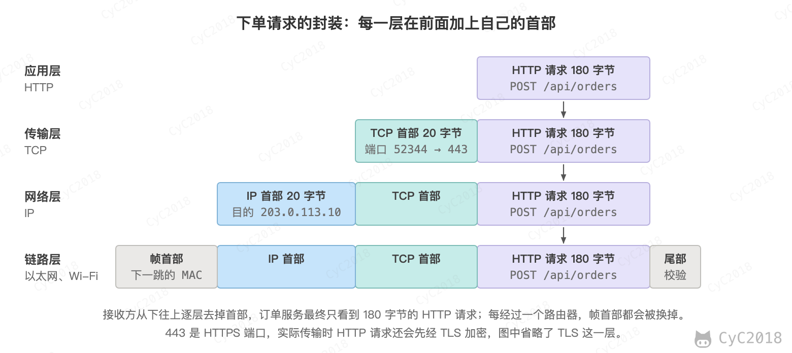 </div><br>

路由器只看 IP 首部中的目的地址，按自己的路由表决定下一站交给谁，并换上新的帧首部；它不关心里面是 HTTP 还是别的内容。只有两端的主机才会处理 TCP 和 HTTP。分层的好处在于各层可以独立变化，例如手机从 Wi-Fi 切换到 4G 只换了链路层，HTTP 请求的内容不受影响。

查看到服务器要经过多长时间可以用 ping，它发出一个小数据包并等待对方回复，所用的时间称为往返时间（Round-Trip Time, RTT）：

```bash
ping -c 4 www.baidu.com
```

从实验所用的家庭宽带到 183.2.172.177，往返时间约 9.7 ms（macOS 实测，见[附录 A6](#a6-dns-与往返时间)）。这个时间主要花在信号的传播和路由器的转发上，后面会看到，建立连接、发送请求都要按往返次数付出这个代价。

### TCP

网络层只负责尽力把数据包送到，不保证送达：数据包可能因为路由器繁忙被丢弃，可能走不同的路径而先发后到，也可能重复。而订单请求必须完整、按顺序地到达。

传输控制协议（Transmission Control Protocol, TCP）在不可靠的网络上提供可靠的传输，它主要做了以下几件事：

- 编号：给发送的每个字节编上序号，接收方按序号重新排好顺序、去掉重复；
- 确认：接收方收到数据后回复确认号，表示“这个序号之前的数据都收到了”；
- 重传：发送方一段时间内没有收到确认，就重新发送这部分数据；
- 流量控制和拥塞控制：根据接收方的处理能力和网络的拥堵情况调整发送速度。

通信之前，双方要先建立连接，交换各自的起始序号，这个过程需要 3 个报文，称为三次握手。下面是实验中一次下单请求在 TCP 连接上的主要报文（省略了响应中间的一次确认和关闭连接的报文），序号是抓包得到的真实数值（Ubuntu 24.04 实测，见[附录 A7](#a7-http-请求与-tcp-报文)）：

<div align="center"> 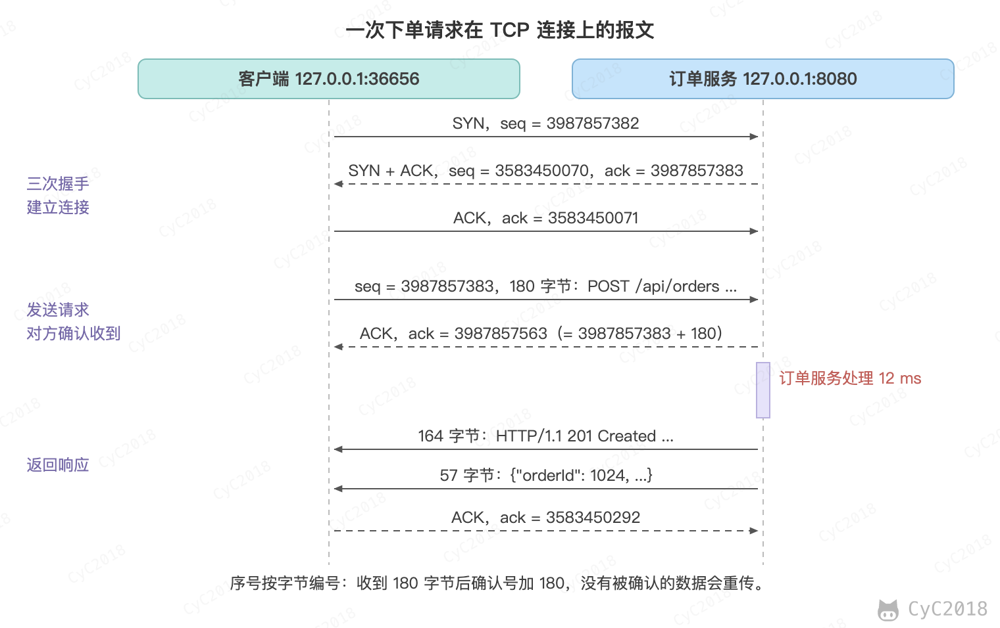 </div><br>

1. 客户端发送 SYN，起始序号 3987857382；
2. 服务器回复 SYN + ACK，确认号 3987857383 表示收到了 SYN（SYN 本身占一个序号，所以是起始序号加 1），同时给出自己的起始序号；
3. 客户端回复 ACK，连接建立，双方可以发送数据；
4. 客户端发送 180 字节的 HTTP 请求，序号从 3987857383 开始，服务器回复确认号 3987857563，正好是 3987857383 + 180。

如果服务器的确认迟迟不来，客户端就会重传这 180 个字节。握手要花一个往返时间，所以 App 通常会复用已经建立的连接发送多个请求。

为什么是三次而不是两次？双方都要确认“对方能收到我的数据”，并让对方知道自己的起始序号：客户端的 SYN 和服务器的 ACK 确认了客户端到服务器这个方向，服务器的 SYN 和客户端的 ACK 确认了反方向，中间两个报文合并成一个 SYN + ACK，所以一共 3 个。只握手两次时，服务器无法知道客户端是否收到了自己的起始序号；网络中滞留的旧 SYN 到达时，服务器也会误以为有新连接而白白分配资源。

通信结束后，双方各自发送 FIN 表示“我这边的数据发完了”，并确认对方的 FIN，一般需要 4 个报文，称为四次挥手。两个方向分别关闭，是因为一方发完数据时，另一方可能还有数据要发。

### UDP

用户数据报协议（User Datagram Protocol, UDP）是另一种传输层协议，它只在 IP 之上加了端口和校验，不建立连接，不确认，也不重传。

TCP 适合必须完整送达的数据，例如下单请求、网页、文件下载；UDP 适合偶尔丢一点也没关系、但要求延迟低的场景，例如视频通话、游戏中的位置同步，以及 DNS 查询（一问一答，丢了重问一次即可）。两者的对比可以概括为：TCP 面向连接、可靠、按顺序，开销较大；UDP 无连接、不保证送达，开销小、延迟低。

### HTTP

超文本传输协议（HyperText Transfer Protocol, HTTP）规定了请求和响应的格式，App 与服务器之间、浏览器与网站之间都用它通信。HTTP/1.1 的报文是纯文本，可以用 curl 直接看到。实验中的订单服务是一个运行在本机 8080 端口的小程序，127.0.0.1 是代表本机的特殊地址；为了看到明文，这里用 HTTP 而不是 HTTPS。创建订单（Ubuntu 24.04 实测，见[附录 A7](#a7-http-请求与-tcp-报文)）：

```bash
curl -v -H 'Content-Type: application/json' \
     -d '{"userId":1001,"dishId":17,"quantity":1}' http://127.0.0.1:8080/api/orders
```

curl 发出的请求（以 > 开头）和收到的响应（以 < 开头）：

```text
> POST /api/orders HTTP/1.1
> Host: 127.0.0.1:8080
> User-Agent: curl/8.5.0
> Accept: */*
> Content-Type: application/json
> Content-Length: 40
>
< HTTP/1.1 201 Created
< Server: BaseHTTP/0.6 Python/3.12.3
< Content-Type: application/json; charset=utf-8
< Content-Length: 57
<
{"orderId": 1024, "status": "CREATED", "amount": "28.50"}
```

请求由三部分组成：

- 请求行：方法 POST 表示提交数据、创建资源，路径 /api/orders 表示订单，最后是协议版本；
- 首部：每行一个“名称: 值”，例如 Content-Type 说明请求体是 JSON 格式，Content-Length 说明请求体有 40 个字节；
- 请求体：空行之后的 {"userId":1001,"dishId":17,"quantity":1}。

响应的第一行是状态行，201 是状态码，表示创建成功。状态码按第一位数字分类：2xx 表示成功，3xx 表示重定向，4xx 表示客户端的错误（例如查询不存在的订单返回 404 Not Found），5xx 表示服务器的错误。查询订单用 GET 方法：

```bash
curl -i http://127.0.0.1:8080/api/orders/1024
```

```text
HTTP/1.1 200 OK
Content-Type: application/json; charset=utf-8
Content-Length: 81

{"orderId": 1024, "dish": "宫保鸡丁", "amount": "28.50", "status": "CREATED"}
```

Content-Length 是 81 而不是字符数 73，因为“宫保鸡丁”在 UTF-8 中占 12 个字节（见[文字](#文字)）。

常用的方法还有 PUT（整体替换资源）、DELETE（删除资源）等。GET 和 POST 的区别主要在用途上：

- GET 用于获取数据，参数放在 URL 中，例如 /api/orders?userId=1001，它不修改服务器上的数据，重复执行没有副作用，浏览器和代理可以缓存它的结果；
- POST 用于提交数据、创建资源，参数放在请求体中，重复执行会创建多个订单，所以 App 要防止用户连点两次“提交订单”。

HTTP 本身不保存状态，每个请求都是独立的，服务器不会记得上一个请求来自谁。要知道请求来自用户 1001，App 在登录成功后保存服务器发给它的凭证，之后的每个请求都在首部中带上，例如 Cookie 首部或 Authorization 首部中的 Token，服务器据此识别用户。

### HTTPS

HTTP 是明文传输的，同一个 Wi-Fi 下的其他人或沿途的路由器都能看到、甚至修改请求内容。HTTPS 在 TCP 和 HTTP 之间加了一层 TLS（Transport Layer Security）：

- 加密：双方在 TLS 握手中协商出一个只有彼此知道的密钥，之后的 HTTP 报文都加密传输；
- 认证：服务器出示由可信机构签发的证书，证明自己确实是 shop.example.com，防止连到假冒的服务器；
- 完整性：报文被篡改时接收方能够发现。

HTTPS 默认使用 443 端口。代价是建立连接时多了 TLS 握手，需要额外的往返时间。

### 把过程连起来

用 curl 访问一个真实的 HTTPS 网站，可以看到各阶段完成的时刻：

```bash
curl -4 -s -o /dev/null -w 'dns %{time_namelookup}  tcp %{time_connect}  tls %{time_appconnect}  first_byte %{time_starttransfer}\n' https://www.baidu.com
```

```text
dns 0.002281  tcp 0.011717  tls 0.041322  first_byte 0.053568
```

时间是从开始计算的累计秒数（macOS 实测，见[附录 A6](#a6-dns-与往返时间)）。对照下单的过程：

1. DNS：域名换成 IP 地址，命中缓存只用了 2 ms；
2. TCP：三次握手约 9 ms，大约一个往返时间；
3. TLS：握手约 30 ms，这次使用的 TLS 1.2 需要两个往返，再加上证书校验等计算；
4. HTTP：发出请求到收到第一个字节约 12 ms，即一个往返时间加上服务器的处理时间。

<div align="center"> 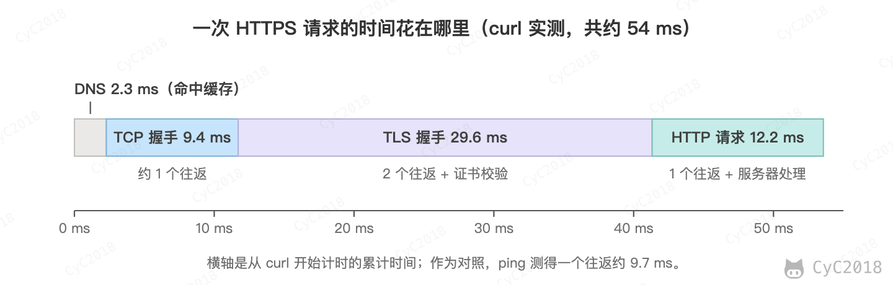 </div><br>

整个过程约 54 ms，其中真正的服务器处理只占一小部分，大部分时间花在网络往返上。这也是“在浏览器中输入网址后发生了什么”这个问题的主线，完整的过程还包括本机获取 IP 地址、查找网关的 MAC 地址等步骤。

分层模型见[计算机网络 - 概述](计算机网络%20-%20概述.md#计算机网络体系结构)；IP 地址与 NAT 见[计算机网络 - 网络层](计算机网络%20-%20网络层.md#ip-地址编址方式)；TCP 的握手与可靠传输见[计算机网络 - 传输层](计算机网络%20-%20传输层.md#tcp-的三次握手)；DNS 与访问网页的完整过程见[计算机网络 - 应用层](计算机网络%20-%20应用层.md#web-页面请求过程)；HTTP 报文、状态码和 HTTPS 见 [HTTP](HTTP.md#请求和响应报文)。

### 练习

#### 第 7 天

选读：[计算机网络体系结构](计算机网络%20-%20概述.md#计算机网络体系结构)。

自测：

1. IP 地址和端口分别用来标识什么？一台服务器的 443 端口怎样同时与很多手机通信？（见[IP 地址与端口](#ip-地址与端口)）
2. DNS 怎样把域名解析成 IP 地址？（见[域名与 DNS](#域名与-dns)）
3. 网络为什么要分层？各层分别解决什么问题？（见[分层](#分层)）

<details>
<summary>参考要点</summary>

1. IP 地址标识网络中的一台主机，相当于门牌号；端口标识主机上的一个进程，取值 0～65535，相当于房间号，例如 HTTPS 用 443；一个连接由客户端 IP、客户端端口、服务器 IP、服务器端口 4 个数共同确定，不同手机的地址或端口不同就是不同的连接，操作系统据此把数据分给对应的连接。
2. 手机先问本地 DNS 服务器（家里的路由器，它一般转给运营商的 DNS 服务器）；有缓存就直接回答，没有就从根服务器开始，依次询问负责 .com、负责 example.com 的服务器，最终得到 IP 地址；结果按有效期（例如 600 秒）缓存，期间可以直接使用。
3. 把请求送达要解决的问题很多，分层后每层只解决一类问题、使用下一层的服务，各层可以独立变化，例如手机从 Wi-Fi 切到 4G 只换了链路层；应用层规定请求和响应的内容（HTTP、DNS）；传输层在两个进程之间传数据，用端口区分进程（TCP、UDP）；网络层用 IP 地址把数据从一台主机送到另一台，由路由器逐跳转发；链路层在同一个网络中把数据交给下一站（以太网、Wi-Fi）。

</details>

动手：执行 `dig www.baidu.com` 和 `ping -c 4 www.baidu.com`，找出解析得到的 IP 地址、记录的有效期和往返时间。

预期：dig 的 ANSWER SECTION 中，www.baidu.com 是 www.a.shifen.com 的别名（CNAME），A 记录给出 IP 地址（笔记实测 183.2.172.177），有效期 600 秒；ping 显示往返时间，笔记在家庭宽带上实测平均约 9.7 ms，具体数字随网络和地区不同。

明天：第 8 天，读[TCP](#tcp)、[UDP](#udp)。

#### 第 8 天

选读：[TCP 的三次握手](计算机网络%20-%20传输层.md#tcp-的三次握手)、[TCP 的四次挥手](计算机网络%20-%20传输层.md#tcp-的四次挥手)。

自测：

1. TCP 怎样保证可靠传输？（见[TCP](#tcp)）
2. TCP 为什么需要三次握手，两次为什么不行？（见[TCP](#tcp)）
3. TCP 和 UDP 有什么区别？各适合什么场景？（见[UDP](#udp)）

<details>
<summary>参考要点</summary>

1. 编号：给每个字节编上序号，接收方按序号重新排序、去掉重复；确认：接收方回复确认号，表示这个序号之前的数据都收到了；重传：一段时间内没收到确认就重新发送；流量控制和拥塞控制：按接收方的处理能力和网络的拥堵情况调整发送速度。
2. 双方都要确认对方能收到自己的数据，并告诉对方自己的起始序号：客户端的 SYN 和服务器的 ACK 确认了客户端到服务器的方向，服务器的 SYN 和客户端的 ACK 确认了反方向，中间两个合并成 SYN + ACK，共 3 个报文；只握手两次时，服务器不知道客户端是否收到了自己的起始序号，网络中滞留的旧 SYN 到达时，服务器还会误以为有新连接而白白分配资源。
3. TCP 面向连接、可靠、按顺序，开销较大，适合必须完整送达的数据，例如下单请求、网页、文件下载；UDP 不建立连接，不确认、不重传，开销小、延迟低，适合偶尔丢一点也没关系的场景，例如视频通话、游戏中的位置同步和一问一答的 DNS 查询。

</details>

动手：在一个终端中执行 sudo tcpdump -nn -S 'tcp port 80' 开始抓包（sudo 会要求输入当前用户的登录密码，-S 显示原始序号），在另一个终端中执行 `curl http://example.com`，然后回到第一个终端按 Ctrl + C 停止，找出三次握手的 3 个报文，对照[TCP](#tcp)一节中的图核对序号和确认号的关系。

预期：前 3 个报文依次是 SYN、SYN + ACK、ACK（tcpdump 中标为 [S]、[S.]、[.]）：第 2 个报文的确认号等于第 1 个的序号加 1，第 3 个报文的确认号等于服务器的起始序号加 1；不加 -S 时 tcpdump 显示相对序号（例如 ack 1）。

明天：第 9 天，读[HTTP](#http)、[HTTPS](#https)、[把过程连起来](#把过程连起来)。

#### 第 9 天

选读：[HTTP 状态码](HTTP.md#三http-状态码)、[Web 页面请求过程](计算机网络%20-%20应用层.md#web-页面请求过程)。

自测：

1. GET 和 POST 有什么区别？常见的状态码有哪些？（见[HTTP](#http)）
2. HTTP 和 HTTPS 有什么区别？（见[HTTPS](#https)）
3. 在浏览器中输入网址到看到页面，中间发生了什么？（见[把过程连起来](#把过程连起来)）

<details>
<summary>参考要点</summary>

1. GET 获取数据，参数在 URL 中，不修改服务器上的数据，重复执行没有副作用，可以缓存；POST 提交数据、创建资源，参数在请求体中，重复执行会创建多个订单；状态码：2xx 成功（200 OK、201 Created），3xx 重定向，4xx 客户端错误（404 Not Found），5xx 服务器错误。
2. HTTP 明文传输，同一 Wi-Fi 下的人或沿途的路由器能看到甚至修改内容；HTTPS 在 TCP 和 HTTP 之间加了一层 TLS：加密（协商出只有双方知道的密钥）、认证（服务器出示可信机构签发的证书）、完整性（报文被篡改能被发现）；HTTP 默认端口 80，HTTPS 默认 443，HTTPS 建立连接时多了 TLS 握手的往返。
3. DNS 把域名换成 IP 地址，命中缓存约 2 ms；与服务器 TCP 三次握手，约一个往返时间（9 ms）；HTTPS 再做 TLS 握手，TLS 1.2 需要两个往返，约 30 ms；发送 HTTP 请求、服务器处理后返回响应，约一个往返加处理时间（12 ms），浏览器收到后显示页面；整个过程约 54 ms，大部分花在网络往返上。

</details>

动手：用[把过程连起来](#把过程连起来)一节中带 -w 参数的 curl 命令访问几个常用的网站，比较 DNS、TCP、TLS 各阶段的耗时。

预期：每个网站输出一行 dns、tcp、tls、first_byte 4 个依次增大的累计秒数，相邻两项相减得到各阶段耗时；笔记访问百度时 DNS 约 2 ms、TCP 约 9 ms、TLS 约 30 ms、首字节约 12 ms，通常 TLS 握手最慢，服务器离得越远，TCP、TLS 阶段越长。

综合题：从点击“提交订单”到 App 显示“下单成功”：按 DNS、TCP、HTTP 的顺序，说出每一步发送了什么、发给了谁，以及哪些步骤要花一个往返时间。（见[一次下单经过了什么](#一总览一次下单经过了什么)、[TCP](#tcp)、[把过程连起来](#把过程连起来)）

<details>
<summary>答题思路</summary>

1. DNS：App 向本地 DNS 服务器查询 shop.example.com，得到 203.0.113.10，一问一答，有缓存时直接使用缓存；
2. TCP：App 向 203.0.113.10 的 443 端口发送 SYN，服务器回复 SYN + ACK，App 再回复 ACK，三次握手花一个往返时间；
3. HTTPS 还要在 TCP 连接上做 TLS 握手，协商密钥并校验服务器的证书，TLS 1.2 再花两个往返；
4. HTTP：App 发送 POST /api/orders，请求体是 {"userId":1001,"dishId":17,"quantity":1}，服务器上的订单服务处理后返回 201 Created 和订单号 1024，花一个往返加上服务器的处理时间；
5. App 收到响应后显示“下单成功”，之后的请求复用已建立的连接，省去握手的往返。

</details>

明天：第 10 天，读[为什么需要数据库](#为什么需要数据库)、[表](#表)、[SQL](#sql)。

## 六、数据库

### 为什么需要数据库

订单服务最简单的做法是把每个订单追加到一个文件中，每行一个。但很快会遇到这些问题：

- 查询慢：要找用户 1001 的订单，只能从头到尾读一遍文件；
- 并发冲突：两个线程同时修改同一个文件，内容可能互相覆盖；
- 不完整：扣完库存、还没写订单时程序崩溃，两份数据就对不上了；
- 难以修改：订单状态从“已创建”改为“已支付”，要改写文件中间的一行。

数据库（Database）是专门保存和管理数据的软件，它解决的正是这些问题：用统一的查询语言按条件查找，用索引加快查找，用锁处理并发修改，用事务保证一组修改要么全部完成、要么全部不做，并且在崩溃后能恢复。订单服务只需要通过网络把请求发给数据库进程，例如 MySQL。

本章用 SQLite 做实验。SQLite 是一个以文件形式保存数据的小型数据库，macOS 自带，Ubuntu 上执行 sudo apt install sqlite3 即可安装，不需要启动数据库服务。下面的基本语句在 MySQL 中写法相同，结果也一致（MySQL 8.0 实测，见[附录 A8](#a8-建表插入与查询)）。

### 表

关系型数据库把数据组织成表（Table），一张表类似一个电子表格：每一列（Column）是一个字段，有确定的名称和类型；每一行（Row）是一条记录。饭馆的菜品和订单分别放在两张表中：

```text
dishes 表
id   name       price   stock
17   宫保鸡丁   2850    30

orders 表
id     user_id   dish_id   amount   status    created_at
1024   1001      17        2850     CREATED   2026-10-29 12:30:00
```

- 主键（Primary Key）唯一标识一行，这里是 id，两个订单不能有相同的订单号；
- orders 表的 dish_id 是 17，对应 dishes 表中 id 为 17 的那道菜，表之间通过这样的字段关联，不用在每个订单中重复保存菜名和价格；
- 金额 amount 和价格 price 都以分为单位保存为整数，原因见[小数](#小数)。

### SQL

结构化查询语言（Structured Query Language, SQL）是操作关系型数据库的标准语言。在终端中执行 sqlite3 -header -column shop.db 打开（不存在时新建）一个数据库文件，然后逐条输入语句。-header -column 让查询结果带列名并按列对齐，和下文的输出一样；不加时每行的各列用 | 隔开。

建表时说明每一列的名称和类型：

```sql
CREATE TABLE dishes (
  id    INT PRIMARY KEY,
  name  VARCHAR(20) NOT NULL,
  price INT NOT NULL,
  stock INT NOT NULL
);
CREATE TABLE orders (
  id         BIGINT PRIMARY KEY,
  user_id    BIGINT NOT NULL,
  dish_id    INT NOT NULL,
  amount     INT NOT NULL,
  status     VARCHAR(10) NOT NULL,
  created_at DATETIME NOT NULL
);
```

INT 是 4 字节整数，BIGINT 是 8 字节整数，VARCHAR(20) 是最多 20 个字符的字符串，NOT NULL 表示必须填写。这些是 MySQL 中的含义，SQLite 只检查 NOT NULL 这类约束，不限制整数的字节数和字符串的长度。插入数据用 INSERT：

```sql
INSERT INTO dishes VALUES (17, '宫保鸡丁', 2850, 30);
INSERT INTO orders VALUES (1024, 1001, 17, 2850, 'CREATED', '2026-10-29 12:30:00');
```

查询用 SELECT，WHERE 后面写条件：

```sql
SELECT id, user_id, amount, status FROM orders WHERE id = 1024;
```

```text
id    user_id  amount  status
----  -------  ------  -------
1024  1001     2850    CREATED
```

修改用 UPDATE，执行后再查询，status 就变成了 PAID：

```sql
UPDATE orders SET status = 'PAID' WHERE id = 1024;
```

再插入一个订单号同样是 1024 的订单，数据库会拒绝，因为主键不能重复：

```text
Runtime error: UNIQUE constraint failed: orders.id (19)
```

MySQL 中对应的报错是 Duplicate entry '1024' for key 'orders.PRIMARY'。这类约束由数据库保证，即使程序有错误，也不会写入两个相同的订单号。

“我的订单”页面要显示菜名，而菜名在 dishes 表中，这时用 JOIN 把两张表按 dish_id 连接起来。假设用户 1001 晚上又点了一份 26.00 元的鱼香肉丝（订单 1026）：

```sql
INSERT INTO dishes VALUES (18, '鱼香肉丝', 2600, 20);
INSERT INTO orders VALUES (1026, 1001, 18, 2600, 'CREATED', '2026-10-29 18:05:00');
```

按下单时间从新到旧列出：

```sql
SELECT o.id, d.name, o.amount, o.created_at
FROM orders o JOIN dishes d ON o.dish_id = d.id
WHERE o.user_id = 1001
ORDER BY o.created_at DESC;
```

```text
id    name      amount  created_at
----  --------  ------  -------------------
1026  鱼香肉丝  2600    2026-10-29 18:05:00
1024  宫保鸡丁  2850    2026-10-29 12:30:00
```

o 和 d 是两张表的简称，ORDER BY 指定排序，DESC 表示从大到小。统计用户 1001 一共下了几单、花了多少钱，用 COUNT 和 SUM：

```sql
SELECT COUNT(*), SUM(amount) FROM orders WHERE user_id = 1001;
```

结果是 2 单、5450 分。这些语句在 MySQL 中的结果相同（见[附录 A8](#a8-建表插入与查询)）。程序只需要说明“要什么”，怎样逐行查找、连接和排序由数据库决定。

### 索引

按订单号查询很快，因为数据库会自动为主键建立索引。但 App 的“我的订单”页面要按用户查询：

```sql
SELECT * FROM orders WHERE user_id = 1001;
```

如果 user_id 上没有索引，数据库只能逐行检查每个订单的 user_id 是否等于 1001，这称为全表扫描。订单表有 100 万行时，就要比较 100 万次。

索引（Index）是按某一列排好序的另一份数据，每一项记录着这一列的值和对应的行在哪里，就像书末尾按拼音排好的索引页。数据库中的索引通常组织成一棵多路的平衡树（MySQL 用 B+ 树，本章实验用的 SQLite 用 B 树，区别见[树](#树)一节）：每个节点是一个页（数据库读写磁盘的基本单位，SQLite 默认 4 KB，MySQL 默认 16 KB），里面放着几百个排好序的键，从根页开始，每一层根据键的大小选择往哪个子页走，直到找到要查的键。

在 SQLite 中可以自己生成 100 万个订单来对比。先执行 DELETE FROM orders; 清空前面插入的订单，否则订单号 1024 会与生成的订单号冲突（下面这条语句是 SQLite 的写法）：

```sql
WITH RECURSIVE n(i) AS (SELECT 1 UNION ALL SELECT i + 1 FROM n WHERE i < 1000000)
INSERT INTO orders
SELECT i, i * 7919 % 100000 + 1, 17, 2850, 'PAID', datetime('2026-01-01', '+' || (i * 25) || ' seconds')
FROM n;
```

它生成订单号 1～1000000，每个订单的用户由订单号算出，10 万个用户每人正好 10 个订单。执行 .timer on 打开计时，再执行查询，然后建立索引：

```sql
CREATE INDEX idx_user ON orders (user_id);
```

<div align="center"> 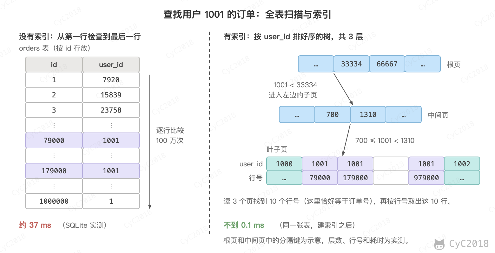 </div><br>

没有索引时查询用户 1001 的订单约 37 ms；建立索引后不到 0.1 ms。这 100 万行的索引只有 3 层，找到用户 1001 只需要读根页、中间页和一个叶子页，再按叶子页中记录的 10 个行号（这里恰好等于订单号）取出整行（SQLite 3.43 实测，见[附录 A9](#a9-索引)）。在 MySQL 中，EXPLAIN 显示没有索引时预计扫描 996761 行，有索引时只读 10 行，耗时从约 100 ms 降到 0.3 ms。

EXPLAIN QUERY PLAN 可以显示 SQLite 打算怎样执行查询：

```text
没有索引：SCAN orders
有索引：  SEARCH orders USING INDEX idx_user (user_id=?)
```

索引不是越多越好：每插入或修改一行，所有相关的索引都要同步更新，还要占用额外的空间。所以只为经常出现在查询条件中的列建立索引。

### 事务

下单要修改两张表：dishes 表中的库存减 1，orders 表中插入订单。如果扣完库存后程序崩溃，订单没有写入，就会少一份菜却没有订单。

事务（Transaction）把多条语句组成一个整体：要么全部生效，要么全部不生效。用 BEGIN 开始事务，COMMIT 提交，中途出错时用 ROLLBACK 撤销已经做过的修改：

```sql
BEGIN;
UPDATE dishes SET stock = stock - 1 WHERE id = 17 AND stock > 0;
-- 程序检查上一条修改了几行：0 行表示已售罄，执行 ROLLBACK，不再往下执行
INSERT INTO orders VALUES (1024, 1001, 17, 2850, 'CREATED', '2026-10-29 12:30:00');
COMMIT;
```

在 UPDATE 执行完、INSERT 之前强行结束程序（kill -9），模拟程序崩溃，结果如下（SQLite 3.43 与 MySQL 8.0 实测，见[附录 A10](#a10-事务)）：

<div align="center"> 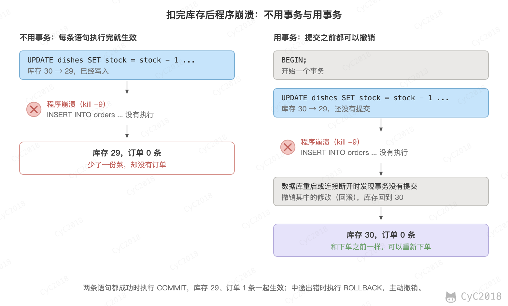 </div><br>

不用事务时，每条语句执行完就立即生效，库存变成 29，却没有订单；用事务时，数据库发现这个事务没有提交，撤销了其中的修改，库存仍是 30。

UPDATE 语句中的 stock > 0 也很重要。库存已经为 0 时，这条语句一行也不修改，程序根据“影响了 0 行”判断已售罄，回滚事务。MySQL 在修改一行时会给这一行加锁，另一个事务要修改同一行必须等前一个提交或回滚，再按最新的库存判断 stock > 0（SQLite 更简单，同一时刻只允许一个事务写）。所以两个用户同时抢最后一份菜，也只有一个能扣减成功，不会出现[线程](#线程)一节中两个线程都卖出的问题。

事务的四个性质通常称为 ACID：

- 原子性（Atomicity）：事务中的修改要么全部完成，要么全部撤销；
- 一致性（Consistency）：事务前后数据都满足规则，例如库存不为负、每个订单都对应扣过的库存；
- 隔离性（Isolation）：并发执行的事务互不干扰，像是一个接一个执行；
- 持久性（Durability）：事务一旦提交，即使随后断电，修改也不会丢失。

隔离性要解决的是多个事务同时读写时互相看到中间状态的问题。例如事务 A 扣了库存还没提交，事务 B 就读到了 29；如果 A 随后回滚，B 读到的就是一个从未真正存在过的值，这称为脏读。数据库提供了几种隔离级别，级别越高，事务之间越像排队执行，但并发性能越低，MySQL 默认的级别不会出现脏读。

数据库实现原子性和持久性的关键是日志：修改数据之前先把“要做什么”和“原来是什么”写入日志文件，并确保写到磁盘上。崩溃后重启时，数据库读取日志，把已提交的事务补完，把未提交的事务撤销。

SQL 的更多语法见 [SQL 语法](SQL%20语法.md#七查询)；事务、ACID 与隔离级别见[数据库系统原理](数据库系统原理.md#一事务)；B+ 树索引见 [MySQL：索引](MySQL.md#b-tree-原理)。

### 练习

#### 第 10 天

选读：[查询](SQL%20语法.md#七查询)、[过滤](SQL%20语法.md#九过滤)。

自测：

1. 为什么用数据库保存订单，而不是直接写文件？（见[为什么需要数据库](#为什么需要数据库)）
2. 什么是主键？再插入一个相同主键的订单会怎样？（见[SQL](#sql)）

<details>
<summary>参考要点</summary>

1. 直接写文件时，查询要从头读到尾，多个线程同时写会互相覆盖，扣完库存还没写订单就崩溃时数据对不上，改中间一行也很麻烦；数据库用 SQL 按条件查询，用索引加快查找，用锁处理并发修改，用事务保证一组修改全做或全不做，崩溃后能恢复。
2. 主键（Primary Key）是唯一标识一行的列，例如 orders 表的订单号 id；再插入一个 1024 号订单会被数据库拒绝，SQLite 报 UNIQUE constraint failed，MySQL 报 Duplicate entry '1024' for key 'orders.PRIMARY'；即使程序有错误，数据库也不会写入重复的订单号。

</details>

动手：执行 sqlite3 -header -column shop.db，按[SQL](#sql)一节建立 dishes 和 orders 两张表，插入订单 1024 和 1026，写出“我的订单”页面的 JOIN 查询。

预期：订单 1026 用到的鱼香肉丝要先插入 dishes 表；JOIN 查询输出两行，1026 鱼香肉丝 2600 2026-10-29 18:05:00 在前，1024 宫保鸡丁 2850 2026-10-29 12:30:00 在后。

明天：第 11 天，分组与连接。

#### 第 11 天

阅读：[函数](SQL%20语法.md#十二函数)、[分组](SQL%20语法.md#十三分组)、[子查询](SQL%20语法.md#十四子查询)、[连接](SQL%20语法.md#十五连接)。

选读：[组合查询](SQL%20语法.md#十六组合查询)。

自测：

1. WHERE 和 HAVING 有什么区别？（见[分组](SQL%20语法.md#十三分组)）
2. 内连接和外连接有什么区别？（见[连接](SQL%20语法.md#十五连接)）

<details>
<summary>参考要点</summary>

1. WHERE 过滤行，在分组之前执行；HAVING 过滤分组，在 GROUP BY 之后执行，可以用 COUNT 这类汇总结果作条件，例如 GROUP BY Email HAVING COUNT(*) >= 2 找出重复的邮件地址。
2. 内连接只返回两张表中按连接条件能对上的行；外连接还保留没有关联的行，左外连接保留左表的所有行，右表中对不上的列填 NULL（空值），例如列出所有顾客及其订单时，没有订单的顾客 b 也会出现，order_id 为 NULL；外连接分为左外连接、右外连接和全外连接。

</details>

动手：在 SQLite 中按[182](SQL%20练习.md#182-duplicate-emails)、[175](SQL%20练习.md#175-combine-two-tables)、[181](SQL%20练习.md#181-employees-earning-more-than-their-managers)三题逐题练习：执行题目的 SQL Schema 建表并插入数据，先自己写出查询，再对照笔记的解法，做完一题再做下一题（182 和 175 都用表名 Person，后建的会覆盖先建的）。

预期：182 的结果是 a@b.com；175 的结果是 Allen Wang，City 和 State 为空，换成内连接则一行都没有；181 的结果是 Joe。

明天：第 12 天，读[索引](#索引)、[事务](#事务)。

#### 第 12 天

选读：[事务](数据库系统原理.md#一事务)、[B+ Tree 原理](MySQL.md#b-tree-原理)。

自测：

1. 索引为什么能加快查询？为什么不是越多越好？（见[索引](#索引)）
2. 事务的 ACID 分别指什么？（见[事务](#事务)）
3. 扣库存和创建订单为什么要放在一个事务中？程序崩溃时会怎样？（见[事务](#事务)）

<details>
<summary>参考要点</summary>

1. 索引是按某一列排好序的另一份数据，组织成多路的平衡树（MySQL 用 B+ 树，SQLite 用 B 树），查找时从根页往下几层就能定位，不用逐行检查（全表扫描）；例如 100 万个订单按 user_id 查询，没有索引约 37 ms，建索引后不到 0.1 ms，索引只有 3 层；每插入或修改一行，相关的索引都要同步更新，还占额外的空间，所以只为经常出现在查询条件中的列建索引。
2. 原子性（Atomicity）：事务中的修改要么全部完成，要么全部撤销；一致性（Consistency）：事务前后数据都满足规则，例如库存不为负；隔离性（Isolation）：并发执行的事务互不干扰，像是一个接一个执行；持久性（Durability）：事务一旦提交，即使随后断电，修改也不会丢失。
3. 扣库存和写订单必须同时生效或同时不生效，否则会少了一份菜却没有订单；不用事务时，扣完库存后崩溃，库存变成 29，订单表中没有记录；用事务时，数据库发现事务没有提交，撤销其中的修改，库存仍是 30，这靠日志实现：重启时补完已提交的事务，撤销未提交的事务。

</details>

动手：按[索引](#索引)一节在 SQLite 中生成 100 万个订单，执行 .timer on，比较建立 idx_user 前后查询用户 1001 的订单的耗时，并用 EXPLAIN QUERY PLAN 查看执行方式的变化。

预期：先清空 orders 表（DELETE FROM orders），否则与已有的订单 1024 主键冲突，整条 INSERT 失败；耗时随机器不同，第一次查询可能慢一些，多执行几次再比较；建索引前查询约 37 ms，执行方式为 SCAN orders，建立 idx_user 后不到 0.1 ms（.timer 显示 real 0.000），执行方式变为 SEARCH orders USING INDEX idx_user (user_id=?)，用户 1001 有 10 个订单。

综合题：为外卖 App 设计 dishes 和 orders 两张表：写出下单（扣库存并写入订单）的 SQL，说明为什么要放在一个事务中、UPDATE 中的 stock > 0 起什么作用，以及“我的订单”页面需要在哪一列上建索引。（见[SQL](#sql)、[索引](#索引)、[事务](#事务)）

<details>
<summary>答题思路</summary>

1. dishes 表：id 为主键，另有 name、price、stock，orders 表：id 为 BIGINT 主键，另有 user_id、dish_id、amount、status、created_at，价格和金额都按分保存为整数；
2. 下单 SQL：BEGIN; UPDATE dishes SET stock = stock - 1 WHERE id = 17 AND stock > 0; INSERT INTO orders VALUES (1024, 1001, 17, 2850, 'CREATED', '2026-10-29 12:30:00'); COMMIT;
3. 两条语句放在一个事务中，要么都生效、要么都不生效，扣完库存后崩溃时数据库会撤销修改，不会出现库存少了却没有订单；
4. stock > 0 保证库存为 0 时 UPDATE 一行也不修改，程序根据影响了 0 行判断已售罄并回滚；MySQL 修改一行时会给它加锁（SQLite 同一时刻只允许一个事务写），两人同时抢最后一份只有一个能扣减成功；
5. “我的订单”按 user_id 查询，要在 orders 表的 user_id 列上建索引：CREATE INDEX idx_user ON orders (user_id)。

</details>

明天：第 13 天，读[数据结构与算法](#七数据结构与算法)、[数组](#数组)、[链表](#链表)。

## 七、数据结构与算法

数据结构（Data Structure）指的是数据在内存中的组织方式，算法（Algorithm）是解决问题的步骤。同样是在 100 万个订单中找一个，组织方式不同，要做的工作可能相差几万倍。

### 数组

数组（Array）把元素一个挨一个地存放在一段连续的内存中。App 中的“我的订单”列表可以用数组保存订单号，每个订单号占 8 个字节：

<div align="center"> 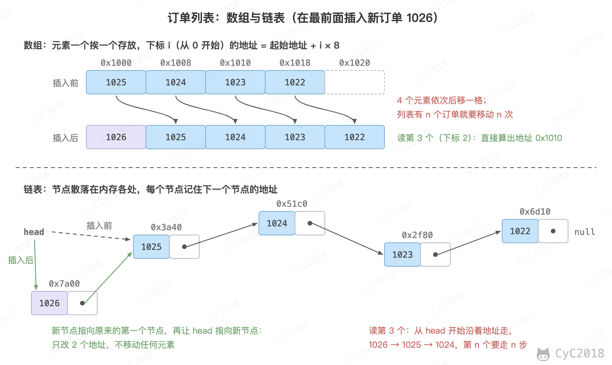 </div><br>

因为元素大小相同、位置连续，下标为 i（从 0 开始）的元素地址可以直接算出来：起始地址 + i × 8，所以按位置读取任何一个元素都只要一步，与数组多长无关。

代价是插入和删除。新订单 1026 要显示在列表最前面，就得把后面所有元素依次后移一格；列表有 n 个订单，就要移动 n 次。数组的长度在创建时确定，放满之后要申请一块更大的内存，把元素全部复制过去。

### 链表

链表（Linked List）中的每个元素称为节点，节点可以分散在内存的任何位置，每个节点除了保存数据，还保存下一个节点的地址。只要记住第一个节点的地址（head），就能沿着地址依次访问所有节点。

在最前面插入 1026 时，只需让新节点指向原来的第一个节点，再让 head 指向新节点，改两个地址就完成了，不用移动任何元素。但读第 n 个元素时，必须从 head 开始一个一个往后走 n 步。

数组与链表的取舍可以概括为：数组按位置读取快，插入删除慢；链表插入删除快（已知位置时），按位置读取慢。此外数组的元素连续存放，CPU 读一个元素时会把相邻的元素一起读进缓存，遍历起来比链表快得多。实际开发中数组用得更多，例如 Java 的 ArrayList 就是基于数组实现的。

### 栈和队列

栈（Stack）和队列（Queue）限制了元素进出的顺序：

- 栈是后进先出：只能在同一端放入和取出，像一摞盘子，最后放上去的最先拿走；
- 队列是先进先出：从一端放入、另一端取出，像排队，先来的先处理。

饭馆的后厨按下单顺序做菜，等待制作的订单就是一个队列：订单 1024 先进入队列，就比后面的 1025 先做。栈的典型用途是处理“嵌套”的结构，例如检查括号是否匹配：从左到右读，遇到左括号放入栈，遇到右括号就取出栈顶的左括号，看两者是否配对。程序调用函数时，也用栈保存每一层调用的临时数据，[线程](#线程)一节中每个线程的栈就是这个用途。

### 哈希表

按订单号查找订单是最常见的操作。如果订单放在数组中，只能逐个比较，100 万个订单平均要比较 50 万次。

哈希表（Hash Table）用一个哈希函数把键直接换算成数组中的位置。最简单的哈希函数是取余数，例如有 8 个位置（称为桶）时，订单号 % 8 就是桶号：

<div align="center"> 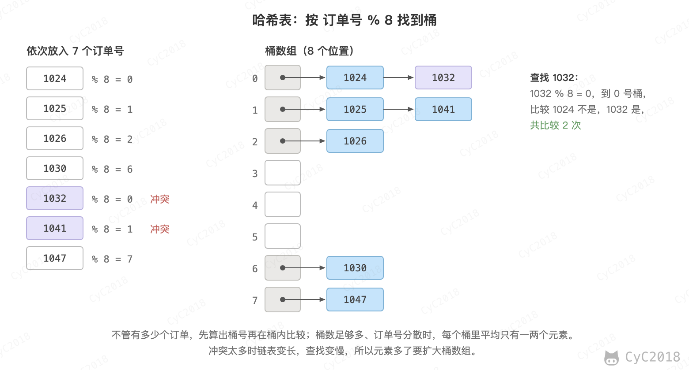 </div><br>

1024 % 8 = 0，放进 0 号桶；查找 1024 时同样算出 0，直接去 0 号桶找，不用看其它桶。不同的键可能算出相同的桶号，例如 1032 % 8 也是 0，这称为哈希冲突。常用的解决办法是拉链法：每个桶挂一个链表，冲突的元素依次接在后面，查找时在链表中逐个比较。

只要桶的数量和元素数量相当、哈希函数把键分散得足够均匀，每个桶中平均只有一两个元素。用 100 万个随机的订单号、约 100 万个桶实测，查找一个订单平均只比较 1.48 次（见[附录 A11](#a11-比较次数)）。元素越来越多时，哈希表会把桶数组扩大一倍，重新分配所有元素，让链表保持很短。

哈希表的缺点是元素没有顺序，不能回答“12 点到 12 点半之间有哪些订单”这类范围查询。Java 的 HashMap 和 Redis 保存所有键的字典都是哈希表。

### 二分查找

如果订单已经按下单时间排好序，查找某个时刻的订单可以用二分查找（Binary Search）：先和中间的元素比较，目标更大就只在右半边继续找，更小就只在左半边找，每比较一次排除一半。

在 8 个按时间排好序的订单中查找 12:30 下的订单 1024，只需要 3 步：

<div align="center"> 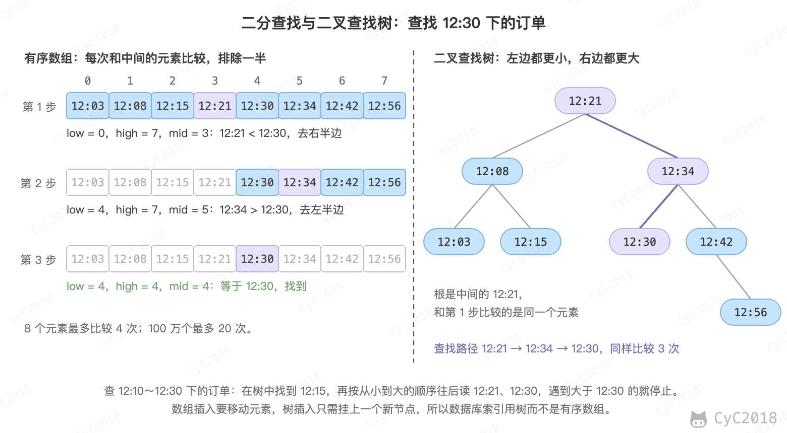 </div><br>

用伪代码表示：

```text
low = 0，high = n - 1
当 low ≤ high 时重复：
    mid = (low + high) / 2，舍去小数
    如果 a[mid] 等于目标：找到，返回 mid
    如果 a[mid] 小于目标：low = mid + 1
    否则：high = mid - 1
没有找到
```

每比较一次，剩下的范围减半。log₂n 指的是 n 连续除以 2 多少次才剩 1，例如 log₂8 = 3，所以 n 个元素最多比较 log₂n 向下取整再加 1 次（8 个最多 4 次）。100 万约等于 2²⁰，所以最多比较 20 次：

```bash
echo 'l(1000000)/l(2)' | bc -l
```

```text
19.93156856932417408741
```

二分查找的前提是数据已经排好序，并且能按位置直接读取元素，所以它只适用于有序数组，不适用于链表。

### 树

有序数组查找快，但在中间插入一个元素，就要移动后面的所有元素。二叉查找树（Binary Search Tree, BST）把二分查找的过程变成了一种数据结构：每个节点最多有两个子节点，最上面的节点称为根；一个节点的左子节点及其下面的所有节点称为左子树，其中的值都比它小，右子树中的值都比它大。

上图右边是同一组下单时间构成的树，根是中间的 12:21。查找 12:30 时从根开始，比 12:21 大就往右，比 12:34 小就往左，经过的节点和二分查找比较的元素完全相同。插入新订单时，按同样的方法找到位置，挂上一个新节点即可，不用移动其它节点。

树还能做范围查询：找到范围的起点后，按从小到大的顺序往后读，超出范围就停止，哈希表做不到这一点。

如果数据按顺序插入，二叉查找树会退化成一条链表，查找又变成逐个比较。实际使用的是能自动保持平衡的树，例如红黑树。

二叉树每个节点只有两个分支，100 万个元素至少要 20 层。如果树放在磁盘上，每往下走一层就要读一次磁盘，20 次随机读取就要 1 毫秒以上。数据库的索引因此让每个节点占一个磁盘页、放几百个键，节点的分支多了，树就很矮。[索引](#索引)一节实验中的索引就是这样：根页有 10 个键，中间页平均约 270 个，叶子页平均约 350 个，100 万个条目只用了 3 层（SQLite 实测，见[附录 A9](#a9-索引)）。根页也装满时，3 层可以容纳约 270 × 270 × 350 ≈ 2500 万个条目。MySQL 使用的 B+ 树是这种多路树的一种，只在叶子页中存放数据，叶子页之间用链表相连，便于范围查询。

### 排序

二分查找和范围查询都要求数据有序，所以排序是最常用的算法之一。以 5 个订单的金额（分）为例，插入排序（Insertion Sort）的做法和整理手中的扑克牌一样：从第二个开始，每次拿起一个，和左边已经排好的元素从右往左比较，插到合适的位置：

```text
开始        2850  1600  3200   980  2600
插入 1600   1600  2850  3200   980  2600    比较 1 次
插入 3200   1600  2850  3200   980  2600    比较 1 次
插入 980     980  1600  2850  3200  2600    比较 3 次
插入 2600    980  1600  2600  2850  3200    比较 3 次
```

插入排序每次只能把一个元素挪到位，数据完全打乱时，第 k 个元素平均要和左边一半的元素比较，约 k/2 次，n 个元素总共约 (1 + 2 + … + n) / 2 ≈ n²/4 次。

归并排序（Merge Sort）换了一种思路：把数组分成两半，分别排好序，再把两个有序的部分合并。每一半又按同样的方法继续分下去，直到只剩单个元素，单个元素本身就是有序的。合并时只需比较两部分的第一个元素，取较小的放进结果。同样以这 5 个金额为例：

<div align="center"> 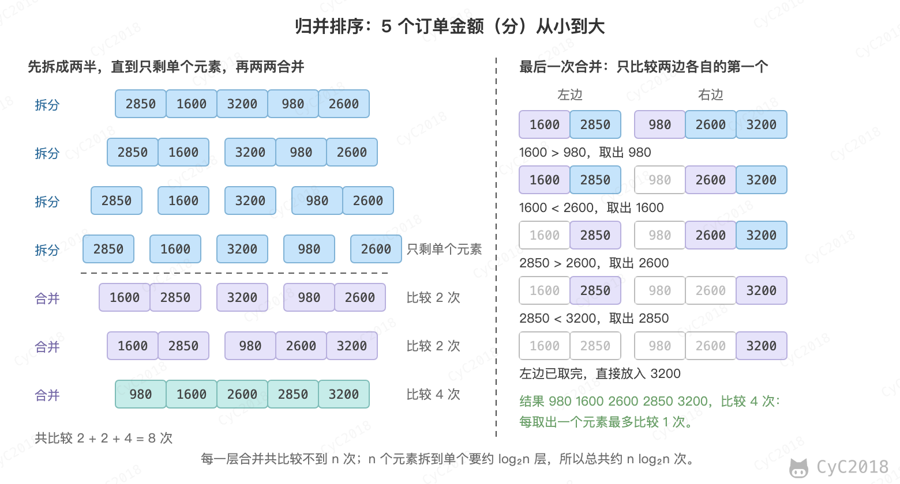 </div><br>

最后一次合并 [1600, 2850] 和 [980, 2600, 3200]，依次取出 980、1600、2600、2850，每取一个只比较一次，左边取完后 3200 直接放入。100 万个元素分 20 层就只剩单个元素，每一层合并共比较不到 n 次，所以总共约 n log₂n 次。

### 时间复杂度

比较算法的快慢时，不看具体用了多少秒（这和机器有关），而看数据量 n 增大时，操作次数怎样增长。时间复杂度（Time Complexity）用大 O 记号表示这种增长趋势，只保留增长最快的一项，省略常数系数：

- O(1)：操作次数与 n 无关，例如按位置读数组、哈希表查找；
- O(log n)：n 翻倍时只多一次操作，例如二分查找、在平衡树中查找；
- O(n)：与 n 成正比，例如在无序数组中逐个查找、全表扫描；
- O(n log n)：例如归并排序等高效的排序算法；
- O(n²)：例如插入排序，n 翻倍时操作次数变为 4 倍。

以 100 万个订单为例，统计各种做法比较的次数（见[附录 A11](#a11-比较次数)）：

```text
操作                        复杂度        比较次数
哈希表查找一个订单          O(1)          平均 1.48 次
二分查找一个订单            O(log n)      最多 20 次
逐个查找一个订单            O(n)          平均 50 万次
归并排序 100 万个订单       O(n log n)    1867 万次
插入排序 100 万个订单       O(n²)         约 2500 亿次
```

按每秒 10 亿次比较粗略估算，归并排序约 0.02 秒，插入排序要 250 秒，相差上万倍。数据量小的时候差别不明显，数据量一大，复杂度的差距就会远远超过机器快慢的差距。可以在终端中感受一下排序 100 万个数的速度：

```bash
seq -f '%.0f' 1000000 | sort -R > orders.txt     # 生成 1～1000000 并打乱顺序
time sort -n orders.txt > sorted.txt               # 按数值排序
```

sort 使用的是 O(n log n) 的算法，100 万个数排序只用了约 0.5 秒（macOS 实测，Ubuntu 上约 0.2 秒，见[附录 A11](#a11-比较次数)）。

空间复杂度用同样的方法描述算法需要多少额外的内存，例如归并排序需要 O(n) 的辅助空间。

复杂度的分析方法见[算法 - 算法分析](算法%20-%20算法分析.md#数学模型)；各种排序算法见[算法 - 排序](算法%20-%20排序.md#插入排序)；二分查找、二叉查找树和哈希表的实现见[算法 - 符号表](算法%20-%20符号表.md#2-二分查找实现有序符号表)；栈和队列见[算法 - 栈和队列](算法%20-%20栈和队列.md#栈)；Java 中的数组列表、链表和哈希表见 [Java 容器](Java%20容器.md#arraylist)。

### 练习

#### 第 13 天

自测：

1. 数组和链表有什么区别？各适合什么场景？（见[链表](#链表)）

<details>
<summary>参考要点</summary>

1. 数组连续存放，按位置读取一步完成（地址 = 起始地址 + i × 元素大小），但插入、删除要移动后面的元素；链表的节点分散存放，每个节点记着下一个节点的地址，已知位置时插入、删除只改两个地址，但读第 n 个要从头走 n 步；按位置读取、遍历多时用数组（相邻元素会一起读进 CPU 缓存，实际用得更多），频繁在头部插入、删除时用链表。

</details>

推演：反转链表。链表 1024 → 1025 → 1026 → null，head 指向 1024。只修改节点中“下一个”的地址，把它反转成 1026 → 1025 → 1024 → null。用三个变量 prev、cur、next，写出每一步之后各变量的值和每个节点指向谁。

规则：开始时 prev = null，cur = head。重复以下 4 步直到 cur 为 null：next = cur 的下一个；cur 的下一个改为 prev；prev = cur；cur = next。最后 head = prev。

<details>
<summary>参考答案</summary>

```text
轮次     prev   cur    next   1024 指向  1025 指向  1026 指向
开始     null   1024   -      1025       1026       null
第 1 轮  1024   1025   1025   null       1026       null
第 2 轮  1025   1026   1026   null       1024       null
第 3 轮  1026   null   null   null       1024       1025
```

第 3 轮后 cur 为 null，停止，head = prev = 1026，链表变为 1026 → 1025 → 1024 → null。每一轮都要先用 next 记住下一个节点，否则改完 cur 的指向后，后面的节点就找不到了。

</details>

明天：第 14 天，读[栈和队列](#栈和队列)。

#### 第 14 天

自测：

1. 栈和队列有什么区别？各举一个使用的例子。（见[栈和队列](#栈和队列)）

<details>
<summary>参考要点</summary>

1. 栈是后进先出，只在同一端放入和取出，像一摞盘子；队列是先进先出，一端放入、另一端取出，像排队；栈的例子：检查括号是否匹配，函数调用时保存每一层的临时数据；队列的例子：后厨按下单顺序做菜，先下单的订单 1024 比 1025 先做。

</details>

推演：用栈检查括号是否匹配。App 发出的请求体是 JSON，例如 {"items":[{"dishId":17}]}，服务器解析时要检查括号是否成对。

用栈分别检查 “({[]})” 和 “([)]” 是否匹配，写出每读入一个字符后栈中的内容（栈底在左）。

规则：读到左括号就放入栈；读到右括号时，栈顶必须是与它配对的左括号，是就取出，否则不匹配；全部读完时栈为空才算匹配。

<details>
<summary>参考答案</summary>

“({[]})”

```text
读入  操作                   栈
(     放入                   (
{     放入                   ({
[     放入                   ({[
]     栈顶是 [，配对，取出   ({
}     栈顶是 {，配对，取出   (
)     栈顶是 (，配对，取出   空
```

读完时栈为空，匹配。

“([)]”

```text
读入  操作                       栈
(     放入                       (
[     放入                       ([
)     栈顶是 [，与 ) 不配对      ([
```

第 3 个字符就不匹配，停止。只数左右括号的个数是不够的，还要看顺序。

</details>

推演：后厨的订单队列。后厨用容量为 4 的循环数组保存待做的订单，head 指向队头（下一个要做的），tail 指向下一个空位，到达末尾后回到 0。开始时 head = tail = 0。依次执行：入队 1024、入队 1025、入队 1026、出队、入队 1027、入队 1028、出队、出队。写出每一步之后数组的内容和 head、tail。

<details>
<summary>参考答案</summary>

```text
操作          数组（下标 0～3）           head  tail  取出
入队 1024     1024  -     -     -          0     1
入队 1025     1024  1025  -     -          0     2
入队 1026     1024  1025  1026  -          0     3
出队          -     1025  1026  -          1     3     1024
入队 1027     -     1025  1026  1027       1     0
入队 1028     1028  1025  1026  1027       1     1
出队          1028  -     1026  1027       2     1     1025
出队          1028  -     -     1027       3     1     1026
```

订单按 1024、1025、1026 的顺序出队，先下单的先做。入队 1027 后 tail 从 3 回到 0，1028 放进了下标 0 这个已经空出来的位置，这就是“循环”的含义。入队 1028 后 head = tail = 1，此时队列是满的（4 个位置都有订单）；而开始时 head = tail = 0 表示空，所以实际实现中还要另外记录元素个数来区分空和满。

</details>

明天：第 15 天，读[哈希表](#哈希表)。

#### 第 15 天

自测：

1. 哈希表的原理是什么？哈希冲突怎样解决？（见[哈希表](#哈希表)）

<details>
<summary>参考要点</summary>

1. 哈希表用哈希函数把键换算成数组中的位置（桶），例如 8 个桶时订单号 % 8 就是桶号，查找 1024 时算出 0，直接去 0 号桶找；不同的键算出同一个桶号称为哈希冲突，例如 1032 % 8 也是 0；拉链法让每个桶挂一个链表，冲突的元素接在后面，查找时逐个比较；元素多了就把桶数扩大一倍重新分配，100 万个订单、约 100 万个桶时平均只比较 1.48 次。

</details>

推演：哈希表与冲突。哈希表有 8 个桶（编号 0～7），哈希函数是 订单号 % 8，冲突用拉链法处理，新元素接在链表末尾。

1. 依次放入订单号 1027、1030、1035、1036、1043、1049、1050，画出每个桶的链表；
2. 查找 1043 和 1028，各要比较几次；
3. 再放入 1051，3 号桶变成什么样；把桶数扩大到 16、按 订单号 % 16 重新分配后，这 4 个订单分别在哪个桶。

<details>
<summary>参考答案</summary>

1. 先算桶号：1027 % 8 = 3，1030 % 8 = 6，1035 % 8 = 3（与 1027 冲突），1036 % 8 = 4，1043 % 8 = 3（再次冲突），1049 % 8 = 1，1050 % 8 = 2。结果：

```text
桶 0：空
桶 1：1049
桶 2：1050
桶 3：1027 → 1035 → 1043
桶 4：1036
桶 5：空
桶 6：1030
桶 7：空
```

2. 1043 % 8 = 3，到 3 号桶，依次比较 1027、1035、1043，共 3 次；1028 % 8 = 4，到 4 号桶，比较 1036 不是，链表结束，共比较 1 次，没有找到。

3. 1051 % 8 = 3，接在 3 号桶末尾：1027 → 1035 → 1043 → 1051。8 个桶装了 8 个订单，平均每桶 1 个，但这组订单号恰好集中在 3 号桶，查找它们要比较好几次。扩大到 16 个桶后，1027 % 16 = 3、1043 % 16 = 3，1035 % 16 = 11、1051 % 16 = 11，长度为 4 的链表拆成了两条长度为 2 的链表。

</details>

明天：第 16 天，读[二分查找](#二分查找)、[树](#树)。

#### 第 16 天

自测：

1. 二分查找的时间复杂度是多少？100 万个元素最多比较几次？（见[二分查找](#二分查找)）
2. 数据库索引为什么用 B+ 树，而不用二叉树或哈希表？（见[树](#树)）

<details>
<summary>参考要点</summary>

1. 二分查找每比较一次排除一半，时间复杂度是 O(log n)；n 个元素最多比较 log₂n 向下取整再加 1 次，100 万约等于 2²⁰，最多比较 20 次；前提是数据已排好序并能按位置直接读取，所以只适用于有序数组。
2. 哈希表的元素没有顺序，不能做“12:00～12:30 的订单”这类范围查询；二叉树每个节点只有两个分支，100 万个元素至少 20 层，放在磁盘上每往下一层就读一次磁盘，20 次随机读要 1 毫秒以上；B+ 树这类多路树每个节点占一个磁盘页、放几百个键，树很矮，实验中 100 万个条目只要 3 层，3 层约能容纳 2500 万个；B+ 树的数据只放在叶子页，叶子页之间用链表相连，便于范围查询。

</details>

推演：二分查找。8 个订单按下单时间排好序，放在数组 a 中，下标从 0 开始。分别查找 12:42 和 12:25 下的订单，写出每一步的 low、high、mid、a[mid] 以及接下来往哪边找。

```text
下标   0      1      2      3      4      5      6      7
a      12:03  12:08  12:15  12:21  12:30  12:34  12:42  12:56
```

规则：mid = (low + high) / 2，舍去小数；a[mid] 小于目标时 low = mid + 1，大于目标时 high = mid - 1；low > high 时停止，表示没有找到。

<details>
<summary>参考答案</summary>

查找 12:42

```text
步骤  low  high  mid  a[mid]  判断
1     0    7     3    12:21   12:21 < 12:42，low = 4
2     4    7     5    12:34   12:34 < 12:42，low = 6
3     6    7     6    12:42   相等，找到，下标 6
```

查找 12:25

```text
步骤  low  high  mid  a[mid]  判断
1     0    7     3    12:21   12:21 < 12:25，low = 4
2     4    7     5    12:34   12:34 > 12:25，high = 4
3     4    4     4    12:30   12:30 > 12:25，high = 3
结束  4    3                  low > high，没有找到
```

两次都比较了 3 次。没有找到时 low = 4，正好是 12:25 应该插入的位置（插在 12:21 和 12:30 之间）。

</details>

推演：二叉查找树。规则：从根开始，比当前节点小就往左，大就往右，走到空位置时放下。

1. 按 12:21、12:08、12:34、12:03、12:15、12:30、12:42、12:56 的顺序把下单时间插入一棵空的二叉查找树，画出结果，并写出查找 12:56 和 12:25 经过的节点；
2. 如果按从早到晚的顺序 12:03、12:08……12:56 插入，树是什么样子，查找 12:56 要比较几次。

<details>
<summary>参考答案</summary>

1. 结果如下：

```text
              12:21
           /         \
       12:08         12:34
       /   \         /   \
   12:03  12:15  12:30  12:42
                           \
                          12:56
```

根为 12:21，12:56 比 12:21、12:34、12:42 都大，挂在 12:42 的右边，树高 4 层。查找 12:56：12:21 → 12:34 → 12:42 → 12:56，比较 4 次。查找 12:25：12:21（往右）→ 12:34（往左）→ 12:30（往左，左边为空），比较 3 次，没有找到。

2. 每个新元素都比已有的大，总是挂在最右边，树变成一条 8 层的“链”：12:03 → 12:08 → … → 12:56，查找 12:56 要比较 8 次，与逐个查找一样。这就是实际使用红黑树、B+ 树这类能自动保持平衡的树的原因。

</details>

明天：第 17 天，读[排序](#排序)、[时间复杂度](#时间复杂度)。

#### 第 17 天

自测：

1. 常见的时间复杂度有哪些？O(n log n) 和 O(n²) 的排序在 100 万个元素上差多少？（见[时间复杂度](#时间复杂度)）

<details>
<summary>参考要点</summary>

1. 常见的有 O(1)（哈希表查找）、O(log n)（二分查找）、O(n)（逐个查找）、O(n log n)（归并排序）、O(n²)（插入排序）；排序 100 万个元素，归并排序实测约 1867 万次比较，插入排序约 2500 亿次；按每秒 10 亿次比较估算，前者约 0.02 秒，后者约 250 秒，相差上万倍。

</details>

动手：按[时间复杂度](#时间复杂度)一节的命令生成 100 万个打乱的数，用 time sort -n 计时排序。

预期：time 显示排序 100 万个数约 0.5 秒（笔记在 macOS 上实测，Ubuntu 上约 0.2 秒），sorted.txt 中的数从 1 依次排到 1000000。

推演：插入排序。5 个订单的金额（分）依次是 2600、3200、980、2850、1600。用插入排序从小到大排序，写出每一轮插入后的数组和这一轮比较的次数。

规则：从第 2 个元素开始，每轮取出一个元素，从右往左与已排好的元素比较，比它大的元素右移一格，遇到不比它大的元素或到达最左边时放下。

<details>
<summary>参考答案</summary>

```text
轮次  插入   结果                           比较次数
开始         2600  3200   980  2850  1600
1     3200   2600  3200   980  2850  1600   1（2600 不比 3200 大，停）
2     980     980  2600  3200  2850  1600   2（3200、2600 都右移，到最左边）
3     2850    980  2600  2850  3200  1600   2（3200 右移，2600 不比 2850 大，停）
4     1600    980  1600  2600  2850  3200   4（3200、2850、2600 右移，980 不比 1600 大，停）
```

共比较 9 次。数据本来就有序时每轮只比较 1 次，共 4 次；完全倒序时第 k 轮比较 k 次，共 1 + 2 + 3 + 4 = 10 次。

</details>

推演：估算比较次数。订单数 n 分别为 1000、100 万、10 亿时，估算：

1. 在有序数组中二分查找，最多比较几次；
2. 用插入排序把完全打乱的订单排序，平均大约比较几次（按 n²/4 估算）；
3. 按每秒 10 亿次比较计算，n = 100 万时插入排序大约要多久，归并排序（约 n log₂n 次）大约要多久。

<details>
<summary>参考答案</summary>

1. 最多比较 log₂n 向下取整再加 1 次。2¹⁰ = 1024 > 1000，所以 1000 个最多 10 次；2²⁰ ≈ 105 万 > 100 万，最多 20 次；2³⁰ ≈ 10.7 亿 > 10 亿，最多 30 次。数据量每扩大 1000 倍，只多比较 10 次；

2. 1000 个：1000² / 4 = 25 万次；100 万个：(10⁶)² / 4 = 2500 亿次；10 亿个：(10⁹)² / 4 = 2.5 × 10¹⁷ 次；

3. 插入排序：2.5 × 10¹¹ ÷ 10⁹ = 250 秒，约 4 分钟；归并排序：10⁶ × 20 = 2 × 10⁷ 次，÷ 10⁹ = 0.02 秒。笔记附录 A11 中对 100 万个打乱的数做归并排序，实测比较了 1867 万次，与估算一致。

</details>

综合题：外卖 App 要支持三种操作：按订单号查找订单、按时间从新到旧列出最近的订单、查出 12:00～12:30 之间的订单。分别用什么数据结构？时间复杂度各是多少？（见[哈希表](#哈希表)、[二分查找](#二分查找)、[树](#树)）

<details>
<summary>答题思路</summary>

1. 按订单号查找：用哈希表，以订单号为键算出桶号，平均 O(1)，100 万个订单平均比较约 1.5 次；
2. 按时间从新到旧列出最近的订单：用数组按下单顺序保存，新订单的时间总是最晚，追加到末尾（通常是 O(1)）数组就自然按时间有序；从末尾往前读，列出 k 个是 O(k)，不必每次重新排序；
3. 查 12:00～12:30 的订单：在同一个按时间有序的数组中，用二分查找以 O(log n) 找到第一个不早于 12:00 的订单，再往后读，超过 12:30 就停止；范围内有 k 个订单时共 O(log n + k)；
4. 哈希表做不到后两种操作，因为元素没有顺序；如果要按一个不随时间递增的值排序（例如金额），新元素要插到中间，有序数组插入要移动后面的元素，是 O(n)，这时改用平衡二叉查找树（例如红黑树）或 B+ 树，查找和插入都是 O(log n)，同样能找到起点后顺序往后读。

</details>

明天：第 18 天，Git。

## 八、Git

Git 记录代码的每一次修改，可以回到任何一个历史版本，也让多人在各自的分支上修改同一个项目，再合并到一起。后面的路线中写的代码都应该放进 Git 仓库。

### 练习

#### 第 18 天

阅读：[集中式与分布式](Git.md#集中式与分布式)、[工作流](Git.md#工作流)、[分支实现](Git.md#分支实现)、[冲突](Git.md#冲突)、[Fast forward](Git.md#fast-forward)、[储藏（Stashing）](Git.md#储藏stashing)、[.gitignore 文件](Git.md#gitignore-文件)、[Git 命令一览](Git.md#git-命令一览)。

自测：

1. Git 和 SVN 有什么区别？（见[集中式与分布式](Git.md#集中式与分布式)）
2. 合并分支时出现冲突怎样解决？（见[冲突](Git.md#冲突)）
3. git stash 有什么作用？（见[储藏（Stashing）](Git.md#储藏stashing)）

<details>
<summary>参考要点</summary>

1. Git 是分布式版本控制，每个人的电脑上都有完整的历史；SVN 是集中式，完整的历史只在中心服务器上，每个人只有某个版本的工作副本。SVN 不联网也能修改和撤销本地改动，但提交、查看历史要连接服务器，服务器出故障时这些操作都做不了；Git 不联网也能提交、查看历史。SVN 的分支是服务器上的廉价复制，Git 新建、合并分支只需在本地移动指针。
2. 两个分支修改了同一个文件的同一行，合并时就会冲突；Git 在文件中用 <<<<<<<、=======、>>>>>>> 标出两边的内容，把这一段改成最终想要的内容，并删掉这三行标记；然后执行 git add 标记冲突已解决，再执行 git commit 完成合并。
3. git stash 把工作区中还没提交的修改存起来，工作区回到干净的状态，可以安全地切换分支；例如在 dev 上开发到一半，要去修 master 上的 bug，先执行 git stash，修完回来用 git stash pop 恢复；未跟踪的新文件默认不储藏，需要加 -u。

</details>

动手：在终端中依次执行下面的命令，两个分支把宫保鸡丁的价格改成不同的值后合并。前两行设置提交记录中的用户名和邮箱，只需执行一次；没有 git 命令时，Ubuntu 用 sudo apt install git 安装，macOS 按弹出的提示安装命令行工具。git switch -c dev 新建并切换到 dev 分支，git switch - 回到原来的分支（默认叫 master 或 main，取决于配置）。

```bash
git config --global user.name "你的名字"
git config --global user.email "you@example.com"
mkdir shop && cd shop && git init
echo "宫保鸡丁 2850" > menu.txt
git add menu.txt && git commit -m "add menu"
git switch -c dev
echo "宫保鸡丁 2600" > menu.txt && git commit -am "price 2600"
git switch -
echo "宫保鸡丁 3000" > menu.txt && git commit -am "price 3000"
git merge dev
```

预期：git merge 提示 CONFLICT (content): Merge conflict in menu.txt，menu.txt 变成 <<<<<<< HEAD、宫保鸡丁 3000、=======、宫保鸡丁 2600、>>>>>>> dev 五行；把文件改成想保留的一行（例如宫保鸡丁 2600），执行 git add menu.txt 和 git commit -m "merge dev" 完成合并；git log --oneline --graph 中两条分支线（|\ 和 |/）汇合到这个合并提交。

明天：第 19 天，复习全篇。

## 九、下一步

### 练习

#### 第 19 天

回到开头的[全景图](#一总览一次下单经过了什么)，不看正文，按图中的 6 个步骤讲一遍下单的全过程，讲不清的地方回到对应的章节。

预期：能不看正文按顺序讲完 6 步：DNS 解析出 203.0.113.10，建立 TCP 连接并发送 HTTP 请求，内核把请求交给订单服务进程中的一个线程，CPU 执行指令并读写内存，数据库在一个事务中把库存从 30 减为 29 并写入订单 1024，服务器返回 HTTP 响应后 App 显示下单成功。

综合题：从按下“提交订单”到 App 显示“下单成功”，按数据、程序、操作系统、网络、数据库、数据结构六个方面，各说出两三件发生的事。（见[一次下单经过了什么](#一总览一次下单经过了什么)及各章）

<details>
<summary>答题思路</summary>

1. 数据：订单号 1024 用 8 字节整数按小端序保存，金额 28.50 元存为整数 2850 分以避免浮点误差，菜名按 UTF-8 编码占 12 个字节；
2. 程序：订单程序从磁盘上的可执行文件装入内存成为进程，CPU 按程序计数器逐条执行指令，扣库存的一行代码拆成读、减、写几条指令；
3. 操作系统：请求交给线程池中的一个线程，线程等数据库时阻塞、CPU 去执行别的线程，收发网络数据和写日志都通过系统调用由内核完成；
4. 网络：DNS 把 shop.example.com 解析为 203.0.113.10，TCP 三次握手（HTTPS 还有 TLS 握手）后发送 POST /api/orders，服务器返回 201 Created 和订单号 1024；
5. 数据库：在一个事务中用带 stock > 0 条件的 UPDATE 把库存从 30 减为 29，插入订单 1024 后提交，主键保证订单号不重复，MySQL 给正在修改的库存行加锁，保证最后一份只卖出一次；
6. 数据结构：数据库的索引是多路平衡树（MySQL 中是 B+ 树），实验中 3 层就能定位一行，按订单号查找可以用哈希表，后厨按队列先进先出做菜。

</details>

之后按目标选择[Java 后端](学习路线%20-%20Java%20后端.md)或[大模型应用开发](学习路线%20-%20大模型应用开发.md)。两条路线都不讲语法：Java 后端要求会 Java，大模型应用开发的动手大多用 Python，开头的“开始之前”列出了几个自查的小程序，写不出来时先学这门语言的基础语法；离面试只有两三周时，用[面试冲刺](学习路线%20-%20面试冲刺.md)复习。

## 附录：实测

除特别说明外，macOS 环境为 Apple M1 Pro（10 核）、macOS 15.8；Ubuntu 环境为 Docker 中的 Ubuntu 24.04（aarch64，内核 6.10），gcc 13.3；数据库为 SQLite 3.43.2（macOS 自带）和 MySQL 8.0.44。MySQL 上的表名加了前缀，以免与其它实验冲突，输出中的表名已改回正文中的写法。

### A1 字符编码与浮点数

macOS 上的输出如下（macOS 的 od 列间距更宽，这里按 Ubuntu 的格式排版）。Ubuntu 上 od、awk、printf 的结果相同，镜像中没有 bc；Ubuntu 的 iconv 按 GBK 解码到第 2 个字节处报错 illegal input sequence，只输出“瀹”：

```text
$ printf '宫保鸡丁' | od -An -tx1
 e5 ae ab e4 bf 9d e9 b8 a1 e4 b8 81
$ printf '宫保鸡丁' | wc -c
12
$ printf 'Kung Pao' | od -An -tx1
 4b 75 6e 67 20 50 61 6f
$ printf '宫保鸡丁' | iconv -f UTF-8 -t GBK | od -An -tx1
 b9 ac b1 a3 bc a6 b6 a1
$ printf '宫保鸡丁' | iconv -f GBK -t UTF-8
瀹繚楦′竵
$ echo 'obase=2; 1024' | bc
10000000000
$ printf '%x\n' 1024
400
$ printf '%x\n' -2850
fffffffffffff4de
$ awk 'BEGIN { printf "%.17g\n", 28.50 }'
28.5
$ awk 'BEGIN { printf "%.17g\n", 1.10 + 2.20 }'
3.3000000000000003
$ awk 'BEGIN { printf "%.17g\n", 3.30 }'
3.2999999999999998
$ awk 'BEGIN { print (1.10 + 2.20 == 3.30) }'
0
$ awk 'BEGIN { printf "%.17g\n", 0.1 + 0.2 }'
0.30000000000000004
```

printf 按 8 字节输出 -2850 的补码，取低 4 字节即正文中的 ff ff f4 de。

### A2 订单在内存中的字节

用 C 语言定义一个订单结构，打印它在内存中的每个字节：

```c
#include <stdio.h>
#include <string.h>
struct order { long id; int amount; char dish[13]; };
int main(void) {
    struct order o = {1024, 2850, "宫保鸡丁"};
    unsigned char *p = (unsigned char *)&o;
    printf("sizeof(long)=%zu sizeof(int)=%zu sizeof(struct order)=%zu strlen(dish)=%zu\n",
           sizeof(long), sizeof(int), sizeof o, strlen(o.dish));
    for (size_t i = 0; i < sizeof o; i++) printf("%02x%s", p[i], i % 8 == 7 ? "\n" : " ");
}
```

macOS（clang）与 Ubuntu（gcc 13.3）的输出相同：

```text
sizeof(long)=8 sizeof(int)=4 sizeof(struct order)=32 strlen(dish)=12
00 04 00 00 00 00 00 00
22 0b 00 00 e5 ae ab e4
bf 9d e9 b8 a1 e4 b8 81
00 00 00 00 00 00 00 00
```

### A3 机器指令

在 Ubuntu 中编译只有一行的函数 stock = stock - 1，再反汇编：

```text
$ cat stock.c
int stock = 30;
void sell(void) { stock = stock - 1; }
$ gcc -O1 -c stock.c && objdump -d stock.o
0000000000000000 <sell>:
   0:   90000001        adrp    x1, 0 <sell>
   4:   b9400020        ldr     w0, [x1]
   8:   51000400        sub     w0, w0, #0x1
   c:   b9000020        str     w0, [x1]
  10:   d65f03c0        ret
$ od -A x -t x1 -N 16 /bin/ls
000000 7f 45 4c 46 02 01 01 00 00 00 00 00 00 00 00 00
```

这是还没有链接的目标文件，地址和偏移都还是 0。链接后，adrp 算出 stock 所在页的地址，stock 在页内的偏移填进 ldr 和 str 的 [x1] 中（objdump -dr 可以看到这三处重定位）。

macOS 上的 /bin/ls 同时包含 x86_64 和 arm64e 两种指令，开头的 4 个字节是 ca fe ba be（多架构的 Mach-O 文件）。

### A4 存储器的访问延迟

内存：申请一块指定大小的内存，按 128 字节（M1 的缓存行大小）切成节点，把节点随机串成一个环，每个节点保存下一个节点的地址；然后沿着环读 2000 万次，每次读取都依赖上一次的结果，总时间除以次数即一次读取的延迟。clang -O2 编译，运行 3 次，第 1 次的输出：

```text
      16 KB  1.0 ns
      64 KB  1.0 ns
    1024 KB  6.2 ns
    4096 KB  10.9 ns
   65536 KB  129.0 ns
 1048576 KB  314.2 ns
```

3 次中 64 MB 为 129～157 ns，1 GB 为 182～314 ns（1 GB 时还要频繁查找页表，所以更慢）。M1 Pro 性能核的一级数据缓存为 128 KB，二级缓存为 12 MB（sysctl 查得）。

SSD：在内置 SSD 上创建 4 GB 的文件，用 fcntl(F_NOCACHE) 关闭操作系统的文件缓存，随机读取 5000 个 4 KB 的块，4 次的平均延迟：

```text
random 4KB read: 81.5 us
random 4KB read: 68.0 us
random 4KB read: 74.3 us
random 4KB read: 67.4 us
```

### A5 进程、线程与系统调用

macOS 上的进程数和线程数：

```text
$ sysctl -n hw.ncpu
10
$ top -l 1 | head -1
Processes: 1091 total, 6 running, 1085 sleeping, 11019 threads
```

Ubuntu 中运行 A7 的模拟订单服务（进程号 7），同时发出 3 个下单请求，每个请求在服务端停留 3 秒，期间查看线程：

```text
$ ps -o pid,nlwp,cmd -p 7          # 空闲时
  PID NLWP CMD
    7    1 python3 order_server.py
$ ps -T -p 7                       # 处理 3 个请求时
  PID  SPID TTY          TIME CMD
    7     7 ?        00:00:00 python3
    7    15 ?        00:00:00 python3
    7    16 ?        00:00:00 python3
    7    17 ?        00:00:00 python3
```

用 strace -f -p 7 跟踪进程 7 及其线程，再发出一个下单请求（每行开头是线程号，省略了时间戳和部分参数）：

```text
7   accept4(3, {sa_family=AF_INET, sin_port=htons(36656), sin_addr=inet_addr("127.0.0.1")}, [16], SOCK_CLOEXEC) = 4
28  recvfrom(4, "POST /api/orders HTTP/1.1\r\nHost:"..., 8192, 0, NULL, NULL) = 180
28  openat(AT_FDCWD, "orders.log", O_WRONLY|O_CREAT|O_APPEND|O_CLOEXEC, 0666) = 5
28  write(5, "order 1024 user 1001 amount 2850"..., 33) = 33
28  close(5)          = 0
28  write(2, "127.0.0.1 - - [28/Oct/2026 16:27"..., 71) = 71
28  sendto(4, "HTTP/1.1 201 Created\r\nServer: Ba"..., 164, 0, NULL, 0) = 164
28  sendto(4, "{\"orderId\": 1024, \"status\": \"CRE"..., 57, 0, NULL, 0) = 57
28  recvfrom(4, "", 8192, 0, NULL, NULL) = 0
28  close(4)          = 0
```

write(2, ...) 是服务程序在标准错误上打印访问日志，正文的图中省略了这一行。其它命令：

```text
$ strace -e trace=write echo "order 1024"
write(1, "order 1024\n", 11order 1024
)            = 11
$ strace -c cat /etc/hostname | tail -1
100.00    0.000874          21        41         1 total
```

### A6 DNS 与往返时间

macOS，家庭宽带，DNS 服务器为路由器 192.168.1.1：

```text
$ dig www.baidu.com
;; ANSWER SECTION:
www.baidu.com.          600     IN      CNAME   www.a.shifen.com.
www.a.shifen.com.       600     IN      A       183.2.172.177
;; Query time: 5 msec
;; SERVER: 192.168.1.1#53(192.168.1.1)
$ ping -c 4 www.baidu.com
round-trip min/avg/max/stddev = 9.310/9.655/9.863/0.210 ms
```

curl -4 访问 https://www.baidu.com 5 次，间隔 1 秒：

```text
dns 0.004013  tcp 0.015670  tls 0.044868  first_byte 0.057040  total 0.057136  ip 183.2.172.177:443  http 200
dns 0.002221  tcp 0.012144  tls 0.040571  first_byte 0.053718  total 0.053823  ip 183.2.172.177:443  http 200
dns 0.006563  tcp 0.015096  tls 0.041829  first_byte 0.053008  total 0.053110  ip 183.2.172.177:443  http 200
dns 0.002281  tcp 0.011717  tls 0.041322  first_byte 0.053568  total 0.053693  ip 183.2.172.177:443  http 200
dns 0.002117  tcp 0.011890  tls 0.041010  first_byte 0.054700  total 0.054805  ip 183.2.172.177:443  http 200
```

curl -v 显示这次连接使用 TLS 1.2，服务器在 ALPN 中选择了 http/1.1。

### A7 HTTP 请求与 TCP 报文

模拟的订单服务用 Python 标准库编写，每个请求由一个新线程处理：POST /api/orders 向 orders.log 追加一行并返回 201，GET /api/orders/1024 返回订单，其它路径返回 404。

```python
import json, time
from http.server import ThreadingHTTPServer, BaseHTTPRequestHandler

class Handler(BaseHTTPRequestHandler):
    protocol_version = "HTTP/1.1"
    def reply(self, code, body):
        data = json.dumps(body, ensure_ascii=False).encode()
        self.send_response(code)
        self.send_header("Content-Type", "application/json; charset=utf-8")
        self.send_header("Content-Length", str(len(data)))
        self.end_headers()
        self.wfile.write(data)
    def do_POST(self):
        req = json.loads(self.rfile.read(int(self.headers["Content-Length"])))
        time.sleep(float(self.headers.get("X-Delay", "0")))      # A5 中用来延长处理时间
        with open("orders.log", "a") as f:
            f.write(f"order 1024 user {req['userId']} amount 2850\n")
        self.reply(201, {"orderId": 1024, "status": "CREATED", "amount": "28.50"})
    def do_GET(self):
        if self.path == "/api/orders/1024":
            self.reply(200, {"orderId": 1024, "dish": "宫保鸡丁", "amount": "28.50", "status": "CREATED"})
        else:
            self.reply(404, {"error": "order not found"})

ThreadingHTTPServer(("0.0.0.0", 8080), Handler).serve_forever()
```

curl 的输出见正文，查询不存在的订单：

```text
$ curl -i http://127.0.0.1:8080/api/orders/9999
HTTP/1.1 404 Not Found
Server: BaseHTTP/0.6 Python/3.12.3
Date: Wed, 28 Oct 2026 16:27:24 GMT
Content-Type: application/json; charset=utf-8
Content-Length: 28

{"error": "order not found"}
```

发送下单请求的同时用 tcpdump -i lo -nn -S 'tcp port 8080' 抓包（-S 显示原始序号，省略了 TCP 选项）：

```text
16:27:24.090458 IP 127.0.0.1.36656 > 127.0.0.1.8080: Flags [S], seq 3987857382, win 65495, length 0
16:27:24.090512 IP 127.0.0.1.8080 > 127.0.0.1.36656: Flags [S.], seq 3583450070, ack 3987857383, win 65483, length 0
16:27:24.090533 IP 127.0.0.1.36656 > 127.0.0.1.8080: Flags [.], ack 3583450071, win 512, length 0
16:27:24.090656 IP 127.0.0.1.36656 > 127.0.0.1.8080: Flags [P.], seq 3987857383:3987857563, ack 3583450071, win 512, length 180: HTTP: POST /api/orders HTTP/1.1
16:27:24.090660 IP 127.0.0.1.8080 > 127.0.0.1.36656: Flags [.], ack 3987857563, win 511, length 0
16:27:24.102776 IP 127.0.0.1.8080 > 127.0.0.1.36656: Flags [P.], seq 3583450071:3583450235, ack 3987857563, win 512, length 164: HTTP: HTTP/1.1 201 Created
16:27:24.102798 IP 127.0.0.1.36656 > 127.0.0.1.8080: Flags [.], ack 3583450235, win 511, length 0
16:27:24.103215 IP 127.0.0.1.8080 > 127.0.0.1.36656: Flags [P.], seq 3583450235:3583450292, ack 3987857563, win 512, length 57: HTTP
16:27:24.103227 IP 127.0.0.1.36656 > 127.0.0.1.8080: Flags [.], ack 3583450292, win 511, length 0
16:27:24.103583 IP 127.0.0.1.36656 > 127.0.0.1.8080: Flags [F.], seq 3987857563, ack 3583450292, win 512, length 0
```

服务器确认请求（16:27:24.090660）到发出响应（16:27:24.102776）之间约 12 ms，是正文图中的处理时间。

### A8 建表、插入与查询

正文中的建表、插入、查询、修改语句，最后再插入一个订单号重复的订单，统计行数。SQLite（sqlite3 -header -column shop.db < basic.sql）：

```text
id    user_id  amount  status
----  -------  ------  -------
1024  1001     2850    CREATED
id    status
----  ------
1024  PAID
Runtime error near line 21: UNIQUE constraint failed: orders.id (19)
COUNT(*)
--------
2
```

MySQL 8.0.44 执行同样的文件（mysql --table -f）：

```text
+------+---------+--------+---------+
| id   | user_id | amount | status  |
+------+---------+--------+---------+
| 1024 |    1001 |   2850 | CREATED |
+------+---------+--------+---------+
+------+--------+
| id   | status |
+------+--------+
| 1024 | PAID   |
+------+--------+
ERROR 1062 (23000) at line 21: Duplicate entry '1024' for key 'orders.PRIMARY'
+----------+
| COUNT(*) |
+----------+
|        2 |
+----------+
```

### A9 索引

SQLite，用正文中的语句生成 100 万行，查询用户 1001 的订单数，各执行 3 次（.timer on，real 为耗时秒数）：

```text
`--SCAN orders
10
Run Time: real 0.038 user 0.030082 sys 0.007728
Run Time: real 0.037 user 0.029338 sys 0.007746
Run Time: real 0.037 user 0.029297 sys 0.007269
Run Time: real 0.304 user 0.255028 sys 0.036108        -- CREATE INDEX idx_user
`--SEARCH orders USING INDEX idx_user (user_id=?)
10
Run Time: real 0.000 user 0.000022 sys 0.000019
Run Time: real 0.000 user 0.000009 sys 0.000007
Run Time: real 0.000 user 0.000008 sys 0.000006
```

用 dbstat 虚拟表查看索引的页（页大小 4096 字节）。SQLite 的索引是 B 树，非叶子页中也存放条目；最深的页路径为 /000/000/，即根页、中间页、叶子页共 3 层：

```text
pagetype  pages  cells   avg_cells
internal  12     2852    237.7
leaf      2853   997148  349.5
根页 / 的条目数 10，中间页 /000/、/001/ 的条目数各 271
```

用户 1001 的订单号为 79000、179000……979000。

MySQL 8.0.44 生成同样的数据（递归深度上限需调大：SET SESSION cte_max_recursion_depth = 1000000）：

```text
没有索引：type ALL，rows 996761
有索引：  type ref，key idx_user，rows 10
SHOW PROFILES：没有索引 0.290、0.102、0.111 秒（第 1 次包含读盘）；有索引 0.00061、0.00028、0.00029 秒
```

### A10 事务

dishes 表中宫保鸡丁的库存为 30。用管道把语句交给 sqlite3（或 mysql 客户端），1 秒后用 kill -9 结束客户端进程，再查询库存和订单数：

```bash
(echo "BEGIN; UPDATE dishes SET stock = stock - 1 WHERE id = 17 AND stock > 0;"; sleep 3) | sqlite3 tx.db &
sleep 1; kill -9 $(pgrep sqlite3)
sqlite3 tx.db "SELECT stock FROM dishes WHERE id = 17; SELECT COUNT(*) FROM orders;"
```

SQLite 与 MySQL 的结果相同（MySQL 中客户端被结束后连接断开，服务器回滚未提交的事务）：

```text
# 1. 不用事务：扣完库存后崩溃
stock 29，orders 0
# 2. 用事务：扣完库存后崩溃
stock 30，orders 0
# 3. 用事务：两条语句都成功后 COMMIT
stock 29，orders 1
# 4. BEGIN、UPDATE 后 ROLLBACK
事务中 stock 28，回滚后 stock 29
# 5. 库存为 0 时执行 UPDATE ... AND stock > 0
影响行数 0（SQLite 的 changes()、MySQL 的 ROW_COUNT()）
```

### A11 比较次数

用 Python 统计在订单号 1～1000000 中查找和排序的比较次数（只计数，不计时）：顺序查找对每个订单号分别统计；二分查找每次与中间元素比较记 1 次；哈希表用拉链法、2²⁰ 个桶，订单号取 100 万个 1～10¹² 之间的随机数；归并排序对打乱的 100 万个数实测；插入排序在 1 万个数上实测，验证与 n²/4 一致后按 n²/4 估算 100 万个。

```text
顺序查找 找第 1 个: 1  找最后一个: 1000000  平均: 500000.5
二分查找 最多: 20  平均: 18.95  找不存在的 0: 19  log2(N) = 19.93
哈希表（随机订单号） 平均比较: 1.476  最长链: 8
归并排序 N=100万 比较: 18673733  n*log2(n) = 19931568
插入排序 N=1万 实测比较: 24880276  n^2/4 = 25000000
插入排序 N=100万 估算: n^2/4 = 250000000000
```

排序 100 万个数：

```text
$ seq -f '%.0f' 1000000 | sort -R > orders.txt
$ time sort -n orders.txt > sorted.txt        # macOS
sort -n orders.txt > sorted.txt  0.50s user 0.02s system 99% cpu 0.527 total
$ time sort -n o.txt > s.txt                  # Ubuntu（数据由 shuf 打乱）
real	0m0.200s
```

macOS 的 seq 默认把 1000000 输出为 1e+06，所以加了 -f '%.0f'。

## 参考资料

- Bryant R E, O'Hallaron D R. 深入理解计算机系统（原书第 3 版）[M]. 机械工业出版社, 2016.
- Tanenbaum A S, Bos H. 现代操作系统（原书第 4 版）[M]. 机械工业出版社, 2017.
- Kurose J F, Ross K W. 计算机网络：自顶向下方法（原书第 7 版）[M]. 机械工业出版社, 2018.
- Sedgewick R, Wayne K. 算法（第 4 版）[M]. 人民邮电出版社, 2012.
- [RFC 3629: UTF-8, a transformation format of ISO 10646](https://www.rfc-editor.org/rfc/rfc3629)
- [Floating-Point Arithmetic: Issues and Limitations，Python 文档](https://docs.python.org/3/tutorial/floatingpoint.html)
- [MySQL 8.0 Reference Manual: Fixed-Point Types (DECIMAL, NUMERIC)](https://dev.mysql.com/doc/refman/8.0/en/fixed-point-types.html)
- [syscalls(2)，Linux manual page](https://man7.org/linux/man-pages/man2/syscalls.2.html)
- [ps(1)，Linux manual page](https://man7.org/linux/man-pages/man1/ps.1.html)
- [pthreads(7)，Linux manual page](https://man7.org/linux/man-pages/man7/pthreads.7.html)
- [RFC 791: Internet Protocol](https://www.rfc-editor.org/rfc/rfc791)
- [RFC 1918: Address Allocation for Private Internets](https://www.rfc-editor.org/rfc/rfc1918)
- [RFC 1034: Domain Names - Concepts and Facilities](https://www.rfc-editor.org/rfc/rfc1034)
- [RFC 768: User Datagram Protocol](https://www.rfc-editor.org/rfc/rfc768)
- [RFC 9293: Transmission Control Protocol (TCP)](https://www.rfc-editor.org/rfc/rfc9293)
- [RFC 9110: HTTP Semantics](https://www.rfc-editor.org/rfc/rfc9110)
- [RFC 9112: HTTP/1.1](https://www.rfc-editor.org/rfc/rfc9112)
- [RFC 5737: IPv4 Address Blocks Reserved for Documentation](https://www.rfc-editor.org/rfc/rfc5737)
- [RFC 2606: Reserved Top Level DNS Names](https://www.rfc-editor.org/rfc/rfc2606)
- [SQLite: Transaction](https://www.sqlite.org/lang_transaction.html)
- [SQLite: Atomic Commit In SQLite](https://www.sqlite.org/atomiccommit.html)
- [SQLite: Query Planning](https://www.sqlite.org/queryplanner.html)
- [SQLite: EXPLAIN QUERY PLAN](https://www.sqlite.org/eqp.html)
- [SQLite: The DBSTAT Virtual Table](https://www.sqlite.org/dbstat.html)
- [MySQL 8.0 Reference Manual: START TRANSACTION, COMMIT, and ROLLBACK Statements](https://dev.mysql.com/doc/refman/8.0/en/commit.html)
- [MySQL 8.0 Reference Manual: How MySQL Uses Indexes](https://dev.mysql.com/doc/refman/8.0/en/mysql-indexes.html)
- [Algorithms, 4th Edition: Elementary Sorts](https://algs4.cs.princeton.edu/21elementary/)
- [Algorithms, 4th Edition: Symbol Tables（二分查找）](https://algs4.cs.princeton.edu/31elementary/)
- [Algorithms, 4th Edition: Binary Search Trees](https://algs4.cs.princeton.edu/32bst/)
- [Algorithms, 4th Edition: Hash Tables](https://algs4.cs.princeton.edu/34hash/)
