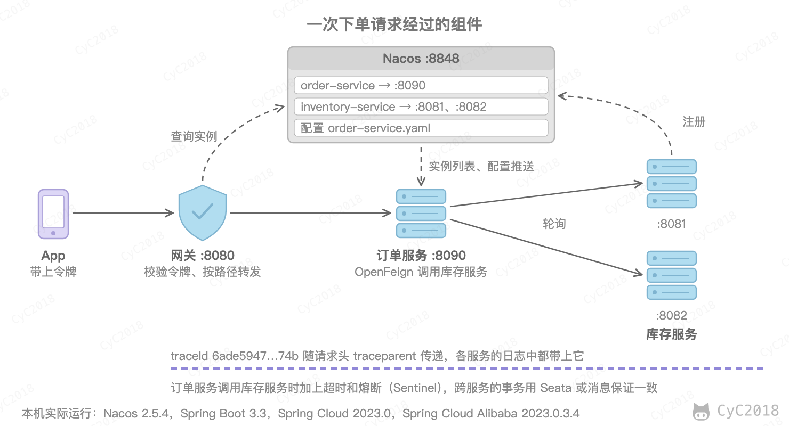
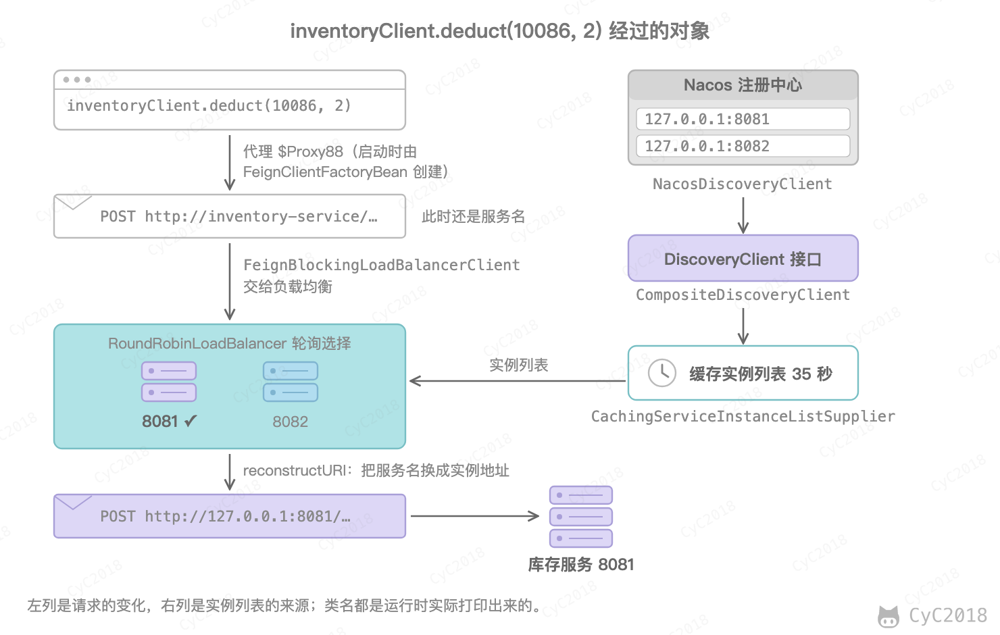
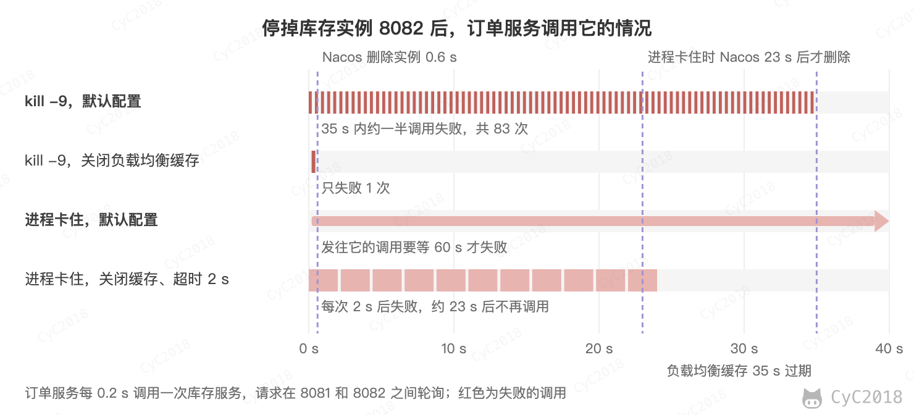
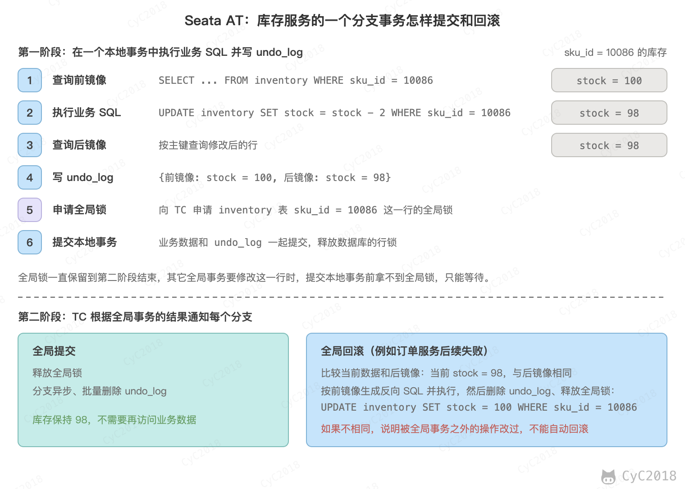

# 微服务
<!-- GFM-TOC -->
* [微服务](#微服务)
    * [一、从单体到微服务](#一从单体到微服务)
        * [服务拆分](#服务拆分)
    * [二、Spring Cloud](#二spring-cloud) 🔥🔥
        * [组件](#组件)
        * [接口与实现](#接口与实现)
        * [版本](#版本)
    * [三、注册中心](#三注册中心)
    * [四、服务调用](#四服务调用)
        * [OpenFeign](#openfeign)
        * [负载均衡策略](#负载均衡策略)
        * [实例下线后多久能感知](#实例下线后多久能感知)
        * [注册中心宕机](#注册中心宕机)
    * [五、网关](#五网关) 🔥
    * [六、配置中心](#六配置中心)
    * [七、服务保护与分布式事务](#七服务保护与分布式事务)
    * [八、链路追踪](#八链路追踪)
    * [九、灰度发布](#九灰度发布)
    * [附录：实测](#附录实测)
        * [A1 实验环境](#a1-实验环境)
        * [A2 实例下线](#a2-实例下线)
        * [A3 注册中心宕机](#a3-注册中心宕机)
        * [A4 链路追踪](#a4-链路追踪)
        * [A5 调用失败时的重试与降级](#a5-调用失败时的重试与降级)
    * [参考资料](#参考资料)
<!-- GFM-TOC -->


## 一、从单体到微服务

一个商城最初通常是单体应用：用户、商品、库存、订单、支付的代码在同一个工程中，部署成一个进程，共用一个数据库。微服务指的是把系统按业务拆成多个独立部署的服务，每个服务有自己的数据库，服务之间通过网络调用。例如下单时，订单服务要通过网络调用库存服务扣减库存，而不是调用同一个进程中的方法。

微服务与分布式的关系：分布式只说明系统由多台机器上的进程协作完成，例如一个应用部署多个实例；微服务是分布式系统的一种架构方式，进一步要求按业务拆分、独立部署、各自维护数据。

拆分带来的好处：

- 独立部署：修改库存服务只需重新发布库存服务；
- 独立扩容：大促时只给订单服务和库存服务增加实例；
- 故障隔离：支付服务出问题时，用户仍然可以浏览商品；
- 团队独立：每个团队负责几个服务，可以各自开发和发布。

代价同样明显：

- 方法调用变成了网络调用，可能超时和失败，需要处理超时、重试和熔断；
- 一个数据库事务变成了跨服务的分布式事务；
- 一个请求经过多个服务，排查问题需要链路追踪；
- 服务和实例的数量增加，部署和监控的成本更高。

因此团队规模小、业务还在快速变化时，单体应用加上清晰的模块划分往往更合适；当各个模块的发布互相阻塞，或者某些模块需要单独扩容时，再考虑拆分。

### 服务拆分

拆分的依据是业务边界，而不是技术上的分层。判断方法是看数据：经常被一起修改、需要在同一个事务中保证一致的数据，应该放在同一个服务中。例如订单和订单明细放在订单服务，库存放在库存服务。

拆分之后每个服务只能访问自己的数据库，订单服务不能再用 JOIN 查询用户表中的用户名。常见的做法有两种：调用用户服务的接口查询；或者在下单时把用户名、商品名称和价格作为快照保存到订单表中，商品之后改名、改价，订单中记录的仍然是下单时的信息。

拆分已有的单体时通常逐步进行：先拆变化快、压力大的模块，新功能直接写在新服务中，网关把对应的请求转发给新服务，旧功能再一点点迁出。数据库也是先理清每个模块用到哪些表，消除跨模块的 JOIN 和事务，最后再分库。

## 二、Spring Cloud 🔥🔥

服务拆分之后，每个服务都要解决同样的问题：去哪里找其它服务的实例、选择哪个实例、配置放在哪里、下游故障时怎么办。Spring Cloud 是一组基于 Spring Boot 的项目，把这些问题抽象成统一的接口和配置方式，具体的实现由不同的项目提供。

Spring Cloud 与 Spring Boot 的关系：Spring Boot 用来快速构建单个服务，Spring Cloud 处理多个服务之间的协作。每个 Spring Cloud 组件都是一个 starter，依靠 Spring Boot 的 [自动配置](Spring.md#四spring-boot-自动配置) 生效。例如引入 spring-cloud-starter-alibaba-nacos-discovery 后，它的 jar 包中列出了 NacosDiscoveryAutoConfiguration、NacosServiceRegistryAutoConfiguration 等 10 个自动配置类，应用启动时就会自动注册到 Nacos，不需要写任何代码。

### 组件

| 要解决的问题 | Spring Cloud 中的项目 | Spring Cloud Alibaba | Netflix 的早期组件 |
| --- | --- | --- | --- |
| 服务的实例在哪里 | DiscoveryClient 接口 | Nacos | Eureka |
| 选择哪个实例 | Spring Cloud LoadBalancer | Nacos 的权重负载均衡 | Ribbon |
| 怎么调用其它服务 | OpenFeign | — | Feign |
| 配置的集中管理和动态修改 | Spring Cloud Config | Nacos | Archaius |
| 外部请求从哪里进入 | Spring Cloud Gateway | — | Zuul |
| 下游故障时怎么保护自己 | Spring Cloud Circuit Breaker（Resilience4j） | Sentinel | Hystrix |
| 跨服务的事务 | — | Seata | — |
| 一个请求经过了哪些服务 | Micrometer Tracing | — | — |

早期的 Spring Cloud 项目大多使用 Netflix 的组件。其中 Ribbon、Hystrix、Zuul 1、Archaius 1 在 2018 年进入维护模式，在 2020.0 版本中被移除，分别由 Spring Cloud LoadBalancer、Resilience4j、Spring Cloud Gateway 和 Spring Boot 的外部配置加 Spring Cloud Config 取代；Eureka 不在其中，仍在维护。链路追踪原来的 Spring Cloud Sleuth 不支持 Spring Boot 3，核心部分已经移到了 Micrometer Tracing。

国内常用的组合是 Spring Cloud Alibaba：Nacos 同时作为注册中心和配置中心，Sentinel 负责限流和熔断，Seata 负责分布式事务，服务调用和网关仍然使用 Spring Cloud 自己的 OpenFeign 和 Gateway。

Spring Cloud 与 Dubbo 的区别：Spring Cloud 是覆盖服务发现、配置、网关、熔断的一整套组件，服务之间默认通过 HTTP 调用；Dubbo 从 RPC 框架发展而来，重点是高性能的服务调用和服务治理。两者并不互斥，Dubbo 也可以使用 Nacos 作为注册中心。

下面的例子都实际运行过：网关、订单服务各一个实例，库存服务两个实例，订单服务通过 OpenFeign 调用库存服务扣减库存。

<div align="center">  </div><br>

### 接口与实现

Spring Cloud Commons 定义了服务发现、负载均衡等接口，例如 DiscoveryClient 表示“按服务名查询实例”。业务代码只依赖这个接口：

```java
@RestController
class InstanceController {
    private final DiscoveryClient discoveryClient;    // Spring Cloud Commons 中的接口

    InstanceController(DiscoveryClient discoveryClient) {
        this.discoveryClient = discoveryClient;
    }

    @GetMapping("/instances")
    List<String> instances() {
        return discoveryClient.getInstances("inventory-service").stream()
                .map(i -> i.getHost() + ":" + i.getPort())
                .toList();
    }
}
```

引入了 Nacos 的 starter 时，注入的 DiscoveryClient 是 CompositeDiscoveryClient，它依次询问 NacosDiscoveryClient 和 Spring Cloud 自带的 SimpleDiscoveryClient，/instances 返回 ["127.0.0.1:8081","127.0.0.1:8082"]。

接着关闭 Nacos 的服务发现，在配置文件中写死实例的地址：

```yaml
spring:
  cloud:
    nacos:
      discovery:
        enabled: false
    discovery:
      client:
        simple:
          instances:
            inventory-service:
              - uri: http://127.0.0.1:8081
```

代码不用修改，/instances 返回 ["127.0.0.1:8081"]，OpenFeign 的调用也全部落到了 8081。换成 Consul、Eureka 等注册中心也是同样的道理：替换依赖和配置，业务代码不变。

### 版本

Spring Cloud 以发布列车（release train）的方式发版，版本号由年份和序号组成，每个版本还有一个代号，例如 2023.0 的代号是 Leyton。每个版本只兼容特定的 Spring Boot 版本：

| Spring Cloud | Spring Boot |
| --- | --- |
| 2025.1（Oakwood） | 4.0、4.1 |
| 2025.0（Northfields） | 3.5 |
| 2024.0（Moorgate） | 3.4 |
| 2023.0（Leyton） | 3.2、3.3 |

截至 2026 年 10 月，2025.0 及更早的版本已经结束开源支持。

Spring Cloud Alibaba 的版本号前缀与 Spring Cloud 一致，例如 2023.0.3.4 对应 Spring Cloud 2023.0。为了避免组件之间的版本不匹配，通常在父工程中导入 Spring Cloud 和 Spring Cloud Alibaba 的 BOM，子模块引入依赖时不再写版本号。本文的例子使用的组合如下（实验环境见[附录 A1](#a1-实验环境)），版本的对应关系以官方最新的说明为准：

```xml
<parent>
    <groupId>org.springframework.boot</groupId>
    <artifactId>spring-boot-starter-parent</artifactId>
    <version>3.3.5</version>
</parent>

<dependencyManagement>
    <dependencies>
        <dependency>
            <groupId>org.springframework.cloud</groupId>
            <artifactId>spring-cloud-dependencies</artifactId>
            <version>2023.0.3</version>
            <type>pom</type>
            <scope>import</scope>
        </dependency>
        <dependency>
            <groupId>com.alibaba.cloud</groupId>
            <artifactId>spring-cloud-alibaba-dependencies</artifactId>
            <version>2023.0.3.4</version>
            <type>pom</type>
            <scope>import</scope>
        </dependency>
    </dependencies>
</dependencyManagement>
```

## 三、注册中心

注册中心的基本原理见 [服务发现](分布式.md#服务发现)。库存服务启动后，Nacos 中记录的实例信息如下（省略了部分字段）：

```json
{
  "ip": "127.0.0.1", "port": 8081,
  "weight": 1.0, "healthy": true, "enabled": true, "ephemeral": true,
  "metadata": {"preserved.register.source": "SPRING_CLOUD"}
}
```

weight 用于按权重分配流量；metadata 可以存放版本号等自定义信息，灰度发布时会用到；ephemeral 表示临时实例，Spring Cloud 应用默认注册为临时实例。

Nacos 2.x 的客户端与服务端之间保持一个 gRPC 长连接，端口为主端口加 1000（默认 9848）。临时实例依附于这个连接，连接断开，服务端就删除这个实例。持久化实例保存在服务端，客户端断开后不会被删除，只会被标记为不健康，通常由运维通过控制台或者接口维护。

Nacos 与 Eureka 的区别：

- 发现实例下线：Eureka 的客户端每 30 秒发送一次心跳，租约默认 90 秒过期（实现上实际约 180 秒），短时间内大量实例续约失败时还会进入自我保护，暂停删除实例。Nacos 2.x 依靠长连接发现客户端断开，本文实测进程退出后 0.6 秒就删除了实例（见[附录 A2](#a2-实例下线)）；
- 通知调用方：Eureka 的客户端每 30 秒拉取一次实例列表的变化，Nacos 把实例的变化推送给订阅者；
- 功能：Eureka 只是注册中心，Nacos 同时也是配置中心。

Nacos 与 ZooKeeper 的区别：Nacos 的临时实例使用自研的 Distro 协议，每个节点都保存全部数据，网络分区时仍然可以返回实例列表，属于 [AP](分布式.md#权衡)（持久化实例使用 Raft，属于 CP）；ZooKeeper 是 CP 的，只有多数节点可用时才能提供服务。服务发现可以容忍短暂的数据不一致，却不能接受注册中心不可用，所以更适合 AP。

## 四、服务调用

### OpenFeign

订单服务调用库存服务时，只需声明一个接口：

```java
@FeignClient(name = "inventory-service")
interface InventoryClient {
    @PostMapping("/inventory/deduct")
    Map<String, Object> deduct(@RequestParam("skuId") long skuId, @RequestParam("count") int count);
}
```

```java
Map<String, Object> result = inventoryClient.deduct(10086, 2);
```

注入的 inventoryClient 是 JDK 动态代理生成的对象，运行时打印它的类名为 $Proxy88。调用 deduct() 时：

1. 代理根据注解拼出 HTTP 请求 POST /inventory/deduct?skuId=10086&count=2；
2. Spring Cloud LoadBalancer 从 inventory-service 的实例列表中选出一个实例，默认轮询，连续下单 6 次依次落在 8082、8081、8082、8081、8082、8081；
3. 把请求发给选中的实例，再把响应的 JSON 转换为返回值。

@FeignClient 注解的接口没有实现类，却能直接注入使用，过程如下：

- 启动时，@EnableFeignClients 导入 FeignClientsRegistrar，它扫描所有带 @FeignClient 的接口，为每个接口注册一个 FeignClientFactoryBean 类型的 Bean 定义；
- 创建 Bean 时，FeignClientFactoryBean 把服务名拼成 http://inventory-service，用 JDK 动态代理生成接口的实现，也就是上面的 $Proxy88；
- 调用时，代理把方法和参数转换成 HTTP 请求，交给 FeignBlockingLoadBalancerClient，它通过 Spring Cloud LoadBalancer 选出一个实例，把 URL 中的服务名换成实例的地址后再发送。

<div align="center">  </div><br>

下文实例下线实验中 35 秒的延迟，就来自图中 CachingServiceInstanceListSupplier 的缓存。

原理与 [RPC 的调用过程](分布式.md#调用过程) 相同，只是 OpenFeign 使用 HTTP + JSON，而 Dubbo 默认使用 TCP 上的二进制协议。Spring Cloud 项目常用 OpenFeign，因为它的注解与 Spring MVC 一致，被调用的就是普通的 HTTP 接口；调用量大、对延迟敏感的内部服务可以选择 Dubbo 或者 gRPC，原因见 [RPC 与 HTTP](分布式.md#rpc-与-http)。

服务之间不通过 Nginx 转发，是因为 Nginx 是集中式的代理：每次调用都要多经过一跳，Nginx 本身也要做高可用，实例变化时还要更新它的配置。客户端负载均衡由调用方直接从注册中心获取实例列表并选择实例，没有中间这一跳。

需要注意的是，OpenFeign 默认的连接超时为 10 秒、读取超时为 60 秒。下游实例卡住时，实测订单服务要等 60 秒才失败，期间一直占用一个线程，所以要按接口的实际耗时设置超时：

```yaml
spring:
  cloud:
    openfeign:
      client:
        config:
          default:
            connect-timeout: 500
            read-timeout: 2000
```

OpenFeign 默认不重试，调用失败时异常直接抛给业务代码，[实例下线](#实例下线后多久能感知)后、负载均衡缓存过期前，选中这个实例的调用都会失败。常见的做法是再加两层（见[附录 A5](#a5-调用失败时的重试与降级)）：

- 重试：引入 spring-retry 后，GET 请求遇到连接失败、读取超时这类异常时，Spring Cloud LoadBalancer 默认换一个实例再试一次，POST 不重试。扣库存这类写操作要带上请求 ID、由服务方去重后才能重试，见 [超时与重试](分布式.md#超时与重试)；
- 降级：开启 spring.cloud.openfeign.circuitbreaker.enabled 并引入熔断器的实现（例如 Resilience4j），在 @FeignClient 的 fallback 中指定一个实现同一接口的 Bean，调用失败或者熔断时返回它给出的默认值，例如“库存查询失败时先显示有货”。

Spring Cloud OpenFeign 已经只做维护、不再增加新功能。新项目也可以用 Spring Framework 6 的 HTTP 接口客户端（@HttpExchange），用标注了 @LoadBalanced 的 RestClient.Builder 构建 RestClient，再由 HttpServiceProxyFactory 生成接口的代理，同样按服务名调用。

### 负载均衡策略

Spring Cloud LoadBalancer 默认使用 RoundRobinLoadBalancer 轮询，还提供 RandomLoadBalancer 随机选择。早期的 Ribbon 通过 IRule 接口配置策略，已经在 2020.0 版本中移除。

轮询不考虑机器之间的差异。例如 8081 所在的机器配置更高，启动时用 spring.cloud.nacos.discovery.weight 把它在 Nacos 中的权重设为 3，8082 保持 1，再各调用 400 次：

| 负载均衡 | 8081（权重 3） | 8082（权重 1） |
| --- | --- | --- |
| 默认的 RoundRobinLoadBalancer | 200 | 200 |
| RandomLoadBalancer | 203 | 197 |
| NacosLoadBalancer | 303 | 97 |

默认的轮询和随机都不读取 Nacos 中的权重。把 spring.cloud.loadbalancer.nacos.enabled 设为 true 后，Spring Cloud Alibaba 用 NacosLoadBalancer 替换默认的实现，它优先选择与调用方在同一个集群（cluster-name）中的实例，再按权重随机选择。

为某个服务指定其它策略时，用 @LoadBalancerClient 引用一个配置类：

```java
@Configuration
@LoadBalancerClient(name = "inventory-service", configuration = RandomConfiguration.class)
class LoadBalancerConfig {
}

// 不加 @Configuration，或者放在组件扫描的范围之外，这样只对 inventory-service 生效
public class RandomConfiguration {
    @Bean
    ReactorLoadBalancer<ServiceInstance> randomLoadBalancer(Environment environment,
            LoadBalancerClientFactory factory) {
        String name = environment.getProperty(LoadBalancerClientFactory.PROPERTY_NAME);
        return new RandomLoadBalancer(factory.getLazyProvider(name, ServiceInstanceListSupplier.class), name);
    }
}
```

需要自定义规则时，例如只选择元数据中 version 为 v2 的实例，可以参照 RandomLoadBalancer 实现 ReactorServiceInstanceLoadBalancer 接口，再用同样的方式注册。

### 实例下线后多久能感知

注册中心删除实例之后，调用方并不会立刻停止调用它。下面让订单服务每 0.2 秒调用一次库存服务，再用三种方式停掉 8082（见[附录 A2](#a2-实例下线)）：

<div align="center">  </div><br>

| 停止方式 | Nacos 删除实例 | 默认配置 | 关闭负载均衡缓存，读取超时 2 秒 |
| --- | --- | --- | --- |
| kill -9，进程退出 | 0.6 s | 35 s 内约一半调用失败，共 83 次 | 失败 1 次 |
| 正常关闭 | 0.6 s | 33 s 内失败 77 次 | 失败 1 次 |
| kill -STOP，进程卡住 | 23 s | 发往它的调用要等 60 s 才失败 | 每次 2 s 后失败，约 23 s 后不再调用 |

原因有两个：

- 负载均衡缓存：Spring Cloud LoadBalancer 默认把实例列表缓存 35 秒，Nacos 已经删除了实例，调用方在缓存过期前仍然会选中它。Nacos 客户端会接收服务端推送的实例变化并保存在本地，所以可以关闭这层缓存（spring.cloud.loadbalancer.cache.enabled 设为 false），Spring Cloud 的文档也建议在服务发现客户端已有缓存时关闭，避免重复缓存；
- 连接没有断开：进程退出或者正常关闭时连接随之断开，Nacos 立刻删除实例；进程卡住、机器宕机或者网络中断时连接并没有断开，Nacos 要等健康检查超时才能发现，实测为 23 秒。这段时间只能靠调用方的超时和熔断尽快放弃这个实例。

### 注册中心宕机

停掉 Nacos 后：

- 已经运行的订单服务仍然可以调用库存服务，因为实例列表已经缓存在本地；
- 新启动的订单服务默认无法启动：spring.cloud.nacos.discovery.fail-fast 默认为 true，注册失败时直接报错退出。把它设为 false 后可以启动，配置也能从本地快照读取，但调用库存服务时报错 No servers available for service: inventory-service，因为新进程从没有拿到过实例列表（见[附录 A3](#a3-注册中心宕机)）。

所以注册中心宕机不会立刻影响线上的调用，但扩容和发布都无法进行，生产环境中 Nacos 要以集群方式部署。

## 五、网关 🔥

外部请求不应该直接访问各个服务：客户端要知道每个服务的地址，每个服务也都要各自做鉴权、限流。网关是所有外部请求的统一入口，负责：

- 路由：按路径把请求转发给对应的服务，例如把 /api/orders/** 转发给订单服务；
- 鉴权：校验令牌，拒绝未登录的请求；
- 限流、日志、跨域等每个服务都需要的处理。

Spring Cloud Gateway 的路由配置：

```yaml
spring:
  cloud:
    gateway:
      routes:
        - id: order
          uri: lb://order-service    # 从注册中心获取 order-service 的实例并负载均衡
          predicates:
            - Path=/api/orders/**
          filters:
            - StripPrefix=1          # 去掉 /api，转发为 /orders/**
```

这是 2023.0 的写法，2025.0 起 starter 改名为 spring-cloud-starter-gateway-server-webflux，配置前缀改为 spring.cloud.gateway.server.webflux。

鉴权通常放在网关：网关校验令牌（例如 [JWT](HTTP.md#11-jwt)），取出用户 ID 放进请求首部，下游服务直接使用这个首部，不再重复校验：

```java
@Bean
GlobalFilter auth() {
    return (exchange, chain) -> {
        String userId = verify(exchange.getRequest().getHeaders().getFirst("Authorization"));
        if (userId == null) {
            exchange.getResponse().setStatusCode(HttpStatus.UNAUTHORIZED);
            return exchange.getResponse().setComplete();
        }
        return chain.filter(exchange.mutate()
                .request(r -> r.headers(h -> h.set("X-User-Id", userId))).build());
    };
}
```

实测不带令牌或者令牌错误时，网关返回 401；带上正确的令牌时，订单服务收到 X-User-Id: 1024。需要注意两点：

- 用 set 而不是 add：客户端自己带上 X-User-Id: 1 时会被覆盖，实测订单服务收到的仍然是 1024；
- 下游服务信任网关传来的首部，所以这些服务本身不能对外暴露，只能通过网关访问。

网关与 Nginx 并不冲突：Nginx 通常在最外层负责 TLS 和多个网关实例之间的负载均衡，网关在它后面按服务路由，并处理鉴权这类与业务相关的逻辑。

## 六、配置中心

每个服务有多个实例，如果配置写在各自的配置文件中，修改一个参数就要改所有实例并重启。配置中心集中保存配置，修改后推送给运行中的实例。放在配置中心的通常是各环境不同或需要运行时调整的配置，例如数据库地址、功能开关、限流阈值。

订单服务从 Nacos 读取名为 order-service.yaml 的配置：

```yaml
spring:
  config:
    import: optional:nacos:order-service.yaml
```

```java
@RestController
@RefreshScope
class OrderController {
    @Value("${order.max-items:10}")
    int maxItems;
}
```

在 Nacos 中把 order.max-items 从 5 改为 8，306 ms 后订单服务就读到了新值，不需要重启。

这是因为配置变化后，Nacos 2.x 通过 gRPC 长连接推送一条变更通知（只说明哪个配置变了），客户端再查询新的内容；@RefreshScope 的 Bean 是一个代理，配置刷新时缓存的实例被丢弃，下次调用时用新的配置重新创建。

Spring Cloud 2020.0 起默认不再加载 bootstrap.yml，配置中心的配置改为通过上面的 spring.config.import 导入。

客户端还会在本地保存配置的快照（~/nacos/config 目录下）。Nacos 不可用时，实测新启动的订单服务从快照中读到了 max-items: 8。

## 七、服务保护与分布式事务

服务之间调用越多，一个服务变慢就越容易拖垮调用它的服务：上面卡住的库存实例让每次调用等待 60 秒，订单服务的线程会被逐渐占满。限流、降级和熔断的原理见 [限流、降级与熔断](系统设计基础.md#限流降级与熔断)。

Spring Cloud Alibaba 中常用 Sentinel 实现：把接口或者一段代码定义为资源，再为资源配置规则。熔断规则可以按慢调用比例、异常比例或者异常数触发，熔断时长过后进入半开状态，放行一个请求试探，成功就结束熔断，失败就继续熔断。

跨服务的数据一致性见 [分布式事务](分布式.md#二分布式事务)。Seata 的 AT 模式对业务代码的改动最少，以下单时订单服务创建订单、库存服务扣减库存为例：

1. 第一阶段：每个服务执行自己的 SQL，并在同一个本地事务中写入 undo_log，记录被修改的行修改前后的值，然后提交本地事务。提交前要先获得这些行的全局锁，防止其它全局事务同时修改它们；
2. 全局事务成功时，第二阶段异步删除 undo_log；
3. 全局事务失败时，第二阶段按 undo_log 中修改前的值生成反向的 SQL，例如库存服务把扣掉的库存加回去。

库存服务中的一个分支事务如下图，商品 10086 的库存从 100 扣成 98：

<div align="center">  </div><br>

AT 与 XA 两阶段提交的区别在于锁持有的时间：XA 的第一阶段只准备、不提交，行锁一直持有到第二阶段；AT 的第一阶段就提交了本地事务、释放行锁，只靠全局锁阻止其它全局事务修改这些行，所以并发更高。代价有两个：

- 其它事务在第二阶段之前就能读到 98，即默认的全局隔离级别是读未提交，需要读已提交时用 SELECT ... FOR UPDATE 等待全局锁；
- 全局锁只对 Seata 管理的事务有效，其它代码直接改了这些行时，回滚前发现当前值与后镜像不一致，只能人工处理。

## 八、链路追踪

一个下单请求依次经过网关、订单服务和库存服务，出错时需要知道是哪一步出了错、每一步耗时多少。链路追踪为每个请求分配一个 traceId，调用下游时通过 HTTP 首部传递，各个服务打印日志和上报耗时的时候都带上它。

在上面的服务中加入 Micrometer Tracing 后，同一次下单在订单服务和库存服务中打印的日志如下，方括号中依次是 traceId 和 spanId（见[附录 A4](#a4-链路追踪)）：

```text
[order-service]     [6ade5947250103822ff3f13a5baab74b-2763eeac981ce4a4] 创建订单 userId=1024
[inventory-service] [6ade5947250103822ff3f13a5baab74b-92a95370047818fb] 扣减库存 skuId=10086
```

库存服务收到的请求首部为：

```text
traceparent: 00-6ade5947250103822ff3f13a5baab74b-64990a2774676e11-01
```

traceparent 是 W3C Trace Context 规定的格式，四段依次是版本、traceId、调用方这次请求的 spanId（这里是订单服务发起 HTTP 调用的 span）和采样标记。每个服务处理请求时生成自己的 spanId，并记下父 spanId，这些 span 上报到 Zipkin、SkyWalking 等系统后，就能按 traceId 还原出完整的调用树和每一段的耗时。用 traceId 在日志系统中搜索，也能找到这个请求在所有服务中的日志。

## 九、灰度发布

新版本上线时，常用的发布方式：

- 滚动发布：逐个替换旧的实例，占用的资源少，但一段时间内新旧版本同时运行；
- 蓝绿发布：准备一整套新环境，验证后把流量一次切过去，回滚时切回即可，但需要双倍的资源；
- 灰度发布（金丝雀发布）：先让一小部分流量进入新版本，观察错误率和耗时，没有问题再逐步扩大比例。

灰度发布可以借助注册中心和网关实现。新版本注册为单独的服务名，例如 order-service-v2，网关为新旧服务各配一条路由，用 Spring Cloud Gateway 的 Weight 断言按 90%、10% 分配，或者按用户、请求首部选择路由；发现问题时把新版本的比例调回 0 即可回滚。新旧实例共用服务名、只在元数据中带上 version=v2 时，还要[自定义负载均衡](#负载均衡策略)按版本筛选实例。

需要注意的是，新旧版本会同时访问同一个数据库，表结构的修改必须同时兼容两个版本。例如先只增加新列，等旧版本全部下线后，再删除不再使用的旧列。

## 附录：实测

### A1 实验环境

Apple M1 Pro，macOS 15，JDK 21，Spring Boot 3.3.5、Spring Cloud 2023.0.3、Spring Cloud Alibaba 2023.0.3.4，Nacos 2.5.4 单机模式。所有服务运行在本机：网关 8080、订单服务 8090、库存服务 8081 和 8082，启动时用 --spring.cloud.nacos.discovery.ip=127.0.0.1 注册本机地址。正文中的调用次数、耗时都来自这套环境，每次运行的数字会略有差异。

### A2 实例下线

脚本先启动 8082，确认订单服务能调用到它之后，用指定的方式停止 8082；随后 60 秒内每 0.2 秒调用一次订单服务的下单接口（超时 3 秒），记下每次落在哪个端口、是否失败，同时另一个线程每 0.2 秒查询一次 Nacos，记下 8082 从实例列表中消失的时间：

```python
os.kill(pid, {"kill -9": signal.SIGKILL, "kill -STOP": signal.SIGSTOP, "SIGTERM": signal.SIGTERM}[mode])
while time.time() - t0 < 60:
    s = time.time()
    try:
        r = json.loads(urlopen(Request("http://127.0.0.1:8090/orders", method="POST"), timeout=3).read())
        out = r["inventoryPort"]
    except Exception as e:
        out = "超时" if "timed out" in str(e) else "失败"
    events.append((round(s - t0, 1), out))
    time.sleep(0.2)

# 查询 Nacos 的线程
hosts = json.loads(urlopen("http://127.0.0.1:8848/nacos/v1/ns/instance/list?serviceName=inventory-service").read())["hosts"]
```

“关闭负载均衡缓存，读取超时 2 秒”一列在订单服务启动时加上 spring.cloud.loadbalancer.cache.enabled=false 和 OpenFeign 的 read-timeout: 2000。统计结果见[实例下线后多久能感知](#实例下线后多久能感知)中的表格。

### A3 注册中心宕机

停掉 Nacos 后启动新的订单服务。默认配置下注册失败，启动中止：

```text
ERROR ... NacosServiceRegistry : nacos registry, order-service register failed...
com.alibaba.nacos.api.exception.NacosException: Client not connected, current status:STARTING
WARN  ... Exception encountered during context initialization - cancelling refresh attempt
org.springframework.context.ApplicationContextException: Failed to start bean 'webServerStartStop'
```

加上 spring.cloud.nacos.discovery.fail-fast=false 后可以启动，调用库存服务时失败：

```text
WARN  ... NacosServiceRegistry : Failfast is false. order-service register failed...
INFO  ... Started OrderApp in 2.53 seconds (process running for 2.777)
WARN  ... RoundRobinLoadBalancer : No servers available for service: inventory-service
WARN  ... FeignBlockingLoadBalancerClient : Load balancer does not contain an instance for the service inventory-service
```

### A4 链路追踪

库存服务中打印 traceparent 首部，某一次运行的日志如下（traceId 与正文的例子不是同一次请求）：

```text
[inventory-service] [6ade5f4e849a3ac47ccc3cdb7dd195a0-01b064dce8abb5e0] 扣减库存 skuId=10086，traceparent=00-6ade5f4e849a3ac47ccc3cdb7dd195a0-5f83fda61e8bee64-01
```

traceparent 中的 traceId 与日志中的相同，第三段 5f83fda61e8bee64 是订单服务发起调用的 span，库存服务的 spanId 01b064dce8abb5e0 是它自己生成的。

### A5 调用失败时的重试与降级

环境同 A1，不启动 Nacos：订单服务用静态实例列表配置 inventory-service 的两个实例，一个正常运行，另一个端口没有进程监听（连接被拒绝），并关闭负载均衡缓存。@FeignClient 加上 fallback = InventoryFallback.class，InventoryFallback 实现同一接口、返回默认值，并用 @Component 注册为 Bean。分别用 GET 查询库存和 POST 扣减库存连续调用 10 次：

```text
默认依赖                         GET：成功 5，失败 5（RetryableException）  POST：成功 5，失败 5
加上 spring-retry                GET：成功 10                              POST：成功 5，失败 5
再开启 openfeign.circuitbreaker  GET：成功 10                              POST：成功 5，降级 5
```

加上 spring-retry 后 POST 仍有 5 次失败，说明失败的 POST 没有换到正常的实例重试；库存服务共执行 15 次扣减，没有重复扣减。

## 参考资料

- [Spring Cloud](https://spring.io/projects/spring-cloud)
- [Spring Cloud Greenwich.RC1 Available Now](https://spring.io/blog/2018/12/12/spring-cloud-greenwich-rc1-available-now)
- [Spring Cloud 2020.0 Release Notes](https://github.com/spring-cloud/spring-cloud-release/wiki/Spring-Cloud-2020.0-Release-Notes)
- [Spring Cloud Sleuth](https://docs.spring.io/spring-cloud-sleuth/docs/current/reference/html/)
- [Spring Cloud Circuit Breaker](https://docs.spring.io/spring-cloud-circuitbreaker/reference/)
- [Spring Cloud Alibaba 版本说明](https://sca.aliyun.com/en/docs/2023/overview/version-explain/)
- [Understanding Eureka Client Server Communication](https://github.com/Netflix/eureka/wiki/Understanding-eureka-client-server-communication)
- [Nacos: Instance Lifecycle](https://nacos.io/en/docs/latest/manual/user/naming/instance-lifecycle/)
- [Nacos 2.0 兼容性文档](https://nacos.io/docs/latest/upgrading/200-compatibility/)
- [Nacos 的 Distro 一致性协议](https://nacos.io/en/news/article-nacos-distro-mechanism/)
- [Nacos Java SDK](https://nacos.io/docs/latest/manual/user/java-sdk/usage/)
- [ZooKeeper: Overview](https://zookeeper.apache.org/doc/current/zookeeperOver.html)
- [Spring Cloud Commons: Spring Cloud LoadBalancer](https://docs.spring.io/spring-cloud-commons/reference/spring-cloud-commons/loadbalancer.html)
- [Spring Cloud Commons: Refresh Scope](https://docs.spring.io/spring-cloud-commons/reference/spring-cloud-commons/application-context-services.html)
- [Spring Cloud OpenFeign](https://docs.spring.io/spring-cloud-openfeign/reference/)
- [Spring Cloud Gateway: Route Predicate Factories](https://docs.spring.io/spring-cloud-gateway/reference/spring-cloud-gateway-server-webflux/request-predicates-factories.html)
- [Sentinel 熔断降级](https://sentinelguard.io/zh-cn/docs/circuit-breaking.html)
- [Seata AT 模式](https://seata.apache.org/docs/dev/mode/at-mode/)
- [W3C Trace Context](https://www.w3.org/TR/trace-context/)
