# 数据库系统原理
<!-- GFM-TOC -->
* [数据库系统原理](#数据库系统原理)
    * [一、事务](#一事务)
        * [概念](#概念)
        * [ACID](#acid)
        * [AUTOCOMMIT](#autocommit)
    * [二、并发一致性问题](#二并发一致性问题)
        * [丢失修改](#丢失修改)
        * [脏读](#脏读)
        * [不可重复读](#不可重复读)
        * [幻读](#幻读)
    * [三、封锁](#三封锁)
        * [封锁粒度](#封锁粒度)
        * [封锁类型](#封锁类型)
        * [封锁协议](#封锁协议)
        * [MySQL 隐式与显式锁定](#mysql-隐式与显式锁定)
        * [MySQL 中的锁](#mysql-中的锁)
    * [四、隔离级别](#四隔离级别)
        * [未提交读（READ UNCOMMITTED）](#未提交读read-uncommitted)
        * [提交读（READ COMMITTED）](#提交读read-committed)
        * [可重复读（REPEATABLE READ）](#可重复读repeatable-read)
        * [可串行化（SERIALIZABLE）](#可串行化serializable)
    * [五、多版本并发控制](#五多版本并发控制)
        * [基本思想](#基本思想)
        * [版本号](#版本号)
        * [Undo 日志](#undo-日志)
        * [ReadView](#readview)
        * [快照读与当前读](#快照读与当前读)
    * [六、Next-Key Locks](#六next-key-locks)
        * [Record Locks](#record-locks)
        * [Gap Locks](#gap-locks)
        * [Next-Key Locks](#next-key-locks)
    * [七、关系数据库设计理论](#七关系数据库设计理论)
        * [函数依赖](#函数依赖)
        * [异常](#异常)
        * [范式](#范式)
    * [八、ER 图](#八er-图)
        * [实体的三种联系](#实体的三种联系)
        * [表示出现多次的关系](#表示出现多次的关系)
        * [联系的多向性](#联系的多向性)
        * [表示子类](#表示子类)
    * [附录：实测](#附录实测)
        * [A1 并发一致性问题](#a1-并发一致性问题)
        * [A2 可串行化与快照读](#a2-可串行化与快照读)
        * [A3 事务 ID 的分配](#a3-事务-id-的分配)
        * [A4 快照读与当前读混用](#a4-快照读与当前读混用)
        * [A5 Next-Key Locks 的加锁范围](#a5-next-key-locks-的加锁范围)
        * [A6 没有索引时的加锁](#a6-没有索引时的加锁)
        * [A7 元数据锁的等待](#a7-元数据锁的等待)
        * [A8 长事务与版本链](#a8-长事务与版本链)
    * [参考资料](#参考资料)
<!-- GFM-TOC -->


## 一、事务

### 概念

事务指的是满足 ACID 特性的一组操作，可以通过 Commit 提交一个事务，也可以使用 Rollback 进行回滚。

<div align="center"> 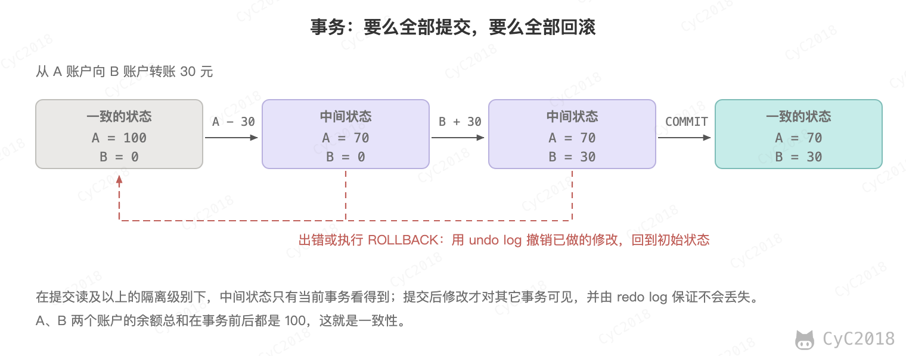 </div><br>

### ACID

#### 1. 原子性（Atomicity）

事务被视为不可分割的最小单元，事务的所有操作要么全部提交成功，要么全部失败回滚。

回滚可以用回滚日志（Undo Log）来实现，回滚日志记录着事务所执行的修改操作，在回滚时反向执行这些修改操作即可。

#### 2. 一致性（Consistency）

数据库在事务执行前后都保持一致性状态，即满足所有的约束和业务规则。例如转账前后，两个账户的余额总和保持不变。

#### 3. 隔离性（Isolation）

一个事务所做的修改在最终提交以前，对其它事务是不可见的。

#### 4. 持久性（Durability）

一旦事务提交，则其所做的修改将会永远保存到数据库中。即使系统发生崩溃，事务执行的结果也不能丢失。

系统发生崩溃可以用重做日志（Redo Log）进行恢复，从而实现持久性。与回滚日志记录数据的逻辑修改不同，重做日志记录的是数据页的物理修改。

----

事务的 ACID 特性概念简单，但不是很好理解，主要是因为这几个特性不是一种平级关系：

- 只有满足一致性，事务的执行结果才是正确的；
- 在无并发的情况下，事务串行执行，隔离性一定能够满足，此时只要能满足原子性，就一定能满足一致性；
- 在并发的情况下，多个事务并行执行，事务不仅要满足原子性，还需要满足隔离性，才能满足一致性；
- 事务满足持久性是为了能应对系统崩溃的情况。

在 InnoDB 中，这四个特性分别这样实现：

- 原子性：undo log 记录每次修改之前的值，回滚时用它恢复；
- 持久性：修改数据页之前先写 redo log，默认配置下事务提交时把 redo log 刷到磁盘，崩溃后重放 redo log 恢复已提交的修改，见 [MySQL 的日志](MySQL.md#七日志)；
- 隔离性：写操作加锁，普通的读操作通过 MVCC 读取快照，见 [多版本并发控制](#五多版本并发控制)；
- 一致性：由以上三者和数据库的约束（主键、唯一索引、外键）共同保证，业务规则还需要应用自己维护。

<div align="center"> 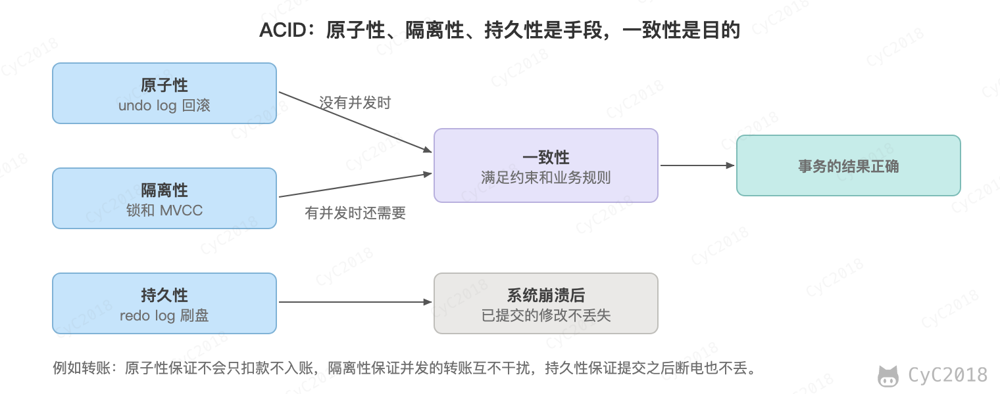 </div><br>

### AUTOCOMMIT

MySQL 默认采用自动提交模式。也就是说，如果不显式使用 START TRANSACTION 或 BEGIN 开始一个事务，那么每条语句都会被当做一个事务并自动提交。

## 二、并发一致性问题

在并发环境下，事务的隔离性很难保证，因此会出现很多并发一致性问题。以下例子中，表 account 原有 id 为 1、2 的两行，余额都是 100，图中的结果是在 MySQL 8.0 上用两个会话实际执行得到的（见[附录 A1](#a1-并发一致性问题)）。

### 丢失修改

丢失修改指一个事务的更新操作被另外一个事务的更新操作替换。例如：T<sub>1</sub> 和 T<sub>2</sub> 先后读到余额为 100，T<sub>1</sub> 取出 30 元，写回 70 并提交；T<sub>2</sub> 存入 50 元，在它读到的 100 的基础上写回 150，T<sub>1</sub> 的修改被覆盖了。

<div align="center"> 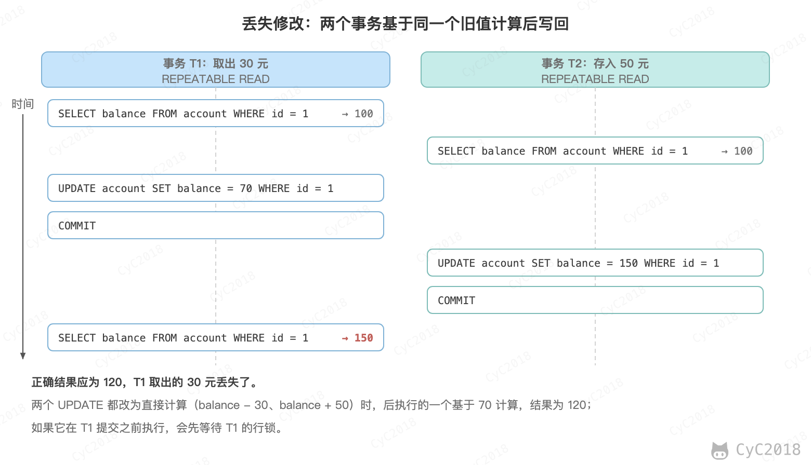 </div><br>

### 脏读

脏读指一个事务读到了另一个事务还没有提交的数据。例如：T<sub>1</sub> 修改一个数据但未提交，T<sub>2</sub> 随后读取这个数据。如果 T<sub>1</sub> 撤销了这次修改，那么 T<sub>2</sub> 读取的数据是脏数据。

<div align="center"> 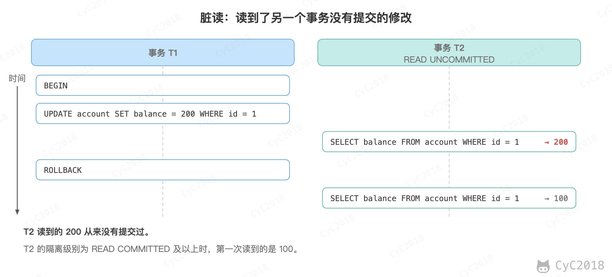 </div><br>

### 不可重复读

不可重复读指一个事务内两次读取同一行，结果不同，原因是两次读取之间另一个事务修改并提交了这一行。例如：T<sub>2</sub> 读取一个数据，T<sub>1</sub> 修改了这个数据并提交，T<sub>2</sub> 再次读取时，结果和第一次不同。

<div align="center"> 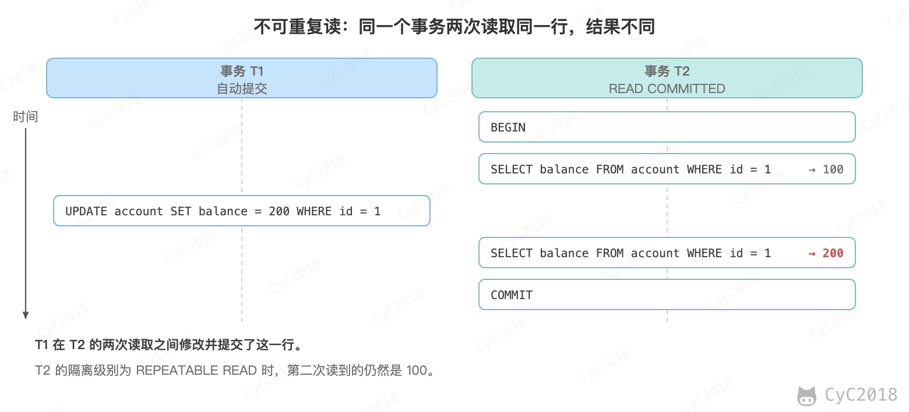 </div><br>

### 幻读

幻读本质上也属于不可重复读的情况：T<sub>2</sub> 读取某个范围的数据，T<sub>1</sub> 在这个范围内插入新的数据，T<sub>2</sub> 再次读取这个范围的数据时，多出了新插入的行。不可重复读针对的是同一行被修改，幻读针对的是范围内的行数变化。

<div align="center"> 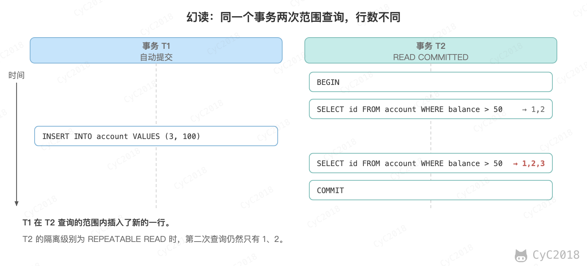 </div><br>

InnoDB 在可重复读下如何避免幻读，见 [六、Next-Key Locks](#六next-key-locks)。

----

产生并发不一致性问题的主要原因是破坏了事务的隔离性，解决方法是通过并发控制来保证隔离性。并发控制可以通过封锁来实现，但是封锁操作需要用户自己控制，相当复杂。数据库管理系统提供了事务的隔离级别，让用户以一种更轻松的方式处理并发一致性问题。

## 三、封锁

### 封锁粒度

MySQL 中提供了两种封锁粒度：行级锁以及表级锁。

应该尽量只锁定需要修改的那部分数据，而不是所有的资源。锁定的数据量越少，发生锁争用的可能就越小，系统的并发程度就越高。

但是加锁需要消耗资源，锁的各种操作（包括获取锁、释放锁、以及检查锁状态）都会增加系统开销。因此封锁粒度越小，系统开销就越大。

在选择封锁粒度时，需要在锁开销和并发程度之间做一个权衡。


### 封锁类型

#### 1. 读写锁

- 排他锁（Exclusive），简写为 X 锁，又称写锁；
- 共享锁（Shared），简写为 S 锁，又称读锁。

有以下两个规定：

- 一个事务对数据对象 A 加了 X 锁，就可以对 A 进行读取和更新，加锁期间其它事务不能对 A 加任何锁；
- 一个事务对数据对象 A 加了 S 锁，可以对 A 进行读取操作，但是不能进行更新操作，加锁期间其它事务能对 A 加 S 锁，但是不能加 X 锁。

锁的兼容关系如下：

|  | X | S |
| :---: | :---: | :---: |
| X | 冲突 | 冲突 |
| S | 冲突 | 兼容 |

#### 2. 意向锁

使用意向锁（Intention Locks）可以更容易地支持多粒度封锁。

在存在行级锁和表级锁的情况下，事务 T 想要对表 A 加 X 锁，就需要先检测是否有其它事务对表 A 或者表 A 中的任意一行加了锁，那么就需要对表 A 的每一行都检测一次，这是非常耗时的。

意向锁在原来的 X/S 锁之上引入了 IX/IS，IX/IS 都是表锁，用来表示一个事务想要在表中的某个数据行上加 X 锁或 S 锁。有以下两个规定：

- 一个事务在获得某个数据行对象的 S 锁之前，必须先获得表的 IS 锁或者更强的锁；
- 一个事务在获得某个数据行对象的 X 锁之前，必须先获得表的 IX 锁。

通过引入意向锁，事务 T 想要对表 A 加 X 锁，只需要先检测是否有其它事务对表 A 加了 X/IX/S/IS 锁，如果加了就表示有其它事务正在使用这个表或者表中某一行的锁，因此事务 T 加 X 锁失败。

各种锁的兼容关系如下：

|  | X | IX | S | IS |
| :---: | :---: | :---: | :---: | :---: |
| X | 冲突 | 冲突 | 冲突 | 冲突 |
| IX | 冲突 | 兼容 | 冲突 | 兼容 |
| S | 冲突 | 冲突 | 兼容 | 兼容 |
| IS | 冲突 | 兼容 | 兼容 | 兼容 |

解释如下：

- 任意 IS/IX 锁之间都是兼容的，因为它们只表示想要对表中的某些行加锁，而不是真正锁住整张表；
- 表中的兼容关系只针对表级锁。例如事务 T<sub>1</sub> 要修改行 R<sub>1</sub>，事务 T<sub>2</sub> 要修改同一张表的行 R<sub>2</sub>，两者都先对表加 IX 锁（IX 与 IX 兼容），再分别对 R<sub>1</sub>、R<sub>2</sub> 加行级 X 锁，互不冲突；如果这时另一个事务要对整张表加 X 锁，就会和 IX 锁冲突，不需要逐行检查。

### 封锁协议

#### 1. 三级封锁协议

##### 1.1 一级封锁协议

事务 T 要修改数据 A 时必须加 X 锁，直到 T 结束才释放锁。

可以解决丢失修改问题，因为不能同时有两个事务对同一个数据进行修改，那么事务的修改就不会被覆盖。

<div align="center"> 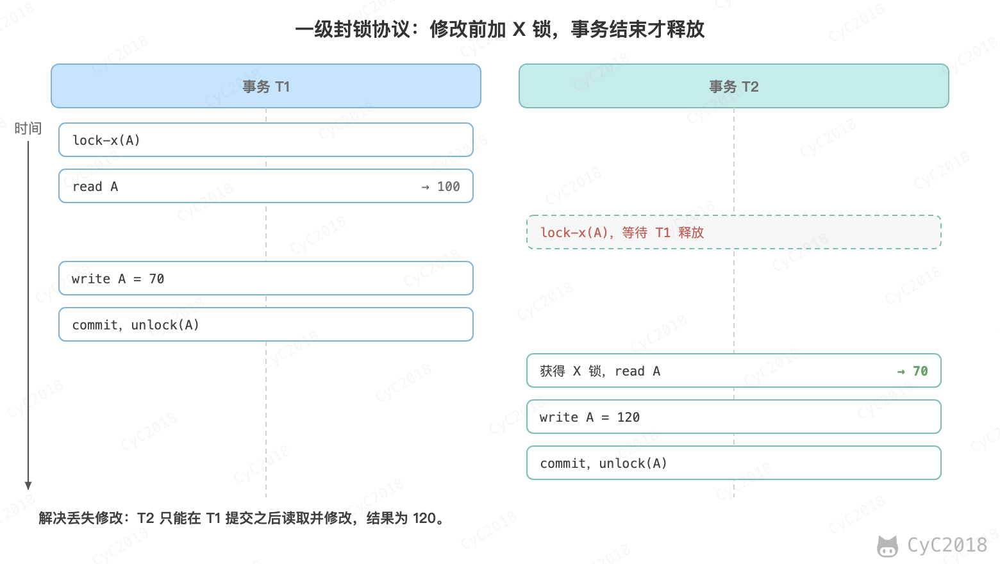 </div><br>

##### 1.2 二级封锁协议

在一级的基础上，要求读取数据 A 时必须加 S 锁，读取完马上释放 S 锁。

可以解决脏读问题，因为如果一个事务在对数据 A 进行修改，根据 1 级封锁协议，会加 X 锁，那么就不能再加 S 锁了，也就是不会读入数据。

<div align="center"> 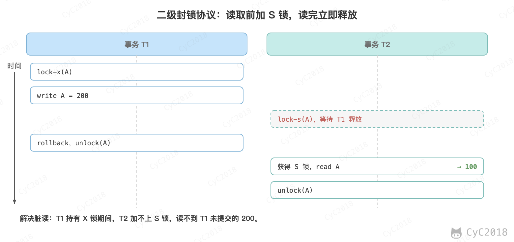 </div><br>

##### 1.3 三级封锁协议

在二级的基础上，要求读取数据 A 时必须加 S 锁，直到事务结束了才能释放 S 锁。

可以解决不可重复读的问题，因为读 A 时，其它事务不能对 A 加 X 锁，从而避免了在读的期间数据发生改变。

<div align="center"> 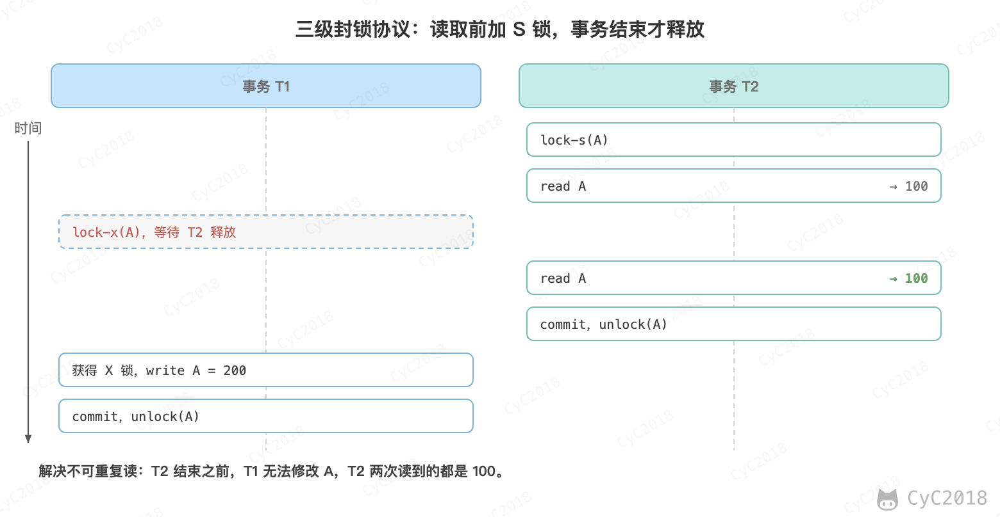 </div><br>

#### 2. 两段锁协议

两段锁协议指的是每个事务的加锁和解锁分为两个阶段：先是只加锁不解锁的扩展阶段，一旦释放了某个锁，就进入只解锁不加锁的收缩阶段。

可串行化调度是指，通过并发控制，使得并发执行的事务结果与某个串行执行的事务结果相同。串行执行的事务互不干扰，不会出现并发一致性问题。

事务遵循两段锁协议是保证可串行化调度的充分条件。例如以下操作满足两段锁协议，它是可串行化调度。

```text
lock-x(A)...lock-s(B)...lock-s(C)...unlock(A)...unlock(C)...unlock(B)
```

但不是必要条件，例如以下操作不满足两段锁协议，但它还是可串行化调度。

```text
lock-x(A)...unlock(A)...lock-s(B)...unlock(B)...lock-s(C)...unlock(C)
```

### MySQL 隐式与显式锁定

MySQL 的 InnoDB 存储引擎采用两段锁协议，会根据隔离级别在需要的时候自动加锁，所有的锁都在事务提交或回滚时一起释放，这被称为隐式锁定。

InnoDB 也可以使用特定的语句进行显式锁定：

```sql
SELECT ... FOR SHARE;    -- MySQL 8.0 之前写作 LOCK IN SHARE MODE
SELECT ... FOR UPDATE;
```

### MySQL 中的锁

按粒度从大到小，MySQL 中的锁主要有以下几种：

| 粒度 | 锁 | 用途 |
| --- | --- | --- |
| 全局 | 全局读锁（FLUSH TABLES WITH READ LOCK） | 整个实例只读，用于给不支持事务的表做一致性备份 |
| 表 | 表锁（LOCK TABLES ... READ / WRITE） | 显式锁住整张表 |
| 表 | 元数据锁（Metadata Lock, MDL） | 自动加，防止表结构在使用过程中被修改 |
| 表 | 意向锁（IS、IX） | 加行锁之前先加，用来快速判断表中有没有行被锁住，见上文 |
| 表 | 自增锁（AUTO-INC） | 分配自增值，MySQL 8.0 默认的 innodb_autoinc_lock_mode = 2 下插入语句不再使用 |
| 行 | 记录锁、间隙锁、Next-Key Lock、插入意向锁 | InnoDB 的行锁，加在索引上，见 [六、Next-Key Locks](#六next-key-locks) |

InnoDB 的表备份时不需要全局读锁：mysqldump --single-transaction 在一个可重复读的事务中导出，读到的是开始时的快照，不阻塞其它读写。InnoDB 也不会把大量行锁升级为表锁，“锁表”通常是因为条件列没有索引，扫描过的每一行都被锁住了，见 [六、Next-Key Locks](#六next-key-locks) 的末尾。

#### 1. 元数据锁

执行 SELECT、UPDATE 等语句时自动对表加 MDL 读锁，ALTER TABLE 要加 MDL 写锁，读锁和写锁互斥，并且 MDL 一直持有到事务结束。例如事务 A 读过表 t 但没有提交（MySQL 8.0 实测，见[附录 A7](#a7-元数据锁的等待)）：

```text
A：BEGIN; SELECT * FROM t WHERE id = 1;    -- 不提交，持有 MDL 读锁
B：ALTER TABLE t ADD COLUMN c INT;         -- Waiting for table metadata lock
C：SELECT * FROM t WHERE id = 2;           -- Waiting for table metadata lock
A：COMMIT;                                 -- B、C 随后执行完成
```

C 只是一条普通的查询，也被阻塞了。这是因为 B 在等待 MDL 写锁，写锁请求的优先级高于读锁，排在 B 后面的读请求都要等待，表上的所有查询看起来就像“锁表”了。MySQL 8.0 中加列默认使用 ALGORITHM=INSTANT，只改元数据、瞬间完成，但同样要先拿到 MDL 写锁。

所以改表前先在 information_schema.innodb_trx 中检查有没有长事务，并给 DDL 设置较短的 lock_wait_timeout（默认是一年）。上例中 B 设置 lock_wait_timeout = 3 后，等待 3 秒报错退出，C 随即执行完成，ALTER 可以稍后重试。

#### 2. 间隙锁带来的问题

间隙锁之间互不冲突：两个事务可以同时锁住同一个间隙，间隙锁只阻止插入。并发写入多时这会带来两个问题：插入被其它事务的间隙锁阻塞；两个事务先锁住同一个间隙再各自插入，会互相等待对方的间隙锁而死锁，常见于“先查有没有，没有再插入”，例子见 [MySQL 死锁](计算机操作系统%20-%20死锁.md#2-mysql-死锁)。可以直接依赖唯一索引插入并处理重复键错误，或者改用不加间隙锁的提交读。

以上都是悲观锁。数据库中的乐观锁一般用版本号实现，不需要加锁，见 [乐观锁与悲观锁](Java%20并发.md#4-乐观锁与悲观锁)。

## 四、隔离级别

### 未提交读（READ UNCOMMITTED）

事务中的修改，即使没有提交，对其它事务也是可见的。

### 提交读（READ COMMITTED）

一个事务只能读取已经提交的事务所做的修改。换句话说，一个事务所做的修改在提交之前对其它事务是不可见的。

InnoDB 在提交读下不加间隙锁（只在检查外键和唯一键时使用），UPDATE、DELETE 扫描过但不满足条件的行，判断完条件就释放锁。插入不再被间隙锁阻塞，死锁也少得多，所以不少公司把隔离级别改为提交读，代价是会出现不可重复读和幻读，并且 binlog 必须使用 ROW 格式（见 [binlog](MySQL.md#binlog)）。

### 可重复读（REPEATABLE READ）

保证在同一个事务中多次读取同一数据的结果是一样的。

### 可串行化（SERIALIZABLE）

保证并发执行的结果与某种串行执行的结果相同，不会出现并发一致性问题。

InnoDB 的实现方式是在关闭自动提交时，把普通的 SELECT 都变成加共享锁的 SELECT ... FOR SHARE，读和写会互相阻塞，并发度最低：可串行化的事务读过的行，另一个事务要修改就得等它结束（见[附录 A2](#a2-可串行化与快照读)）。

----

各个隔离级别能否避免并发一致性问题：

| 隔离级别 | 脏读 | 不可重复读 | 幻读 |
| :---: | :---: | :---: | :---: |
| 未提交读 | 可能 | 可能 | 可能 |
| 提交读 | 不可能 | 可能 | 可能 |
| 可重复读 | 不可能 | 不可能 | 可能 |
| 可串行化 | 不可能 | 不可能 | 不可能 |

这是 SQL 标准的规定。MySQL 的 InnoDB 默认使用可重复读，并且用 MVCC 和 Next-Key Locks 在很大程度上避免了幻读，见 [六、Next-Key Locks](#六next-key-locks)；Oracle 和 PostgreSQL 默认使用提交读。

MySQL 默认使用可重复读与 binlog 有关：提交读不加间隙锁，按语句重放时从库可能得到与主库不同的结果，所以 InnoDB 的提交读只支持 ROW 格式的 binlog；而 MySQL 5.1.4 及以前，binlog 只有记录语句的 STATEMENT 格式。

InnoDB 用 MVCC 和锁实现这四种隔离级别：

| 隔离级别 | 普通 SELECT | 加锁读、UPDATE、DELETE |
| --- | --- | --- |
| 未提交读 | 直接读最新版本 | 只锁记录 |
| 提交读 | 每条语句创建新的 ReadView | 只锁记录 |
| 可重复读 | 第一次读时创建 ReadView，整个事务复用 | Next-Key Lock |
| 可串行化 | 关闭自动提交时变为加共享锁的 FOR SHARE | Next-Key Lock |

查看和修改隔离级别：

```sql
SELECT @@transaction_isolation;                          -- REPEATABLE-READ
SET SESSION TRANSACTION ISOLATION LEVEL READ COMMITTED;  -- 当前会话之后的事务都使用提交读
```

MySQL 8.0 已移除旧的变量名 tx_isolation。SET TRANSACTION 不写 SESSION 或 GLOBAL 时，只对下一个事务有效。

## 五、多版本并发控制

多版本并发控制（Multi-Version Concurrency Control, MVCC）是 MySQL 的 InnoDB 存储引擎实现隔离级别的一种具体方式，用于实现提交读和可重复读这两种隔离级别。而未提交读隔离级别总是读取最新的数据行，要求很低，无需使用 MVCC。可串行化隔离级别需要对所有读取的行都加锁，单纯使用 MVCC 无法实现。

### 基本思想

在封锁一节中提到，加锁能解决多个事务同时执行时出现的并发一致性问题。在实际场景中读操作往往多于写操作，因此又引入了读写锁来避免不必要的加锁操作，例如读和读没有互斥关系。读写锁中读和写操作仍然是互斥的，而 MVCC 利用了多版本的思想，写操作更新最新的版本快照，而读操作去读旧版本快照，没有互斥关系，这一点和 CopyOnWrite 类似。

在 MVCC 中事务的修改操作（DELETE、INSERT、UPDATE）会为数据行新增一个版本快照。

脏读的原因是事务读取到其它事务未提交的修改，MVCC 规定只能读取已经提交的快照来解决脏读。不可重复读的原因是两次读取之间其它事务提交了修改，可重复读隔离级别下事务始终读取同一个快照来解决这个问题。当然一个事务可以读取自身未提交的快照，这不算是脏读。

### 版本号

InnoDB 为每个事务分配一个递增的事务 ID（TRX_ID），每个数据行都记录着最后修改它的事务 ID。行中的这类信息放在隐藏列中：6 字节的 DB_TRX_ID 是最后修改它的事务 ID，7 字节的 DB_ROLL_PTR 是指向 undo log 中旧版本的回滚指针；表没有主键和非空唯一索引时，还有 6 字节的 DB_ROW_ID 作为聚簇索引的键。需要注意的是，事务 ID 不是在 BEGIN 时分配的，而是在事务第一次修改数据时才分配；只读的事务不分配真正的事务 ID，也就不会出现在其它事务的 ReadView 中。在 information_schema.innodb_trx 中可以看到，事务只执行过 SELECT 时 trx_id 是一个很大的临时编号，执行 UPDATE 之后才变成真正的事务 ID（见[附录 A3](#a3-事务-id-的分配)）。

### Undo 日志

MVCC 的多版本指的是多个版本的快照，快照存储在 Undo 日志中，该日志通过回滚指针 ROLL_PTR 把一个数据行的所有快照连接起来。

例如在 MySQL 创建一个表 t，包含主键 id 和一个字段 x。先插入一个数据行，然后对该数据行执行两次更新操作。

```sql
INSERT INTO t(id, x) VALUES(1, "a");
UPDATE t SET x="b" WHERE id=1;
UPDATE t SET x="c" WHERE id=1;
```

因为没有使用 `START TRANSACTION` 将上面的操作当成一个事务来执行，根据 MySQL 的 AUTOCOMMIT 机制，每个操作都会被当成一个事务来执行，所以上面的操作总共涉及到三个事务，假设它们的 ID 依次为 101、102、103。快照中除了记录事务版本号 TRX_ID 和操作之外，还记录了一个 bit 的 DEL 字段，用于标记是否被删除。

<div align="center"> 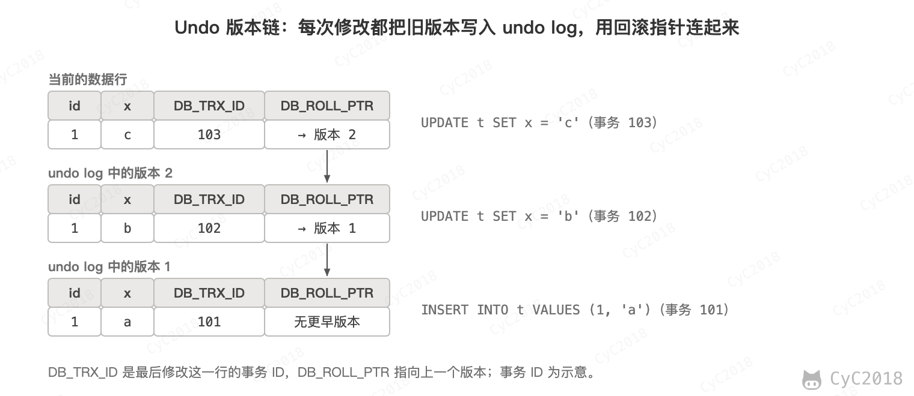 </div><br>

INSERT、UPDATE、DELETE 操作会创建一个日志，并将事务版本号 TRX_ID  写入。DELETE 可以看成是一个特殊的 UPDATE，还会额外将 DEL 字段设置为 1。

旧版本不会一直保留。INSERT 产生的 undo log 只用于回滚，事务提交后就可以丢弃；UPDATE、DELETE 产生的 undo log 还要供其它事务读取旧版本，等到没有任何 ReadView 还需要它时，才由后台的 purge 线程清理，被标记删除的行也在这时真正删除。

所以长事务的代价很大：它的 ReadView 让之后的旧版本都不能清理，undo log 越积越多，它自己读数据时还要沿着越来越长的版本链往回找。例如一个可重复读事务读过某一行后一直不提交，另一个会话把这一行更新了 10 万次，这时长事务再读这一行要 26 ms，而新事务只要 0.06 ms（MySQL 8.0 实测，见[附录 A8](#a8-长事务与版本链)）。SHOW ENGINE INNODB STATUS 中的 History list length 反映了还没有清理的 undo log 数量，持续增长时要找出长事务（information_schema.innodb_trx 中 trx_started 很早的事务）。

### ReadView

MVCC 维护了一个 ReadView 结构，主要包含了创建 ReadView 时系统中未提交的事务列表 TRX_IDs {TRX_ID_1, TRX_ID_2, ...}，该列表的最小值 TRX_ID_MIN，以及下一个将要分配的事务 ID TRX_ID_MAX。InnoDB 源码中这几项分别是 m_ids、m_up_limit_id、m_low_limit_id，另外 m_creator_trx_id 记录创建它的事务自己的 ID。


在进行 SELECT 操作时，根据数据行快照的 TRX_ID 与 TRX_ID_MIN 和 TRX_ID_MAX 之间的关系，从而判断数据行快照是否可以使用：

- TRX_ID 等于当前事务自己的 ID，表示是本事务修改的，可以使用；
- TRX_ID \< TRX_ID_MIN，表示该数据行快照是在当前所有未提交事务之前进行更改的，因此可以使用；
- TRX_ID \>= TRX_ID_MAX，表示该数据行快照是在 ReadView 创建之后被更改的，因此不可使用；
- TRX_ID_MIN \<= TRX_ID \< TRX_ID_MAX，如果 TRX_ID 在 TRX_IDs 列表中，表示该数据行快照对应的事务还未提交，则该快照不可使用。否则表示已经提交，可以使用。

提交读和可重复读的判断规则相同，区别在于 ReadView 的创建时机：提交读在每次 SELECT 时都创建新的 ReadView，因此能读到其它事务新提交的修改；可重复读只在事务第一次 SELECT 时创建 ReadView，之后一直复用，因此多次读取的结果相同。

在数据行快照不可使用的情况下，需要沿着 Undo Log 的回滚指针 ROLL_PTR 找到下一个快照，再进行上面的判断。

接着上面的例子，假设事务 103 修改了 x 但还没有提交，另一个事务这时开始读取这一行：

<div align="center"> 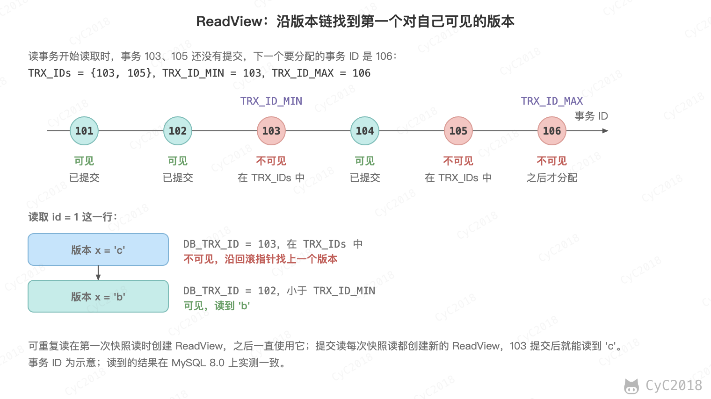 </div><br>

事务 103 提交之后，这个可重复读的事务再读仍然是 'b'，而新开始的提交读事务读到 'c'（见[附录 A2](#a2-可串行化与快照读)）。

### 快照读与当前读

#### 1. 快照读

MVCC 的 SELECT 操作是快照中的数据，不需要进行加锁操作。

```sql
SELECT * FROM table ...;
```

#### 2. 当前读

MVCC 其它会对数据库进行修改的操作（INSERT、UPDATE、DELETE）需要进行加锁操作，从而读取最新的数据。可以看到 MVCC 并不是完全不用加锁，而只是避免了 SELECT 的加锁操作。

```sql
INSERT;
UPDATE;
DELETE;
```

在进行 SELECT 操作时，可以强制指定进行加锁操作。以下第一个语句需要加 S 锁，第二个需要加 X 锁。MySQL 8.0 起推荐用 FOR SHARE 代替 LOCK IN SHARE MODE。

```sql
SELECT * FROM table WHERE ? FOR SHARE;
SELECT * FROM table WHERE ? FOR UPDATE;
```

## 六、Next-Key Locks

Next-Key Locks 是 MySQL 的 InnoDB 存储引擎的一种锁实现。

在可重复读（REPEATABLE READ）隔离级别下，MVCC 使普通的 SELECT（快照读）不会读到其它事务新插入的行，但是 UPDATE、DELETE、SELECT ... FOR UPDATE 等当前读仍然可能出现幻读，Next-Key Locks 就是为了解决这个问题而存在的。InnoDB 使用 MVCC + Next-Key Locks 在可重复读隔离级别下解决了幻读问题。

需要注意的是，这要求一个事务中的读取全部是快照读或者全部是当前读，两者混用时仍然会出现幻读。例如表 acct 原有 id 为 1、2 的两行（MySQL 8.0 实测，见[附录 A4](#a4-快照读与当前读混用)）：

```text
A：SELECT * FROM acct WHERE balance >= 100;                     -- id 1、2
B：INSERT INTO acct VALUES (3, 100);                            -- 自动提交
A：SELECT * FROM acct WHERE balance >= 100;                     -- 仍然是 id 1、2
A：UPDATE acct SET balance = balance + 10 WHERE balance >= 100; -- Rows matched: 3
A：SELECT * FROM acct WHERE balance >= 100;                     -- id 1、2、3
```

事务 A 的 UPDATE 是当前读，看到了事务 B 新插入并已提交的第 3 行，并且修改了它；这一行最新版本的事务 ID 变成了 A 自己，所以之后的快照读也能看到它。如果 A 一开始就用 SELECT ... FOR UPDATE 加锁读取，B 的插入会被 Next-Key Locks 阻塞，直到 A 结束或者锁等待超时。

### Record Locks

锁定一个记录上的索引，而不是记录本身。

如果表没有定义主键，InnoDB 会选第一个所有列都 NOT NULL 的唯一索引作为聚簇索引；连这样的索引也没有时，就在隐藏的 6 字节行 ID 上创建聚簇索引（GEN_CLUST_INDEX），因此 Record Locks 依然可以使用。

### Gap Locks

锁定索引之间的间隙，但是不包含索引本身。例如当一个事务执行以下语句，其它事务就不能在 t.c 中插入 15。

```sql
SELECT c FROM t WHERE c BETWEEN 10 and 20 FOR UPDATE;
```

### Next-Key Locks

它是 Record Locks 和 Gap Locks 的结合，不仅锁定一个记录上的索引，也锁定索引之间的间隙。它锁定一个前开后闭区间，例如一个索引包含以下值：10, 11, 13, and 20，那么就需要锁定以下区间：

```sql
(-∞, 10]
(10, 11]
(11, 13]
(13, 20]
(20, +∞)
```

以表 t(id, c) 为例，c 上有普通索引，有 c 为 10、11、13、20 的四行。在可重复读下执行两种加锁读，实际加的锁和对插入的影响如下（从 performance_schema.data_locks 中查看，见[附录 A5](#a5-next-key-locks-的加锁范围)）：

<div align="center"> 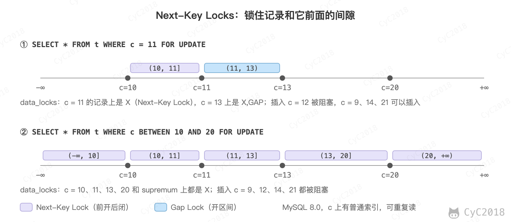 </div><br>

按 c = 11 查询时，c 不是唯一索引，后面还可能有 c = 11 的记录，所以除了 (10, 11] 的 Next-Key Lock，还要锁住到下一条记录 13 之间的间隙；如果 c 是唯一索引，就只锁 c = 11 这一条记录。

当前读的条件列没有索引时，InnoDB 只能扫描整个聚簇索引，扫描过的每一行都要加锁。例如表 t_nl 有 5 行，d 列没有索引，执行 UPDATE t_nl SET d = d + 1 WHERE d = 30 只修改 1 行：在可重复读下锁住了全部 5 行和最后的间隙，其它事务插入新行、修改 id 为 5 的行都要等待，效果相当于锁住了整张表；在提交读下只锁住 1 行，插入和修改都不受影响（MySQL 8.0 实测，见[附录 A6](#a6-没有索引时的加锁)）。所以 UPDATE、DELETE 的条件列要建索引。

## 七、关系数据库设计理论

### 函数依赖

记 A-\>B 表示 A 函数决定 B，也可以说 B 函数依赖于 A。

如果 {A1，A2，... ，An} 是关系的一个或多个属性的集合，该集合函数决定了关系的其它所有属性并且是最小的，那么该集合就称为键码。

对于 A-\>B，如果能找到 A 的真子集 A'，使得 A'-\> B，那么 A-\>B 就是部分函数依赖，否则就是完全函数依赖。

对于 A-\>B，B-\>C，则 A-\>C 是一个传递函数依赖。

### 异常

以下的学生课程关系的函数依赖为 {Sno, Cname} -\> {Sname, Sdept, Mname, Grade}，键码为 {Sno, Cname}。也就是说，确定学生和课程之后，就能确定其它信息。

| Sno | Sname | Sdept | Mname | Cname | Grade |
| :---: | :---: | :---: | :---: | :---: |:---:|
| 1 | 学生-1 | 学院-1 | 院长-1 | 课程-1 | 90 |
| 2 | 学生-2 | 学院-2 | 院长-2 | 课程-2 | 80 |
| 2 | 学生-2 | 学院-2 | 院长-2 | 课程-1 | 100 |
| 3 | 学生-3 | 学院-2 | 院长-2 | 课程-2 | 95 |

不符合范式的关系，会产生很多异常，主要有以下四种异常：

- 冗余数据：例如 `学生-2` 出现了两次。
- 修改异常：修改了一个记录中的信息，但是另一个记录中相同的信息却没有被修改。
- 删除异常：删除一个信息，那么也会丢失其它信息。例如删除了 `课程-1` 需要删除第一行和第三行，那么 `学生-1` 的信息就会丢失。
- 插入异常：例如想要插入一个学生的信息，如果这个学生还没选课，那么就无法插入。

### 范式

范式理论是为了解决以上提到四种异常。

高级别范式的依赖于低级别的范式，1NF 是最低级别的范式。

#### 1. 第一范式 (1NF)

属性不可分。例如“联系方式”一列中同时存放了电话和邮箱，就不满足 1NF，应该拆成两列。

#### 2. 第二范式 (2NF)

每个非主属性完全函数依赖于键码。

可以通过分解来满足。

分解前：

| Sno | Sname | Sdept | Mname | Cname | Grade |
| :---: | :---: | :---: | :---: | :---: |:---:|
| 1 | 学生-1 | 学院-1 | 院长-1 | 课程-1 | 90 |
| 2 | 学生-2 | 学院-2 | 院长-2 | 课程-2 | 80 |
| 2 | 学生-2 | 学院-2 | 院长-2 | 课程-1 | 100 |
| 3 | 学生-3 | 学院-2 | 院长-2 | 课程-2 | 95 |

以上学生课程关系中，{Sno, Cname} 为键码，有如下函数依赖：

- Sno -\> Sname, Sdept
- Sdept -\> Mname
- Sno, Cname-\> Grade

Grade 完全函数依赖于键码，它没有任何冗余数据，每个学生的每门课都有特定的成绩。

Sname, Sdept 和 Mname 都部分依赖于键码，当一个学生选修了多门课时，这些数据就会出现多次，造成大量冗余数据。

分解后：

关系-1

| Sno | Sname | Sdept | Mname |
| :---: | :---: | :---: | :---: |
| 1 | 学生-1 | 学院-1 | 院长-1 |
| 2 | 学生-2 | 学院-2 | 院长-2 |
| 3 | 学生-3 | 学院-2 | 院长-2 |

有以下函数依赖：

- Sno -\> Sname, Sdept
- Sdept -\> Mname

关系-2

| Sno | Cname | Grade |
| :---: | :---: |:---:|
| 1 | 课程-1 | 90 |
| 2 | 课程-2 | 80 |
| 2 | 课程-1 | 100 |
| 3 | 课程-2 | 95 |

有以下函数依赖：

- Sno, Cname -\>  Grade

#### 3. 第三范式 (3NF)

非主属性不传递函数依赖于键码。

上面的 关系-1 中存在以下传递函数依赖：

- Sno -\> Sdept -\> Mname

可以进行以下分解：

关系-11

| Sno | Sname | Sdept |
| :---: | :---: | :---: |
| 1 | 学生-1 | 学院-1 |
| 2 | 学生-2 | 学院-2 |
| 3 | 学生-3 | 学院-2 |

关系-12

| Sdept | Mname |
| :---: | :---: |
| 学院-1 | 院长-1 |
| 学院-2 | 院长-2 |

## 八、ER 图

实体-联系图（Entity-Relationship Diagram）用来进行关系型数据库的概念设计，有三个组成部分：实体（矩形）、属性（椭圆）、联系（菱形）。

### 实体的三种联系

包含一对一、多对一、多对多三种，箭头指向“一”的一方：

- 如果每个 A 最多对应一个 B（A 到 B 是多对一），就画一个指向 B 的箭头；
- 如果是一对一，两端都画箭头；
- 如果是多对多，两端都不画箭头。

<div align="center"> 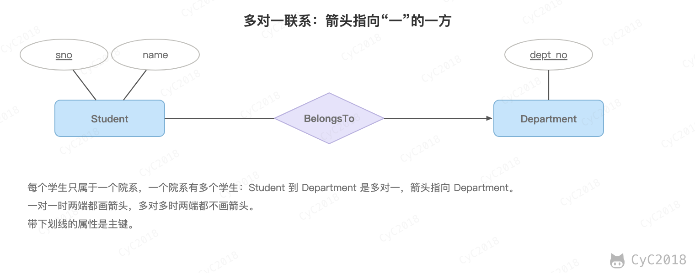 </div><br>

### 表示出现多次的关系

一个实体在联系出现几次，就要用几条线连接。

下图表示课程的先修关系，联系中出现两个 Course 实体，一个是先修课程，一个是后续课程，因此需要用两条线来表示。

<div align="center">  </div><br>

### 联系的多向性

虽然老师可以开设多门课，并且可以教授多名学生，但是对于特定的学生和课程，只有一个老师教授，这就构成了一个三元联系。

<div align="center"> 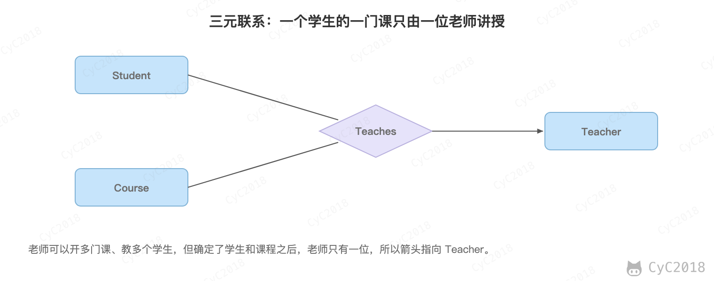 </div><br>

### 表示子类

用一个三角形和两条线来连接类和子类，与子类有关的属性和联系都连到子类上，而与父类和子类都有关的连到父类上。

<div align="center"> 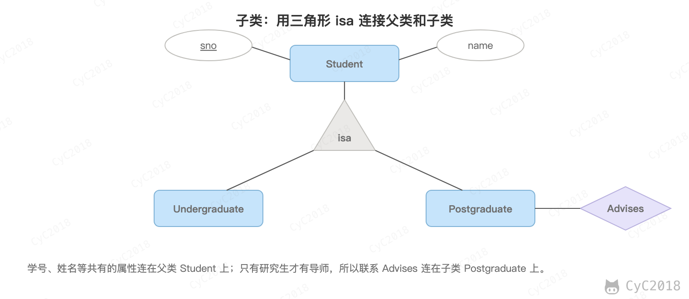 </div><br>

## 附录：实测

以下实验在 MySQL 8.0.44 上进行，用 Python 的 pymysql 开两个连接模拟两个事务。

### A1 并发一致性问题

每个例子开始前重建表：

```sql
CREATE TABLE account (id INT PRIMARY KEY, balance INT);
INSERT INTO account VALUES (1, 100), (2, 100);
```

输出（A、B 分别是两个会话，-> 后为结果）：

```text
丢失修改（两个会话都是 REPEATABLE READ，应用先查询再写回）
  A: SELECT balance FROM account WHERE id = 1              -> 100
  B: SELECT balance FROM account WHERE id = 1              -> 100
  A: UPDATE account SET balance = 70 WHERE id = 1; COMMIT
  B: UPDATE account SET balance = 150 WHERE id = 1; COMMIT
  A: SELECT balance FROM account WHERE id = 1              -> 150
改为 balance = balance - 30 / + 50：B 的 UPDATE 等待 A 的行锁，最终 -> 120

脏读（B 为 READ UNCOMMITTED）
  A: BEGIN; UPDATE account SET balance = 200 WHERE id = 1
  B: SELECT balance FROM account WHERE id = 1              -> 200
  A: ROLLBACK
  B: SELECT balance FROM account WHERE id = 1              -> 100

不可重复读（A 自动提交）
  B 为 READ COMMITTED：  第一次 -> 100，A 改为 200 后第二次 -> 200
  B 为 REPEATABLE READ： 第一次 -> 100，A 改为 200 后第二次 -> 100

幻读（A 自动提交 INSERT INTO account VALUES (3, 100)）
  B 为 READ COMMITTED：  SELECT id FROM account WHERE balance > 50 第一次 -> 1, 2，第二次 -> 1, 2, 3
  B 为 REPEATABLE READ： 第一次 -> 1, 2，第二次 -> 1, 2
```

### A2 可串行化与快照读

可串行化：A 以 SERIALIZABLE 开始事务并读取 id = 1 的行，B 设置 innodb_lock_wait_timeout = 1 后修改这一行：

```text
A 为 REPEATABLE READ：B 的 UPDATE 立即成功
A 为 SERIALIZABLE：  B 的 UPDATE 报错 ERROR 1205 Lock wait timeout exceeded
```

ReadView：表 t 中插入 x = 'a' 并更新为 'b'（都自动提交），会话 C 执行 BEGIN; UPDATE t SET x = 'c' 但不提交，此时会话 R 以 REPEATABLE READ 开始事务读取：

```text
R: SELECT x FROM t WHERE id = 1                  -> b
（innodb_trx 中 C 的 trx_id 为 3696，R 只读，显示为 281479674466992）
C: COMMIT
R: SELECT x FROM t WHERE id = 1                  -> b
新的 READ COMMITTED 事务读取                      -> c
```

### A3 事务 ID 的分配

```text
BEGIN; SELECT * FROM account;     innodb_trx.trx_id = 281479674465408
UPDATE account SET balance = 1;    innodb_trx.trx_id = 3095
```

### A4 快照读与当前读混用

表 acct 原有 id 为 1、2 的两行，balance 都是 100。A 为 REPEATABLE READ：

```text
A: SELECT * FROM acct WHERE balance >= 100                       -> 1, 2
B: INSERT INTO acct VALUES (3, 100)                              （自动提交）
A: SELECT * FROM acct WHERE balance >= 100                       -> 1, 2
A: UPDATE acct SET balance = balance + 10 WHERE balance >= 100   -> Rows matched: 3  Changed: 3
A: SELECT * FROM acct WHERE balance >= 100                       -> 1, 2, 3（balance 都是 110）
```

A 先执行 SELECT ... FROM acct WHERE balance >= 100 FOR UPDATE 时，B 的 INSERT 在 innodb_lock_wait_timeout = 1 下报错 ERROR 1205。

### A5 Next-Key Locks 的加锁范围

```sql
CREATE TABLE t (id INT PRIMARY KEY, c INT, KEY idx_c (c));
INSERT INTO t VALUES (1, 10), (2, 11), (3, 13), (4, 20);
```

A 执行加锁读后，从 performance_schema.data_locks 查询行锁（LOCK_DATA 为 c 的值和主键），B 依次尝试插入 c = 9、12、14、21：

```text
SELECT * FROM t WHERE c = 11 FOR UPDATE
  idx_c    X              11, 2
  idx_c    X,GAP          13, 3
  PRIMARY  X,REC_NOT_GAP  2
  插入 c = 9 成功，c = 12 阻塞，c = 14 成功，c = 21 成功

SELECT * FROM t WHERE c BETWEEN 10 AND 20 FOR UPDATE
  idx_c    X              10, 1 / 11, 2 / 13, 3 / 20, 4 / supremum pseudo-record
  PRIMARY  X,REC_NOT_GAP  1 / 2 / 3 / 4
  插入 c = 9、12、14、21 都阻塞

把 idx_c 改为唯一索引后，c = 11 FOR UPDATE 只有 uk_c X,REC_NOT_GAP 11, 2 和主键上的记录锁，插入 c = 12 成功。
```

### A6 没有索引时的加锁

```sql
CREATE TABLE t_nl (id INT PRIMARY KEY, d INT);
INSERT INTO t_nl VALUES (1, 10), (2, 20), (3, 30), (4, 40), (5, 50);
```

A、B 两个会话的锁等待超时设为 1 秒。A 执行 UPDATE t_nl SET d = d + 1 WHERE d = 30 后不提交，查看 data_locks，B 再插入一行、修改另一行：

```text
可重复读：A 的锁 7 个
  TABLE   IX
  RECORD  X  1 / 2 / 3 / 4 / 5 / supremum pseudo-record
  B: INSERT INTO t_nl VALUES (100, 1000)     -> 1205 Lock wait timeout exceeded
  B: UPDATE t_nl SET d = 51 WHERE id = 5     -> 1205 Lock wait timeout exceeded

提交读：A 的锁 2 个
  TABLE   IX
  RECORD  X,REC_NOT_GAP  3
  B: INSERT INTO t_nl VALUES (100, 1000)     -> OK
  B: UPDATE t_nl SET d = 51 WHERE id = 5     -> OK
```

### A7 元数据锁的等待

```sql
CREATE TABLE t (id INT PRIMARY KEY, v INT);
INSERT INTO t VALUES (1, 10), (2, 20);
```

A 开始事务读取 id = 1 后不提交；1 秒后 B 执行 ALTER TABLE t ADD COLUMN c INT, ALGORITHM=INSTANT；再过 1 秒 C 执行 SELECT * FROM t WHERE id = 2。此时查看 PROCESSLIST 和 performance_schema.metadata_locks：

```text
processlist     Waiting for table metadata lock   ALTER TABLE t ADD COLUMN c INT, ALGORITHM=INSTANT
processlist     Waiting for table metadata lock   SELECT * FROM t WHERE id = 2
metadata_locks  SHARED_READ        GRANTED   A
metadata_locks  SHARED_UPGRADABLE  GRANTED   B
metadata_locks  EXCLUSIVE          PENDING   B
metadata_locks  SHARED_READ        PENDING   C
```

A 在第 5 秒提交后，B 用时 5.02 s 完成，C 用时 4.02 s 完成。

B 先执行 SET SESSION lock_wait_timeout = 3 时：B 在 3.02 s 后报错 ERROR 1205 Lock wait timeout exceeded，C 随即返回（用时 1.79 s），此时 A 仍未提交。

### A8 长事务与版本链

```sql
CREATE TABLE t (id INT PRIMARY KEY, v INT);
INSERT INTO t VALUES (1, 0);
```

R 以 START TRANSACTION WITH CONSISTENT SNAPSHOT 开始可重复读事务并读取 id = 1，不提交；W 执行 10 万次 UPDATE t SET v = v + 1 WHERE id = 1，每 1000 次提交一次。之后两个会话各执行 5 次 SELECT v FROM t WHERE id = 1，取最快的一次：

```text
History list length：W 更新前 8，更新后 108
R（旧的 ReadView）   v = 0        26.40 ms
新的自动提交查询      v = 100000   0.06 ms
R 提交 3 秒后 History list length 为 0
```

## 参考资料

- AbrahamSilberschatz, HenryF.Korth, S.Sudarshan, 等. 数据库系统概念 [M]. 机械工业出版社, 2006.
- 施瓦茨. 高性能 MYSQL(第3版)[M]. 电子工业出版社, 2013.
- 史嘉权. 数据库系统概论[M]. 清华大学出版社有限公司, 2006.
- [The InnoDB Storage Engine](https://dev.mysql.com/doc/refman/5.7/en/innodb-storage-engine.html)
- [MySQL 8.0: Transaction Isolation Levels](https://dev.mysql.com/doc/refman/8.0/en/innodb-transaction-isolation-levels.html)
- [MySQL 8.0: InnoDB Locking](https://dev.mysql.com/doc/refman/8.0/en/innodb-locking.html)
- [MySQL 8.0: Locks Set by Different SQL Statements in InnoDB](https://dev.mysql.com/doc/refman/8.0/en/innodb-locks-set.html)
- [MySQL 8.0: The data_locks Table](https://dev.mysql.com/doc/refman/8.0/en/performance-schema-data-locks-table.html)
- [Transaction isolation levels](https://www.slideshare.net/ErnestoHernandezRodriguez/transaction-isolation-levels)
- [Concurrency Control](https://web.archive.org/web/20260614192237/https://scanftree.com/dbms/2-phase-locking-protocol)
- [The Nightmare of Locking, Blocking and Isolation Levels!](https://www.slideshare.net/brshristov/the-nightmare-of-locking-blocking-and-isolation-levels-46391666)
- [Database Normalization and Normal Forms with an Example](https://aksakalli.github.io/2012/03/12/database-normalization-and-normal-forms-with-an-example.html)
- [The basics of the InnoDB undo logging and history system](https://blog.jcole.us/2014/04/16/the-basics-of-the-innodb-undo-logging-and-history-system/)
- [MySQL locking for the busy web developer](https://www.brightbox.com/blog/2013/10/31/on-mysql-locks/)
- [浅入浅出 MySQL 和 InnoDB](https://draveness.me/mysql-innodb)
- [Innodb 中的事务隔离级别和锁的关系](https://tech.meituan.com/2014/08/20/innodb-lock.html)
- [MySQL 8.0: Metadata Locking](https://dev.mysql.com/doc/refman/8.0/en/metadata-locking.html)
- [MySQL 8.0: Online DDL Operations](https://dev.mysql.com/doc/refman/8.0/en/innodb-online-ddl-operations.html)
- [MySQL 8.0: AUTO_INCREMENT Handling in InnoDB](https://dev.mysql.com/doc/refman/8.0/en/innodb-auto-increment-handling.html)
- [MySQL 8.0: InnoDB Multi-Versioning](https://dev.mysql.com/doc/refman/8.0/en/innodb-multi-versioning.html)
- [MySQL 8.0: Purge Configuration](https://dev.mysql.com/doc/refman/8.0/en/innodb-purge-configuration.html)
- [MySQL 8.0: SET TRANSACTION Statement](https://dev.mysql.com/doc/refman/8.0/en/set-transaction.html)
- [MySQL 5.1: Replication Formats](https://docs.oracle.com/cd/E19078-01/mysql/mysql-refman-5.1/replication.html)
