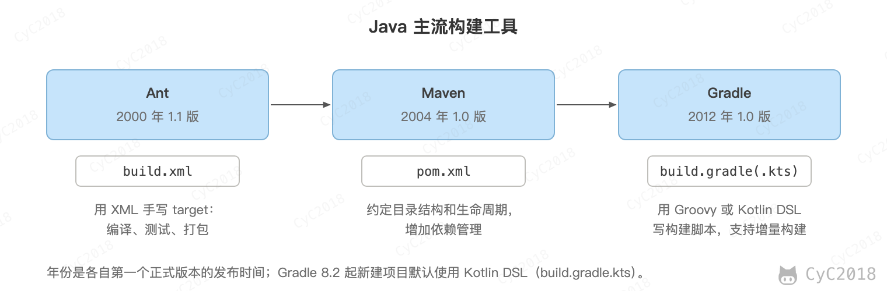

# 构建工具
<!-- GFM-TOC -->
* [构建工具](#构建工具)
    * [一、构建工具的作用](#一构建工具的作用)
    * [二、Java 主流构建工具](#二java-主流构建工具)
    * [三、Maven](#三maven)
    * [附录：实测](#附录实测)
    * [参考资料](#参考资料)
<!-- GFM-TOC -->


## 一、构建工具的作用

构建一个项目通常包含了依赖管理、测试、编译、打包、发布等流程，构建工具可以自动化进行这些操作，从而减少这些繁琐的工作。

其中构建工具提供的依赖管理可以自动处理依赖关系。例如一个项目需要用到依赖 A，A 又依赖于 B，那么构建工具就能自动导入 B，而不需要手动去寻找并导入。

在 Java 项目中，打包流程通常是将项目打包成 jar 包。在没有构建工具的情况下，需要使用命令行工具或者 IDE 手动打包。而发布流程通常是将 jar 包上传到服务器上。

## 二、Java 主流构建工具

Ant 具有编译、测试和打包功能，其后出现的 Maven 在 Ant 的功能基础上又新增了依赖管理功能，而 Gradle 可以使用 Maven 的仓库，改用代码编写构建脚本。

<div align="center">  </div><br>

Gradle 和 Maven 的区别是，Gradle 的构建脚本用基于 Groovy 或 Kotlin 的特定领域语言（DSL）编写，而不再使用 XML 这种标记性语言。因为项目如果庞大的话，XML 很容易就变得臃肿。

例如要在项目中引入 JUnit，Maven 的代码如下：

```xml
<?xml version="1.0" encoding="UTF-8"?>
<project xmlns="http://maven.apache.org/POM/4.0.0" xmlns:xsi="http://www.w3.org/2001/XMLSchema-instance"
  xsi:schemaLocation="http://maven.apache.org/POM/4.0.0 http://maven.apache.org/xsd/maven-4.0.0.xsd">
   <modelVersion>4.0.0</modelVersion>
 
   <groupId>jizg.study.maven.hello</groupId>
   <artifactId>hello-first</artifactId>
   <version>0.0.1-SNAPSHOT</version>

   <dependencies>
          <dependency>
               <groupId>junit</groupId>
               <artifactId>junit</artifactId>
               <version>4.10</version>
               <scope>test</scope>
          </dependency>
   </dependencies>
</project>
```

而 Gradle 的完整 build.gradle 只需要几行代码：

```groovy
plugins {
    id "java"
}

repositories {
    mavenCentral()
}

dependencies {
    testImplementation "junit:junit:4.10"
}
```

和 Maven 不同，Gradle 不默认使用中央仓库，也要先应用 java 插件才有 testImplementation 这类依赖配置，所以这两段不能省略（Gradle 9.8 实测，见[附录 A1](#a1-gradle-构建脚本的最小写法)）。

早期版本中的 testCompile 在 Gradle 7 中已被移除，改用 testImplementation。Gradle 也可以用 Kotlin 编写构建脚本（build.gradle.kts），Gradle 8.2 起新建的项目默认使用 Kotlin。

两者处理依赖冲突的规则也不同：Maven 选路径最短的版本，见下文的[依赖原则](#依赖原则)；Gradle 默认在所有请求的版本中选最高的一个。

## 三、Maven

### 概述

Maven 用项目对象模型（Project Object Model, POM）文件描述项目和它的依赖，并约定了目录结构和构建的生命周期：源码放在 src/main/java，执行 mvn package 时依次完成编译、测试和打包，在 target 目录生成 jar 包。

### 仓库

Maven 先在本地仓库中查找依赖，找不到时再按配置的顺序访问远程仓库下载，中央仓库排在 POM 中声明的仓库之后。

- 本地仓库是本机上的目录（默认 ~/.m2/repository），缓存下载过的依赖，找到了就不再联网，SNAPSHOT 版本除外，它会按更新策略检查远程仓库有没有新版本；
- 中央仓库（Maven Central）是 Maven 默认使用的远程仓库；
- 其它远程仓库是中央仓库的补充，例如公司的私服，用来存放中央仓库没有的依赖，或者在中央仓库访问很慢时提供镜像。

### POM

POM 是一个 XML 文件，保存在项目根目录的 pom.xml 中。例如下面声明了测试时使用的 JUnit：

```xml
<dependency>
    <groupId>junit</groupId>
    <artifactId>junit</artifactId>
    <version>4.12</version>
    <scope>test</scope>
</dependency>
```

[groupId, artifactId, version, packaging, classifier] 称为一个项目的坐标，其中 groupId、artifactId、version 必须定义，packaging 可选（默认为 jar），classifier 不能直接定义，需要结合插件使用。

- groupId：组织或项目组的标识，通常是反写的域名，例如 org.apache.maven；
- artifactId：项目 Id，即项目名；
- version：项目版本；
- packaging：项目打包方式。

### 依赖原则

#### 1. 依赖路径最短优先原则

```text
A -> B -> C -> X(1.0)
A -> D -> X(2.0)
```
由于 X(2.0) 路径最短，所以使用 X(2.0)。

#### 2. 声明顺序优先原则

```text
A -> B -> X(1.0)
A -> C -> X(2.0)
```

在 POM 中最先声明的优先，上面的两个依赖如果先声明 B，那么最后使用 X(1.0)。

#### 3. 覆写优先原则

子 POM 内声明的依赖优先于父 POM 中声明的依赖。

### 解决依赖冲突

先用 `mvn dependency:tree -Dverbose` 查看依赖树，找到冲突的版本分别是从哪条路径引入的。例如“依赖路径最短优先原则”中的例子，被舍弃的版本会标为 omitted for conflict：

```text
demo:a:pom:1.0
+- demo:b:jar:1.0:compile
|  \- demo:c:jar:1.0:compile
|     \- (demo:x:jar:1.0:compile - omitted for conflict with 2.0)
\- demo:d:jar:1.0:compile
   \- demo:x:jar:2.0:compile
```

再用以下方法确定使用的版本：

- 在 dependencyManagement 中声明版本，所有传递依赖都使用这个版本；
- 用 exclusions 排除某个依赖传递过来的版本；
- 在当前 POM 中直接声明需要的版本，它的路径最短。

## 附录：实测

### A1. Gradle 构建脚本的最小写法

环境：Gradle 9.8.2，JDK 21.0.13，macOS。

只写 dependencies 一段时，脚本求值失败：

```text
> Could not find method testImplementation() for arguments [junit:junit:4.10] on object of type org.gradle.api.internal.artifacts.dsl.dependencies.DefaultDependencyHandler.
```

加上 plugins 和 repositories 后，`gradle -q dependencies --configuration testRuntimeClasspath` 的输出：

```text
testRuntimeClasspath - Runtime classpath of source set 'test'.
\--- junit:junit:4.10
     \--- org.hamcrest:hamcrest-core:1.1
```

## 参考资料

- [POM Reference](http://maven.apache.org/pom.html#Dependency_Version_Requirement_Specification)
- [Introduction to the Dependency Mechanism](https://maven.apache.org/guides/introduction/introduction-to-dependency-mechanism.html)
- [What is a build tool?](https://stackoverflow.com/questions/7249871/what-is-a-build-tool)
- [Java Build Tools Comparisons: Ant vs Maven vs Gradle](https://programmingmitra.blogspot.com/2016/05/java-build-tools-comparisons-ant-vs.html)
- [maven 2 gradle](http://sagioto.github.io/maven2gradle/)
- [新一代构建工具 gradle](https://www.imooc.com/learn/833)

