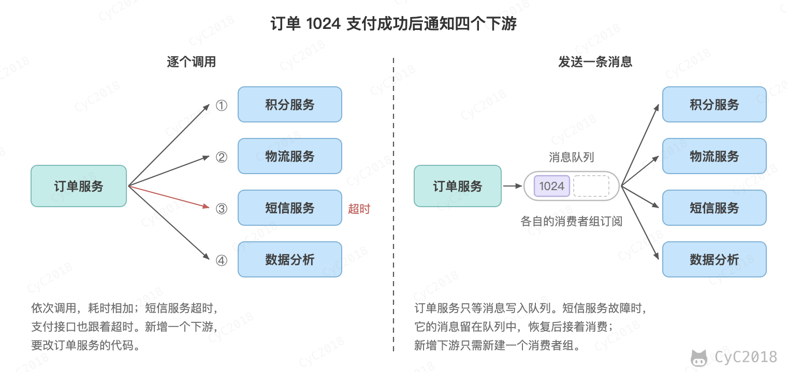
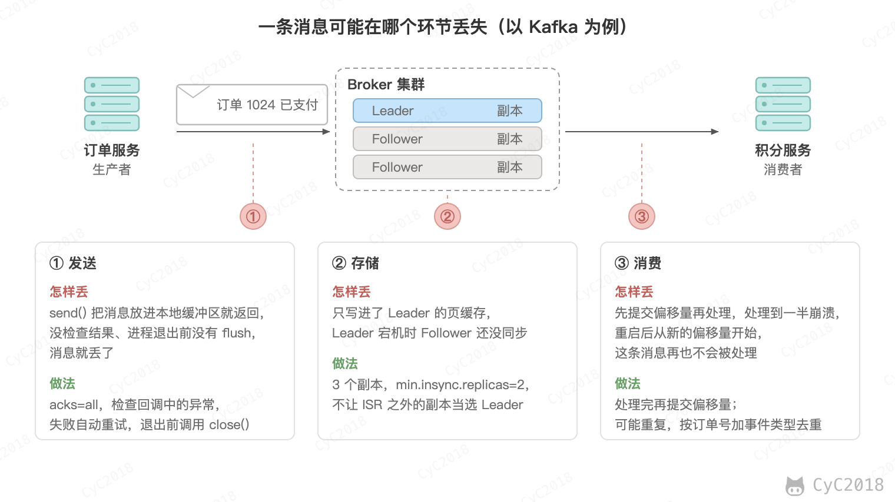
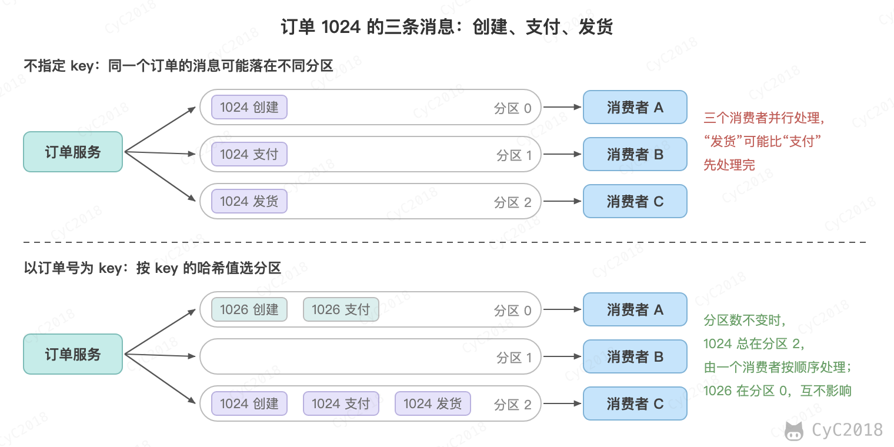
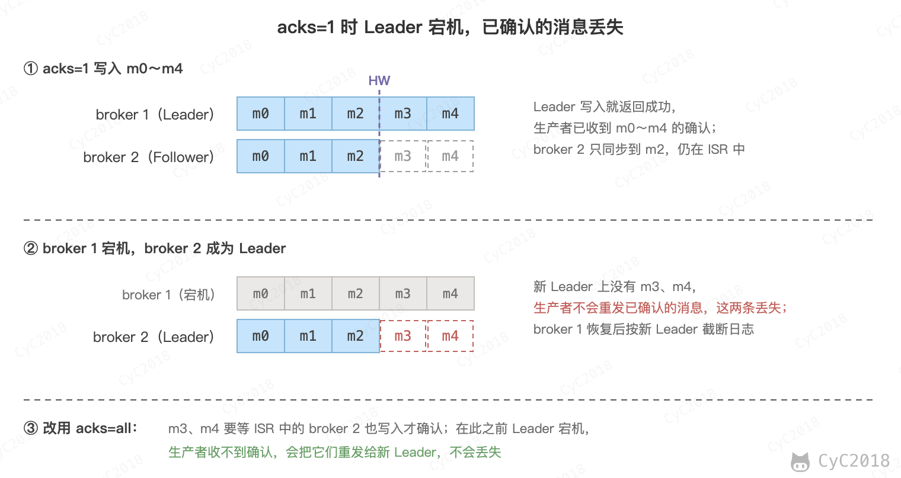
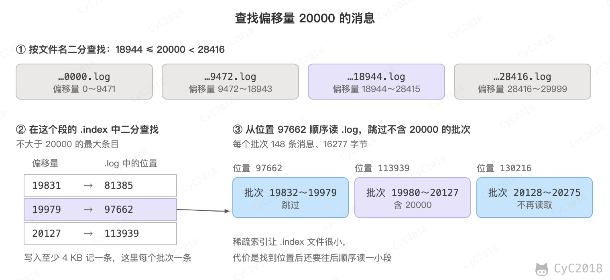

# 消息队列
<!-- GFM-TOC -->
* [消息队列](#消息队列)
    * [一、消息模型](#一消息模型)
        * [点对点](#点对点)
        * [发布/订阅](#发布订阅)
    * [二、使用场景](#二使用场景) 🔥🔥
        * [异步处理](#异步处理)
        * [流量削峰](#流量削峰)
        * [应用解耦](#应用解耦)
        * [与 RPC 调用的区别](#与-rpc-调用的区别)
    * [三、可靠性](#三可靠性) 🔥🔥
        * [发送端的可靠性](#发送端的可靠性)
        * [消息队列的可靠性](#消息队列的可靠性)
        * [接收端的可靠性](#接收端的可靠性)
    * [四、顺序性](#四顺序性) 🔥
    * [五、消息堆积](#五消息堆积) 🔥
    * [六、延迟消息与死信队列](#六延迟消息与死信队列) 🔥
        * [延迟消息](#延迟消息)
        * [死信队列](#死信队列)
    * [七、Kafka](#七kafka)
        * [分区与消费者组](#分区与消费者组)
        * [副本与可靠性](#副本与可靠性)
        * [存储](#存储)
        * [为什么吞吐量高](#为什么吞吐量高)
    * [附录：实测](#附录实测)
        * [A1 批量对吞吐量的影响](#a1-批量对吞吐量的影响)
        * [A2 重复消费](#a2-重复消费)
        * [A3 消费积压](#a3-消费积压)
        * [A4 Redis Stream 的确认](#a4-redis-stream-的确认)
        * [A5 增加分区后 key 所在的分区](#a5-增加分区后-key-所在的分区)
        * [A6 共享组](#a6-共享组)
        * [A7 重平衡时交出的分区](#a7-重平衡时交出的分区)
        * [A8 min.insync.replicas 与 acks](#a8-mininsyncreplicas-与-acks)
    * [参考资料](#参考资料)
<!-- GFM-TOC -->


## 一、消息模型

### 点对点

消息生产者向消息队列中发送了一个消息之后，多个消费者竞争领取，一条消息只交给其中一个消费者处理。

<div align="center">  </div><br>

### 发布/订阅

消息生产者向频道发送一个消息之后，多个消费者可以从该频道订阅到这条消息并消费。

<div align="center">  </div><br>

Kafka、RocketMQ 等通过消费者组把两种模型结合起来：一条消息会发送给每个订阅它的消费者组，但在一个消费者组内只会被一个消费者消费。

<div align="center">  </div><br>

发布与订阅模式和观察者模式有以下不同：

- 观察者模式中，观察者和主题都知道对方的存在；而在发布与订阅模式中，生产者与消费者不知道对方的存在，它们之间通过频道进行通信；
- 观察者模式是同步的，当事件触发时，主题会调用观察者的方法，然后等待方法返回；而发布与订阅模式是异步的，生产者向频道发送一个消息之后，就不需要关心消费者何时去订阅这个消息，可以立即返回。

<div align="center">  </div><br>

## 二、使用场景 🔥🔥

### 异步处理

发送者把消息发送到消息队列之后立即返回，不等待接收者处理完毕；接收者从消息队列中取出消息后再处理。

例如用户注册时要发送验证邮件。注册服务把“给用户 1001 发验证邮件”的消息写入队列就返回注册成功，邮件服务稍后再发送，邮件接口变慢或者暂时失败都不影响注册。

前提是后续步骤不依赖这次处理的结果，见下文的 [与 RPC 调用的区别](#与-rpc-调用的区别)。

用进程内的线程池异步发送也能立即返回，但任务只在内存中，宕机就丢了，重试要自己实现，其它服务也无法订阅。

### 流量削峰

短时间内大量请求同时到达（例如秒杀开始的那一秒）会压垮服务器。可以先把请求写入消息队列，服务器再按自己的处理能力从队列中取出处理。

“按处理能力”是由消费者控制的：Kafka 的消费者每次 poll 最多取回 max.poll.records（默认 500）条消息，处理完再取下一批；RabbitMQ 用 prefetch 限制推给每个消费者、还没有确认的消息数。峰值期间来不及处理的请求留在队列中，峰值过后再慢慢处理完，积压量和排空时间的估算见[削峰](系统设计基础.md#2-削峰)。

削峰的代价是用户不能立即得到结果，前端要显示“排队中”，再查询处理结果。队列也不能无限积压，入口仍然需要限流：排队时间超过用户能接受的程度时，不如直接返回“已售罄”或“稍后再试”。

### 应用解耦

模块之间不直接调用，而是一个模块向消息队列发送消息、其它模块按需订阅，这样修改或者新增一个模块时，对其它模块的影响很小。

例如订单支付成功后，积分、物流、短信和数据分析四个服务都要处理。订单服务逐个调用它们时，每新增一个下游都要修改订单服务，任何一个下游超时都会拖慢支付流程；改为发送一条“订单 1024 已支付”的消息后，各下游用自己的消费者组订阅，新增下游不需要修改订单服务，某个下游故障时消息留在队列中，恢复后继续处理。

<div align="center">  </div><br>

引入消息队列也带来了新的问题：

- 系统多了一个需要保证高可用的组件；
- 消息可能丢失或者被重复投递，见[可靠性](#三可靠性)；
- 多个队列之间没有顺序保证，见[顺序性](#四顺序性)；
- 上下游只能最终一致，例如支付成功后积分晚几秒到账；
- 链路变长，排查问题要靠消息轨迹或贯穿上下游的追踪编号。

### 与 RPC 调用的区别

[RPC](分布式.md#七rpc) 是同步的请求-响应：调用方等待被调用方返回结果，被调用方必须在线，适合需要立即得到结果的调用；消息队列是异步的：发送方只确认消息已经存入队列，不知道也不等待谁来处理、何时处理，适合结果可以稍后产生、或者有多个接收方的场景。

选择时可以问两个问题：调用方的下一步是否依赖这次调用的结果？被调用方暂时不可用时，调用方是否也应该失败？两个答案都是“是”时用 RPC，否则考虑消息队列。例如支付前必须知道库存是否扣减成功，用 RPC 调用库存服务；支付成功后加积分，积分服务晚几秒处理、甚至宕机几分钟都不影响支付，用消息队列。

## 三、可靠性 🔥🔥

一条消息要经过发送、存储、消费三个环节，每个环节都可能丢失消息。以 Kafka 为例：

<div align="center">  </div><br>

三种常用的消息队列在这三个环节上的做法：

| 环节 | Kafka | RabbitMQ | RocketMQ（4.x） |
| --- | --- | --- | --- |
| 发送 | acks=all，失败自动重试 | 开启发布确认（Publisher Confirm），收到 ack 才算成功，并设置 mandatory | 同步发送，返回 SEND_OK 才算成功 |
| 存储 | 多副本，配合 min.insync.replicas，见 [副本与可靠性](#副本与可靠性) | 持久化的队列加持久化的消息，或者使用多副本的仲裁队列（Quorum Queue） | 同步刷盘（SYNC_FLUSH）加同步复制（SYNC_MASTER），默认都是异步的 |
| 消费 | 处理完再提交偏移量 | 关闭自动确认，处理完再发送 ack | 处理完再返回 CONSUME_SUCCESS，失败返回 RECONSUME_LATER 稍后重试 |

需要注意的是，RabbitMQ 对无法路由到任何队列的消息同样返回 ack，只开启确认而不设置 mandatory 时，发错路由键的消息会被直接丢弃；设置了 mandatory，这类消息会先退回给生产者。

即使这些配置都打开，消息仍可能因为程序缺陷、误操作等原因丢失或者处理失败，关键业务还要定期核对上下游的数据（对账），发现缺失时补发。

### 发送端的可靠性

消息队列把消息可靠地保存之后才向发送端返回确认，发送端没有收到确认就进行重传。这里的“保存”不一定是刷盘，例如 Kafka 中是写入了足够多的副本，见下文的[副本与可靠性](#副本与可靠性)。

需要注意的是，Kafka 生产者的 send() 是异步的，把消息放入本地的缓冲区就返回，发送和重试在后台线程中进行。既不检查返回的 Future、也不传入回调时，重试用完之后的失败没有任何人知道；进程退出前没有调用 close() 或 flush()，缓冲区中还没有发出的消息也会丢失。

另一个问题是业务操作和发送消息不在同一个事务中：订单写库成功后进程崩溃，消息就没有发出。解决方法是[本地消息表](分布式.md#本地消息表)：在同一个本地事务中写入业务数据和待发送的消息，提交后再转发，收到确认前不断重传。

### 消息队列的可靠性

消息队列收到消息后需要持久化到磁盘，并复制到多个副本上，避免单个节点宕机导致消息丢失。

Kafka 默认不在每次写入后刷盘（log.flush.interval.messages 默认为 Long 的最大值），持久性依靠多个副本。如果所有副本所在的机器同时断电，还在页缓存中的消息仍然会丢失，所以副本要分布在不同的机架或可用区。另一个相关的配置是 unclean.leader.election.enable，默认为 false：ISR 中的副本全部不可用时，宁可让分区暂时无法写入，也不让落后的副本成为 Leader；设为 true 可以更快恢复写入，但落后的副本没有同步到的消息就丢失了。

### 接收端的可靠性

接收端在处理完成之后才向消息队列确认，处理过程中崩溃的话消息会被重新投递，不会丢失，代价是同一条消息可能被处理多次。生产者重发、消费者处理完但没来得及确认、重平衡后分区换了消费者，都会造成重复，Kafka 的幂等生产者只能去掉生产者内部重试造成的重复。所以处理消息的逻辑要具有幂等性，同一条消息处理多次和处理一次的结果相同，常用的做法是用一张去重表记录已经处理过的消息的业务键。

例如积分服务消费“订单 1024 支付成功”的消息，在同一个本地事务中先写去重表、再加积分。重复的消息插入去重表时违反主键约束，回滚后直接确认这条消息：

```sql
BEGIN;
INSERT INTO consumed_msg (msg_key) VALUES ('order:1024:paid');   -- 重复时报错 1062
UPDATE points SET balance = balance + 100 WHERE user_id = 1001;
COMMIT;
```

去重的键要用业务上的唯一标识，例如订单号加事件类型，不要用消息队列生成的消息 ID：RocketMQ 中同一条消息被生产者重发后可能有两个不同的消息 ID。

有状态的业务也可以直接用状态做条件，不需要去重表。例如处理“订单 1024 已支付”的消息时执行 UPDATE orders SET status = 'PAID' WHERE id = 1024 AND status = 'UNPAID'，重复的消息影响行数为 0，直接确认即可。

需要注意的是，消息队列提供的“恰好一次”（Exactly Once）不能代替业务的幂等。Kafka 的恰好一次指的是“从 Kafka 读取、处理、再写回 Kafka”这个过程中，用事务把输出的消息和消费的偏移量一起提交。消费者把结果写入数据库或者调用外部接口时，数据库的提交和偏移量的提交仍然是两件事，两者之间崩溃就会重复处理，Kafka 文档也说明写入其它系统时需要那个系统配合。

去重记录也可以放在 Redis 中，但如果用 SETNX 标记之后、处理完成之前消费者崩溃，重新投递的消息会被当作已经处理而跳过，这条消息就丢了。因此 Redis 中要区分“处理中”和“已完成”两种状态，“处理中”设置过期时间，过期后允许重新处理。过期后重新处理时，前一个处理者可能还没有结束，所以业务写入仍要用唯一索引或状态条件兜底。通用的幂等方法见 [分布式中的幂等](分布式.md#九幂等)。

## 四、顺序性 🔥

消息队列通常只保证单个队列（Kafka 中的分区）内的消息有序，多个队列之间没有顺序保证。并且在点对点模式下，一个消费者处理失败的消息会被重新投递给另一个消费者，顺序也会被打乱。

要保证同一业务的消息有序，需要让发送端把这些消息按业务 Key（例如订单号）路由到同一个队列，并且接收端对同一个队列只用一个线程顺序消费。

发送端也要按业务顺序发送。生产者的重试也可能打乱顺序：多个批次同时在途时，“已支付”的批次失败重试，后面“已发货”的批次先写入成功。Kafka 默认开启的幂等生产者用序号避免了这种乱序，关闭幂等时要把 max.in.flight.requests.per.connection 设为 1。

<div align="center">  </div><br>

RabbitMQ 中一个队列内的消息是先进先出的，但一个队列有多个消费者时，消息被拒绝后重新入队会打乱顺序。需要顺序时按业务 Key 把消息路由到多个队列，每个队列只有一个消费者；或者开启单活跃消费者（Single Active Consumer），同一时刻只有一个消费者接收消息，它断开后才由另一个消费者接替。Kafka 中这两件事由分区和消费者组完成：同一个 key 进入同一个分区，一个分区只分配给组内的一个消费者。

需要注意的是，分区数改变后同一个 key 可能落到另一个分区。例如主题从 3 个分区扩为 4 个后，订单 1024 的“已支付”在分区 2，“已发货”进入了分区 1，可能先被处理（Kafka 4.4 实测，见[附录 A5](#a5-增加分区后-key-所在的分区)）。所以要求顺序的主题要预先规划分区数，扩容时先暂停写入，等旧分区消费完再恢复。

顺序消费时一条消息处理失败，后面的消息都要等它。RocketMQ 4.x 的顺序消费默认一直重试，要设置最大重试次数（maxReconsumeTimes），超过后转入[死信队列](#死信队列)。

## 五、消息堆积 🔥

消费速度长期低于生产速度时，消息会在队列中堆积。

堆积的程度用积压量（Lag）衡量，Kafka 中每个分区的积压量等于日志末尾的偏移量减去消费者组已提交的偏移量。例如积分服务只消费了 3000 条就停止，用 kafka-consumer-groups.sh 查看（Kafka 4.4 实测，省略了后三列，见[附录 A3](#a3-消费积压)）：

```text
GROUP    TOPIC           PARTITION  CURRENT-OFFSET  LOG-END-OFFSET  LAG
points   points-events   0          0               9237            9237
points   points-events   1          0               9577            9577
points   points-events   2          3000            11186           8186
```

积压要靠监控提前发现。常用的告警指标有两个：积压量持续增长，说明消费速率一直低于生产速率；消费延迟，即最早一条未消费的消息已经等待了多久，它与业务的关系更直接，例如订单超时取消的消息延迟超过 1 分钟就应该告警。

排查时先看积压是生产突增造成的，还是消费变慢造成的：

- 生产突增：例如大促、批量任务，生产速率的监控会明显上升，峰值过后通常能自然消化；
- 消费变慢：最常见的原因是消费逻辑依赖的数据库或外部接口变慢，其次是某些消息反复处理失败、不断重试，或者处理超时导致消费者被踢出、频繁重平衡；
- 只有个别分区积压：通常是 key 分布不均，大量消息集中到了同一个分区。

处理方法：

- 先解决消费变慢的原因，例如修复下游、把反复失败的消息转入死信队列；
- 增加消费者数量。Kafka 和 RocketMQ 4.x 中消费者数量超过分区（队列）数量之后不再有效，上面的主题有 3 个分区，组内启动 4 个消费者后，其中一个分到 0 个分区；Kafka 的[共享组](#分区与消费者组)和 RocketMQ 5.x 新 SDK 的 PushConsumer、SimpleConsumer 没有这个限制；
- 提高单个消费者的处理能力：批量写库，或者在消费者内部用线程池并行处理，同一个 key 的消息交给同一个线程以保持顺序，这时提交偏移量要注意的问题见[副本与可靠性](#副本与可靠性)的最后一段；
- 积压量很大、分区数又不够时，给原主题增加分区没有用，积压的消息仍在原来的分区里，可以临时新建一个分区更多的主题，原来的消费者只把消息按原来的 key 和顺序转发过去，再用更多的消费者消费新主题；
- 不重要的消息可以降级，例如先跳过，之后再补偿。

需要注意的是，Kafka 按保留时间删除旧数据，不管消息有没有被消费，积压超过 retention.ms（默认 7 天）的消息会被删除；RocketMQ 默认保留 72 小时。积压的时间接近保留时间时，要先把消息转存出来。

RabbitMQ 的队列默认没有长度上限，积压的消息占用内存和磁盘，达到内存或磁盘的水位线后，RabbitMQ 会阻塞所有发布消息的连接；设置了长度上限（x-max-length）的队列满了之后，默认丢弃队头最早的消息，配置了死信交换机时转入死信队列。

## 六、延迟消息与死信队列 🔥

### 延迟消息

延迟消息指的是发送后不立即投递，等到指定时间才能被消费的消息。典型的场景是订单 30 分钟未支付自动取消：下单时发送一条 30 分钟后投递的消息，到时消费者检查订单，仍未支付就取消。相比[定时任务扫描全表](分布式.md#定时扫描与延迟消息)，延迟消息只处理到期的订单。

延迟消息也可能丢失、晚到或重复，所以取消时以订单的当前状态为条件：UPDATE orders SET status = 'CANCELLED' WHERE id = 1024 AND status = 'UNPAID'，支付回调同样带状态条件，取消后才到的支付成功要退款；要求高的业务再用低频扫描兜底。取消前先向支付平台关单，用户就不能在取消后再付款，见[超时关单](系统设计基础.md#超时关单)。

各消息队列的支持情况：

- RocketMQ 4.x 只支持 18 个固定的延迟级别：1s 5s 10s 30s 1m 2m 3m 4m 5m 6m 7m 8m 9m 10m 20m 30m 1h 2h，消息先存入内部的定时主题，每个级别一个队列，同一队列中先写入的先到期，只需检查队头；
- RocketMQ 5.x 改用时间轮，支持指定任意的投递时间，默认精度为 1 秒；最长时长由配置决定，开源 5.5.1 中经 Proxy 发送的默认 1 天、Broker 默认 3 天，超出时拒绝写入（以官方最新文档为准）；
- RabbitMQ 常用的做法是给消息设置过期时间（TTL），过期后转入死信交换机，由死信队列的消费者处理。过期的消息到达队头才会被转出，前面 30 分钟的消息会挡住后面已到期的 1 分钟的消息，所以每种延迟时长单独建一个队列；4.4 起仲裁队列也支持延迟投递（以官方最新文档为准）；
- Kafka 不支持延迟消息，需要自己实现，例如按延迟时长分成几个主题，消费者读到未到期的消息就暂停等待。

不使用消息队列时，也可以用 Redis 的有序集合实现：分值为到期时间，后台线程定期取出分值不大于当前时间的成员。多个实例同时轮询时，用 ZREM 的返回值判断由谁处理，返回 1 的实例才处理：

```text
> zadd delay:orders 1792997618 order:1024 1792999423 order:1025
(integer) 2
> zrangebyscore delay:orders 0 1792997623 limit 0 10
1) "order:1024"
> zrem delay:orders order:1024
(integer) 1
> zrem delay:orders order:1024
(integer) 0
```

需要注意的是，ZREM 之后、处理完成之前实例崩溃，任务就丢了；要求可靠时用 Lua 脚本把任务原子地移到“处理中”的有序集合，处理完再删除，超时未删除的放回。

JDK 自带的 DelayQueue 也能实现延迟，但数据只在单个进程的内存中，服务重启就会丢失，多个实例之间也无法共享。

### 死信队列

消息多次消费失败后，不再重试，而是转入死信队列，避免一条有问题的消息反复重试、阻塞其它消息，之后由人工或专门的程序排查，修复后重新投递。重试间隔通常逐次拉长，因为失败多由下游故障引起，立即重试多半还会失败。

- RocketMQ 并发消费时默认重试 16 次，间隔从 10s 逐步拉长到 2h，仍然失败就进入名为 %DLQ% 加消费者组名的死信主题，死信同样只保存 72 小时；
- RabbitMQ 中消息被消费者拒绝且不重新入队、消息的 TTL 过期、队列长度超过上限时，消息会被转发到死信交换机。仲裁队列中投递失败超过 delivery-limit 次（4.0 起默认 20 次）的消息也会转入，没有配置死信交换机就直接删除；
- Kafka 的普通消费者组没有死信，由消费者把多次失败的消息写到重试主题、死信主题，例如 Spring Kafka 的 DeadLetterPublishingRecoverer。

事务消息用于保证本地事务和发送消息同时成功或失败，半消息、提交和回查的过程见 [分布式事务中的事务消息](分布式.md#本地消息表)。回查时按业务数据判断：例如回查“订单 1024 已创建”时，订单表中有 1024 就提交，确认事务已结束而没有订单才回滚，无法确定时返回 Unknown 等下次回查。

## 七、Kafka

Kafka 把消息保存为按分区追加的日志，消息被消费后不会删除，这是它与 RabbitMQ 最大的区别。三种常用的消息队列对比如下：

| | Kafka | RabbitMQ | RocketMQ |
| --- | --- | --- | --- |
| 存储 | 分区日志，按保留时间删除，与是否被消费无关 | 队列，消息被确认后删除 | 所有主题的消息顺序写入同一个 CommitLog，每个队列另有消费索引，按保留时间删除 |
| 消费 | 消费者拉取，提交偏移量，可以把偏移量调回去重新消费 | Broker 主动推送给消费者，用 prefetch 限制未确认的消息数 | 消费者按队列拉取（Push 模式用长轮询实现），可以按时间重置消费位置 |
| 路由 | 生产者按 key 选择分区 | 交换机按类型和绑定规则把消息投递到一个或多个队列：direct 精确匹配，topic 按通配符匹配，fanout 广播给所有绑定的队列，headers 按消息首部匹配 | 主题加 Tag 过滤 |
| 业务功能 | 本身不支持延迟消息，死信只有共享组支持（4.4 起） | 死信交换机、TTL、优先级队列，4.4 起仲裁队列支持延迟消息 | 延迟消息、事务消息、消费重试和死信队列 |
| 适用场景 | 日志、埋点、数据同步、流处理等吞吐量大的场景 | 消息量不大、路由规则复杂的业务消息 | 订单、支付等需要事务消息、延迟消息和重试的业务消息 |

Kafka 选择拉模式，是因为推送的速率由 Broker 决定，需要额外的流控（例如 RabbitMQ 的 prefetch）才能匹配消费者的处理速度；拉取时消费者按自己的速度读取，一次可以拉走当前位置之后的一批消息。没有新消息时，拉取请求在 Broker 上等待数据到达（长轮询），避免空转。

RabbitMQ 也提供了只追加的 Stream 类型，消息确认后不删除，可以重复读取。

选型时先看业务需要什么：

- 日志、埋点、数据同步这类数据量大、需要多个系统各自消费或者回溯重放的，选 Kafka；
- 订单、支付等业务消息需要延迟消息、事务消息、失败重试和死信时，选 RocketMQ，可以少写很多自研的代码；
- 消息量不大、路由规则复杂（按路由键或通配符分发到不同的队列）的，选 RabbitMQ。

此外还要考虑团队的运维经验和已有的技术栈。同时维护多种消息队列的成本很高，已有的一种能满足需求时通常继续使用。

Redis 也常被用作轻量的消息队列，但可靠性不如专门的消息队列：

- Pub/Sub 不保存消息，发布时没有订阅者或者订阅者断线，消息就丢了，实测没有订阅者时 PUBLISH 返回 0；
- List 用 LPUSH 和 BRPOP 实现队列，消息取出后就从 List 中删除，消费者处理时崩溃就丢了，也不支持多个消费者组；
- Stream（Redis 5.0 起）支持消费者组和确认：XREADGROUP 读出的消息进入待确认列表，XACK 之后才移除，消费者崩溃时其它消费者可以用 XCLAIM（6.2 起也可用 XAUTOCLAIM）接管它没有确认的消息（见[附录 A4](#a4-redis-stream-的确认)）。

即使使用 Stream，数据也保存在内存中，默认配置下持久化和主从复制都是异步的，宕机时可能丢失最近写入的消息，能保存的消息量也受内存限制。消息量不大、能接受少量丢失时可以用 Redis，否则用专门的消息队列。

### 分区与消费者组

Kafka 中的消息按主题（Topic）分类，每个主题分成多个分区（Partition）。分区是一个只能在末尾追加的日志，每条消息在分区内有一个递增的偏移量（Offset），消费者记录自己读到了哪个偏移量。

生产者发送消息时可以带一个 key，默认按 key 的哈希值对分区数取模选择分区，相同 key 的消息一定进入同一个分区，所以同一个订单的消息是有序的，不同分区之间则没有顺序。没有 key 时，生产者先把一批消息发往同一个分区，再换下一个分区，以便凑成批次。

<div align="center">  </div><br>

消费者以消费者组为单位订阅主题：组内每个分区只分配给一个消费者，一个消费者可以负责多个分区。所以分区数决定了一个组最多有多少个消费者同时工作，多出来的消费者只能空闲。不同的组各自独立地消费全部消息，例如计费服务和物流服务各用一个组，都能收到每一条订单消息。

Kafka 4.2 起提供共享组（Share Group）：一个分区的消息可以分给多个消费者，消费者数可以超过分区数，每条消息单独确认，超时未确认就重新投递，代价是不再保证顺序。例如 1 个分区的主题，3 个共享消费者各处理了 40 条消息（Kafka 4.4 实测，见[附录 A6](#a6-共享组)）。

消费者加入、退出或者分区数变化时，组内会重新分配分区，称为重平衡（Rebalance）。默认的 classic 协议下所有消费者先交出全部分区，整个组暂停；Kafka 4.0 起的新协议（group.protocol=consumer）只暂停需要移动的分区。例如 6 个分区的组加入第二个消费者时，第一个消费者在两种协议下分别交出 6 个和 3 个分区（Kafka 4.4 实测，见[附录 A7](#a7-重平衡时交出的分区)）。

重平衡还可能造成重复消费。一个常见的原因是处理一批消息的时间超过了 max.poll.interval.ms（默认 5 分钟），消费者被认为已经失效，它的分区被分给其他消费者，这时它再提交偏移量会失败。可以调小 max.poll.records 或调大 max.poll.interval.ms；正常的重平衡可以在 ConsumerRebalanceListener 的 onPartitionsRevoked 中先同步提交已处理完的偏移量，再交出分区。

### 副本与可靠性

每个分区有多个副本，分布在不同的 broker 上，其中一个是 Leader，负责处理读写，其余的 Follower 不断从 Leader 拉取数据。与 Leader 保持同步的副本集合称为 ISR（In-Sync Replicas），Follower 超过 replica.lag.time.max.ms（默认 30 秒）没有追上 Leader 就会被移出 ISR。ISR 中所有副本都已写入的位置称为高水位（High Watermark, HW），消费者只能读到高水位之前的消息。Kafka 4.0 起完全移除了 ZooKeeper，Leader 选举等元数据由内置的 KRaft 控制器管理，它基于 [Raft](分布式.md#六raft) 协议实现。分区数据的复制没有用 Raft 的多数派：多数派要有 2f+1 个副本，才能在 f 个副本故障后保住已提交的消息并选出新 Leader；Kafka 的消息要写入 ISR 中的全部副本才算提交，提交时 ISR 有 f+1 个副本，损失其中 f 个仍能保住这条消息。代价是提交要等 ISR 中最慢的副本；故障后能否继续写入还取决于下文的 min.insync.replicas。

例如创建 3 个分区、3 个副本的主题，然后用 kill -9 停掉 broker 3（3 个节点的 KRaft 集群实测）：

```text
停止前
Partition: 0    Leader: 2    Replicas: 2,3,1    Isr: 2,3,1
Partition: 1    Leader: 3    Replicas: 3,1,2    Isr: 3,1,2
Partition: 2    Leader: 1    Replicas: 1,2,3    Isr: 1,2,3
停止后
Partition: 0    Leader: 2    Replicas: 2,3,1    Isr: 2,1
Partition: 1    Leader: 1    Replicas: 3,1,2    Isr: 1,2
Partition: 2    Leader: 1    Replicas: 1,2,3    Isr: 1,2
```

分区 1 的 Leader 从 broker 3 切换到了 ISR 中的 broker 1，其它分区只是 ISR 中少了 3。broker 3 重启并追上数据后，又回到了 ISR 中。

生产者的 acks 参数决定写入多少个副本才算成功：

- acks=0：不等待确认，可能丢消息；
- acks=1：Leader 写入就返回，Leader 宕机而 Follower 还没同步时会丢消息；
- acks=all：ISR 中的副本都写入才返回，Kafka 3.0 起是默认值。

Follower 落后几条消息时仍在 ISR 中，Leader 宕机后它可以成为新 Leader，acks=1 时已经确认的消息就丢了：

<div align="center">  </div><br>

acks=all 要配合 min.insync.replicas 使用，否则 ISR 只剩 Leader 一个时，acks=all 就退化成了 acks=1。min.insync.replicas 设为 2 时，ISR 少于 2 个副本，broker 就拒绝 acks=all 的写入。上面停掉 broker 3 之后 ISR 还有 2 个副本，写入正常；把 min.insync.replicas 改为 3 再写入，生产者重试几次后报错 NotEnoughReplicasException；改用 acks=1 时写入成功，但高水位不前进，停掉的 broker 回到 ISR 后消费者才能读到这条消息（Kafka 4.4 实测，见[附录 A8](#a8-mininsyncreplicas-与-acks)）。常用的配置是 3 个副本、min.insync.replicas=2、acks=all，一个副本故障时既不丢消息，也不停止写入。

生产者没有收到确认就会重试，这可能让同一条消息写入两次。Kafka 3.0 起默认开启幂等生产者（3.0.0、3.1.0 因缺陷未生效）：broker 给每个生产者分配一个 ID，生产者给发往每个分区的消息编上序号，broker 发现序号重复就丢弃。后文查看 .log 文件时，每个批次都带有 producerId: 1001 和 baseSequence 字段。幂等只保证单个分区内、生产者自身重试时不重复，应用自己重发的消息不能去重；要让写入多个分区的消息同时成功或失败，需要使用事务，消费者设置 isolation.level=read_committed 后只读取已提交事务中的消息。

消费者处理完消息后提交偏移量，下次从提交的位置继续读取。默认每 5 秒自动提交一次，已经处理但还没提交时崩溃，重启后就会重复消费。例如消费者读到 3 条扣款消息后被 kill -9，这时组的偏移量仍然为空；它在 session.timeout.ms（默认 45 秒）之后被移出消费者组，重新启动的消费者又收到了这 3 条消息（见[附录 A2](#a2-重复消费)）。因此接收端必须做到幂等，方法见 [接收端的可靠性](#接收端的可靠性)。反过来，如果先提交偏移量再处理，处理失败的消息就丢失了。

消费者用线程池并行处理时也会遇到这个问题。提交偏移量 N 表示 N 之前的消息都已经处理完。例如一次取回了偏移量 100～109，线程已经处理完 105～109，100～104 还在处理中，这时提交 110，进程崩溃后 100～104 就不会再被消费。所以要关闭自动提交（它可能早于处理完成），只手动提交连续处理完的位置，这里是 100，代价是重启后 105～109 会被重复消费。

### 存储

每个分区在磁盘上是一个目录，日志按大小切分成多个段（Segment），文件名是段中第一条消息的偏移量。例如把段的大小设为 1 MB（默认 1 GB），向一个只有一个分区的主题写入 3 万条 100 字节的消息后，目录中的文件和大小如下（Kafka 4.4 实测，省略了 .timeindex 等文件）：

```text
00000000000000000000.log     1041728
00000000000000000000.index       504
00000000000000009472.log     1041728
00000000000000009472.index       504
00000000000000018944.log     1041728
00000000000000018944.index       504
00000000000000028416.log      174207
00000000000000028416.index  10485760
```

.index 是稀疏索引，每写入一段数据（index.interval.bytes，默认 4 KB）记录一条“偏移量 → 在 .log 文件中的位置”。查找偏移量 20000 的消息：

1. 按文件名二分查找，20000 落在 00000000000000018944 这个段中；
2. 在这个段的索引中二分查找，不大于 20000 的最近一条索引是 19979 → 97662；
3. 从 .log 文件的位置 97662 开始顺序读，这里是偏移量 19832～19979 的批次，跳过它，下一个批次（19980～20127）中就有 20000。

<div align="center">  </div><br>

正在写入的段的索引文件预先分配了 10 MB，并用 mmap 映射到内存，段写满后才截断为实际大小。用 kafka-dump-log.sh 查看 .log 文件，可以看到消息是按批次存放的，这里每个批次有 148 条消息、16277 字节，接近生产者批次大小的默认值 16 KB。

旧数据按保留时间（默认 7 天）或总大小清理，每次删除一整个段，不需要修改文件内容；也可以配置为日志压缩，每个 key 只保留最新的一条消息。

### 为什么吞吐量高

顺序写和页缓存：消息只追加到日志的末尾，是顺序写，比随机写快得多。写入时只写到操作系统的页缓存，由操作系统决定何时刷盘，消费者读取刚写入不久的数据时也通常直接命中页缓存。可靠性不依靠每条消息都刷盘，而是依靠多个副本。

批量：生产者把发往同一个分区的消息攒成批次再发送，批次在网络传输、写入日志和副本复制时都作为一个整体处理，压缩也以批次为单位。例如在 3 个节点的集群上发送 2 万条 100 字节的消息（acks=all），默认配置每秒约 5.7 万～6.8 万条，平均延迟 21～54 ms；设置 batch.size=0（linger.ms=0）关闭批量后，每秒只有约 6500～6800 条，发送的请求大量排队，平均延迟约 1.4 秒（Kafka 4.4 实测，见[附录 A1](#a1-批量对吞吐量的影响)）。

零拷贝：零拷贝（Zero-copy）指的是传输数据时，CPU 不在内核空间和用户空间之间来回拷贝数据。用 read() 和 write() 把文件发到网络时，数据从页缓存拷贝到应用的缓冲区，再拷贝到 Socket 缓冲区，共 4 次拷贝、2 次系统调用。broker 把日志发给消费者时使用 sendfile 系统调用，数据只在内核中传递（启用 SSL 时数据要在用户空间加密，不能使用 sendfile）：

<div align="center">  </div><br>

另一种减少拷贝的方法是内存映射（mmap）：把文件映射到进程的地址空间，进程读写这段内存就是直接读写页缓存，不需要 read() 和 write() 的拷贝。第一次访问某一页时触发缺页异常，由内核把这一页从磁盘读入页缓存，再建立映射。前文 Kafka 的索引文件、RocketMQ 的 CommitLog 都是用 mmap 读写的。

两者的适用场景不同：sendfile 把文件原样发给 Socket，程序接触不到数据；mmap 适合程序本身要频繁读写文件内容的场景。Linux 还提供了 splice，在两个文件描述符之间移动数据而不经过用户空间，要求其中一个是管道。

分区并行：一个主题的多个分区分布在不同的 broker 上，读写由多台机器共同承担。

## 附录：实测

环境为 Apple M1 Pro、macOS，Kafka 4.4.0 的 3 个节点的 KRaft 集群运行在同一台机器上（端口 9091～9093，命令中的 $B 为这三个地址）。

### A1 批量对吞吐量的影响

主题有 3 个分区、3 个副本，每种配置运行 3 次：

```text
$ kafka-topics.sh --bootstrap-server $B --create --topic perf --partitions 3 --replication-factor 3
$ kafka-producer-perf-test.sh --topic perf --num-records 20000 --record-size 100 --throughput -1 \
    --command-property bootstrap.servers=$B acks=all
20000 records sent, 64724.919094 records/sec (6.17 MB/sec), 35.14 ms avg latency, 186.00 ms max latency
20000 records sent, 56980.056980 records/sec (5.43 MB/sec), 53.59 ms avg latency, 184.00 ms max latency
20000 records sent, 68493.150685 records/sec (6.53 MB/sec), 21.34 ms avg latency, 190.00 ms max latency

$ ...（同上） acks=all batch.size=0 linger.ms=0
20000 records sent, 6459.948320 records/sec (0.62 MB/sec), 1446.62 ms avg latency, 2773.00 ms max latency
20000 records sent, 6704.659739 records/sec (0.64 MB/sec), 1397.86 ms avg latency, 2674.00 ms max latency
20000 records sent, 6795.786612 records/sec (0.65 MB/sec), 1410.16 ms avg latency, 2648.00 ms max latency
```

### A2 重复消费

消费者组 billing 使用默认的自动提交，读到 3 条消息后立即 kill -9，45 秒后再启动一个同组的消费者：

```text
第一个消费者：
扣款 order:1024
扣款 order:1025
扣款 order:1026
（kill -9）
重新启动的消费者：
扣款 order:1024
扣款 order:1025
扣款 order:1026
Processed a total of 3 messages
```

### A3 消费积压

主题 points-events 有 3 个分区、3 个副本。用 kafka-console-producer.sh 写入 3 万条带 key 的消息（key 为 997 个用户 ID），消费者组 points 用 kafka-console-consumer.sh --max-messages 3000 消费 3000 条后退出，再查看积压；之后同时启动 4 个同组的消费者，查看每个消费者分到的分区数：

```text
$ kafka-consumer-groups.sh --bootstrap-server $B --describe --group points
Consumer group 'points' has no active members.

GROUP           TOPIC           PARTITION  CURRENT-OFFSET  LOG-END-OFFSET  LAG
points          points-events   0          0               9237            9237
points          points-events   1          0               9577            9577
points          points-events   2          3000            11186           8186

$ kafka-consumer-groups.sh --bootstrap-server $B --describe --group points --members
GROUP           CONSUMER-ID                                           #PARTITIONS
points          console-consumer-473682e9-43d9-4ade-98fb-045cbad44ef5 1
points          console-consumer-45a48e35-9625-4cb2-8495-73c2f2da0830 1
points          console-consumer-dcea488d-0498-4116-8265-3aed53a8667d 0
points          console-consumer-610451bd-692d-45f0-8b8b-d0af64cda4b1 1
```

### A4 Redis Stream 的确认

Redis 7.4.1，依次执行以下命令（redis-cli 非交互模式的原始输出，每个元素一行，空行表示空结果）：

```text
$ redis-cli xadd s3:orders '*' orderId 1024
1793162053370-0
$ redis-cli xgroup create s3:orders points 0
OK
$ redis-cli xreadgroup group points c1 count 10 streams s3:orders '>'
s3:orders
1793162053370-0
orderId
1024
$ redis-cli xpending s3:orders points            # c1 读出但还没有确认
1
1793162053370-0
1793162053370-0
c1
1
$ redis-cli xreadgroup group points c2 count 10 streams s3:orders '>'
                                                 # 新消息已经被 c1 领走，c2 读不到
$ redis-cli xautoclaim s3:orders points c2 0 0   # c2 接管 c1 没有确认的消息
0-0
1793162053370-0
orderId
1024

$ redis-cli xack s3:orders points 1793162053370-0
1
$ redis-cli xpending s3:orders points
0


$ redis-cli publish ch:orders 1024               # 没有订阅者
0
```

### A5 增加分区后 key 所在的分区

A5～A8 在另一个新建的同样配置的集群上运行，Java 程序用 JDK 21 和 Kafka 4.4.0 的客户端。主题 addp 先建 3 个分区，写入 4 个订单的“pay”，扩为 4 个分区后再写入“ship”：

```text
$ printf '1024:pay\n1025:pay\n1026:pay\n1027:pay\n' | kafka-console-producer.sh --bootstrap-server $B --topic addp \
    --reader-property parse.key=true --reader-property key.separator=:
$ kafka-topics.sh --bootstrap-server $B --alter --topic addp --partitions 4
$ printf '1024:ship\n1025:ship\n1026:ship\n1027:ship\n' | kafka-console-producer.sh ...（同上）
$ kafka-console-consumer.sh --bootstrap-server $B --topic addp --from-beginning \
    --formatter-property print.key=true --formatter-property print.partition=true --formatter-property print.offset=true
Partition:0	Offset:0	1026	pay
Partition:0	Offset:1	1027	pay
Partition:0	Offset:2	1026	ship
Partition:1	Offset:0	1024	ship
Partition:1	Offset:1	1025	ship
Partition:2	Offset:0	1024	pay
Partition:2	Offset:1	1025	pay
Partition:3	Offset:0	1027	ship
```

### A6 共享组

主题只有 1 个分区，写入 120 条消息，3 个消费者同时以共享组 sg3 订阅 25 秒，每条处理 50 ms（共享组设置了 share.auto.offset.reset=earliest）：

```java
Properties p = new Properties();
p.put("bootstrap.servers", "localhost:29091,localhost:29092,localhost:29093");
p.put("group.id", "sg3");
p.put("max.poll.records", "5");
p.put("share.acquire.mode", "record_limit");   // 默认的 batch_optimized 会让一个消费者领走整批消息
// key.deserializer、value.deserializer 省略
try (KafkaShareConsumer<String, String> c = new KafkaShareConsumer<>(p)) {
    c.subscribe(List.of("share3"));
    while (...) {
        for (ConsumerRecord<String, String> r : c.poll(Duration.ofMillis(200))) {
            Thread.sleep(50); n++;
        }
        c.commitSync();
    }
}
```

```text
c1 共处理 40 条
c2 共处理 40 条
c3 共处理 40 条
去重后的偏移量数：120
```

### A7 重平衡时交出的分区

主题有 6 个分区，消费者 A 先加入，15 秒后同组的 B 加入。消费者注册了 ConsumerRebalanceListener，在 onPartitionsRevoked 和 onPartitionsAssigned 中打印分区号：

```text
== group.protocol=classic（默认）
A 分到 [0, 1, 2, 3, 4, 5]，现在持有 [0, 1, 2, 3, 4, 5]
A 收回 [0, 1, 2, 3, 4, 5]
A 分到 [0, 1, 2]，现在持有 [0, 1, 2]
B 分到 [3, 4, 5]，现在持有 [3, 4, 5]
== group.protocol=consumer
A 分到 [0, 1, 2, 3, 4, 5]，现在持有 [0, 1, 2, 3, 4, 5]
B 分到 []，现在持有 []
A 收回 [3, 4, 5]
A 分到 []，现在持有 [0, 1, 2]
B 分到 [3, 4, 5]，现在持有 [3, 4, 5]
```

### A8 min.insync.replicas 与 acks

主题 hw 有 1 个分区、3 个副本，Leader 为 broker 1。先写入 m1，kill -9 broker 2，再把 min.insync.replicas 改为 3，用 acks=1 写入 m3：

```text
$ kafka-topics.sh --bootstrap-server $B --describe --topic hw
	Topic: hw	Partition: 0	Leader: 1	Replicas: 1,2,3	Isr: 1,3
$ echo "1026:m3" | kafka-console-producer.sh ... --command-property acks=1     # 正常返回
$ kafka-console-consumer.sh --bootstrap-server $B --topic hw --from-beginning --property print.offset=true
Offset:0	m1
Processed a total of 1 messages
$ kafka-get-offsets.sh --bootstrap-server $B --topic hw
hw:0:1
$ kafka-dump-log.sh --files data-1/hw-0/00000000000000000000.log    # Leader 的日志中已经有偏移量 1
baseOffset: 0 lastOffset: 0
baseOffset: 1 lastOffset: 1
（重启 broker 2，ISR 恢复为 1,2,3）
$ kafka-console-consumer.sh ...（同上）
Offset:0	m1
Offset:1	m3
Processed a total of 2 messages
```

## 参考资料

- [Designing Data-Intensive Applications 中文版](https://github.com/vonng/ddia)
- [消息队列中点对点与发布订阅区别](https://web.archive.org/web/20250522024511/https://blog.csdn.net/lizhitao/article/details/47723105)
- [定时/延时消息 | RocketMQ](https://rocketmq.apache.org/zh/docs/featureBehavior/02delaymessage/)
- [Dead Letter Exchanges | RabbitMQ](https://www.rabbitmq.com/docs/dlx)
- [Consumer Acknowledgements and Publisher Confirms | RabbitMQ](https://www.rabbitmq.com/docs/confirms)
- [Queues: Message Ordering | RabbitMQ](https://www.rabbitmq.com/docs/queues)
- [最佳实践 | RocketMQ 4.x](https://rocketmq.apache.org/zh/docs/4.x/bestPractice/01bestpractice/)
- [RocketMQ 设计](https://github.com/apache/rocketmq/blob/develop/docs/cn/design.md)
- [Redis Streams](https://redis.io/docs/latest/develop/data-types/streams/)
- [Redis Pub/Sub](https://redis.io/docs/latest/develop/pubsub/)
- [sendfile(2)](https://man7.org/linux/man-pages/man2/sendfile.2.html)、[splice(2)](https://man7.org/linux/man-pages/man2/splice.2.html)、[mmap(2)](https://man7.org/linux/man-pages/man2/mmap.2.html)
- [Apache Kafka Documentation: Design](https://kafka.apache.org/43/design/design/)
- [Apache Kafka Documentation: Configuration](https://kafka.apache.org/43/configuration/)
- [Apache Kafka Documentation: Upgrading](https://kafka.apache.org/43/getting-started/upgrade/)
- [KafkaProducer（Kafka 4.3 Javadoc）](https://kafka.apache.org/43/javadoc/org/apache/kafka/clients/producer/KafkaProducer.html)
- [Queue Length Limit | RabbitMQ](https://www.rabbitmq.com/docs/maxlength)
- [Memory and Disk Alarms | RabbitMQ](https://www.rabbitmq.com/docs/alarms)
- [Apache Kafka Documentation: Share Consumer 与 Consumer Rebalance Protocol（Kafka 4.4 发行包文档）](https://kafka.apache.org/documentation/)
- [Quorum Queues: Poison Message Handling | RabbitMQ](https://www.rabbitmq.com/docs/quorum-queues#poison-message-handling)
- [Time-To-Live and Expiration | RabbitMQ](https://www.rabbitmq.com/docs/ttl)
- [RabbitMQ 4.4.0 Release Notes](https://github.com/rabbitmq/rabbitmq-server/releases/tag/v4.4.0)
- [rabbitmq-delayed-message-exchange](https://github.com/rabbitmq/rabbitmq-delayed-message-exchange)
- [Redis persistence](https://redis.io/docs/latest/operate/oss_and_stack/management/persistence/)
