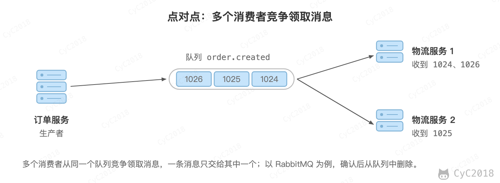
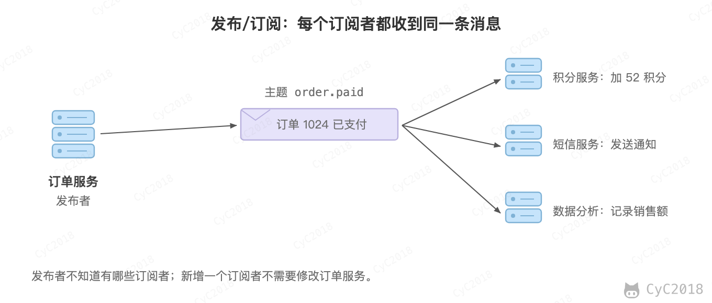
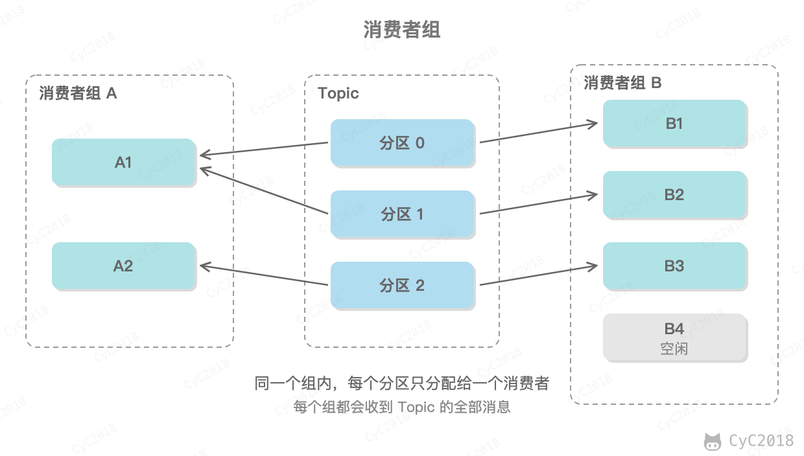
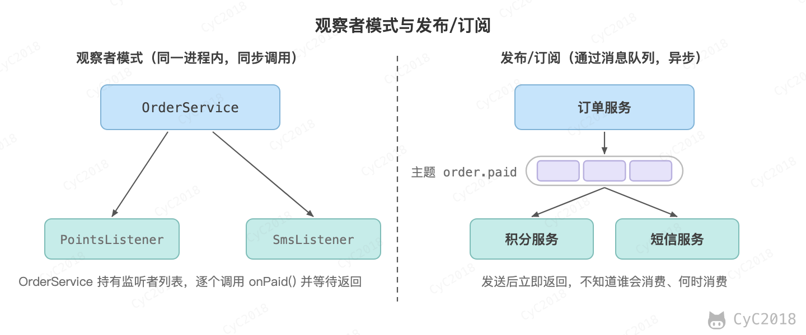
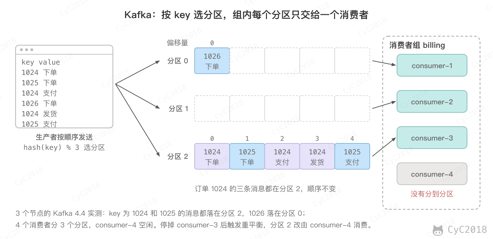
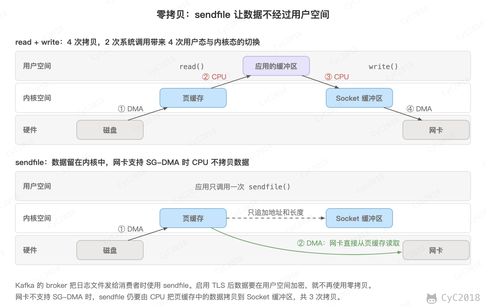

# 消息队列
<!-- GFM-TOC -->
* [消息队列](#消息队列)
    * [一、消息模型](#一消息模型)
        * [点对点](#点对点)
        * [发布/订阅](#发布订阅)
    * [二、使用场景](#二使用场景)
        * [异步处理](#异步处理)
        * [流量削峰](#流量削峰)
        * [应用解耦](#应用解耦)
    * [三、可靠性](#三可靠性)
        * [发送端的可靠性](#发送端的可靠性)
        * [消息队列的可靠性](#消息队列的可靠性)
        * [接收端的可靠性](#接收端的可靠性)
    * [四、顺序性](#四顺序性)
    * [五、消息堆积](#五消息堆积)
    * [六、延迟消息与死信队列](#六延迟消息与死信队列)
        * [延迟消息](#延迟消息)
        * [死信队列](#死信队列)
    * [七、Kafka](#七kafka)
        * [分区与消费者组](#分区与消费者组)
        * [存储](#存储)
        * [为什么吞吐量高](#为什么吞吐量高)
        * [副本与可靠性](#副本与可靠性)
    * [附录：实测](#附录实测)
    * [参考资料](#参考资料)
<!-- GFM-TOC -->


## 一、消息模型

### 点对点

消息生产者向消息队列中发送了一个消息之后，只能被一个消费者消费一次。

<div align="center">  </div><br>

### 发布/订阅

消息生产者向频道发送一个消息之后，多个消费者可以从该频道订阅到这条消息并消费。

<div align="center">  </div><br>

Kafka、RocketMQ 等通过消费者组把两种模型结合起来：一条消息会发送给每个订阅它的消费者组，但在一个消费者组内只会被一个消费者消费。

<div align="center">  </div><br>

发布与订阅模式和观察者模式有以下不同：

- 观察者模式中，观察者和主题都知道对方的存在；而在发布与订阅模式中，生产者与消费者不知道对方的存在，它们之间通过频道进行通信；
- 观察者模式是同步的，当事件触发时，主题会调用观察者的方法，然后等待方法返回；而发布与订阅模式是异步的，生产者向频道发送一个消息之后，就不需要关心消费者何时去订阅这个消息，可以立即返回。

<div align="center">  </div><br>

## 二、使用场景

### 异步处理

发送者将消息发送给消息队列之后，不需要同步等待消息接收者处理完毕，而是立即返回进行其它操作。消息接收者从消息队列中订阅消息之后异步处理。

例如在注册流程中通常需要发送验证邮件来确保注册用户身份的合法性，可以使用消息队列使发送验证邮件的操作异步处理，用户在填写完注册信息之后就可以完成注册，而将发送验证邮件这一消息发送到消息队列中。

只有在业务流程允许异步处理的情况下才能这么做，例如上面的注册流程中，如果要求用户对验证邮件进行点击之后才能完成注册的话，就不能再使用消息队列。

### 流量削峰

在高并发的场景下，如果短时间有大量的请求到达会压垮服务器。

可以将请求发送到消息队列中，服务器按照其处理能力从消息队列中订阅消息进行处理。

### 应用解耦

如果模块之间不直接进行调用，模块之间耦合度就会很低，那么修改一个模块或者新增一个模块对其它模块的影响会很小，从而实现可扩展性。

通过使用消息队列，一个模块只需要向消息队列中发送消息，其它模块可以选择性地从消息队列中订阅消息从而完成调用。

引入消息队列的代价是系统多了一个需要保证高可用的组件，并且需要处理下面的可靠性和顺序性问题。

## 三、可靠性

一条消息要经过发送、存储、消费三个环节，每个环节都可能丢失消息。

### 发送端的可靠性

发送端完成操作后一定能将消息成功发送到消息队列中。

实现方法：在本地数据库建一张消息表，将消息数据与业务数据保存在同一数据库实例里，这样就可以利用本地数据库的事务机制。事务提交成功后，将消息表中的消息转移到消息队列中，若转移消息成功则删除消息表中的数据，否则继续重传。

消息队列把消息可靠地保存之后才向发送端返回确认，发送端没有收到确认就进行重传。这里的“保存”不一定是刷盘，例如 Kafka 中是写入了足够多的副本，见下文的[副本与可靠性](#副本与可靠性)。

### 消息队列的可靠性

消息队列收到消息后需要持久化到磁盘，并复制到多个副本上，避免单个节点宕机导致消息丢失。

### 接收端的可靠性

接收端能够从消息队列成功消费一次消息。

接收端在处理完成之后才向消息队列确认，处理过程中崩溃的话消息会被重新投递，因此一条消息可能被重复消费，需要做到：

- 保证接收端处理消息的业务逻辑具有幂等性：只要具有幂等性，那么消费多少次消息，最后处理的结果都是一样的；
- 保证消息具有唯一编号，并使用一张日志表来记录已经消费的消息编号。

## 四、顺序性

消息队列通常只保证单个队列（Kafka 中的分区）内的消息有序，多个队列之间没有顺序保证。并且在点对点模式下，一个消费者处理失败的消息会被重新投递给另一个消费者，顺序也会被打乱。

要保证同一业务的消息有序，需要让发送端把这些消息按业务 Key（例如订单号）路由到同一个队列，并且接收端对同一个队列只用一个线程顺序消费。

## 五、消息堆积

消费速度长期低于生产速度时，消息会在队列中堆积。

解决方法是增加消费者数量来提高消费能力，但是消费者数量超过队列（分区）数量之后就不再有效，需要同时增加队列数量。

## 六、延迟消息与死信队列

### 延迟消息

延迟消息指的是发送后不立即投递，等到指定时间才能被消费的消息。典型的场景是订单 30 分钟未支付自动取消：下单时发送一条 30 分钟后投递的消息，到时消费者检查订单，仍未支付就取消。相比定时任务扫描全表，延迟消息只处理到期的订单。

各消息队列的支持情况：

- RocketMQ 4.x 只支持 18 个固定的延迟级别：1s 5s 10s 30s 1m 2m 3m 4m 5m 6m 7m 8m 9m 10m 20m 30m 1h 2h，消息先存入内部的定时主题，到期后再投递到目标主题；
- RocketMQ 5.x 支持指定任意的投递时间，默认最长 24 小时，精度为秒级；
- RabbitMQ 没有原生的延迟消息，常用的做法是给消息设置过期时间（TTL），过期后转入死信交换机，由死信队列的消费者处理，或者安装延迟消息插件；
- Kafka 不支持延迟消息，需要自己实现，例如按延迟时长分成几个主题，消费者读到未到期的消息就暂停等待。

不使用消息队列时，也可以用 Redis 的有序集合实现：分值为到期时间，后台线程定期取出分值不大于当前时间的成员。多个实例同时轮询时，用 ZREM 的返回值判断由谁处理，返回 1 的实例才处理：

```text
> zadd delay:orders 1792997618 order:1024 1792999423 order:1025
(integer) 2
> zrangebyscore delay:orders 0 1792997623 limit 0 10
1) "order:1024"
> zrem delay:orders order:1024
(integer) 1
> zrem delay:orders order:1024
(integer) 0
```

JDK 自带的 DelayQueue 也能实现延迟，但数据只在单个进程的内存中，服务重启就会丢失，多个实例之间也无法共享。

### 死信队列

消息多次消费失败后，不再重试，而是转入死信队列，避免一条有问题的消息反复重试、阻塞其它消息，之后由人工或专门的程序排查处理。

- RocketMQ 并发消费时默认重试 16 次，仍然失败就进入名为 %DLQ% 加消费者组名的死信主题；
- RabbitMQ 中消息被消费者拒绝且不重新入队、消息的 TTL 过期、队列长度超过上限时，消息会被转发到死信交换机。

事务消息用于保证本地事务和发送消息同时成功或失败，见 [分布式事务中的事务消息](分布式.md#本地消息表)。

## 七、Kafka

### 分区与消费者组

Kafka 中的消息按主题（Topic）分类，每个主题分成多个分区（Partition）。分区是一个只能在末尾追加的日志，每条消息在分区内有一个递增的偏移量（Offset），消费者记录自己读到了哪个偏移量。

生产者发送消息时可以带一个 key，默认按 key 的哈希值对分区数取模选择分区，相同 key 的消息一定进入同一个分区，所以同一个订单的消息是有序的，不同分区之间则没有顺序。没有 key 时，生产者先把一批消息发往同一个分区，再换下一个分区，以便凑成批次。

<div align="center">  </div><br>

消费者以消费者组为单位订阅主题：组内每个分区只分配给一个消费者，一个消费者可以负责多个分区。所以分区数决定了一个组最多有多少个消费者同时工作，多出来的消费者只能空闲。不同的组各自独立地消费全部消息，例如计费服务和物流服务各用一个组，都能收到每一条订单消息。

消费者加入、退出或者分区数变化时，组内会重新分配分区，称为重平衡（Rebalance）。重平衡期间被重新分配的分区暂停消费，还可能造成重复消费。一个常见的原因是处理一批消息的时间超过了 max.poll.interval.ms（默认 5 分钟），消费者被认为已经失效，它的分区被分给其他消费者。

### 存储

每个分区在磁盘上是一个目录，日志按大小切分成多个段（Segment），文件名是段中第一条消息的偏移量。例如把段的大小设为 1 MB（默认 1 GB），向一个只有一个分区的主题写入 3 万条 100 字节的消息后，目录中的文件和大小如下（Kafka 4.4 实测，省略了 .timeindex 等文件）：

```text
00000000000000000000.log     1041728
00000000000000000000.index       504
00000000000000009472.log     1041728
00000000000000009472.index       504
00000000000000018944.log     1041728
00000000000000018944.index       504
00000000000000028416.log      174207
00000000000000028416.index  10485760
```

.index 是稀疏索引，每写入一段数据（index.interval.bytes，默认 4 KB）记录一条“偏移量 → 在 .log 文件中的位置”。查找偏移量 20000 的消息：

1. 按文件名二分查找，20000 落在 00000000000000018944 这个段中；
2. 在这个段的索引中二分查找，不大于 20000 的最近一条索引是 19979 → 97662；
3. 从 .log 文件的位置 97662 开始顺序读，下一个批次（偏移量 19980～20127）中就有 20000。

正在写入的段的索引文件预先分配了 10 MB，并用 mmap 映射到内存，段写满后才截断为实际大小。用 kafka-dump-log.sh 查看 .log 文件，可以看到消息是按批次存放的，这里每个批次有 148 条消息、16277 字节，接近生产者批次大小的默认值 16 KB。

旧数据按保留时间（默认 7 天）或总大小清理，每次删除一整个段，不需要修改文件内容；也可以配置为日志压缩，每个 key 只保留最新的一条消息。

### 为什么吞吐量高

顺序写和页缓存：消息只追加到日志的末尾，是顺序写，比随机写快得多。写入时只写到操作系统的页缓存，由操作系统决定何时刷盘，消费者读取刚写入不久的数据时也通常直接命中页缓存。可靠性不依靠每条消息都刷盘，而是依靠多个副本。

批量：生产者把发往同一个分区的消息攒成批次再发送，批次在网络传输、写入日志和副本复制时都作为一个整体处理，压缩也以批次为单位。例如在 3 个节点的集群上发送 2 万条 100 字节的消息（acks=all），默认配置每秒约 5.7 万～6.8 万条，平均延迟 21～54 ms；设置 batch.size=0（linger.ms=0）关闭批量后，每秒只有约 6500～6800 条，发送的请求大量排队，平均延迟约 1.4 秒（Kafka 4.4 实测，见[附录：实测](#附录实测)）。

零拷贝：broker 把日志发给消费者时使用 sendfile 系统调用，数据不需要先读到用户空间再写回内核（启用 SSL 时数据要在用户空间加密，不能使用 sendfile）：

<div align="center">  </div><br>

分区并行：一个主题的多个分区分布在不同的 broker 上，读写由多台机器共同承担。

### 副本与可靠性

每个分区有多个副本，分布在不同的 broker 上，其中一个是 Leader，负责处理读写，其余的 Follower 不断从 Leader 拉取数据。与 Leader 保持同步的副本集合称为 ISR（In-Sync Replicas），Follower 超过 replica.lag.time.max.ms（默认 30 秒）没有追上 Leader 就会被移出 ISR。Kafka 4.0 起完全移除了 ZooKeeper，Leader 选举等元数据由内置的 KRaft 控制器管理，它基于 Raft 协议实现。

例如创建 3 个分区、3 个副本的主题，然后用 kill -9 停掉 broker 3（3 个节点的 KRaft 集群实测）：

```text
停止前
Partition: 0    Leader: 2    Replicas: 2,3,1    Isr: 2,3,1
Partition: 1    Leader: 3    Replicas: 3,1,2    Isr: 3,1,2
Partition: 2    Leader: 1    Replicas: 1,2,3    Isr: 1,2,3
停止后
Partition: 0    Leader: 2    Replicas: 2,3,1    Isr: 2,1
Partition: 1    Leader: 1    Replicas: 3,1,2    Isr: 1,2
Partition: 2    Leader: 1    Replicas: 1,2,3    Isr: 1,2
```

分区 1 的 Leader 从 broker 3 切换到了 ISR 中的 broker 1，其它分区只是 ISR 中少了 3。broker 3 重启并追上数据后，又回到了 ISR 中。

生产者的 acks 参数决定写入多少个副本才算成功：

- acks=0：不等待确认，可能丢消息；
- acks=1：Leader 写入就返回，Leader 宕机而 Follower 还没同步时会丢消息；
- acks=all：ISR 中的副本都写入才返回，Kafka 3.0 起是默认值。

acks=all 要配合 min.insync.replicas 使用，否则 ISR 只剩 Leader 一个时，acks=all 就退化成了 acks=1。min.insync.replicas 设为 2 时，ISR 少于 2 个副本，broker 就拒绝 acks=all 的写入。上面停掉 broker 3 之后 ISR 还有 2 个副本，写入正常；把 min.insync.replicas 改为 3 再写入，生产者重试几次后报错 NotEnoughReplicasException，改用 acks=1 则仍然能写入。常用的配置是 3 个副本、min.insync.replicas=2、acks=all，一个副本故障时既不丢消息，也不停止写入。

生产者没有收到确认就会重试，这可能让同一条消息写入两次。Kafka 3.0 起默认开启幂等生产者：broker 给每个生产者分配一个 ID，生产者给发往每个分区的消息编上序号，broker 发现序号重复就丢弃。前面查看 .log 文件时，每个批次都带有 producerId: 1001 和 baseSequence 字段。幂等只保证单个分区内不重复；要让写入多个分区的消息同时成功或失败，需要使用事务，消费者设置 isolation.level=read_committed 后只读取已提交事务中的消息。

消费者处理完消息后提交偏移量，下次从提交的位置继续读取。默认每 5 秒自动提交一次，已经处理但还没提交时崩溃，重启后就会重复消费。例如消费者读到 3 条扣款消息后被 kill -9，这时组的偏移量仍然为空；它在 session.timeout.ms（默认 45 秒）之后被移出消费者组，重新启动的消费者又收到了这 3 条消息（见[附录：实测](#附录实测)）。因此接收端必须做到幂等，方法见 [接收端的可靠性](#接收端的可靠性)。反过来，如果先提交偏移量再处理，处理失败的消息就丢失了。

## 附录：实测

环境为 Apple M1 Pro、macOS，Kafka 4.4.0 的 3 个节点的 KRaft 集群运行在同一台机器上（端口 9091～9093，命令中的 $B 为这三个地址）。

批量对吞吐量的影响：主题有 3 个分区、3 个副本，每种配置运行 3 次：

```text
$ kafka-topics.sh --bootstrap-server $B --create --topic perf --partitions 3 --replication-factor 3
$ kafka-producer-perf-test.sh --topic perf --num-records 20000 --record-size 100 --throughput -1 \
    --command-property bootstrap.servers=$B acks=all
20000 records sent, 64724.919094 records/sec (6.17 MB/sec), 35.14 ms avg latency, 186.00 ms max latency
20000 records sent, 56980.056980 records/sec (5.43 MB/sec), 53.59 ms avg latency, 184.00 ms max latency
20000 records sent, 68493.150685 records/sec (6.53 MB/sec), 21.34 ms avg latency, 190.00 ms max latency

$ ...（同上） acks=all batch.size=0 linger.ms=0
20000 records sent, 6459.948320 records/sec (0.62 MB/sec), 1446.62 ms avg latency, 2773.00 ms max latency
20000 records sent, 6704.659739 records/sec (0.64 MB/sec), 1397.86 ms avg latency, 2674.00 ms max latency
20000 records sent, 6795.786612 records/sec (0.65 MB/sec), 1410.16 ms avg latency, 2648.00 ms max latency
```

重复消费：消费者组 billing 使用默认的自动提交，读到 3 条消息后立即 kill -9，45 秒后再启动一个同组的消费者：

```text
第一个消费者：
扣款 order:1024
扣款 order:1025
扣款 order:1026
（kill -9）
重新启动的消费者：
扣款 order:1024
扣款 order:1025
扣款 order:1026
Processed a total of 3 messages
```

## 参考资料

- [Designing Data-Intensive Applications 中文版](https://github.com/vonng/ddia)
- [消息队列中点对点与发布订阅区别](https://web.archive.org/web/20250522024511/https://blog.csdn.net/lizhitao/article/details/47723105)
- [定时/延时消息 | RocketMQ](https://rocketmq.apache.org/zh/docs/featureBehavior/02delaymessage/)
- [Dead Letter Exchanges | RabbitMQ](https://www.rabbitmq.com/docs/dlx)
- [Apache Kafka Documentation: Design](https://kafka.apache.org/43/design/design/)
- [Apache Kafka Documentation: Configuration](https://kafka.apache.org/43/configuration/)
- [Apache Kafka Documentation: Upgrading](https://kafka.apache.org/43/getting-started/upgrade/)
