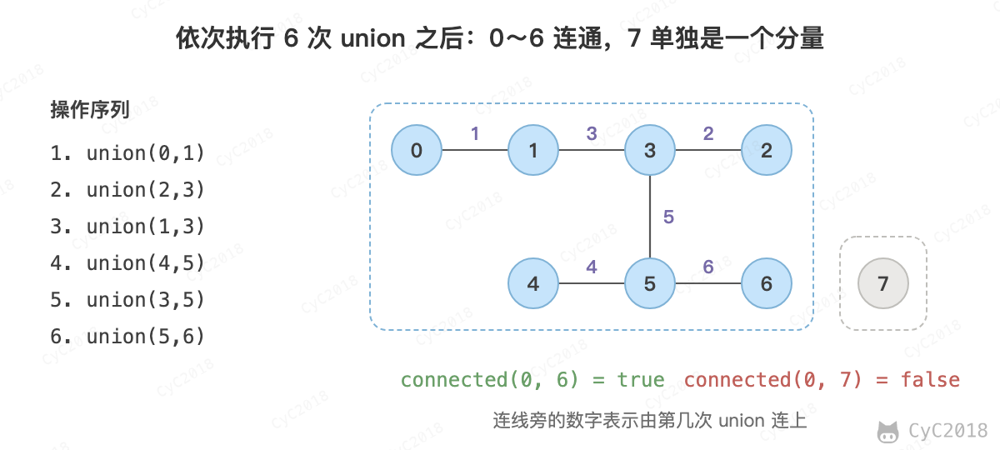
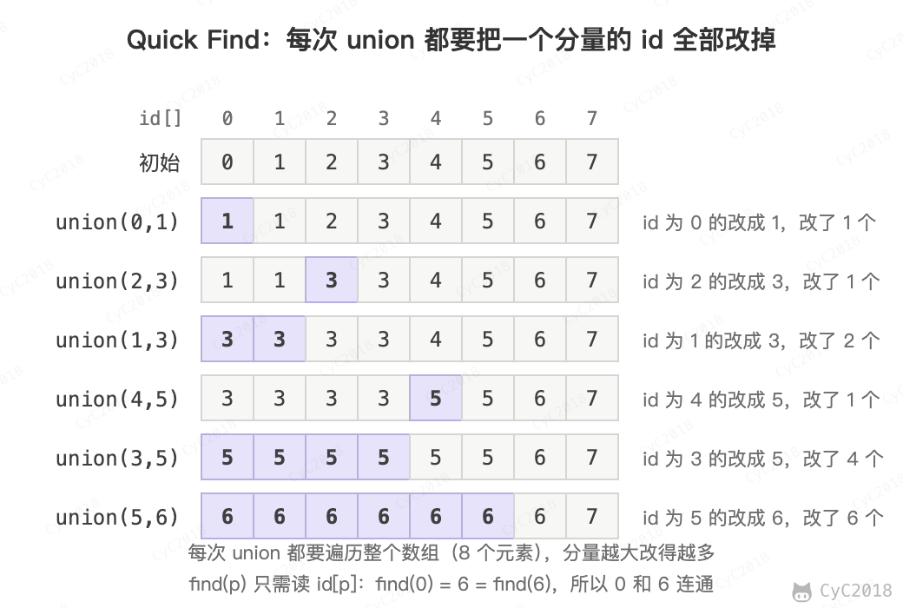
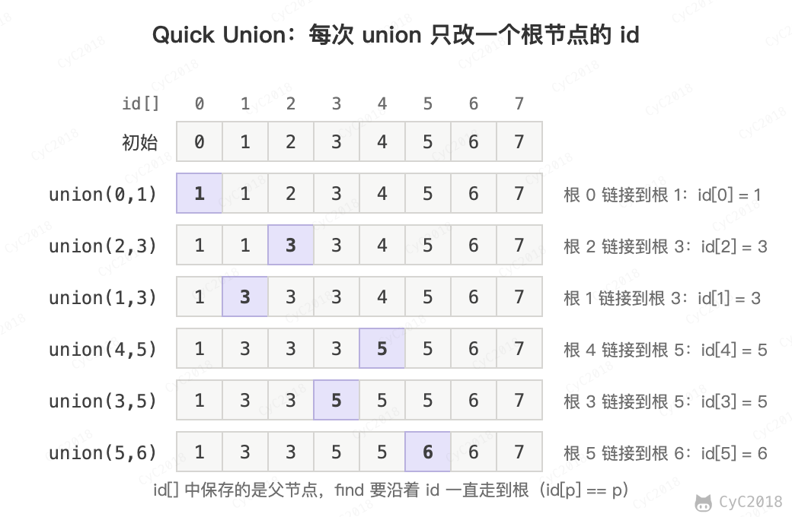
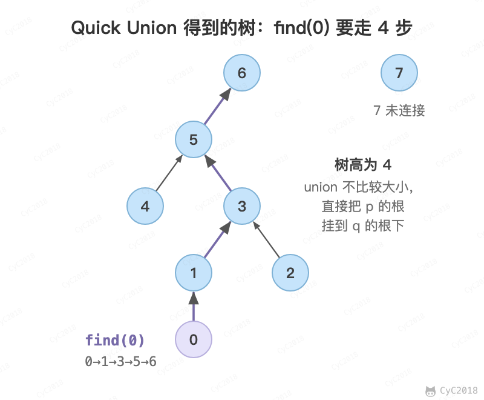
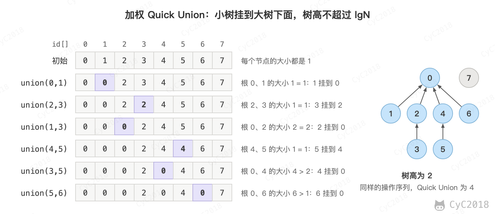
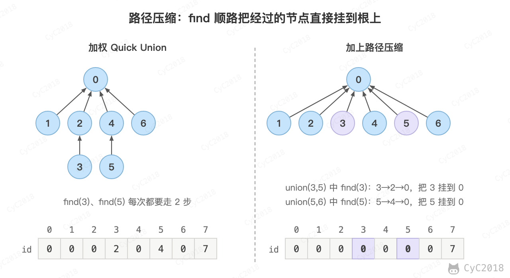

# 算法 - 并查集
<!-- GFM-TOC -->
* [算法 - 并查集](#算法---并查集)
    * [前言](#前言)
    * [Quick Find](#quick-find)
    * [Quick Union](#quick-union)
    * [加权 Quick Union](#加权-quick-union)
    * [路径压缩的加权 Quick Union](#路径压缩的加权-quick-union)
    * [比较](#比较)
    * [参考资料](#参考资料)
<!-- GFM-TOC -->


## 前言

并查集（Union-Find）用于解决动态连通性问题，能动态连接两个点，并且判断两个点是否连通。

<div align="center">  </div><br>

下文用图中这 6 次 union 操作比较几种实现。

| 方法 | 描述 |
| :---: | :---: |
| UF(int N) | 构造一个大小为 N 的并查集 |
| void union(int p, int q) | 连接 p 和 q 节点 |
| int find(int p) | 查找 p 所在的连通分量编号 |
| boolean connected(int p, int q) | 判断 p 和 q 节点是否连通 |

```java
public abstract class UF {

    protected int[] id;

    public UF(int N) {
        id = new int[N];
        for (int i = 0; i < N; i++) {
            id[i] = i;
        }
    }

    public boolean connected(int p, int q) {
        return find(p) == find(q);
    }

    public abstract int find(int p);

    public abstract void union(int p, int q);
}
```

## Quick Find

可以快速进行 find 操作，也就是可以快速判断两个节点是否连通。

需要保证同一连通分量的所有节点的 id 值相等，就可以通过判断两个节点的 id 值是否相等从而判断其连通性。

但是 union 操作代价却很高，需要将其中一个连通分量中的所有节点 id 值都修改为另一个节点的 id 值。

<div align="center">  </div><br>

```java
public class QuickFindUF extends UF {

    public QuickFindUF(int N) {
        super(N);
    }


    @Override
    public int find(int p) {
        return id[p];
    }


    @Override
    public void union(int p, int q) {
        int pID = find(p);
        int qID = find(q);

        if (pID == qID) {
            return;
        }

        for (int i = 0; i < id.length; i++) {
            if (id[i] == pID) {
                id[i] = qID;
            }
        }
    }
}
```

## Quick Union

可以快速进行 union 操作，只需要修改一个节点的 id 值即可。

这种方法把每个连通分量看成一棵树：id[p] 保存的是 p 的父节点，根节点的 id 等于它自身。同一个连通分量的节点 id 值不一定相同，但根节点相同，因此 find 需要沿着 id 一直向上查找，直到找到根节点，开销较大。

<div align="center">  </div><br>

```java
public class QuickUnionUF extends UF {

    public QuickUnionUF(int N) {
        super(N);
    }


    @Override
    public int find(int p) {
        while (p != id[p]) {
            p = id[p];
        }
        return p;
    }


    @Override
    public void union(int p, int q) {
        int pRoot = find(p);
        int qRoot = find(q);

        if (pRoot != qRoot) {
            id[pRoot] = qRoot;
        }
    }
}
```

这种方法可以快速进行 union 操作，但是 find 操作和树高成正比，最坏的情况下树会退化成一条链，树高为 N - 1。

<div align="center">  </div><br>

## 加权 Quick Union

为了解决 Quick Union 的树通常会很高的问题，加权 Quick Union 在 union 操作时会让节点较少的树连接到节点较多的树上面。

这样构造的树深度最多不超过 logN。这是因为一个节点的深度只在它所在的树连接到另一棵树上时加 1，而那棵树的节点数不少于它，合并后的树至少是原来的两倍大；N 个节点的树最多只能翻倍 logN 次。

<div align="center">  </div><br>

```java
public class WeightedQuickUnionUF extends UF {

    // 以该节点为根的树的节点数，只有根节点的值有意义
    private int[] sz;


    public WeightedQuickUnionUF(int N) {
        super(N);
        this.sz = new int[N];
        for (int i = 0; i < N; i++) {
            this.sz[i] = 1;
        }
    }


    @Override
    public int find(int p) {
        while (p != id[p]) {
            p = id[p];
        }
        return p;
    }


    @Override
    public void union(int p, int q) {

        int i = find(p);
        int j = find(q);

        if (i == j) return;

        if (sz[i] < sz[j]) {
            id[i] = j;
            sz[j] += sz[i];
        } else {
            id[j] = i;
            sz[i] += sz[j];
        }
    }
}
```

## 路径压缩的加权 Quick Union

在检查节点的同时将它们直接链接到根节点，只需要在 find 中添加一个循环即可。

<div align="center">  </div><br>

```java
@Override
public int find(int p) {
    int root = p;
    while (root != id[root]) {
        root = id[root];
    }
    while (p != root) { // 把路径上的节点直接链接到根节点
        int next = id[p];
        id[p] = root;
        p = next;
    }
    return root;
}
```

这样处理后，一组 union 和 find 操作的均摊代价非常接近 1（与反阿克曼函数 α(N) 成正比，实际中 α(N) 不超过 4），但单次操作在最坏情况下仍与 logN 成正比。

## 比较

| 算法 | union | find |
| :---: | :---: | :---: |
| Quick Find | N | 1 |
| Quick Union | 树高 | 树高 |
| 加权 Quick Union | logN | logN |
| 路径压缩的加权 Quick Union | 均摊非常接近 1 | 均摊非常接近 1 |

## 参考资料

- Sedgewick R, Wayne K. 算法（第 4 版）[M]. 人民邮电出版社, 2012.
- [Algorithms, 4th Edition](https://algs4.cs.princeton.edu/home/)
