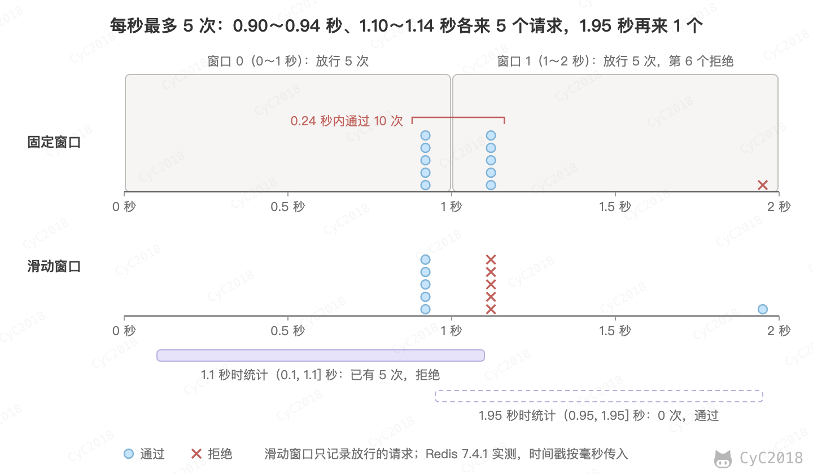
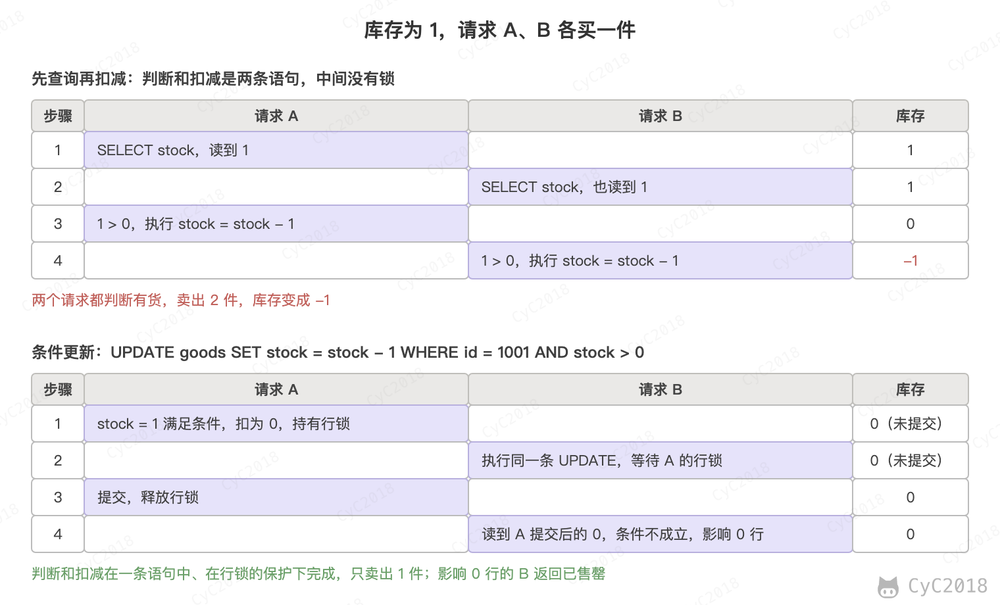
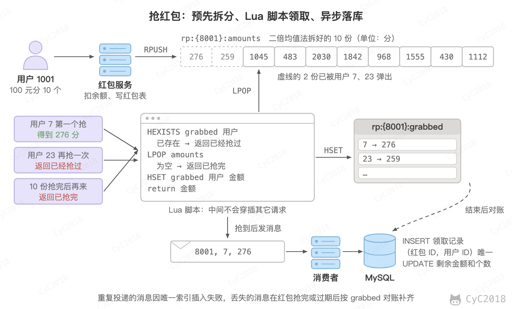
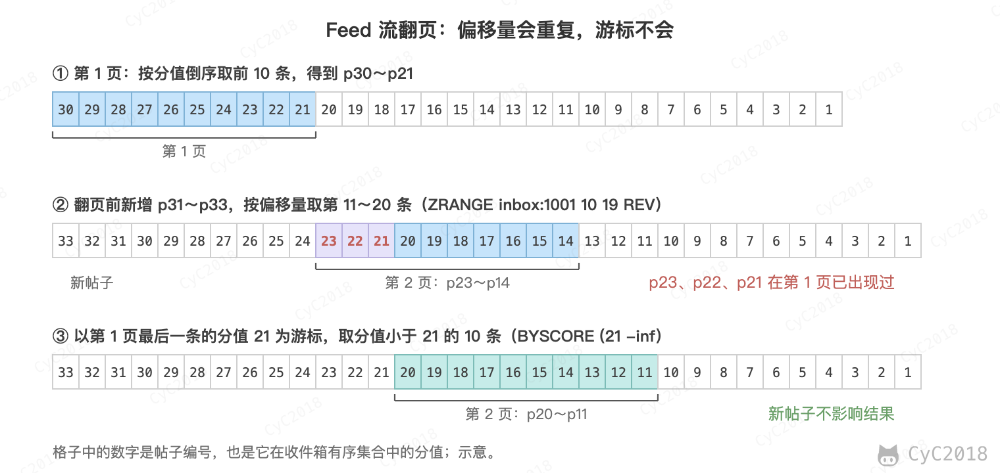
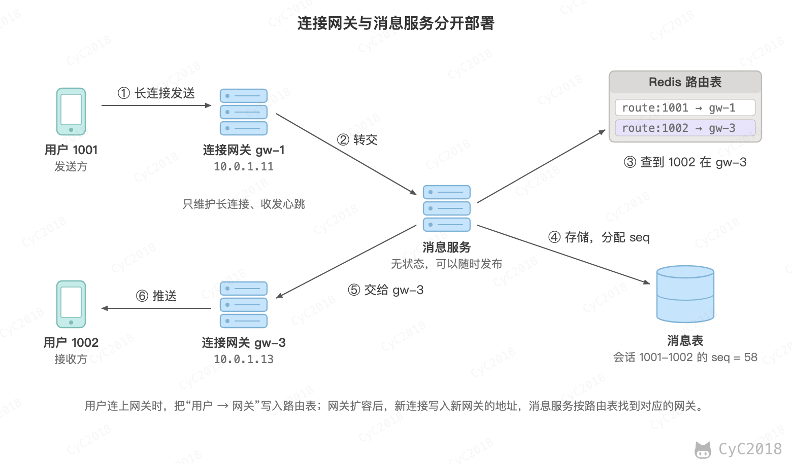
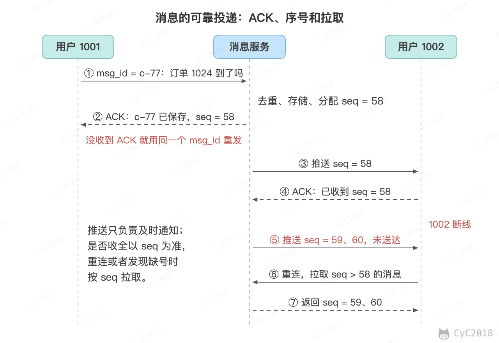

# 系统设计基础
<!-- GFM-TOC -->
* [系统设计基础](#系统设计基础)
    * [一、性能](#一性能)
    * [二、伸缩性](#二伸缩性)
    * [三、扩展性](#三扩展性)
    * [四、可用性](#四可用性) 🔥🔥
    * [五、安全性](#五安全性)
    * [六、秒杀系统](#六秒杀系统) 🔥🔥
    * [七、海量数据处理](#七海量数据处理)
    * [八、短链系统](#八短链系统)
    * [九、Feed 流](#九feed-流) 🔥
    * [十、高并发系统的设计](#十高并发系统的设计) 🔥🔥
    * [十一、大文件上传](#十一大文件上传)
    * [十二、权限系统](#十二权限系统)
    * [十三、系统设计题的思路](#十三系统设计题的思路)
    * [十四、即时通讯](#十四即时通讯)
    * [附录：实测](#附录实测)
    * [参考资料](#参考资料)
<!-- GFM-TOC -->


## 一、性能

### 性能指标

#### 1. 响应时间

指某个请求从发出到接收到响应消耗的时间。

在对响应时间进行测试时，通常采用重复请求的方式，然后计算平均响应时间。平均值会掩盖少数很慢的请求，因此也常用 P99 等分位值来衡量。P99（也写作 TP99）指 99% 的请求的响应时间都不超过的值。

一个用户请求通常需要调用多个后端服务，只要其中一个慢，整个请求就慢，后端调用越多，受慢请求影响的用户比例越高，这称为尾部延迟放大。例如每个服务都有 1% 的调用慢于自己的 P99，假设各次调用是否变慢相互独立，一个请求并行调用 10 个服务时，至少遇到一个慢调用的概率为 1 − 0.99<sup>10</sup> ≈ 9.6%，调用 50 个服务时约为 39.5%。

#### 2. 吞吐量

指系统在单位时间内可以处理的请求数量，通常使用每秒的请求数（QPS）来衡量，处理的是事务时也用每秒事务数（TPS）。

#### 3. 并发用户数

指系统能同时处理的并发用户请求数量。

三者的关系为：并发数 = 吞吐量 × 响应时间，三者都取平均值，在系统处于稳定状态时成立，称为利特尔法则（Little's Law）。在没有并发存在的系统中，请求被顺序执行，此时响应时间为吞吐量的倒数。例如系统支持的吞吐量为 100 req/s，那么平均响应时间应该为 0.01 s。

这里的并发数指同时在处理的请求数。按在线用户估算时，要加上用户两次操作之间的思考时间 Z：在线用户数 = 吞吐量 ×（响应时间 + Z）。例如 1 万个在线用户平均每 10 秒操作一次、响应时间 0.1 秒，吞吐量约为 990 次/秒，同时在处理的请求只有约 99 个。

多线程能够提高吞吐量，主要有两个原因：

- 多个 CPU 核心可以同时执行多个线程；
- 一个线程等待 I/O（例如查询数据库）时，CPU 可以去执行其它线程。

I/O 多路复用用的是第二个原因：一个线程同时等待多个连接上的 I/O，哪个就绪就处理哪个，不需要为每个连接准备一个线程，见 [I/O 复用](Socket.md#二io-复用)。

并发用户数不是越高越好，因为如果并发用户数太高，系统来不及处理这么多的请求，会使得过多的请求需要等待，那么响应时间就会大大提高。

### 性能优化

#### 1. 集群

将多台服务器组成集群，使用负载均衡将请求转发到集群中，避免单一服务器的负载压力过大导致性能降低，见 [负载均衡](集群.md#一负载均衡)。

#### 2. 缓存

缓存能够提高性能的原因如下：

- 缓存数据通常位于内存等介质中，这种介质对于读操作特别快；
- 缓存数据可以位于靠近用户的地理位置上；
- 可以将计算结果进行缓存，从而避免重复计算。

缓存的位置和常见问题见 [缓存](缓存.md)。

#### 3. 异步

某些流程可以将操作转换为消息，将消息发送到消息队列之后立即返回，之后这个操作会被异步处理。例如大促下单先写入消息队列，订单服务按自己的处理能力消费，见 [削峰](#2-削峰)。

## 二、伸缩性

指不断向集群中添加服务器来缓解不断上升的用户并发访问压力和不断增长的数据存储需求。

- 垂直伸缩：提升单台服务器的硬件配置，存在上限；
- 水平伸缩：增加服务器的数量，是大型系统的主要方式。

### 伸缩性与性能

如果系统存在性能问题，那么单个用户的请求总是很慢的；如果系统存在伸缩性问题，那么单个用户的请求可能会很快，但是在并发数很高的情况下系统会很慢。

### 实现伸缩性

应用服务器只要不具有状态，那么就可以很容易地通过负载均衡器向集群中添加新的服务器。

关系型数据库通常先通过主从复制实现读写分离来分担读压力，再通过 Sharding 将数据按一定的规则分布到不同的节点上，从而解决单台存储服务器的存储空间限制。

很多非关系型数据库内置了分片和复制，例如 Redis Cluster 按哈希槽把数据分到多个节点，增加节点时迁移部分槽即可，不需要应用自己切分数据。

## 三、扩展性

指的是添加新功能时对现有系统的其它应用无影响，这就要求不同应用具备低耦合的特点。

实现可扩展主要有两种方式：

- 使用消息队列进行解耦，应用之间通过消息传递进行通信；
- 使用分布式服务将业务和可复用的服务分离开来，业务使用分布式服务框架调用可复用的服务。新增的产品可以通过调用可复用的服务来实现业务逻辑，对其它产品没有影响。

## 四、可用性 🔥🔥

可用性用系统可用时间占总时间的比值来衡量，4 个 9 表示系统 99.99% 的时间是可用的，一年的不可用时间不超过 53 分钟。

### 冗余

保证高可用的主要手段是使用冗余，当某个服务器故障时就请求其它服务器。

应用服务器的冗余比较容易实现，只要保证应用服务器不具有状态，那么某个应用服务器故障时，负载均衡器将该应用服务器原先的用户请求转发到另一个应用服务器上，不会对用户有任何影响。

存储服务器的冗余需要使用主从复制来实现，当主服务器故障时，需要提升从服务器为主服务器，这个过程称为故障转移（Failover）。故障转移有两个常见问题：异步复制下新的主服务器可能没有收到旧主服务器的全部写入，这部分写入通常会丢失；旧主服务器恢复后如果仍然认为自己是主服务器，就会出现两个主（脑裂），因此需要把它降级为从服务器。

### 监控

对 CPU、内存、磁盘、网络等系统负载信息进行监控，当某个信息达到一定阈值时通知运维人员，从而在系统发生故障之前及时发现问题。

### 限流、降级与熔断

- 限流：请求量超过系统的处理能力时，拒绝多余的请求；
- 降级：主动关闭部分非核心功能，从而保证核心功能可用；
- 熔断：某个依赖的服务持续出错时，暂时不再调用它而是直接返回默认结果，避免故障沿着调用链扩散。

三者针对的对象不同：限流保护的是自己，按进入的请求量拒绝多余的请求；熔断针对的是下游依赖，按依赖的失败情况停止调用；降级是被限流、被熔断或主动关闭功能之后返回的替代结果。三者通常一起使用，例如熔断器打开时执行的就是降级逻辑。

#### 1. 限流算法

限流要判断的是：最近一段时间已经放行了多少请求，下一个请求还能不能放行。下面都以“每个用户每秒最多下单 5 次”为例。

固定窗口（计数器）把时间切成 1 秒的窗口，每个窗口一个计数器，超过 5 次就拒绝。用 Redis 实现时，键名带上用户和秒数，例如 order:limit:1001:1700000001，INCR 返回 1 时再设置过期时间。

固定窗口的问题在窗口边界。0.90～0.94 秒和 1.10～1.14 秒各来 5 个请求，分别落在两个窗口中，都能通过，0.24 秒内放行了 10 次，是上限的 2 倍。

滑动窗口统计的是“当前时刻往前 1 秒”内放行的请求数，窗口随时间移动。可以用有序集合（ZSET）记录每个放行的请求：成员是唯一的请求 ID，分值是毫秒时间戳；新请求到来时，先删除 1 秒以前的记录（ZREMRANGEBYSCORE），剩下的不足 5 条（ZCARD）才放行并写入（ZADD）。

同样的请求，1.1 秒时往前 1 秒已有 5 次，后 5 个请求被拒绝；1.95 秒时 0.9 秒的记录已经移出窗口，请求通过（Redis 7.4 实测，见[附录 A13](#a13-限流算法)）：

<div align="center">  </div><br>

滑动窗口的代价是每个放行的请求都要存一条记录。上限为每秒 1000 次时，一个用户的 ZSET 约占 100 KB，而固定窗口的计数器只占 56 字节。折中的做法是把 1 秒分成若干小格，每格一个计数器，把落在窗口内的格子相加，格子越多越精确，Sentinel 统计 QPS 用的就是这种方法。

漏桶把请求放进队列，以固定速率取出处理，例如每 200 毫秒一个，队列满了再来的请求被拒绝。它的输出最平滑，但突发的请求要排队等待。Nginx 的 limit_req 就是漏桶，burst 是允许排队的请求数，加上 nodelay 后 burst 以内的请求不再排队，而是立即处理。

令牌桶以固定速率放入令牌，例如每秒 5 个，桶中最多存 5 个，请求取到令牌才放行。空闲一段时间后桶是满的，可以一次放行 5 个请求，之后每 200 毫秒放行一个。

<div align="center">  </div><br>

令牌桶不需要定时放入令牌，只要记下剩余的令牌数和上次更新的时间，请求到来时补上这段时间应放入的令牌，再判断够不够。Guava 的 RateLimiter 和 Spring Cloud Gateway 的 Redis 限流器都是这样实现的。RateLimiter 的 acquire() 在令牌不足时让调用线程等待，tryAcquire() 则立即返回 false（Guava 33.4 实测，见[附录 A14](#a14-guava-的-ratelimiter)）。

四种算法的对比：

| 算法 | 突发请求 | 需要保存的数据 | 适用场景 |
| --- | --- | --- | --- |
| 固定窗口 | 窗口边界处最多放行 2 倍 | 每个窗口一个计数器 | 精度要求不高的限制，例如每天的调用次数 |
| 滑动窗口 | 任意 1 秒内都不超过上限 | 每个请求一条记录，或分格计数 | 按用户、按接口的精确限制 |
| 漏桶 | 排队，按固定速率处理 | 请求队列 | 保护处理能力固定的下游，例如调用外部接口 |
| 令牌桶 | 允许不超过桶容量的突发 | 令牌数和时间戳 | 允许短时突发的接口限流 |

#### 2. 分布式限流

服务部署了多个实例时，只在每个实例的内存中计数是不够的：4 个实例各限 5 次/秒，总量就变成 20 次/秒，扩容后还会变化；同一个用户的请求被分到不同实例，单个实例看到的次数也不准。因此要把计数放到所有实例共享的 Redis 中。

判断和扣减必须是原子的。令牌桶要先读出令牌数、计算后再写回，几条命令之间可能插入其它请求的命令：桶中有 5 个令牌时同时来 50 个请求，先 HMGET 再 HSET 的写法把 50 个全部放行（见[附录 A13](#a13-限流算法)）。

WATCH 加 MULTI 也能保证只放行 5 个，但冲突时要反复重试，因此一般用 Lua 脚本，脚本执行期间不会插入其它命令。令牌数和更新时间存在一个哈希表中：

```lua
-- KEYS[1] 限流键；ARGV：每秒放入的令牌数、桶的容量、当前时间（毫秒）
local rate = tonumber(ARGV[1])
local capacity = tonumber(ARGV[2])
local now = tonumber(ARGV[3])
local b = redis.call('HMGET', KEYS[1], 'tokens', 'ts')
local tokens = tonumber(b[1]) or capacity
local ts = tonumber(b[2]) or now
-- 请求的时间戳可能乱序，时间不能倒退，否则同一段时间会被重复补令牌
now = math.max(now, ts)
-- 不用定时放令牌，按距离上次请求的时间补上这段时间应放入的令牌
tokens = math.min(capacity, tokens + (now - ts) * rate / 1000)
local allowed = 0
if tokens >= 1 then
  tokens = tokens - 1
  allowed = 1
end
redis.call('HSET', KEYS[1], 'tokens', tokens, 'ts', now)
redis.call('PEXPIRE', KEYS[1], math.ceil(capacity / rate * 1000) * 2)
return allowed
```

调用时传入用户的限流键、每秒 5 个、容量 5 和当前的毫秒时间。同一时刻连续 7 个请求，前 5 个通过、后 2 个被拒绝；400 毫秒后补充了 2 个令牌，3 个请求中通过 2 个；空闲 10 秒后，令牌也只补到容量 5 个（见[附录 A13](#a13-限流算法)）。

分布式限流还要考虑以下几点：

- 每次判断都多一次 Redis 往返，并且一个限流键只落在一个 Redis 节点上，一个键每秒约能判断 9 万～10 万次（Redis 7.4 实测，见[附录 A13](#a13-限流算法)）；全局总量的限流超过这个量级时，可以把令牌分到多个键，或者让每个实例一次领取一批令牌在本地使用；
- 时间由各个实例传入时，实例之间的时钟要同步，也可以在脚本中用 Redis 的 TIME 命令取时间；
- Redis 不可用时，可以退回到每个实例自己的单机限流，避免因为限流组件故障而拒绝所有请求。

限流通常放在多个位置：网关按 IP、用户或接口限流，挡住大部分突发和恶意的流量；服务内部按接口或热点参数限流，例如 Sentinel 可以按并发线程数或 QPS 设置阈值，按 QPS 限流时可以选择直接拒绝、预热（Warm Up，放行的量逐渐升到阈值）或者匀速排队（漏桶）。

只按接口限制总量时，一个刷接口的调用方就能用完额度，正常用户也跟着被拒绝，因此还要按 IP 或用户分别限制。同一个出口 IP 后面可能是整个公司或学校，登录后的接口按用户限流更准确。

被限流的请求返回 429 Too Many Requests，可以带上 Retry-After 首部告诉客户端多久之后重试。

阈值来自压测得到的容量，并留出余量，见[压测与容量规划](#压测与容量规划)；规则放在配置中心，不用重启就能调整。下游的容量会变化时，例如调用第三方接口，可以按响应自动调整：收到 429 或延迟明显升高就按比例降低速率，恢复后再缓慢增加，与 [TCP 拥塞控制](计算机网络%20-%20传输层.md#tcp-拥塞控制) 的思路相同。

#### 3. 熔断

熔断器有关闭、打开和半开三种状态：失败率达到阈值时打开；打开一段时间后进入半开状态，只放行少量请求试探，因为刚恢复的下游可能还承受不住全部流量；试探的失败率低于阈值则关闭，否则重新打开。

<div align="center">  </div><br>

熔断要解决的问题是下游变慢时调用方被拖垮。例如库存服务卡住，订单服务调用它的读取超时为 2 秒、每秒调用 200 次，按[利特尔法则](#3-并发用户数)，约有 200 × 2 = 400 个线程同时在等待。线程池耗尽后，不依赖库存的接口也无法响应，故障就沿调用链传到了上游，称为服务雪崩（级联故障）。熔断器发现下游持续失败后直接拒绝调用，调用方立即执行降级逻辑，线程不再被占住，下游也得到了恢复的时间。熔断打开之前，慢调用仍会占住线程，因此还要给每个依赖单独的线程池或并发数上限（隔离，例如 Resilience4j 的 Bulkhead），库存服务再慢也只占满自己的那一份。

是否打开由最近一段时间的调用统计决定。以 Resilience4j（Spring Cloud Circuit Breaker 常用的实现）为例，主要的参数和默认值：

- 统计窗口：最近 100 次调用，也可以改为最近若干秒；
- 最小调用数：窗口内至少有 100 次调用才计算失败率，避免刚启动时 1 次失败就算作 100% 的失败率；
- 阈值：失败率达到 50% 时打开，也可以按慢调用的比例打开，下游没有报错、只是变慢时也能熔断；
- 计入失败的异常：默认所有异常都算失败，参数错误、商品不存在这类业务异常说明下游工作正常，要用 ignoreExceptions 排除，否则一批非法请求就能打开熔断器，连正常的请求也被拒绝（见[附录 A18](#a18-熔断器的状态变化)）；
- 打开时长：60 秒，之后进入半开状态；
- 半开时放行的请求数：10 个，这些试探请求的失败率仍达到阈值就重新打开，否则关闭，其余请求在试探完成前仍被拒绝。

阈值参照依赖平时的表现设定：失败率阈值要明显高于平时的错误率，慢调用的时长要高于下游正常时的 P99，避免偶发的抖动打开熔断器。熔断器打开时要告警，降级的结果会掩盖故障，不告警可能长时间没人发现。

Sentinel 的半开状态只放行一个请求，这个请求成功就结束熔断，失败则再次熔断。

例如把统计窗口改为最近 10 次、最小调用数 10、打开时长 2 秒、半开时放行 3 个，库存服务从第 5 次调用开始超时，每次调用的结果如下（Resilience4j 2.2 实测，见[附录 A18](#a18-熔断器的状态变化)）：

```text
#01～#04  库存 37
#05～#10  失败（读取超时），降级：有货  第 10 次后失败率 60%，CLOSED → OPEN
#11～#13  被熔断，降级：有货            不再调用库存服务
（2 秒后，库存服务仍然超时）
#14～#16  失败（读取超时），降级：有货  OPEN → HALF_OPEN，3 次试探都失败，回到 OPEN
#17       被熔断，降级：有货
（再过 2 秒，库存服务已恢复）
#18～#20  库存 37                       OPEN → HALF_OPEN，3 次试探都成功，HALF_OPEN → CLOSED
#21       库存 37
```

21 次调用中只有 17 次真正发给了库存服务。需要注意的是，打开时长过后要有调用到来才会转为半开，默认不启动后台线程检查状态，所以是第 14 次调用触发了 OPEN → HALF_OPEN。

熔断依赖超时：没有设置超时的调用只会一直等待，不会失败，熔断器也就无从统计，所以每个远程调用都要先设好超时，见 [OpenFeign](微服务.md#openfeign) 中的超时配置。

重试则要克制。只对幂等的操作、可能自行恢复的错误（例如超时、连接被拒绝、429）重试，次数要有上限，间隔按指数增长并加上随机抖动，响应带有 Retry-After 时按它等待；参数错误、余额不足这类重试也不会成功的错误直接失败。还要避免每一层都重试：调用链上 3 层各重试 3 次，一次用户操作在最底层最多产生 4 × 4 × 4 = 64 次请求。熔断器打开后，对这个依赖的重试也随之停止。

#### 4. 降级

降级指的是在资源不足或依赖故障时，用代价更低的结果代替完整的结果，以保住核心功能。

常见的降级做法：

- 返回缓存或旧的数据：例如推荐服务超时时，返回前一天算好的热门商品；
- 返回默认值或简化的结果：库存服务被熔断时，详情页显示“有货”，下单时仍以数据库为准；
- 关闭非核心功能：大促时关闭评论、积分抵扣，把资源留给下单和支付；
- 延后写操作：积分、通知这类操作先写入消息队列，下游恢复后再处理；
- 快速失败：核心功能无法降级时，立即提示“稍后再试”，而不是让请求一直等待。

降级有两种触发方式。自动降级由超时、熔断和限流触发，兜底的逻辑（fallback）事先写在代码中，例如上面熔断时返回“有货”。手动降级由开关控制，开关放在[配置中心](微服务.md#六配置中心)，大促前或故障时修改配置即可生效，不需要重新发布。

哪些功能可以降级、降级成什么样，要在设计时和业务方一起确定。例如商品详情页依赖商品、价格、库存、评论、推荐五个服务：商品和价格是核心，失败时返回错误；库存失败时显示“有货”；评论和推荐失败时不显示这一块。

大模型应用中也是同样的思路：模型接口超时或被限流时，切换到备用的模型或更小的模型，或者返回缓存的回答；RAG 的重排服务超时时，跳过重排，直接用召回结果的前几条；Agent 调用工具超时时，把“工具不可用”作为工具的结果返回给模型，由模型换一种方式回答或如实告知用户，而不是让整个请求失败。模型调用的熔断见[稳定性](大模型应用.md#稳定性)，Agent 的步数上限见[可靠性与评测](大模型应用.md#可靠性与评测)。

需要注意的是，降级逻辑平时很少执行，容易到真正需要时才发现它本身有问题，例如兜底的缓存早已过期、开关关闭后功能没有恢复。因此降级方案要和正常功能一样测试，并在故障演练中实际打开一次。

## 五、安全性

要求系统在应对各种攻击手段时能够有可靠的应对措施，常见的攻击手段和防范方法见 [攻击技术](攻击技术.md)。

### 接口防刷

接口防刷指的是拦截格式合法、但由脚本发出的大量请求，例如脚本抢购、批量注册、撞库登录，或者利用发送短信验证码的接口给别人的手机号连续发短信。这些请求单独看都是正常的，只能按来源和频率识别。

以发送短信验证码的接口为例，每条短信都要付费，被刷时既浪费钱，又骚扰收到短信的人。常用的做法是按多个维度限制频率：

- 同一个手机号 60 秒内只能发一次，每天最多 10 次；
- 同一个 IP 每小时最多 20 次，防止一台机器换着手机号刷；
- 超过阈值的设备或账号，先要求完成图形或滑块验证码。

判断和计数要原子地完成，否则并发的请求会同时通过检查，所以用一个 Lua 脚本实现（单个 Redis 实例；Redis Cluster 中脚本操作的键必须在同一个槽，手机号和 IP 的计数要拆成两个脚本分别判断）：

```lua
-- KEYS[1]：手机号的冷却键，KEYS[2]：手机号当天的计数，KEYS[3]：IP 这一小时的计数
-- ARGV[1]：冷却秒数，ARGV[2]：手机号每天的上限，ARGV[3]：IP 每小时的上限
if redis.call('EXISTS', KEYS[1]) == 1 then
    return 1                                        -- 60 秒内已经发过
end
if tonumber(redis.call('GET', KEYS[2]) or '0') >= tonumber(ARGV[2]) then
    return 2                                        -- 这个手机号今天的次数用完
end
if tonumber(redis.call('GET', KEYS[3]) or '0') >= tonumber(ARGV[3]) then
    return 3                                        -- 这个 IP 请求太多
end
redis.call('SET', KEYS[1], 1, 'EX', ARGV[1])
if redis.call('INCR', KEYS[2]) == 1 then redis.call('EXPIRE', KEYS[2], 86400) end
if redis.call('INCR', KEYS[3]) == 1 then redis.call('EXPIRE', KEYS[3], 3600) end
return 0                                            -- 可以发送
```

同一个手机号 1 秒内请求 5 次，只有第 1 次发送了短信；把冷却时间改为 1 秒后连续请求 12 次，第 11、12 次因为当天的次数用完被拒绝；同一个 IP 给 30 个手机号发验证码，从第 21 个开始被拒绝（Redis 7.4 实测，见[附录 A20](#a20-接口防刷)）。按小时、按天计数是固定窗口，窗口边界附近可能短时间内放过两倍的请求，需要更精确时改用滑动窗口，见 [限流算法](#1-限流算法)。

验证码本身也要防止被猜中。6 位数字只有 100 万种，不限制输错次数时，在本机直接调用校验脚本逐个尝试，第 835770 次猜中，只用了 8 秒（见附录 A20）；通过网络调用接口会慢一些，但按每秒 1000 次计算，平均约 8 分钟也能猜中。所以校验时：

- 验证码保存在 Redis 中，5 分钟后过期，多个服务实例都能读到；
- 输对后立即删除，一个验证码只能用一次；
- 同一个验证码输错 5 次就作废，要重新发送。

加上发送的限制，一个手机号每天最多能猜 50 次，猜中的概率只有 50 / 10<sup>6</sup> = 0.005%。

开放给合作方的接口还要防止请求被篡改或者重放。重放指的是把截获的合法请求原样再发一次，例如把一次退款请求重复提交。做法是双方事先约定一个密钥，调用方把请求的关键字段和时间戳、随机数（nonce）拼在一起，用密钥计算 HMAC 签名：

```text
签名原文：POST\n/api/refund\n1793000000\nn-8f3a2c\n{"order": 1024, "amount": 3900}
签名：HMAC-SHA256(密钥, 签名原文)
```

服务端依次检查：

- 时间戳与当前时间相差不超过 5 分钟，很久以前的请求直接拒绝；
- 用同样的密钥重新计算签名并比较，请求中任何一个字段被改过都对不上；
- 执行 SET nonce:n-8f3a2c 1 NX EX 600 记录随机数，失败说明这个请求已经处理过。随机数保存的时间要覆盖时间戳允许的范围，否则过期后又能重放。

原样重放的请求因为随机数已经用过被拒绝，改掉金额的请求签名对不上，10 分钟后再重放则时间戳超出了范围（见附录 A20）。需要注意的是，签名只适合密钥保存在服务端的调用，例如开放平台和支付回调；写在 App 或网页中的密钥可以被逆向取出，只能增加刷接口的成本。

识别出的刷接口来源，还可以在网关中加入黑名单，例如 SET ban:ip:203.0.113.7 1 EX 3600，一小时内直接拒绝它的请求。规模更大的系统会接入风控，根据设备指纹、操作轨迹等判断请求是否来自机器，可疑时要求验证码。图形和滑块验证码能被打码平台破解，同样只能提高成本，所以要和限频、黑名单一起使用。

## 六、秒杀系统 🔥🔥

秒杀指的是少量商品在某一时刻开售，大量用户同时抢购，例如 100 件商品在开售瞬间收到 10 万个请求。难点在于：

- 瞬时流量远超平时，但绝大多数请求注定失败；
- 库存不能超卖，一个用户只能买一件；
- 抢购不能拖垮正常的业务。

解决思路是层层过滤，使最终到达数据库的请求接近库存数量：

<div align="center">  </div><br>

1. 前端和网关：商品详情页静态化后放在 CDN 上，开售前的刷新大多由 CDN 返回；开售前按钮置灰，下单地址到点才下发，提交后禁止重复点击；网关按用户和接口[限流](#1-限流算法)，拦截刷单请求；
2. 库存预扣：开售前把库存加载到 Redis 中，用 Lua 脚本在 Redis 中判断并扣减库存，没有库存的请求直接返回已抢完；
3. 异步下单：扣减成功的请求写入消息队列，订单服务按自己的处理能力消费，扣减数据库中的库存并创建订单，用户通过轮询等方式查询结果；
4. 隔离：秒杀服务独立部署，避免影响正常的业务。

预扣库存的 Lua 脚本如下：

```lua
-- KEYS[1]：库存，KEYS[2]：已购用户集合，ARGV[1]：用户 ID
if redis.call('SISMEMBER', KEYS[2], ARGV[1]) == 1 then
    return 2                                -- 一人一单，重复购买
end
if tonumber(redis.call('GET', KEYS[1]) or '0') <= 0 then
    return 1                                -- 库存不足
end
redis.call('DECR', KEYS[1])
redis.call('SADD', KEYS[2], ARGV[1])
return 0                                    -- 抢购成功
```

Redis 执行 Lua 脚本时不会穿插执行其它命令，判断是否已购、判断库存、扣减库存和记录用户这四步作为一个整体完成。如果在应用中先 GET 库存、判断大于 0 之后再 DECR，两个请求可能同时读到库存为 1，并且都扣减成功。例如库存为 100、1000 个用户各请求 2 次、64 个线程并发：Lua 脚本恰好卖出 100 件；先查询后扣减的写法运行 3 次，分别卖出了 113、106、114 件，库存变成了负数（Redis 7.4 实测，见[附录 A1](#a1-秒杀)）。

不用 Lua 时，可以利用单条命令的原子性：先 SADD 已购集合，返回 0 说明买过；再 DECR 库存，返回值小于 0 说明没货，INCR 加回并 SREM 撤销。这样也恰好卖出 100 件，但没抢到的用户同时发出的另一个请求可能看到还没撤销的占位，被告知已经买过（见附录 A1）；应用在两步之间宕机还会留下残留。只用 MULTI 事务时不能根据读到的库存决定是否扣减，见 [Lua 脚本](Redis.md#lua-脚本)。

库存键本身也是热点。一个商品的库存只有一个键，只能落在一个 Redis 节点上，集群的节点再多也分担不了；对单个库存键执行上面的脚本，每秒约 7.5 万～8.6 万次（见附录 A1）。请求量超过这个量级时，常用的做法有：

- 网关按库存放行：100 件商品只放前 1 万个请求进入预扣，其余直接返回已抢完；
- 进程内售罄标记：脚本返回库存不足后，应用实例在内存中记下这个商品已售罄，之后的请求不再访问 Redis，回补库存时清除标记；
- 库存分桶：把库存分到 10 个键，按用户 ID 选桶，所有桶都为 0 才算售罄，与数据库[拆分库存行](#1-热点行)是同一个思路。用户换桶时，重复购买由订单表的唯一索引兜底。

脚本同时操作两个键，在 Redis 集群中要用哈希标签让它们落在同一个槽，例如 {sku:1001}:stock 和 {sku:1001}:users。分桶时每个桶用自己的标签，例如 {sku:1001:3}，否则所有桶仍在同一个节点上。

数据库也要兜底。扣减库存时把库存大于 0 作为条件，影响的行数为 0 说明库存不足：

```sql
UPDATE goods SET stock = stock - 1 WHERE id = 1001 AND stock > 0;
```

一人一单可以用订单表上（用户 ID，商品 ID）的唯一索引保证，消息被重复消费时插入失败，也就实现了幂等。前提是扣减数据库库存和插入订单在同一个事务中，插入失败时整个事务回滚，库存不会被多扣。

### 防止超卖的几种做法

超卖的根源是“判断库存”和“扣减库存”不是一个原子操作：两个请求都读到库存为 1，都判断有货，都去扣减。所以防止超卖的做法都是让判断和扣减成为一个整体，区别在于在哪里做、代价是什么。

<div align="center">  </div><br>

在数据库中有三种写法：

- 悲观锁：在事务中先用 SELECT ... FOR UPDATE 锁住库存行，再判断和扣减，其它请求在锁上排队；
- 乐观锁：表中加一个版本号，UPDATE 时带上条件 version = 读到的值，影响行数为 0 说明这一行已被别人修改，放弃或重试；
- 条件更新：把判断写进 UPDATE 的条件 stock > 0，判断和扣减由一条语句在行锁的保护下完成。

也可以在应用中加锁。synchronized 这类本地锁只在一个进程内有效，多实例部署时无效；分布式锁能保证正确，但同一商品的请求全部排队，见[分布式锁的对比](分布式.md#三种实现的对比)。一人一单按用户加锁冲突很少，可以使用，但锁可能因过期或主从切换失效，最终仍以唯一索引为准。

用 64 个线程模拟抢购库存为 100 的商品，每个用户请求 1 次，每种写法运行 3 轮（MySQL 8.0 实测，见[附录 A19](#a19-防止超卖的几种写法)）：

```text
写法                    用户数    卖出        剩余库存
先查询再扣减（对照）      1000    134～162    -62～-34
悲观锁 FOR UPDATE         1000    100         0
乐观锁，不重试            1000    70～83      17～30
乐观锁，最多重试 3 次     1000    100         0
乐观锁，最多重试 3 次      150    48～57      43～52
条件更新 stock > 0        1000    100         0
```

先查询再扣减多卖了 34～62 件。乐观锁不会超卖，但同一时刻读到同一个版本号的请求中只有一个能更新成功，其余请求即使还有库存也会失败：150 个用户抢 100 件，重试 3 次也只卖出了 48～57 件，出现了“少卖”。因此版本号适合冲突少的场景，例如修改个人资料；库存这类同一行被大量请求同时修改的场景用条件更新，它不需要重试，语句也最少。悲观锁同样正确，但锁要持有到事务提交，事务中的操作越多，其它请求等待得越久。

无论哪种写法，同一行的更新在数据库中都是串行执行的，单行能承受的写入量有上限，见[热点行](#1-热点行)。所以秒杀先用 Redis 挡住绝大部分请求，数据库的条件更新作为最后一道防线。

### Redis 与数据库的库存一致

库存同时保存在 Redis 和数据库中，两者无法在一个事务中同时修改，所以先要确定以谁为准：数据库中的库存和订单是最终结果，Redis 中的库存只是一道闸门，用来挡住注定失败的请求。因此可以接受 Redis 的库存暂时偏少（少卖，事后补回），但数据库不能超卖，数据库的条件更新始终保留。

按请求经过的步骤，可能出现的不一致和处理方法：

- Lua 脚本扣减成功，发送消息失败：明确返回失败时立即执行一段反向的脚本，把库存加回、把用户移出已购集合；发送超时的消息可能已经送达，不能直接回补，交给对账判断；应用恰好在两步之间宕机时，这次扣减只留在 Redis 中，由对账发现。也可以用 RocketMQ 的[事务消息](分布式.md#本地消息表)，先发送半消息，执行 Lua 脚本后再提交，应用宕机时由 Broker 回查用户是否在已购集合中；
- 消息已发出，订单服务创建订单失败：用户校验不通过这类业务上的失败，订单服务记录失败结果并回补 Redis；网络超时、数据库暂时不可用这类异常则依靠消息重试，订单表的唯一索引保证重试不会创建两个订单；
- 订单创建后用户未支付：超时取消订单时，在同一个事务中修改订单状态并把数据库的库存加回，提交后再回补 Redis，超时取消可以用[延迟消息](消息队列.md#延迟消息)实现。

回补 Redis 时要防止重复执行，例如在脚本中先 SREM 已购集合，返回 1（用户确实在集合中）才把库存加 1，同一条回补消息执行两次也只加一次。如果回补后允许用户再抢一次，迟到的重复回补消息会删掉新的购买记录，这时已购记录要保存这次抢购的请求 ID，回补时请求 ID 一致才执行。

Redis 的主从复制是异步的，主节点宕机时，还没同步到从节点的扣减和购买记录会丢失，切换后多放行的请求在数据库的条件更新或唯一索引处失败，不会超卖。其中因数据库库存不足而失败的（先确认这个用户没有订单，排除重复投递的消息），只把用户移出已购集合，不加回 Redis 的库存，否则加回的库存又会放行新的请求。

对账在活动结束后或定期进行：Redis 中的已购用户应当与数据库中的订单一一对应，只出现在 Redis 中的用户说明消息丢失了，补发消息或回补库存。需要注意的是，库存只在活动开始前从数据库一次性加载到 Redis，活动进行中不要再从数据库同步，否则还在队列中的消息会让两边的数字互相覆盖。

### 同类场景：抢券、抢红包与抽奖

抢券、抽奖和抢红包也是大量用户在同一时刻争抢有限的资源，上面的限流、Redis 预扣、异步落库和数据库兜底都可以直接套用。下面只讲它们各自不同的部分。

#### 1. 抢券

券的发放总量就是库存，预扣的 Lua 脚本与秒杀基本相同，区别主要在限领和使用。

每人限领 N 张时，把脚本中的已购用户集合换成 Hash（用户 ID → 已领张数），已领张数小于 N 才扣库存并 HINCRBY，返回值就是“第几张”。例如券 501 发 100 张、每人限领 2 张，80 个用户各并发请求 5 次：恰好发出 100 张，没有人超过 2 张（Redis 7.4 实测，见[附录 A17](#a17-抢券的限领与核销)）。领取的人很多时这个 Hash 会成为[大 Key](缓存.md#大-key-与热-key)，活动结束后要设置过期时间或用 UNLINK 删除。

领到的券写入用户券表，以“第几张”作为 seq，在（user_id, coupon_id, seq）上建唯一索引，消息重复投递时插入失败，不会多发：

```sql
CREATE TABLE user_coupon (
  id        BIGINT PRIMARY KEY,
  user_id   BIGINT NOT NULL,
  coupon_id BIGINT NOT NULL,      -- 券的模板，例如 501：满 100 减 20
  seq       TINYINT NOT NULL,     -- 该用户领的第几张
  status    TINYINT NOT NULL,     -- 0 未使用，1 已锁定，2 已使用
  order_id  BIGINT,
  valid_end DATETIME NOT NULL,    -- 有效期，例如领取后 7 天
  UNIQUE KEY uk_user_coupon (user_id, coupon_id, seq)
);
```

用户查询“我的券”时按 user_id 查询，因此这张表分库分表时按 user_id 切分。

券的有效期写在每条用户券上，是否过期在使用时按 valid_end 判断，不依赖定时任务或延迟消息把状态改为“已过期”。这类任务只用于提醒和展示，即使延迟或积压，也不会让过期的券被用掉。

核销分两步：下单时锁定，支付成功后改为已使用。锁定用条件更新，影响行数为 1 才算成功，同一张券因此只能被一个订单锁定；订单取消或超时未支付时，再把状态改回未使用：

```sql
UPDATE user_coupon SET status = 1, order_id = 9001
WHERE id = 70001 AND user_id = 1001 AND status = 0 AND valid_end > NOW();
```

#### 2. 抽奖

抽奖比抢券多了一步：先按概率决定抽中哪个奖品，再扣这个奖品的库存。

概率一般配置为权重。例如一等奖 1%（库存 10 个）、二等奖 9%（库存 500 个）、三等奖 30%（不限量）、谢谢参与 60%，按 10000 份累加成区间 [0, 100)、[100, 1000)、[1000, 4000)、[4000, 10000)。服务端生成 0～9999 的随机数，落在哪个区间就是哪个奖品；奖品多时可以对区间二分查找，或者预先展开成 10000 格的数组直接按下标取，用空间换时间。

抽中限量的奖品后，再用与秒杀相同的 Lua 脚本扣减这个奖品的库存。扣减失败说明奖品已经发完，这时应降级为“谢谢参与”或兜底奖品，而不是重新抽一次。这是因为重新抽相当于把一等奖的 1% 按比例分给其它奖品，二等奖的实际概率会从 9% 变为 9 ÷ 99 ≈ 9.09%，发出的奖品超出预算。

每人每天的抽奖次数可以在 Redis 中用 INCR 计数并按天设置过期时间，返回值超过上限就拒绝。“每人最多中一次大奖”这类限制也按降级处理，因此实际中奖率会低于配置值，上线前可以用大量模拟统计各奖品的频率来核对。

#### 3. 抢红包

抢红包与秒杀的区别在于每一份的金额不同：发红包时要把总金额拆成若干份，抢的时候每人拿走一份。下面以用户 1001 在群里发的拼手气红包 8001 为例，共 100 元、10 个。

##### 3.1 金额的拆分

金额用整数的分表示，避免浮点数的误差。常用的拆分方法是二倍均值法：剩余 R 分、还有 k 份时，本份在 1 到 2R ÷ k − 1 分（除法向下取整）之间均匀随机，最后一份拿走剩余的全部金额。例如第一份在 1～1999 分之间，即 0.01～19.99 元。

上限比剩余平均值的 2 倍少 1 分，保证拿走本份之后，剩下的每一份至少还有 1 分。均匀随机的均值约等于当时的剩余平均值，所以每个位置的期望都是 10 元，先抢和后抢的期望相同；但越靠后的位置可取的范围越大，波动也越大。

对这个红包模拟拆分 10 万次，每次的总额都是 100.00 元、每份至少 0.01 元，各位置的统计如下（单位：元，见[附录 A15](#a15-红包金额的拆分)）：

```text
位置          1      2      3      4      5      6      7      8      9     10
平均值    10.02  10.01   9.95  10.02   9.99   9.98  10.00  10.01   9.99  10.03
标准差     5.77   5.80   5.89   5.97   6.06   6.20   6.41   6.84   7.69   7.71
最小值     0.01   0.01   0.01   0.01   0.01   0.01   0.01   0.01   0.01   0.01
最大值    19.99  22.19  24.57  27.70  31.79  34.46  39.05  45.85  60.50  68.33
```

##### 3.2 预先拆分与实时计算

拆分的时机有两种：

- 预先拆分：发红包时就拆成 10 份，用 RPUSH 放入 Redis 列表，抢的时候 LPOP 一份。抢的路径只有一次弹出，金额在发的时候就已确定，可以随红包一起落库备查；代价是每一份都要占用内存，份数多时更明显；
- 实时计算：Redis 中只保存剩余金额和剩余个数，抢的时候在 Lua 脚本中按二倍均值法算出本份金额，再更新这两个值。占用的内存固定，但每次领取都要在脚本中计算。Redis 7 中脚本的随机数生成器每次调用都会随机设置种子，可以直接调用 math.random。

两种做法用的是同一个拆分方法，金额的分布相同，在 Lua 脚本中执行时也都不会超发。红包的份数通常不多，预先拆分的实现更简单。

##### 3.3 并发领取与落库

<div align="center">  </div><br>

领取用下面的 Lua 脚本，判断是否抢过、弹出一份、记录领取者三步作为一个整体执行：

```lua
-- KEYS[1]：金额列表，KEYS[2]：领取记录（Hash，用户 ID → 金额），ARGV[1]：用户 ID
if redis.call('HEXISTS', KEYS[2], ARGV[1]) == 1 then
    return -1                               -- 已经抢过
end
local amount = redis.call('LPOP', KEYS[1])
if not amount then
    return 0                                -- 已抢完
end
redis.call('HSET', KEYS[2], ARGV[1], amount)
return tonumber(amount)
```

列表中只有 10 份，LPOP 每次弹出一份，最多 10 个请求成功，发出的总额不会超过 100 元。每人只能抢一次则依赖脚本的原子性：如果在应用中依次执行 HEXISTS、LPOP、HSET，同一个用户的两个并发请求可能都通过判断，各弹出一份。

例如 100 个用户各并发请求 2 次：使用脚本时恰好 10 人各抢到一份，合计 100.00 元；分成三条命令执行 3 次，分别有 4、3、4 个用户抢到了两份，而领取记录被 HSET 覆盖，只剩 6、7、6 条，发出的金额与记录对不上（Redis 7.4 实测，见[附录 A16](#a16-并发抢红包与异步落库)）。

同一个红包的键名都带上 {8001} 这样的哈希标签，使它们落在 Redis 集群的同一个槽中，脚本才能同时操作；不同的红包则分散到不同的节点。

抢红包是写密集的场景，每抢到一份都要写一条记录、修改一次剩余金额。这些写入由 Redis 先承接，脚本返回成功后再发送消息，由消费者在一个事务中写入数据库：

```sql
INSERT INTO red_packet_grab (packet_id, user_id, amount) VALUES (8001, 7, 276);
UPDATE red_packet SET remain_amount = remain_amount - 276, remain_num = remain_num - 1
WHERE id = 8001 AND remain_num > 0 AND remain_amount >= 276;
```

领取记录表在（packet_id, user_id）上有唯一索引，重复投递的消息插入失败，整个事务回滚，剩余金额不会被扣两次（见[接收端的可靠性](消息队列.md#接收端的可靠性)）；UPDATE 的条件是数据库这一层的兜底。

应用在脚本执行成功之后、消息发出之前宕机时，这条领取只记录在 Redis 中。因此红包抢完或过期后，要用 Redis 中的领取记录与数据库对账，补发缺失的消息。例如每条消息都投递两次、其中一个用户的消息全部丢失：18 条消息插入 9 条、冲突 9 条，对账补发后剩余金额为 0、领取记录 10 条，合计正好 100 元（MySQL 8.0 实测，见[附录 A16](#a16-并发抢红包与异步落库)）。

红包一般有有效期，例如 24 小时。到期后先完成对账，再把数据库中的剩余金额退回给发送者。

## 七、海量数据处理

这类问题的特点是数据量远大于内存，例如“100 GB 的文件，内存只有 4 GB”。常用的思路是分而治之：先把数据切成能放进内存的小块，分别处理后再合并结果。

### Top K

从 1 亿个整数中找出最大的 10 个：维护一个大小为 10 的小顶堆，堆顶是当前第 10 大的数。依次读入每个数，比堆顶大就替换堆顶并调整堆，最后堆中的 10 个数就是答案。时间复杂度为 O(NlogK)，内存中只需保存 10 个数，数据可以一边读一边处理；而全部排序需要 O(NlogN) 的时间，还要把 400 MB 的数据都读入内存。Java 实现见 [Leetcode 题解 - 排序](Leetcode%20题解%20-%20排序.md#1-kth-element)。

### 出现次数最多的 K 个

100 GB 的日志文件中每行是一个 URL，内存只有 4 GB，找出出现次数最多的 10 个 URL。直接用 HashMap 统计所有 URL 会超出内存，需要先按哈希切分：

<div align="center">  </div><br>

1. 逐行读取，按 hash(url) % 100 写入 100 个小文件，平均每个约 1 GB；
2. 依次把每个小文件读入内存，用 HashMap 统计每个 URL 的次数，再用小顶堆得到这个文件中出现次数最多的 10 个；
3. 用一个小顶堆从 100 × 10 个候选中选出全局的前 10 个。

这样做的关键是相同的 URL 一定落在同一个小文件中，所以每个文件单独统计出的次数就是这个 URL 的总次数。HashMap 占用的内存取决于文件中不同 URL 的数量，如果某个文件中不同的 URL 仍然太多，可以换一个哈希函数对它再次切分。

### 两个大文件的交集

两个文件各有 50 亿个 URL，每个 URL 64 字节，找出两个文件共同的 URL。每个文件有 320 GB，用同一个哈希函数把两个文件各切成 1000 份，每份约 320 MB。相同的 URL 一定落在编号相同的一对小文件中，只需要依次把 a<sub>i</sub> 读入 HashSet，再逐行检查 b<sub>i</sub>。

如果允许少量误判，可以用 [布隆过滤器](缓存.md#缓存穿透)：把 a 中的 URL 都加入布隆过滤器，再逐个检查 b 中的 URL。4 GB 内存约有 344 亿位，每个 URL 平均 6.9 位，使用 5 个哈希函数时误判率约为 3.7%；要把误判率降到 1%，每个 URL 需要约 9.6 位，共需 5.6 GB。

### 去重与判断是否存在

数据是整数时可以用位图，每个整数只用 1 位表示是否出现。int 共有 2<sup>32</sup> 个取值，位图只需要 512 MB。

例如在 2 亿个整数中找出只出现一次的数，可以给每个整数分配 2 位：00 表示没出现，01 表示出现一次，10 表示出现多次，共需 1 GB。读完所有数据后扫描位图，取出状态为 01 的数。

### 外部排序

100 GB 的数据排序，内存只有 1 GB：

1. 分段排序：每次读入 1 GB 数据，在内存中排序后写回磁盘，得到 100 个有序的文件；
2. 多路归并：同时打开这 100 个文件，用大小为 100 的小顶堆，每次取出最小的元素写入结果文件，再从它所在的文件读入下一个元素。

如果数据的取值范围很小，例如 1 亿个 10000 到 20000 之间的整数，一共只有 10001 种取值，用长度为 10001 的数组统计每个值出现的次数，一次扫描就能完成排序，也就是计数排序。

## 八、短链系统

短链系统把很长的网址换成很短的网址，例如把 https://shop.example.com/item/1024?from=campaign 换成 https://s.example/6LAze，常用于短信和社交媒体。用户访问短链时，服务返回一个跳转，浏览器再去访问原来的长链接。

<div align="center">  </div><br>

### 短码的生成

常见的方法有三种：

- 哈希：对长链接计算哈希（例如 MurmurHash），再把结果转成 Base62。同一个长链接总是得到同一个短码，但不同的长链接也可能得到同一个短码，冲突时要加上后缀重新计算；
- 随机：随机生成 6 位字符，由唯一索引检查是否重复，重复就重新生成。已经用掉的短码越多越容易重复，例如已有 10 亿个短链时，新生成的短码约有 1.8% 的概率重复；
- 发号器：先取一个全局唯一的自增 ID，再转成 Base62。不会冲突，短码也最短。

Base62 指的是用 0～9、a～z、A～Z 共 62 个字符表示一个数。例如 ID 100000000 不断除以 62，依次得到余数 14、35、36、47、6，倒过来对应字符 6、L、A、z、e，短码就是 6LAze。6 位 Base62 能表示 62<sup>6</sup> ≈ 568 亿个短码，每天新增 1 亿个也能用一年半。

发号器通常用 [数据库号段](分布式.md#八分布式-id)：每个实例一次领取 1000 个 ID 在内存中使用，用完再领。雪花算法生成的 ID 是 64 位的大整数，转成 Base62 有 10～11 位，用在短链中太长。需要注意的是，自增 ID 得到的短码是连续的，100000001 对应 6LAzf，别人可以据此遍历出其他短链；对隐私敏感的链接可以改用随机的方法，或者加上有效期和访问权限。

### 跳转用 301 还是 302

301 表示永久跳转，响应没有缓存指令时浏览器也可以缓存，之后直接跳到长链接；302 表示临时跳转，默认不缓存，每次访问都会请求短链服务。是否缓存最终由 Cache-Control 等首部决定，302 带上 max-age 同样会被缓存。例如用浏览器访问同一个短链两次，响应都不带缓存首部：返回 301 时，第二次直接跳到了长链接，服务端只收到一次请求；返回 302 时，两次都请求了服务端（Edge 156 实测，见[附录 A2](#a2-短链跳转)）。

需要统计点击量、允许修改目标地址或者设置有效期时用 302，并加上 Cache-Control: private, no-store，避免被浏览器和 CDN 缓存；只想减轻服务端的压力时可以用 301，代价是已缓存的跳转无法撤回。

### 存储与缓存

```sql
CREATE TABLE short_url (
    code       VARCHAR(8)    CHARACTER SET ascii COLLATE ascii_bin PRIMARY KEY,
    long_url   VARCHAR(2048) NOT NULL,
    url_hash   BINARY(16)    NOT NULL,   -- 长链接的 MD5，用于查找同一个长链接是否已经生成过
    expire_at  DATETIME,
    KEY idx_url_hash (url_hash)
);
```

Base62 区分大小写，code 列要用区分大小写的排序规则。MySQL 8.0 默认的 utf8mb4_0900_ai_ci 不区分大小写，6LAze 和 6laze 会被当成同一个主键，第二个插入时报错 Duplicate entry。

长链接最长可能有几千个字符，直接在 long_url 上建唯一索引会报错 Specified key was too long（InnoDB 索引最长 3072 字节），所以另存一列 16 字节的 MD5 建索引，查到后再比较完整的长链接。

短链读多写少，热门链接的访问又很集中，适合用 Redis 缓存短码到长链接的映射。不存在的短码会穿透到数据库，可以缓存空值或者使用布隆过滤器，见 [缓存穿透](缓存.md#缓存穿透)。点击统计不要在跳转时同步写数据库，而是把点击事件写入消息队列，异步汇总。

## 九、Feed 流 🔥

Feed 流指的是把关注的人发布的内容按时间倒序合并后展示，例如朋友圈和微博的首页。每个用户有一个发件箱，保存自己发的帖子；难点在于怎样把几百个人的发件箱合成一个首页。

<div align="center">  </div><br>

### 拉模式与推模式

- 拉模式（读扩散）：打开首页时，读取所有关注者的发件箱，合并后取最新的一页。发帖只写一次，但关注的人越多读得越慢；
- 推模式（写扩散）：发帖时把帖子写入每个粉丝的收件箱，打开首页只需读自己的收件箱。读很快，但粉丝越多写得越多，而且每个粉丝都存一份帖子 ID。

用有序集合实现时（分值为发布时间），一个帖子推给 10 万个粉丝，用流水线写入 10 万个收件箱共约 480 ms，已有的收件箱每多一条约占 16 字节；读自己的收件箱一页只需 0.11 ms；拉模式从 500 个发件箱各取最新 20 条再合并，一次要 22.8 ms（Redis 7.4 实测，见[附录 A3](#a3-feed-流)）。按这个速度，一个有 1000 万粉丝的大 V 发一条帖子，单个节点要写入约 50 秒；粉丝的收件箱都已存在时多占用约 150 MB 内存，需要新建收件箱时约 1 GB。

所以实际的系统大多推拉结合：

- 粉丝少的普通用户使用推模式；
- 粉丝很多的大 V 不推，粉丝打开首页时，从自己的收件箱和所关注的少数几个大 V 的发件箱中拉取，再合并；
- 只推给最近活跃的粉丝，长期不登录的用户回来时再用拉模式重建收件箱；
- 收件箱只保留最近的若干条，例如每次写入后执行 ZREMRANGEBYRANK inbox:1001 0 -1001，只留下分值最大的 1000 条，更早的内容到数据库中查。

### 分页

Feed 流的分页不能用偏移量。例如收件箱中有 p1～p30 共 30 条帖子，第 1 页取到 p30～p21；用户翻页之前又有 3 条新帖子进来，这时按偏移量取第 11～20 条，结果是 p23～p14，p23、p22、p21 重复出现了。

应该用上一页最后一条的分值作为游标，取比它更早的帖子：

```text
> ZRANGE inbox:1001 (21 -inf BYSCORE REV LIMIT 0 10
p20 p19 p18 ... p11
```

<div align="center">  </div><br>

左括号表示不包含 21 本身，这是 Redis 6.2 起的写法，相当于旧的 ZREVRANGEBYSCORE。分值相同的帖子可能被跳过，所以分值最好唯一。需要注意的是，ZSET 的分值是双精度浮点数，只能精确表示 2<sup>53</sup> 以内的整数，64 位的雪花 ID（见 [分布式 ID](分布式.md#八分布式-id)）不能直接作为分值：2<sup>60</sup> 和 2<sup>60</sup> + 1 写入后分值相同（Redis 7.4 实测）。可以用毫秒时间戳乘 1000 再加上这一毫秒内的序号，约 1.8 × 10<sup>15</sup>，小于 2<sup>53</sup> ≈ 9 × 10<sup>15</sup>；或者游标同时记下分值和帖子 ID，按包含边界的分值查询，再跳过已经返回的帖子。

## 十、高并发系统的设计 🔥🔥

高并发指的是系统在某段时间内要同时处理大量请求。设计时通常先估算峰值 QPS，再让绝大部分请求在到达数据库之前被挡住，最后用异步、限流和降级保证剩下的请求不会压垮系统。

本节以某电商的商品详情页为例。这个页面既要读（展示商品、价格和库存），也要写（下单扣减库存）。缓存、秒杀、限流算法和分库分表的细节已在前面各节讲过，这里只说明它们在整条链路中的位置。

### 容量估算

估算的第一步是把日流量换算成高峰时的 QPS。假设日 PV 为 6 亿，平均每秒约 6944 次；晚高峰一小时的 PV 占全天的 6%，这一小时的平均 QPS 约为 6 亿 × 6% ÷ 3600 ≈ 1 万。大促期间流量是平时的 10 倍，设计目标为 10 万 QPS。

容量要按高峰计算，不能按全天的平均值：平时高峰小时的 QPS 约是全天平均的 1.4 倍，大促则约是 14 倍。高峰小时内还有秒级的突发，所以估算值只是起点，要留出余量，并用秒级的监控和压测确认。

10 万 QPS 直接落到数据库上风险很大。实测的 MySQL 主键点查在 16 至 128 个连接时达到 17 万至 19 万 QPS（见[附录 A4](#a4-mysql-主键点查的并发扫描)），但这是客户端与服务端同机、没有网络开销的结果；生产环境经过网络和其它负载后的上限会低很多。因此需要在数据库之前挡住绝大部分请求。

### 读路径的逐层分流

读请求从用户到数据库要经过多层：内容分发网络（Content Delivery Network, CDN）的边缘节点、应用进程内的本地缓存、Redis 和数据库。每一层都可以挡住一部分请求。进入某层的 QPS 乘以（1 − 命中率），就是该层回源的 QPS。例如 10 万 QPS 进入 CDN，命中率为 60% 时，回源 4 万 QPS。

#### 1. CDN

CDN 边缘节点缓存商品基础信息的 JSON，存活时间（Time To Live, TTL）设为 10 秒。价格和库存允许有 10 秒的展示延迟，下单时仍以服务端的数据为准。

#### 2. 应用进程缓存

每台应用实例在进程内保存热门商品，TTL 为 5 秒，假设命中率为 50%，回源 2 万 QPS。它不需要网络往返，但每台实例各存一份。TTL 到期时，同一实例内对这个商品的并发请求要合并成一次回源（例如 Caffeine 的 get，见[多级缓存](缓存.md#多级缓存)），否则会同时回源，与[缓存击穿](缓存.md#缓存击穿)的道理相同。单个爆款商品的请求全部打到存放它的 Redis 节点时，这一层就是主要的解决办法，其它做法见[热 Key](缓存.md#大-key-与热-key)。

#### 3. Redis

商品详情、价格和库存分别存放在 Redis 的键中，键名带上同一个哈希标签（例如 {sku:1001}），使它们落在同一个槽，用一次 MGET 取回。Redis 的请求量为 2 万 QPS，约为单实例 GET 实测中位数（12.5 万 QPS，见[附录 A7](#a7-redis-get-的并发扫描)）的 1/6。假设 98% 的请求命中，回源到数据库的请求为 400 QPS。

#### 4. 数据库

回源的 400 QPS 都是主键点查，单个 MySQL 实例完全可以承担。

<div align="center">  </div><br>

命中率的影响比想象中大。Redis 命中率从 98% 降到 90%，回源 QPS 从 400 增至 2000。

百万 QPS 时，若命中率保持不变，进入 Redis 的请求增至 20 万 QPS。按每个分片约 4 万 QPS 的规划值（假设为上述实测值的约 1/3）计算，需要 5 个分片；回源到数据库的请求只增至 4000 QPS。因此高并发读的扩展主要落在缓存层和应用层的水平扩展上，而不是升级单台数据库。

### 写路径：库存与下单

下单的写请求不能依赖缓存，库存必须准确。假设下单量为峰值 PV 的 2%，即 2000 QPS，其中 40% 集中在一个爆款 SKU 上，相当于 800 QPS 落在同一行库存记录上。

#### 1. 热点行

InnoDB 使用行级锁，并采用两阶段锁（Two-Phase Locking, 2PL），事务持有的行锁一般要到提交或回滚时才释放。因此同一行的更新只能串行执行，单行的吞吐量约为 1 ÷ 锁持有时间。

实测验证了这一点：对同一行执行自动提交的 UPDATE，吞吐量在 1 到 64 个并发之间稳定在 0.8 万至 1 万 TPS，不随并发增加；分散到 100 行后，64 个并发达到 3.4 万 TPS（见[附录 A5](#a5-热点行与分散行的-update)）。

客户端与服务端在同一台机器上时，单条查询的往返约为 0.03 ms（见[附录 A6](#a6-本机单条查询的往返延迟)），生产环境的事务内则有多次网络往返。假设同机房往返为 0.5 ms，事务内有 3 次往返（查询并加锁、更新库存、插入订单），锁持有约 1.6 ms，单行上限约为 625 TPS，低于 800 QPS。解决办法是拆分库存：把 1 万件分成 10 行，每行 1000 件，每行约 80 QPS，远低于上限。

拆分后，某一行售罄而其它行仍有库存时，要换一行重试，并定期把库存在各行之间调拨：

```sql
UPDATE t_stock_slot SET stock = stock - 1
WHERE sku_id = 1 AND slot = 3 AND stock > 0;
-- 影响行数为 0 时，换一个 slot 重试；所有 slot 都为 0 时视为售罄
```

#### 2. 削峰

下单请求先写入消息队列，订单服务按自己的处理能力消费（见[流量削峰](消息队列.md#流量削峰)）。假设峰值 2000 QPS 持续 10 分钟，订单事务的处理能力为 1000 TPS，队列积压为 (2000 − 1000) × 600 = 60 万条。峰后到达量降到 500 QPS 时，排空积压需要 60 万 ÷ (1000 − 500) = 1200 秒，即 20 分钟。消息的保留时间要长于这段时间，前端要显示“排队中”，由用户轮询订单结果。

#### 3. 分库分表的时机

日下单量约为 1200 万（6 亿 × 2%），平均每秒约 139 单，2000 QPS 只是大促的瞬时值。订单表一年约 44 亿行，分库分表主要由数据量决定，而不是由峰值 QPS 决定。订单表一般按用户 ID 切分，使同一用户的订单落在同一个库中，见[MySQL 切分](MySQL.md#五切分)。

### 保护：限流、降级与熔断

限流、降级与熔断的算法和状态机见[限流、降级与熔断](#限流降级与熔断)，这里说明它们在大促链路中的位置：

- 网关限流：按 IP 和用户限制请求频率，例如每个用户每秒只允许 1 次下单，超出的请求直接返回“请稍后再试”；
- 降级：大促时关闭评价摘要、推荐等非核心模块，库存数字改为“有货”“库存紧张”，减少对库存服务的查询；
- 熔断：库存服务的超时比例超过阈值时，详情页直接返回缓存中的库存状态，不再等待超时。

过载时优先返回降级的响应，即数据更少、计算更简单的结果，只有在极端过载时才返回错误。

### 一致性与可用性

#### 1. 一致性

只有不能超卖的数据要求强一致。库存用数据库的条件更新实现，只有库存大于 0 时才扣减，影响行数为 0 时视为售罄。详情页的价格和库存允许秒级延迟，用缓存的 TTL 换取性能，缓存与数据库的更新顺序见[缓存一致性](缓存.md#缓存一致性)。消息的重复消费通过[幂等](分布式.md#九幂等)处理。

#### 2. 可用性

应用实例是无状态的，分布在三个可用区，见[冗余](#冗余)。Redis 采用一主两从，MySQL 采用主从复制加故障转移（见[Redis 复制](Redis.md#十一复制)、[MySQL 复制](MySQL.md#六复制)）。容量规划也要考虑故障：一个可用区故障时，其余实例要能承受全部流量，这一点在后面的实例数估算中计算。

### 压测与容量规划

压测的目标是找到拐点，即吞吐量不再随并发增加、延迟开始陡升的位置。做法是逐步增加并发，记录吞吐量、P99、错误率和 CPU，观察它们的变化。

以 Redis GET 为例（见下图）：连接数从 1 增加到 50 时，吞吐量从 1.3 万 QPS 升至 12.5 万 QPS；继续增加到 200 时吞吐量持平，P99 却从 0.56 ms 增至 1.98 ms；到 1000 个连接时 P99 达到 16.0 ms。拐点约在 50 个连接（见[附录 A7](#a7-redis-get-的并发扫描)）。

<div align="center">  </div><br>


拐点的位置随环境波动，同一台机器上三轮测试的数值也不完全一致，因此压测要重复多次并取中位数，只在相同规格的环境中比较结果。另外，用 1 个连接逐条同步发送命令，测到的主要是网络和客户端的往返延迟，要测服务端本身的上限需要多个连接。

数据库也有类似的拐点。MySQL 主键点查在 16 个连接时为 16.9 万 QPS，128 个连接时为 19.2 万 QPS，吞吐量只增加 14%，平均响应时间却从 0.095 ms 增至 0.668 ms（见[附录 A4](#a4-mysql-主键点查的并发扫描)）。压测时客户端与服务端在同一台机器上，共用 10 个核心，吞吐量很快接近这台机器的上限，之后的并发只增加排队时间。热点行的更新则从一开始就没有并发收益。

过了拐点继续加压，吞吐量还可能下降：排队时间超过客户端的超时后，请求被放弃，服务端已经做的工作白费；超时又触发重试，请求量进一步增加；线程和连接越多，上下文切换、锁竞争和 GC 的开销越大。

定位时逐层查看各项资源的使用率和等待时间：CPU、线程池和连接池（获取连接的等待时间）、慢 SQL 与锁等待、Redis 延迟、GC 停顿和网卡带宽。饱和的资源不一定是根因，要顺着等待往下游追：例如连接池占满、获取连接要等很久，可能是 SQL 在等行锁、一直占着连接，这时扩大连接池没有用。CPU 不高而吞吐量上不去，通常也是在等锁、等连接或者等下游。

压测的结果要能代表生产，容易出错的地方有：

- 环境：机器规格、实例数和数据量与生产一致，或者按比例缩小；表中只有一万行时，索引和缓冲池的表现与一亿行时完全不同；
- 数据的分布：读接口如果总是请求同一个商品，所有请求都命中缓存，测出的只是缓存的上限；请求的参数要按生产的访问日志回放或者按热度分布生成，才能得到真实的命中率和回源量；
- 读写分开：先单独压读接口和写接口，分别找到瓶颈（读接口通常是缓存和应用的 CPU，写接口通常是数据库的锁和连接池），再按生产中的比例混合压测；
- 压测客户端：客户端的 CPU、连接数和带宽要有余量，不能先于服务端成为瓶颈；
- 持续时间：每个并发级别至少运行几分钟，时间太短看不到连接池耗尽、GC 和缓存过期这类随时间出现的问题。

JMeter、wrk、k6 等工具负责按设定的并发或速率发出请求，并统计延迟分布；同时要看服务端各层的监控。压测的结论应该是“哪一层先到达拐点、原因是什么”，而不只是一个 QPS 数字。

大促前通常还要在生产环境做全链路压测，因为测试环境很难复现生产的规模和依赖关系。压测请求带上专门的标记（例如一个请求首部），每个服务识别这个标记并传给下游，传递方式与[链路追踪](微服务.md#八链路追踪)中的 traceId 相同，消息和异步任务中也要带上；带标记的请求写入影子库或影子表，不污染真实的订单和库存。压测安排在业务低峰期，并准备好随时停止压测的开关。

用[利特尔法则](#3-并发用户数)可以估算同时在处理的请求数。例如 10 万 QPS、平均响应时间 5 ms（假设）时，系统中约有 500 个请求同时在处理。单台实例按 1200 QPS 计算时，同时处理约 6 个请求，线程池和连接池要在此基础上留出余量。

实例数的估算方法是：所需实例数 = 峰值 QPS ÷（单实例拐点 QPS × 目标利用率），再按可用区向上取整。例如应用层的回源为 4 万 QPS，单实例拐点按 2000 QPS 计算（假设，需用服务自己的压测结果替换），目标利用率为 60%：4 万 ÷ 1200 ≈ 33.3，取 34 台，三个可用区各 12 台，共 36 台。一个可用区故障时剩余 24 台，每台约 1667 QPS，仍低于拐点。

同样的 QPS 在不同接口上的开销可能相差很大，所以容量最好用 CPU 等资源来度量。上面的 QPS 估算只是起点，最终要用 CPU 使用率校准。

### QPS 突增 10 倍时先做什么

假设线上 QPS 从 1 万突增到 10 万，处理顺序如下：

1. 确认流量的性质：查看来源 IP、User-Agent 和接口分布，区分真实增长、爬虫和客户端重试风暴；
2. 先保护再扩容：立即在网关限流，关闭非核心功能，熔断慢的依赖。过载后健康的实例会减少，降低负载不一定能让服务恢复，因此保护要先于扩容生效；
3. 找出瓶颈层：按读路径逐层查看 QPS、CPU、连接池、慢 SQL 和 Redis 延迟，判断哪一层先到达拐点；
4. 扩容：无状态的应用实例可以较快地加入集群。Redis 增加分片、数据库分库需要迁移数据，耗时较长，因此大促前要按 10 倍峰值提前扩容并压测；
5. 复盘：把新的拐点和瓶颈层记入容量模型，作为下一次估算的依据。

### 大模型服务的高并发

大模型推理的并发单位不是请求，而是 token。每个请求的输出长度不固定，服务能同时处理的请求数取决于显存中能放下多少键值缓存（KV Cache，见[自回归生成与 KV Cache](大模型应用.md#自回归生成与-kv-cache)）。

以 Qwen2.5-7B-Instruct 为例，每个 token 的 KV Cache 为 56 KiB，权重约 14.2 GiB（见[附录 A8](#a8-由配置推算-qwen25-7b-的参数与-kv-cache)）。24 GiB 的显卡扣除权重、再保留 2 GiB 给框架与激活（假设）后，约能缓存 14.6 万个 token，平均每个请求 2000 token 时同时只能处理约 73 个。计算方法和减少 KV Cache 的做法见[显存：权重与 KV Cache](大模型应用.md#3-显存权重与-kv-cache)。

因此大模型服务的限流通常按 token 计算，而不是按请求数。vLLM 用分页的方式管理 KV Cache（PagedAttention），减少显存的浪费，从而提高可同时处理的请求数。

## 十一、大文件上传

大文件上传指的是文件大到一次 HTTP 请求无法可靠完成的上传，例如几个 GB 的视频。直接上传时有三个问题：请求时间长，中途断开就要从头开始；网关对请求体有大小限制，例如 Nginx 默认的 client_max_body_size 为 1 MB，超过时返回 413；失败后无法只补传没有完成的部分。

分片上传（Multipart Upload）把文件切成若干分片，每片作为一次独立的请求上传，服务端在所有分片到齐后按序拼接成完整的文件。断点续传建立在分片上传之上，秒传则依赖文件的内容哈希。

### 分片上传的流程

以一个 300 MiB 的视频文件 lecture.mp4 为例，按 5 MiB 切分，314572800 ÷ 5242880 = 60，共 60 片，每片都是 5 MiB。直接上传时，在 10 Mbps 的上行带宽下需要约 4.2 分钟，期间连接不能断开。

分片之间互不影响，可以乱序上传，也可以并行上传以提高吞吐量。整个流程分为四步：

1. 初始化：客户端提交文件名、文件大小、整文件的 SHA-256，以及 60 个分片各自的 SHA-256（清单）；服务端写入上传记录和 60 条分片记录，返回上传 ID（upload_id）；
2. 上传分片：客户端对每一片发送一个 PUT 请求，服务端校验分片的长度和 SHA-256 与清单一致后保存，并记录分片的实体标签 ETag（这里取分片内容的 MD5，与 Amazon S3 相同）。客户端根据每次 PUT 的响应判断哪一片失败，单片失败时只重试这一片；
3. 完成：客户端提交完成请求，服务端检查 60 片齐全，按分片号升序拼接，计算整文件的 SHA-256，与初始化时的值相同才生成最终文件；
4. 清理：完成后删除分片；未完成的上传要定期取消，并删除已上传的分片。

两层哈希的作用不同：分片哈希用于校验每一片是否与清单一致，整文件哈希用于秒传查重，以及完成时的最终校验。

<div align="center">  </div><br>

实测中，这一流程由标准库实现的最小服务完成，元数据保存在 MySQL 8.0 中，各步的请求和响应见[附录 A9](#a9-分片上传的最小实现与实测)。

### 断点续传

断点续传指的是中断后从已经完成的分片继续，而不是从头开始。前提是服务端保存每个分片的完成状态，并提供查询接口。

假设第 37 片传到一半时连接断开。服务端只为 1～36 号分片记录了 ETag，第 37 片的记录仍为空。客户端调用查询接口得到已完成的 36 个分片号，只需补传 37～60 共 24 片，即 120 MiB，而不是重新传 300 MiB。

<div align="center">  </div><br>

中断的分片不会留下残缺的数据。服务端把请求体写入临时文件，实际收到的字节数少于 HTTP 首部 Content-Length 时删除临时文件并返回 400，状态中不会记录这一片。

分片状态可以用记录表保存，也可以用位图（bitmap）保存，每片只占 1 位，60 片只需 8 字节。无论哪种方式，分片状态都必须持久化。上面的查询结果来自 MySQL 中的分片表，服务重启后仍然存在。如果状态只保存在进程内存中，例如 Java 的 ConcurrentHashMap，服务重启后断点信息全部丢失，多台服务实例之间也无法共享，续传就失效了。

上传进度可以按已完成的分片数计算，例如 36 / 60 即 60%。

### 秒传

秒传指的是服务端已经有内容相同的文件时，客户端不需要上传任何分片，直接建立引用。判断依据是文件的内容哈希：客户端在初始化前计算整文件的 SHA-256，服务端在文件表中查到相同的哈希，就直接返回文件已存在。

秒传的代价在于先要读完整个文件来计算哈希。同时计算整文件和全部分片的 SHA-256，300 MiB 耗时约 0.31 秒，2 GiB 约 2 秒（Python hashlib 实测，见[附录 A9](#a9-分片上传的最小实现与实测)）。浏览器中的 Web Crypto API 不支持流式输入，digest 要求把完整数据读入内存，因此大文件的哈希通常要用增量算法计算。

需要注意的是，只按哈希判断文件是否存在时，任何知道哈希的用户都可以“秒传”别人的文件，并借此探测某个文件是否存在。秒传应当只在当前用户自己的文件空间内建立引用，存储中的文件仍然只保存一份。实测中，同一内容换了文件名再次上传，初始化直接返回已存在，没有发送任何分片。

### 分片大小

分片太小，请求数和清单都会变多，每一片的固定开销占比升高；分片太大，单片失败时的重传量变大，服务端每次需要缓冲的数据也更多。本例选择 5 MiB，它是 S3 允许的最小分片大小。

以 10 Mbps 的上行带宽计算，5 MiB 的分片传一片约 4.2 秒，中断后最多损失这一片的时间；100 MiB 的分片传一片要 84 秒。

分片数量也有上限。S3 每个上传最多 10000 片，因此要上传 2 TiB 的对象，每片至少约 209.7 MiB；如果仍用 5 MiB 切分，需要 419431 片，远超上限（推算见[附录 A10](#a10-推算数字)）。分片大小要先满足上限，再考虑单片失败的代价。

### 重复分片与幂等

同一分片号再次上传会覆盖之前的分片，S3 也是这样处理的。因此客户端在超时或不确定时直接重传即可，不需要判断服务端是否已经收到。

本实现还要求分片内容与初始化时提交的清单一致，覆盖规则之外多了这一层检查：

- 内容相同：覆盖，返回 overwritten 为 true，分片数仍为 60；
- 内容不同：分片的 SHA-256 与清单不符，返回 409，原分片保持不变。

其它步骤也是幂等的。同一文件（哈希和大小相同）在未完成时再次初始化，返回原来的上传 ID，客户端重启后可以接着传，不会产生多份未完成的上传。完成请求重复提交时，返回同一个文件 ID。幂等的一般原理见[分布式 九、幂等](分布式.md#九幂等)。

### 完整性校验

完整性校验分为四层，任何一层失败都只需要重传相关的分片：

1. 传输层：服务端按 Content-Length 判断请求体是否收全，收不全时丢弃，不记录状态；
2. 分片层：每片的 SHA-256 必须与清单一致；
3. 存储层：完成前逐片核对已保存的分片。实测中把第 7 片的一个字节改掉后，完成请求返回 409 并列出第 7 片，只把它标记为待补传，补传后再次完成即成功；
4. 文件层：按序拼接后计算整文件的 SHA-256，与初始化时的值比较。

对象存储的校验规则有所不同。S3 多分片对象的 ETag 不是整个对象的 MD5，而是把各分片的 MD5 拼接后再求 MD5，末尾加上分片数，例如 “-9” 表示 9 个分片。多分片上传时，整对象校验只支持 CRC-64/NVME、CRC-32 和 CRC-32C，SHA-256 只能使用组合校验。因此要用 SHA-256 核对整个文件时，需要由应用自己保存整文件的 SHA-256。

### 合并与清理

S3 的完成请求要求列出每个分片的分片号和 ETag，服务端按分片号升序拼接，完成后分片不再存在。自建服务可以直接使用服务端保存的清单，拼接同样按分片号升序进行，并以流的方式进行，每次只读写 1 MiB，不能把整个文件读入内存。

两个完成请求同时到达时，只能有一个进入合并。实现方法是用条件更新把上传状态从 uploading 改为 completing，影响的行数为 0 说明已有请求在处理。合并失败时把状态改回 uploading，客户端可以重试。如果服务在合并过程中崩溃，状态会停留在 completing，需要用超时机制把它恢复。

未完成的上传会占用存储。S3 对未完成的分片按存储量计费，直到上传完成或取消；可以配置生命周期规则 AbortIncompleteMultipartUpload 自动删除超期的未完成上传。在 S3 中，取消之后原上传 ID 不能再用于上传分片。自建服务同样需要定期取消超期的上传并删除分片，取消接口的实测见[附录 A9](#a9-分片上传的最小实现与实测)。

### 对象存储的分片上传

对象存储（Object Storage）的分片上传是同样的流程，Amazon S3 的接口分别为：CreateMultipartUpload（初始化，返回 UploadId）、UploadPart（上传分片，返回 ETag）、ListParts（列出已上传的分片）、CompleteMultipartUpload（按分片号和 ETag 完成）、AbortMultipartUpload（取消）。

主要限制如下（2026 年 10 月）：单个对象最大 48.8 TiB；每次上传最多 10000 片，分片号为 1 到 10000；除最后一片外，分片大小为 5 MiB 到 5 GiB；ListParts 每次最多返回 1000 片；单次 PUT 最多上传 5 GB，超过的文件要用分片上传。

分片本身不是对象，只有完成请求之后才生成对象，分片也随之消失。因此合并是分片上传的最后一步。在 S3 中，合并由存储服务按分片号组合，应用不需要再下载、拼接并重新上传一次。

MinIO 兼容 S3 的分片上传接口，它的限制与 S3 一致：分片号必须在 1 到 10000 之间，分片小于 5 MB 时返回 EntityTooSmall 错误。应用侧的流程与上文相同，区别在于分片由 MinIO 保存，完成时由 MinIO 组合成对象。如果希望大文件不经过应用服务器，也可以让客户端用预签名 URL 直接上传到对象存储，应用服务只保存上传状态。

## 十二、权限系统

权限系统要解决两个问题：功能权限指的是用户能不能执行某个操作，数据权限指的是用户能看到哪些数据。例如在采购后台中，采购员可以创建采购订单，但只能看到自己创建的订单；采购主管可以审批订单，并能看到本部门的全部订单。前者由接口权限决定，后者由数据范围决定。

### 功能权限与 RBAC

#### 1. 基本模型

基于角色的访问控制（Role-Based Access Control, RBAC）把权限授予角色，再把角色分配给用户，用户通过角色间接获得权限。

逐个用户授权的成本很高，既费事又容易出错。例如有 200 个采购员，每人 15 个权限，假设共有 4 个角色：逐人授权需要 3000 条用户-权限记录；使用角色时，需要 200 条用户-角色记录，加上 4 个角色各 15 条角色-权限记录，共 260 条（计算值）。权限变更时只需修改角色，不必逐个用户调整。

#### 2. 表结构

以采购管理后台为例，权限相关的数据分为五张表：用户、角色、权限、用户-角色和角色-权限。建表语句如下（MySQL 8.0）：

```sql
CREATE TABLE sys_user (
    id       BIGINT PRIMARY KEY,
    username VARCHAR(64) NOT NULL UNIQUE,
    dept_id  BIGINT NOT NULL
);

CREATE TABLE sys_role (
    id         BIGINT PRIMARY KEY,
    name       VARCHAR(64) NOT NULL UNIQUE,
    data_scope ENUM('SELF', 'DEPT', 'ALL') NOT NULL
);

CREATE TABLE sys_permission (
    id          BIGINT PRIMARY KEY,
    code        VARCHAR(64)  NOT NULL UNIQUE,
    http_method VARCHAR(8)   NOT NULL,
    url         VARCHAR(255) NOT NULL,
    UNIQUE KEY uk_method_url (http_method, url)
);

CREATE TABLE sys_user_role (
    user_id BIGINT NOT NULL,
    role_id BIGINT NOT NULL,
    PRIMARY KEY (user_id, role_id),
    KEY idx_role_id (role_id)
);

CREATE TABLE sys_role_permission (
    role_id BIGINT NOT NULL,
    perm_id BIGINT NOT NULL,
    PRIMARY KEY (role_id, perm_id),
    KEY idx_perm_id (perm_id)
);
```

sys_permission 中的 code 是权限码，格式为“资源:操作”；http_method 和 url 是对应的接口。用户与角色、角色与权限都是多对多关系，因此各用一张关联表表示。关联表以两个外键组成联合主键，保证同一对关系只出现一次；另一个索引用于反向查询，例如查询拥有某个角色的全部用户。

示例数据中，采购员拥有 order:query 和 order:create，采购主管在此基础上还拥有 order:approve，财务拥有 order:query 和 payment:query。张三、赵六是采购员，李四是采购主管，王五是财务，孙七暂时没有角色。部门表从略，dept_id 为 10 表示采购部。图中高亮的是张三创建订单时经过的记录。

<div align="center">  </div><br>

判断某个用户能否调用某个接口，就是沿着用户、角色、权限三级关系查找是否存在匹配的记录：

```sql
SELECT EXISTS (
    SELECT 1
    FROM sys_user_role ur
    JOIN sys_role_permission rp ON rp.role_id = ur.role_id
    JOIN sys_permission p ON p.id = rp.perm_id
    WHERE ur.user_id = 1001 AND p.http_method = 'POST' AND p.url = '/api/orders'
) AS allowed;
```

返回 1 表示允许，0 表示拒绝。张三创建订单返回 1，审批订单返回 0；李四审批订单返回 1；没有角色的孙七访问订单接口返回 0（MySQL 8.0 实测，见[附录 A11](#a11-权限判断与执行计划)）。执行计划中，三张表分别通过唯一索引、主键前缀和主键查找，预估行数均为 1。

#### 3. 权限的检查位置

权限需要在多个位置体现，但真正的安全边界只能放在服务端：

- 前端：根据权限码显示菜单和按钮。这只改善使用体验，前端的判断可以被绕过，不能作为安全边界；
- 服务端：通过拦截器或注解读取当前用户的权限码集合，与接口要求的权限码比较，不满足时返回 403。例如在接口方法上标注需要 order:create，调用前由框架完成检查；
- 网关：一般只校验登录状态。接口需要哪个权限码由服务定义，网关不能替代服务端的检查。

服务端要对每次请求校验权限，并且默认拒绝：没有匹配的授权规则时，结果是拒绝，而不是放行。

#### 4. 权限缓存与失效

每次请求都执行三表连接会增加数据库压力，因此常把用户的权限码集合缓存起来，例如在 Redis 中以用户 ID 为键保存权限码集合（示意）。缓存失效取决于变更的对象：

- 修改用户的角色：删除该用户的缓存；
- 修改角色的权限：找出拥有该角色的全部用户并删除他们的缓存。用户很多时，可以改为给权限数据加版本号，角色变更时递增版本号，缓存中的版本号与之不一致时重新加载。

删除缓存与更新数据库之间的先后顺序问题见 [缓存一致性](缓存.md#缓存一致性)。权限码不要直接写入 JSON Web Token（JWT）：已签发的 Token 不会随数据库变化，权限变更要等到 Token 过期才生效。Token 中通常只保存用户 ID，权限在服务端查询并缓存。

#### 5. 动态权限

硬编码的权限把角色写在代码中，例如判断 roleKey 是否等于 admin，新增角色或调整权限都要改代码并重新发版。动态权限把角色、权限以及它们的关系保存在数据库中，由管理后台维护，接口检查时读取这些数据。管理员修改 sys_role_permission 之后，经过缓存失效，新的权限即可生效，不需要发版。

### 数据权限

#### 1. 数据范围

功能权限决定能否调用订单接口，数据权限决定查询结果包含哪些行。角色上的 data_scope 指定它能看到的范围：SELF 表示只能看本人创建的数据，DEPT 表示本部门的数据，ALL 表示全部数据。订单表记录了创建人和所属部门：

```sql
CREATE TABLE sys_order (
    id         BIGINT PRIMARY KEY,
    title      VARCHAR(128)  NOT NULL,
    amount     DECIMAL(12,2) NOT NULL,
    creator_id BIGINT NOT NULL,
    dept_id    BIGINT NOT NULL,
    KEY idx_creator (creator_id),
    KEY idx_dept (dept_id)
);
```

表中有 4 条订单：订单 1 和 3 由张三创建，订单 2 由李四创建，订单 4 由赵六创建；订单 1 至 3 属于采购部，订单 4 属于研发部。按角色的数据范围，各用户能看到的订单如下：

- 张三（采购员，SELF）：订单 1、3；
- 李四（采购主管，DEPT）：订单 1、2、3；
- 王五（财务，ALL）：全部 4 条；
- 赵六（采购员，SELF）：订单 4；
- 孙七（没有角色）：0 条。

实现时，把数据范围转换为查询条件，例如：

```sql
-- 张三：采购员，SELF
SELECT id, title FROM sys_order WHERE creator_id = 1001 ORDER BY id;
-- 李四：采购主管，DEPT
SELECT id, title FROM sys_order WHERE dept_id = 10 ORDER BY id;
-- 王五：财务，ALL，不追加条件
SELECT id, title FROM sys_order ORDER BY id;
```

用户拥有多个角色时，先找出拥有当前操作权限的角色，再把这些角色的条件用 OR 合并，其中只要有一个是 ALL，就不追加条件。例如一个人兼任采购主管和财务，审批订单时财务没有审批权限，它的 ALL 不参与合并，范围仍是采购主管的 DEPT。没有任何角色时追加 WHERE 1 = 0，孙七的查询因此返回 0 行（MySQL 8.0 实测，见[附录 A12](#a12-数据范围分页总数与写操作)）。

#### 2. 实现与注意事项

常见做法是在 Mapper 或 DAO 层用注解标记需要过滤的查询，由 AOP 或 MyBatis 拦截器在执行前把范围条件追加到 WHERE 中，业务代码不需要关心范围。这种做法需要注意以下几点：

- 条件的值必须通过参数绑定传入，不能拼接字符串；
- 多表关联或子查询中，条件要加在正确的表别名上，拦截器需要能正确解析 SQL；
- 分页的总数（COUNT）也要带同一条件。张三的订单列表只有 2 条，不带条件的 COUNT(*) 却返回 4，分页会显示错误的总数；
- 修改和删除同样要带范围条件。张三修改订单 2 时，执行 UPDATE sys_order SET amount = 1 WHERE id = 2 AND creator_id = 1001，影响行数为 0，应用据此拒绝请求。这是为了防止不安全的直接对象引用（Insecure Direct Object Reference, IDOR），即用户只改动 URL 中的 ID 就访问到别人的数据；
- 部门有层级时，DEPT 的范围还应包括下级部门，可以在部门表中保存祖先路径，或使用闭包表；
- 数据库自带的行级安全策略（例如 PostgreSQL 的 Row Security Policies）会在每次查询时自动追加策略条件，本节的 MySQL 示例则在应用层实现。

检索增强生成（RAG）中同样需要数据权限。权限条件应作为检索的过滤条件，在文档进入模型的上下文之前完成过滤；否则模型可能引用用户无权查看的文档。

### 其他权限模型

#### 1. ACL 与 ABAC

访问控制列表（Access Control List, ACL）以资源为中心，每个资源直接列出可以访问它的主体和操作，例如某个网盘文件的 ACL 为 zhangsan 可读、lisi 可读写。它适合个人之间的共享，但授权关系分散在每个资源上，用户和资源很多时难以统一管理。

基于属性的访问控制（Attribute-Based Access Control, ABAC）根据主体、客体、操作和环境条件的属性计算授权。例如“金额超过 1 万元的订单只能由采购部主管在工作时间审批”，其中金额、部门和时间都是属性。ABAC 的表达能力强，但策略数量增加后难以理解和审计。

三者的区别在于授权的依据不同：

- RBAC 以角色为中心：适合组织结构稳定、权限按岗位划分的后台系统；
- ACL 以资源为中心：适合少量资源的个人分享；
- ABAC 以属性为中心：适合条件多变、需要按时间、地点或金额细分的场景。

#### 2. 混合使用与角色继承

实际系统通常混合使用三者。一种常见的判断顺序是：先检查 ACL 中的显式拒绝，再检查 RBAC 的角色权限，最后检查 ABAC 条件。显式拒绝优先于允许，例如某个用户的角色允许审批，但被单独禁止审批某笔订单时，仍然拒绝。

RBAC 还可以扩展两类约束。角色继承（role hierarchy）指高级角色自动拥有低级角色的权限，例如采购主管继承采购员的权限，表中只需为采购主管配置审批权限。职责分离（separation of duty）指互相冲突的角色不能由同一个人同时拥有，例如创建订单的角色与审批订单的角色互斥。

组织结构是多维的时候，只用角色一个维度不够。例如同一个人既属于某个部门，又参与多条业务线，权限可以按部门、业务线和角色的组合授予，这是在 RBAC 之上叠加属性条件的做法。

### Agent 的最小权限

Agent 调用工具时，模型只输出调用意图，是否真正执行由权限检查决定。最小权限的做法是：为每个 Agent 只配置完成任务所需的工具和数据范围，读操作与写操作分开授权，高风险操作需要人工审批，见 [大模型应用](大模型应用.md#安全)。

## 十三、系统设计题的思路

系统设计题通常只给一句话，例如“设计一个点赞系统”，没有标准答案。面试官看的是能否把模糊的需求变成具体的方案，以及能否说清每个选择的代价。可以按以下顺序展开：

1. 明确需求：要支持哪些功能、规模多大、哪些数据不能出错；
2. 估算规模：算出读写的峰值和存储量，判断需要什么量级的方案；
3. 定义接口和数据模型；
4. 先给出一个能工作的简单方案；
5. 按估算找出瓶颈，逐个改进；
6. 说明一致性、故障时的表现和取舍。

以点赞系统为例走一遍。

### 明确需求

功能：用户可以给视频点赞和取消，视频下方显示点赞数和自己是否点过赞，“我赞过的视频”按时间倒序列出。

非功能需求决定了后面的方案，要和面试官确认：

- 同一个用户对同一个视频只能计一次；
- 点赞数允许延迟几秒，但用户自己点过赞，刷新页面后必须显示已点赞；
- 热门视频可能在短时间内收到大量点赞。

直播间的点赞是另一种需求：只累计次数，不记录谁点过，同一个人可以连续点很多下，见下文。

### 估算规模

假设日活用户 2000 万，每人每天看 100 个视频、点赞 5 次，晚高峰一小时占全天流量的 6%（与 [容量估算](#容量估算) 相同）：

- 写：每天 1 亿次点赞，高峰小时约 1 亿 × 6% ÷ 3600 ≈ 1700 次/秒；
- 读：每看一个视频都要读点赞数和“是否点过”，每天 20 亿次，高峰小时约 3.3 万次/秒；
- 存储：点赞关系表每行约 112 字节（含二级索引，MySQL 8.0 实测，见[附录 A21](#a21-点赞系统)），每年约 365 亿行、4 TB。

由此可以得出：读远多于写，适合加缓存；每秒 1700 次写入单库能承受，但几年的数据量单库放不下，要分库分表。

### 接口与数据模型

```text
POST   /videos/{id}/like                  点赞，重复调用只计一次
DELETE /videos/{id}/like                  取消点赞
GET    /videos/like-status?ids=1024,1025  一页视频的点赞数和是否点过
```

```sql
CREATE TABLE video_like (
    user_id    BIGINT   NOT NULL,
    video_id   BIGINT   NOT NULL,
    created_at DATETIME NOT NULL DEFAULT CURRENT_TIMESTAMP,
    PRIMARY KEY (user_id, video_id),          -- 同一个用户对同一个视频只能有一行
    KEY idx_user_time (user_id, created_at)   -- 我赞过的视频
);

CREATE TABLE video_stat (
    video_id   BIGINT PRIMARY KEY,
    like_count BIGINT NOT NULL DEFAULT 0
);
```

点赞关系以 (user_id, video_id) 为主键，重复点赞时插入失败（ERROR 1062 Duplicate entry），接口自然是幂等的；查询一页视频是否点过，只需要一条按 user_id 的查询。点赞数单独保存，显示时不必 COUNT(*)。

### 简单方案

单库时在一个事务中完成：

```sql
BEGIN;
INSERT INTO video_like (user_id, video_id) VALUES (1001, 1024);   -- 重复点赞时报错 1062，回滚
UPDATE video_stat SET like_count = like_count + 1 WHERE video_id = 1024;
COMMIT;
```

取消点赞也一样，先 DELETE 点赞关系，影响行数为 1 时才把点赞数减 1，重复取消不会把点赞数减多。两张表在同一个事务中修改，点赞关系和点赞数不会不一致，规模不大时这样就够了。面试中先给出这个方案，再说明它在估算的规模下哪里会出问题。

### 找出瓶颈并改进

#### 1. 热门视频的计数

点赞同一个视频的请求都要更新 video_stat 中的同一行，行锁让它们只能一个接一个地执行。对同一行执行 UPDATE ... + 1，每秒约 1 万次，并且不随并发增加（见[热点行](#1-热点行)），一个视频同时被几十万人点赞时，请求会排队直至超时。

改进的办法是把计数移出点赞的事务：

- 点赞数放在 Redis 中用 INCR 增加，单个键每秒能处理约 10 万次；单个键仍然太热时，拆成多个键分别累加，读取时求和；
- 数据库中的点赞数改为异步合并写入，例如每秒把视频 1024 这一秒的增量合并成一条 UPDATE ... + 37。

这样点赞关系和点赞数不在一个事务中，可能出现关系写入成功、点赞数没有加上的情况。以点赞关系为准，点赞数是由它派生出来的：在插入点赞关系的同一个事务中写一条计数消息，由后台任务发送并重试，见[本地消息表](分布式.md#本地消息表)。重试可能让同一条消息到达两次，消费者按消息 ID 去重，用一个 Lua 脚本同时记下消息 ID 和增加计数，重复的消息不会多加；定期对热门视频重新统计 COUNT(*) 只作兜底。

#### 2. 读的压力

点赞数直接从 Redis 中读。“是否点过”按用户查询，一页 10 个视频用一条按 user_id 的查询就能查完，再缓存用户最近点过赞的视频，大部分请求不需要访问数据库。

用 Redis 的 SET 保存每个视频的点赞用户看起来更直接，但热门视频的集合很大：100 万个用户 ID 约占 30 MB（Redis 7.4 实测，见附录 A21），1000 万个就是约 300 MB 的大 Key，删除和迁移时都会阻塞 Redis，见 [大 Key 与热 Key](缓存.md#大-key-与热-key)。所以“谁赞过什么”按用户保存，而不是按视频保存。

#### 3. 数据量

一年约 4 TB，需要分库分表，见 [水平切分](MySQL.md#水平切分)。分片键选 user_id：“是否点过”和“我赞过的视频”都按用户查询，按 user_id 分片后每次只访问一个分片；按 video_id 分片的话，这两类查询都要访问所有分片。需要按视频列出点赞的用户时（例如“谁赞了我的视频”），另外异步写一份按 video_id 分片的副本。

#### 4. 直播间的点赞

直播间的点赞只累计次数。观众连续点了 10 下，客户端不必发 10 个请求，而是攒 1 秒后发送一次“+10”；服务端再把同一个直播间的增量在内存中累加，每秒用 INCRBY 写入 Redis 一次。几万人同时点赞时，这个键每秒只被每个服务实例更新一次，观众看到的数字比实际晚 1～2 秒，这在直播间中可以接受。

### 说明取舍

最后说明方案的取舍和故障时的表现：

- 点赞关系是准确的，点赞数是最终一致的，可能延迟几秒；
- 点赞关系同步写入数据库，并更新这个用户的缓存，所以用户刷新页面后能看到自己的点赞；
- Redis 宕机时，点赞数改为从数据库的 video_stat 中读取，没有写回的增量通过与点赞关系对账补回。

前面的秒杀、短链和 Feed 流也可以按这个顺序复述：先问清需求，算出量级，再从简单方案出发逐步改进。面试官追问“流量再涨 10 倍怎么办”时，回到估算这一步，重新算出每一层的量，看哪一层先超过上限。

以点赞系统为例，写入约 1.7 万次/秒，分摊到按 user_id 划分的各个分片上，不够时增加分片；读取约 33 万次/秒，Redis 加分片可以分摊，但同一个爆款视频的点赞数只存在一个或几个键中，加分片分不走这部分读取，要在应用中再缓存 1 秒（点赞数本来允许延迟几秒）。线上突发流量的处理顺序见 [QPS 突增 10 倍时先做什么](#qps-突增-10-倍时先做什么)。

## 十四、即时通讯

即时通讯（Instant Messaging, IM）指的是聊天这类实时收发消息的系统，例如用户 1001 问用户 1002“订单 1024 到了吗”，1002 的手机要马上收到。它要解决三个问题：服务器要能主动把消息推给客户端；消息不能丢、不能重复，顺序不能乱；大量用户同时在线，每个用户都要保持一条连接。

### 长连接与整体结构

HTTP 只能由客户端发起请求，服务器要主动推送，就要让客户端和服务器之间保持一条长连接：网页中通常用 [WebSocket](HTTP.md#websocket)，App 中也可以在 TCP 上使用自己定义的协议。App 退到后台后，连接可能被系统断开，这时通过手机厂商的推送通道（例如苹果的 APNs）发送通知。

有了长连接，服务器就要记住每个用户连在哪台机器上。通常把维护连接和处理业务分成两层：

<div align="center">  </div><br>

- 连接网关：维护长连接、收发心跳，不包含业务逻辑。用户连上网关时，把“用户 → 网关”写入路由表，例如 route:1002 → gw-3；
- 消息服务：无状态，负责鉴权、存储和投递消息。投递给 1002 时，先查路由表找到 gw-3，再把消息交给 gw-3，由它写到 1002 的连接上。

分开的原因是长连接有状态：重启网关会断开上面所有用户的连接，这些用户会同时重连。经常改动的业务代码放在消息服务中，发布时不会断开用户的连接，网关则很少需要发布。网关扩容后，新的连接写入新网关的地址，消息服务按路由表投递，不需要知道有多少个网关。

### 消息的可靠投递

TCP 只保证一条连接内的数据不丢、有序，但连接会断开、服务会重启，消息可能在任何一个环节丢失或者重复，所以应用层要自己做确认、去重和排序：

<div align="center">  </div><br>

1. 发送方为每条消息生成唯一的 msg_id，例如 c-77。消息服务存储成功后回复确认（ACK），发送方超时没有收到 ACK，就用同一个 msg_id 重发，消息服务按 msg_id 去重，见 [幂等](分布式.md#九幂等)；
2. 消息服务为每个会话分配递增的序号 seq，例如这条是 1001 和 1002 的会话中的第 58 条。接收方按 seq 排序显示，而不是按发送时间，因为各台机器的时钟并不一致；
3. 推送给 1002 后，1002 回复已经收到的 seq；
4. 1002 断线期间的第 59、60 条推送失败，但消息已经存储。1002 重连后带上自己收到的最大 seq 58，拉取之后的消息。收到第 61 条而本地只有第 58 条时，同样说明中间缺了消息，要按 seq 补拉。

所以推送只负责及时通知，消息是否收全以 seq 为准，离线消息就是用户上线后按 seq 拉取到的这部分消息。seq 只需要在会话内递增，可以用 Redis 的 INCR 为每个会话生成。需要注意的是，用 INCR 时分配序号和写入消息不是一个原子操作：写入失败会留下空号，后分配序号的消息也可能先写入，客户端看到 60 时 59 可能还没写完。要求序号连续时，可以在同一个事务中把会话的最大序号加 1 并插入消息，行锁让同一会话的消息串行写入，事务回滚时序号也一起回滚。

消息按会话保存，单聊和群聊都是一个会话：

```sql
CREATE TABLE message (
    conv_id    BIGINT      NOT NULL,   -- 会话 ID
    seq        BIGINT      NOT NULL,   -- 会话内递增的序号
    sender_id  BIGINT      NOT NULL,
    msg_id     VARCHAR(32) NOT NULL,   -- 发送方生成，用于去重
    content    TEXT        NOT NULL,
    created_at DATETIME    NOT NULL DEFAULT CURRENT_TIMESTAMP,
    PRIMARY KEY (conv_id, seq),
    UNIQUE KEY uk_sender_msg (sender_id, msg_id)
);

CREATE TABLE conv_member (
    conv_id  BIGINT NOT NULL,
    user_id  BIGINT NOT NULL,
    read_seq BIGINT NOT NULL DEFAULT 0,  -- 读到了第几条
    PRIMARY KEY (conv_id, user_id),
    KEY idx_user (user_id)
);
```

拉取第 58 条之后的消息是一次主键上的范围查询：SELECT ... FROM message WHERE conv_id = ? AND seq > 58 ORDER BY seq LIMIT 100。重发的消息因为 (sender_id, msg_id) 已经存在而插入失败。

### 群聊

群聊消息的投递和 [Feed 流](#九feed-流) 一样有两种方式：

- 写扩散：为每个成员保存一份，500 人的群，一条消息要写 500 次，读取时每个人只读自己的消息列表；
- 读扩散：群消息只保存一份，按群分配 seq，每个成员只记录自己读到的位置，即上面的 read_seq。

大群通常用读扩散。例如群 88 的成员 1002 读到第 1 条后下线，群里又发了 9 条消息，最大的 seq 变为 10。1002 上线时，未读数就是 10 − 1 = 9（有空号时略偏大），再按 seq > 1 拉取这 9 条，不需要逐条记录谁读了哪条消息（MySQL 8.0 实测，见[附录 A22](#a22-长连接与心跳)）。推送时也只推给在线的成员，并且可以只推送“群 88 有新消息”的通知，由客户端自己拉取。

### 心跳与重连

连接断开时两端不一定能收到通知，例如手机切换网络或者进入电梯，中间的 NAT 和代理也可能删除长时间没有数据的连接。TCP 自带的保活机制（keepalive）默认空闲 2 小时后才开始探测，每 75 秒探测一次、共 9 次，要 2 小时 11 分钟才能发现断线（Ubuntu 24.04 的默认值，见附录 A22）；而且它由内核回复，只能说明对方的系统还在，不能说明对方的程序还能处理消息。所以应用层要自己发心跳：

- 客户端每隔一段时间（例如 30 秒）发送一个心跳包，服务端回复；
- 服务端记录每个连接最后一次收到数据的时间，超过 3 个心跳周期（例如 90 秒）没有收到就关闭连接，并删除路由表中的记录；
- 客户端连续几次收不到回复，就认为连接已经断开，主动重连。

10 万个连接每 30 秒发一次心跳，服务端每秒要处理约 3300 个心跳包，单线程的 NIO 服务约占用一个 CPU 核的 11%；其中 1000 个连接不发心跳，超过 90 秒后被服务端全部关闭（JDK 21 实测，见附录 A22）。心跳间隔是一种取舍：间隔越短，越早发现断线，但手机越耗电，服务端负担也越重。

重连时要避免所有客户端同时重连。一个网关重启时，上面的几万个用户会在同一时刻重连，可能压垮其它网关。所以重连的间隔按指数增长（1 秒、2 秒、4 秒……），再加上随机的抖动，把重连分散开。重连成功后，先按 seq 拉取断线期间的消息。

### 单机能支撑多少连接

一个常见的误解是一台服务器最多只能有 65535 个连接。TCP 连接由四元组（源 IP、源端口、目的 IP、目的端口）区分，服务端的所有连接共用一个监听端口，只要客户端的地址或者端口不同，就是不同的连接。

端口数的限制在发起连接的一方：从同一个源 IP 连接同一个目的地址和端口，可用的源端口只有 ip_local_port_range 规定的范围，Ubuntu 默认是 32768～60999，实测第 28233 个连接失败，报错 Cannot assign requested address（见附录 A22）。网关连接后端服务、压测的客户端都可能遇到这个限制。

服务端的限制主要是：

- 文件描述符：每个连接占用一个，要调大 ulimit -n，见 [epoll](Socket.md#epoll)；
- 内存：10 万个空闲连接，Java 进程的内存增加约 120 MB，内核中每个套接字约 4 KB，合计每个连接约 5 KB，100 万个连接约需 5 GB；
- CPU 和带宽：取决于消息量，空闲的连接只需要处理心跳。

管理这么多连接要用 epoll 这类 [I/O 复用](Socket.md#二io-复用)：实测中一个线程就管理了全部 10 万个连接，每个连接一个线程的话需要 10 万个线程。

## 附录：实测

环境为 Apple M1 Pro、macOS，Redis 7.4.1 使用默认配置，客户端为 redis-py。

### A1 秒杀

库存 stock 为 100，用户 0～999 各请求 2 次，共 2000 个请求由 64 个线程并发执行。Lua 脚本与正文相同；对比的写法依次执行 SISMEMBER、GET、DECR、SADD 四条命令：

```python
def naive(u):
    if c.sismember('buyers', u): return 2
    if int(c.get('stock')) <= 0: return 1
    c.decr('stock'); c.sadd('buyers', u)
    return 0
```

```text
Lua 脚本：成功 100，库存不足 1800，重复购买 100，剩余库存 0
先 GET 再 DECR（第 1 次）：成功 113，库存不足 1887，重复购买 0，剩余库存 -13
先 GET 再 DECR（第 2 次）：成功 106，库存不足 1894，重复购买 0，剩余库存 -6
先 GET 再 DECR（第 3 次）：成功 114，库存不足 1886，重复购买 0，剩余库存 -14
```

不用 Lua、按 SADD 和 DECR 的返回值判断的写法，同样的请求运行 3 次：

```python
def no_lua(u):
    if c.sadd('buyers', u) == 0: return 2
    if c.decr('stock') < 0:
        c.incr('stock'); c.srem('buyers', u)
        return 1
    return 0
```

```text
第 1 次：成功 100，库存不足 941，重复购买 959，剩余库存 0，已购集合 100
第 2 次：成功 100，库存不足 915，重复购买 985，剩余库存 0，已购集合 100
第 3 次：成功 100，库存不足 910，重复购买 990，剩余库存 0，已购集合 100
```

抢到的 100 个用户，另一个请求都返回重复购买；其余的重复购买来自没抢到的用户：两个请求同时执行，一个已经 SADD 占位、还没有 SREM 撤销，另一个的 SADD 就返回了 0。

库存键不存在时（例如没有预热），GET 返回空值，脚本中不加 or '0' 会报错，加上后返回 1（库存不足）：

```text
修改前，库存键不存在： user_script:5: attempt to compare nil with number
修改后，库存键不存在：返回 1
```

单个商品的库存键（另起一个关闭持久化的实例）：库存设为 1 亿，用户 ID 随机，redis-benchmark 用 50 个连接对正文的脚本执行 30 万次 EVALSHA，3 轮：

```bash
redis-benchmark -c 50 -n 300000 -r 100000000 -q EVALSHA <sha> 2 sk:stock sk:users __rand_int__
```

```text
85763.30 requests per second, p50=0.511 msec
74552.68 requests per second, p50=0.551 msec
80171.03 requests per second, p50=0.527 msec
```

### A2 短链跳转

服务器对 /a 返回 301、对 /b 返回 302，Location 都是 /target，响应不带 Cache-Control、Expires 等缓存首部。用 Edge 156 分别访问 /a 两次、/b 两次，服务器收到的请求：

```text
HIT /a
HIT /target
HIT /favicon.ico
HIT /target
HIT /favicon.ico
HIT /b
HIT /target
HIT /b
HIT /target
```

### A3 Feed 流

推模式向 10 万个收件箱各写入 1 条（流水线，每 1000 条提交一次）；读一页为 ZREVRANGE 取 20 条，执行 1000 次取平均；拉模式为 500 个发件箱各有 20 条帖子，用流水线各取最新 20 条再排序，执行 20 次取平均。内存是写入前后 INFO memory 中 used_memory 的差：

```text
推：写入 100000 个收件箱 481 ms
推模式读一页：0.110 ms（1000 次平均）
拉模式读一页：22.8 ms（读 500 个发件箱共 10000 条再排序）
新建 10 万个收件箱、各写 1 条：+10.2 MB
已有的 10 万个收件箱各再写 1 条：+1.5 MB，每条约 16 字节
OBJECT ENCODING inbox:0 -> listpack
```

### A4 MySQL 主键点查的并发扫描

环境：MySQL 8.0.44，通过 unix socket 连接；Apple M1 Pro（10 核），macOS 15.8.1；客户端 mysqlslap 与服务端在同一台机器上。表 `t1_item` 有 10 万行，主键为 `id BIGINT`，表大小约 5.5 MB，小于 128 MB 的 InnoDB 缓冲池，预热后查询都在内存中完成。

查询为 2000 条不同主键的语句循环执行，形如：

```sql
SELECT name, price, stock FROM t1_item WHERE id = 48213;
```

命令（每个并发数执行 3 次，每次 10 万条查询）：

```bash
mysqlslap --user=root --socket=<socket 路径> --create-schema=demo \
  --concurrency=1,4,8,16,32,64,128 --iterations=3 --number-of-queries=100000 \
  --query=<查询文件>
```

| 并发数 | 耗时（秒，3 次平均） | 吞吐量（QPS） | 平均响应时间（ms） |
| --- | --- | --- | --- |
| 1 | 2.468 | 40519 | 0.025 |
| 4 | 0.879 | 113766 | 0.035 |
| 8 | 0.642 | 155763 | 0.051 |
| 16 | 0.593 | 168634 | 0.095 |
| 32 | 0.699 | 143062 | 0.224 |
| 64 | 0.557 | 179476 | 0.357 |
| 128 | 0.522 | 191510 | 0.668 |

吞吐量为实际执行条数除以耗时。mysqlslap 的 `--number-of-queries` 指每个客户端约执行的条数（[mysqlslap 手册](https://dev.mysql.com/doc/refman/8.0/en/mysqlslap.html)），64 和 128 个连接时取整后实际分别执行 99968 条。平均响应时间为耗时除以每个客户端的条数，即并发数 ÷ 吞吐量，包含客户端自身的开销。32 个连接的单次耗时在 0.557 至 0.927 秒之间波动。

原始输出（并发数 16 的一段）：

```text
Benchmark
	Average number of seconds to run all queries: 0.593 seconds
	Minimum number of seconds to run all queries: 0.584 seconds
	Maximum number of seconds to run all queries: 0.600 seconds
	Number of clients running queries: 16
	Average number of queries per client: 6250
```

### A5 热点行与分散行的 UPDATE

环境同[附录 A4](#a4-mysql-主键点查的并发扫描)。表 `t1_stock` 有 100 行（`sku_id` 为 1 至 100，`sold` 为计数）。热点负载为：

```sql
UPDATE t1_stock SET sold = sold + 1 WHERE sku_id = 1;
```

分散负载为 2000 条语句，`sku_id` 为 1 至 100 之间的随机数。两者都是自动提交，每个并发数执行 20000 条，3 次平均。服务端的 `innodb_flush_log_at_trx_commit` 和 `sync_binlog` 均为默认值 1，每次提交都要刷盘。

| 并发数 | 热点行 TPS | 热点行响应时间（ms） | 分散行 TPS | 分散行响应时间（ms） |
| --- | --- | --- | --- | --- |
| 1 | 8669 | 0.115 | 7886 | 0.127 |
| 4 | 9592 | 0.417 | 18100 | 0.221 |
| 16 | 9005 | 1.777 | 25000 | 0.640 |
| 64 | 8022 | 7.978 | 33730 | 1.897 |

并发数从 1 增加到 64，热点行的吞吐量不增加，响应时间随并发数近似线性增长，说明同一行的更新是串行执行的；分散行的吞吐量则随并发数增加。

### A6 本机单条查询的往返延迟

单连接执行 `SELECT 1`（pymysql，unix socket，20000 次）：平均 0.030 ms，中位数 0.030 ms，p99 0.048 ms。本机往返远小于同机房的网络往返，正文中的锁持有时间按假设的 0.5 ms 计算，不能用本机数据代替。

### A7 Redis GET 的并发扫描

环境：Redis 7.4.1，redis-benchmark 7.4.1，与 Redis 在同一台 Apple M1 Pro 上运行，键为随机的 100000 个。每个连接数重复 3 轮，每轮 20 万请求，取中位数：

```bash
redis-benchmark -p 6395 --csv -t get -r 100000 -n 200000 -c <连接数>
```

| 连接数 | 吞吐量中位数（QPS） | 平均延迟中位数（ms） | P99 中位数（ms） | 三轮吞吐量（QPS） |
| --- | --- | --- | --- | --- |
| 1 | 13348 | 0.069 | 0.135 | 10994、13600、13348 |
| 4 | 33151 | 0.113 | 0.175 | 31109、33151、33344 |
| 16 | 93809 | 0.149 | 0.255 | 95329、91659、93809 |
| 50 | 124844 | 0.323 | 0.559 | 116414、124844、125000 |
| 200 | 122699 | 1.035 | 1.975 | 109111、126342、122699 |
| 1000 | 115607 | 4.761 | 15.967 | 115607、118273、91366 |

第一轮的 1 个连接出现过 288 ms 的最大延迟，属于环境波动，不影响中位数。按“并发数 ÷ 吞吐量”估算的时间比 redis-benchmark 的平均延迟大，例如 1000 个连接时分别约为 8.7 ms 和 4.8 ms，差值来自客户端自身的排队，所以该公式只用于数量级估算。

### A8 由配置推算 Qwen2.5-7B 的参数与 KV Cache

配置来自 [Qwen2.5-7B-Instruct 的 config.json](https://huggingface.co/Qwen/Qwen2.5-7B-Instruct/blob/main/config.json)：`hidden_size` 3584，`num_attention_heads` 28，`num_key_value_heads` 4，`num_hidden_layers` 28，`intermediate_size` 18944，`vocab_size` 152064，`tie_word_embeddings` 为 false，`torch_dtype` 为 bfloat16。

```python
L, h, V, inter, kv_heads = 28, 3584, 152064, 18944, 4
head_dim = h // 28                                  # 3584 / 28 = 128
attn = h * h * 2 + 2 * h * kv_heads * head_dim      # q、o 为 h×h，k、v 为 h×(kv_heads×head_dim)
mlp = 3 * h * inter                                 # gate、up、down
params = L * (attn + mlp) + 2 * V * h               # 输入嵌入与输出层不共享
kv_per_token = 2 * L * kv_heads * head_dim * 2      # K 与 V，bfloat16 为 2 字节
print(params / 1e9, kv_per_token)
```

输出为 `7.615 57344`，即约 7.6 B 参数（官方模型卡标注为 7.61B）和每个 token 57344 字节（56 KiB）的 KV Cache。bfloat16 的权重为 7.615 × 10<sup>9</sup> × 2 字节，约 14.2 GiB；24 GiB 扣除权重和假设保留的 2 GiB 后剩约 7.8 GiB，除以 56 KiB 约为 14.6 万个 token。计算忽略了偏置和归一化层的参数，数量级很小。

### A9 分片上传的最小实现与实测

环境：Apple M1 Pro，macOS 15.8.1；Python 3.13.7，标准库 http.server 和 hashlib，pymysql 2.2.8；MySQL 8.0.44，demo 库中三张表 t2_upload、t2_part、t2_file。测试文件为 300 MiB（314572800 字节），由固定种子的伪随机数生成，分片 5 MiB，共 60 片。

服务端的分片接收和合并（核心片段，省略建表、路由和部分错误分支）：

```python
# 服务端：接收分片。先写临时文件，长度和 SHA-256 都正确才替换同号分片
def put_part(self, uid, n):
    length = int(self.headers['Content-Length'])
    tmp = f'{DATA}/uploads/{uid}/{n}.{uuid.uuid4().hex}.tmp'
    h, md5, got = hashlib.sha256(), hashlib.md5(), 0
    with open(tmp, 'wb') as f:
        while got < length:
            buf = self.rfile.read(min(CHUNK, length - got))
            if not buf:                              # 客户端中途断开
                break
            f.write(buf); h.update(buf); md5.update(buf); got += len(buf)
    expect = q("SELECT expect_sha256 FROM t2_part WHERE upload_id=%s AND part_no=%s",
               (uid, n), 'one')
    if got != length or h.hexdigest() != expect['expect_sha256']:
        os.remove(tmp)
        return self.send(400 if got != length else 409, {'error': 'part rejected'})
    os.replace(tmp, part_path(uid, n))               # 同号分片被覆盖
    q("UPDATE t2_part SET size=%s, etag=%s WHERE upload_id=%s AND part_no=%s",
      (got, md5.hexdigest(), uid, n))
    self.send(200, {'part': n, 'etag': md5.hexdigest()})

# 服务端：完成上传。条件更新保证只有一个请求进入合并，合并时流式计算整文件哈希
if q("UPDATE t2_upload SET status='completing' WHERE id=%s AND status='uploading'", (uid,)) == 0:
    return self.send(409, {'error': 'being completed or aborted'})
# 此处省略检查缺片、逐片核对哈希的代码
h = hashlib.sha256()
with open(tmp, 'wb') as out:
    for p in parts:                                  # 按分片号升序
        with open(part_path(uid, p['part_no']), 'rb') as src:
            while buf := src.read(CHUNK):            # CHUNK = 1 MiB
                out.write(buf); h.update(buf)
if h.hexdigest() != u['sha256']:
    os.remove(tmp)
    return self.send(409, {'error': 'file sha256 mismatch'})
os.replace(tmp, os.path.join(DATA, 'files', u['sha256']))
```

客户端的初始化与续传循环（核心片段，省略命令行参数）：

```python
# 客户端：一次顺序读取同时得到整文件哈希和每片哈希
size, ps = os.path.getsize(path), 5 << 20
sha, parts = scan(path, ps)
st, r = call('POST', '/uploads', {'name': name, 'size': size, 'sha256': sha,
                                  'part_size': ps, 'part_sha256': parts})
if r.get('instant'):                                 # 秒传：服务端已有相同哈希的文件
    sys.exit(0)
uid = r['upload_id']
done = set(call('GET', f'/uploads/{uid}')[1]['uploaded'])   # 断点续传：查询已完成的分片
for n in range(1, len(parts) + 1):
    if n in done:
        continue
    data = read_part(path, ps, n)
    for attempt in range(3):                         # 单片失败只重试这一片，间隔 0.5 s、1 s
        try:
            st, rr = call('PUT', f'/uploads/{uid}/parts/{n}', raw=data)
            break
        except OSError:
            time.sleep(0.5 * 2 ** attempt)
    else:
        sys.exit(1)
call('POST', f'/uploads/{uid}/complete')
```

实验输出（省略了状态中过长的分片列表，原始输出完整保存）：

```text
input a.bin 314572800 bytes sha256=3b89d933a7e61175fa6bb3e7ffec229a23a0a13977e34c982ab9f7e751562ad9
input b.bin 104857600 bytes; d.bin 12582912 bytes

== A1 上传 300 MiB 文件，第 37 个分片传到一半时连接中断
$ 客户端 upload a.bin --name lecture.mp4 --drop 37
scan size=314572800 part_size=5242880 parts=60 sha256=3b89d933a7e61175.. cost=0.31s
init 201 {'upload_id': 'b80db1c51e31407b', 'part_count': 60, 'part_size': 5242880}
upload_id=b80db1c51e31407b
status before upload: 0/60 parts uploaded
part 37: connection lost after 2621440 of 5242880 bytes
[exit 1]

== A2 中断后直接完成：分片不齐，服务端拒绝合并
$ 客户端 complete b80db1c51e31407b
(400, {'error': 'missing parts', 'count': 24, 'missing': [37, 38, 39, 40, 41, 42, …, 59, 60]})
[exit 0]

== A3 查询已上传的分片
$ 客户端 status b80db1c51e31407b
(200, {'status': 'uploading', 'part_count': 60, 'uploaded': [1, 2, 3, 4, 5, 6, …, 35, 36]})
[exit 0]

== A4 重启服务端进程后再查询：分片信息已在 MySQL 中
$ 客户端 status b80db1c51e31407b
(200, {'status': 'uploading', 'part_count': 60, 'uploaded': [1, 2, 3, 4, 5, 6, …, 35, 36]})
[exit 0]

== A5 续传：同一文件再次初始化，返回同一个上传 ID，只补传缺失的分片
$ 客户端 upload a.bin --name lecture.mp4 --no-complete
scan size=314572800 part_size=5242880 parts=60 sha256=3b89d933a7e61175.. cost=0.32s
init 200 {'upload_id': 'b80db1c51e31407b', 'resumed': True}
upload_id=b80db1c51e31407b
status before upload: 36/60 parts uploaded
uploaded parts 37..60 (24 parts), last etag=ff8fb5973c0ec16740e30ad6bd786dbc
upload b80db1c51e31407b left open
[exit 0]

== A6 同一分片重复上传：内容相同则覆盖；内容不同则与清单中的 SHA-256 不符，拒绝
$ 客户端 part b80db1c51e31407b 10 a.bin
(200, {'part': 10, 'size': 5242880, 'etag': 'ee4a92058a5211ffefd9cac23a7355ee', 'overwritten': True})
[exit 0]
$ 客户端 part b80db1c51e31407b 10 a.bin --flip
(409, {'error': 'part sha256 differs from manifest', 'part': 10})
[exit 0]
$ 客户端 status b80db1c51e31407b
(200, {'status': 'uploading', 'part_count': 60, 'uploaded': [1, 2, 3, 4, 5, 6, …, 59, 60]})
[exit 0]

== A7 完成上传：按序合并后计算整文件 SHA-256；重复提交完成请求返回同一结果
$ 客户端 complete b80db1c51e31407b
(200, {'file_id': '3b89d933a7e61175fa6bb3e7ffec229a23a0a13977e34c982ab9f7e751562ad9', 'size': 314572800, 'sha256': '3b89d933a7e61175fa6bb3e7ffec229a23a0a13977e34c982ab9f7e751562ad9'})
[exit 0]
input sha256  = 3b89d933a7e61175fa6bb3e7ffec229a23a0a13977e34c982ab9f7e751562ad9
merged sha256 = 3b89d933a7e61175fa6bb3e7ffec229a23a0a13977e34c982ab9f7e751562ad9  size 314572800 == 314572800
identical: True
$ 客户端 complete b80db1c51e31407b
(200, {'file_id': '3b89d933a7e61175fa6bb3e7ffec229a23a0a13977e34c982ab9f7e751562ad9', 'already_done': True})
[exit 0]

== B1 秒传：同一内容换个名字再传，初始化即返回已存在，不发送任何分片
$ 客户端 upload a.bin --name copy-of-lecture.mp4
scan size=314572800 part_size=5242880 parts=60 sha256=3b89d933a7e61175.. cost=0.31s
init 200 {'instant': True, 'file_id': '3b89d933a7e61175fa6bb3e7ffec229a23a0a13977e34c982ab9f7e751562ad9'}
[exit 0]

== C1 分片损坏：100 MiB 文件上传完成后，磁盘上的第 7 个分片被改了 1 个字节
$ 客户端 upload b.bin --name b.bin --no-complete
scan size=104857600 part_size=5242880 parts=20 sha256=ffb2ebfc9f5be81c.. cost=0.10s
init 201 {'upload_id': '762fa9bd16a44d31', 'part_count': 20, 'part_size': 5242880}
upload_id=762fa9bd16a44d31
status before upload: 0/20 parts uploaded
uploaded parts 1..20 (20 parts), last etag=333b556f23ee432c9fbba10811b8be9d
upload 762fa9bd16a44d31 left open
[exit 0]
$ 客户端 complete 762fa9bd16a44d31
(409, {'error': 'stored parts corrupted, re-upload them', 'parts': [7]})
[exit 0]
$ 客户端 status 762fa9bd16a44d31
(200, {'status': 'uploading', 'part_count': 20, 'uploaded': [1, 2, 3, 4, 5, 6, …, 19, 20]})
[exit 0]

== C2 只重传被标记的分片，然后完成
$ 客户端 upload b.bin --name b.bin
scan size=104857600 part_size=5242880 parts=20 sha256=ffb2ebfc9f5be81c.. cost=0.10s
init 200 {'upload_id': '762fa9bd16a44d31', 'resumed': True}
upload_id=762fa9bd16a44d31
status before upload: 19/20 parts uploaded
uploaded parts 7..7 (1 parts), last etag=bcd8182bf9bf0850c6df47588fa59f7c
complete 200 {'file_id': 'ffb2ebfc9f5be81c82c317814b0f2cea3a7878daf5f65be60baa1c36680cf4ef', 'size': 104857600, 'sha256': 'ffb2ebfc9f5be81c82c317814b0f2cea3a7878daf5f65be60baa1c36680cf4ef'}
[exit 0]

== D1 取消上传：传到第 2 个分片时中断，随后调用取消
$ 客户端 upload d.bin --name d.bin --drop 2
scan size=12582912 part_size=5242880 parts=3 sha256=30ab925bef8b5568.. cost=0.01s
init 201 {'upload_id': 'e355c1f1002e409d', 'part_count': 3, 'part_size': 5242880}
upload_id=e355c1f1002e409d
status before upload: 0/3 parts uploaded
part 2: connection lost after 2621440 of 5242880 bytes
[exit 1]
$ 客户端 abort e355c1f1002e409d
(204, None)
[exit 0]
$ 客户端 status e355c1f1002e409d
(200, {'status': 'aborted', 'part_count': 3, 'uploaded': []})
[exit 0]
upload directory exists after abort: False

== E1 数据库状态
t2_upload by status: (('aborted', 1), ('done', 2))
t2_file rows: 2
t2_part (upload_id, rows, uploaded): ('762fa9bd16a44d31', 20, Decimal('20'))
t2_part (upload_id, rows, uploaded): ('b80db1c51e31407b', 60, Decimal('60'))

== 服务端日志
listening on 49696
incomplete body: upload b80db1c51e31407b part 37 got 2621440 of 5242880
listening on 49696
incomplete body: upload e355c1f1002e409d part 2 got 2621440 of 5242880
```

分片的 ETag 与原始字节的 MD5 核对：分片 10 的 ETag 为 ee4a92058a5211ffefd9cac23a7355ee，对同一段原始字节直接计算 MD5 得到相同的值。

### A10 推算数字

按正文的数值计算，输出如下（脚本与输出保存在实验目录中）：

```text
2 GiB 文件、5 MiB 分片：分片数 410，最后一片 3 MiB
2 GiB 在 10 Mbps 上行下传输时间：1718.0 s = 28.6 min
5 MiB 分片在 10 Mbps 下的传输时间：4.19 s
100 MiB 分片在 10 Mbps 下的传输时间：83.9 s
2 TiB 对象、10000 片：每片至少 209.7 MiB
2 TiB 对象、5 MiB 分片：需要 419431 片，超过 10000 片的上限
48.8 TiB 对象、10000 片：每片至少 5.00 GiB（官方上限 5 GiB）
10000 × 5 GiB = 48.83 TiB
300 MiB 在 10 Mbps 下的传输时间：251.7 s = 4.2 min
300 MiB 文件、5 MiB 分片：60 片；第 37 片中断前已完成 36 片 = 180 MiB，占 60%
中断后需要重传：不分片从头 300 MiB；分片只需补传第 37～60 片，共 120 MiB
SHA-256 扫描 300 MiB 实测 0.31 s，换算 2 GiB 约 2.12 s
```

### A11 权限判断与执行计划

环境：MySQL 8.0.44，macOS（Apple M1 Pro），库 t3_rbac，客户端字符集 utf8mb4。判断查询与正文相同，五个用例只替换 user_id、请求方法和路径。原始输出如下：

```text
+--------------------------------+---------+
| case_                          | allowed |
+--------------------------------+---------+
| 1001 POST /api/orders          | 1       |
| 1001 POST /api/orders/approve  | 0       |
| 1002 POST /api/orders/approve  | 1       |
| 1003 GET /api/payments         | 1       |
| 1005 GET /api/orders (no role) | 0       |
+--------------------------------+---------+

+----+-------------+-------+------------+--------+-----------------------+---------------+---------+--------------------------+------+----------+-------------+
| id | select_type | table | partitions | type   | possible_keys         | key           | key_len | ref                      | rows | filtered | Extra       |
+----+-------------+-------+------------+--------+-----------------------+---------------+---------+--------------------------+------+----------+-------------+
| 1  | SIMPLE      | p     | NULL       | const  | PRIMARY,uk_method_url | uk_method_url | 1056    | const,const              | 1    | 100.00   | NULL        |
| 1  | SIMPLE      | ur    | NULL       | ref    | PRIMARY,idx_role_id   | PRIMARY       | 8       | const                    | 1    | 100.00   | Using index |
| 1  | SIMPLE      | rp    | NULL       | eq_ref | PRIMARY,idx_perm_id   | PRIMARY       | 16      | t3_rbac.ur.role_id,const | 1    | 100.00   | Using index |
+----+-------------+-------+------------+--------+-----------------------+---------------+---------+--------------------------+------+----------+-------------+
```

### A12 数据范围、分页总数与写操作

环境同[附录 A11](#a11-权限判断与执行计划)。数据范围的查询与正文相同，COUNT 和 UPDATE 为：

```sql
SELECT COUNT(*) FROM sys_order WHERE creator_id = 1001;
SELECT COUNT(*) FROM sys_order;
UPDATE sys_order SET amount = 1 WHERE id = 2 AND creator_id = 1001;
SELECT ROW_COUNT();
SELECT id, amount FROM sys_order WHERE id = 2;
```

原始输出如下（UPDATE 之后订单 2 的金额仍为 8800.00，说明越权修改没有生效）：

```text
+----------------+----+----------+------------+---------+
| who            | id | title    | creator_id | dept_id |
+----------------+----+----------+------------+---------+
| 1001 张三 SELF | 1  | 办公用品 | 1001       | 10      |
| 1001 张三 SELF | 3  | 打印耗材 | 1001       | 10      |
+----------------+----+----------+------------+---------+

+----------------+----+----------+------------+---------+
| who            | id | title    | creator_id | dept_id |
+----------------+----+----------+------------+---------+
| 1002 李四 DEPT | 1  | 办公用品 | 1001       | 10      |
| 1002 李四 DEPT | 2  | 服务器   | 1002       | 10      |
| 1002 李四 DEPT | 3  | 打印耗材 | 1001       | 10      |
+----------------+----+----------+------------+---------+

+---------------+----+----------+------------+---------+
| who           | id | title    | creator_id | dept_id |
+---------------+----+----------+------------+---------+
| 1003 王五 ALL | 1  | 办公用品 | 1001       | 10      |
| 1003 王五 ALL | 2  | 服务器   | 1002       | 10      |
| 1003 王五 ALL | 3  | 打印耗材 | 1001       | 10      |
| 1003 王五 ALL | 4  | 测试设备 | 1004       | 20      |
+---------------+----+----------+------------+---------+

+----------------+----+----------+------------+---------+
| who            | id | title    | creator_id | dept_id |
+----------------+----+----------+------------+---------+
| 1004 赵六 SELF | 4  | 测试设备 | 1004       | 20      |
+----------------+----+----------+------------+---------+

+------------------+---------------+
| who              | rows_returned |
+------------------+---------------+
| 1005 孙七 无角色 | 0             |
+------------------+---------------+

+------------------+
| count_with_scope |
+------------------+
| 2                |
+------------------+

+---------------------+
| count_without_scope |
+---------------------+
| 4                   |
+---------------------+

+---------------+
| affected_rows |
+---------------+
| 0             |
+---------------+

+----+---------+
| id | amount  |
+----+---------+
| 2  | 8800.00 |
+----+---------+
```

### A13 限流算法

环境：Redis 7.4.1，Apple M1 Pro，macOS，默认配置。客户端用 redis-py 调用 Lua 脚本，时间戳由客户端以毫秒传入，便于精确复现窗口边界。令牌桶的脚本与正文相同，固定窗口和滑动窗口的脚本如下：

```lua
-- 固定窗口：KEYS[1] 为“限流键:窗口编号”；ARGV：上限、窗口毫秒数
local n = redis.call('INCR', KEYS[1])
if n == 1 then
  redis.call('PEXPIRE', KEYS[1], ARGV[2])
end
if n <= tonumber(ARGV[1]) then
  return 1
end
return 0
```

```lua
-- 滑动窗口（日志）：KEYS[1] 限流键；ARGV：窗口毫秒数、上限、当前时间（毫秒）、请求 ID
local window = tonumber(ARGV[1])
local limit = tonumber(ARGV[2])
local now = tonumber(ARGV[3])
redis.call('ZREMRANGEBYSCORE', KEYS[1], 0, now - window)
if redis.call('ZCARD', KEYS[1]) < limit then
  redis.call('ZADD', KEYS[1], now, ARGV[4])
  redis.call('PEXPIRE', KEYS[1], window)
  return 1
end
return 0
```

固定窗口的键为“限流键:时间戳 // 1000”，上限 5，窗口 1000 毫秒；滑动窗口的窗口为 1000 毫秒、上限 5，请求 ID 为 req-0、req-1……；令牌桶为每秒 5 个、容量 5。原始输出：

```text
== 固定窗口与滑动窗口：上限 5 次/秒，用户 1001
时间(ms)  固定窗口  滑动窗口
    900  通过      通过
    910  通过      通过
    920  通过      通过
    930  通过      通过
    940  通过      通过
   1100  通过      拒绝
   1110  通过      拒绝
   1120  通过      拒绝
   1130  通过      拒绝
   1140  通过      拒绝
   1950  拒绝      通过
0.90～1.14 秒内通过：固定窗口 10 次，滑动窗口 5 次
== 令牌桶：每秒 5 个令牌，容量 5，用户 1001
     0 ms  通过  剩余令牌 4.0
     0 ms  通过  剩余令牌 3.0
     0 ms  通过  剩余令牌 2.0
     0 ms  通过  剩余令牌 1.0
     0 ms  通过  剩余令牌 0.0
     0 ms  拒绝  剩余令牌 0.0
     0 ms  拒绝  剩余令牌 0.0
   400 ms  通过  剩余令牌 1.0
   400 ms  通过  剩余令牌 0.0
   400 ms  拒绝  剩余令牌 0.0
 10400 ms  通过  剩余令牌 4.0
 10400 ms  通过  剩余令牌 3.0
 10400 ms  通过  剩余令牌 2.0
 10400 ms  通过  剩余令牌 1.0
 10400 ms  通过  剩余令牌 0.0
 10400 ms  拒绝  剩余令牌 0.0
 10400 ms  拒绝  剩余令牌 0.0
```

内存用 MEMORY USAGE <key> SAMPLES 0 测量：写入 1000 条记录的 ZSET（成员形如 req-1000000，分值为毫秒时间戳）为 102016 字节，多次运行在 101888～102384 字节之间；固定窗口的计数器为 56 字节，令牌桶的哈希表为 104 字节。

单个键的吞吐量用 redis-benchmark 测量（本机回环，50 个连接，每项 200000 次，同一个键），令牌桶脚本先用 SCRIPT LOAD 加载：

```text
redis-benchmark -n 200000 -c 50 -q INCR t-rl:bench:incr
redis-benchmark -n 200000 -c 50 -q EVALSHA <sha1> 1 t-rl:bench:tb 5 5 1700000000000

-- 第 1 次
INCR: 138696.25 requests per second, p50=0.279 msec
EVALSHA: 99700.90 requests per second, p50=0.415 msec
-- 第 2 次
INCR: 143266.47 requests per second, p50=0.263 msec
EVALSHA: 87719.30 requests per second, p50=0.479 msec
-- 第 3 次
INCR: 125156.45 requests per second, p50=0.311 msec
EVALSHA: 101112.23 requests per second, p50=0.415 msec
```

判断和扣减分开执行时：桶中有 5 个令牌，时间戳固定（不补令牌），50 个线程各用一个连接（redis-py），同时对同一个键请求一次，每种写法运行 3 次。不用 Lua 和用 WATCH 的写法如下，补令牌的计算与脚本相同：

```python
def no_lua(c, key):              # 先读、在客户端计算、再写回
    t, ts = c.hmget(key, 'tokens', 'ts')
    tokens, now = refill(t, ts)
    if tokens < 1:
        return 0
    c.hset(key, mapping={'tokens': tokens - 1, 'ts': now})
    return 1

def watch_multi(c, key):         # 键在 EXEC 之前被改过时，EXEC 失败，重新读
    with c.pipeline() as p:
        while True:
            try:
                p.watch(key)
                t, ts = p.hmget(key, 'tokens', 'ts')
                tokens, now = refill(t, ts)
                if tokens < 1:
                    return 0
                p.multi()
                p.hset(key, mapping={'tokens': tokens - 1, 'ts': now})
                p.execute()
                return 1
            except redis.WatchError:
                pass             # 统计重试次数的代码省略
```

```text
不用 Lua（HMGET 后 HSET） 第 1 次：50 个请求通过 50 个，剩余令牌 3
不用 Lua（HMGET 后 HSET） 第 2 次：50 个请求通过 50 个，剩余令牌 2
不用 Lua（HMGET 后 HSET） 第 3 次：50 个请求通过 50 个，剩余令牌 3
WATCH + MULTI 第 1 次：50 个请求通过 5 个，剩余令牌 0，EXEC 失败重试 46 次
WATCH + MULTI 第 2 次：50 个请求通过 5 个，剩余令牌 0，EXEC 失败重试 67 次
WATCH + MULTI 第 3 次：50 个请求通过 5 个，剩余令牌 0，EXEC 失败重试 92 次
Lua 脚本 第 1 次：50 个请求通过 5 个，剩余令牌 0
Lua 脚本 第 2 次：50 个请求通过 5 个，剩余令牌 0
Lua 脚本 第 3 次：50 个请求通过 5 个，剩余令牌 0
```

不用 Lua 时，多数请求在其它请求写回之前就读到了令牌数，都判断为可以放行。

### A14 Guava 的 RateLimiter

环境：Guava 33.4.8-jre，JDK 21.0.13，Apple M1 Pro。

```java
RateLimiter limiter = RateLimiter.create(5);   // 每秒 5 个
for (int i = 1; i <= 7; i++) {
    double waited = limiter.acquire();         // 返回等待的秒数
}
Thread.sleep(2000);
for (int i = 1; i <= 7; i++) {
    double waited = limiter.acquire();
}
for (int i = 1; i <= 3; i++) {
    limiter.tryAcquire();                      // 不等待
}
```

```text
== 新建后连续 7 次 acquire()
第 1 次 等待 0.000 秒，此时 0.001 秒
第 2 次 等待 0.188 秒，此时 0.211 秒
第 3 次 等待 0.189 秒，此时 0.410 秒
第 4 次 等待 0.190 秒，此时 0.605 秒
第 5 次 等待 0.195 秒，此时 0.808 秒
第 6 次 等待 0.191 秒，此时 1.009 秒
第 7 次 等待 0.191 秒，此时 1.210 秒
== 空闲 2 秒后连续 7 次 acquire()
第 1 次 等待 0.000 秒，此时 0.000 秒
第 2 次 等待 0.000 秒，此时 0.000 秒
第 3 次 等待 0.000 秒，此时 0.000 秒
第 4 次 等待 0.000 秒，此时 0.000 秒
第 5 次 等待 0.000 秒，此时 0.001 秒
第 6 次 等待 0.000 秒，此时 0.001 秒
第 7 次 等待 0.199 秒，此时 0.210 秒
== 紧接着 tryAcquire()（不等待）
tryAcquire() = false
tryAcquire() = false
tryAcquire() = false
```

RateLimiter.create() 创建的 SmoothBursty 最多积累 1 秒的令牌，即 5 个。空闲后前 5 次用的是积累的令牌；第 6 次也不等待，因为 RateLimiter 让当前请求先通过，把欠下的时间算到下一个请求上（SmoothRateLimiter 源码注释），所以第 7 次等待约 0.2 秒。

### A15 红包金额的拆分

100 元（10000 分）分 10 份，二倍均值法拆分 10 万次，统计每个位置的平均值、标准差、最小值和最大值，并检查每次的总额和最小的一份（Python 3）：

```python
def split(total, n):
    """单位为分。前 n-1 份在 [1, 2 × 剩余平均 − 1] 中均匀随机，最后一份拿剩余。"""
    res = []
    for left in range(n, 1, -1):          # left：包括本份在内还剩几份
        x = random.randint(1, 2 * total // left - 1)
        res.append(x)
        total -= x
    res.append(total)
    return res
```

```text
runs=100000 total=100.00 n=10 bad=0      # bad：总额不等于 10000 分或某份小于 1 分的次数
pos  mean   std    min    max
  1  10.02   5.77  0.01  19.99
  2  10.01   5.80  0.01  22.19
  3   9.95   5.89  0.01  24.57
  4  10.02   5.97  0.01  27.70
  5   9.99   6.06  0.01  31.79
  6   9.98   6.20  0.01  34.46
  7  10.00   6.41  0.01  39.05
  8  10.01   6.84  0.01  45.85
  9   9.99   7.69  0.01  60.50
 10  10.03   7.71  0.01  68.33
```

### A16 并发抢红包与异步落库

红包 8001 为 100 元分 10 个，用户 0～99 各请求 2 次，同一用户的两次请求相邻提交，共 200 个请求由 64 个线程并发执行。预先拆分的脚本与正文相同；实时计算的脚本如下：

```lua
-- KEYS[1]：红包（Hash：remain 剩余金额，count 剩余个数），KEYS[2]：领取记录，ARGV[1]：用户 ID
if redis.call('HEXISTS', KEYS[2], ARGV[1]) == 1 then
    return -1
end
local remain = tonumber(redis.call('HGET', KEYS[1], 'remain'))
local count = tonumber(redis.call('HGET', KEYS[1], 'count'))
if count == 0 then
    return 0
end
local amount = remain                       -- 最后一个拿剩余
if count > 1 then
    amount = math.random(1, math.floor(2 * remain / count) - 1)
end
redis.call('HSET', KEYS[1], 'remain', remain - amount, 'count', count - 1)
redis.call('HSET', KEYS[2], ARGV[1], amount)
return amount
```

对比的写法把三步分开执行：

```python
def naive(u):
    if c.hexists(H, u): return -1
    a = c.lpop(L)
    if a is None: return 0
    c.hset(H, u, a)
    return int(a)
```

```text
预拆 + Lua：成功 10，已抢完 180，已经抢过 10，抢到 2 次的用户 0，发出总额 100.00，领取记录 10 条
实时计算 + Lua：成功 10，已抢完 180，已经抢过 10，抢到 2 次的用户 0，发出总额 100.00，领取记录 10 条
分开执行（第 1 次）：成功 10，已抢完 190，已经抢过 0，抢到 2 次的用户 4，发出总额 100.00，领取记录 6 条
分开执行（第 2 次）：成功 10，已抢完 189，已经抢过 1，抢到 2 次的用户 3，发出总额 100.00，领取记录 7 条
分开执行（第 3 次）：成功 10，已抢完 190，已经抢过 0，抢到 2 次的用户 4，发出总额 100.00，领取记录 6 条
实时计算 1 万个红包：总额或最小值不符 0 个，第一份金额有 1985 种取值
```

落库在 MySQL 8.0.44 上执行。红包表和领取记录表如下，消费者在一个事务中执行正文中的 INSERT 和 UPDATE，唯一索引冲突时回滚：

```sql
CREATE TABLE red_packet (
  id BIGINT PRIMARY KEY, total INT NOT NULL, num INT NOT NULL,
  remain_amount INT NOT NULL, remain_num INT NOT NULL);
CREATE TABLE red_packet_grab (
  id BIGINT AUTO_INCREMENT PRIMARY KEY, packet_id BIGINT NOT NULL, user_id BIGINT NOT NULL,
  amount INT NOT NULL, UNIQUE KEY uk_packet_user (packet_id, user_id));
```

10 条领取消息各投递两次并打乱顺序，去掉其中一个用户的两条，剩余 18 条由 8 个线程并发消费；之后查出数据库中已有的领取者，与 Redis 中的领取记录比较，补发缺失的消息：

```text
消息 18 条：插入成功 9，唯一索引冲突 9
  红包剩余金额 154 分，剩余个数 1；领取记录 9 条，合计 9846 分
对账发现缺失: [(8001, 83, 154)] 补发结果: ['ok']
  红包剩余金额 0 分，剩余个数 0；领取记录 10 条，合计 10000 分
```

### A17 抢券的限领与核销

券 501 库存 100 张，每人限领 2 张，用户 0～79 各请求 5 次，共 400 个请求由 64 个线程并发执行：

```lua
-- KEYS[1]：库存，KEYS[2]：领取记录（Hash，用户 ID → 已领张数），ARGV[1]：用户 ID，ARGV[2]：每人限领张数
local n = tonumber(redis.call('HGET', KEYS[2], ARGV[1]) or '0')
if n >= tonumber(ARGV[2]) then return -1 end
if tonumber(redis.call('GET', KEYS[1]) or '0') <= 0 then return 0 end
redis.call('DECR', KEYS[1])
return redis.call('HINCRBY', KEYS[2], ARGV[1], 1)    -- 返回第几张，落库时作为 seq
```

运行 5 次的输出：

```text
发出 100 张，库存剩余 0，领到张数分布 [(1, 4), (2, 48)]，超过 2 张的用户 0，(用户, seq) 重复 0
发出 100 张，库存剩余 0，领到张数分布 [(1, 2), (2, 49)]，超过 2 张的用户 0，(用户, seq) 重复 0
发出 100 张，库存剩余 0，领到张数分布 [(1, 2), (2, 49)]，超过 2 张的用户 0，(用户, seq) 重复 0
发出 100 张，库存剩余 0，领到张数分布 [(1, 2), (2, 49)]，超过 2 张的用户 0，(用户, seq) 重复 0
发出 100 张，库存剩余 0，领到张数分布 [(2, 50)]，超过 2 张的用户 0，(用户, seq) 重复 0
```

核销在 MySQL 8.0.44 上执行，表结构与正文相同。用户 1001 有两张券：70001 未过期，70002 已于前一天过期：

```text
重复消息再插入 (1001, 501, 1)：ERROR 1062 (23000): Duplicate entry '1001-501-1' for key 'uk_user_coupon'
订单 9001 锁定 70001：影响 1 行
订单 9002 再锁定 70001：影响 0 行
订单 9002 锁定已过期的 70002：影响 0 行
订单 9001 取消，释放 70001（WHERE order_id = 9001 AND status = 1）：影响 1 行
```

### A18 熔断器的状态变化

环境：Resilience4j 2.2.0（resilience4j-circuitbreaker），JDK 21.0.13，Apple M1 Pro。库存服务用一个方法模拟，inventoryDown 为 true 时抛出 TimeoutException：

```java
CircuitBreakerConfig cfg = CircuitBreakerConfig.custom()
        .slidingWindowType(CircuitBreakerConfig.SlidingWindowType.COUNT_BASED)
        .slidingWindowSize(10)
        .minimumNumberOfCalls(10)
        .failureRateThreshold(50)
        .waitDurationInOpenState(Duration.ofSeconds(2))
        .permittedNumberOfCallsInHalfOpenState(3)
        .build();
CircuitBreaker cb = CircuitBreaker.of("inventory", cfg);

Supplier<String> call = () -> {
    try {
        return cb.executeCallable(() -> queryStock(10086));
    } catch (CallNotPermittedException e) {
        return "被熔断，降级：有货";
    } catch (Exception e) {
        return "失败（" + e.getMessage() + "），降级：有货";
    }
};
// 先调用 4 次；inventoryDown = true 后调用 9 次；等待 2.1 秒后调用 4 次；
// inventoryDown = false，再等待 2.1 秒后调用 4 次。状态变化由 onStateTransition 事件打印
```

CircuitBreakerConfig.ofDefaults() 的输出中，failureRateThreshold=50.0、slidingWindowSize=100、minimumNumberOfCalls=100、permittedNumberOfCallsInHalfOpenState=10、automaticTransitionFromOpenToHalfOpenEnabled=false、slowCallDurationThreshold=PT1M。运行输出（方括号中是距开始的时间）：

```text
#01 库存 37
#02 库存 37
#03 库存 37
#04 库存 37
-- 库存服务开始超时
#05 失败（读取超时），降级：有货
#06 失败（读取超时），降级：有货
#07 失败（读取超时），降级：有货
#08 失败（读取超时），降级：有货
#09 失败（读取超时），降级：有货
#10 失败（读取超时），降级：有货
    [0.01 s] State transition from CLOSED to OPEN
#11 被熔断，降级：有货
#12 被熔断，降级：有货
#13 被熔断，降级：有货
-- 等待 2 秒，库存服务仍然故障
#14 失败（读取超时），降级：有货
    [2.12 s] State transition from OPEN to HALF_OPEN
#15 失败（读取超时），降级：有货
#16 失败（读取超时），降级：有货
    [2.12 s] State transition from HALF_OPEN to OPEN
#17 被熔断，降级：有货
-- 再等待 2 秒，库存服务已恢复
#18 库存 37
    [4.22 s] State transition from OPEN to HALF_OPEN
#19 库存 37
#20 库存 37
    [4.22 s] State transition from HALF_OPEN to CLOSED
#21 库存 37
共调用 21 次，真正发给库存服务 17 次
```

状态变化的事件在调用过程中触发，每次调用结束后打印，所以 OPEN → HALF_OPEN 出现在第 14 次和第 18 次调用的结果之后。

业务异常是否计入失败率：同样是最近 10 次、最小调用数 10、阈值 50%，先查询 10 个不存在的商品（queryStock 抛出 BizException("商品不存在")），再查询商品 10086，分别用默认配置和排除 BizException 的配置运行：

```java
CircuitBreakerConfig.custom().ignoreExceptions(BizException.class)  // 第二次运行多加这一项
```

```text
默认配置：状态 OPEN，失败 10 次，失败率 100%，查询商品 10086：被熔断
ignoreExceptions(BizException)：状态 CLOSED，失败 0 次，失败率 -1%，查询商品 10086：库存 37
```

失败率为 -1 表示被统计的调用不足最小调用数，被排除的异常既不算失败也不算成功。

### A19 防止超卖的几种写法

环境：MySQL 8.0.44（默认的可重复读），Python 3 + PyMySQL，Apple M1 Pro。表 d5_goods(id, stock, version) 中商品 1001 的库存为 100，d5_order 的主键为 (user_id, goods_id)。每种写法用 64 个线程，每个用户请求 1 次，每个线程使用自己的连接（自动提交）：

```python
def naive(uid):           # 先查询，大于 0 再扣减
    cur.execute("SELECT stock FROM d5_goods WHERE id = 1001")
    if cur.fetchone()[0] <= 0: return 'soldout'
    cur.execute("UPDATE d5_goods SET stock = stock - 1 WHERE id = 1001")
    cur.execute("INSERT INTO d5_order VALUES (%s, 1001)", (uid,))
    return 'ok'

def pessimistic(uid):     # SELECT ... FOR UPDATE
    c.begin()
    cur.execute("SELECT stock FROM d5_goods WHERE id = 1001 FOR UPDATE")
    if cur.fetchone()[0] <= 0: c.rollback(); return 'soldout'
    cur.execute("UPDATE d5_goods SET stock = stock - 1 WHERE id = 1001")
    cur.execute("INSERT INTO d5_order VALUES (%s, 1001)", (uid,))
    c.commit(); return 'ok'

def optimistic(uid, retries=0):   # 版本号，冲突时最多重试 retries 次
    for _ in range(retries + 1):
        cur.execute("SELECT stock, version FROM d5_goods WHERE id = 1001")
        stock, ver = cur.fetchone()
        if stock <= 0: return 'soldout'
        n = cur.execute("UPDATE d5_goods SET stock = stock - 1, version = version + 1 "
                        "WHERE id = 1001 AND version = %s", (ver,))
        if n == 1:
            cur.execute("INSERT INTO d5_order VALUES (%s, 1001)", (uid,))
            return 'ok'
    return 'conflict'

def conditional(uid):     # 条件更新
    n = cur.execute("UPDATE d5_goods SET stock = stock - 1 WHERE id = 1001 AND stock > 0")
    if n == 0: return 'soldout'
    cur.execute("INSERT INTO d5_order VALUES (%s, 1001)", (uid,))
    return 'ok'
```

运行 3 轮的原始输出（耗时受机器负载影响，只作参考）：

```text
== 第 1 轮
先查询后扣减          请求 1000  成功 162  售罄  838  冲突    0  剩余库存  -62  订单 162     122 ms
悲观锁 FOR UPDATE     请求 1000  成功 100  售罄  900  冲突    0  剩余库存    0  订单 100     183 ms
乐观锁（不重试）      请求 1000  成功  70  售罄    0  冲突  930  剩余库存   30  订单  70     134 ms
乐观锁（重试 3 次）   请求 1000  成功 100  售罄  708  冲突  192  剩余库存    0  订单 100     147 ms
条件更新 stock > 0    请求 1000  成功 100  售罄  900  冲突    0  剩余库存    0  订单 100      80 ms
先查询后扣减          请求  150  成功 122  售罄   28  冲突    0  剩余库存  -22  订单 122      79 ms
悲观锁 FOR UPDATE     请求  150  成功 100  售罄   50  冲突    0  剩余库存    0  订单 100      85 ms
乐观锁（不重试）      请求  150  成功  29  售罄    0  冲突  121  剩余库存   71  订单  29      41 ms
乐观锁（重试 3 次）   请求  150  成功  55  售罄    0  冲突   95  剩余库存   45  订单  55      64 ms
条件更新 stock > 0    请求  150  成功 100  售罄   50  冲突    0  剩余库存    0  订单 100      60 ms
== 第 2 轮
先查询后扣减          请求 1000  成功 134  售罄  866  冲突    0  剩余库存  -34  订单 134      89 ms
悲观锁 FOR UPDATE     请求 1000  成功 100  售罄  900  冲突    0  剩余库存    0  订单 100     162 ms
乐观锁（不重试）      请求 1000  成功  83  售罄    0  冲突  917  剩余库存   17  订单  83     112 ms
乐观锁（重试 3 次）   请求 1000  成功 100  售罄  634  冲突  266  剩余库存    0  订单 100     155 ms
条件更新 stock > 0    请求 1000  成功 100  售罄  900  冲突    0  剩余库存    0  订单 100      83 ms
先查询后扣减          请求  150  成功 115  售罄   35  冲突    0  剩余库存  -15  订单 115      39 ms
悲观锁 FOR UPDATE     请求  150  成功 100  售罄   50  冲突    0  剩余库存    0  订单 100      81 ms
乐观锁（不重试）      请求  150  成功  38  售罄    0  冲突  112  剩余库存   62  订单  38      58 ms
乐观锁（重试 3 次）   请求  150  成功  48  售罄    0  冲突  102  剩余库存   52  订单  48      69 ms
条件更新 stock > 0    请求  150  成功 100  售罄   50  冲突    0  剩余库存    0  订单 100      56 ms
== 第 3 轮
先查询后扣减          请求 1000  成功 147  售罄  853  冲突    0  剩余库存  -47  订单 147      87 ms
悲观锁 FOR UPDATE     请求 1000  成功 100  售罄  900  冲突    0  剩余库存    0  订单 100     139 ms
乐观锁（不重试）      请求 1000  成功  70  售罄    0  冲突  930  剩余库存   30  订单  70      93 ms
乐观锁（重试 3 次）   请求 1000  成功 100  售罄  646  冲突  254  剩余库存    0  订单 100     135 ms
条件更新 stock > 0    请求 1000  成功 100  售罄  900  冲突    0  剩余库存    0  订单 100      69 ms
先查询后扣减          请求  150  成功 126  售罄   24  冲突    0  剩余库存  -26  订单 126      62 ms
悲观锁 FOR UPDATE     请求  150  成功 100  售罄   50  冲突    0  剩余库存    0  订单 100      77 ms
乐观锁（不重试）      请求  150  成功  31  售罄    0  冲突  119  剩余库存   69  订单  31      56 ms
乐观锁（重试 3 次）   请求  150  成功  57  售罄    0  冲突   93  剩余库存   43  订单  57      69 ms
条件更新 stock > 0    请求  150  成功 100  售罄   50  冲突    0  剩余库存    0  订单 100      66 ms
```

### A20 接口防刷

Redis 7.4.1，Apple M1 Pro，macOS，默认配置。发送限制的脚本与正文相同，校验的脚本如下，客户端用 redis-py 调用：

```lua
-- KEYS[1]：验证码，KEYS[2]：输错的次数；ARGV[1]：用户输入，ARGV[2]：最多输错几次
local code = redis.call('GET', KEYS[1])
if not code then
    return -1                                       -- 过期或已经作废
end
if code == ARGV[1] then
    redis.call('DEL', KEYS[1], KEYS[2])             -- 验证通过，验证码只能用一次
    return 1
end
local n = redis.call('INCR', KEYS[2])
if n == 1 then redis.call('EXPIRE', KEYS[2], 300) end
if n >= tonumber(ARGV[2]) then
    redis.call('DEL', KEYS[1], KEYS[2])             -- 输错太多次，作废
    return -2
end
return 0                                            -- 输错，还可以再试
```

实验 B 为了不等太久，把冷却时间改为 1 秒；实验 D 先用限制 5 次的脚本猜 10 次，再把上限改为 10<sup>9</sup>，用流水线每批 1000 次从 000000 开始穷举。签名用 HMAC-SHA256，服务端依次检查时间戳（前后 5 分钟）、签名和 nonce（SET NX EX 600）：

```text
== A 同一个手机号 1 秒内请求 5 次
['发送', '冷却中', '冷却中', '冷却中', '冷却中']
   sms:cd 的剩余秒数 60
== B 冷却改为 1 秒，同一个手机号每隔 1.1 秒请求一次，共 12 次（每天上限 10 次）
['发送', '发送', '发送', '发送', '发送', '发送', '发送', '发送', '发送', '发送', '今天次数已用完', '今天次数已用完']
== C 同一个 IP 依次给 30 个不同的手机号发验证码（每小时上限 20 次）
发送 20 次；被拒绝 10 次，从第 21 个开始
== D 穷举验证码
真实验证码 835769
限制输错 5 次：前 10 次猜测的返回值 [0, 0, 0, 0, -2, -1, -1, -1, -1, -1] （0 输错，-2 作废，-1 已不存在）
不限制输错次数：第 835770 次猜中 835769，用时 8.1 秒（本机，流水线每批 1000 次）
限制后的上限：每个验证码 5 次 × 每天 10 个验证码 = 50 次，每天猜中的概率 50 / 10^6 = 0.005%
== E 签名与防重放
签名原文： 'POST\n/api/refund\n1793000000\nn-8f3a2c\n{"order": 1024, "amount": 3900}'
签名 2f908ffdaf053064...
第一次请求： 通过
原样重放： 拒绝：nonce 已经用过
改掉金额再发： 拒绝：签名不对
10 分钟后重放： 拒绝：时间戳超过 5 分钟
```

### A21 点赞系统

MySQL 8.0.44，Apple M1 Pro，默认配置。video_like 表与正文相同，10 万个用户各点赞 10 个随机的视频，按随机顺序分批插入，再用 ANALYZE TABLE 更新统计信息：

```text
插入 999997 行，用时 52.9 秒
COUNT(*) = 999997，data_length = 68.6 MB，index_length = 38.6 MB，每行合计 112 字节
表空间文件 116.0 MB，每行 122 字节
重复点赞： (1062, "Duplicate entry '10064451-51075055' for key 'video_like.PRIMARY'")
INSERT IGNORE 重复点赞，影响行数 0
一次查询 5 个视频是否点过： (None, 'ref', 'PRIMARY,idx_user_time', 'idx_user_time', '8', 'const', 10)
```

最后一行是 EXPLAIN 的 type、possible_keys、key、key_len、ref、rows 列：查一个用户对 5 个视频是否点过赞，用 user_id 等值查询，扫描 10 行。

Redis 7.4.1，同一台机器。向一个 SET 中加入 n 个 8 位数字的用户 ID，记录 INFO memory 中 used_memory 的增量；MEMORY USAGE 是估算值，偏大：

```text
SET 中 100 个用户 ID：编码 intset，used_memory 增加 592 字节（每个 6 字节），MEMORY USAGE 488 字节
SET 中 10000 个用户 ID：编码 hashtable，used_memory 增加 410704 字节（每个 41 字节），MEMORY USAGE 596736 字节
SET 中 1000000 个用户 ID：编码 hashtable，used_memory 增加 30070800 字节（每个 30 字节），MEMORY USAGE 48388736 字节
```

重复取消点赞（MySQL 8.0.44，同一台机器）：用户 1001 点赞视频 1024 后，连续执行两次 `DELETE FROM video_like WHERE user_id = 1001 AND video_id = 1024`，用 ROW_COUNT() 查看影响行数：

```text
第一次 DELETE：ROW_COUNT() = 1
第二次 DELETE：ROW_COUNT() = 0
```

### A22 长连接与心跳

Docker Desktop 中的 Ubuntu 24.04 容器（内核 6.10.14-linuxkit，aarch64，--privileged，ulimit -n 为 300000），JDK 21。服务端和客户端在同一个容器中：

- 服务端：一个线程、一个 Selector 管理所有连接；收到 PING 回复 PONG，并记录连接最后一次收到数据的时间；每 5 秒扫描一次，关闭超过 90 秒没有收到数据的连接；
- 客户端：先不指定源地址，连接 127.0.0.1:9000，直到失败；然后把 ip_local_port_range 改为 10000～65000（第一次实验用默认范围连接 4 个目的地址、每个 2.5 万个连接，用了 233 秒才建立完），依次连接 127.0.0.2～127.0.0.9 共 8 个目的地址，建立 10 万个连接，每个连接每 30 秒发一次心跳，前 1000 个连接不发；
- Slab 是整个虚拟机的内核内存，包括两端的套接字，10 万个连接共 20 万个套接字。

```text
== 内核参数
ip_local_port_range: 32768  60999
tcp_keepalive_time/intvl/probes: 7200 75 9
ulimit -n: 300000
（第一部分）ip_local_port_range: 32768  60999
同一个目的地址：成功 28232 个，第 28233 个失败：java.net.BindException: Cannot assign requested address
== 服务端启动后
VmRSS:     41632 kB
Slab:              67152 kB
TCP: inuse 0 orphan 0 tw 0 alloc 26 mem 767
连接 8 个目的地址，建立 100000 个连接，用时 5.6 秒
== 10 万个连接建立后
VmRSS:    162056 kB
Slab:             910068 kB
TCP: inuse 0 orphan 0 tw 0 alloc 200026 mem 1023
== 之后 60 秒（心跳），服务端 CPU 时间 688 个时钟周期（CLK_TCK=100）
== 心跳 60 秒后
VmRSS:    173692 kB
Slab:             910820 kB
TCP: inuse 0 orphan 0 tw 0 alloc 200026 mem 1535
全部建立后又运行 150 秒：累计收到 PONG 506741 个，被服务端关闭的连接 1000 个
== 服务端日志（节选）
  10 s  连接 100000  收到心跳累计 19662  因超时关闭 0  堆已用 79 MB
  30 s  连接 100000  收到心跳累计 85662  因超时关闭 0  堆已用 80 MB
  90 s  连接 100000  收到心跳累计 283703  因超时关闭 0  堆已用 77 MB
 100 s  连接 99000  收到心跳累计 316976  因超时关闭 1000  堆已用 79 MB
 150 s  连接 99000  收到心跳累计 482088  因超时关闭 1000  堆已用 87 MB
```

由此计算：服务端进程的 VmRSS 增加约 120 MB，每个连接约 1.2 KB；Slab 增加 843 MB，每个套接字约 4.2 KB；心跳阶段服务端 60 秒内用了 6.88 秒 CPU，约为一个核的 11%。

群聊的未读数和拉取，表结构与正文相同，群 88 的成员 1002 读到第 1 条，群里共有 10 条消息：

```text
+-----------------+
| resend_affected |
+-----------------+
|               0 |
+-----------------+
+--------+
| unread |
+--------+
|      9 |
+--------+
+-----+---------+
| seq | content |
+-----+---------+
|   2 | 2       |
|   3 | 3       |
|   4 | 4       |
|   5 | 5       |
|   6 | 6       |
|   7 | 7       |
|   8 | 8       |
|   9 | 9       |
|  10 | 10      |
+-----+---------+
+----+-------------+---------+------------+-------+---------------+---------+---------+------+------+----------+-------------+
| id | select_type | table   | partitions | type  | possible_keys | key     | key_len | ref  | rows | filtered | Extra       |
+----+-------------+---------+------------+-------+---------------+---------+---------+------+------+----------+-------------+
|  1 | SIMPLE      | message | NULL       | range | PRIMARY       | PRIMARY | 16      | NULL |    9 |   100.00 | Using where |
+----+-------------+---------+------------+-------+---------------+---------+---------+------+------+----------+-------------+
```

## 参考资料

- [Redis: Scripting with Lua](https://redis.io/docs/latest/develop/programmability/eval-intro/)
- 李智慧. 大型网站技术架构：核心原理与案例分析 [M]. 电子工业出版社, 2013.
- [Designing Data-Intensive Applications 中文版](https://github.com/vonng/ddia)
- [RFC 9110: HTTP Semantics](https://www.rfc-editor.org/rfc/rfc9110)
- [RFC 9111: HTTP Caching](https://www.rfc-editor.org/rfc/rfc9111)
- [Handling Overload（Google SRE 书，过载处理）](https://sre.google/sre-book/handling-overload/)
- [Addressing Cascading Failures（Google SRE 书，级联故障）](https://sre.google/sre-book/addressing-cascading-failures/)
- Beyer B, Jones C, Petoff J, Murphy N R. Site Reliability Engineering [M]. O'Reilly Media, 2016.
- [Redis: Benchmark](https://redis.io/docs/latest/operate/oss_and_stack/management/optimization/benchmarks/)
- [mysqlslap — A Load Emulation Client（MySQL 8.0 参考手册）](https://dev.mysql.com/doc/refman/8.0/en/mysqlslap.html)
- [InnoDB Transaction Model（MySQL 8.0 参考手册）](https://dev.mysql.com/doc/refman/8.0/en/innodb-transaction-model.html)
- [Qwen/Qwen2.5-7B-Instruct config.json](https://huggingface.co/Qwen/Qwen2.5-7B-Instruct/blob/main/config.json)，模型卡参数量见 [README](https://huggingface.co/Qwen/Qwen2.5-7B-Instruct)
- Little J D C. A Proof for the Queuing Formula: L = λW [J]. Operations Research, 1961, 9(3): 383–387.
- [Efficient Memory Management for Large Language Model Serving with PagedAttention](https://arxiv.org/abs/2309.06180)
- [Amazon S3 multipart upload limits](https://docs.aws.amazon.com/AmazonS3/latest/userguide/qfacts.html)
- [Uploading and copying objects using multipart upload in Amazon S3](https://docs.aws.amazon.com/AmazonS3/latest/userguide/mpuoverview.html)
- [Checking object integrity for data uploads in Amazon S3](https://docs.aws.amazon.com/AmazonS3/latest/userguide/checking-object-integrity-upload.html)
- [CompleteMultipartUpload - Amazon S3 API Reference](https://docs.aws.amazon.com/AmazonS3/latest/API/API_CompleteMultipartUpload.html)
- [UploadPart - Amazon S3 API Reference](https://docs.aws.amazon.com/AmazonS3/latest/API/API_UploadPart.html)
- [Resilience4j: CircuitBreaker](https://resilience4j.readme.io/docs/circuitbreaker)
- [Sentinel 熔断降级](https://sentinelguard.io/zh-cn/docs/circuit-breaking.html)
- [Circuit Breaker pattern（Azure 架构中心）](https://learn.microsoft.com/en-us/azure/architecture/patterns/circuit-breaker)
- [阿里云 PTS：线上业务压测的核心要素](https://help.aliyun.com/zh/pts/performance-test-pts-2-0/product-overview/core-elements-for-online-business-stress-testing)
- [ListParts - Amazon S3 API Reference](https://docs.aws.amazon.com/AmazonS3/latest/API/API_ListParts.html)
- [Uploading objects in Amazon S3](https://docs.aws.amazon.com/AmazonS3/latest/userguide/upload-objects.html)
- [MinIO 源码 cmd/api-errors.go、cmd/object-api-errors.go](https://github.com/minio/minio/tree/master/cmd)
- [Nginx ngx_http_core_module：client_max_body_size](https://nginx.org/en/docs/http/ngx_http_core_module.html)
- [MDN：SubtleCrypto.digest()](https://developer.mozilla.org/en-US/docs/Web/API/SubtleCrypto/digest)
- Sandhu R S, Coyne E J, Feinstein H L, Youman C E. Role-Based Access Control Models [J]. IEEE Computer, 1996, 29(2): 38–47.
- [Role Based Access Control (RBAC)，NIST 项目页](https://csrc.nist.gov/projects/role-based-access-control)
- Hu V C, Ferraiolo D, Kuhn R, et al. Guide to Attribute Based Access Control (ABAC) Definition and Considerations. NIST SP 800-162, 2014. [https://doi.org/10.6028/NIST.SP.800-162](https://doi.org/10.6028/NIST.SP.800-162)
- [Authorization Cheat Sheet，OWASP Cheat Sheet Series](https://cheatsheetseries.owasp.org/cheatsheets/Authorization_Cheat_Sheet.html)
- [Row Security Policies，PostgreSQL 文档](https://www.postgresql.org/docs/current/ddl-rowsecurity.html)
- [Redis: INCR（Pattern: Rate limiter）](https://redis.io/docs/latest/commands/incr/)
- [Nginx ngx_http_limit_req_module](https://nginx.org/en/docs/http/ngx_http_limit_req_module.html)
- [Guava RateLimiter](https://github.com/google/guava/blob/master/guava/src/com/google/common/util/concurrent/RateLimiter.java)、[SmoothRateLimiter](https://github.com/google/guava/blob/master/guava/src/com/google/common/util/concurrent/SmoothRateLimiter.java)
- [Spring Cloud Gateway request_rate_limiter.lua](https://github.com/spring-cloud/spring-cloud-gateway/blob/4.1.x/spring-cloud-gateway-server/src/main/resources/META-INF/scripts/request_rate_limiter.lua)
- [Sentinel：流量控制](https://sentinelguard.io/zh-cn/docs/flow-control.html)
- [RFC 6585: Additional HTTP Status Codes](https://www.rfc-editor.org/rfc/rfc6585)
