# 系统设计基础
<!-- GFM-TOC -->
* [系统设计基础](#系统设计基础)
    * [一、性能](#一性能)
    * [二、伸缩性](#二伸缩性)
    * [三、扩展性](#三扩展性)
    * [四、可用性](#四可用性)
    * [五、安全性](#五安全性)
    * [六、秒杀系统](#六秒杀系统)
    * [七、海量数据处理](#七海量数据处理)
    * [八、短链系统](#八短链系统)
    * [九、Feed 流](#九feed-流)
    * [十、高并发系统的设计](#十高并发系统的设计)
    * [十一、大文件上传](#十一大文件上传)
    * [十二、权限系统](#十二权限系统)
    * [附录：实测](#附录实测)
    * [参考资料](#参考资料)
<!-- GFM-TOC -->


## 一、性能

### 性能指标

#### 1. 响应时间

指某个请求从发出到接收到响应消耗的时间。

在对响应时间进行测试时，通常采用重复请求的方式，然后计算平均响应时间。平均值会掩盖少数很慢的请求，因此也常用 P99 等分位值来衡量。

一个用户请求通常需要调用多个后端服务，只要其中一个慢，整个请求就慢，后端调用越多，受慢请求影响的用户比例越高，这称为尾部延迟放大。

#### 2. 吞吐量

指系统在单位时间内可以处理的请求数量，通常使用每秒的请求数（QPS）来衡量。

#### 3. 并发用户数

指系统能同时处理的并发用户请求数量。

三者的关系为：并发数 = 吞吐量 × 响应时间，三者都取平均值，在系统处于稳定状态时成立，称为利特尔法则（Little's Law）。在没有并发存在的系统中，请求被顺序执行，此时响应时间为吞吐量的倒数。例如系统支持的吞吐量为 100 req/s，那么平均响应时间应该为 0.01 s。

目前的大型系统都支持多线程来处理并发请求，多线程能够提高吞吐量，主要有两个原因：

- 多 CPU；
- I/O 等待时间。

使用 I/O 多路复用等方式，系统在等待一个 I/O 操作完成的这段时间内不需要被阻塞，可以去处理其它请求。通过将这个等待时间利用起来，使得 CPU 利用率大大提高。

并发用户数不是越高越好，因为如果并发用户数太高，系统来不及处理这么多的请求，会使得过多的请求需要等待，那么响应时间就会大大提高。

### 性能优化

#### 1. 集群

将多台服务器组成集群，使用负载均衡将请求转发到集群中，避免单一服务器的负载压力过大导致性能降低。

#### 2. 缓存

缓存能够提高性能的原因如下：

- 缓存数据通常位于内存等介质中，这种介质对于读操作特别快；
- 缓存数据可以位于靠近用户的地理位置上；
- 可以将计算结果进行缓存，从而避免重复计算。

#### 3. 异步

某些流程可以将操作转换为消息，将消息发送到消息队列之后立即返回，之后这个操作会被异步处理。

## 二、伸缩性

指不断向集群中添加服务器来缓解不断上升的用户并发访问压力和不断增长的数据存储需求。

- 垂直伸缩：提升单台服务器的硬件配置，存在上限；
- 水平伸缩：增加服务器的数量，是大型系统的主要方式。

### 伸缩性与性能

如果系统存在性能问题，那么单个用户的请求总是很慢的；如果系统存在伸缩性问题，那么单个用户的请求可能会很快，但是在并发数很高的情况下系统会很慢。

### 实现伸缩性

应用服务器只要不具有状态，那么就可以很容易地通过负载均衡器向集群中添加新的服务器。

关系型数据库通常先通过主从复制实现读写分离来分担读压力，再通过 Sharding 将数据按一定的规则分布到不同的节点上，从而解决单台存储服务器的存储空间限制。

对于非关系型数据库，它们天生就是为海量数据而诞生，对伸缩性的支持特别好。

## 三、扩展性

指的是添加新功能时对现有系统的其它应用无影响，这就要求不同应用具备低耦合的特点。

实现可扩展主要有两种方式：

- 使用消息队列进行解耦，应用之间通过消息传递进行通信；
- 使用分布式服务将业务和可复用的服务分离开来，业务使用分布式服务框架调用可复用的服务。新增的产品可以通过调用可复用的服务来实现业务逻辑，对其它产品没有影响。

## 四、可用性

可用性用系统可用时间占总时间的比值来衡量，4 个 9 表示系统 99.99% 的时间是可用的，一年的不可用时间不超过 53 分钟。

### 冗余

保证高可用的主要手段是使用冗余，当某个服务器故障时就请求其它服务器。

应用服务器的冗余比较容易实现，只要保证应用服务器不具有状态，那么某个应用服务器故障时，负载均衡器将该应用服务器原先的用户请求转发到另一个应用服务器上，不会对用户有任何影响。

存储服务器的冗余需要使用主从复制来实现，当主服务器故障时，需要提升从服务器为主服务器，这个过程称为故障转移（Failover）。故障转移有两个常见问题：异步复制下新的主服务器可能没有收到旧主服务器的全部写入，这部分写入通常会丢失；旧主服务器恢复后如果仍然认为自己是主服务器，就会出现两个主（脑裂），因此需要把它降级为从服务器。

### 监控

对 CPU、内存、磁盘、网络等系统负载信息进行监控，当某个信息达到一定阈值时通知运维人员，从而在系统发生故障之前及时发现问题。

### 限流、降级与熔断

- 限流：请求量超过系统的处理能力时，拒绝多余的请求，常用令牌桶和漏桶算法；
- 降级：主动关闭部分非核心功能，从而保证核心功能可用；
- 熔断：某个依赖的服务持续出错时，暂时不再调用它而是直接返回默认结果，避免故障沿着调用链扩散。

漏桶以固定速率处理请求，桶满时丢弃新的请求；令牌桶以固定速率放入令牌，请求拿到令牌才能被处理，桶中积累的令牌允许一定的突发流量。

<div align="center"> 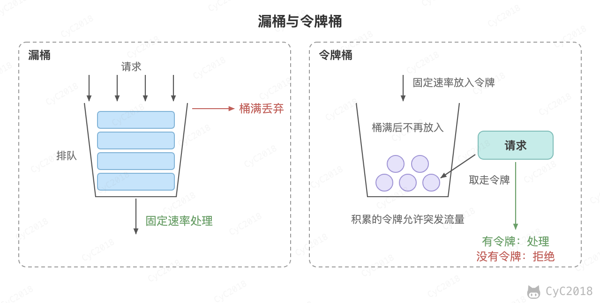 </div><br>

熔断器有关闭、打开和半开三种状态：失败率超过阈值时打开；打开一段时间后进入半开状态，放行少量请求试探，成功则关闭，失败则重新打开。

<div align="center"> 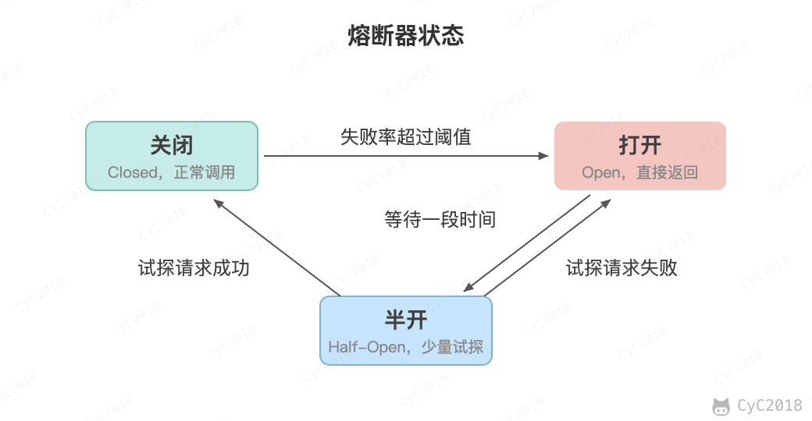 </div><br>

## 五、安全性

要求系统在应对各种攻击手段时能够有可靠的应对措施，常见的攻击手段和防范方法见 [攻击技术](攻击技术.md)。

## 六、秒杀系统

秒杀指的是少量商品在某一时刻开售，大量用户同时抢购，例如 100 件商品在开售瞬间收到 10 万个请求。难点在于：

- 瞬时流量远超平时，但绝大多数请求注定失败；
- 库存不能超卖，一个用户只能买一件；
- 抢购不能拖垮正常的业务。

解决思路是层层过滤，使最终到达数据库的请求接近库存数量：

<div align="center"> 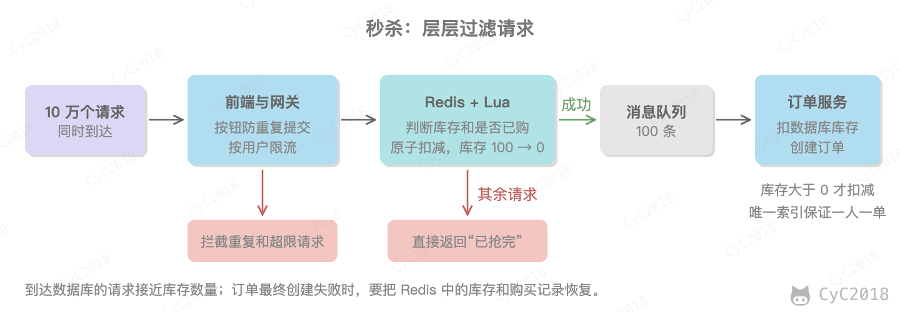 </div><br>

1. 前端和网关：开售前按钮置灰，提交后禁止重复点击，网关按用户和接口限流，拦截刷单请求；
2. 库存预扣：开售前把库存加载到 Redis 中，用 Lua 脚本在 Redis 中判断并扣减库存，没有库存的请求直接返回已抢完；
3. 异步下单：扣减成功的请求写入消息队列，订单服务按自己的处理能力消费，扣减数据库中的库存并创建订单，用户通过轮询等方式查询结果；
4. 隔离：秒杀服务独立部署，避免影响正常的业务。

预扣库存的 Lua 脚本如下：

```lua
-- KEYS[1]：库存，KEYS[2]：已购用户集合，ARGV[1]：用户 ID
if redis.call('SISMEMBER', KEYS[2], ARGV[1]) == 1 then
    return 2                                -- 一人一单，重复购买
end
if tonumber(redis.call('GET', KEYS[1])) <= 0 then
    return 1                                -- 库存不足
end
redis.call('DECR', KEYS[1])
redis.call('SADD', KEYS[2], ARGV[1])
return 0                                    -- 抢购成功
```

Redis 执行 Lua 脚本时不会穿插执行其它命令，判断是否已购、判断库存、扣减库存和记录用户这四步作为一个整体完成。如果在应用中先 GET 库存、判断大于 0 之后再 DECR，两个请求可能同时读到库存为 1，并且都扣减成功。例如库存为 100、1000 个用户各请求 2 次、64 个线程并发：Lua 脚本恰好卖出 100 件；先查询后扣减的写法运行 3 次，分别卖出了 113、106、114 件，库存变成了负数（Redis 7.4 实测，见[附录 A1](#a1-秒杀)）。

数据库也要兜底。扣减库存时把库存大于 0 作为条件，影响的行数为 0 说明库存不足：

```sql
UPDATE goods SET stock = stock - 1 WHERE id = 1001 AND stock > 0;
```

一人一单可以用订单表上（用户 ID，商品 ID）的唯一索引保证，消息被重复消费时插入失败，也就实现了幂等。Redis 中扣减成功、但订单最终创建失败时，需要把 Redis 中的库存和购买记录恢复，并定期与数据库对账。

## 七、海量数据处理

这类问题的特点是数据量远大于内存，例如“100 GB 的文件，内存只有 4 GB”。常用的思路是分而治之：先把数据切成能放进内存的小块，分别处理后再合并结果。

### Top K

从 1 亿个整数中找出最大的 10 个：维护一个大小为 10 的小顶堆，堆顶是当前第 10 大的数。依次读入每个数，比堆顶大就替换堆顶并调整堆，最后堆中的 10 个数就是答案。时间复杂度为 O(NlogK)，内存中只需保存 10 个数，数据可以一边读一边处理；而全部排序需要 O(NlogN) 的时间，还要把 400 MB 的数据都读入内存。Java 实现见 [Leetcode 题解 - 排序](Leetcode%20题解%20-%20排序.md#1-kth-element)。

### 出现次数最多的 K 个

100 GB 的日志文件中每行是一个 URL，内存只有 4 GB，找出出现次数最多的 10 个 URL。直接用 HashMap 统计所有 URL 会超出内存，需要先按哈希切分：

<div align="center"> 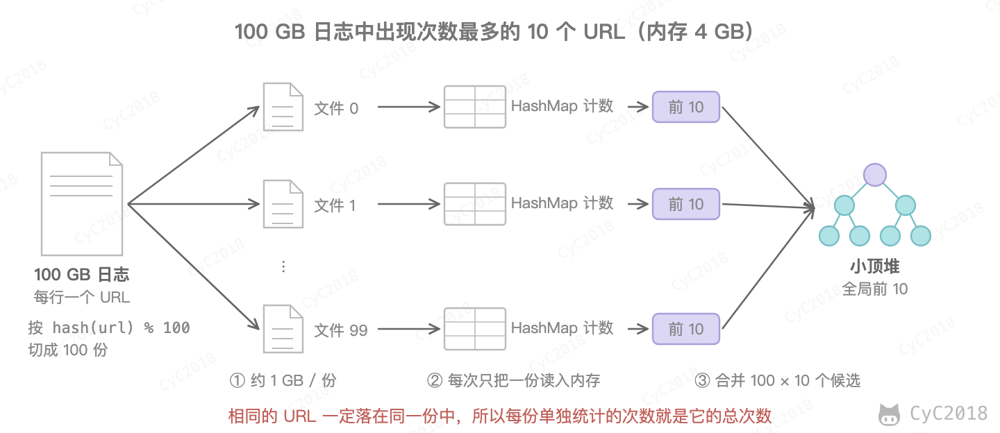 </div><br>

1. 逐行读取，按 hash(url) % 100 写入 100 个小文件，平均每个约 1 GB；
2. 依次把每个小文件读入内存，用 HashMap 统计每个 URL 的次数，再用小顶堆得到这个文件中出现次数最多的 10 个；
3. 用一个小顶堆从 100 × 10 个候选中选出全局的前 10 个。

这样做的关键是相同的 URL 一定落在同一个小文件中，所以每个文件单独统计出的次数就是这个 URL 的总次数。HashMap 占用的内存取决于文件中不同 URL 的数量，如果某个文件中不同的 URL 仍然太多，可以换一个哈希函数对它再次切分。

### 两个大文件的交集

两个文件各有 50 亿个 URL，每个 URL 64 字节，找出两个文件共同的 URL。每个文件有 320 GB，用同一个哈希函数把两个文件各切成 1000 份，每份约 320 MB。相同的 URL 一定落在编号相同的一对小文件中，只需要依次把 a<sub>i</sub> 读入 HashSet，再逐行检查 b<sub>i</sub>。

如果允许少量误判，可以用 [布隆过滤器](缓存.md#缓存穿透)：把 a 中的 URL 都加入布隆过滤器，再逐个检查 b 中的 URL。4 GB 内存约有 344 亿位，每个 URL 平均 6.9 位，使用 5 个哈希函数时误判率约为 3.7%；要把误判率降到 1%，每个 URL 需要约 9.6 位，共需 5.6 GB。

### 去重与判断是否存在

数据是整数时可以用位图，每个整数只用 1 位表示是否出现。int 共有 2<sup>32</sup> 个取值，位图只需要 512 MB。

例如在 2 亿个整数中找出只出现一次的数，可以给每个整数分配 2 位：00 表示没出现，01 表示出现一次，10 表示出现多次，共需 1 GB。读完所有数据后扫描位图，取出状态为 01 的数。

### 外部排序

100 GB 的数据排序，内存只有 1 GB：

1. 分段排序：每次读入 1 GB 数据，在内存中排序后写回磁盘，得到 100 个有序的文件；
2. 多路归并：同时打开这 100 个文件，用大小为 100 的小顶堆，每次取出最小的元素写入结果文件，再从它所在的文件读入下一个元素。

如果数据的取值范围很小，例如 1 亿个 10000 到 20000 之间的整数，一共只有 10001 种取值，用长度为 10001 的数组统计每个值出现的次数，一次扫描就能完成排序，也就是计数排序。

## 八、短链系统

短链系统把很长的网址换成很短的网址，例如把 https://shop.example.com/item/1024?from=campaign 换成 https://s.example/6LAze，常用于短信和社交媒体。用户访问短链时，服务返回一个跳转，浏览器再去访问原来的长链接。

<div align="center"> 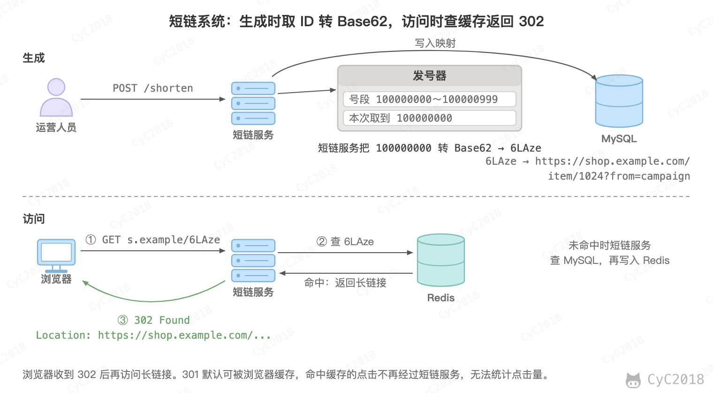 </div><br>

### 短码的生成

常见的方法有三种：

- 哈希：对长链接计算哈希（例如 MurmurHash），再把结果转成 Base62。同一个长链接总是得到同一个短码，但不同的长链接也可能得到同一个短码，冲突时要加上后缀重新计算；
- 随机：随机生成 6 位字符，由唯一索引检查是否重复，重复就重新生成。已经用掉的短码越多越容易重复，例如已有 10 亿个短链时，新生成的短码约有 1.8% 的概率重复；
- 发号器：先取一个全局唯一的自增 ID，再转成 Base62。不会冲突，短码也最短。

Base62 指的是用 0～9、a～z、A～Z 共 62 个字符表示一个数。例如 ID 100000000 不断除以 62，依次得到余数 14、35、36、47、6，倒过来对应字符 6、L、A、z、e，短码就是 6LAze。6 位 Base62 能表示 62<sup>6</sup> ≈ 568 亿个短码，每天新增 1 亿个也能用一年半。

发号器通常用 [数据库号段](分布式.md#八分布式-id)：每个实例一次领取 1000 个 ID 在内存中使用，用完再领。雪花算法生成的 ID 是 64 位的大整数，转成 Base62 有 10～11 位，用在短链中太长。需要注意的是，自增 ID 得到的短码是连续的，100000001 对应 6LAzf，别人可以据此遍历出其他短链；对隐私敏感的链接可以改用随机的方法，或者加上有效期和访问权限。

### 跳转用 301 还是 302

301 表示永久跳转，响应默认可以被缓存，浏览器之后会直接跳到长链接；302 表示临时跳转，每次访问都会请求短链服务。例如用浏览器访问同一个短链两次，返回 301 时，第二次直接跳到了长链接，服务端只收到一次请求；返回 302 时，两次都请求了服务端（Edge 156 实测，见[附录 A2](#a2-短链跳转)）。

需要统计点击量、允许修改目标地址或者设置有效期时用 302；只想减轻服务端的压力时可以用 301。

### 存储与缓存

```sql
CREATE TABLE short_url (
    code       VARCHAR(8)    PRIMARY KEY,
    long_url   VARCHAR(2048) NOT NULL,
    url_hash   BINARY(16)    NOT NULL,   -- 长链接的 MD5，用于查找同一个长链接是否已经生成过
    expire_at  DATETIME,
    KEY idx_url_hash (url_hash)
);
```

长链接最长可能有几千个字符，直接在 long_url 上建唯一索引会报错 Specified key was too long（InnoDB 索引最长 3072 字节），所以另存一列 16 字节的 MD5 建索引，查到后再比较完整的长链接。

短链读多写少，热门链接的访问又很集中，适合用 Redis 缓存短码到长链接的映射。不存在的短码会穿透到数据库，可以缓存空值或者使用布隆过滤器，见 [缓存穿透](缓存.md#缓存穿透)。点击统计不要在跳转时同步写数据库，而是把点击事件写入消息队列，异步汇总。

## 九、Feed 流

Feed 流指的是把关注的人发布的内容按时间倒序合并后展示，例如朋友圈和微博的首页。每个用户有一个发件箱，保存自己发的帖子；难点在于怎样把几百个人的发件箱合成一个首页。

<div align="center"> 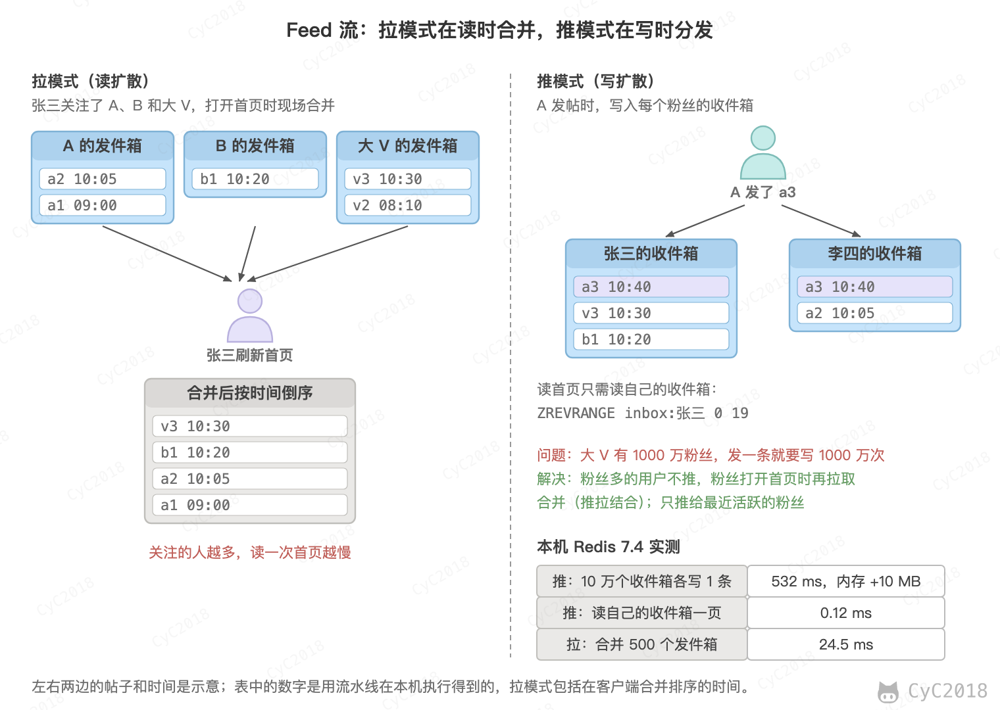 </div><br>

### 拉模式与推模式

- 拉模式（读扩散）：打开首页时，读取所有关注者的发件箱，合并后取最新的一页。发帖只写一次，但关注的人越多读得越慢；
- 推模式（写扩散）：发帖时把帖子写入每个粉丝的收件箱，打开首页只需读自己的收件箱。读很快，但粉丝越多写得越多，而且每个粉丝都存一份帖子 ID。

用有序集合实现时（分值为发布时间），一个帖子推给 10 万个粉丝，用流水线写入 10 万个收件箱共约 480 ms，已有的收件箱每多一条约占 16 字节；读自己的收件箱一页只需 0.11 ms；拉模式从 500 个发件箱各取最新 20 条再合并，一次要 22.8 ms（Redis 7.4 实测，见[附录 A3](#a3-feed-流)）。按这个速度，一个有 1000 万粉丝的大 V 发一条帖子，单个节点要写入约 50 秒；粉丝的收件箱都已存在时多占用约 150 MB 内存，需要新建收件箱时约 1 GB。

所以实际的系统大多推拉结合：

- 粉丝少的普通用户使用推模式；
- 粉丝很多的大 V 不推，粉丝打开首页时，从自己的收件箱和所关注的少数几个大 V 的发件箱中拉取，再合并；
- 只推给最近活跃的粉丝，长期不登录的用户回来时再用拉模式重建收件箱；
- 收件箱只保留最近的若干条，例如每次写入后执行 ZREMRANGEBYRANK inbox:1001 0 -1001，只留下分值最大的 1000 条，更早的内容到数据库中查。

### 分页

Feed 流的分页不能用偏移量。例如收件箱中有 p1～p30 共 30 条帖子，第 1 页取到 p30～p21；用户翻页之前又有 3 条新帖子进来，这时按偏移量取第 11～20 条，结果是 p23～p14，p23、p22、p21 重复出现了。

应该用上一页最后一条的分值作为游标，取比它更早的帖子：

```text
> ZRANGE inbox:1001 (21 -inf BYSCORE REV LIMIT 0 10
p20 p19 p18 ... p11
```

左括号表示不包含 21 本身，这是 Redis 6.2 起的写法，相当于旧的 ZREVRANGEBYSCORE。分值相同的帖子可能被跳过，可以把分值设为帖子 ID 这类唯一且递增的值，例如雪花算法生成的 ID 本身就按时间递增，见 [分布式 ID](分布式.md#八分布式-id)。

## 十、高并发系统的设计

高并发指的是系统在某段时间内要同时处理大量请求。设计时通常先估算峰值 QPS，再让绝大部分请求在到达数据库之前被挡住，最后用异步、限流和降级保证剩下的请求不会压垮系统。

本节以某电商的商品详情页为例。这个页面既要读（展示商品、价格和库存），也要写（下单扣减库存）。缓存、秒杀、限流算法和分库分表的细节已在前面各节讲过，这里只说明它们在整条链路中的位置。

### 容量估算

估算的第一步是把日流量换算成峰值 QPS。假设日 PV 为 6 亿，平均每秒约 6944 次；晚高峰一小时的 PV 占全天的 6%，峰值约为 6 亿 × 6% ÷ 3600 ≈ 1 万 QPS。大促期间流量是平时的 10 倍，设计目标为 10 万 QPS。

容量要按峰值计算，不能按平均值。平时的峰值约是平均值的 1.4 倍，大促峰值则约是平均值的 14 倍。

10 万 QPS 直接落到数据库上风险很大。本机回环实测的 MySQL 主键点查在 16 至 128 个连接时达到 17 万至 19 万 QPS（见[附录 A4](#a4-mysql-主键点查的并发扫描)），但这是客户端与服务端同机、没有网络开销的结果；生产环境经过网络和其它负载后的上限会低很多。因此需要在数据库之前挡住绝大部分请求。

### 读路径的逐层分流

读请求从用户到数据库要经过多层：内容分发网络（Content Delivery Network, CDN）的边缘节点、应用进程内的本地缓存、Redis 和数据库。每一层都可以挡住一部分请求。进入某层的 QPS 乘以（1 − 命中率），就是该层回源的 QPS。例如 10 万 QPS 进入 CDN，命中率为 60% 时，回源 4 万 QPS。

#### 1. CDN

CDN 边缘节点缓存商品基础信息的 JSON，存活时间（Time To Live, TTL）设为 10 秒。价格和库存允许有 10 秒的展示延迟，下单时仍以服务端的数据为准。

#### 2. 应用进程缓存

每台应用实例在进程内保存热门商品，TTL 为 5 秒。它不需要网络往返，但每台实例各存一份。TTL 到期时，同一商品可能在多台实例上同时回源，这就是[缓存击穿](缓存.md#缓存击穿)。

#### 3. Redis

商品详情、价格和库存分别存放在 Redis 的键中，用一次 MGET 取回。Redis 的请求量为 2 万 QPS，约为本机 GET 实测中位数（12.5 万 QPS，见[附录 A7](#a7-redis-get-的并发扫描)）的 1/6。假设 98% 的请求命中，回源到数据库的请求为 400 QPS。

#### 4. 数据库

回源的 400 QPS 都是主键点查，单个 MySQL 实例完全可以承担。

<div align="center"> 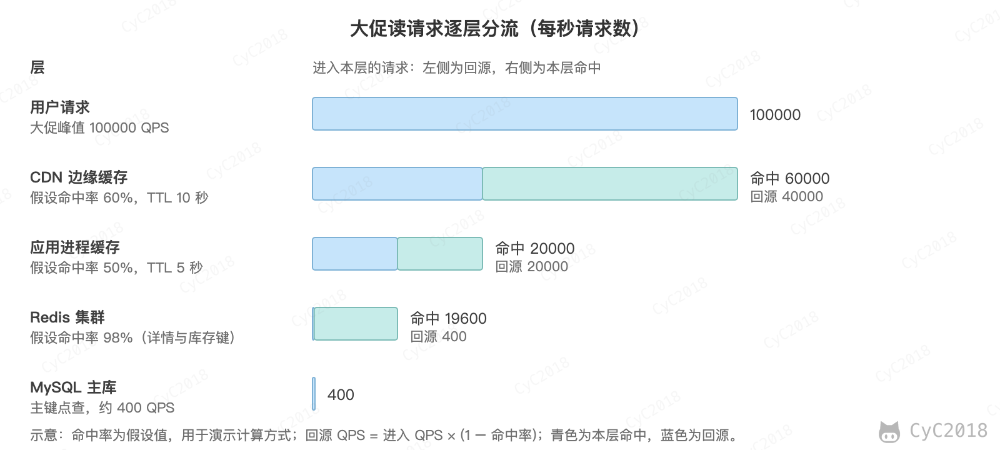 </div><br>

命中率的影响比想象中大。Redis 命中率从 98% 降到 90%，回源 QPS 从 400 增至 2000。

百万 QPS 时，若命中率保持不变，进入 Redis 的请求增至 20 万 QPS。按每个分片约 4 万 QPS 的规划值（假设为本机实测的约 1/3）计算，需要 5 个分片；回源到数据库的请求只增至 4000 QPS。因此高并发读的扩展主要落在缓存层和应用层的水平扩展上，而不是升级单台数据库。

### 写路径：库存与下单

下单的写请求不能依赖缓存，库存必须准确。假设下单量为峰值 PV 的 2%，即 2000 QPS，其中 40% 集中在一个爆款 SKU 上，相当于 800 QPS 落在同一行库存记录上。

#### 1. 热点行

InnoDB 使用行级锁，并采用两阶段锁（Two-Phase Locking, 2PL），事务持有的行锁一般要到提交或回滚时才释放（[InnoDB Transaction Model](https://dev.mysql.com/doc/refman/8.0/en/innodb-transaction-model.html)）。因此同一行的更新只能串行执行，单行的吞吐量约为 1 ÷ 锁持有时间。

本机实测验证了这一点：对同一行执行自动提交的 UPDATE，吞吐量在 1 到 64 个并发之间稳定在 0.8 万至 1 万 TPS，不随并发增加；分散到 100 行后，64 个并发达到 3.4 万 TPS（见[附录 A5](#a5-热点行与分散行的-update)）。

本机回环上单条查询的往返约为 0.03 ms（见[附录 A6](#a6-本机单条查询的往返延迟)），生产环境的事务内则有多次网络往返。假设同机房往返为 0.5 ms，事务内有 3 次往返（查询并加锁、更新库存、插入订单），锁持有约 1.6 ms，单行上限约为 625 TPS，低于 800 QPS。解决办法是拆分库存：把 1 万件分成 10 行，每行 1000 件，每行约 80 QPS，远低于上限。

拆分后，某一行售罄而其它行仍有库存时，要换一行重试，并定期把库存在各行之间调拨：

```sql
UPDATE t_stock_slot SET stock = stock - 1
WHERE sku_id = 1 AND slot = 3 AND stock > 0;
-- 影响行数为 0 时，换一个 slot 重试；所有 slot 都为 0 时视为售罄
```

#### 2. 削峰

下单请求先写入消息队列，订单服务按自己的处理能力消费（见[流量削峰](消息队列.md#流量削峰)）。假设峰值 2000 QPS 持续 10 分钟，订单事务的处理能力为 1000 TPS，队列积压为 (2000 − 1000) × 600 = 60 万条。峰后到达量降到 500 QPS 时，排空积压需要 60 万 ÷ (1000 − 500) = 1200 秒，即 20 分钟。消息的保留时间要长于这段时间，前端要显示“排队中”，由用户轮询订单结果。

#### 3. 分库分表的时机

日下单量约为 1200 万（6 亿 × 2%），平均每秒约 139 单，2000 QPS 只是大促的瞬时值。订单表一年约 44 亿行，分库分表主要由数据量决定，而不是由峰值 QPS 决定。订单表一般按用户 ID 切分，使同一用户的订单落在同一个库中，见[MySQL 切分](MySQL.md#五切分)。

### 保护：限流、降级与熔断

限流、降级与熔断的算法和状态机见[限流、降级与熔断](#限流降级与熔断)，这里说明它们在大促链路中的位置：

- 网关限流：按 IP 和用户限制请求频率，例如每个用户每秒只允许 1 次下单，超出的请求直接返回“请稍后再试”；
- 降级：大促时关闭评价摘要、推荐等非核心模块，库存数字改为“有货”“库存紧张”，减少对库存服务的查询；
- 熔断：库存服务的超时比例超过阈值时，详情页直接返回缓存中的库存状态，不再等待超时。

Google SRE 对过载的建议是先返回降级的响应，即数据更少、计算更简单的结果，只有在极端过载时才返回错误（[Handling Overload](https://sre.google/sre-book/handling-overload/)）。

### 一致性与可用性

#### 1. 一致性

只有不能超卖的数据要求强一致。库存用数据库的条件更新实现，只有库存大于 0 时才扣减，影响行数为 0 时视为售罄。详情页的价格和库存允许秒级延迟，用缓存的 TTL 换取性能，缓存与数据库的更新顺序见[缓存一致性](缓存.md#缓存一致性)。消息的重复消费通过[幂等](分布式.md#九幂等)处理。

#### 2. 可用性

应用实例是无状态的，分布在三个可用区，见[冗余](#冗余)。Redis 采用一主两从，MySQL 采用主从复制加故障转移（见[Redis 复制](Redis.md#十一复制)、[MySQL 复制](MySQL.md#六复制)）。容量规划也要考虑故障：一个可用区故障时，其余实例要能承受全部流量，这一点在后面的实例数估算中计算。

### 压测与容量规划

压测的目标是找到拐点，即吞吐量不再随并发增加、延迟开始陡升的位置。做法是逐步增加并发，记录吞吐量、P99、错误率和 CPU，观察它们的变化。

以 Redis GET 为例（见下图）：连接数从 1 增加到 50 时，吞吐量从 1.3 万 QPS 升至 12.5 万 QPS；继续增加到 200 时吞吐量持平，P99 却从 0.56 ms 增至 1.98 ms；到 1000 个连接时 P99 达到 16.0 ms。拐点约在 50 个连接（见[附录 A7](#a7-redis-get-的并发扫描)）。

<div align="center"> 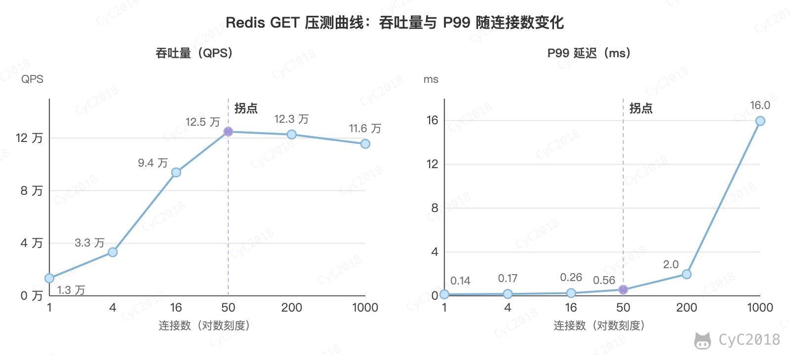 </div><br>


拐点的位置随环境波动。同一台机器上的三轮测试，数值并不完全一致：第一轮 16 个连接时已达到 9.5 万 QPS，200 个连接时的 P99 为 7.19 ms，而第二、三轮约为 2 ms。因此压测要重复多次并取中位数，只在相同规格的环境中比较结果。Redis 文档也指出，逐条同步发送命令测的是网络和客户端的延迟，要测服务端本身需要多个连接（[Redis Benchmark](https://redis.io/docs/latest/operate/oss_and_stack/management/optimization/benchmarks/)）。

数据库也有类似的拐点。MySQL 主键点查在 16 个连接时为 16.9 万 QPS，128 个连接时为 19.2 万 QPS，吞吐量只增加 14%，平均响应时间却从 0.095 ms 增至 0.668 ms（见[附录 A4](#a4-mysql-主键点查的并发扫描)）。本机压测的客户端与服务端共用 10 个核心，吞吐量很快接近这台机器的上限，之后的并发只增加排队时间。热点行的更新则从一开始就没有并发收益。

并发数 = 吞吐量 × 响应时间，这一关系即 Little 定律（Little's law），见[性能指标](#性能指标)。它可以用来估算同时在处理的请求数。例如 10 万 QPS、平均响应时间 5 ms（假设）时，系统中约有 500 个请求同时在处理。单台实例按 1200 QPS 计算时，同时处理约 6 个请求，线程池和连接池要在此基础上留出余量。

实例数的估算方法是：所需实例数 = 峰值 QPS ÷（单实例拐点 QPS × 目标利用率），再按可用区向上取整。例如应用层的回源为 4 万 QPS，单实例拐点按 2000 QPS 计算（假设，需用服务自己的压测结果替换），目标利用率为 60%：4 万 ÷ 1200 ≈ 33.3，取 34 台，三个可用区各 12 台，共 36 台。一个可用区故障时剩余 24 台，每台约 1667 QPS，仍低于拐点。

Google SRE 的经验是用 CPU 等资源而不是 QPS 作为容量的度量，因为同样的 QPS 在不同接口上的开销可能相差很大（[Handling Overload](https://sre.google/sre-book/handling-overload/)）。因此上面的 QPS 估算只是起点，最终要用 CPU 使用率校准。

### QPS 突增 10 倍时先做什么

假设线上 QPS 从 1 万突增到 10 万，处理顺序如下：

1. 确认流量的性质：查看来源 IP、User-Agent 和接口分布，区分真实增长、爬虫和客户端重试风暴；
2. 先保护再扩容：立即在网关限流，关闭非核心功能，熔断慢的依赖。过载后健康的实例会减少，降低负载不一定能让服务恢复，因此保护要先于扩容生效（[Addressing Cascading Failures](https://sre.google/sre-book/addressing-cascading-failures/)）；
3. 找出瓶颈层：按读路径逐层查看 QPS、CPU、连接池、慢 SQL 和 Redis 延迟，判断哪一层先到达拐点；
4. 扩容：无状态的应用实例可以较快地加入集群。Redis 增加分片、数据库分库需要迁移数据，耗时较长，因此大促前要按 10 倍峰值提前扩容并压测；
5. 复盘：把新的拐点和瓶颈层记入容量模型，作为下一次估算的依据。

### 大模型服务的高并发

大模型推理的并发单位不是请求，而是 token。每个请求的输出长度不固定，服务能同时处理的请求数取决于显存中能放下多少键值缓存（KV Cache，见[自回归生成与 KV Cache](大模型应用.md#自回归生成与-kv-cache)）。

以 Qwen2.5-7B-Instruct 为例：28 层，4 个 KV 头，每个头的维度为 128，使用 bfloat16（2 字节）。每个 token 的 KV Cache 为 2 × 28 × 4 × 128 × 2 = 57344 字节，即 56 KiB。模型权重约 15.2 GB（由配置推算为 7.6 B 参数，见[附录 A8](#a8-由配置推算-qwen25-7b-的参数与-kv-cache)）。在 24 GB 的显卡上，若保留 2 GB 给框架与激活（假设），KV Cache 空间约 6.8 GB，可缓存约 11.8 万个 token。平均每个请求 2000 token 时，同时并发的请求约 59 个。

若使用 28 个 KV 头的多头注意力（Multi-Head Attention, MHA），每个 token 的 KV Cache 为 392 KiB，同样的显存只能容纳 1/7 的 token。分组查询注意力（Grouped-Query Attention, GQA）让多个查询头共享一组 KV，正是为了减少这部分开销。

因此大模型服务的限流通常按 token 计算，而不是按请求数。vLLM 用分页的方式管理 KV Cache，减少显存的浪费，从而提高可同时处理的请求数（[PagedAttention 论文](https://arxiv.org/abs/2309.06180)）。

## 十一、大文件上传

大文件上传指的是文件大到一次 HTTP 请求无法可靠完成的上传，例如几个 GB 的视频。直接上传时有三个问题：请求时间长，中途断开就要从头开始；网关对请求体有大小限制，例如 Nginx 默认的 client_max_body_size 为 1 MB，超过时返回 413；失败后无法只补传没有完成的部分。

分片上传（Multipart Upload）把文件切成若干分片，每片作为一次独立的请求上传，服务端在所有分片到齐后按序拼接成完整的文件。断点续传建立在分片上传之上，秒传则依赖文件的内容哈希。

### 分片上传的流程

以一个 300 MiB 的视频文件 lecture.mp4 为例，按 5 MiB 切分，314572800 ÷ 5242880 = 60，共 60 片，每片都是 5 MiB。直接上传时，在 10 Mbps 的上行带宽下需要约 4.2 分钟，期间连接不能断开。

分片之间互不影响，可以乱序上传，也可以并行上传以提高吞吐量。整个流程分为四步：

1. 初始化：客户端提交文件名、文件大小、整文件的安全哈希算法 256（Secure Hash Algorithm 256, SHA-256），以及 60 个分片各自的 SHA-256（清单）；服务端写入上传记录和 60 条分片记录，返回上传 ID（upload_id）；
2. 上传分片：客户端对每一片发送一个 PUT 请求，服务端校验分片的长度和 SHA-256 与清单一致后保存，并记录分片的实体标签（Entity Tag, ETag），这里取分片内容的消息摘要算法 5（Message-Digest Algorithm 5, MD5）值，与简单存储服务（Simple Storage Service, S3）的做法一致。客户端根据每次 PUT 的响应判断哪一片失败，单片失败时只重试这一片；
3. 完成：客户端提交完成请求，服务端检查 60 片齐全，按分片号升序拼接，计算整文件的 SHA-256，与初始化时的值相同才生成最终文件；
4. 清理：完成后删除分片；未完成的上传要定期取消，并删除已上传的分片。

两层哈希的作用不同：分片哈希用于校验每一片是否与清单一致，整文件哈希用于秒传查重，以及完成时的最终校验。

<div align="center"> 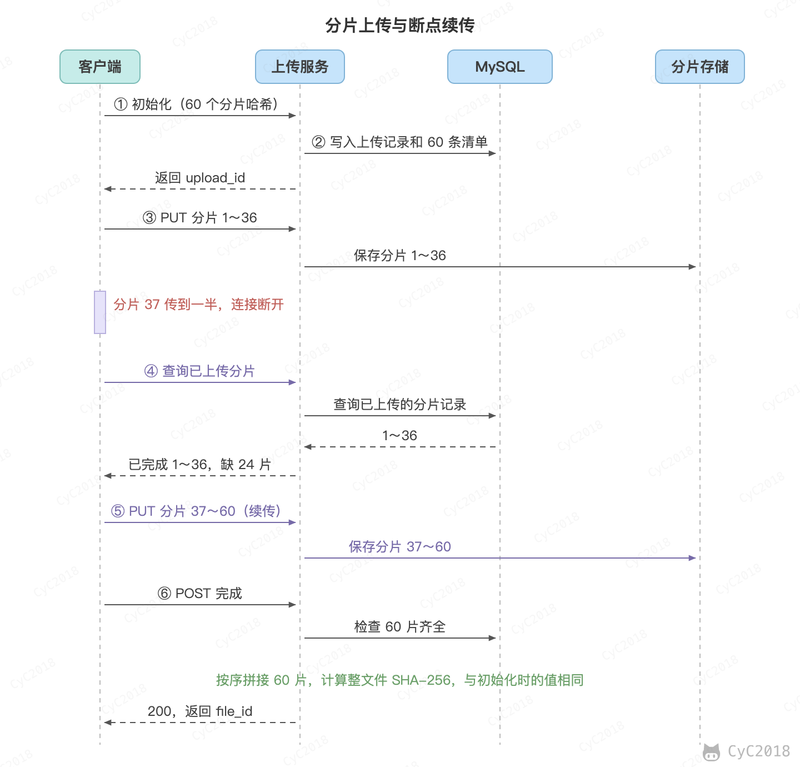 </div><br>

实测中，这一流程由标准库实现的最小服务完成，元数据保存在 MySQL 8.0 中，各步的请求和响应见[附录 A9](#a9-分片上传的最小实现与实测)。

### 断点续传

断点续传指的是中断后从已经完成的分片继续，而不是从头开始。前提是服务端保存每个分片的完成状态，并提供查询接口。

假设第 37 片传到一半时连接断开。服务端只为 1～36 号分片记录了 ETag，第 37 片的记录仍为空。客户端调用查询接口得到已完成的 36 个分片号，只需补传 37～60 共 24 片，即 120 MiB，而不是重新传 300 MiB。

<div align="center"> 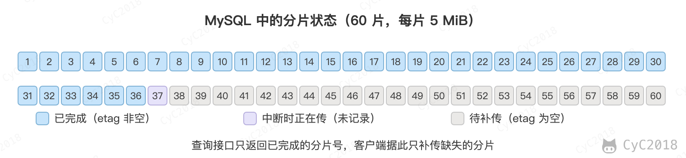 </div><br>

中断的分片不会留下残缺的数据。服务端把请求体写入临时文件，实际收到的字节数少于 HTTP 首部 Content-Length 时删除临时文件并返回 400，状态中不会记录这一片。

分片状态可以用记录表保存，也可以用位图（bitmap）保存，每片只占 1 位，60 片只需 8 字节。无论哪种方式，分片状态都必须持久化。上面的查询结果来自 MySQL 中的分片表，服务重启后仍然存在。如果状态只保存在进程内存中，例如 Java 的 ConcurrentHashMap，服务重启后断点信息全部丢失，多台服务实例之间也无法共享，续传就失效了。

上传进度可以按已完成的分片数计算，例如 36 / 60 即 60%。

### 秒传

秒传指的是服务端已经有内容相同的文件时，客户端不需要上传任何分片，直接建立引用。判断依据是文件的内容哈希：客户端在初始化前计算整文件的 SHA-256，服务端在文件表中查到相同的哈希，就直接返回文件已存在。

秒传的代价在于先要读完整个文件来计算哈希。在本机上，同时计算整文件和全部分片的 SHA-256，300 MiB 耗时约 0.31 秒，2 GiB 约 2 秒（Python hashlib 实测，见[附录 A9](#a9-分片上传的最小实现与实测)）。浏览器中的 Web Crypto API 不支持流式输入，digest 要求把完整数据读入内存，因此大文件的哈希通常要用增量算法计算。

需要注意的是，只按哈希判断文件是否存在时，任何知道哈希的用户都可以“秒传”别人的文件，并借此探测某个文件是否存在。秒传应当只在当前用户自己的文件空间内建立引用，存储中的文件仍然只保存一份。实测中，同一内容换了文件名再次上传，初始化直接返回已存在，没有发送任何分片。

### 分片大小

分片太小，请求数和清单都会变多，每一片的固定开销占比升高；分片太大，单片失败时的重传量变大，服务端每次需要缓冲的数据也更多。本例选择 5 MiB，它是 S3 允许的最小分片大小。

以 10 Mbps 的上行带宽计算，5 MiB 的分片传一片约 4.2 秒，中断后最多损失这一片的时间；100 MiB 的分片传一片要 84 秒。

分片数量也有上限。S3 每个上传最多 10000 片，因此要上传 2 TiB 的对象，每片至少约 209.7 MiB；如果仍用 5 MiB 切分，需要 419431 片，远超上限（推算见[附录 A10](#a10-推算数字)）。分片大小要先满足上限，再考虑单片失败的代价。

### 重复分片与幂等

同一分片号再次上传会覆盖之前的分片，这是 S3 的规则。因此客户端在超时或不确定时直接重传即可，不需要判断服务端是否已经收到。

本实现还要求分片内容与初始化时提交的清单一致，覆盖规则之外多了这一层检查：

- 内容相同：覆盖，返回 overwritten 为 true，分片数仍为 60；
- 内容不同：分片的 SHA-256 与清单不符，返回 409，原分片保持不变。

其它步骤也是幂等的。同一文件（哈希和大小相同）在未完成时再次初始化，返回原来的上传 ID，客户端重启后可以接着传，不会产生多份未完成的上传。完成请求重复提交时，返回同一个文件 ID。幂等的一般原理见[分布式 九、幂等](分布式.md#九幂等)。

### 完整性校验

完整性校验分为四层，任何一层失败都只需要重传相关的分片：

1. 传输层：服务端按 Content-Length 判断请求体是否收全，收不全时丢弃，不记录状态；
2. 分片层：每片的 SHA-256 必须与清单一致；
3. 存储层：完成前逐片核对已保存的分片。实测中把第 7 片的一个字节改掉后，完成请求返回 409 并列出第 7 片，只把它标记为待补传，补传后再次完成即成功；
4. 文件层：按序拼接后计算整文件的 SHA-256，与初始化时的值比较。

对象存储的校验规则有所不同。S3 多分片对象的 ETag 不是整个对象的 MD5，而是把各分片的 MD5 拼接后再求 MD5，末尾加上分片数，官方文档的示例为 “-9”。多分片上传时，整对象校验只支持 CRC-64/NVME、CRC-32 和 CRC-32C，SHA-256 只能使用组合校验。因此要用 SHA-256 核对整个文件时，需要由应用自己保存整文件的 SHA-256。

### 合并与清理

S3 的完成请求要求列出每个分片的分片号和 ETag，服务端按分片号升序拼接，完成后分片不再存在。自建服务可以直接使用服务端保存的清单，拼接同样按分片号升序进行，并以流的方式进行，每次只读写 1 MiB，不能把整个文件读入内存。

两个完成请求同时到达时，只能有一个进入合并。实现方法是用条件更新把上传状态从 uploading 改为 completing，影响的行数为 0 说明已有请求在处理。合并失败时把状态改回 uploading，客户端可以重试。如果服务在合并过程中崩溃，状态会停留在 completing，需要用超时机制把它恢复。

未完成的上传会占用存储。S3 对未完成的分片按存储量计费，直到上传完成或取消；官方建议配置生命周期规则 AbortIncompleteMultipartUpload 自动删除超期的未完成上传。在 S3 中，取消之后原上传 ID 不能再用于上传分片。自建服务同样需要定期取消超期的上传并删除分片，取消接口的实测见[附录 A9](#a9-分片上传的最小实现与实测)。

### 对象存储的分片上传

对象存储（Object Storage）的分片上传是同样的流程，Amazon S3 的接口分别为：CreateMultipartUpload（初始化，返回 UploadId）、UploadPart（上传分片，返回 ETag）、ListParts（列出已上传的分片）、CompleteMultipartUpload（按分片号和 ETag 完成）、AbortMultipartUpload（取消）。

主要限制以官方文档为准，2026 年 10 月核对：单个对象最大 48.8 TiB；每次上传最多 10000 片，分片号为 1 到 10000；除最后一片外，分片大小为 5 MiB 到 5 GiB；ListParts 每次最多返回 1000 片；单次 PUT 最多上传 5 GB，超过的文件要用分片上传。

分片本身不是对象，只有完成请求之后才生成对象，分片也随之消失。因此合并是分片上传的最后一步。在 S3 中，合并由存储服务按分片号组合，应用不需要再下载、拼接并重新上传一次。

MinIO 兼容 S3 的分片上传接口，它的限制与 S3 一致：分片号必须在 1 到 10000 之间，分片小于 5 MB 时返回 EntityTooSmall 错误。应用侧的流程与上文相同，区别在于分片由 MinIO 保存，完成时由 MinIO 组合成对象。如果希望大文件不经过应用服务器，也可以让客户端用预签名 URL 直接上传到对象存储，应用服务只保存上传状态。

## 十二、权限系统

权限系统要解决两个问题：功能权限指的是用户能不能执行某个操作，数据权限指的是用户能看到哪些数据。例如在采购后台中，采购员可以创建采购订单，但只能看到自己创建的订单；采购主管可以审批订单，并能看到本部门的全部订单。前者由接口权限决定，后者由数据范围决定。

### 功能权限与 RBAC

#### 1. 基本模型

基于角色的访问控制（Role-Based Access Control, RBAC）把权限授予角色，再把角色分配给用户，用户通过角色间接获得权限。Sandhu 等人在 1996 年提出的参考模型中，权限与角色相关联，用户是角色的成员；这一模型与 Ferraiolo 和 Kuhn 的模型在 2000 年统一为 NIST 的 RBAC 模型，2004 年成为 ANSI/INCITS 359-2004 标准。

逐个用户授权的成本很高。NIST 指出，管理员通常要为每个用户单独指定访问控制列表（Access Control List, ACL），既费事又容易出错。例如有 200 个采购员，每人 15 个权限，假设共有 4 个角色：逐人授权需要 3000 条用户-权限记录；使用角色时，需要 200 条用户-角色记录，加上 4 个角色各 15 条角色-权限记录，共 260 条（计算值）。权限变更时只需修改角色，不必逐个用户调整。

#### 2. 表结构

以采购管理后台为例，权限相关的数据分为五张表：用户、角色、权限、用户-角色和角色-权限。建表语句如下（MySQL 8.0）：

```sql
CREATE TABLE sys_user (
    id       BIGINT PRIMARY KEY,
    username VARCHAR(64) NOT NULL UNIQUE,
    dept_id  BIGINT NOT NULL
);

CREATE TABLE sys_role (
    id         BIGINT PRIMARY KEY,
    name       VARCHAR(64) NOT NULL UNIQUE,
    data_scope ENUM('SELF', 'DEPT', 'ALL') NOT NULL
);

CREATE TABLE sys_permission (
    id          BIGINT PRIMARY KEY,
    code        VARCHAR(64)  NOT NULL UNIQUE,
    http_method VARCHAR(8)   NOT NULL,
    url         VARCHAR(255) NOT NULL,
    UNIQUE KEY uk_method_url (http_method, url)
);

CREATE TABLE sys_user_role (
    user_id BIGINT NOT NULL,
    role_id BIGINT NOT NULL,
    PRIMARY KEY (user_id, role_id),
    KEY idx_role_id (role_id)
);

CREATE TABLE sys_role_permission (
    role_id BIGINT NOT NULL,
    perm_id BIGINT NOT NULL,
    PRIMARY KEY (role_id, perm_id),
    KEY idx_perm_id (perm_id)
);
```

sys_permission 中的 code 是权限码，格式为“资源:操作”；http_method 和 url 是对应的接口。用户与角色、角色与权限都是多对多关系，因此各用一张关联表表示。关联表以两个外键组成联合主键，保证同一对关系只出现一次；另一个索引用于反向查询，例如查询拥有某个角色的全部用户。

示例数据中，采购员拥有 order:query 和 order:create，采购主管在此基础上还拥有 order:approve，财务拥有 order:query 和 payment:query。张三、赵六是采购员，李四是采购主管，王五是财务，孙七暂时没有角色。部门表从略，dept_id 为 10 表示采购部。图中高亮的是张三创建订单时经过的记录。

<div align="center"> 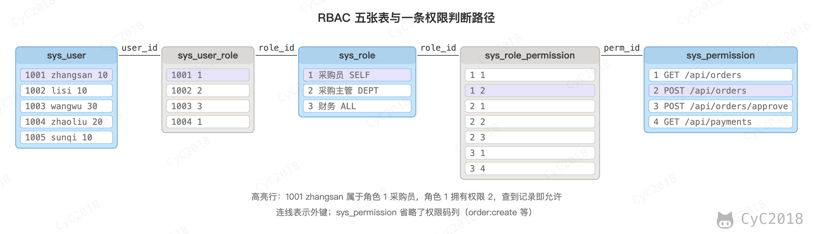 </div><br>

判断某个用户能否调用某个接口，就是沿着用户、角色、权限三级关系查找是否存在匹配的记录：

```sql
SELECT EXISTS (
    SELECT 1
    FROM sys_user_role ur
    JOIN sys_role_permission rp ON rp.role_id = ur.role_id
    JOIN sys_permission p ON p.id = rp.perm_id
    WHERE ur.user_id = 1001 AND p.http_method = 'POST' AND p.url = '/api/orders'
) AS allowed;
```

返回 1 表示允许，0 表示拒绝。张三创建订单返回 1，审批订单返回 0；李四审批订单返回 1；没有角色的孙七访问订单接口返回 0（MySQL 8.0 实测，见[附录 A11](#a11-权限判断与执行计划)）。执行计划中，三张表分别通过唯一索引、主键前缀和主键查找，预估行数均为 1。

#### 3. 权限的检查位置

权限需要在多个位置体现，但真正的安全边界只能放在服务端：

- 前端：根据权限码显示菜单和按钮。这只改善使用体验，前端的判断可以被绕过，不能作为安全边界；
- 服务端：通过拦截器或注解读取当前用户的权限码集合，与接口要求的权限码比较，不满足时返回 403。例如在接口方法上标注需要 order:create，调用前由框架完成检查；
- 网关：一般只校验登录状态。接口需要哪个权限码由服务定义，网关不能替代服务端的检查。

OWASP 的授权速查表建议在服务端对每次请求校验权限，并且默认拒绝：没有匹配的授权规则时，结果是拒绝，而不是放行。

#### 4. 权限缓存与失效

每次请求都执行三表连接会增加数据库压力，因此常把用户的权限码集合缓存起来，例如在 Redis 中以用户 ID 为键保存权限码集合（示意）。缓存失效取决于变更的对象：

- 修改用户的角色：删除该用户的缓存；
- 修改角色的权限：找出拥有该角色的全部用户并删除他们的缓存。用户很多时，可以改为给权限数据加版本号，角色变更时递增版本号，缓存中的版本号与之不一致时重新加载。

删除缓存与更新数据库之间的先后顺序问题见 [缓存一致性](缓存.md#缓存一致性)。权限码不要直接写入 JSON Web Token（JWT）：已签发的 Token 不会随数据库变化，权限变更要等到 Token 过期才生效。Token 中通常只保存用户 ID，权限在服务端查询并缓存。

#### 5. 动态权限

硬编码的权限把角色写在代码中，例如判断 roleKey 是否等于 admin，新增角色或调整权限都要改代码并重新发版。动态权限把角色、权限以及它们的关系保存在数据库中，由管理后台维护，接口检查时读取这些数据。管理员修改 sys_role_permission 之后，经过缓存失效，新的权限即可生效，不需要发版。

### 数据权限

#### 1. 数据范围

功能权限决定能否调用订单接口，数据权限决定查询结果包含哪些行。角色上的 data_scope 指定它能看到的范围：SELF 表示只能看本人创建的数据，DEPT 表示本部门的数据，ALL 表示全部数据。订单表记录了创建人和所属部门：

```sql
CREATE TABLE sys_order (
    id         BIGINT PRIMARY KEY,
    title      VARCHAR(128)  NOT NULL,
    amount     DECIMAL(12,2) NOT NULL,
    creator_id BIGINT NOT NULL,
    dept_id    BIGINT NOT NULL,
    KEY idx_creator (creator_id),
    KEY idx_dept (dept_id)
);
```

表中有 4 条订单：订单 1 和 3 由张三创建，订单 2 由李四创建，订单 4 由赵六创建；订单 1 至 3 属于采购部，订单 4 属于研发部。按角色的数据范围，各用户能看到的订单如下：

- 张三（采购员，SELF）：订单 1、3；
- 李四（采购主管，DEPT）：订单 1、2、3；
- 王五（财务，ALL）：全部 4 条；
- 赵六（采购员，SELF）：订单 4；
- 孙七（没有角色）：0 条。

实现时，把数据范围转换为查询条件，例如：

```sql
-- 张三：采购员，SELF
SELECT id, title FROM sys_order WHERE creator_id = 1001 ORDER BY id;
-- 李四：采购主管，DEPT
SELECT id, title FROM sys_order WHERE dept_id = 10 ORDER BY id;
-- 王五：财务，ALL，不追加条件
SELECT id, title FROM sys_order ORDER BY id;
```

用户拥有多个角色时，各角色的条件用 OR 合并；只要有一个角色是 ALL，就不追加条件。没有任何角色时追加 WHERE 1 = 0，孙七的查询因此返回 0 行（MySQL 8.0 实测，见[附录 A12](#a12-数据范围分页总数与写操作)）。

#### 2. 实现与注意事项

常见做法是在 Mapper 或 DAO 层用注解标记需要过滤的查询，由 AOP 或 MyBatis 拦截器在执行前把范围条件追加到 WHERE 中，业务代码不需要关心范围。这种做法需要注意以下几点：

- 条件的值必须通过参数绑定传入，不能拼接字符串；
- 多表关联或子查询中，条件要加在正确的表别名上，拦截器需要能正确解析 SQL；
- 分页的总数（COUNT）也要带同一条件。张三的订单列表只有 2 条，不带条件的 COUNT(*) 却返回 4，分页会显示错误的总数；
- 修改和删除同样要带范围条件。张三修改订单 2 时，执行 UPDATE sys_order SET amount = 1 WHERE id = 2 AND creator_id = 1001，影响行数为 0，应用据此拒绝请求。这是为了防止不安全的直接对象引用（Insecure Direct Object Reference, IDOR），即用户只改动 URL 中的 ID 就访问到别人的数据；
- 部门有层级时，DEPT 的范围还应包括下级部门，可以在部门表中保存祖先路径，或使用闭包表；
- 数据库自带的行级安全策略（例如 PostgreSQL 的 Row Security Policies）会在每次查询时自动追加策略条件，本节的 MySQL 示例则在应用层实现。

检索增强生成（RAG）中同样需要数据权限。权限条件应作为检索的过滤条件，在文档进入模型的上下文之前完成过滤；否则模型可能引用用户无权查看的文档。

### 其他权限模型

#### 1. ACL 与 ABAC

ACL 以资源为中心，每个资源直接列出可以访问它的主体和操作，例如某个网盘文件的 ACL 为 zhangsan 可读、lisi 可读写。它适合个人之间的共享，但授权关系分散在每个资源上，用户和资源很多时难以统一管理。

基于属性的访问控制（Attribute-Based Access Control, ABAC）根据主体、客体、操作和环境条件的属性计算授权。NIST SP 800-162 的定义是：授权由这些属性与策略、规则或关系比较后决定。例如“金额超过 1 万元的订单只能由采购部主管在工作时间审批”，其中金额、部门和时间都是属性。ABAC 的表达能力强，但策略数量增加后难以理解和审计。

三者的区别在于授权的依据不同：

- RBAC 以角色为中心：适合组织结构稳定、权限按岗位划分的后台系统；
- ACL 以资源为中心：适合少量资源的个人分享；
- ABAC 以属性为中心：适合条件多变、需要按时间、地点或金额细分的场景。

#### 2. 混合使用与角色继承

实际系统通常混合使用三者。一种常见的判断顺序是：先检查 ACL 中的显式拒绝，再检查 RBAC 的角色权限，最后检查 ABAC 条件。显式拒绝优先于允许，例如某个用户的角色允许审批，但被单独禁止审批某笔订单时，仍然拒绝。

RBAC 还可以扩展两类约束。角色继承（role hierarchy）指高级角色自动拥有低级角色的权限，例如采购主管继承采购员的权限，表中只需为采购主管配置审批权限。职责分离（separation of duty）指互相冲突的角色不能由同一个人同时拥有，例如创建订单的角色与审批订单的角色互斥。

组织结构是多维的时候，只用角色一个维度不够。例如同一个人既属于某个部门，又参与多条业务线，权限可以按部门、业务线和角色的组合授予，这是在 RBAC 之上叠加属性条件的做法。

### Agent 的最小权限

Agent 调用工具时，模型只输出调用意图，是否真正执行由权限检查决定。最小权限的做法是：为每个 Agent 只配置完成任务所需的工具和数据范围，读操作与写操作分开授权，高风险操作需要人工审批，见 [大模型应用](大模型应用.md#安全)。

## 附录：实测

环境为 Apple M1 Pro、macOS，Redis 7.4.1 使用默认配置，客户端为 redis-py。

### A1 秒杀

库存 stock 为 100，用户 0～999 各请求 2 次，共 2000 个请求由 64 个线程并发执行。Lua 脚本与正文相同；对比的写法依次执行 SISMEMBER、GET、DECR、SADD 四条命令：

```python
def naive(u):
    if c.sismember('buyers', u): return 2
    if int(c.get('stock')) <= 0: return 1
    c.decr('stock'); c.sadd('buyers', u)
    return 0
```

```text
Lua 脚本：成功 100，库存不足 1800，重复购买 100，剩余库存 0
先 GET 再 DECR（第 1 次）：成功 113，库存不足 1887，重复购买 0，剩余库存 -13
先 GET 再 DECR（第 2 次）：成功 106，库存不足 1894，重复购买 0，剩余库存 -6
先 GET 再 DECR（第 3 次）：成功 114，库存不足 1886，重复购买 0，剩余库存 -14
```

### A2 短链跳转

服务器对 /a 返回 301、对 /b 返回 302，Location 都是 /target。用 Edge 156 分别访问 /a 两次、/b 两次，服务器收到的请求：

```text
HIT /a
HIT /target
HIT /favicon.ico
HIT /target
HIT /favicon.ico
HIT /b
HIT /target
HIT /b
HIT /target
```

### A3 Feed 流

推模式向 10 万个收件箱各写入 1 条（流水线，每 1000 条提交一次）；读一页为 ZREVRANGE 取 20 条，执行 1000 次取平均；拉模式为 500 个发件箱各有 20 条帖子，用流水线各取最新 20 条再排序，执行 20 次取平均。内存是写入前后 INFO memory 中 used_memory 的差：

```text
推：写入 100000 个收件箱 481 ms
推模式读一页：0.110 ms（1000 次平均）
拉模式读一页：22.8 ms（读 500 个发件箱共 10000 条再排序）
新建 10 万个收件箱、各写 1 条：+10.2 MB
已有的 10 万个收件箱各再写 1 条：+1.5 MB，每条约 16 字节
OBJECT ENCODING inbox:0 -> listpack
```

### A4 MySQL 主键点查的并发扫描

环境：MySQL 8.0.44，通过 unix socket 连接；Apple M1 Pro（10 核），macOS 15.8.1；客户端 mysqlslap 与服务端在同一台机器上。表 `t1_item` 有 10 万行，主键为 `id BIGINT`，表大小约 5.5 MB，小于 128 MB 的 InnoDB 缓冲池，预热后查询都在内存中完成。

查询为 2000 条不同主键的语句循环执行，形如：

```sql
SELECT name, price, stock FROM t1_item WHERE id = 48213;
```

命令（每个并发数执行 3 次，每次 10 万条查询）：

```bash
mysqlslap --user=root --socket=<socket 路径> --create-schema=demo \
  --concurrency=1,4,8,16,32,64,128 --iterations=3 --number-of-queries=100000 \
  --query=<查询文件>
```

| 并发数 | 耗时（秒，3 次平均） | 吞吐量（QPS） | 平均响应时间（ms） |
| --- | --- | --- | --- |
| 1 | 2.468 | 40519 | 0.025 |
| 4 | 0.879 | 113766 | 0.035 |
| 8 | 0.642 | 155763 | 0.051 |
| 16 | 0.593 | 168634 | 0.095 |
| 32 | 0.699 | 143062 | 0.224 |
| 64 | 0.557 | 179476 | 0.357 |
| 128 | 0.522 | 191510 | 0.668 |

吞吐量为实际执行条数除以耗时。mysqlslap 的 `--number-of-queries` 指每个客户端约执行的条数（[mysqlslap 手册](https://dev.mysql.com/doc/refman/8.0/en/mysqlslap.html)），64 和 128 个连接时取整后实际分别执行 99968 条。平均响应时间为耗时除以每个客户端的条数，即并发数 ÷ 吞吐量，包含客户端自身的开销。32 个连接的单次耗时在 0.557 至 0.927 秒之间波动。

原始输出（并发数 16 的一段）：

```text
Benchmark
	Average number of seconds to run all queries: 0.593 seconds
	Minimum number of seconds to run all queries: 0.584 seconds
	Maximum number of seconds to run all queries: 0.600 seconds
	Number of clients running queries: 16
	Average number of queries per client: 6250
```

### A5 热点行与分散行的 UPDATE

环境同[附录 A4](#a4-mysql-主键点查的并发扫描)。表 `t1_stock` 有 100 行（`sku_id` 为 1 至 100，`sold` 为计数）。热点负载为：

```sql
UPDATE t1_stock SET sold = sold + 1 WHERE sku_id = 1;
```

分散负载为 2000 条语句，`sku_id` 为 1 至 100 之间的随机数。两者都是自动提交，每个并发数执行 20000 条，3 次平均。服务端的 `innodb_flush_log_at_trx_commit` 和 `sync_binlog` 均为默认值 1，每次提交都要刷盘。

| 并发数 | 热点行 TPS | 热点行响应时间（ms） | 分散行 TPS | 分散行响应时间（ms） |
| --- | --- | --- | --- | --- |
| 1 | 8669 | 0.115 | 7886 | 0.127 |
| 4 | 9592 | 0.417 | 18100 | 0.221 |
| 16 | 9005 | 1.777 | 25000 | 0.640 |
| 64 | 8022 | 7.978 | 33730 | 1.897 |

热点行的吞吐量约为 1 ÷ 0.115 ms，即约 8700 TPS，与并发数无关。这说明同一行的事务是串行执行的。

### A6 本机单条查询的往返延迟

单连接执行 `SELECT 1`（pymysql，unix socket，20000 次）：平均 0.030 ms，中位数 0.030 ms，p99 0.048 ms。本机往返远小于同机房的网络往返，正文中的锁持有时间按假设的 0.5 ms 计算，不能用本机数据代替。

### A7 Redis GET 的并发扫描

环境：Redis 7.4.1，redis-benchmark 7.4.1，与 Redis 在同一台 Apple M1 Pro 上运行，键为随机的 100000 个。每个连接数重复 3 轮，每轮 20 万请求，取中位数：

```bash
redis-benchmark -p 6395 --csv -t get -r 100000 -n 200000 -c <连接数>
```

| 连接数 | 吞吐量中位数（QPS） | 平均延迟中位数（ms） | P99 中位数（ms） | 三轮吞吐量（QPS） |
| --- | --- | --- | --- | --- |
| 1 | 13348 | 0.069 | 0.135 | 10994、13600、13348 |
| 4 | 33151 | 0.113 | 0.175 | 31109、33151、33344 |
| 16 | 93809 | 0.149 | 0.255 | 95329、91659、93809 |
| 50 | 124844 | 0.323 | 0.559 | 116414、124844、125000 |
| 200 | 122699 | 1.035 | 1.975 | 109111、126342、122699 |
| 1000 | 115607 | 4.761 | 15.967 | 115607、118273、91366 |

第一轮的 1 个连接出现过 288 ms 的最大延迟，属于环境波动，不影响中位数。按“并发数 ÷ 吞吐量”估算的时间比 redis-benchmark 的平均延迟大，例如 1000 个连接时分别约为 8.7 ms 和 4.8 ms，差值来自客户端自身的排队，所以该公式只用于数量级估算。

### A8 由配置推算 Qwen2.5-7B 的参数与 KV Cache

配置来自 [Qwen2.5-7B-Instruct 的 config.json](https://huggingface.co/Qwen/Qwen2.5-7B-Instruct/blob/main/config.json)：`hidden_size` 3584，`num_attention_heads` 28，`num_key_value_heads` 4，`num_hidden_layers` 28，`intermediate_size` 18944，`vocab_size` 152064，`tie_word_embeddings` 为 false，`torch_dtype` 为 bfloat16。

```python
L, h, V, inter, kv_heads = 28, 3584, 152064, 18944, 4
head_dim = h // 28                                  # 3584 / 28 = 128
attn = h * h * 2 + 2 * h * kv_heads * head_dim      # q、o 为 h×h，k、v 为 h×(kv_heads×head_dim)
mlp = 3 * h * inter                                 # gate、up、down
params = L * (attn + mlp) + 2 * V * h               # 输入嵌入与输出层不共享
kv_per_token = 2 * L * kv_heads * head_dim * 2      # K 与 V，bfloat16 为 2 字节
print(params / 1e9, kv_per_token)
```

输出为 `7.615 57344`，即约 7.6 B 参数（官方模型卡标注为 7.61B）和每个 token 57344 字节的 KV Cache。计算忽略了偏置和归一化层的参数，数量级很小。

### A9 分片上传的最小实现与实测

环境：Apple M1 Pro，macOS 15.8.1；Python 3.13.7，标准库 http.server 和 hashlib，pymysql 2.2.8；MySQL 8.0.44，demo 库中三张表 t2_upload、t2_part、t2_file。测试文件为 300 MiB（314572800 字节），由固定种子的伪随机数生成，分片 5 MiB，共 60 片。

服务端的分片接收和合并（核心片段，省略建表、路由和部分错误分支）：

```python
# 服务端：接收分片。先写临时文件，长度和 SHA-256 都正确才替换同号分片
def put_part(self, uid, n):
    length = int(self.headers['Content-Length'])
    tmp = f'{DATA}/uploads/{uid}/{n}.{uuid.uuid4().hex}.tmp'
    h, md5, got = hashlib.sha256(), hashlib.md5(), 0
    with open(tmp, 'wb') as f:
        while got < length:
            buf = self.rfile.read(min(CHUNK, length - got))
            if not buf:                              # 客户端中途断开
                break
            f.write(buf); h.update(buf); md5.update(buf); got += len(buf)
    expect = q("SELECT expect_sha256 FROM t2_part WHERE upload_id=%s AND part_no=%s",
               (uid, n), 'one')
    if got != length or h.hexdigest() != expect['expect_sha256']:
        os.remove(tmp)
        return self.send(400 if got != length else 409, {'error': 'part rejected'})
    os.replace(tmp, part_path(uid, n))               # 同号分片被覆盖
    q("UPDATE t2_part SET size=%s, etag=%s WHERE upload_id=%s AND part_no=%s",
      (got, md5.hexdigest(), uid, n))
    self.send(200, {'part': n, 'etag': md5.hexdigest()})

# 服务端：完成上传。条件更新保证只有一个请求进入合并，合并时流式计算整文件哈希
if q("UPDATE t2_upload SET status='completing' WHERE id=%s AND status='uploading'", (uid,)) == 0:
    return self.send(409, {'error': 'being completed or aborted'})
# 此处省略检查缺片、逐片核对哈希的代码
h = hashlib.sha256()
with open(tmp, 'wb') as out:
    for p in parts:                                  # 按分片号升序
        with open(part_path(uid, p['part_no']), 'rb') as src:
            while buf := src.read(CHUNK):            # CHUNK = 1 MiB
                out.write(buf); h.update(buf)
if h.hexdigest() != u['sha256']:
    os.remove(tmp)
    return self.send(409, {'error': 'file sha256 mismatch'})
os.replace(tmp, os.path.join(DATA, 'files', u['sha256']))
```

客户端的初始化与续传循环（核心片段，省略命令行参数）：

```python
# 客户端：一次顺序读取同时得到整文件哈希和每片哈希
size, ps = os.path.getsize(path), 5 << 20
sha, parts = scan(path, ps)
st, r = call('POST', '/uploads', {'name': name, 'size': size, 'sha256': sha,
                                  'part_size': ps, 'part_sha256': parts})
if r.get('instant'):                                 # 秒传：服务端已有相同哈希的文件
    sys.exit(0)
uid = r['upload_id']
done = set(call('GET', f'/uploads/{uid}')[1]['uploaded'])   # 断点续传：查询已完成的分片
for n in range(1, len(parts) + 1):
    if n in done:
        continue
    data = read_part(path, ps, n)
    for attempt in range(3):                         # 单片失败只重试这一片，间隔 0.5 s、1 s
        try:
            st, rr = call('PUT', f'/uploads/{uid}/parts/{n}', raw=data)
            break
        except OSError:
            time.sleep(0.5 * 2 ** attempt)
    else:
        sys.exit(1)
call('POST', f'/uploads/{uid}/complete')
```

实验输出（省略了状态中过长的分片列表，原始输出完整保存）：

```text
input a.bin 314572800 bytes sha256=3b89d933a7e61175fa6bb3e7ffec229a23a0a13977e34c982ab9f7e751562ad9
input b.bin 104857600 bytes; d.bin 12582912 bytes

== A1 上传 300 MiB 文件，第 37 个分片传到一半时连接中断
$ 客户端 upload a.bin --name lecture.mp4 --drop 37
scan size=314572800 part_size=5242880 parts=60 sha256=3b89d933a7e61175.. cost=0.31s
init 201 {'upload_id': 'b80db1c51e31407b', 'part_count': 60, 'part_size': 5242880}
upload_id=b80db1c51e31407b
status before upload: 0/60 parts uploaded
part 37: connection lost after 2621440 of 5242880 bytes
[exit 1]

== A2 中断后直接完成：分片不齐，服务端拒绝合并
$ 客户端 complete b80db1c51e31407b
(400, {'error': 'missing parts', 'count': 24, 'missing': [37, 38, 39, 40, 41, 42, …, 59, 60]})
[exit 0]

== A3 查询已上传的分片
$ 客户端 status b80db1c51e31407b
(200, {'status': 'uploading', 'part_count': 60, 'uploaded': [1, 2, 3, 4, 5, 6, …, 35, 36]})
[exit 0]

== A4 重启服务端进程后再查询：分片信息已在 MySQL 中
$ 客户端 status b80db1c51e31407b
(200, {'status': 'uploading', 'part_count': 60, 'uploaded': [1, 2, 3, 4, 5, 6, …, 35, 36]})
[exit 0]

== A5 续传：同一文件再次初始化，返回同一个上传 ID，只补传缺失的分片
$ 客户端 upload a.bin --name lecture.mp4 --no-complete
scan size=314572800 part_size=5242880 parts=60 sha256=3b89d933a7e61175.. cost=0.32s
init 200 {'upload_id': 'b80db1c51e31407b', 'resumed': True}
upload_id=b80db1c51e31407b
status before upload: 36/60 parts uploaded
uploaded parts 37..60 (24 parts), last etag=ff8fb5973c0ec16740e30ad6bd786dbc
upload b80db1c51e31407b left open
[exit 0]

== A6 同一分片重复上传：内容相同则覆盖；内容不同则与清单中的 SHA-256 不符，拒绝
$ 客户端 part b80db1c51e31407b 10 a.bin
(200, {'part': 10, 'size': 5242880, 'etag': 'ee4a92058a5211ffefd9cac23a7355ee', 'overwritten': True})
[exit 0]
$ 客户端 part b80db1c51e31407b 10 a.bin --flip
(409, {'error': 'part sha256 differs from manifest', 'part': 10})
[exit 0]
$ 客户端 status b80db1c51e31407b
(200, {'status': 'uploading', 'part_count': 60, 'uploaded': [1, 2, 3, 4, 5, 6, …, 59, 60]})
[exit 0]

== A7 完成上传：按序合并后计算整文件 SHA-256；重复提交完成请求返回同一结果
$ 客户端 complete b80db1c51e31407b
(200, {'file_id': '3b89d933a7e61175fa6bb3e7ffec229a23a0a13977e34c982ab9f7e751562ad9', 'size': 314572800, 'sha256': '3b89d933a7e61175fa6bb3e7ffec229a23a0a13977e34c982ab9f7e751562ad9'})
[exit 0]
input sha256  = 3b89d933a7e61175fa6bb3e7ffec229a23a0a13977e34c982ab9f7e751562ad9
merged sha256 = 3b89d933a7e61175fa6bb3e7ffec229a23a0a13977e34c982ab9f7e751562ad9  size 314572800 == 314572800
identical: True
$ 客户端 complete b80db1c51e31407b
(200, {'file_id': '3b89d933a7e61175fa6bb3e7ffec229a23a0a13977e34c982ab9f7e751562ad9', 'already_done': True})
[exit 0]

== B1 秒传：同一内容换个名字再传，初始化即返回已存在，不发送任何分片
$ 客户端 upload a.bin --name copy-of-lecture.mp4
scan size=314572800 part_size=5242880 parts=60 sha256=3b89d933a7e61175.. cost=0.31s
init 200 {'instant': True, 'file_id': '3b89d933a7e61175fa6bb3e7ffec229a23a0a13977e34c982ab9f7e751562ad9'}
[exit 0]

== C1 分片损坏：100 MiB 文件上传完成后，磁盘上的第 7 个分片被改了 1 个字节
$ 客户端 upload b.bin --name b.bin --no-complete
scan size=104857600 part_size=5242880 parts=20 sha256=ffb2ebfc9f5be81c.. cost=0.10s
init 201 {'upload_id': '762fa9bd16a44d31', 'part_count': 20, 'part_size': 5242880}
upload_id=762fa9bd16a44d31
status before upload: 0/20 parts uploaded
uploaded parts 1..20 (20 parts), last etag=333b556f23ee432c9fbba10811b8be9d
upload 762fa9bd16a44d31 left open
[exit 0]
$ 客户端 complete 762fa9bd16a44d31
(409, {'error': 'stored parts corrupted, re-upload them', 'parts': [7]})
[exit 0]
$ 客户端 status 762fa9bd16a44d31
(200, {'status': 'uploading', 'part_count': 20, 'uploaded': [1, 2, 3, 4, 5, 6, …, 19, 20]})
[exit 0]

== C2 只重传被标记的分片，然后完成
$ 客户端 upload b.bin --name b.bin
scan size=104857600 part_size=5242880 parts=20 sha256=ffb2ebfc9f5be81c.. cost=0.10s
init 200 {'upload_id': '762fa9bd16a44d31', 'resumed': True}
upload_id=762fa9bd16a44d31
status before upload: 19/20 parts uploaded
uploaded parts 7..7 (1 parts), last etag=bcd8182bf9bf0850c6df47588fa59f7c
complete 200 {'file_id': 'ffb2ebfc9f5be81c82c317814b0f2cea3a7878daf5f65be60baa1c36680cf4ef', 'size': 104857600, 'sha256': 'ffb2ebfc9f5be81c82c317814b0f2cea3a7878daf5f65be60baa1c36680cf4ef'}
[exit 0]

== D1 取消上传：传到第 2 个分片时中断，随后调用取消
$ 客户端 upload d.bin --name d.bin --drop 2
scan size=12582912 part_size=5242880 parts=3 sha256=30ab925bef8b5568.. cost=0.01s
init 201 {'upload_id': 'e355c1f1002e409d', 'part_count': 3, 'part_size': 5242880}
upload_id=e355c1f1002e409d
status before upload: 0/3 parts uploaded
part 2: connection lost after 2621440 of 5242880 bytes
[exit 1]
$ 客户端 abort e355c1f1002e409d
(204, None)
[exit 0]
$ 客户端 status e355c1f1002e409d
(200, {'status': 'aborted', 'part_count': 3, 'uploaded': []})
[exit 0]
upload directory exists after abort: False

== E1 数据库状态
t2_upload by status: (('aborted', 1), ('done', 2))
t2_file rows: 2
t2_part (upload_id, rows, uploaded): ('762fa9bd16a44d31', 20, Decimal('20'))
t2_part (upload_id, rows, uploaded): ('b80db1c51e31407b', 60, Decimal('60'))

== 服务端日志
listening on 49696
incomplete body: upload b80db1c51e31407b part 37 got 2621440 of 5242880
listening on 49696
incomplete body: upload e355c1f1002e409d part 2 got 2621440 of 5242880
```

分片的 ETag 与原始字节的 MD5 核对：分片 10 的 ETag 为 ee4a92058a5211ffefd9cac23a7355ee，对同一段原始字节直接计算 MD5 得到相同的值。

### A10 推算数字

按正文的数值计算，输出如下（脚本与输出保存在实验目录中）：

```text
2 GiB 文件、5 MiB 分片：分片数 410，最后一片 3 MiB
2 GiB 在 10 Mbps 上行下传输时间：1718.0 s = 28.6 min
5 MiB 分片在 10 Mbps 下的传输时间：4.19 s
100 MiB 分片在 10 Mbps 下的传输时间：83.9 s
2 TiB 对象、10000 片：每片至少 209.7 MiB
2 TiB 对象、5 MiB 分片：需要 419431 片，超过 10000 片的上限
48.8 TiB 对象、10000 片：每片至少 5.00 GiB（官方上限 5 GiB）
10000 × 5 GiB = 48.83 TiB
300 MiB 在 10 Mbps 下的传输时间：251.7 s = 4.2 min
300 MiB 文件、5 MiB 分片：60 片；第 37 片中断前已完成 36 片 = 180 MiB，占 60%
中断后需要重传：不分片从头 300 MiB；分片只需补传第 37～60 片，共 120 MiB
SHA-256 扫描 300 MiB 实测 0.31 s，换算 2 GiB 约 2.12 s
```

### A11 权限判断与执行计划

环境：MySQL 8.0.44，macOS（Apple M1 Pro），库 t3_rbac，客户端字符集 utf8mb4。判断查询与正文相同，五个用例只替换 user_id、请求方法和路径。原始输出如下：

```text
+--------------------------------+---------+
| case_                          | allowed |
+--------------------------------+---------+
| 1001 POST /api/orders          | 1       |
| 1001 POST /api/orders/approve  | 0       |
| 1002 POST /api/orders/approve  | 1       |
| 1003 GET /api/payments         | 1       |
| 1005 GET /api/orders (no role) | 0       |
+--------------------------------+---------+

+----+-------------+-------+------------+--------+-----------------------+---------------+---------+--------------------------+------+----------+-------------+
| id | select_type | table | partitions | type   | possible_keys         | key           | key_len | ref                      | rows | filtered | Extra       |
+----+-------------+-------+------------+--------+-----------------------+---------------+---------+--------------------------+------+----------+-------------+
| 1  | SIMPLE      | p     | NULL       | const  | PRIMARY,uk_method_url | uk_method_url | 1056    | const,const              | 1    | 100.00   | NULL        |
| 1  | SIMPLE      | ur    | NULL       | ref    | PRIMARY,idx_role_id   | PRIMARY       | 8       | const                    | 1    | 100.00   | Using index |
| 1  | SIMPLE      | rp    | NULL       | eq_ref | PRIMARY,idx_perm_id   | PRIMARY       | 16      | t3_rbac.ur.role_id,const | 1    | 100.00   | Using index |
+----+-------------+-------+------------+--------+-----------------------+---------------+---------+--------------------------+------+----------+-------------+
```

### A12 数据范围、分页总数与写操作

环境同[附录 A11](#a11-权限判断与执行计划)。数据范围的查询与正文相同，COUNT 和 UPDATE 为：

```sql
SELECT COUNT(*) FROM sys_order WHERE creator_id = 1001;
SELECT COUNT(*) FROM sys_order;
UPDATE sys_order SET amount = 1 WHERE id = 2 AND creator_id = 1001;
SELECT ROW_COUNT();
SELECT id, amount FROM sys_order WHERE id = 2;
```

原始输出如下（UPDATE 之后订单 2 的金额仍为 8800.00，说明越权修改没有生效）：

```text
+----------------+----+----------+------------+---------+
| who            | id | title    | creator_id | dept_id |
+----------------+----+----------+------------+---------+
| 1001 张三 SELF | 1  | 办公用品 | 1001       | 10      |
| 1001 张三 SELF | 3  | 打印耗材 | 1001       | 10      |
+----------------+----+----------+------------+---------+

+----------------+----+----------+------------+---------+
| who            | id | title    | creator_id | dept_id |
+----------------+----+----------+------------+---------+
| 1002 李四 DEPT | 1  | 办公用品 | 1001       | 10      |
| 1002 李四 DEPT | 2  | 服务器   | 1002       | 10      |
| 1002 李四 DEPT | 3  | 打印耗材 | 1001       | 10      |
+----------------+----+----------+------------+---------+

+---------------+----+----------+------------+---------+
| who           | id | title    | creator_id | dept_id |
+---------------+----+----------+------------+---------+
| 1003 王五 ALL | 1  | 办公用品 | 1001       | 10      |
| 1003 王五 ALL | 2  | 服务器   | 1002       | 10      |
| 1003 王五 ALL | 3  | 打印耗材 | 1001       | 10      |
| 1003 王五 ALL | 4  | 测试设备 | 1004       | 20      |
+---------------+----+----------+------------+---------+

+----------------+----+----------+------------+---------+
| who            | id | title    | creator_id | dept_id |
+----------------+----+----------+------------+---------+
| 1004 赵六 SELF | 4  | 测试设备 | 1004       | 20      |
+----------------+----+----------+------------+---------+

+------------------+---------------+
| who              | rows_returned |
+------------------+---------------+
| 1005 孙七 无角色 | 0             |
+------------------+---------------+

+------------------+
| count_with_scope |
+------------------+
| 2                |
+------------------+

+---------------------+
| count_without_scope |
+---------------------+
| 4                   |
+---------------------+

+---------------+
| affected_rows |
+---------------+
| 0             |
+---------------+

+----+---------+
| id | amount  |
+----+---------+
| 2  | 8800.00 |
+----+---------+
```

## 参考资料

- [Redis: Scripting with Lua](https://redis.io/docs/latest/develop/programmability/eval-intro/)
- 李智慧. 大型网站技术架构：核心原理与案例分析 [M]. 电子工业出版社, 2013.
- [Designing Data-Intensive Applications 中文版](https://github.com/vonng/ddia)
- [RFC 9110: HTTP Semantics](https://www.rfc-editor.org/rfc/rfc9110)
- [Handling Overload（Google SRE 书，过载处理）](https://sre.google/sre-book/handling-overload/)
- [Addressing Cascading Failures（Google SRE 书，级联故障）](https://sre.google/sre-book/addressing-cascading-failures/)
- Beyer B, Jones C, Petoff J, Murphy N R. Site Reliability Engineering [M]. O'Reilly Media, 2016.
- [Redis: Benchmark](https://redis.io/docs/latest/operate/oss_and_stack/management/optimization/benchmarks/)
- [mysqlslap — A Load Emulation Client（MySQL 8.0 参考手册）](https://dev.mysql.com/doc/refman/8.0/en/mysqlslap.html)
- [InnoDB Transaction Model（MySQL 8.0 参考手册）](https://dev.mysql.com/doc/refman/8.0/en/innodb-transaction-model.html)
- [Qwen/Qwen2.5-7B-Instruct config.json](https://huggingface.co/Qwen/Qwen2.5-7B-Instruct/blob/main/config.json)，模型卡参数量见 [README](https://huggingface.co/Qwen/Qwen2.5-7B-Instruct)
- Little J D C. A Proof for the Queuing Formula: L = λW [J]. Operations Research, 1961, 9(3): 383–387.
- [Efficient Memory Management for Large Language Model Serving with PagedAttention](https://arxiv.org/abs/2309.06180)
- [Amazon S3 multipart upload limits](https://docs.aws.amazon.com/AmazonS3/latest/userguide/qfacts.html)
- [Uploading and copying objects using multipart upload in Amazon S3](https://docs.aws.amazon.com/AmazonS3/latest/userguide/mpuoverview.html)
- [Checking object integrity for data uploads in Amazon S3](https://docs.aws.amazon.com/AmazonS3/latest/userguide/checking-object-integrity-upload.html)
- [CompleteMultipartUpload - Amazon S3 API Reference](https://docs.aws.amazon.com/AmazonS3/latest/API/API_CompleteMultipartUpload.html)
- [UploadPart - Amazon S3 API Reference](https://docs.aws.amazon.com/AmazonS3/latest/API/API_UploadPart.html)
- [ListParts - Amazon S3 API Reference](https://docs.aws.amazon.com/AmazonS3/latest/API/API_ListParts.html)
- [Uploading objects in Amazon S3](https://docs.aws.amazon.com/AmazonS3/latest/userguide/upload-objects.html)
- [MinIO 源码 cmd/api-errors.go、cmd/object-api-errors.go](https://github.com/minio/minio/tree/master/cmd)
- [Nginx ngx_http_core_module：client_max_body_size](https://nginx.org/en/docs/http/ngx_http_core_module.html)
- [MDN：SubtleCrypto.digest()](https://developer.mozilla.org/en-US/docs/Web/API/SubtleCrypto/digest)
- Sandhu R S, Coyne E J, Feinstein H L, Youman C E. Role-Based Access Control Models [J]. IEEE Computer, 1996, 29(2): 38–47.
- [Role Based Access Control (RBAC)，NIST 项目页](https://csrc.nist.gov/projects/role-based-access-control)
- Hu V C, Ferraiolo D, Kuhn R, et al. Guide to Attribute Based Access Control (ABAC) Definition and Considerations. NIST SP 800-162, 2014. [https://doi.org/10.6028/NIST.SP.800-162](https://doi.org/10.6028/NIST.SP.800-162)
- [Authorization Cheat Sheet，OWASP Cheat Sheet Series](https://cheatsheetseries.owasp.org/cheatsheets/Authorization_Cheat_Sheet.html)
- [Row Security Policies，PostgreSQL 文档](https://www.postgresql.org/docs/current/ddl-rowsecurity.html)
