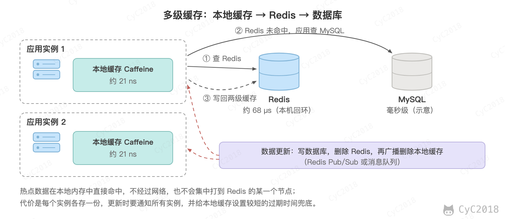
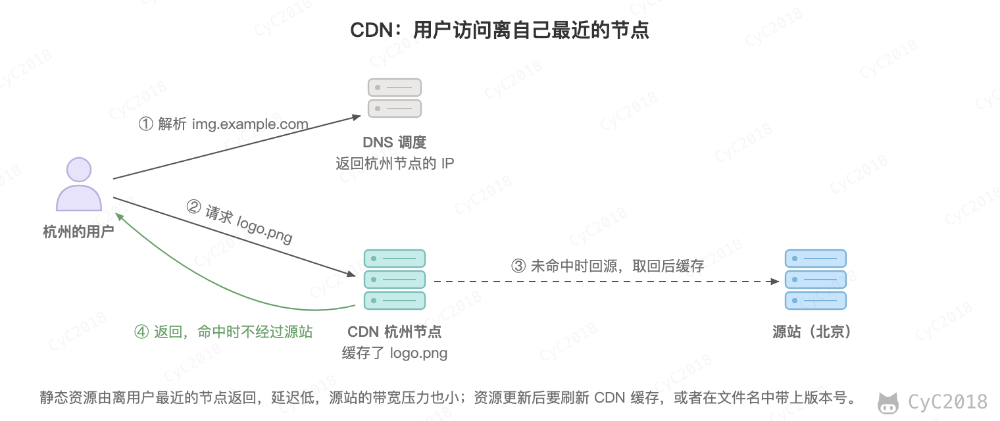
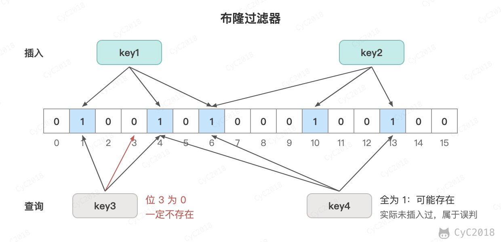
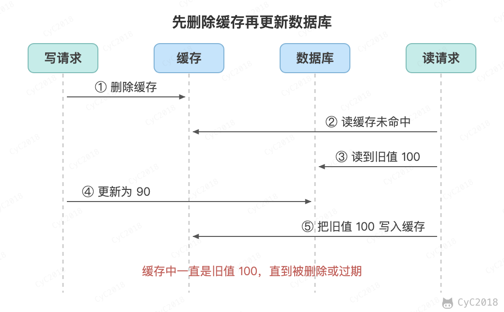
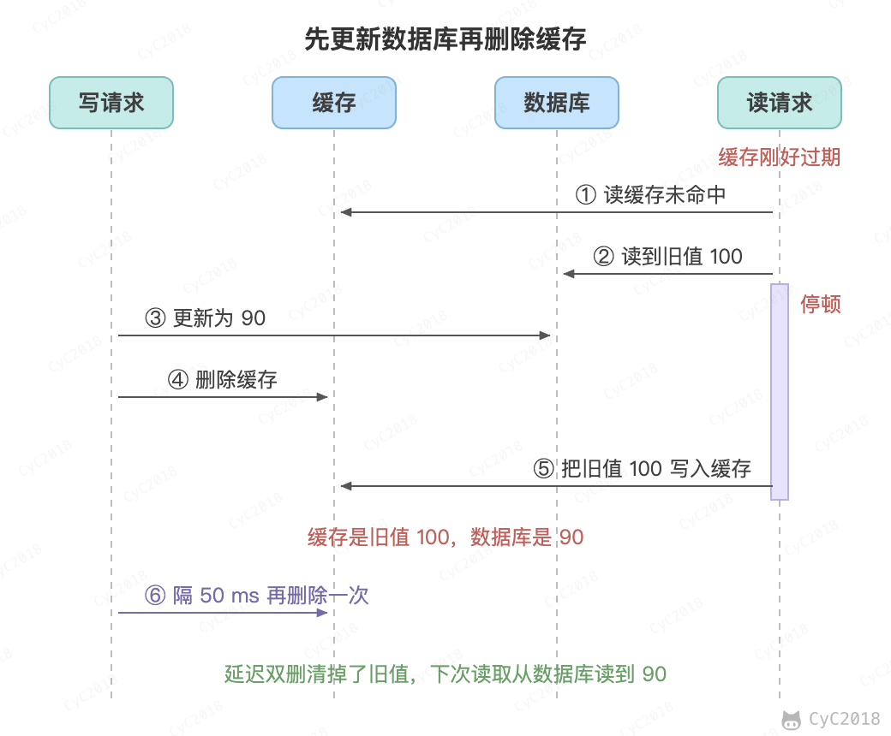
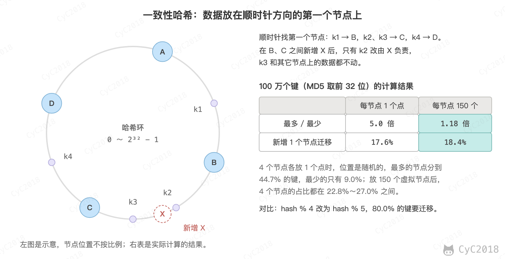
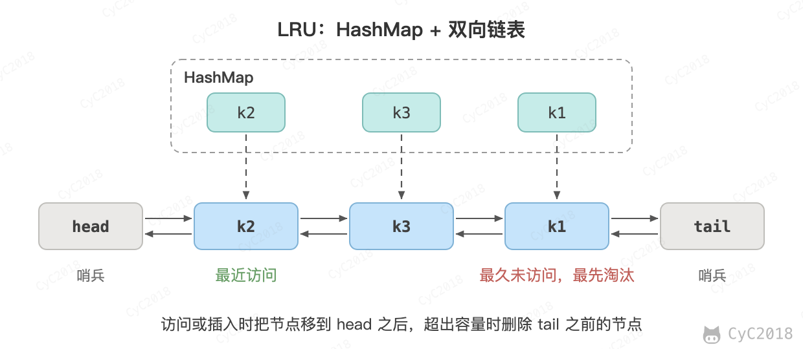

# 缓存
<!-- GFM-TOC -->
* [缓存](#缓存)
    * [一、缓存特征](#一缓存特征)
    * [二、缓存位置](#二缓存位置)
    * [三、CDN](#三cdn)
    * [四、缓存问题](#四缓存问题)
    * [五、数据分布](#五数据分布)
    * [六、一致性哈希](#六一致性哈希)
    * [七、LRU](#七lru)
    * [附录：实测](#附录实测)
    * [参考资料](#参考资料)
<!-- GFM-TOC -->


## 一、缓存特征

### 命中率

当某个请求能够通过访问缓存而得到响应时，称为缓存命中。

命中率指的是命中的请求占全部请求的比例，命中率越高，缓存的利用率也就越高。例如命中率从 90% 提高到 99%，未命中而到达数据库的请求从 10% 降为 1%，数据库的压力降为原来的 1/10。

### 最大空间

缓存通常位于内存中，内存的空间通常比磁盘空间小得多，因此缓存的最大空间不可能非常大。

当缓存存放的数据量超过最大空间时，就需要淘汰部分数据来存放新到达的数据。

### 淘汰策略

- FIFO（First In First Out）：先进先出策略，优先淘汰最早进入缓存的数据。实现简单，但是没有考虑数据的访问情况，命中率较低。

- LRU（Least Recently Used）：最近最久未使用策略，优先淘汰最久未使用的数据，也就是上次被访问时间距离现在最久的数据。该策略尽量把热点数据，也就是经常被访问的数据保留在内存中，从而保证缓存命中率。缺点是偶发的批量访问会把热点数据挤出缓存。

- LFU（Least Frequently Used）：最不经常使用策略，优先淘汰一段时间内使用次数最少的数据。缺点是过去的热点数据即使很久不再访问也难以被淘汰。

除了容量淘汰，缓存通常还会为数据设置过期时间，到期后自动失效。

## 二、缓存位置

### 浏览器

当 HTTP 响应允许进行缓存时，浏览器会将 HTML、CSS、JavaScript、图片等静态资源进行缓存。

### ISP

网络服务提供商（ISP）是网络访问的第一跳，通过将数据缓存在 ISP 中能够大大提高用户的访问速度。

### 反向代理

反向代理位于服务器之前，请求与响应都需要经过反向代理。通过将数据缓存在反向代理，在用户请求反向代理时就可以直接使用缓存进行响应。

### 本地缓存

使用 Guava Cache、Caffeine 等将数据缓存在服务器本地内存中，服务器代码可以直接读取本地内存中的缓存，速度非常快。

### 分布式缓存

使用 Redis、Memcached 等分布式缓存将数据缓存在分布式缓存系统中。

相对于本地缓存来说，分布式缓存单独部署，可以根据需求分配硬件资源。不仅如此，服务器集群都可以访问分布式缓存，而本地缓存需要在服务器集群之间进行同步，实现难度和性能开销上都非常大。

### 多级缓存

多级缓存把本地缓存和分布式缓存组合起来：先查本地缓存，未命中再查 Redis，再未命中才查数据库，并逐级回填。

<div align="center">  </div><br>

Caffeine 读取一次约 21 纳秒；用单个连接逐条向 Redis 发送 GET，每次约 68 微秒，相差三千多倍（JDK 21、Redis 7.4 实测，见[附录 A1](#a1-本地缓存与-redis-的读取耗时)），这还只是本机回环，跨机器访问还要加上网络往返。热点数据放在本地缓存中，既省去了网络开销，也不会让请求集中到存放这个热点键的 Redis 节点上。

本地缓存在每个实例中各存一份，难点在于数据更新后怎样让所有实例失效：

- 更新数据库后删除 Redis 中的键，再通过 Redis 的发布订阅或消息队列广播一条删除消息，各实例收到后删除自己的本地缓存；
- Redis 的发布订阅不保证送达，实例断线期间的消息会丢失，所以本地缓存还要设置较短的过期时间（例如 30 秒）兜底；
- 因此本地缓存只适合读多写少、能接受短暂不一致的数据，例如商品详情、配置；库存、余额这类数据不要放在本地缓存中。

Caffeine 是目前常用的本地缓存库，使用方式如下：

```java
Cache<String, Product> cache = Caffeine.newBuilder()
        .maximumSize(10_000)                         // 最多 1 万个，超出时淘汰
        .expireAfterWrite(Duration.ofSeconds(30))    // 写入 30 秒后过期
        .build();

Product p = cache.get("product:1024", key -> loadFromRedisOrDb(key));
```

它的淘汰算法 W-TinyLFU 同时考虑访问频率和最近访问时间，命中率通常高于 LRU；get 传入的加载函数对同一个键只会执行一次，其它并发的请求等待它的结果，避免缓存未命中时大量请求同时查询下游。

### 数据库缓存

MySQL 等数据库管理系统具有自己的缓存机制来提高查询效率，例如 InnoDB 的 Buffer Pool 将数据页和索引页缓存在内存中。MySQL 的查询缓存因为命中率低、维护开销大，已经在 8.0 版本中被移除。

### Java 内部的缓存

Java 为了优化空间，提高字符串、基本数据类型包装类的创建效率，设计了字符串常量池及 Byte、Short、Character、Integer、Long、Boolean 这六种包装类缓冲池。

### CPU 多级缓存

CPU 为了解决运算速度与主存访问速度不匹配的问题，引入了多级缓存结构，同时使用 MESI 等缓存一致性协议来解决多核 CPU 缓存数据一致性的问题。

## 三、CDN

内容分发网络（Content distribution network，CDN）是一种互连的网络系统，它利用更靠近用户的服务器从而更快更可靠地将 HTML、CSS、JavaScript、音乐、图片、视频等静态资源分发给用户。

用户请求通过 DNS 被调度到最近的 CDN 节点，节点未命中缓存时再回源站获取。

CDN 主要有以下优点：

- 更快地将数据分发给用户；
- 通过部署多台服务器，从而提高系统整体的带宽性能；
- 多台服务器可以看成是一种冗余机制，从而具有高可用性。

<div align="center">  </div><br>

## 四、缓存问题

### 缓存穿透

指的是对某个一定不存在的数据进行请求，该请求将会穿透缓存到达数据库。

解决方案：

- 对这些不存在的数据缓存一个空数据，并设置较短的过期时间；
- 使用布隆过滤器保存所有存在的 Key，对不存在的 Key 的请求直接拒绝。

布隆过滤器用多个哈希函数把 Key 映射到位数组的多个位置并置为 1。查询时只要有一个位置为 0，Key 就一定不存在；全部为 1 时 Key 可能存在，存在一定的误判率。

<div align="center">  </div><br>

### 缓存击穿

指的是某个热点数据的缓存过期时，大量对它的请求同时到达数据库。

解决方案：

- 使用互斥锁，只允许一个请求去数据库加载数据并写回缓存，其它请求等待后直接读缓存；
- 热点数据不设置过期时间，或者由后台线程异步更新。

### 缓存雪崩

指的是由于数据没有被加载到缓存中，或者缓存数据在同一时间大面积失效（过期），又或者缓存服务器宕机，导致大量的请求都到达数据库。

在有缓存的系统中，系统非常依赖于缓存，缓存分担了很大一部分的数据请求。当发生缓存雪崩时，数据库无法处理这么大的请求，导致数据库崩溃。

解决方案：

- 为了防止缓存在同一时间大面积过期导致的缓存雪崩，可以在过期时间上加一个随机值，让过期时间分散开；
- 为了防止缓存服务器宕机出现的缓存雪崩，可以使用分布式缓存，分布式缓存中每一个节点只缓存部分的数据，当某个节点宕机时可以保证其它节点的缓存仍然可用；
- 也可以进行缓存预热，避免在系统刚启动不久由于还未将大量数据进行缓存而导致缓存雪崩；
- 对数据库的访问进行限流，即使缓存失效也不至于压垮数据库。

### 缓存一致性

缓存一致性要求数据更新之后缓存中不能长期保留旧数据。常用的是 Cache Aside 模式：

- 读：先读缓存，未命中则读数据库，并将结果写入缓存；
- 写：先更新数据库，再删除缓存。

删除缓存而不是更新缓存，是因为两个并发的写操作到达缓存的顺序可能和到达数据库的顺序不同，导致缓存中是旧值。先更新数据库再删除缓存，是因为反过来的话，删除缓存之后、更新数据库之前的读请求会把旧值重新写入缓存。

<div align="center">  </div><br>

先更新数据库再删除缓存，仍然有两种情况会留下旧值：

- 删除缓存失败，例如 Redis 超时；
- 缓存刚好过期时，读请求从数据库读到旧值后停顿了一段时间（例如 GC），在它写回缓存之前，写请求更新了数据库并删除了缓存，之后读请求把旧值写入缓存。

<div align="center">  </div><br>

第二种情况要求缓存恰好失效，并且读请求从查询数据库到写回缓存的耗时比写请求更新数据库再删除缓存还长，因此概率很小。

用 8 个读进程不停读取同一个键，写入 1000 次：先删缓存再更新数据库有 980 次留下了旧值，先更新数据库再删缓存为 0 次。让缓存在每次写入前过期、读请求写回缓存前随机停顿 0～5 毫秒之后，先更新数据库再删缓存也有 542 次留下了旧值，加上延迟双删后为 0 次（MySQL 8.0、Redis 7.4 实测，见[附录 A4](#a4-缓存一致性的三种写法)）。

常用的补救措施：

- 为缓存设置过期时间作为兜底；
- 延迟双删：更新数据库并删除缓存之后，隔一段时间再删除一次，清掉慢读请求写回的旧值，间隔要大于读请求从查询数据库到写回缓存的耗时；
- 订阅数据库的 binlog（例如使用 Canal）异步删除缓存，失败时重试，业务代码中不再需要删除缓存；
- 写回缓存时检查期间是否有过删除：Facebook 的 Memcache 在缓存未命中时发给读请求一个租约（lease）令牌，写回时要带上令牌，如果这期间键被删除，令牌就会失效，旧值写不进缓存。

缓存和数据库之间只能做到最终一致，要保证强一致需要付出很大的代价。缓存数据最好是那些对一致性要求不高、能接受短时间读到旧值的数据，余额、库存扣减这类数据应该直接读写数据库。

### 缓存 “无底洞” 现象

指的是为了满足业务要求添加了大量缓存节点，但是性能不但没有好转反而下降了的现象。

产生原因：缓存系统通常采用哈希函数将键映射到对应的缓存节点，随着缓存节点数目的增加，键值分布到更多的节点上，导致客户端一次批量操作会涉及多次网络操作，这意味着批量操作的耗时会随着节点数目的增加而不断增大。此外，网络连接数变多，对节点的性能也有一定影响。

解决方案：

- 按节点分组：客户端先算出每个键所在的节点，同一个节点的键合并成一次 MGET 或者用流水线发送，网络往返次数从键的数量降为节点的数量；
- 并行发送：各节点的请求同时发出，耗时取决于最慢的节点；
- 哈希标签：经常一起读取的键用 {} 放到 Redis Cluster 的同一个槽中，一次请求取回；
- 使用长连接、连接池，减少建立连接的开销。

### 大 Key 与热 Key

大 Key 指的是值很大的键，例如几 MB 的字符串，或者包含几十万个元素的集合；热 Key 指的是访问量远高于其它键的键，例如秒杀商品的库存。

大 Key 的问题：

- 阻塞：Redis 用一个线程执行命令，对大 Key 执行 HGETALL、DEL 这类 O(N) 的命令时，其它命令都要等待。删除一个有 100 万个字段、占用 64 MB 内存的 HASH，DEL 耗时约 345 ms，而 UNLINK 只需几微秒，它在后台线程中释放内存（Redis 7.4 实测，见[附录 A2](#a2-删除大-key)）；
- 网络：一次读写的数据量大，占用带宽；
- 数据倾斜：在集群中，大 Key 所在节点的内存和流量都会高于其它节点。

大 Key 的发现与处理：

- 用 redis-cli --bigkeys 或者 --memkeys 扫描，它们使用 SCAN 命令遍历，不会阻塞服务器；用 MEMORY USAGE 查看单个键占用的内存；
- 拆分：例如把一个大的 HASH 按字段的哈希值拆成 16 个小 HASH，user:1001:fav:0 到 user:1001:fav:15；
- 删除用 UNLINK；读取集合时用 HSCAN、SSCAN 分批读取，不要一次读出所有元素。

热 Key 的问题是请求集中到同一个节点，集群中其它节点再多也无法分担。处理方法：

- 发现：redis-cli --hotkeys，它要求淘汰策略为 LFU；也可以在客户端或者代理中统计访问频率；
- 本地缓存：在应用中缓存热 Key 的值，大部分请求不再访问 Redis，代价是数据会有短暂的不一致，见上文的 [本地缓存](#本地缓存)；
- 复制多份：把同一个值写到 stock#0 到 stock#9 这 10 个键中，读取时随机选一个。这些键分布在不同的槽上，请求就分散到了多个节点，代价是写入时要更新所有副本。

热 Key 过期时大量请求同时打到数据库的问题，见上文的缓存击穿。

## 五、数据分布

### 哈希分布

哈希分布就是将数据计算哈希值之后，按照哈希值分配到不同的节点上。例如有 N 个节点，数据的主键为 key，则将该数据分配的节点序号为：hash(key)%N。

传统的哈希分布算法存在一个问题：当节点数量变化时，也就是 N 值变化，那么几乎所有的数据都需要重新分布，将导致大量的数据迁移。例如节点从 4 个增加到 5 个时，只有 hash(key) % 4 与 hash(key) % 5 相等的键可以留在原节点，约 80% 的键都要迁移（见[附录 A3](#a3-哈希分布与一致性哈希)）。另外哈希打乱了数据的顺序，不能高效地进行范围查询。

### 顺序分布

将数据划分为多个连续的部分，按数据的 ID 或者时间分布到不同节点上。例如 User 表的 ID 范围为 1 \~ 7000，使用顺序分布可以将其划分成多个子表，对应的主键范围为 1 \~ 1000，1001 \~ 2000，...，6001 \~ 7000。

顺序分布相比于哈希分布的主要优点如下：

- 能保持数据原有的顺序；
- 并且能够准确控制每台服务器存储的数据量，从而使得存储空间的利用率最大。

缺点是容易产生热点，例如按时间分布时，写入都集中在最新的节点上。

## 六、一致性哈希

一致性哈希（Consistent Hashing）是一种哈希分布方式，其目的是为了克服传统哈希分布在服务器节点数量变化时大量数据迁移的问题。这里的“一致性”和副本一致性、ACID 一致性没有关系，只是指节点变化时键尽量留在原来的节点上。

### 基本原理

将哈希空间 [0, 2<sup>n</sup>-1] 看成一个哈希环，每个服务器节点都通过哈希配置到哈希环上。每个数据对象通过哈希函数得到哈希值之后，存放到哈希环中顺时针方向第一个大于等于该哈希值的节点上。

一致性哈希在增加或者删除节点时只会影响到哈希环中相邻的节点，例如下图中在 B 和 C 之间新增节点 X，只需要将节点 C 上哈希值位于 B 和 X 之间的数据迁移到 X 上即可，对于节点 A、B、D 都没有影响。同样从 4 个节点增加到 5 个，100 万个键中只有约 18% 需要迁移。

<div align="center">  </div><br>

### 虚拟节点

上面描述的一致性哈希存在数据分布不均匀的问题，节点存储的数据量有可能会存在很大的不同。

数据不均匀主要是因为节点在哈希环上分布的不均匀，这种情况在节点数量很少的情况下尤其明显。例如 4 个节点各在环上放 1 个位置时，100 万个键中最多的节点分到 44.7%，最少的只有 9.0%。

解决方式是通过增加虚拟节点，然后将虚拟节点映射到真实节点上。虚拟节点的数量比真实节点来得多，那么虚拟节点在哈希环上分布的均匀性就会比原来的真实节点好，从而使得数据分布也更加均匀。每个节点放 150 个虚拟节点后，4 个节点的占比在 22.8%～27.0% 之间。

Redis Cluster 使用的不是一致性哈希，而是把 Key 映射到固定的 16384 个哈希槽上，再把哈希槽分配给各个节点，节点变化时只需要迁移对应的哈希槽。

## 七、LRU

以下是基于双向链表和 HashMap 的 LRU 算法实现，对算法的解释如下：

- 访问某个节点时，将其从原来的位置删除，并重新插入到链表头部。这样就能保证链表尾部存储的就是最近最久未使用的节点，当节点数量大于缓存最大空间时就淘汰链表尾部的节点；
- 为了使删除操作时间复杂度为 O(1)，就不能采用遍历的方式找到某个节点。HashMap 存储着 Key 到节点的映射，通过 Key 就能以 O(1) 的时间得到节点，然后再以 O(1) 的时间将其从双向链表中删除。

<div align="center">  </div><br>

Java 的 LinkedHashMap 内部就是这种结构，把 accessOrder 设为 true 并重写 removeEldestEntry 方法，就可以直接得到一个 LRU 缓存。

```java
public class LRU<K, V> implements Iterable<K> {

    private Node head;
    private Node tail;
    private HashMap<K, Node> map;
    private int maxSize;

    private class Node {

        Node pre;
        Node next;
        K k;
        V v;

        public Node(K k, V v) {
            this.k = k;
            this.v = v;
        }
    }


    public LRU(int maxSize) {

        this.maxSize = maxSize;
        this.map = new HashMap<>(maxSize * 4 / 3);

        head = new Node(null, null);
        tail = new Node(null, null);

        head.next = tail;
        tail.pre = head;
    }


    public V get(K key) {

        if (!map.containsKey(key)) {
            return null;
        }

        Node node = map.get(key);
        unlink(node);
        appendHead(node);

        return node.v;
    }


    public void put(K key, V value) {

        if (map.containsKey(key)) {
            Node node = map.get(key);
            unlink(node);
        }

        Node node = new Node(key, value);
        map.put(key, node);
        appendHead(node);

        if (map.size() > maxSize) {
            Node toRemove = removeTail();
            map.remove(toRemove.k);
        }
    }


    private void unlink(Node node) {

        Node pre = node.pre;
        Node next = node.next;

        pre.next = next;
        next.pre = pre;

        node.pre = null;
        node.next = null;
    }


    private void appendHead(Node node) {
        Node next = head.next;
        node.next = next;
        next.pre = node;
        node.pre = head;
        head.next = node;
    }


    private Node removeTail() {

        Node node = tail.pre;

        Node pre = node.pre;
        tail.pre = pre;
        pre.next = tail;

        node.pre = null;
        node.next = null;

        return node;
    }


    @Override
    public Iterator<K> iterator() {

        return new Iterator<K>() {
            private Node cur = head.next;

            @Override
            public boolean hasNext() {
                return cur != tail;
            }

            @Override
            public K next() {
                Node node = cur;
                cur = cur.next;
                return node.k;
            }
        };
    }
}
```

## 附录：实测

以下实验的环境均为 Apple M1 Pro（10 核）、macOS，Redis 7.4.1 使用默认配置，客户端和服务器在同一台机器上。

### A1 本地缓存与 Redis 的读取耗时

Caffeine 3.1.8，JDK 21。缓存中放入 1000 个键，每轮执行 1000 万次 getIfPresent，前几轮用于 JIT 预热：

```java
Cache<String, String> cache = Caffeine.newBuilder()
        .maximumSize(10_000)
        .expireAfterWrite(Duration.ofSeconds(30))
        .build();
for (int i = 0; i < 1000; i++) cache.put("product:" + i, "{\"id\":" + i + ",\"price\":99}");
for (int r = 0; r < 5; r++) {
    long t0 = System.nanoTime();
    for (int i = 0; i < 10_000_000; i++) sink += cache.getIfPresent(keys[i % 1000]).length();
    System.out.printf("round %d: %.1f ns/get%n", r, (System.nanoTime() - t0) / 1e7);
}
```

Redis 用一个连接逐条发送 10 万次 GET：

```bash
redis-benchmark -c 1 -n 100000 -t get -q
```

```text
round 0: 22.5 ns/get
round 1: 21.1 ns/get
round 2: 20.7 ns/get
round 3: 20.7 ns/get
round 4: 20.7 ns/get
GET: 14626.30 requests per second, p50=0.063 msec
```

每秒 14626 次，平均每次约 68 微秒。

### A2 删除大 Key

用流水线向 user:1001:fav 写入 100 万个字段，分别用 DEL 和 UNLINK 删除，执行前设置 CONFIG SET slowlog-log-slower-than 0，从 SLOWLOG 读取服务器的执行时间：

```text
> HLEN user:1001:fav
1000000
> MEMORY USAGE user:1001:fav
64388720
> DEL user:1001:fav
1
SLOWLOG: 345637 微秒 DEL
（重新写入 100 万个字段）
> UNLINK user:1001:fav
1
SLOWLOG: 8 微秒 UNLINK
```

### A3 哈希分布与一致性哈希

100 万个键 user:0～user:999999，哈希值取 MD5 的前 4 个字节，哈希环的范围为 [0, 2<sup>32</sup>-1]。节点 A～E 在环上的位置为节点名的哈希值，虚拟节点为 A#0～A#149 这样的名字的哈希值，键存放在顺时针方向第一个大于等于它的位置对应的节点上：

```python
def h(s):
    return int.from_bytes(hashlib.md5(s.encode()).digest()[:4], "big")

keys = [h(f"user:{i}") for i in range(1_000_000)]
moved = sum(1 for k in keys if k % 4 != k % 5)

def ring(nodes, vnodes):
    pts = sorted((h(f"{n}#{v}" if vnodes > 1 else n), n) for n in nodes for v in range(vnodes))
    return [p for p, _ in pts], [n for _, n in pts]

def owner(r, k):
    pos, names = r
    i = bisect.bisect_left(pos, k)
    return names[i % len(names)]
```

```text
取模：4 个节点增加到 5 个，迁移 80.0% 的键
一致性哈希，每个节点 1 个位置：4 个节点的占比 A 44.7%、B 11.6%、C 9.0%、D 34.6%；增加节点 E 后迁移 17.6% 的键
一致性哈希，每个节点 150 个位置：4 个节点的占比 A 27.0%、B 26.1%、C 24.1%、D 22.8%；增加节点 E 后迁移 18.4% 的键
```

### A4 缓存一致性的三种写法

MySQL 8.0.44，Redis 7.4.1，Python 3.13（pymysql、redis-py）。表中只有一行价格，8 个读进程不停读取：缓存未命中时查询数据库并写回缓存。写入方每次把价格加 1，按三种写法之一处理缓存，延迟双删的间隔为 50 毫秒；每次写入后等在途的读请求结束，检查缓存中是否留下了旧值，留下则计数并删除：

```python
def reader(flag):
    while not flag.value:
        if r.get(KEY) is None:
            c.execute('select price from cache_demo where id = 1')
            v = c.fetchone()[0]
            if READ_DELAY:
                time.sleep(random.uniform(0, READ_DELAY))
            r.set(KEY, v)

# 写入方，第 i 次写入
if EXPIRE:
    r.delete(KEY)                                    # 模拟缓存刚好过期
if strategy == 'delete-then-update':
    r.delete(KEY); c.execute('update cache_demo set price = %s where id = 1', (i,))
else:
    c.execute('update cache_demo set price = %s where id = 1', (i,)); r.delete(KEY)
    if strategy == 'update-then-delete + double delete':
        time.sleep(0.05); r.delete(KEY)
```

```text
ROUNDS=1000 READ_DELAY=0ms EXPIRE=0 readers=8 (processes)
delete-then-update                   stale 980/1000 (98.0%)
update-then-delete                   stale 0/1000 (0.0%)
update-then-delete + double delete   stale 0/1000 (0.0%)

ROUNDS=1000 READ_DELAY=0ms EXPIRE=1 readers=8 (processes)
delete-then-update                   stale 983/1000 (98.3%)
update-then-delete                   stale 0/1000 (0.0%)
update-then-delete + double delete   stale 0/1000 (0.0%)

ROUNDS=1000 READ_DELAY=5ms EXPIRE=1 readers=8 (processes)
delete-then-update                   stale 1000/1000 (100.0%)
update-then-delete                   stale 542/1000 (54.2%)
update-then-delete + double delete   stale 0/1000 (0.0%)
```

## 参考资料

- 杨传辉. 大规模分布式存储系统：原理解析与架构实战 [M]. 机械工业出版社, 2013.
- [Designing Data-Intensive Applications 中文版](https://github.com/vonng/ddia)
- [缓存那些事](https://tech.meituan.com/cache_about.html)
- [一致性哈希算法](https://my.oschina.net/jayhu/blog/732849)
- [内容分发网络](https://zh.wikipedia.org/wiki/%E5%85%A7%E5%AE%B9%E5%82%B3%E9%81%9E%E7%B6%B2%E8%B7%AF)
- [How Aspiration CDN helps to improve your website loading speed?](https://www.aspirationhosting.com/aspiration-cdn/)
- [Redis: UNLINK](https://redis.io/docs/latest/commands/unlink/)
- [Redis CLI](https://redis.io/docs/latest/develop/tools/cli/)
- [Scaling Memcache at Facebook](https://www.usenix.org/system/files/conference/nsdi13/nsdi13-final170_update.pdf)
- [Caffeine Wiki](https://github.com/ben-manes/caffeine/wiki)
- [Consistent Hashing and Random Trees: Distributed Caching Protocols for Relieving Hot Spots on the World Wide Web](https://dl.acm.org/doi/10.1145/258533.258660)
