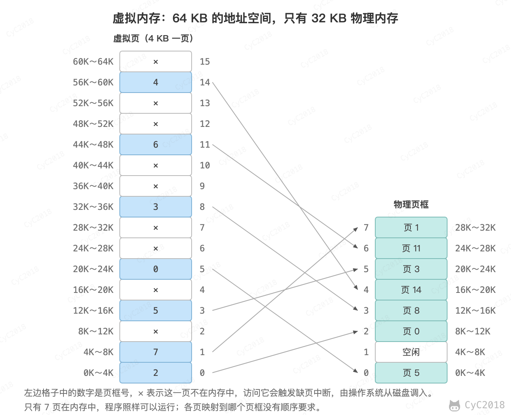
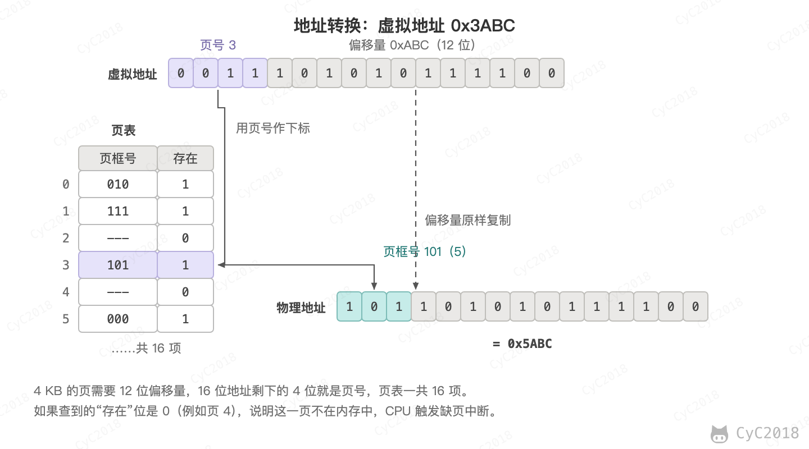
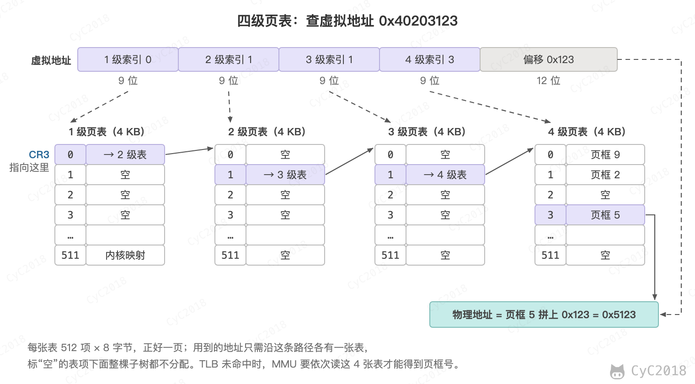
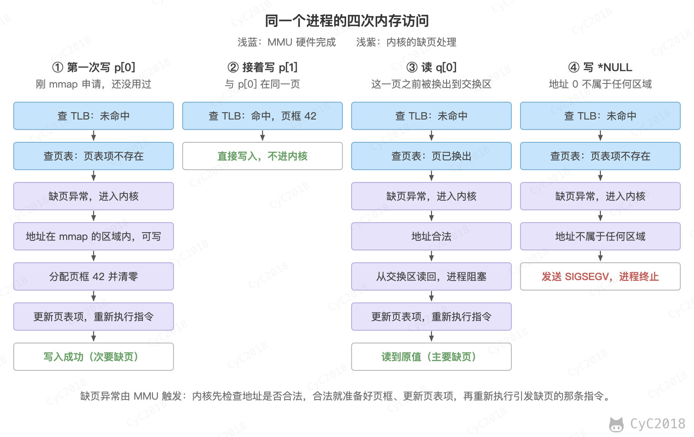
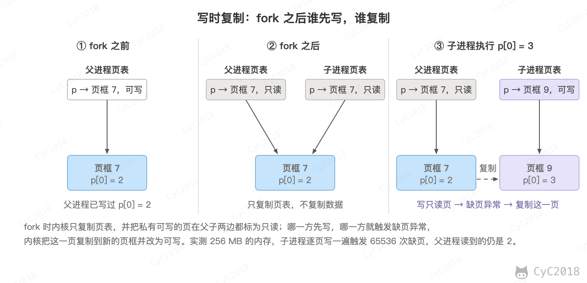
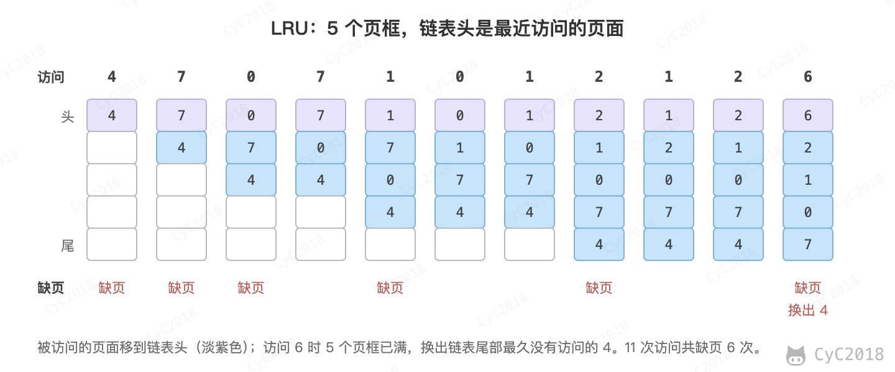
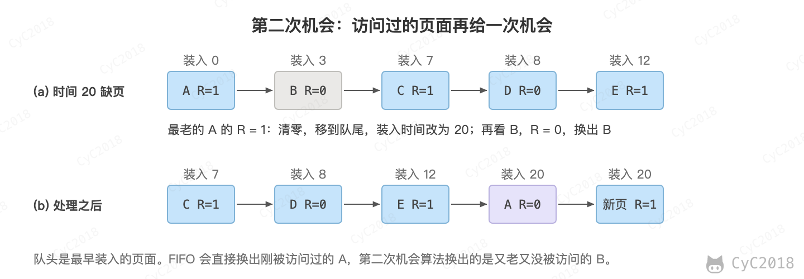
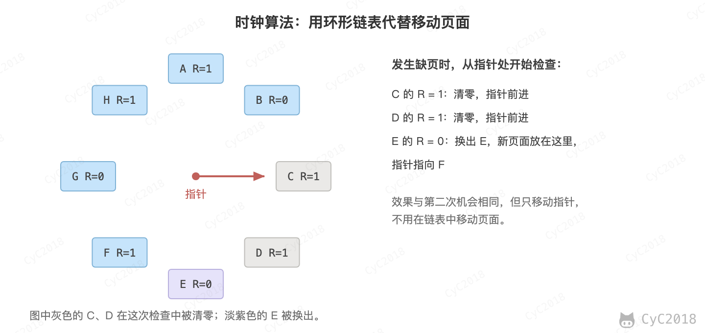
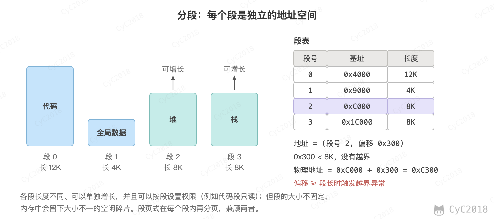
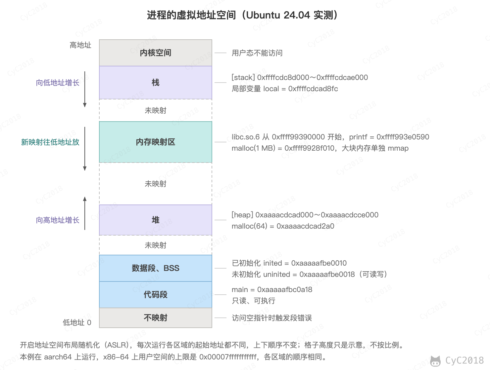

# 计算机操作系统 - 内存管理
<!-- GFM-TOC -->
* [计算机操作系统 - 内存管理](#计算机操作系统---内存管理)
    * [虚拟内存](#虚拟内存) 🔥🔥
    * [分页系统地址映射](#分页系统地址映射)
    * [页面置换算法](#页面置换算法)
        * [1. 最佳](#1-最佳)
        * [2. 最近最久未使用](#2-最近最久未使用)
        * [3. 最近未使用](#3-最近未使用)
        * [4. 先进先出](#4-先进先出)
        * [5. 第二次机会算法](#5-第二次机会算法)
        * [6. 时钟](#6-时钟)
    * [分段](#分段)
    * [段页式](#段页式)
    * [分页与分段的比较](#分页与分段的比较)
    * [附录：实测](#附录实测)
        * [A1 页面置换模拟](#a1-页面置换模拟)
        * [A2 缺页次数](#a2-缺页次数)
        * [A3 进程的地址空间布局](#a3-进程的地址空间布局)
        * [A4 页表占用的内存](#a4-页表占用的内存)
        * [A5 申请超过物理内存](#a5-申请超过物理内存)
    * [参考资料](#参考资料)
<!-- GFM-TOC -->


## 虚拟内存 🔥🔥

虚拟内存指的是让每个进程看到一个独立、连续的地址空间，程序中使用的都是虚拟地址，访问内存时由硬件和操作系统翻译成物理地址。它主要解决了以下问题：

- 扩充内存：只有用到的部分才需要放在物理内存中，暂时不用的可以换出到磁盘，程序可以比物理内存大；
- 隔离和保护：每个进程都有独立的地址空间，一个进程无法直接访问另一个进程的内存，操作系统还可以按页设置读写和执行权限；
- 简化内存管理：每个程序都按相同的地址布局链接和加载，不用关心物理内存中哪些位置空闲，分到的物理内存也不必连续；
- 共享：不同进程的虚拟页可以映射到同一块物理内存，例如共享库的代码、fork 之后写时复制的页。

实现上，操作系统把每个进程的地址空间划分成固定大小的页，物理内存按同样的大小划分成页框，再由页表记录每一页放在哪个页框中。页不必放在连续的页框中，也不必都在物理内存中：访问到不在内存中的页时，硬件触发[缺页异常](#分页系统地址映射)，操作系统把这一页装入内存，再重新执行那条指令。

因此程序不需要全部调入内存就能运行。例如一台计算机产生 16 位地址，程序的地址空间是 0\~64 KB，物理内存却只有 32 KB，借助虚拟内存仍然可以运行一个 64 KB 的程序，内存中只放当前用到的页。

地址空间的大小由虚拟地址的位数决定：32 位系统是 2^32 = 4 GB，Linux 默认用户态 3 GB、内核 1 GB；x86-64 目前使用 48 位虚拟地址，共 256 TB，用户态和内核各约 128 TB，开启 5 级页表后用户态扩大到 64 PB。

<div align="center">  </div><br>

## 分页系统地址映射

内存管理单元（Memory Management Unit, MMU）是 CPU 中负责把虚拟地址翻译成物理地址的硬件，翻译的依据是操作系统为每个进程维护的页表（Page Table），页表记录了每一页（虚拟地址空间）对应哪个页框（物理内存）。

一个虚拟地址分成两个部分，一部分存储页面号，一部分存储偏移量。

下图的页表存放着 16 个页，这 16 个页需要用 4 个比特位来进行索引定位。例如对于虚拟地址 0x3ABC（0011 101010111100），前 4 位是页面号 3，读取表项内容为（101 1），页表项最后一位表示是否存在于内存中，1 表示存在。后 12 位是偏移量，直接拼接到页框号 101 后面，得到物理地址 0x5ABC（101 101010111100）。

<div align="center">  </div><br>

页表存放在内存中，每次访问内存之前都要先查一次页表。CPU 中的快表（Translation Lookaside Buffer, TLB）缓存最近用过的页表项，命中时不用再访问页表。

64 位系统的地址空间很大，如果用一张页表覆盖全部地址，页表本身就会非常大：48 位地址、4 KB 的页共有 2^36 个页，每个页表项 8 字节，一张单级页表要 512 GB，而且每个进程一张。因此使用多级页表，只为用到的地址分配下一级页表。例如 x86-64 通常使用 4 级页表，48 位虚拟地址分为 4 个 9 位的页表索引和 12 位的页内偏移。

4 级页表中每张表正好占一页（512 项 × 8 字节），某一级的表项为空，它下面的整棵子树都不用分配。例如一个刚启动的小程序，页表只占 44 KB；mmap 256 MB 并逐页写入后，新增的 65536 个页表项占 512 KB，页表共 556 KB（Ubuntu 24.04 实测，见[附录 A4](#a4-页表占用的内存)）。

<div align="center">  </div><br>

多级页表的代价是 TLB 未命中时要依次访问 4 级页表，所以 TLB 的命中率对性能很重要，使用 2 MB 的大页时，同样多的 TLB 表项可以覆盖更多内存。

MMU 查页表时发现页不在内存中，或者这次访问违反了页的权限（例如写只读页），就会触发缺页异常（Page Fault，也常称为缺页中断），由操作系统处理：

1. 保存现场，取得引发缺页的虚拟地址；
2. 检查地址是否合法，地址不属于进程的任何区域，或者违反了区域本身的权限（例如写代码段）时，向进程发送 SIGSEGV 信号，也就是常见的段错误；区域允许写、只是页表项暂时标为只读的（写时复制），属于正常的缺页，继续处理；
3. 按页的来源准备页框：第一次访问的堆、栈等匿名页分配一个页框并清零；代码和 mmap 映射的文件页先在页缓存中找，找到就直接映射，找不到才分配页框并读磁盘；换出到交换区的页从交换区读回；fork 之后写共享的页时复制一份（写时复制）；
4. 需要页框而内存不足时，先用页面置换算法换出一页，被修改过的页要先写回磁盘；
5. 更新页表项，回到用户态重新执行引发缺页的那条指令。

需要读磁盘的缺页称为主要缺页（Major Fault），进程要阻塞到 I/O 完成，期间 CPU 去运行其它进程；不需要 I/O 的称为次要缺页（Minor Fault），只需分配、清零或复制页框并修改页表。缺页异常属于异常，在执行某条指令的过程中同步产生，处理完后重新执行这条指令；外部中断由设备异步产生，处理完后继续执行下一条指令，见[中断分类](计算机操作系统%20-%20概述.md#中断分类)。

<div align="center">  </div><br>

例如用 mmap 申请 256 MB 的匿名内存后，进程的常驻内存（RSS）几乎不变；逐页写入一遍，触发 65536 次次要缺页（256 MB / 4 KB），RSS 增加到 257 MB，再写一遍就不再缺页（Ubuntu 24.04 实测，见[附录 A2](#a2-缺页次数)）。这说明申请内存只是分配了虚拟地址，真正用到时才占用物理内存。

因此 top 中进程的 VIRT（VmSize）远大于 RES（VmRSS）通常是正常的：申请了还没写的内存、线程栈中还没用到的部分、映射了但没读到的文件都只占虚拟地址；需要关注的是 RES 是否持续增长。

所以申请比物理内存还大的内存也可能成功，结果取决于 vm.overcommit_memory：默认值 0 用启发式规则拒绝明显过大的申请，即一次申请超过物理内存与交换区的总和；1 总是允许；2 不允许所有进程申请的总量超过交换区加上一定比例（默认 50%）的物理内存。申请成功不代表能用完，例如在内存上限为 512 MB 的容器中（overcommit_memory 为 1），malloc 1024 GB 也会成功，但逐 MB 写入 2 GB 时，写到 384 MB 之后不久进程就被内核的 OOM Killer 杀死，退出码 137（实测，见[附录 A5](#a5-申请超过物理内存)）。

fork 也靠缺页异常推迟复制，这称为写时复制（Copy-on-Write, COW）：fork 时内核只复制页表，并把私有可写的页在父子两边都标为只读，哪一方先写，哪一方就触发缺页，内核把这一页复制到新的页框并改为可写，没被写过的页一直共享。接着上面的例子，fork 出的子进程把 256 MB 再写一遍，又触发 65536 次缺页，父进程中的值不受影响；换成父进程先写，同样触发约 65536 次缺页（见[附录 A2](#a2-缺页次数)）。

<div align="center">  </div><br>

## 页面置换算法

缺页时如果内存已经没有空闲的页框，操作系统就要选一页换出：被修改过的页先写回磁盘（交换区或映射的文件），没修改过的页在磁盘上已有相同的内容，直接丢弃，以后用到时再读回。

页面置换算法决定换出哪一页，目标是让缺页率最低。这与缓存的淘汰策略是同一个问题，内存相当于磁盘的缓存。

### 1. 最佳

最佳置换算法（Optimal replacement algorithm, OPT）所选择的被换出的页面将是最长时间内不再被访问，可以保证获得最低的缺页率。它需要知道将来的访问顺序，所以无法实现，只用来衡量其它算法。

举例：一个系统为某进程分配了三个物理块，并有如下页面引用序列：

```text
7，0，1，2，0，3，0，4，2，3，0，3，2，1，2，0，1，7，0，1
```

开始运行时，先将 7、0、1 三个页面装入内存。当进程要访问页面 2 时发生缺页，会将页面 7 换出，因为页面 7 再次被访问的时间最长。按这个规则走完整个序列共缺页 9 次；同样的序列和 3 个物理块，LRU 缺页 12 次，FIFO 缺页 15 次（逐步模拟，见[附录 A1](#a1-页面置换模拟)）。

### 2. 最近最久未使用

最近最久未使用（Least Recently Used, LRU）：虽然无法知道将来要使用的页面情况，但是可以知道过去使用页面的情况。LRU 将最近最久未使用的页面换出。

为了实现 LRU，需要在内存中维护一个所有页面的链表。当一个页面被访问时，将这个页面移到链表表头。这样就能保证链表表尾的页面是最近最久未访问的。

因为每次访问内存都要更新链表，这种实现的代价很高，通用的硬件也不提供支持，实际的系统用页表项中的访问位（R 位）来近似 LRU，例如下面的 NRU 和时钟算法。

例如有 5 个页框，访问序列如下：

```text
4，7，0，7，1，0，1，2，1，2，6
```

<div align="center">  </div><br>

### 3. 最近未使用

最近未使用（Not Recently Used, NRU）算法中，每个页面都有两个状态位：R 与 M，当页面被访问时设置页面的 R=1，当页面被修改时设置 M=1。其中 R 位会定时被清零。可以将页面分成以下四类：

- 第 0 类：R=0，M=0；
- 第 1 类：R=0，M=1；
- 第 2 类：R=1，M=0；
- 第 3 类：R=1，M=1。

缺页时，NRU 算法随机地从类编号最小的非空类中挑选一个页面将它换出。

因此最近没被访问的脏页（第 1 类）比最近访问过的干净页（第 2 类）先被换出。这是因为最近是否被访问更能说明之后还会不会用到，换出脏页只是多写一次磁盘。

### 4. 先进先出

先进先出（First In First Out, FIFO）算法选择换出的页面是最先进入的页面。

该算法会将那些经常被访问的页面换出，导致缺页率升高。例如 OPT 一节的序列，FIFO 缺页 15 次，比 LRU 多 3 次。

### 5. 第二次机会算法

FIFO 算法可能会把经常使用的页面置换出去，为了避免这一问题，对该算法做一个简单的修改：

当页面被访问（读或写）时设置该页面的 R 位为 1。需要替换的时候，检查最老页面的 R 位。如果 R 位是 0，那么这个页面既老又没有被使用，可以立刻置换掉；如果是 1，就将 R 位清 0，并把该页面放到链表的尾端，修改它的装入时间使它就像刚装入的一样，然后继续从链表的头部开始搜索。

<div align="center">  </div><br>

### 6. 时钟

第二次机会算法需要在链表中移动页面，降低了效率。时钟（Clock）算法使用环形链表将页面连接起来，再使用一个指针指向最老的页面。缺页时检查指针指向的页面：R 位为 0 就换出它；R 位为 1 就清 0，指针前进一格继续检查。效果与第二次机会算法相同，但不需要移动页面。

<div align="center">  </div><br>

## 分段

前面介绍的虚拟内存采用的是分页技术，也就是将地址空间划分成固定大小的页，每一页再与内存进行映射。

例如一个程序有代码、全局数据、堆和栈几部分，其中堆和栈会动态增长。如果放在一维的地址空间中，就要预先给每一部分留出位置，某一部分增长到相邻部分的位置时就会发生覆盖。

分段的做法是把每一部分作为一个段，一个段构成一个独立的地址空间。每个段的长度可以不同，并且可以动态增长。地址由段号和段内偏移组成，通过段表找到段的基址，再加上偏移得到物理地址。

<div align="center">  </div><br>

## 段页式

程序的地址空间划分成多个拥有独立地址空间的段，每个段上的地址空间划分成大小相同的页。这样既能按逻辑上的段来组织地址空间、按段设置共享和保护，每个段又不必占用连续的物理内存。

地址由段号、段内页号和页内偏移三部分组成：先用段号查段表，找到这个段的页表，再用段内页号查页表得到页框号，拼上页内偏移就是物理地址。

## 分页与分段的比较

- 对程序员的透明性：分页透明，但是分段需要程序员显式划分每个段；
- 地址空间的维度：分页是一维地址空间，分段是二维的；
- 大小是否可以改变：页的大小不可变，段的大小可以动态改变；
- 碎片：分页不会产生外部碎片，但每个段或区域的最后一页通常用不满，形成内部碎片；分段按需分配大小不一的连续内存，段释放后会留下大小不一的空闲块，形成外部碎片；
- 出现的原因：分页主要用于实现虚拟内存，从而获得更大的地址空间；分段主要是为了使程序和数据可以被划分为逻辑上独立的地址空间并且有助于共享和保护。

需要注意的是，x86-64 的 64 位模式下分段基本不再使用，代码段、数据段的基址都按 0 处理（FS、GS 除外，用于线程局部存储），Linux 等系统只用分页来管理内存。

虽然不用分段，Linux 仍然把进程的地址空间划分成代码、数据、堆、栈等区域，每个区域是一段连续的虚拟地址，区域之间的大片空白不分配页框。下图是 Ubuntu 上一个小程序打印出的各部分地址（实测，见[附录 A3](#a3-进程的地址空间布局)）：

<div align="center">  </div><br>

- 代码段、数据段和 BSS 在低地址，大小在程序加载时就确定了，BSS 存放未初始化的全局变量，加载时清零；
- 堆从低地址向高地址增长，malloc 申请小块内存时通过 brk 扩大堆，大块内存（glibc 的阈值初始为 128 KB）改用 mmap 单独映射；
- 栈从高地址向低地址增长，Ubuntu 默认最大 8 MB（ulimit -s）；这是主线程的栈，其它线程的栈在内存映射区中单独分配，大小在创建线程时指定，例如 JVM 用 -Xss 设置，见 [Java 虚拟机栈](Java%20虚拟机.md#java-虚拟机栈)；
- 共享库、mmap 映射的文件和大块内存放在堆和栈之间的内存映射区。

## 附录：实测

### A1 页面置换模拟

用 Python 逐步模拟 3 个物理块下的页面置换，引用序列为 OPT 一节中的例子。Clock 的结果与新装入页面的 R 位取 0 还是 1、指针从哪里开始有关，这里装入时置 1：

```text
引用序列 [7, 0, 1, 2, 0, 3, 0, 4, 2, 3, 0, 3, 2, 1, 2, 0, 1, 7, 0, 1] 物理块 3
OPT   缺页 9 次
LRU   缺页 12 次
FIFO  缺页 15 次
Clock 缺页 14 次
```

### A2 缺页次数

Docker Desktop 中的 Ubuntu 24.04 容器（Apple M1 Pro，aarch64，内核 6.10.14-linuxkit，页大小 4 KB），gcc 13.3。用 mmap 申请 256 MB 匿名内存，用 getrusage 的 ru_minflt、ru_majflt 统计缺页次数，从 /proc/self/status 读 VmRSS：

```c
char *p = mmap(NULL, size, PROT_READ | PROT_WRITE, MAP_PRIVATE | MAP_ANONYMOUS, -1, 0);
madvise(p, size, MADV_NOHUGEPAGE);
for (size_t i = 0; i < size; i += page) p[i] = 1;   // 逐页写入
for (size_t i = 0; i < size; i += page) p[i] = 2;   // 再写一遍
if (fork() == 0) {
    for (size_t i = 0; i < size; i += page) p[i] = 3;   // 子进程写入，触发写时复制
    _exit(0);
}
```

```text
页大小 4096 字节，共 65536 页，MADV_NOHUGEPAGE
mmap 之后：  次要缺页 +0，RSS 1 MB
逐页写入后：次要缺页 +65536，主要缺页 0，RSS 257 MB
再写一遍：  次要缺页 +0
子进程逐页写入（写时复制）：次要缺页 +65536
父进程中的值仍为 2
```

换成子进程只读、父进程在 fork 之后先写：

```c
pid_t c = fork();
if (c == 0) { sleep(2); printf("子进程读到 p[0]=%d\n", p[0]); _exit(0); }
for (size_t i = 0; i < size; i += page) p[i] = 3;   // 父进程先写
for (size_t i = 0; i < size; i += page) p[i] = 4;   // 再写一遍
```

```text
子进程读到 p[0]=2
fork 后父进程写一遍：次要缺页 +65537
父进程再写一遍：次要缺页 +0
```

父进程的两行在退出时才从缓冲区输出，所以排在子进程之后。

容器所在虚拟机的透明大页设置为 always，不调用 madvise 时内核用 2 MB 的大页映射，逐页写入只触发 128 次缺页（256 MB / 2 MB）；Ubuntu 默认的设置是 madvise，不主动申请时使用 4 KB 的页，与上面的结果一致。

### A3 进程的地址空间布局

同一个容器，gcc 13.3 编译（默认生成位置无关的可执行文件），开启地址空间布局随机化，打印各部分的地址和 /proc/self/maps（节选）：

```c
int inited = 1024;        // 数据段
int uninited;             // BSS
int main(void) {
    int local = 0;                     // 栈
    char *small = malloc(64);          // 堆
    char *big = malloc(1 << 20);       // 超过 mmap 阈值，单独映射
    printf("代码 main     %p\n", (void *)main);
    // ……依次打印 &inited、&uninited、small、big、printf、&local，再输出 /proc/self/maps
}
```

```text
代码 main     0xaaaaafbc0a18
数据 inited   0xaaaaafbe0010
BSS  uninited 0xaaaaafbe0018
堆   small    0xaaaacdcad2a0
映射 big      0xffff9928f010
共享库 printf 0xffff993e0590
栈   local    0xffffcdcad8fc
aaaaafbc0000-aaaaafbc1000 r-xp 00000000 00:40 841313      /tmp/layout
aaaaafbe0000-aaaaafbe1000 rw-p 00010000 00:40 841313      /tmp/layout
aaaacdcad000-aaaacdcce000 rw-p 00000000 00:00 0           [heap]
ffff9928f000-ffff99390000 rw-p 00000000 00:00 0
ffff99390000-ffff9952a000 r-xp 00000000 00:40 831743      /usr/lib/aarch64-linux-gnu/libc.so.6
ffffcdc8d000-ffffcdcae000 rw-p 00000000 00:00 0           [stack]
$ ulimit -s
8192
```

再运行一次，各区域的起始地址都变了（例如 main 为 0xaaaabc070a18、local 为 0xffffd6a9311c），上下顺序不变。

### A4 页表占用的内存

同一个容器（aarch64 内核同样使用 4 KB 的页和 4 级页表），从 /proc/self/status 读 VmSize（虚拟内存大小）、VmRSS 和 VmPTE（页表占用的内存）：

```c
show("启动后");
char *p = mmap(NULL, size, PROT_READ | PROT_WRITE, MAP_PRIVATE | MAP_ANONYMOUS, -1, 0);   // 256 MB
madvise(p, size, MADV_NOHUGEPAGE);
show("mmap 256 MB 后");
for (size_t i = 0; i < size; i += page) p[i] = 1;
show("逐页写入后");
```

```text
启动后          VmSize:    2252 kB
启动后          VmRSS:     1056 kB
启动后          VmPTE:       44 kB
mmap 256 MB 后  VmSize:  264396 kB
mmap 256 MB 后  VmRSS:     1184 kB
mmap 256 MB 后  VmPTE:       44 kB
逐页写入后      VmSize:  264396 kB
逐页写入后      VmRSS:   263328 kB
逐页写入后      VmPTE:      556 kB
```

### A5 申请超过物理内存

同一个容器，启动时限制内存为 512 MB 且不使用交换区（docker run --memory=512m --memory-swap=512m）。Docker Desktop 的虚拟机中 vm.overcommit_memory 为 1，与 Ubuntu 默认的 0 不同，这个设置不能在容器中修改，因此没有实测模式 0。程序依次 malloc 4 GB、16 GB 和 1024 GB，再 malloc 2 GB 并逐 MB 写入，每 128 MB 打印一次 RSS：

```text
vm.overcommit_memory = 1
               total        used        free      shared  buff/cache   available
Mem:            7837         545        6490           0         965        7292
Swap:           1023           0        1023
malloc(   4 GB) 成功，RSS 3 MB
malloc(  16 GB) 成功，RSS 3 MB
malloc(1024 GB) 成功，RSS 3 MB
已写入 128 MB，RSS 131 MB
已写入 256 MB，RSS 259 MB
已写入 384 MB，RSS 387 MB
Killed
退出码 137
```

模式 0 的规则见 Linux 6.10 的 mm/util.c：__vm_enough_memory 中 OVERCOMMIT_GUESS 分支只在一次申请的页数超过 totalram_pages() + total_swap_pages 时返回失败。

## 参考资料

- Tanenbaum A S, Bos H. Modern Operating Systems [M]. Pearson, 2014.
- Silberschatz A, Galvin P B, Gagne G. Operating System Concepts [M]. Wiley, 2018.
- [Page Tables — The Linux Kernel documentation](https://docs.kernel.org/mm/page_tables.html)
- [getrusage(2) — Linux manual page](https://man7.org/linux/man-pages/man2/getrusage.2.html)
- [proc_pid_maps(5) — Linux manual page](https://man7.org/linux/man-pages/man5/proc_pid_maps.5.html)
- [mallopt(3) — Linux manual page](https://man7.org/linux/man-pages/man3/mallopt.3.html)
- [Overcommit Accounting — The Linux Kernel documentation](https://docs.kernel.org/mm/overcommit-accounting.html)
- [proc_pid_status(5) — Linux manual page](https://man7.org/linux/man-pages/man5/proc_pid_status.5.html)
