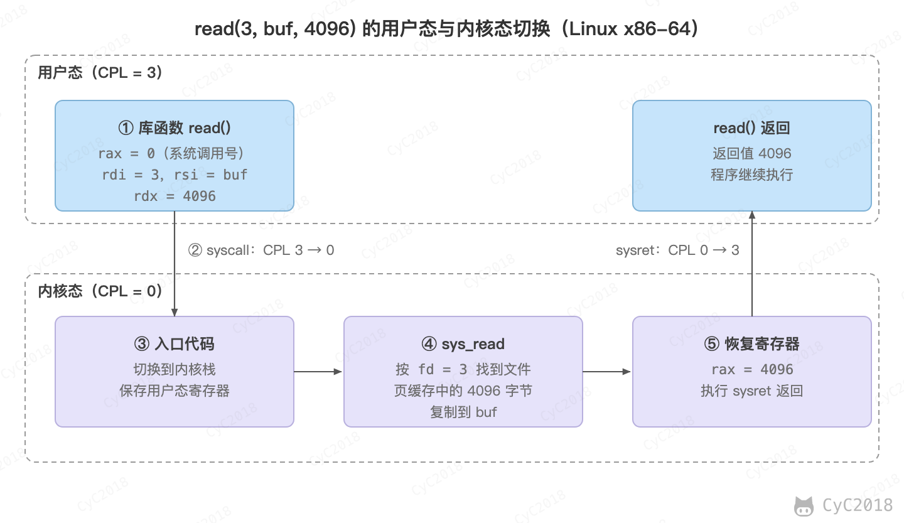
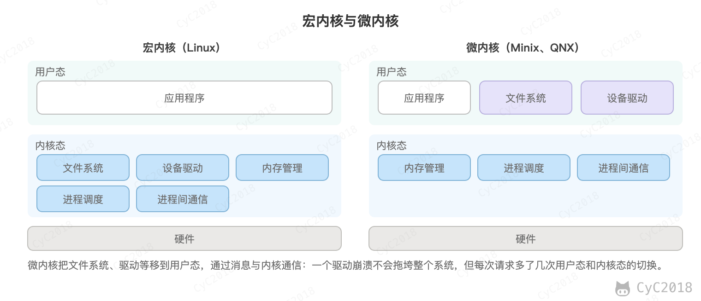

# 计算机操作系统 - 概述
<!-- GFM-TOC -->
* [计算机操作系统 - 概述](#计算机操作系统---概述)
    * [基本特征](#基本特征)
        * [1. 并发](#1-并发)
        * [2. 共享](#2-共享)
        * [3. 虚拟](#3-虚拟)
        * [4. 异步](#4-异步)
    * [基本功能](#基本功能)
        * [1. 进程管理](#1-进程管理)
        * [2. 内存管理](#2-内存管理)
        * [3. 文件管理](#3-文件管理)
        * [4. 设备管理](#4-设备管理)
    * [系统调用](#系统调用) 🔥
    * [宏内核和微内核](#宏内核和微内核)
        * [1. 宏内核](#1-宏内核)
        * [2. 微内核](#2-微内核)
    * [中断分类](#中断分类)
        * [1. 外中断](#1-外中断)
        * [2. 异常](#2-异常)
        * [3. 陷入](#3-陷入)
    * [附录：实测](#附录实测)
        * [A1 普通函数调用与系统调用的耗时](#a1-普通函数调用与系统调用的耗时)
    * [参考资料](#参考资料)
<!-- GFM-TOC -->


## 基本特征

### 1. 并发

并发是指宏观上在一段时间内能同时运行多个程序，而并行则指同一时刻能运行多个指令。

并行需要硬件支持，如多流水线、多核处理器或者分布式计算系统。

操作系统通过引入进程和线程，使得程序能够并发运行。

### 2. 共享

共享是指系统中的资源可以被多个并发进程共同使用。

有两种共享方式：互斥共享和同时共享。

互斥共享的资源称为临界资源，例如打印机等，在同一时刻只允许一个进程访问，需要用同步机制来实现互斥访问。

### 3. 虚拟

虚拟技术把一个物理实体转换为多个逻辑实体。

主要有两种虚拟技术：时（时间）分复用技术和空（空间）分复用技术。

多个进程能在同一个处理器上并发执行使用了时分复用技术，让每个进程轮流占用处理器，每次只执行一小个时间片并快速切换。

虚拟内存使用了空分复用技术，它将物理内存抽象为地址空间，每个进程都有各自的地址空间。地址空间的页被映射到物理内存，地址空间的页并不需要全部在物理内存中，当使用到一个没有在物理内存的页时，产生缺页中断，把该页调入内存；内存已满时，还要用页面置换算法选择一页换出。

### 4. 异步

异步指进程不是一次性执行完毕，而是走走停停，以不可知的速度向前推进。

## 基本功能

### 1. 进程管理

进程控制、进程同步、进程通信、死锁处理、处理机调度等。

### 2. 内存管理

内存分配、地址映射、内存保护与共享、虚拟内存等。

### 3. 文件管理

文件存储空间的管理、目录管理、文件读写管理和保护等。

### 4. 设备管理

完成用户的 I/O 请求，方便用户使用各种设备，并提高设备的利用率。

主要包括缓冲管理、设备分配、设备处理、虚拟设备等。

## 系统调用 🔥

CPU 通过特权级（privilege level）限制程序能做的事。x86 上用当前特权级（Current Privilege Level, CPL）表示，取值为 0～3，数字越小权限越高。操作系统内核运行在 0 级，称为内核态（kernel mode）；应用程序运行在 3 级，称为用户态（user mode）。

划分两种状态是为了保护内核和其它进程。如果应用程序能随意修改页表基址寄存器 CR3，就能访问其它进程的内存；如果能直接操作磁盘和网卡，就绕过了文件系统和网络协议栈的管理。因此修改 CR3、加载 GDT 等特权指令只能在 CPL 为 0 时执行，用户程序执行时会产生通用保护异常（General Protection Exception, #GP）。

应用程序需要内核完成的工作，例如读写文件、创建进程、收发网络数据，只能通过系统调用（system call）请求内核。系统调用是用户态进入内核态的受控入口：陷入时跳转的地址由内核预先设定（x86-64 上由内核写入 IA32_LSTAR 寄存器），程序不能指定跳转的地址，否则就能跳到内核的任意位置。

Linux 的系统调用主要有以下这些：

| 类别 | 系统调用 |
| :---: | --- |
| 进程控制 | fork(); exit(); wait(); |
| 进程通信 | pipe(); shmget(); mmap(); |
| 文件操作 | open(); read(); write(); |
| 设备操作 | ioctl(); read(); write(); |
| 信息维护 | getpid(); alarm(); nanosleep(); |
| 安全 | chmod(); umask(); chown(); |

以 `read(3, buf, 4096)` 为例（Linux x86-64，见下图）：读取文件描述符 3 指向的文件，最多 4096 字节放入用户缓冲区 buf。整个过程分为以下几步：

1. C 库的 read() 把系统调用号放入 rax（read 在 x86-64 上的编号为 0），把参数放入 rdi、rsi、rdx；
2. 执行 syscall 指令，CPU 切换到特权级 0，把下一条指令的地址存入 rcx，把 RFLAGS 存入 r11，然后跳转到内核入口；这条指令不保存栈指针 RSP；
3. 入口代码切换到当前进程的内核栈，把用户态的 RIP、RSP、RFLAGS 和其它寄存器保存到内核栈上，再调用 do_syscall_64，按编号查系统调用表，找到 sys_read；
4. sys_read 按 fd = 3 找到打开的文件，页缓存中有数据时，把 4096 字节复制到 buf，返回值为 4096；
5. 内核恢复寄存器，执行 sysret，CPU 回到特权级 3，从 rcx 保存的地址继续执行，C 库把 rax 中的 4096 作为 read() 的返回值交给调用者。

第 4 步中，内核不直接使用用户传入的指针，而是通过 copy_to_user 等函数访问用户缓冲区，这些函数会先检查地址。

<div align="center">  </div><br>

切换时需要保存的是返回地址、标志寄存器和用户栈指针，以及内核要使用的通用寄存器；返回时必须原样恢复，程序才能从原来的位置继续执行。x86-64 上 syscall 指令只把 RIP 和 RFLAGS 放入 rcx、r11，RSP 和其它寄存器由入口代码保存。

进入内核态有三种途径：程序主动执行的系统调用（陷入），指令执行时引起的异常（例如缺页），以及来自 CPU 外部的外中断，见[中断分类](#中断分类)。异常和外中断返回时使用 iret，系统调用返回时使用 sysret。

陷入和返回本身需要的时间并不少。在 Linux 上实测（arm64，见[附录 A1](#a1-普通函数调用与系统调用的耗时)），一次普通函数调用约 1 ns，glibc 的 getppid() 约 167 ns，直接执行陷入指令约 165 ns，一次系统调用约为普通函数调用的 170 倍。getppid 在内核中的工作很少，测得的时间基本就是进入和退出内核的代价。具体数字与 CPU 和内核配置有关，x86-64 上启用 PTI 时会更高。

开销由以下几部分组成：

- 特权级切换，以及寄存器的保存和恢复；
- 内核入口和出口的额外工作，例如启用页表隔离（Page Table Isolation, PTI，用于缓解 Meltdown 攻击）时，每次进入和退出内核都要写 CR3，内核文档给出的量级是百余个周期；
- 内核执行的工作本身，例如参数检查、查找文件、复制数据。

需要注意的是，陷入内核不等于切换进程：系统调用执行完通常回到同一个线程，不一定发生上下文切换，见[进程管理](计算机操作系统%20-%20进程管理.md#4-上下文切换)。

减少系统调用开销的做法主要有以下几种：

- 批量处理：writev 一次系统调用写入多个缓冲区（writev(2)）；
- 在用户态完成：vDSO（virtual dynamic shared object）是内核自动映射到每个进程中的一小段共享代码，在支持的时钟源上，clock_gettime 等调用不再陷入内核（vdso(7)），实测经 vDSO 约 18 ns，绕过 vDSO 直接陷入约 202 ns；
- 内存映射：mmap 把文件映射到用户地址空间，之后直接读写内存，不需要每次调用 read() 和 write()，但缺页时仍会陷入内核（内存映射文件见 [Java IO](Java%20IO.md#内存映射文件)）。

排查系统调用的开销时，可以用 strace -c 统计各系统调用的次数，用 strace -T 查看每次调用的耗时（strace(1)）。

写文件也要经过陷入。例如 `write(fd, buf, 4096)` 陷入内核后，内核把 buf 的内容复制到页缓存（page cache，内存中的文件缓存）并标记为脏页，然后返回 4096。此时数据未必已经写到磁盘，磁盘写入由内核之后异步完成，或由 fsync() 强制完成。write(2) 的手册明确说明，成功返回并不保证数据已经提交到磁盘。

零拷贝（zero-copy）减少的是数据在用户空间和内核空间之间的复制。sendfile 在内核中把文件内容直接送到 socket，既不经过用户缓冲区，也把 read() 和 write() 两次调用合并为一次（sendfile(2)），Kafka 的 broker 发送消息就是这样做的，见[消息队列](消息队列.md#为什么吞吐量高)。

## 宏内核和微内核

### 1. 宏内核

宏内核是将操作系统功能作为一个紧密结合的整体放到内核。

由于各模块共享信息，因此有很高的性能。

### 2. 微内核

由于操作系统不断复杂，因此将一部分操作系统功能移出内核，从而降低内核的复杂性。移出的部分根据分层的原则划分成若干服务，相互独立。

在微内核结构下，操作系统被划分成小的、定义良好的模块，只有微内核这一个模块运行在内核态，其余模块运行在用户态。

因为需要频繁地在用户态和内核态之间进行切换，所以会有一定的性能损失。

<div align="center">  </div><br>

## 中断分类

进入内核态的事件按引起的原因分为外中断、异常和陷入三类。外中断和异常通过中断描述符表（Interrupt Descriptor Table, IDT）找到处理程序，特权级切换时，硬件把旧的 SS、RSP、RFLAGS、CS、RIP 压入内核栈（Intel SDM Vol. 3A 第 7 章）。系统调用则由 syscall 指令直接跳转，不经过 IDT。

### 1. 外中断

外中断（external interrupt）由 CPU 外部的事件引起，与当前执行的指令无关，因此是异步的。例如磁盘完成 I/O 后发出 I/O 完成中断，表示设备的输入输出已经完成，处理器可以发送下一个 I/O 请求；时钟中断周期性地到来，是时间片轮转的基础。外中断经由 CPU 引脚或本地 APIC（Advanced Programmable Interrupt Controller）送达。

### 2. 异常

异常（exception）由正在执行的指令引起，是同步的，指令执行到哪里，异常就在哪里发生。例如访问未映射的地址会触发缺页异常（page fault），内核分配物理页后，同一条指令可以重新执行（见[虚拟内存](计算机操作系统 - 内存管理.md#虚拟内存)）；执行除法指令时除数为 0，会触发除法错误（#DE）；遇到非法操作码会触发 #UD。

需要注意的是，x86 上整数加法溢出只设置标志位，不会产生异常，因此这里用除数为 0 作例子。

### 3. 陷入

陷入（trap）由程序主动执行的指令引起，同样是同步的。系统调用就是通过陷入实现的：x86-64 上是 syscall 指令，arm64 上是 svc 指令（syscalls(2)）。

Intel 手册中的 trap 指异常在指令执行之后报告，例如 INT3、INTO；syscall 不属于 IDT 中的异常，因此两者的含义并不完全相同。

## 附录：实测

### A1 普通函数调用与系统调用的耗时

环境：Docker Desktop 的 Linux 虚拟机，Ubuntu 24.04 容器，内核 6.10.14-linuxkit（aarch64，宿主为 Apple M1 Pro），gcc 13.3.0，编译选项 -O2。arm64 上 getppid 的系统调用号为 173，陷入指令为 svc #0。核心代码如下：

```c
static __attribute__((noinline)) long add1(long x) { return x + 1; }

static long raw_getppid(void) {
    register long x8 asm("x8") = SYS_getppid;   /* 系统调用号放在 x8 */
    register long x0 asm("x0");                 /* 返回值在 x0 */
    asm volatile("svc #0" : "=r"(x0) : "r"(x8) : "memory", "cc");
    return x0;
}

/* 每种方式循环 10^7 次，clock_gettime(CLOCK_MONOTONIC) 计时，7 轮取中位数 */
for (long i = 0; i < n; i++) x = add1(x);                                   /* function_call */
for (long i = 0; i < n; i++) acc += getppid();                              /* getppid_libc */
for (long i = 0; i < n; i++) acc += raw_getppid();                          /* svc_raw_getppid */
for (long i = 0; i < n; i++) clock_gettime(CLOCK_MONOTONIC, &ts);           /* clock_gettime_vdso */
for (long i = 0; i < n; i++) syscall(SYS_clock_gettime, CLOCK_MONOTONIC, &ts);  /* clock_gettime_syscall */
```

原始输出（三次独立运行，单位为每次调用的纳秒数）：

```text
run  function_call  getppid_libc  svc_raw_getppid  clock_gettime_vdso  clock_gettime_syscall
1    0.94           167.44        165.26           18.01               201.36
2    0.94           167.24        165.26           17.94               201.85
3    0.95           167.81        165.21           17.94               202.94
```

反汇编显示循环体调用的是 add1（bl add1），直接陷入的路径中是 mov x8, #0xad 和 svc #0x0。glibc 的 getppid 与直接 svc 只相差约 2 ns，说明主要开销在陷入本身，而不是库函数的包装。

## 参考资料

- Tanenbaum A S, Bos H. Modern Operating Systems [M]. Pearson, 2014.
- Silberschatz A, Galvin P B, Gagne G. Operating System Concepts [M]. Wiley, 2018.
- Arpaci-Dusseau R H, Arpaci-Dusseau A C. Operating Systems: Three Easy Pieces [M]. Arpaci-Dusseau Books, 2018. 第 6 章 Mechanism: Limited Direct Execution（[在线版](https://pages.cs.wisc.edu/~remzi/OSTEP/)）。
- Intel. Intel® 64 and IA-32 Architectures Software Developer's Manual, Volume 2B（SYSCALL、SYSRET）和 Volume 3A（第 6、7 章）[M]. Intel, 2026（[SDM 下载页](https://www.intel.com/content/www/us/en/developer/articles/technical/intel-sdm.html)）。
- [syscalls(2)](https://man7.org/linux/man-pages/man2/syscalls.2.html)、[syscall(2)](https://man7.org/linux/man-pages/man2/syscall.2.html)、[write(2)](https://man7.org/linux/man-pages/man2/write.2.html)、[writev(2)](https://man7.org/linux/man-pages/man2/writev.2.html)、[sendfile(2)](https://man7.org/linux/man-pages/man2/sendfile.2.html)、[vdso(7)](https://man7.org/linux/man-pages/man7/vdso.7.html)、[strace(1)](https://man7.org/linux/man-pages/man1/strace.1.html)。
- Linux 内核源码：[syscall_64.tbl](https://github.com/torvalds/linux/blob/master/arch/x86/entry/syscalls/syscall_64.tbl)、[entry_64.S](https://github.com/torvalds/linux/blob/master/arch/x86/entry/entry_64.S)、[uaccess.h](https://github.com/torvalds/linux/blob/master/include/linux/uaccess.h)、[Page Table Isolation (PTI)](https://github.com/torvalds/linux/blob/master/Documentation/arch/x86/pti.rst)。
