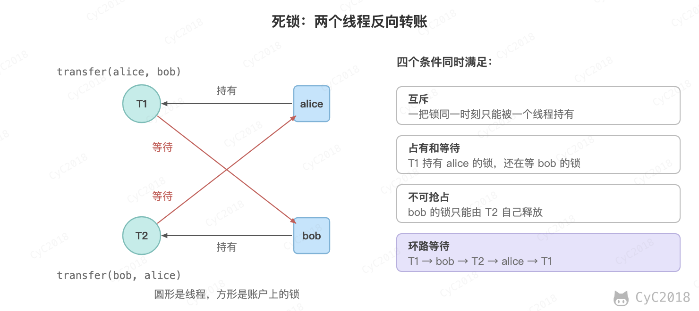
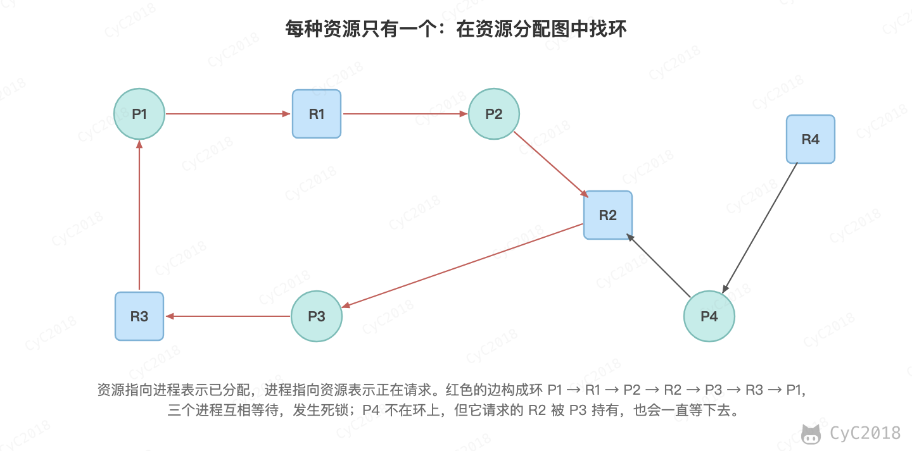
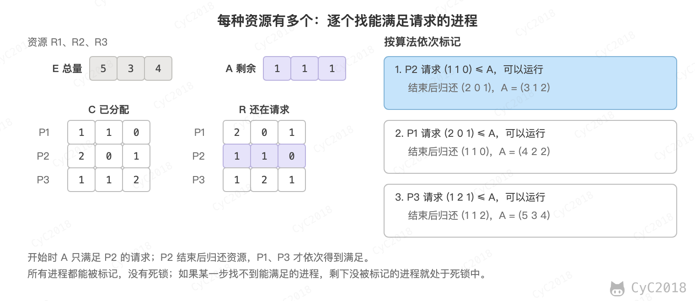

# 计算机操作系统 - 死锁
<!-- GFM-TOC -->
* [计算机操作系统 - 死锁](#计算机操作系统---死锁)
    * [必要条件](#必要条件) 🔥🔥
    * [处理方法](#处理方法)
    * [鸵鸟策略](#鸵鸟策略)
    * [死锁检测与死锁恢复](#死锁检测与死锁恢复)
        * [1. 每种类型一个资源的死锁检测](#1-每种类型一个资源的死锁检测)
        * [2. 每种类型多个资源的死锁检测](#2-每种类型多个资源的死锁检测)
        * [3. 死锁恢复](#3-死锁恢复)
    * [死锁预防](#死锁预防)
        * [1. 破坏互斥条件](#1-破坏互斥条件)
        * [2. 破坏占有和等待条件](#2-破坏占有和等待条件)
        * [3. 破坏不可抢占条件](#3-破坏不可抢占条件)
        * [4. 破坏环路等待](#4-破坏环路等待)
    * [死锁避免](#死锁避免)
        * [1. 安全状态](#1-安全状态)
        * [2. 单个资源的银行家算法](#2-单个资源的银行家算法)
        * [3. 多个资源的银行家算法](#3-多个资源的银行家算法)
    * [程序中的死锁](#程序中的死锁)
        * [1. Java 线程死锁](#1-java-线程死锁)
        * [2. MySQL 死锁](#2-mysql-死锁)
    * [附录：实测](#附录实测)
        * [A1 Java 线程死锁](#a1-java-线程死锁)
        * [A2 MySQL 死锁](#a2-mysql-死锁)
        * [A3 先查后插的间隙锁死锁](#a3-先查后插的间隙锁死锁)
        * [A4 死锁线程的状态与 CPU 时间](#a4-死锁线程的状态与-cpu-时间)
        * [A5 单个线程重复加锁](#a5-单个线程重复加锁)
    * [参考资料](#参考资料)
<!-- GFM-TOC -->


## 必要条件 🔥🔥

死锁指的是一组进程中的每个进程都在等待只有组内其它进程才能释放的资源，结果谁都无法继续执行，也不会自己结束。例如下图中 T1 持有 alice 等待 bob，T2 持有 bob 等待 alice。

<div align="center">  </div><br>

只有以下四个条件同时成立时才会发生死锁：

- 互斥：每个资源要么已经分配给了一个进程，要么就是可用的；
- 占有和等待：已经得到了某个资源的进程可以再请求新的资源；
- 不可抢占：已经分配给一个进程的资源不能强制性地被抢占，它只能被占有它的进程显式地释放；
- 环路等待：有两个或者两个以上的进程组成一条环路，该环路中的每个进程都在等待下一个进程所占有的资源。

占有和等待说的是单个进程的行为，环路等待说的是进程之间的等待关系。例如 T1 持有 alice 后请求 T2 持有的 bob，如果 T2 不再请求别的锁，用完就会释放 bob，T1 只是多等一会儿；只有等待关系连成环（例如 T2 反过来等 alice），才是死锁。

## 处理方法

主要有以下四种方法：

- 鸵鸟策略
- 死锁检测与死锁恢复
- 死锁预防
- 死锁避免

死锁预防在设计时破坏某个必要条件，死锁避免在运行时每次分配前检查是否安全。平时说的“避免死锁”多指预防的做法，例如固定加锁顺序、加锁时设置超时，见[程序中的死锁](#程序中的死锁)。

## 鸵鸟策略

鸵鸟策略指的是假装死锁不会发生，不采取任何措施。死锁发生的概率很低、发生后影响不大时，处理死锁的代价比死锁本身更高，不处理反而性能更好。

大多数操作系统，包括 Unix、Linux 和 Windows，处理死锁问题的办法仅仅是忽略它。

## 死锁检测与死锁恢复

不试图阻止死锁，而是当检测到死锁发生时，采取措施进行恢复。

### 1. 每种类型一个资源的死锁检测

<div align="center">  </div><br>

上图为资源分配图，其中方框表示资源，圆圈表示进程。资源指向进程表示该资源已经分配给该进程，进程指向资源表示进程请求获取该资源。

图中 P1、P2、P3 和 R1、R2、R3 构成一个环，满足环路等待条件，因此发生了死锁。

每种类型一个资源的死锁检测算法是通过检测有向图是否存在环来实现：从每个节点出发进行深度优先搜索，记录当前搜索路径上的节点，如果沿着边又走回了路径上的节点，就找到了环，也就是检测到死锁。需要注意的是，走到之前搜索过、但不在当前路径上的节点并不表示有环，例如 P1、P2 都在请求 R1 时，从两者出发都会走到 R1。

### 2. 每种类型多个资源的死锁检测

<div align="center">  </div><br>

上图中，有三个进程三种资源，每个数据代表的含义如下：

- E 向量：资源总量；
- A 向量：资源剩余量；
- C 矩阵：每个进程所拥有的资源数量，每一行都代表一个进程拥有资源的数量；
- R 矩阵：每个进程请求的资源数量。

进程 P<sub>1</sub> 和 P<sub>3</sub> 所请求的资源都得不到满足，只有进程 P<sub>2</sub> 可以，让 P<sub>2</sub> 执行，之后释放 P<sub>2</sub> 拥有的资源，此时 A = (3 1 2)。P<sub>1</sub> 可以执行，执行后释放 P<sub>1</sub> 拥有的资源，A = (4 2 2)。P<sub>3</sub> 也可以执行。所有进程都可以顺利执行，没有死锁。

算法总结如下：

每个进程最开始时都不被标记，执行过程有可能被标记。当算法结束时，任何没有被标记的进程都是死锁进程。

1. 寻找一个没有标记的进程 P<sub>i</sub>，它所请求的资源小于等于 A；
2. 如果找到了这样一个进程，那么将 C 矩阵的第 i 行向量加到 A 中，标记该进程，并转回 1；
3. 如果没有这样一个进程，算法终止。

### 3. 死锁恢复

- 利用抢占恢复：把资源从持有它的进程手中临时拿走交给另一个进程，能否做到取决于资源的性质；
- 利用回滚恢复：进程定期保存检查点，检测到死锁时回滚到获得该资源之前的检查点；
- 通过杀死进程恢复：杀死环中的一个或多个进程以释放资源，InnoDB 回滚其中一个事务也属于这一类，见 [MySQL 死锁](#2-mysql-死锁)。

## 死锁预防

在程序运行之前预防发生死锁：四个必要条件缺一不可，设计时破坏其中任意一个，死锁就不可能发生。各种方法的代价不同，实际开发中最常用的是破坏环路等待。

### 1. 破坏互斥条件

例如假脱机打印机技术允许若干个进程同时输出，唯一真正请求物理打印机的进程是打印机守护进程。但锁这类资源存在的意义就是互斥，大多数情况下这个条件无法破坏。

### 2. 破坏占有和等待条件

一种实现方式是规定所有进程在开始执行前请求所需要的全部资源。代价是资源被提前占用、利用率低，而且很多程序事先并不知道需要哪些资源。

### 3. 破坏不可抢占条件

已经占有资源的进程请求新资源得不到满足时，必须释放已经占有的资源，之后需要时再重新申请。

分布式锁设置过期时间也是破坏这个条件：持有锁的进程崩溃后不会释放锁，到期后锁自动失效，相当于被强制收回。代价是业务还没执行完锁就可能过期，被另一个客户端拿到，因此还需要续期，见 [分布式锁](分布式.md#redis-的-set-nx-指令)。

### 4. 破坏环路等待

给资源统一编号，进程只能按编号顺序来请求资源。这样所有进程都是从小编号往大编号等待，不可能形成环。它的代价最小，只要求每个加锁的地方遵守同一个顺序，例子见 [Java 线程死锁](#1-java-线程死锁) 和 [MySQL 死锁](#2-mysql-死锁)。

## 死锁避免

在程序运行时避免发生死锁。死锁避免不限制资源的请求方式，而是在每次分配前判断分配之后系统是否仍处于安全状态，不安全就让请求者等待。它要求事先知道每个进程最多需要多少资源，通用的操作系统和应用程序很难满足，因此主要见于教材和特定的资源分配系统。

### 1. 安全状态

如果没有死锁发生，并且即使所有进程突然请求对资源的最大需求，也仍然存在某种调度次序能够使得每一个进程运行完毕，则称该状态是安全的。

<div align="center">  </div><br>

图中条形的长度表示进程总共需要的资源数（Max），浅蓝部分表示已拥有的资源数（Has），Free 表示还可以使用的资源数。从图 a 开始出发，先让 B 拥有所需的所有资源，运行结束后释放 B，此时 Free 变为 6（图 b）；接着以同样的方式运行 A 和 C，使得所有进程都能成功运行，因此可以称图 a 所示的状态是安全的。

需要注意的是，不安全状态不等于死锁：进程不一定真的会请求到最大需求，只是系统已经无法保证所有进程都能完成。判断方法与[每种类型多个资源的死锁检测](#2-每种类型多个资源的死锁检测)相同，只是把当前请求换成最多还需要的数量。

### 2. 单个资源的银行家算法

银行家算法把系统比作银行：每个客户（进程）事先声明最多借多少（Max），银行家每次放款前先假设批准，检查之后是否仍安全，安全才放款，否则让客户等待。

<div align="center">  </div><br>

上图 b 为不安全状态，因此算法会拒绝 C 的这次申请，从而避免进入图 b 中的状态；图 c 仍然是安全的，可以分配。

### 3. 多个资源的银行家算法

<div align="center">  </div><br>

上图中有四个进程，三种资源。Allocation 表示已经分配的资源，Need 表示还需要分配的资源。E 和 Available 分别表示总资源和可用资源，它们都是向量，而不是具体数值，例如 Available = (1 1 2) 表示 3 种资源分别还剩下 1、1、2 个。

检查一个状态是否安全的算法如下：

- 查找 Need 矩阵中是否存在一行小于等于向量 Available。如果不存在这样的行，那么系统可能发生死锁，状态是不安全的；
- 假若找到这样一行，将该进程标记为终止，并将其已分配资源加到 Available 中；
- 重复以上两步，直到所有进程都标记为终止，则状态是安全的。

多个资源时，银行家算法同样先假设分配，再用这个方法检查分配后的状态，不安全就拒绝。

## 程序中的死锁

### 1. Java 线程死锁

两个线程反向转账时，T1 锁住 alice 再请求 bob，T2 锁住 bob 再请求 alice，就是开头图中的情况：

```java
static void transfer(Account from, Account to, int amount) {
    synchronized (from) {
        synchronized (to) {
            from.balance -= amount;
            to.balance += amount;
        }
    }
}
```

用 jstack 查看进程的线程栈，末尾会直接报告死锁（省略了部分内容）：

```text
Found one Java-level deadlock:
=============================
"T1":
  waiting to lock monitor 0x0000000135f26a70 (object 0x000000061fc14e18, a Transfer$Account),
  which is held by "T2"

"T2":
  waiting to lock monitor 0x0000000125f06e60 (object 0x000000061fc14dd0, a Transfer$Account),
  which is held by "T1"
```

解决方法是破坏环路等待：所有线程按同一个顺序加锁，例如总是先锁 id 小的账户。

```java
Account first = from.id < to.id ? from : to;
Account second = from.id < to.id ? to : from;
synchronized (first) {
    synchronized (second) {
        from.balance -= amount;
        to.balance += amount;
    }
}
```

两个线程各反向转账 10 万次，原来的写法每次运行都会卡住，按 id 顺序加锁后都能完成，两个账户的余额仍为 1000（JDK 21 实测，见[附录 A1](#a1-java-线程死锁)）。使用 ReentrantLock 时还可以用 tryLock 设置超时，拿不到锁就释放已持有的锁再重试，破坏的是[不可抢占条件](#3-破坏不可抢占条件)。例如获取第二把锁等待 10 ms 仍失败时释放第一把锁，随机等待 1～4 ms 后重试，同样的两个线程在 30～60 ms 内完成（见[附录 A4](#a4-死锁线程的状态与-cpu-时间)）。等待时间要随机，否则两个线程可能总是同时释放、同时重试，谁都拿不到两把锁，这称为活锁。

需要注意的是，用阻塞式的锁时，死锁的线程处于阻塞状态，并不消耗 CPU；用自旋锁形成的死锁则会一直占用 CPU。上例卡住后，两个线程的状态都是 BLOCKED，之后 3 秒内各自消耗的 CPU 时间都不到 0.1 ms（JDK 21 实测，见[附录 A4](#a4-死锁线程的状态与-cpu-时间)）。因此 CPU 占用很高时应先按 [CPU 占用过高](Java%20虚拟机.md#cpu-占用过高)排查死循环、频繁 GC 等问题；CPU 很低、请求却全部卡住，线程都停在加锁的地方，才更像死锁，用 jstack 或 jcmd 的 Thread.print 命令打印线程栈确认。JVM 不会像 InnoDB 那样选一个线程回滚，卡在 synchronized 上的线程也无法被中断，通常只能重启进程，因此要靠固定加锁顺序或 tryLock 提前预防。程序中也可以定时调用 ThreadMXBean 的 findDeadlockedThreads() 检测死锁并告警，但它检测不到包含虚拟线程的死锁环。

一个线程持有锁后再次申请同一把锁，等的是只有自己才会释放的锁，也会卡死，称为自死锁（self-deadlock）。synchronized 和 ReentrantLock 是可重入锁，同一线程再次加锁只把计数加 1；不可重入的锁会卡住，例如许可数为 1 的 Semaphore，同一线程连续 acquire 两次后一直处于 WAITING，findDeadlockedThreads() 也检不出来（JDK 21 实测，见[附录 A5](#a5-单个线程重复加锁)）。

### 2. MySQL 死锁

事务按不同的顺序更新同一组行时也会死锁。例如两个事务同时反向转账，事务 1 先更新 id = 1，事务 2 先更新 id = 2，之后各自更新对方已经锁住的行（按编号顺序执行）：

```sql
-- ① 事务 1
BEGIN;
UPDATE account SET balance = balance - 100 WHERE id = 1;  -- 锁住 id = 1
-- ② 事务 2
BEGIN;
UPDATE account SET balance = balance - 50 WHERE id = 2;   -- 锁住 id = 2
-- ③ 事务 1
UPDATE account SET balance = balance + 100 WHERE id = 2;  -- 等待事务 2 释放 id = 2 的行锁
-- ④ 事务 2
UPDATE account SET balance = balance + 50 WHERE id = 1;   -- 等待事务 1，形成环
-- ERROR 1213 (40001): Deadlock found when trying to get lock; try restarting transaction
```

InnoDB 默认开启死锁检测，发现环后立即回滚其中一个事务（倾向于回滚修改行数少的事务），另一个事务继续执行。上例中事务 2 被回滚，事务 1 提交后余额为 900 和 1100（MySQL 8.0 实测，见[附录 A2](#a2-mysql-死锁)）。执行 SHOW ENGINE INNODB STATUS，在 LATEST DETECTED DEADLOCK 一节中可以看到两个事务各自持有和等待的锁。被回滚的事务需要由应用重试。

按相同顺序加锁并不能避免所有死锁。可重复读隔离级别下，常见的“先查有没有，没有再插入”也会死锁，例如两个事务分别为订单 1024 和 1025 写支付记录，表中已有 1000 和 2000 两行，两个事务先后执行 SELECT，再先后执行 INSERT（按编号顺序）：

```sql
-- ① 事务 1
BEGIN;
SELECT * FROM payment WHERE order_id = 1024 FOR UPDATE;  -- 没有这一行，锁住间隙 (1000, 2000)
-- ② 事务 2
BEGIN;
SELECT * FROM payment WHERE order_id = 1025 FOR UPDATE;  -- 同一个间隙，间隙锁之间互不冲突
-- ③ 事务 1
INSERT INTO payment VALUES (1024, 100);                  -- 插入意向锁与事务 2 的间隙锁冲突，等待
-- ④ 事务 2
INSERT INTO payment VALUES (1025, 50);                   -- 同样等待事务 1，形成环
-- ERROR 1213 (40001): Deadlock found when trying to get lock; try restarting transaction
```

两个事务都拿到了同一个间隙上的间隙锁，插入前要申请的插入意向锁却和对方的间隙锁冲突，于是互相等待（MySQL 8.0 实测，见[附录 A3](#a3-先查后插的间隙锁死锁)）。去掉 SELECT ... FOR UPDATE，直接 INSERT 并依靠主键或唯一索引判重即可，重复时会返回 1062 错误；改用提交读隔离级别时不加这种间隙锁，同样的语句不会死锁，但查询也就挡不住并发插入，判重同样要靠唯一索引。间隙锁的加锁范围见 [Next-Key Locks](数据库系统原理.md#六next-key-locks)。

排查数据库死锁时，SHOW ENGINE INNODB STATUS 只保留最近一次死锁，打开 innodb_print_all_deadlocks 后每次死锁都会写入错误日志。锁等待还没有形成死锁时，可以查询 performance_schema.data_locks 和 data_lock_waits，看到每个事务持有和等待的锁，例如上例中事务 1 的插入意向锁处于 WAITING 状态。

减少数据库死锁的方法：

- 按相同的顺序访问行，例如转账时先更新 id 小的账户；
- 事务尽量短，不在事务中调用外部接口或等待用户操作；
- 为更新的条件列建立索引，避免扫描时锁住过多的行。

## 附录：实测

### A1 Java 线程死锁

JDK 21，两个线程分别执行 10 万次 transfer(a, b, 1) 和 transfer(b, a, 1)，设为守护线程，各等待 3 秒后检查是否结束，各运行 3 次：

```text
原写法：stuck
原写法：stuck
原写法：stuck
按 id 顺序加锁：1000 1000
按 id 顺序加锁：1000 1000
按 id 顺序加锁：1000 1000
```

### A2 MySQL 死锁

MySQL 8.0.44，account 表中 id 为 1、2 的两行余额都是 1000，用两个连接按正文的顺序执行，最后执行 SHOW ENGINE INNODB STATUS（节选）：

```text
事务 1 的第二条 UPDATE： OK
事务 2 的第二条 UPDATE： OperationalError(1213, 'Deadlock found when trying to get lock; try restarting transaction')
提交后： ((1, 900), (2, 1100))
LATEST DETECTED DEADLOCK
*** (1) TRANSACTION:
UPDATE account SET balance = balance + 100 WHERE id = 2
*** (1) HOLDS THE LOCK(S):
RECORD LOCKS space id 53 page no 4 n bits 72 index PRIMARY of table `demo`.`account` trx id 3933 lock_mode X locks rec but not gap
*** (1) WAITING FOR THIS LOCK TO BE GRANTED:
RECORD LOCKS space id 53 page no 4 n bits 72 index PRIMARY of table `demo`.`account` trx id 3933 lock_mode X locks rec but not gap waiting
*** (2) TRANSACTION:
UPDATE account SET balance = balance + 50 WHERE id = 1
*** WE ROLL BACK TRANSACTION (2)
```

### A3 先查后插的间隙锁死锁

MySQL 8.0.44，payment 表的主键为 order_id，已有 1000、2000 两行，用两个连接按正文的顺序执行，在事务 1 的 INSERT 等待时查询 performance_schema.data_locks 的事务 ID、锁类型、模式、状态和锁住的记录，最后执行 SHOW ENGINE INNODB STATUS（节选）：

```text
== REPEATABLE READ
事务 1 SELECT 1024 FOR UPDATE： ()
事务 2 SELECT 1025 FOR UPDATE： ()
事务 1 INSERT 1024 等待中时的锁：
   (1150774, 'TABLE', 'IX', 'GRANTED', None)
   (1150774, 'RECORD', 'X,GAP', 'GRANTED', '2000')
   (1150774, 'RECORD', 'X,GAP,INSERT_INTENTION', 'WAITING', '2000')
   (1150775, 'TABLE', 'IX', 'GRANTED', None)
   (1150775, 'RECORD', 'X,GAP', 'GRANTED', '2000')
事务 1 INSERT 1024： OK
事务 2 INSERT 1025： OperationalError(1213, 'Deadlock found when trying to get lock; try restarting transaction')
提交后： ((1000, 10), (1024, 100), (2000, 20))
LATEST DETECTED DEADLOCK
*** (1) TRANSACTION:
INSERT INTO payment VALUES (1024, 100)
*** (1) HOLDS THE LOCK(S):
RECORD LOCKS space id 166 page no 4 n bits 72 index PRIMARY of table `demo`.`payment` trx id 1150774 lock_mode X locks gap before rec
*** (1) WAITING FOR THIS LOCK TO BE GRANTED:
RECORD LOCKS space id 166 page no 4 n bits 72 index PRIMARY of table `demo`.`payment` trx id 1150774 lock_mode X locks gap before rec insert intention ...
*** (2) TRANSACTION:
INSERT INTO payment VALUES (1025, 50)
*** WE ROLL BACK TRANSACTION (2)
```

间隙锁记在间隙右边的记录 2000 上（gap before rec）。同样的语句在提交读隔离级别下执行，两个 SELECT ... FOR UPDATE 只加了表级的意向锁，两条 INSERT 都成功：

```text
== READ COMMITTED
事务 1 INSERT 1024 等待中时的锁：
   (1150797, 'TABLE', 'IX', 'GRANTED', None)
   (1150798, 'TABLE', 'IX', 'GRANTED', None)
事务 1 INSERT 1024： OK
事务 2 INSERT 1025： OK
提交后： ((1000, 10), (1024, 100), (1025, 50), (2000, 20))
```

直接插入重复的主键：

```text
ERROR 1062 (23000) at line 1: Duplicate entry '1024' for key 'payment.PRIMARY'
```

执行 SET GLOBAL innodb_print_all_deadlocks = ON 后重跑可重复读的例子，错误日志中同样记录了两个事务持有的间隙锁和等待的插入意向锁（lock_mode X locks gap before rec insert intention waiting）。

### A4 死锁线程的状态与 CPU 时间

JDK 21.0.13，macOS（Apple M1 Pro）。用正文中的 transfer 让线程 T1、T2 反向转账直到卡住，等待 5 秒后，用 ThreadMXBean 记录两个线程此后 3 秒内消耗的 CPU 时间，再调用 findDeadlockedThreads()：

```java
ThreadMXBean mx = ManagementFactory.getThreadMXBean();
long c1 = mx.getThreadCpuTime(t1.threadId()), c2 = mx.getThreadCpuTime(t2.threadId());
Thread.sleep(3000);
long d1 = mx.getThreadCpuTime(t1.threadId()) - c1, d2 = mx.getThreadCpuTime(t2.threadId()) - c2;
for (ThreadInfo ti : mx.getThreadInfo(mx.findDeadlockedThreads())) { ... }
```

```text
T1 状态 BLOCKED，T2 状态 BLOCKED
之后 3 秒内 T1、T2 消耗的 CPU 时间：62000 ns、35000 ns
findDeadlockedThreads：T1 等待 DeadlockDiag$Account@7291c18f，持有者 T2
findDeadlockedThreads：T2 等待 DeadlockDiag$Account@1b2c6ec2，持有者 T1
```

改用 ReentrantLock.tryLock 的版本（获取第二把锁最多等待 10 ms，失败则释放第一把锁，随机等待 1～4 ms 后重试），各转账 10 万次，运行 3 次：

```java
static void transferTry(Account from, Account to, int amount) throws InterruptedException {
    while (true) {
        if (from.lock.tryLock(10, TimeUnit.MILLISECONDS)) {
            try {
                if (to.lock.tryLock(10, TimeUnit.MILLISECONDS)) {
                    try { from.balance -= amount; to.balance += amount; return; }
                    finally { to.lock.unlock(); }
                }
            } finally { from.lock.unlock(); }
        }
        Thread.sleep(ThreadLocalRandom.current().nextInt(1, 5));
    }
}
```

```text
tryLock 版本：完成，余额 1000 1000，用时 59 ms
tryLock 版本：完成，余额 1000 1000，用时 29 ms
tryLock 版本：完成，余额 1000 1000，用时 43 ms
```

### A5 单个线程重复加锁

JDK 21.0.13，同一线程对同一把锁加锁两次，Semaphore 的线程设为守护线程，等待 2 秒后查看状态：

```java
synchronized (o) { synchronized (o) { System.out.println("synchronized 重入：OK"); } }
l.lock(); l.lock();  // ReentrantLock
Semaphore s = new Semaphore(1);
s.acquire(); s.acquire();  // 在新线程中执行
```

```text
synchronized 重入：OK
ReentrantLock 重入：OK，holdCount=2
Semaphore(1) 同一线程 acquire 两次，2 秒后状态：WAITING
此时 findDeadlockedThreads() 返回 null
```

## 参考资料

- Tanenbaum A S, Bos H. Modern Operating Systems [M]. Pearson, 2014.
- [Deadlocks in InnoDB | MySQL 8.0 Reference Manual](https://dev.mysql.com/doc/refman/8.0/en/innodb-deadlocks.html)
- [InnoDB Locking | MySQL 8.0 Reference Manual](https://dev.mysql.com/doc/refman/8.0/en/innodb-locking.html)
- [The data_locks Table | MySQL 8.0 Reference Manual](https://dev.mysql.com/doc/refman/8.0/en/performance-schema-data-locks-table.html)
- [ThreadMXBean (Java SE 21 & JDK 21)](https://docs.oracle.com/en/java/javase/21/docs/api/java.management/java/lang/management/ThreadMXBean.html)
