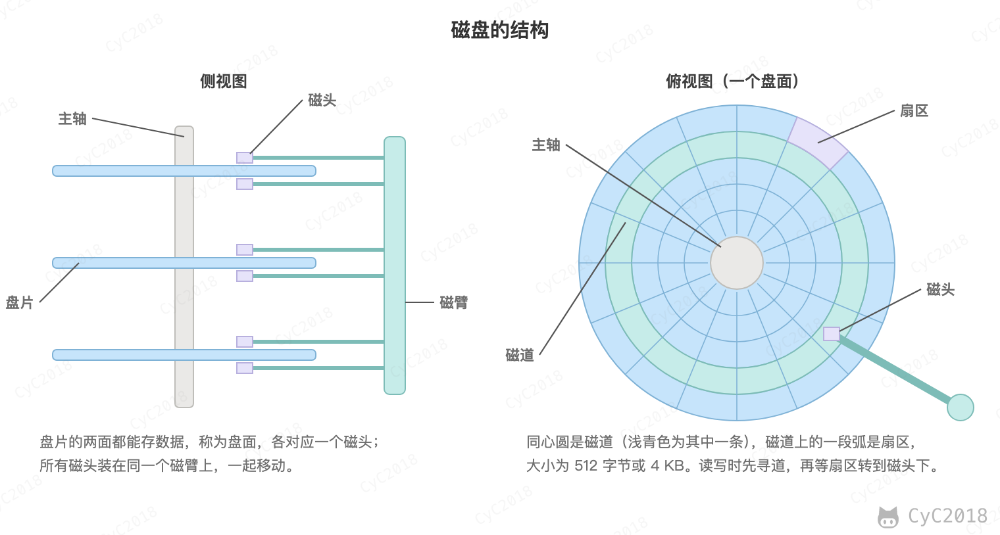
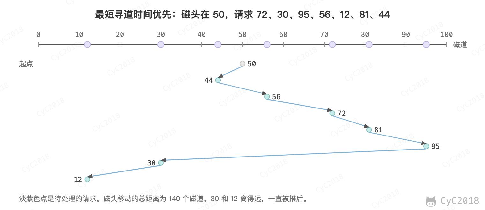
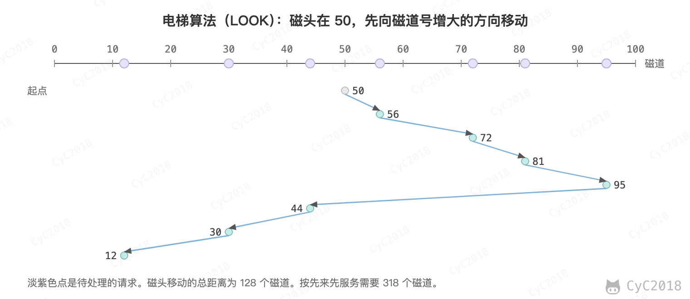

# 计算机操作系统 - 设备管理
<!-- GFM-TOC -->
* [计算机操作系统 - 设备管理](#计算机操作系统---设备管理)
    * [磁盘结构](#磁盘结构)
    * [磁盘调度算法](#磁盘调度算法)
        * [1. 先来先服务](#1-先来先服务)
        * [2. 最短寻道时间优先](#2-最短寻道时间优先)
        * [3. 电梯算法](#3-电梯算法)
    * [参考资料](#参考资料)
<!-- GFM-TOC -->

## 磁盘结构

- 盘片（Platter）：一个磁盘有一张或多张盘片，每张盘片的两面都能存储数据，每一面称为一个盘面；
- 磁道（Track）：盘面上的圆形带状区域，一个盘面可以有多个磁道；
- 扇区（Sector）：磁道上的一个弧段，一个磁道可以有多个扇区，它是最小的物理储存单位，目前主要有 512 字节与 4 KB 两种大小；
- 磁头（Head）：与盘面非常接近，能够将盘面上的磁场转换为电信号（读），或者将电信号转换为盘面的磁场（写）；
- 磁臂（Actuator arm）：用于在磁道之间移动磁头；
- 主轴（Spindle）：带动所有盘片一起转动。

  
 

## 磁盘调度算法

读写一个磁盘块的时间的影响因素有：

- 旋转时间：主轴转动盘面，使目标扇区转到磁头下方；
- 寻道时间：磁臂移动，使得磁头移动到适当的磁道上；
- 实际的数据传输时间。

其中，寻道时间通常最长，因此磁盘调度的主要目标是使磁盘的平均寻道时间最短。固态硬盘没有磁头和寻道，这些调度算法针对的是机械硬盘。

下面的例子中，磁头当前位于 50 号磁道，按到达顺序有 72、30、95、56、12、81、44 七个请求，比较三种算法下磁头移动的总距离。

### 1. 先来先服务

先来先服务（First Come First Served, FCFS）按照磁盘请求到达的顺序进行调度。例子中磁头依次移动到 72、30、95、56、12、81、44，共移动 318 个磁道。

优点是公平和简单。缺点也很明显，因为未对寻道做任何优化，平均寻道时间可能较长。

### 2. 最短寻道时间优先

最短寻道时间优先（Shortest Seek Time First, SSTF）优先调度与当前磁头所在磁道距离最近的请求。例子中 44 和 56 与 50 的距离都是 6，先选 44 时磁头依次移动到 44、56、72、81、95、30、12，共移动 140 个磁道。

虽然平均寻道时间比较低，但是不够公平。如果新到达的磁道请求总是比一个在等待的磁道请求近，那么在等待的磁道请求会一直等待下去，也就是出现饥饿现象。具体来说，两端的磁道请求更容易出现饥饿现象。

  
 

### 3. 电梯算法

电梯算法（扫描算法，SCAN）和电梯的运行过程类似，总是按一个方向来进行磁盘调度，直到该方向上没有未完成的磁盘请求，然后改变方向。严格的 SCAN 要先移动到磁盘的一端再掉头，到达该方向上最后一个请求就掉头的做法称为 LOOK。

例子按 LOOK 计算：磁头先向磁道号增大的方向依次移动到 56、72、81、95，再掉头移动到 44、30、12，共移动 45 + 83 = 128 个磁道。假设磁道号为 0～99，SCAN 要先走到 99 再掉头，共移动 49 + 87 = 136 个磁道。

因为考虑了移动方向，因此所有的磁盘请求都会被满足，解决了 SSTF 的饥饿问题。

  
 

## 参考资料

- Tanenbaum A S, Bos H. Modern Operating Systems [M]. Pearson, 2014.
- Silberschatz A, Galvin P B, Gagne G. Operating System Concepts [M]. Wiley, 2018.
