# 计算机操作系统 - 进程管理
<!-- GFM-TOC -->
* [计算机操作系统 - 进程管理](#计算机操作系统---进程管理)
    * [进程与线程](#进程与线程)
        * [1. 进程](#1-进程)
        * [2. 线程](#2-线程)
        * [3. 区别](#3-区别) 🔥🔥
        * [4. 上下文切换](#4-上下文切换)
        * [5. 协程](#5-协程) 🔥🔥
    * [进程状态的切换](#进程状态的切换)
    * [进程调度算法](#进程调度算法)
        * [1. 批处理系统](#1-批处理系统)
        * [2. 交互式系统](#2-交互式系统)
        * [3. 实时系统](#3-实时系统)
    * [进程同步](#进程同步)
        * [1. 临界区](#1-临界区)
        * [2. 同步与互斥](#2-同步与互斥)
        * [3. 信号量](#3-信号量)
        * [4. 管程](#4-管程)
    * [经典同步问题](#经典同步问题)
        * [1. 哲学家进餐问题](#1-哲学家进餐问题)
        * [2. 读者-写者问题](#2-读者-写者问题)
    * [进程通信](#进程通信) 🔥🔥
        * [1. 管道](#1-管道)
        * [2. FIFO](#2-fifo)
        * [3. 消息队列](#3-消息队列)
        * [4. 信号量](#4-信号量)
        * [5. 共享存储](#5-共享存储)
        * [6. 套接字](#6-套接字)
    * [附录：实测](#附录实测)
        * [A1 上下文切换](#a1-上下文切换)
        * [A2 平台线程与虚拟线程的开销](#a2-平台线程与虚拟线程的开销)
        * [A3 POSIX 共享内存](#a3-posix-共享内存)
        * [A4 fork 与 pthread_create 的 clone 标志](#a4-fork-与-pthread_create-的-clone-标志)
    * [参考资料](#参考资料)
<!-- GFM-TOC -->


## 进程与线程

### 1. 进程

进程是资源分配的基本单位。

进程控制块（Process Control Block, PCB）描述进程的基本信息和运行状态，所谓的创建进程和撤销进程，都是指对 PCB 的操作。

下图显示了 4 个进程在一个 CPU 上并发地执行。

<div align="center"> 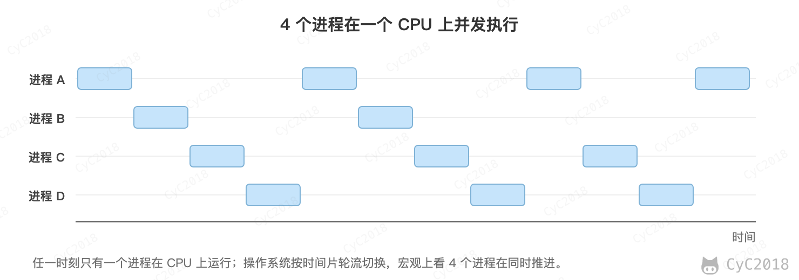 </div><br>

### 2. 线程

线程是独立调度的基本单位。

一个进程中可以有多个线程，它们共享进程资源。

QQ 和浏览器是两个进程，浏览器进程里面有很多线程，例如 HTTP 请求线程、事件响应线程、渲染线程等等，线程的并发执行使得在浏览器中点击一个新链接从而发起 HTTP 请求时，浏览器还可以响应用户的其它事件。

<div align="center"> 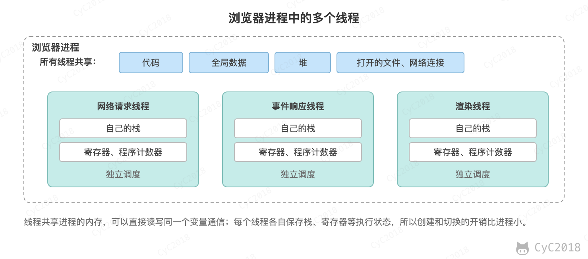 </div><br>

同一进程中的线程共享地址空间（代码、全局变量、堆）、打开的文件描述符、信号的处理方式和当前工作目录等；每个线程独有的是线程 ID、程序计数器和寄存器、栈、信号屏蔽字、errno 和线程局部存储（见 [pthreads(7)](https://man7.org/linux/man-pages/man7/pthreads.7.html)）。

需要注意的是，各线程的栈只是分开使用，并没有隔离：拿到另一个线程栈上变量的地址，同样可以读写它。

### 3. 区别 🔥🔥

- 拥有资源：进程是资源分配的基本单位，但是线程不拥有资源，线程可以访问隶属进程的资源；
- 调度：线程是独立调度的基本单位，在同一进程中，线程的切换不会引起进程切换，从一个进程中的线程切换到另一个进程中的线程时，会引起进程切换；
- 系统开销：由于创建或撤销进程时，系统都要为之分配或回收资源，如内存空间、I/O 设备等，所付出的开销远大于创建或撤销线程时的开销。类似地，在进行进程切换时，涉及当前执行进程 CPU 环境的保存及新调度进程 CPU 环境的设置，而线程切换时只需保存和设置少量寄存器内容，开销很小；
- 通信方面：线程间可以通过直接读写同一进程中的数据进行通信，但是进程通信需要借助 IPC；
- 健壮性：进程之间相互隔离，一个进程崩溃不影响其它进程，而一个线程访问非法内存触发段错误时，整个进程连同其它线程都会被终止。

在 Linux 内核中，进程和线程都用 task_struct 表示，都是调度的对象，区别只在于和创建者共享了多少资源。fork 和 pthread_create 最终都调用 clone 系统调用，只是传入的标志不同（strace 实测，见[附录 A4](#a4-fork-与-pthread_create-的-clone-标志)）：

```text
fork()            clone(flags=CLONE_CHILD_CLEARTID|CLONE_CHILD_SETTID|SIGCHLD)
pthread_create()  clone(flags=CLONE_VM|CLONE_FS|CLONE_FILES|CLONE_SIGHAND|CLONE_THREAD|...)
```

CLONE_VM 表示共享地址空间，CLONE_FILES 表示共享文件描述符表，CLONE_THREAD 表示加入创建者的线程组。没有这些标志时，子进程得到一份地址空间的副本（写时复制），修改全局变量不影响父进程；有这些标志时，新线程修改的就是同一个变量。getpid() 返回的是线程组 ID，同一进程中的线程都相同，gettid() 返回每个线程自己的 ID，top -H、ps -L 中看到的就是它。

<div align="center"> 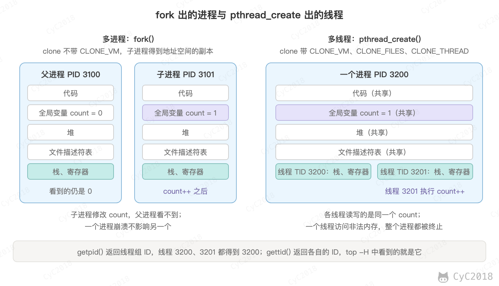 </div><br>

因此选择多进程还是多线程，主要看更需要隔离还是共享：

- 任务之间需要隔离、一个出错不能拖垮其它任务时用多进程，例如 Chrome 把网页放在单独的渲染进程中，一个网页崩溃不影响浏览器和其它标签页；执行不受信任的代码（例如 Agent 运行模型生成的脚本）也应该放在单独的进程甚至容器中；
- 任务之间要频繁共享数据、对创建和切换的开销敏感时用多线程，例如 Web 服务器用线程池处理请求，各线程直接读写同一份本地缓存。

### 4. 上下文切换

上下文切换指的是 CPU 从执行一个线程改为执行另一个线程时，把当前线程的寄存器、程序计数器、栈指针等保存起来，再恢复另一个线程上次保存的值。以下情况会发生上下文切换：

- 时间片用完，被调度程序换下；
- 线程主动阻塞，例如等待 I/O、等待锁、调用 sleep()；
- 更高优先级的线程进入就绪状态。

需要注意的是，系统调用只是从用户态进入内核态，执行完后通常回到同一个线程，不一定发生上下文切换。

同一进程中的线程切换不需要换地址空间；切换到另一个进程时还要切换页表，TLB 和 CPU 缓存中原来的地址映射和数据对新进程没有用，要重新加载，这部分间接开销通常比保存寄存器更大。x86 的 PCID 可以给 TLB 表项标上所属的地址空间，切换页表时不必清空整个 TLB，没有 PCID 时每次切换页表都会清空 TLB。

例如把两个执行流固定在同一个 CPU 上，通过两根管道来回传 1 个字节，让它们交替运行，两个线程之间、两个进程之间每次切换都约 1.1 微秒，包含一次 read 或 write 系统调用（Linux 实测，见[附录 A1](#a1-上下文切换)）。数据量很小时两者几乎没有差别，进程切换的额外开销主要在工作集较大时体现出来。线程过多、频繁阻塞时，CPU 会把相当一部分时间花在切换上，可以用 vmstat 的 cs 列或 pidstat -w 观察每秒的切换次数。

### 5. 协程 🔥🔥

协程（Coroutine）是在用户态实现的轻量级线程，由程序自己调度，而不是由操作系统内核调度。协程在等待 I/O 时主动让出执行权，运行时再把其它协程调度到同一个线程上执行。

协程的调度由语言的运行时完成，内核只看到运行时创建的少量线程（通常与 CPU 核数相当），这种把大量协程映射到少量线程上的方式称为 M:N 调度。大多数协程是协作式调度的，只在让出点切换，例如等待 I/O、等待锁、sleep；一个协程长时间计算而不让出，就会一直占住所在的线程。

Go 的 GMP 模型是一个典型实现：G 是 goroutine，M 是系统线程，P 是执行 Go 代码需要的处理器，数量默认等于可用的 CPU 核数。每个 P 有自己的就绪队列，M 绑定一个 P 后从队列中取 G 执行，队列空了就从其它 P 的队列中偷取一半。Go 1.14 起运行时还会用信号打断长时间运行的 goroutine（异步抢占），避免没有函数调用的循环一直占住线程。

与线程相比：

- 切换在用户态完成，只需要保存少量寄存器，不需要陷入内核，开销小；
- 占用的内存少，可以同时存在大量协程，而每个线程都要预留独立的栈，例如 Linux x64 上 Java 线程的栈默认为 1 MB（ARM64 的 Linux 和 macOS 上为 2 MB），线程数量有限；
- 同一个线程上的协程不能并行执行，要利用多核仍然需要多个线程；协程中如果执行了阻塞的系统调用，所在的线程会被阻塞，所以协程的运行时通常把 I/O 改为非阻塞的方式。

协程按是否有自己的调用栈分为两类。有栈协程（stackful）可以在任意深度的函数调用中挂起，挂起时保存整个调用栈，例如 goroutine 和 Java 的虚拟线程；无栈协程（stackless）由编译器把 async 函数改写成状态机，只能在 await 处挂起，局部变量保存在状态对象中，例如 Python 的 async/await 和 Kotlin 协程。无栈协程更省内存，但 async 会沿调用链传染，调用它的函数也要写成 async。

Java 21 正式引入的虚拟线程（[JEP 444](https://openjdk.org/jeps/444)）就是 JVM 实现的协程：虚拟线程由 JVM 调度到少量的平台线程上运行，执行阻塞 I/O 时从平台线程上卸载，让平台线程去执行其它虚拟线程。调度器是一个工作窃取的 ForkJoinPool，平台线程数默认等于 CPU 核数，JDK 21 不按时间片抢占虚拟线程。虚拟线程卸载时，它的栈帧以栈块对象（stack chunk）的形式保存在堆中，等 I/O 就绪后再挂载到某个平台线程上继续执行，所以阻塞的虚拟线程只占用与调用深度相当的堆内存，不占用平台线程。虚拟线程的创建成本很低，不需要用线程池复用，需要限制并发数时使用信号量。在 JDK 21 中，虚拟线程在 synchronized 块内阻塞时无法卸载，JDK 24 起（[JEP 491](https://openjdk.org/jeps/491)）基本消除了这个限制。

<div align="center"> 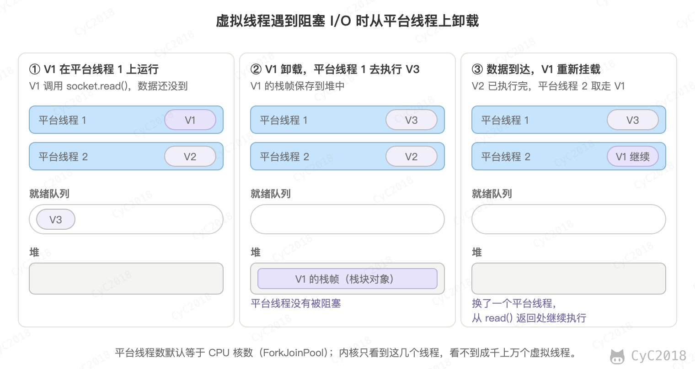 </div><br>

例如在 JDK 21 中启动 1 万个阻塞在同一个 CountDownLatch 上的线程（Ubuntu 24.04 容器实测，见[附录 A2](#a2-平台线程与虚拟线程的开销)）：

- 平台线程用时约 1.4 秒，进程的常驻内存增加约 290 MB，平均每个约 30 KB，这是因为 2 MB（aarch64）的栈只是预留的虚拟地址，用到的页才占用物理内存；
- 虚拟线程用时约 30 毫秒，每个只在堆中占用约 2 KB；启动 100 万个虚拟线程用时约 0.5 秒，堆中共占用约 690 MB。

协程也不能无限创建：每个协程的栈和状态都要占内存，例如把最大堆设为 256 MB 时，启动 100 万个阻塞的虚拟线程会抛出 OutOfMemoryError。协程适合大量任务都在等待 I/O 的场景，例如每个请求都要调用下游接口、查询数据库；CPU 密集的任务没有等待可以让出，开再多协程也只能由少量线程轮流执行，不会更快。

## 进程状态的切换

<div align="center"> 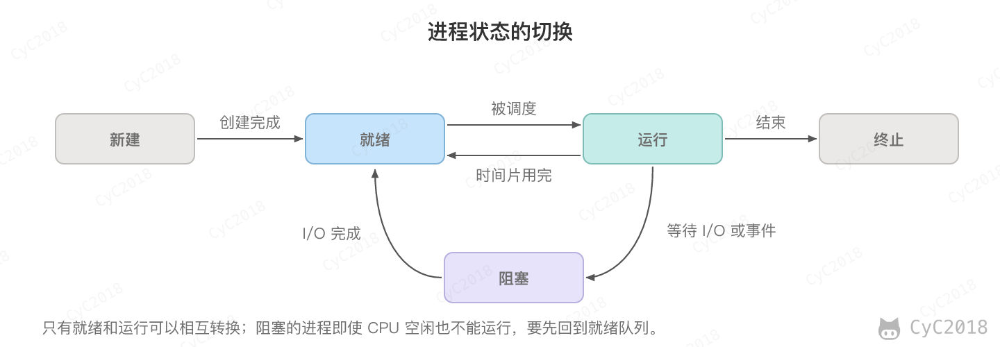 </div><br>

- 就绪状态（ready）：等待被调度；
- 运行状态（running）：正在 CPU 上执行；
- 阻塞状态（waiting）：等待资源。

应该注意以下内容：

- 只有就绪态和运行态可以相互转换，其它的都是单向转换。就绪状态的进程通过调度算法从而获得 CPU 时间，转为运行状态；而运行状态的进程，在分配给它的 CPU 时间片用完之后就会转为就绪状态，等待下一次调度；
- 阻塞状态是缺少需要的资源从而由运行状态转换而来，但是该资源不包括 CPU 时间，缺少 CPU 时间会从运行态转换为就绪态。

## 进程调度算法

不同环境的调度算法目标不同，因此需要针对不同环境来讨论调度算法。

### 1. 批处理系统

批处理系统没有太多的用户操作，在该系统中，调度算法目标是保证吞吐量和周转时间（从提交到终止的时间）。

##### 1.1 先来先服务（First-Come First-Served, FCFS）

非抢占式的调度算法，按照请求的顺序进行调度。

有利于长作业，但不利于短作业，因为短作业必须一直等待前面的长作业执行完毕才能执行，而长作业又需要执行很长时间，造成了短作业等待时间过长。

##### 1.2 短作业优先（Shortest Job First, SJF）

非抢占式的调度算法，按估计运行时间最短的顺序进行调度。

长作业有可能会饿死，处于一直等待短作业执行完毕的状态。因为如果一直有短作业到来，那么长作业永远得不到调度。

##### 1.3 最短剩余时间优先（Shortest Remaining Time Next, SRTN）

最短作业优先的抢占式版本，按剩余运行时间的顺序进行调度。当一个新的作业到达时，其整个运行时间与当前进程的剩余时间作比较。如果新的进程需要的时间更少，则挂起当前进程，运行新的进程。否则新的进程等待。

### 2. 交互式系统

交互式系统有大量的用户交互操作，在该系统中调度算法的目标是快速地进行响应。

##### 2.1 时间片轮转

Windows 系统中线程轮转时间也就是时间片大约是20ms，如果某个线程所需要的时间小于20ms，那么不到20ms就会切换到其他线程;如果一个线程所需的时间超过20ms，系统也最多只给20ms，除非意外发生(那可能导致整个系统无响应)，而Linux/unix中则是5~800ms。

将所有就绪进程按 FCFS 的原则排成一个队列，每次调度时，把 CPU 时间分配给队首进程，该进程可以执行一个时间片。当时间片用完时，由计时器发出时钟中断，调度程序便停止该进程的执行，并将它送往就绪队列的末尾，同时继续把 CPU 时间分配给队首的进程。

时间片轮转算法的效率和时间片的大小有很大关系：

- 因为进程切换都要保存进程的信息并且载入新进程的信息，如果时间片太小，会导致进程切换得太频繁，在进程切换上就会花过多时间；
- 而如果时间片过长，那么实时性就不能得到保证。

<div align="center"> 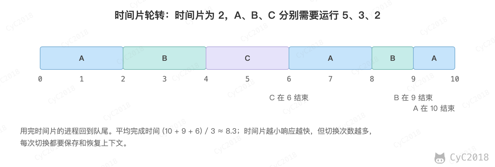 </div><br>

##### 2.2 优先级调度

为每个进程分配一个优先级，按优先级进行调度。

为了防止低优先级的进程永远等不到调度，可以随着时间的推移增加等待进程的优先级。

##### 2.3 多级反馈队列

一个进程需要执行 100 个时间片，如果采用时间片轮转调度算法，那么需要交换 100 次。

多级队列是为这种需要连续执行多个时间片的进程考虑，它设置了多个队列，每个队列时间片大小都不同，例如 1、2、4、8……进程在第一个队列没执行完，就会被移到下一个队列。这种方式下，之前的进程只需要交换 7 次（1 + 2 + … + 64 = 127 ≥ 100）。

每个队列优先权也不同，最上面的优先权最高。因此只有上一个队列没有进程在排队，才能调度当前队列上的进程。

可以将这种调度算法看成是时间片轮转调度算法和优先级调度算法的结合。

<div align="center"> 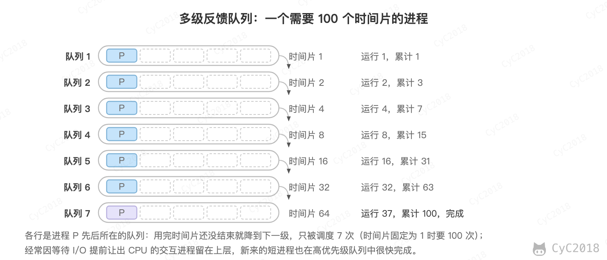 </div><br>

### 3. 实时系统

实时系统要求一个请求在一个确定时间内得到响应。

分为硬实时和软实时，前者必须满足绝对的截止时间，后者可以容忍一定的超时。

实际的操作系统会组合使用这些思想。例如 Linux 2.6.23 起的完全公平调度器（CFS）给每个进程记录按优先级加权后的虚拟运行时间，总是选择虚拟运行时间最小的进程运行，让各进程按权重分享 CPU；Linux 6.6 起开始改用 EEVDF 调度器，在公平分享的基础上考虑每个进程的截止时间，让对延迟敏感的进程更快得到运行。实时进程使用单独的 SCHED_FIFO、SCHED_RR 策略，优先于普通进程。

## 进程同步

### 1. 临界区

对临界资源进行访问的那段代码称为临界区。

为了互斥访问临界资源，每个进程在进入临界区之前，需要先进行检查。

```c
// entry section
// critical section;
// exit section
```

### 2. 同步与互斥

- 同步：多个进程因为合作产生的直接制约关系，使得进程有一定的先后执行关系；
- 互斥：多个进程在同一时刻只有一个进程能进入临界区。

### 3. 信号量

信号量（Semaphore）是一个整型变量，可以对其执行 down 和 up 操作，也就是常见的 P 和 V 操作。

- down：如果信号量大于 0，执行 -1 操作；如果信号量等于 0，进程睡眠，等待信号量大于 0；
- up：对信号量执行 +1 操作，唤醒睡眠的进程让其完成 down 操作。

down 和 up 操作需要被设计成原语，不可分割，通常的做法是在执行这些操作的时候屏蔽中断。

如果信号量的取值只能为 0 或者 1，那么就成为了互斥量（Mutex），0 表示临界区已经加锁，1 表示临界区解锁。

```c
typedef int semaphore;
semaphore mutex = 1;
void P1() {
    down(&mutex);
    // 临界区
    up(&mutex);
}

void P2() {
    down(&mutex);
    // 临界区
    up(&mutex);
}
```

使用信号量实现生产者-消费者问题：

问题描述：使用一个缓冲区来保存物品，只有缓冲区没有满，生产者才可以放入物品；只有缓冲区不为空，消费者才可以拿走物品。

因为缓冲区属于临界资源，因此需要使用一个互斥量 mutex 来控制对缓冲区的互斥访问。

为了同步生产者和消费者的行为，需要记录缓冲区中物品的数量。数量可以使用信号量来进行统计，这里需要使用两个信号量：empty 记录空缓冲区的数量，full 记录满缓冲区的数量。其中，empty 信号量是在生产者进程中使用，当 empty 不为 0 时，生产者才可以放入物品；full 信号量是在消费者进程中使用，当 full 信号量不为 0 时，消费者才可以取走物品。

注意，不能先对缓冲区进行加锁，再测试信号量。也就是说，不能先执行 down(mutex) 再执行 down(empty)。如果这么做了，那么可能会出现这种情况：生产者对缓冲区加锁后，执行 down(empty) 操作，发现 empty = 0，此时生产者睡眠。消费者不能进入临界区，因为生产者对缓冲区加锁了，消费者就无法执行 up(empty) 操作，empty 永远都为 0，导致生产者永远等待下，不会释放锁，消费者因此也会永远等待下去。

```c
#define N 100
typedef int semaphore;
semaphore mutex = 1;
semaphore empty = N;
semaphore full = 0;

void producer() {
    while(TRUE) {
        int item = produce_item();
        down(&empty);
        down(&mutex);
        insert_item(item);
        up(&mutex);
        up(&full);
    }
}

void consumer() {
    while(TRUE) {
        down(&full);
        down(&mutex);
        int item = remove_item();
        consume_item(item);
        up(&mutex);
        up(&empty);
    }
}
```

### 4. 管程

使用信号量机制实现的生产者消费者问题需要客户端代码做很多控制，而管程把控制的代码独立出来，不仅不容易出错，也使得客户端代码调用更容易。

C 语言不支持管程，下面的示例代码使用了类 Pascal 语言来描述管程。示例代码的管程提供了 insert() 和 remove() 方法，客户端代码通过调用这两个方法来解决生产者-消费者问题。

```pascal
monitor ProducerConsumer
    integer i;
    condition c;

    procedure insert();
    begin
        // ...
    end;

    procedure remove();
    begin
        // ...
    end;
end monitor;
```

管程有一个重要特性：在一个时刻只能有一个进程使用管程。进程在无法继续执行的时候不能一直占用管程，否则其它进程永远不能使用管程。

管程引入了条件变量以及相关的操作 wait() 和 signal() 来实现同步操作。对条件变量执行 wait() 操作会导致调用进程阻塞，把管程让出来给另一个进程持有。signal() 操作用于唤醒被阻塞的进程。

使用管程实现生产者-消费者问题：

```pascal
// 管程
monitor ProducerConsumer
    condition full, empty;
    integer count := 0;
    condition c;

    procedure insert(item: integer);
    begin
        if count = N then wait(full);
        insert_item(item);
        count := count + 1;
        if count = 1 then signal(empty);
    end;

    function remove: integer;
    begin
        if count = 0 then wait(empty);
        remove = remove_item;
        count := count - 1;
        if count = N -1 then signal(full);
    end;
end monitor;

// 生产者客户端
procedure producer
begin
    while true do
    begin
        item = produce_item;
        ProducerConsumer.insert(item);
    end
end;

// 消费者客户端
procedure consumer
begin
    while true do
    begin
        item = ProducerConsumer.remove;
        consume_item(item);
    end
end;
```

## 经典同步问题

生产者和消费者问题前面已经讨论过了。

### 1. 哲学家进餐问题

<div align="center"> 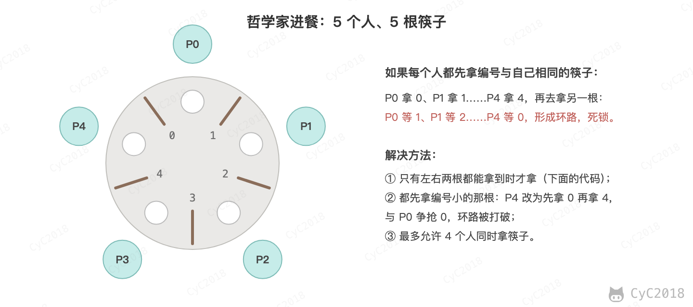 </div><br>

五个哲学家围着一张圆桌，每个哲学家面前放着食物。哲学家的生活有两种交替活动：吃饭以及思考。当一个哲学家吃饭时，需要先拿起自己左右两边的两根筷子，并且一次只能拿起一根筷子。

下面是一种错误的解法，如果所有哲学家同时拿起左手边的筷子，那么所有哲学家都在等待其它哲学家吃完并释放自己手中的筷子，导致死锁。

```c
#define N 5

void philosopher(int i) {
    while(TRUE) {
        think();
        take(i);       // 拿起左边的筷子
        take((i+1)%N); // 拿起右边的筷子
        eat();
        put(i);
        put((i+1)%N);
    }
}
```

为了防止死锁的发生，可以设置两个条件：

- 必须同时拿起左右两根筷子；
- 只有在两个邻居都没有进餐的情况下才允许进餐。

```c
#define N 5
#define LEFT (i + N - 1) % N // 左邻居
#define RIGHT (i + 1) % N    // 右邻居
#define THINKING 0
#define HUNGRY   1
#define EATING   2
typedef int semaphore;
int state[N];                // 跟踪每个哲学家的状态
semaphore mutex = 1;         // 临界区的互斥，临界区是 state 数组，对其修改需要互斥
semaphore s[N];              // 每个哲学家一个信号量

void philosopher(int i) {
    while(TRUE) {
        think(i);
        take_two(i);
        eat(i);
        put_two(i);
    }
}

void take_two(int i) {
    down(&mutex);
    state[i] = HUNGRY;
    check(i);
    up(&mutex);
    down(&s[i]); // 只有收到通知之后才可以开始吃，否则会一直等下去
}

void put_two(i) {
    down(&mutex);
    state[i] = THINKING;
    check(LEFT); // 尝试通知左右邻居，自己吃完了，你们可以开始吃了
    check(RIGHT);
    up(&mutex);
}

void eat(int i) {
    down(&mutex);
    state[i] = EATING;
    up(&mutex);
}

// 检查两个邻居是否都没有用餐，如果是的话，就 up(&s[i])，使得 down(&s[i]) 能够得到通知并继续执行
void check(i) {         
    if(state[i] == HUNGRY && state[LEFT] != EATING && state[RIGHT] !=EATING) {
        state[i] = EATING;
        up(&s[i]);
    }
}
```

### 2. 读者-写者问题

允许多个进程同时对数据进行读操作，但是不允许读和写以及写和写操作同时发生。

一个整型变量 count 记录在对数据进行读操作的进程数量，一个互斥量 count_mutex 用于对 count 加锁，一个互斥量 data_mutex 用于对读写的数据加锁。

```c
typedef int semaphore;
semaphore count_mutex = 1;
semaphore data_mutex = 1;
int count = 0;

void reader() {
    while(TRUE) {
        down(&count_mutex);
        count++;
        if(count == 1) down(&data_mutex); // 第一个读者需要对数据进行加锁，防止写进程访问
        up(&count_mutex);
        read();
        down(&count_mutex);
        count--;
        if(count == 0) up(&data_mutex);
        up(&count_mutex);
    }
}

void writer() {
    while(TRUE) {
        down(&data_mutex);
        write();
        up(&data_mutex);
    }
}
```

这种实现在读者源源不断时可能导致写者饥饿，写者优先和按到达顺序排队的公平实现见[进阶：读者-写者问题](计算机操作系统%20-%20进程管理%20-%20进阶.md#读者-写者问题)。

## 进程通信 🔥🔥

进程同步与进程通信很容易混淆，它们的区别在于：

- 进程同步：控制多个进程按一定顺序执行；
- 进程通信：进程间传输信息。

进程通信是一种手段，而进程同步是一种目的。也可以说，为了能够达到进程同步的目的，需要让进程进行通信，传输一些进程同步所需要的信息。

### 1. 管道

管道是通过调用 pipe 函数创建的，fd[0] 用于读，fd[1] 用于写。

```c
#include <unistd.h>
int pipe(int fd[2]);
```

它具有以下限制：

- 只支持半双工通信（单向交替传输）；
- 只能在父子进程或者兄弟进程中使用。

<div align="center"> 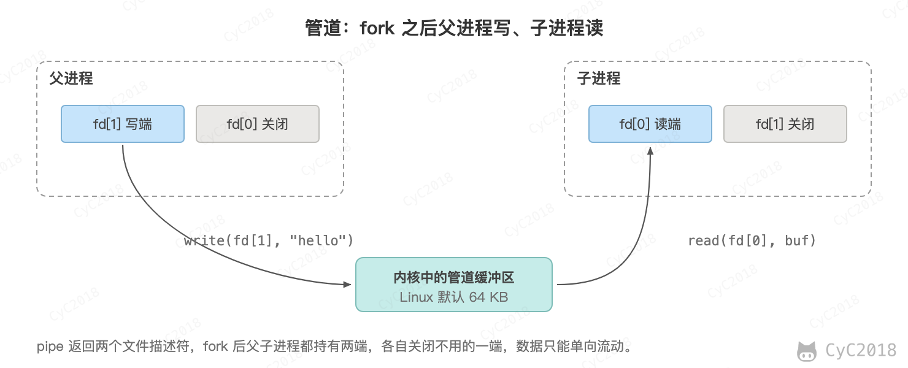 </div><br>

### 2. FIFO

也称为命名管道，去除了管道只能在父子进程中使用的限制。

```c
#include <sys/stat.h>
int mkfifo(const char *path, mode_t mode);
int mkfifoat(int fd, const char *path, mode_t mode);
```

FIFO 常用于客户-服务器应用程序中，FIFO 用作汇聚点，在客户进程和服务器进程之间传递数据。

<div align="center"> 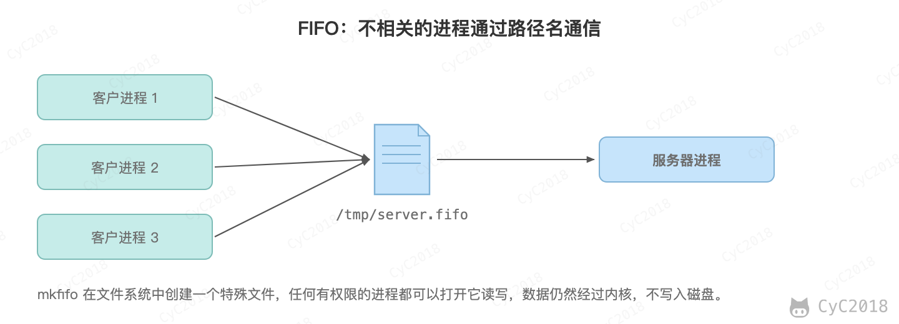 </div><br>

### 3. 消息队列

相比于 FIFO，消息队列具有以下优点：

- 消息队列可以独立于读写进程存在，从而避免了 FIFO 中同步管道的打开和关闭时可能产生的困难；
- 避免了 FIFO 的同步阻塞问题，不需要进程自己提供同步方法；
- 读进程可以根据消息类型有选择地接收消息，而不像 FIFO 那样只能默认地接收。

### 4. 信号量

它是一个计数器，用于为多个进程提供对共享数据对象的访问。

### 5. 共享存储

允许多个进程共享一个给定的存储区。因为数据不需要在进程之间复制，所以这是最快的一种 IPC。

管道每传一次数据要复制两次：write 把数据从写进程复制到内核缓冲区，read 再复制到读进程。共享内存把同一个物理页框映射到两个进程的地址空间，写进程写入后，读进程直接就能读到。

<div align="center"> 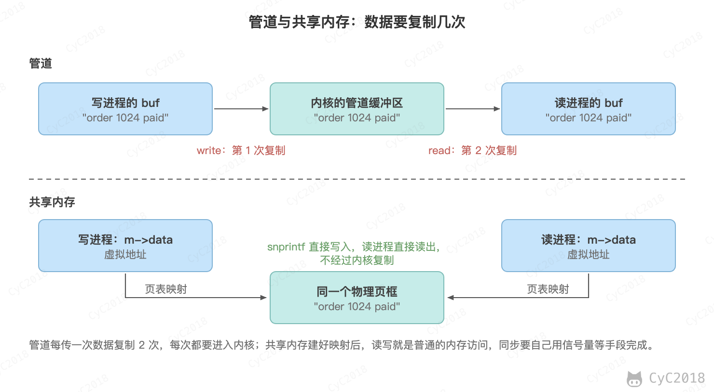 </div><br>

共享内存本身不提供同步，读进程不知道数据什么时候写完，多个进程同时写也会互相覆盖，因此需要配合信号量使用。

例如用 POSIX 共享内存把一条 1 KB 以内的消息交给另一个进程，依次调用 shm_open 创建共享内存对象、ftruncate 设置大小、mmap 映射到地址空间，读写完后 munmap 解除映射、shm_unlink 删除对象。信号量放在共享内存中，sem_init 的第二个参数为 1 表示在进程间共享（Linux 上编译运行，见[附录 A3](#a3-posix-共享内存)）：

```c
struct msg {
    sem_t ready;        // 写完后 up，读进程 down 等待
    char data[1024];
};

int main(void) {
    int fd = shm_open("/demo_shm", O_CREAT | O_RDWR, 0600);
    ftruncate(fd, sizeof(struct msg));
    struct msg *m = mmap(NULL, sizeof(struct msg), PROT_READ | PROT_WRITE, MAP_SHARED, fd, 0);
    sem_init(&m->ready, 1, 0);

    if (fork() == 0) {                                         // 写进程
        snprintf(m->data, sizeof m->data, "order 1024 paid");  // 直接写共享内存
        sem_post(&m->ready);
        return 0;
    }
    sem_wait(&m->ready);                                       // 读进程等待写完
    printf("读到：%s\n", m->data);
    wait(NULL);
    munmap(m, sizeof(struct msg));
    shm_unlink("/demo_shm");
    return 0;
}
```

这里为了简短用 fork 创建写进程，没有亲缘关系的进程只要用同一个名字调用 shm_open，就能映射到同一块共享内存。

多个进程也可以将同一个文件映射到它们的地址空间从而实现共享内存。另外 XSI 共享内存（shmget、shmat）不是使用文件，而是使用内存的匿名段。

### 6. 套接字

与其它通信机制不同的是，它可用于不同机器间的进程通信。

## 附录：实测

### A1 上下文切换

Docker Desktop 中的 Linux 容器（Apple M1 Pro），gcc -O2 编译。两个执行流通过两根管道互相传 1 个字节，每个来回包含 2 次切换，各执行 20 万个来回：

```c
static void *peer(void *arg) {
    char c;
    for (long i = 0; i < n; i++) { read(a[0], &c, 1); write(b[1], &c, 1); }
    return NULL;
}
// main 中：thread 模式用 pthread_create 运行 peer，process 模式用 fork
for (long i = 0; i < n; i++) { write(a[1], &c, 1); read(b[0], &c, 1); }
printf("%-7s 每次切换（含一次 read 或 write）约 %.2f us\n", argv[1], ns / n / 2 / 1000);
```

```text
$ for m in thread process thread process; do taskset -c 0 ./pp $m 200000; done
thread  每次切换（含一次 read 或 write）约 1.10 us
process 每次切换（含一次 read 或 write）约 1.12 us
thread  每次切换（含一次 read 或 write）约 1.08 us
process 每次切换（含一次 read 或 write）约 1.12 us
$ for m in thread process; do ./pp $m 200000; done      # 不限制 CPU
thread  每次切换（含一次 read 或 write）约 16.55 us
process 每次切换（含一次 read 或 write）约 15.49 us
```

不限制 CPU 时两个执行流在不同的 CPU 上，每次都要跨核唤醒对方，反而慢得多。

### A2 平台线程与虚拟线程的开销

Docker Desktop 中的 Ubuntu 24.04 容器（Apple M1 Pro，aarch64，10 核，内存 7.8 GB），Temurin JDK 21.0.13，-Xmx4g。启动 n 个阻塞在同一个 CountDownLatch 上的线程，统计启动耗时、进程 RSS（/proc/self/status 的 VmRSS）和 System.gc() 之后堆内存的增加量：

```java
CountDownLatch gate = new CountDownLatch(1);
Runnable task = () -> { try { gate.await(); } catch (InterruptedException e) { } };
Thread.Builder builder = virtual ? Thread.ofVirtual() : Thread.ofPlatform();
long rss0 = rssKb(), heap0 = heapUsed(), t0 = System.nanoTime();
for (int i = 0; i < n; i++) threads.add(builder.start(task));
long ms = (System.nanoTime() - t0) / 1_000_000;
Thread.sleep(500);
long rss1 = rssKb(), heap1 = heapUsed();
```

```text
platform n=10,000 启动耗时 1424 ms，RSS 增加 287 MB（每个 29.5 KB），堆增加 3 MB（每个 0.33 KB）
virtual  n=10,000 启动耗时 29 ms，RSS 增加 41 MB（每个 4.2 KB），堆增加 19 MB（每个 2.04 KB）
virtual  n=1,000,000 启动耗时 426 ms，RSS 增加 918 MB（每个 0.9 KB），堆增加 684 MB（每个 0.70 KB）
platform n=10,000 启动耗时 1457 ms，RSS 增加 290 MB（每个 29.7 KB），堆增加 3 MB（每个 0.33 KB）
virtual  n=10,000 启动耗时 27 ms，RSS 增加 37 MB（每个 3.9 KB），堆增加 19 MB（每个 2.00 KB）
virtual  n=1,000,000 启动耗时 520 ms，RSS 增加 900 MB（每个 0.9 KB），堆增加 688 MB（每个 0.70 KB）
$ java -XX:+PrintFlagsFinal -version | grep -w ThreadStackSize
     intx ThreadStackSize                          = 2040
```

把最大堆改为 256 MB 后启动 100 万个虚拟线程：

```text
$ java -Xmx256m VtCost virtual 1000000
Exception in thread "main" java.lang.OutOfMemoryError: Java heap space
	at java.base/java.lang.ThreadBuilders.newVirtualThread(ThreadBuilders.java:408)
```

### A3 POSIX 共享内存

Docker Desktop 中的 Ubuntu 24.04 容器（aarch64），gcc 13.3，用正文中的代码（补上头文件 fcntl.h、semaphore.h、stdio.h、sys/mman.h、sys/wait.h、unistd.h）：

```text
$ gcc -O2 -o shm shm.c && ./shm
读到：order 1024 paid
```

### A4 fork 与 pthread_create 的 clone 标志

Docker Desktop 中的 Ubuntu 24.04 容器（aarch64），gcc 13.3，strace 6.8。程序先 fork 一个子进程，子进程把全局变量 counter 加 1；再用 pthread_create 创建一个线程，线程也把 counter 加 1：

```c
int counter = 0;
static void *worker(void *arg) {
    counter++;
    printf("线程  pid=%d tid=%d\n", getpid(), gettid());
    return NULL;
}
// main 中：
pid_t c = fork();
if (c == 0) { counter++; printf("子进程 pid=%d tid=%d\n", getpid(), gettid()); _exit(0); }
waitpid(c, NULL, 0);
printf("fork 之后 counter=%d\n", counter);
pthread_create(&t, NULL, worker, NULL);
pthread_join(t, NULL);
printf("线程结束后 counter=%d\n", counter);
```

```text
$ strace -f -e trace=clone,clone3 ./pt
主线程 pid=14 tid=14
clone(child_stack=NULL, flags=CLONE_CHILD_CLEARTID|CLONE_CHILD_SETTID|SIGCHLD, child_tidptr=0xffff8716dfd0) = 15
子进程 pid=15 tid=15
fork 之后 counter=0
clone3({flags=CLONE_VM|CLONE_FS|CLONE_FILES|CLONE_SIGHAND|CLONE_THREAD|CLONE_SYSVSEM|CLONE_SETTLS|CLONE_PARENT_SETTID|CLONE_CHILD_CLEARTID, ..., stack_size=0x80ea60, ...}, 88) = -1 ENOSYS (Function not implemented)
clone(child_stack=0xffff86e0ea60, flags=CLONE_VM|CLONE_FS|CLONE_FILES|CLONE_SIGHAND|CLONE_THREAD|CLONE_SYSVSEM|CLONE_SETTLS|CLONE_PARENT_SETTID|CLONE_CHILD_CLEARTID, ...) = 16
线程  pid=14 tid=16
线程结束后 counter=1
```

Docker 默认的 seccomp 规则不允许 clone3，glibc 收到 ENOSYS 后改用 clone，标志相同。线程的栈大小 0x80ea60 约 8 MB，来自 ulimit -s 的默认值。

## 参考资料

- Tanenbaum A S, Bos H. Modern Operating Systems [M]. Pearson, 2014.
- [pipe(7) — Linux manual page](https://man7.org/linux/man-pages/man7/pipe.7.html)
- [CFS Scheduler — The Linux Kernel documentation](https://docs.kernel.org/scheduler/sched-design-CFS.html)
- [EEVDF Scheduler — The Linux Kernel documentation](https://docs.kernel.org/scheduler/sched-eevdf.html)
- [pthreads(7) — Linux manual page](https://man7.org/linux/man-pages/man7/pthreads.7.html)
- [shm_overview(7) — Linux manual page](https://man7.org/linux/man-pages/man7/shm_overview.7.html)
- [JEP 444: Virtual Threads](https://openjdk.org/jeps/444)
- [Go 1.14 Release Notes](https://go.dev/doc/go1.14)
- [Multi-process Architecture — The Chromium Projects](https://www.chromium.org/developers/design-documents/multi-process-architecture/)
- [clone(2) — Linux manual page](https://man7.org/linux/man-pages/man2/clone.2.html)
