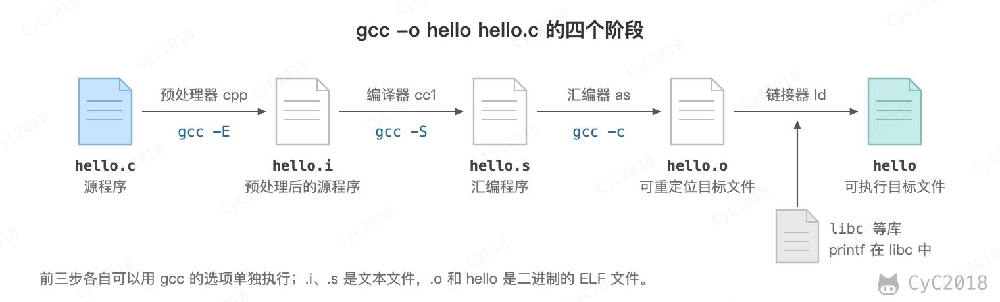
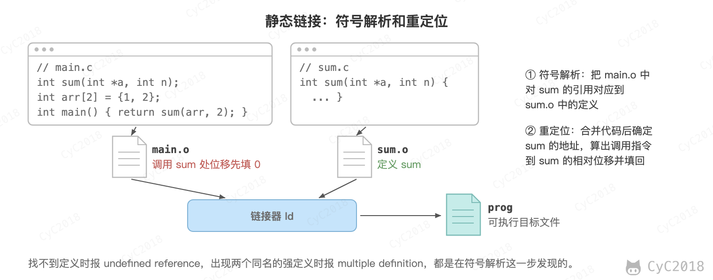
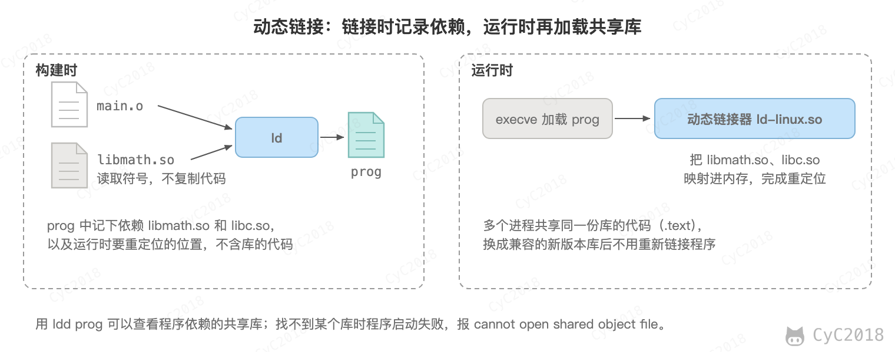

# 计算机操作系统 - 链接
<!-- GFM-TOC -->
* [计算机操作系统 - 链接](#计算机操作系统---链接)
    * [编译系统](#编译系统)
    * [静态链接](#静态链接)
    * [目标文件](#目标文件)
    * [动态链接](#动态链接)
    * [参考资料](#参考资料)
<!-- GFM-TOC -->


## 编译系统


以下是一个 hello.c 程序：

```c
#include <stdio.h>

int main()
{
    printf("hello, world\n");
    return 0;
}
```

在 Unix 系统上，由编译器驱动程序 gcc 把源文件转换为可执行目标文件。

```bash
gcc -o hello hello.c
```

这个过程大致如下：

<div align="center">  </div><br>

- 预处理阶段：处理以 # 开头的预处理命令，例如把 #include 的 stdio.h 的内容插入源文件；
- 编译阶段：翻译成汇编文件；
- 汇编阶段：将汇编文件翻译成可重定位目标文件；
- 链接阶段：链接器把 hello.o 和用到的库（printf 在 C 标准库 libc 中）链接成可执行目标文件。gcc 默认使用共享库 libc.so，可执行文件中只记下对它的依赖，见[动态链接](#动态链接)；加 -static 时才把库中用到的目标文件复制进来，见[静态链接](#静态链接)。

## 静态链接

静态链接器以一组可重定位目标文件为输入，生成一个完全链接的可执行目标文件作为输出。链接器主要完成以下两个任务：

- 符号解析：每个符号对应于一个函数、一个全局变量或一个静态变量，符号解析的目的是将每个符号引用与一个符号定义关联起来；
- 重定位：链接器把每个符号定义与一个内存位置关联起来，然后修改所有对这些符号的引用，使它们指向这个内存位置。

例如 main.c 调用了 sum.c 中定义的 sum（见下图）。单独编译 main.c 时不知道 sum 在哪里，main.o 中调用指令的目标位移先填 0，并记下一条重定位条目“这里要指向 sum”。链接时先在 sum.o 中找到 sum 的定义（符号解析），再把两个文件的代码合并、确定 sum 的地址，按重定位条目算出调用指令到 sum 的相对位移并填回（重定位）。

<div align="center">  </div><br>

## 目标文件

- 可执行目标文件：可以直接在内存中执行；
- 可重定位目标文件：可与其它可重定位目标文件在链接阶段合并，创建一个可执行目标文件；
- 共享目标文件：这是一种特殊的可重定位目标文件，可以在加载或者运行时被动态加载进内存并链接。

## 动态链接

静态库（Linux 上是 .a 文件）是多个可重定位目标文件的打包，静态链接时把用到的目标文件复制进可执行文件。它有以下两个问题：

- 静态库更新后，程序要重新链接才能用上新版本；
- printf 这类标准库函数的代码被复制进每个程序，浪费磁盘和内存。

共享库是为了解决静态库的这两个问题而设计的，在 Linux 系统中通常用 .so 后缀来表示，Windows 系统上它们被称为 DLL。它具有以下特点：

- 在给定的文件系统中一个库只有一个文件，所有引用该库的可执行目标文件都共享这个文件，它不会被复制到引用它的可执行文件中；
- 在内存中，一个共享库的 .text 节（已编译程序的机器代码）的一个副本可以被不同的正在运行的进程共享。

代价是程序运行时依赖系统中有版本兼容的共享库，缺少时程序无法启动；程序启动时还要由动态链接器加载共享库并完成重定位，比静态链接的程序多一些启动开销。

<div align="center">  </div><br>

## 参考资料

- Bryant R E, O'Hallaron D R. 深入理解计算机系统（第 3 版）[M]. 机械工业出版社, 2016.
