# 计算机网络 - 传输层
<!-- GFM-TOC -->
* [计算机网络 - 传输层](#计算机网络---传输层)
    * [UDP 和 TCP 的特点](#udp-和-tcp-的特点) 🔥🔥
        * [选择 TCP 还是 UDP](#选择-tcp-还是-udp)
    * [UDP 首部格式](#udp-首部格式)
    * [TCP 首部格式](#tcp-首部格式)
    * [TCP 的三次握手](#tcp-的三次握手) 🔥🔥
        * [三次握手的原因](#三次握手的原因)
        * [握手报文丢失](#握手报文丢失)
    * [TCP 的四次挥手](#tcp-的四次挥手) 🔥
        * [四次挥手的原因](#四次挥手的原因)
        * [TIME_WAIT](#time_wait)
        * [大量 TIME_WAIT 与 CLOSE_WAIT](#大量-time_wait-与-close_wait)
    * [TCP 可靠传输](#tcp-可靠传输) 🔥
        * [确认与重传](#确认与重传)
        * [超时重传时间](#超时重传时间)
    * [TCP 滑动窗口](#tcp-滑动窗口)
    * [TCP 流量控制](#tcp-流量控制)
    * [TCP 拥塞控制](#tcp-拥塞控制) 🔥🔥
        * [1. 慢开始与拥塞避免](#1-慢开始与拥塞避免)
        * [2. 快重传与快恢复](#2-快重传与快恢复)
    * [TCP 粘包与拆包](#tcp-粘包与拆包)
    * [在 UDP 上实现可靠传输](#在-udp-上实现可靠传输)
    * [附录：实测](#附录实测)
        * [A1 TCP 与 UDP 发送位置更新](#a1-tcp-与-udp-发送位置更新)
        * [A2 握手报文丢失](#a2-握手报文丢失)
        * [A3 三次挥手](#a3-三次挥手)
        * [A4 最后的 ACK 丢失](#a4-最后的-ack-丢失)
        * [A5 DNS 改用 TCP](#a5-dns-改用-tcp)
        * [A6 快重传与 SACK](#a6-快重传与-sack)
        * [A7 零窗口与窗口探测](#a7-零窗口与窗口探测)
        * [A8 全连接队列已满](#a8-全连接队列已满)
    * [参考资料](#参考资料)
<!-- GFM-TOC -->


网络层只把分组送到目的主机，真正通信的却是主机中的进程。传输层提供进程之间的逻辑通信，并向上屏蔽网络层的细节，使应用程序看起来像是在两个进程之间有一条端到端的信道。

传输层用端口号区分同一台主机上的进程，例如 Nginx 监听 80 端口、MySQL 监听 3306 端口，报文按首部中的目的端口交给对应的进程。TCP 和 UDP 的端口互相独立，同一个端口号可以同时被一个 TCP 程序和一个 UDP 程序使用。

## UDP 和 TCP 的特点 🔥🔥

- 用户数据报协议 UDP（User Datagram Protocol）是无连接的，尽最大可能交付，没有拥塞控制，面向报文（对于应用程序传下来的报文不合并也不拆分，只是添加 UDP 首部），支持一对一、一对多、多对一和多对多的交互通信；
- 传输控制协议 TCP（Transmission Control Protocol）是面向连接的，提供可靠交付（实现方法见 [TCP 可靠传输](#tcp-可靠传输)），有流量控制，拥塞控制，提供全双工通信，面向字节流（把应用层传下来的报文看成字节流，把字节流组织成大小不等的数据块，不保留消息边界，见 [TCP 粘包与拆包](#tcp-粘包与拆包)），每一条 TCP 连接只能是点对点的（一对一）。

UDP 延迟低，不是因为它发得更快，而是省掉了 TCP 为可靠付出的等待：不需要握手，第一个数据报就带着数据；丢包时不等重传，后面的数据照常交给应用；没有拥塞控制，不会因为丢包而主动降低发送速率；首部只有 8 字节，TCP 至少 20 字节。需要注意的是，这也意味着网络拥塞时，UDP 应用要自己控制发送速率，否则会加重拥塞。

### 选择 TCP 还是 UDP

TCP 的可靠和按序是有代价的：一个报文段丢失后，后面已经到达的数据也要等它重传成功，才能按顺序交给应用。

- 数据必须完整、晚一点到也可以的场景用 TCP，例如网页（HTTP/1.1、HTTP/2）、文件传输、SSH、数据库连接；
- 数据过时就没有用、宁可丢掉的场景用 UDP，例如实时对战游戏的位置同步、视频通话（WebRTC 优先使用 UDP）；
- 只有一问一答的场景用 UDP 可以省去握手，例如 DNS 查询。

直播常用的 HLS 基于 HTTP 分发视频分片，通常运行在 TCP 上，观众能接受几秒的延迟，换来画面完整。

DNS 也不是只用 UDP。不带 EDNS 扩展时，UDP 上的 DNS 响应限制为 512 字节，超出时服务器只返回放得下的部分并设置 TC（截断）标志，客户端改用 TCP 重新查询；主从 DNS 服务器之间同步整个区域的数据（区域传送）也用 TCP。例如不带 EDNS 查询 google.com 的 TXT 记录，UDP 响应被截断，dig 改用 TCP 后收到 1176 字节的完整响应（实测，见[附录 A5](#a5-dns-改用-tcp)）。RFC 7766 要求 DNS 实现同时支持 UDP 和 TCP。

例如游戏客户端每 50 ms 上报一次位置，在 RTT 为 50 ms、丢包率为 5% 的网络中分别用 TCP 和 UDP 发送 600 次（Linux 实测，见[附录 A1](#a1-tcp-与-udp-发送位置更新)）：

<div align="center"> 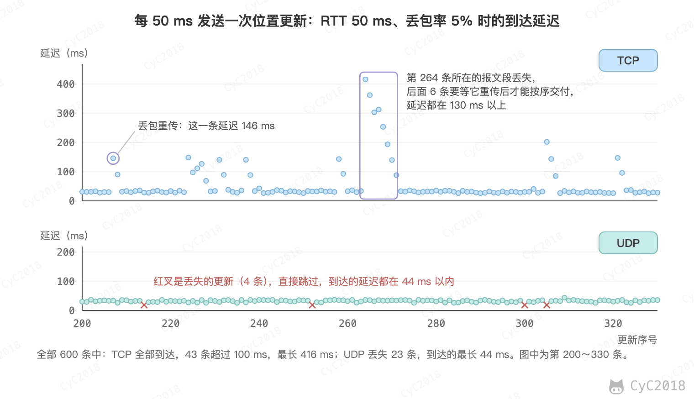 </div><br>

5 次实测中，TCP 的 600 条更新全部到达，但有 24～53 条的延迟超过 100 ms，最长 307～939 ms，到达时位置早已过时；UDP 丢失了 23～30 条，到达的延迟都不超过 44 ms，丢失的那一条由 50 ms 后的下一次更新补上。

有一部分数据必须送达时，可以在 UDP 之上自己实现可靠传输，见[在 UDP 上实现可靠传输](#在-udp-上实现可靠传输)。

## UDP 首部格式

<div align="center"> 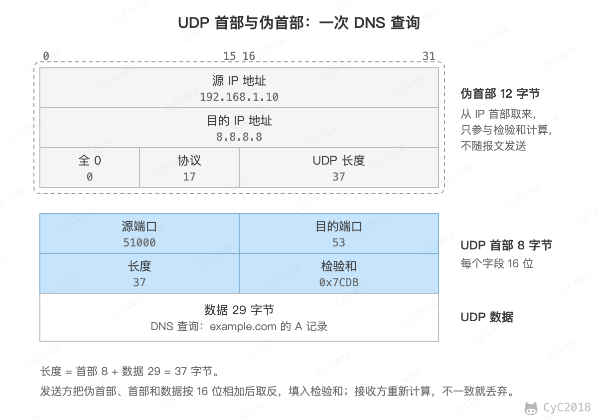 </div><br>

首部字段只有 8 个字节，包括源端口、目的端口、长度、检验和。12 字节的伪首部是为了计算检验和临时添加的。

## TCP 首部格式

<div align="center"> 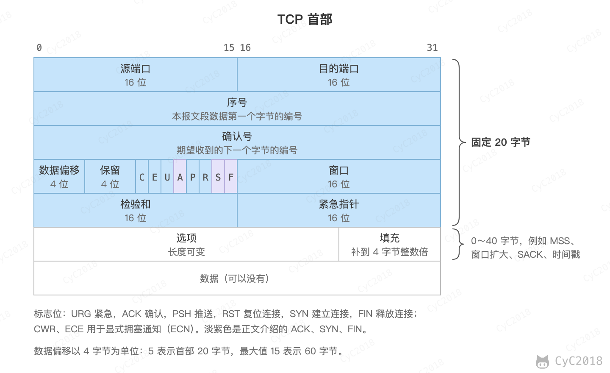 </div><br>

- 序号：用于对字节流进行编号，例如序号为 301，表示第一个字节的编号为 301，如果携带的数据长度为 100 字节，那么下一个报文段的序号应为 401；
- 确认号：期望收到的下一个报文段的序号。例如 B 正确收到 A 发送来的一个报文段，序号为 501，携带的数据长度为 200 字节，因此 B 期望下一个报文段的序号为 701，B 发送给 A 的确认报文段中确认号就为 701；
- 数据偏移：指的是数据部分距离报文段起始处的偏移量，实际上指的是首部的长度；
- 确认 ACK：当 ACK=1 时确认号字段有效，否则无效。TCP 规定，在连接建立后所有传送的报文段都必须把 ACK 置 1；
- 同步 SYN：在连接建立时用来同步序号。当 SYN=1，ACK=0 时表示这是一个连接请求报文段。若对方同意建立连接，则响应报文中 SYN=1，ACK=1；
- 终止 FIN：用来释放一个连接，当 FIN=1 时，表示此报文段的发送方的数据已发送完毕，并要求释放连接；
- 窗口：窗口值作为接收方让发送方设置其发送窗口的依据。之所以要有这个限制，是因为接收方的数据缓存空间是有限的。

## TCP 的三次握手 🔥🔥

<div align="center"> 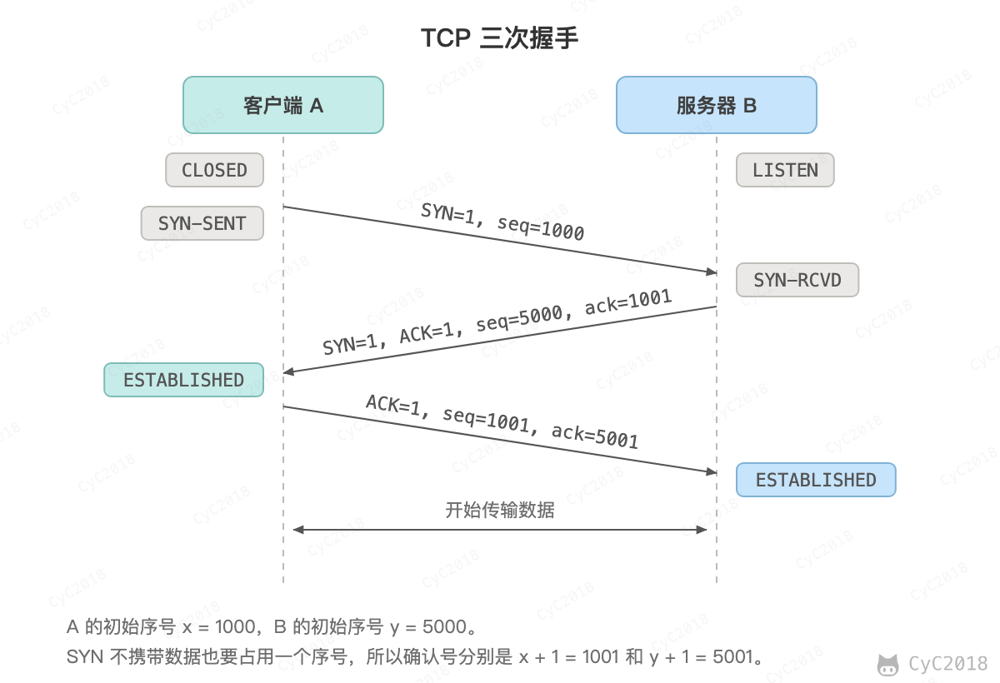 </div><br>

假设 A 为客户端，B 为服务器端。

- 首先 B 处于 LISTEN（监听）状态，等待客户的连接请求；
- A 向 B 发送连接请求报文，SYN=1，ACK=0，选择一个初始的序号 x，进入 SYN_SENT 状态；
- B 收到连接请求报文，如果同意建立连接，则向 A 发送连接确认报文，SYN=1，ACK=1，确认号为 x+1，同时也选择一个初始的序号 y，进入 SYN_RCVD 状态；
- A 收到 B 的连接确认报文后，还要向 B 发出确认，确认号为 y+1，序号为 x+1，A 进入 ESTABLISHED 状态，阻塞式 connect() 此时成功返回，不等这个确认到达 B；
- B 收到 A 的确认后也进入 ESTABLISHED 状态，连接建立，服务器的 accept() 这时才能取到这个连接。

初始序号不从 0 开始，而是由一个随时间递增的计数器加上四元组（双方的 IP 地址和端口）与密钥的哈希值算出。计数器让同一四元组先后建立的连接从不同的序号开始，减少旧连接残留的报文段被新连接误收；带密钥的哈希让攻击者猜不出序号，难以伪造报文段插入连接。

第三次握手可以携带数据，因为 A 收到 SYN+ACK 时已经确认了双方的序号，连接对 A 来说已经建立。SYN 中即使带了数据，也要等握手完成才能交给应用；TCP 快速打开（TCP Fast Open, TFO）用上一次连接时得到的 Cookie 验证客户端，SYN 中的数据才能立即交给应用。

### 三次握手的原因

双方都要把自己的初始序号告诉对方，并得到对方的确认：A 发送 x，B 确认；B 发送 y，A 确认。这本来是四个动作，B 的确认和 B 的 SYN 合并在了一个报文中，所以只需要三次。只握手两次时，B 的初始序号没有得到确认，B 无法知道 A 是否收到了它。

第三次握手还可以防止已经失效的连接请求到达服务器，让服务器错误地打开连接。例如 A 发出的 SYN 在网络中滞留，A 等不到回复，connect() 超时后放弃；很久以后这个 SYN 才到达 B：

<div align="center"> 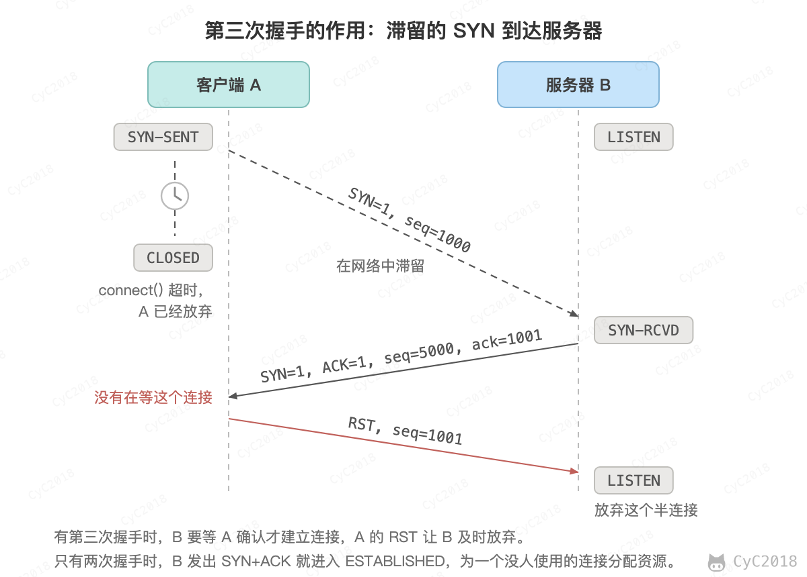 </div><br>

B 照常回复 SYN+ACK。A 并没有在等这个连接，回复 RST（复位报文段，告诉对方这个连接不存在），B 收到后放弃这个半连接。如果只有两次握手，B 发出 SYN+ACK 就认为连接已经建立，为它分配资源，等待一个永远不会来的请求。A 已经重新发起连接时，这个确认对不上 A 正在进行的连接，A 同样回复 RST，B 不会多打开一个连接。

### 握手报文丢失

每个握手报文都可能丢失，丢失后靠超时重传恢复（Linux 6.10 实测，见[附录 A2](#a2-握手报文丢失)）：

- 第一次握手的 SYN 丢失：客户端收不到 SYN+ACK，超时后重传 SYN。Linux 6.5 之前按 tcp_syn_retries（默认 6）重传，间隔从 1 秒起每次翻倍，约 127 秒后放弃；6.5 起前几次重传改为固定间隔 1 秒（tcp_syn_linear_timeouts，默认 4），实测共重传 10 次，134 秒后 connect() 返回超时错误；
- 第二次握手的 SYN+ACK 丢失：客户端以为 SYN 丢了，重传 SYN；服务器收不到第三次握手，也重传 SYN+ACK（tcp_synack_retries 默认 5 次，间隔 1、2、4、8、16 秒），任何一方的重传到达，连接都能建立；
- 第三次握手的 ACK 丢失：客户端发出 ACK 后已经进入 ESTABLISHED，服务器仍处于 SYN_RCVD，继续重传 SYN+ACK，客户端每收到一次就再回复一次 ACK。客户端发送的数据报文段也带有 ACK，服务器收到后同样会建立连接；如果这些 ACK 都丢失、客户端也一直不发数据，服务器重传 5 次后放弃，之后客户端再发数据会收到 RST。

<div align="center"> 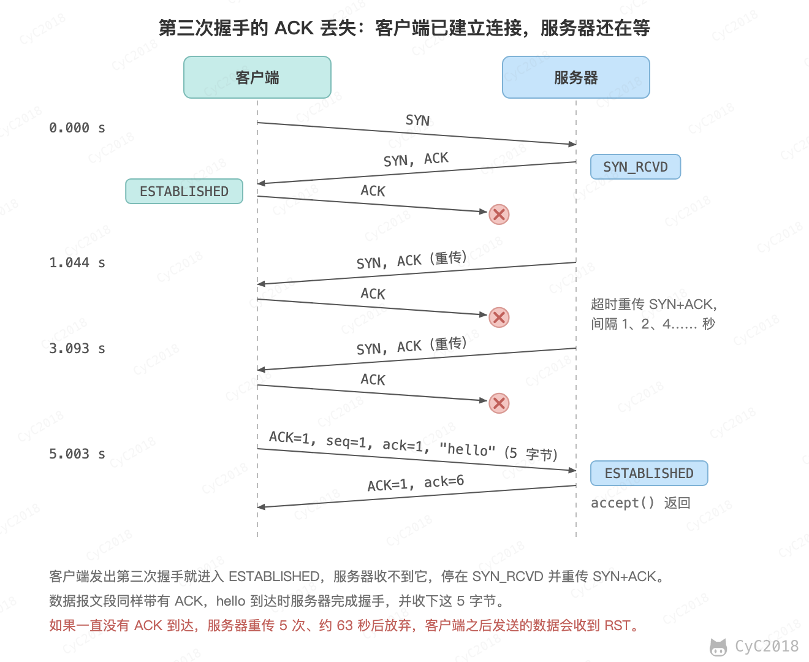 </div><br>

服务器用两个队列存放还没有被应用取走的连接：收到 SYN 后，连接进入半连接队列（SYN_RCVD）；握手完成后移入全连接队列，等应用调用 accept() 取走。listen() 的 backlog 参数指的是全连接队列的长度，超过 net.core.somaxconn（Linux 5.4 起默认 4096）时按它截断。

全连接队列满时，Linux 默认丢弃新到的 SYN，客户端按上面的规则重传。例如 backlog 为 2、服务器不调用 accept()，依次发起 6 个连接，3 个连接建立，另外 3 个停在 SYN_SENT。ss -lnt 中 LISTEN 一行的 Recv-Q 是全连接队列中的连接数，Send-Q 是 backlog（Linux 6.10 实测，见[附录 A8](#a8-全连接队列已满)）：

<div align="center"> 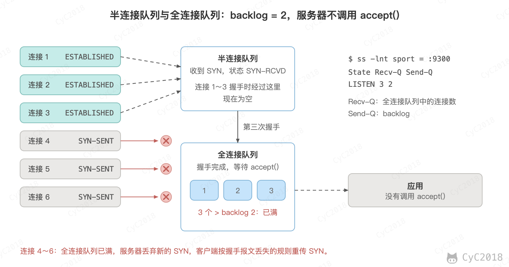 </div><br>

只发 SYN、不完成握手的 SYN Flood 攻击用来占满半连接队列。Linux 默认开启 SYN Cookie：队列溢出时不保存半连接，把连接信息编码进 SYN+ACK 的序号，收到第三次握手时再还原，见 [拒绝服务攻击](攻击技术.md#四拒绝服务攻击)。

## TCP 的四次挥手 🔥

<div align="center"> 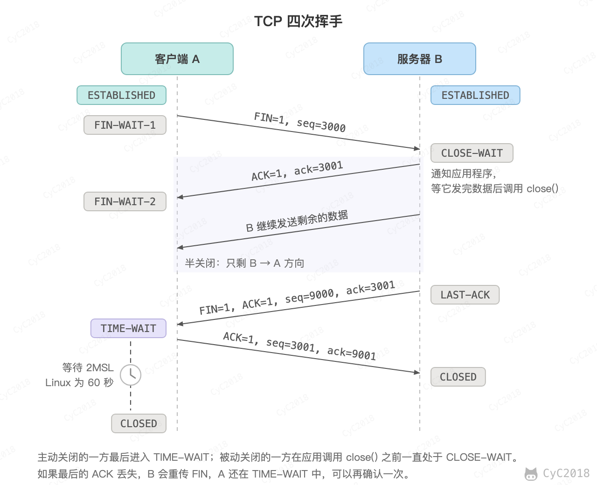 </div><br>

以下描述省略序号和确认号（数值见图），连接建立后所有报文段的 ACK 都为 1，也不再单独写出。

- A 发送连接释放报文，FIN=1，进入 FIN_WAIT_1 状态；
- B 收到之后发出确认，进入 CLOSE_WAIT 状态，A 收到确认后进入 FIN_WAIT_2 状态。此时 TCP 属于半关闭状态，B 能向 A 发送数据但是 A 不能向 B 发送数据；
- 当 B 不再需要连接时，发送连接释放报文，FIN=1，进入 LAST_ACK 状态；
- A 收到后发出确认，进入 TIME_WAIT 状态，等待 2 MSL（Maximum Segment Lifetime，最大报文段寿命）后释放连接；
- B 收到 A 的确认后释放连接，进入 CLOSED 状态。

FIN 和数据一样，丢失后由发送方超时重传。A 在 FIN_WAIT_2 中等待 B 的 FIN，如果 A 的应用已经调用了 close()，而 B 迟迟不发 FIN，Linux 会在 tcp_fin_timeout（默认 60 秒）后直接释放这个连接。

### 四次挥手的原因

TCP 是全双工的，两个方向要分别关闭。A 的 FIN 只表示 A 不再发送数据，B 可能还有数据没发完，所以 B 先回复确认，进入 CLOSE_WAIT 继续发送，等应用发完并调用 close() 后再发出自己的 FIN。握手时 B 的 SYN 和确认可以一起发出，挥手时 B 的确认和 FIN 通常隔着一段时间，只能分开发送，所以多了一次。

如果 B 收到 FIN 时已经没有数据要发送，应用立即调用 close()，B 的确认和 FIN 就可以合并在一个报文段中，挥手只有三次。Linux 收到 FIN 后，确认会延迟几十毫秒再发送，应用在这期间调用 close() 就会合并（Linux 6.10 实测，见[附录 A3](#a3-三次挥手)）：

```text
B 读到 EOF 后立即 close()           B 读到 EOF 后 1 秒再 close()
A → B  FIN                          A → B  FIN
B → A  FIN + ACK                    B → A  ACK         47 ms 后
A → B  ACK                          B → A  FIN + ACK   1 秒后
                                    A → B  ACK
```

### TIME_WAIT

A 收到 B 的 FIN 并发出确认后进入 TIME_WAIT，等待 2MSL 才进入 CLOSED。这么做有两个理由：

- 确保最后一个确认能够到达。这个确认丢失时，B 会重传 FIN，A 还在 TIME_WAIT 中，每收到一次就再确认一次，并重新开始计时（Linux 6.10 实测，见[附录 A4](#a4-最后的-ack-丢失)）。如果 A 已经关闭，收到重传的 FIN 只能回复 RST，B 就无法正常关闭；
- 让本连接的所有报文段都从网络中消失。之后用同一个四元组建立的新连接，就不会收到旧连接迟到的报文段。

<div align="center"> 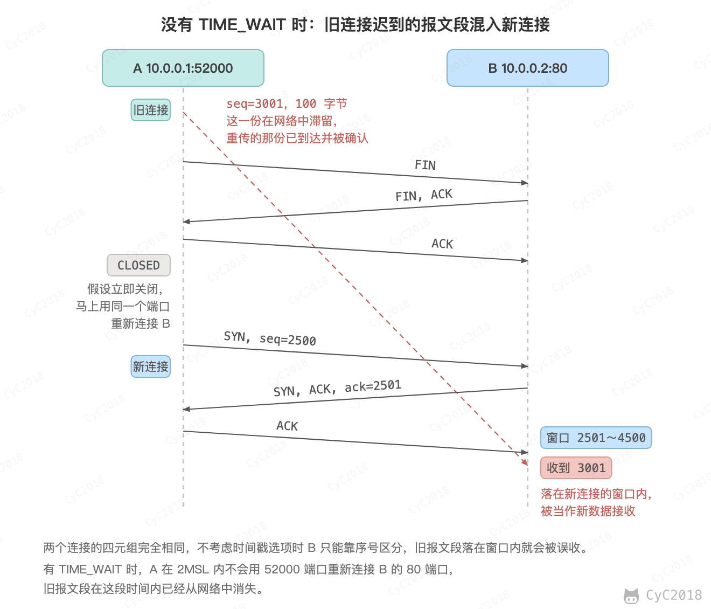 </div><br>

2MSL 正好覆盖一个来回：A 的确认最多在网络中存活 1 MSL，B 超时重传的 FIN 最多再存活 1 MSL。RFC 9293 把 MSL 取为 2 分钟，Linux 中 TIME_WAIT 则固定为 60 秒（TCP_TIMEWAIT_LEN）。

### 大量 TIME_WAIT 与 CLOSE_WAIT

TIME_WAIT 出现在主动关闭的一方，本身是正常的状态，数量多到耗尽端口时才成为问题。使用短连接的机器会积累大量 TIME_WAIT，例如每次请求都新建连接去访问下游服务。每个 TIME_WAIT 连接占用一个本地端口 60 秒，Linux 默认的本地端口范围是 32768～60999，共 28232 个，连接同一个目标地址和端口时，每秒新建超过约 470 个连接就会耗尽端口。

服务器主动关闭时 TIME_WAIT 留在服务器上，例如响应后关闭的 HTTP 短连接。这些连接共用监听端口，靠客户端的地址和端口区分，不消耗本地端口，只占少量内存；总数超过 tcp_max_tw_buckets 时，新进入 TIME_WAIT 的连接会被直接销毁。Nginx 这类代理既是服务器又向上游发起连接，排查时先确认是哪个方向的连接、哪一方先关闭。

各状态的连接数可以这样统计：

```bash
ss -tan | awk 'NR > 1 {print $1}' | sort | uniq -c
```

解决方案：

- 使用长连接或连接池，例如 [HTTP 的长连接](HTTP.md#1-短连接与长连接)、数据库连接池；
- 在发起连接的一方开启 net.ipv4.tcp_tw_reuse，允许新连接复用处于 TIME_WAIT 的端口，它依靠 TCP 时间戳选项识别旧连接的报文（Linux 默认值为 2，只对回环地址生效，设为 1 才对所有出站连接生效）；
- 扩大本地端口范围 net.ipv4.ip_local_port_range。

Linux 没有提供修改 TIME_WAIT 时长的参数，缩短它也会让旧连接的报文段更容易混进新连接。另一个参数 tcp_tw_recycle 在 NAT 环境下会丢弃正常的连接，Linux 4.12 已将其移除。

CLOSE_WAIT 出现在被动关闭的一方，表示对方已经关闭，本方的应用还没有调用 close()。连接大量停在 CLOSE_WAIT 通常是程序的问题，例如异常分支没有关闭连接、从连接池借出的连接没有归还，这些连接会一直占用文件描述符，积累到上限后出现 Too many open files。排查时用 ss -tanp state close-wait 找到所属进程，再检查代码。

## TCP 可靠传输 🔥

IP 层只尽力交付，分组可能出错、丢失、重复或者乱序到达。TCP 在此之上用以下机制保证应用读到的字节流与对方写入的完全一致：

- 检验和：首部和数据都参与计算，出错的报文段直接丢弃，当作丢失处理；
- 序号和确认：每个字节都有序号，接收方据此丢弃重复的数据、把乱序到达的数据排好顺序，并用确认号告诉发送方哪些已经收到；
- 重传：发送方超时没有收到确认，或者收到多个重复确认，就重传数据；
- 滑动窗口、流量控制和拥塞控制：在等待确认的同时连续发送多个报文段，并让发送速率不超过接收方和网络的处理能力，见后面几节。

三次握手也是可靠传输的一部分：双方在握手中交换并确认了各自的初始序号，之后的序号和确认才有共同的起点。

### 确认与重传

TCP 的确认是累积的：确认号为 N 表示 N 之前的字节都已收到。例如发送方连续发出 8 个报文段，每段 1000 字节，第 2 段丢失，双方都支持选择确认（Selective Acknowledgment, SACK）：

<div align="center"> 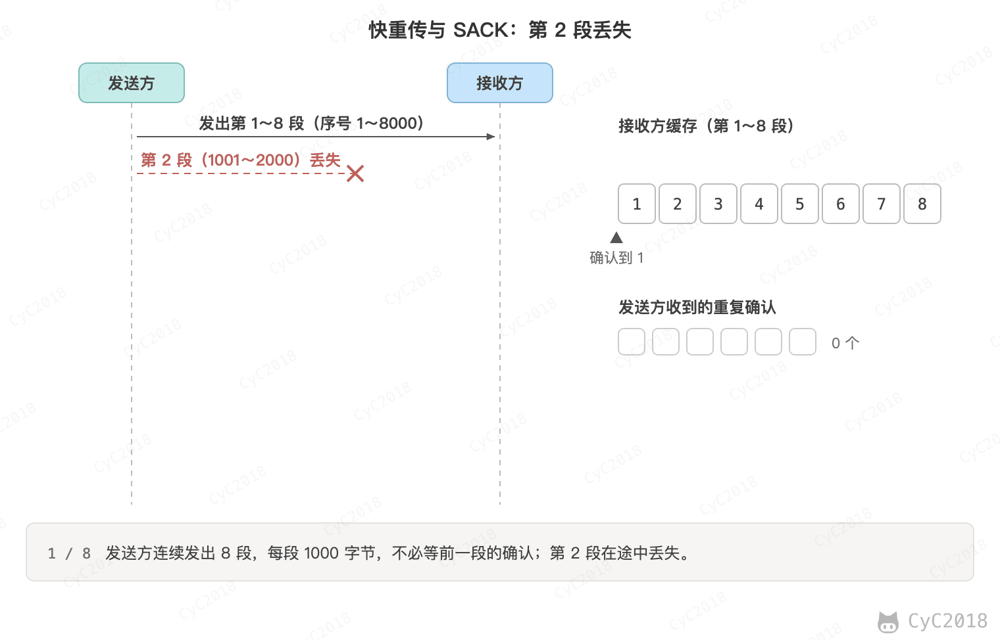 </div><br>

第 3 段到达时，接收方仍然只能确认到 1001，于是重复发送 ack 1001，称为重复确认。发送方收到 3 个重复确认，就知道 1001 开始的这一段丢了，不等超时立即重传，即快重传。要等 3 个，是因为报文段乱序到达也会产生一两个重复确认；接收方补上空洞后，一次确认到 8001。

SACK 是握手时协商的选项，确认中额外携带已经收到的区间。上例中 SACK 2001～8000 告诉发送方只缺 1001～2000，发送方只重传这一段；没有 SACK 时，发送方只知道 1001 之后有缺失，不知道后面哪些已经到达。

在 Linux 上丢弃第 2 段，抓包结果与上面一致：接收方发出 1 个确认和 6 个重复确认，SACK 区间逐步扩大到 2001～8000，发送方在第 2 段首次发出后约 28 ms 重传，远小于 200 ms 的最小超时时间（Linux 6.10 实测，见[附录 A6](#a6-快重传与-sack)）。快重传之后拥塞窗口的变化见[快重传与快恢复](#2-快重传与快恢复)。

### 超时重传时间

如果一个已经发送的报文段在超时时间内没有收到确认，发送方就重传这个报文段。超时时间太短会把晚到的确认误判为丢失，造成不必要的重传；太长则丢包后要等很久才恢复，所以要根据测得的往返时间动态计算。

一个报文段从发送再到接收到确认所经过的时间称为往返时间 RTT，加权平均往返时间 RTTs 计算如下：

```text
RTTs = (1 - a) × RTTs + a × RTT
```

其中，0 ≤ a ＜ 1，RTTs 随着 a 的增加更容易受到 RTT 的影响。

超时时间 RTO 应该略大于 RTTs，TCP 使用的超时时间计算如下：

```text
RTO = RTTs + 4 × RTTd
```

其中 RTTd 为新测得的 RTT 与更新前的 RTTs 之差的绝对值的加权平均值，每次先更新 RTTd 再更新 RTTs；第一次测量时 RTTs 取 RTT，RTTd 取 RTT / 2。RFC 6298 建议 a 取 1/8，计算 RTTd 时的权重取 1/4，并建议 RTO 不小于 1 秒；Linux 的下限为 200 ms。

例如先后测得的 RTT 为 100、120、300、110 ms，按 RFC 6298 计算如下（单位 ms，不计 1 秒的下限，|RTTs − RTT| 用的是更新前的 RTTs）：

```text
RTT    |RTTs − RTT|    RTTd    RTTs     RTO
100    —               50      100      300
120    20              42.5    102.5    273
300    197.5           81.3    127.2    452
110    17.2            65.2    125.0    386
```

RTT 稳定时 RTO 逐渐向 RTT 靠拢；一次 300 ms 的抖动让偏差项变大，RTO 随之变长，避免下一次抖动时误判丢失。

此外还有两条规则：

- 重传过的报文段不用来测量 RTT（Karn 算法），因为收到确认时分不清它确认的是原来那次还是重传的那次。TCP 的时间戳选项把发送时间放在报文段中，对方确认时原样带回，可以准确测量；
- 每次超时后 RTO 翻倍，称为指数退避，网络拥塞时可以减少重传的报文。例如[附录 A4](#a4-最后的-ack-丢失)中服务器重传 FIN 的间隔从约 0.2 秒增长到约 3.3 秒。

## TCP 滑动窗口

如果每发出一个报文段都要等到确认再发下一个，一个 RTT 只能发送一个报文段，例如 RTT 为 100 ms、每段 1460 字节时，吞吐量只有约 117 kbit/s。滑动窗口允许发送方连续发出窗口内的多个报文段，再随着确认的到达向前滑动。

窗口是一段允许发送或接收的序号范围，对应缓存中暂时存放字节流的部分。发送方和接收方各有一个窗口，接收方通过 TCP 报文段中的窗口字段告诉发送方自己的窗口大小，发送方的窗口不超过这个值，还要受拥塞窗口的限制（见[TCP 拥塞控制](#tcp-拥塞控制)）。

发送窗口内的字节都允许发送，接收窗口内的字节都允许接收。发送窗口左端的字节收到确认后，窗口向右滑动，直到左端是第一个还没有被确认的字节；接收窗口左端的字节按序收到并确认后，接收窗口同样向右滑动。

接收窗口只会对窗口内最后一个按序到达的字节进行确认，例如接收窗口已经收到的字节为 {31, 34, 35}，其中 {31} 按序到达，而 {34, 35} 就不是，因此只对字节 31 进行确认，确认号为 32。发送方得到一个字节的确认之后，就知道这个字节之前的所有字节都已经被接收。图中假设 B 的应用及时读走数据，通告的窗口一直是 10；应用不读取时窗口会缩小，见[流量控制](#tcp-流量控制)。

<div align="center"> 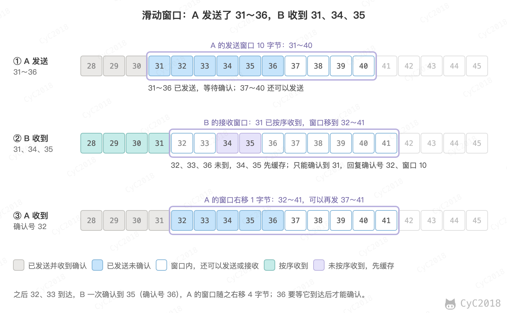 </div><br>

## TCP 流量控制

流量控制是为了控制发送方的发送速率，保证接收方来得及接收。接收方在确认报文的窗口字段中通告接收缓冲区还空着的大小，发送方已发送但未确认的数据不能超过这个值。

应用读得慢，缓冲区逐渐填满，窗口就逐渐变小直到 0，发送方随之停下；应用读走数据后，接收方发出窗口更新，发送方继续发送。例如服务器把接收缓冲区设为 16 KB 并且暂不读取，客户端不停地写入（Linux 6.10 实测，见[附录 A7](#a7-零窗口与窗口探测)）：

```text
时间（秒）        服务器通告的窗口（字节）    说明
0.000             15928、15000、14000、13000  数据陆续到达，服务器不读取
0.042             5792
0.083             1448
0.124             0                           客户端停止发送
0.34、0.77、1.69  0                           客户端发送零窗口探测，回复的窗口仍为 0
3.002             15928                       服务器读走数据，客户端立即恢复发送
```

窗口为 0 时，发送方启动持续计时器，定期发送零窗口探测报文段，间隔逐次翻倍，对方收到后必须回复当前的窗口。这是因为窗口更新报文不携带数据，丢失后不会重传，如果发送方只是等待，双方就会一直互相等待。

首部的窗口字段只有 16 位，最大 65535 字节。在带宽大、延迟高的网络中不够用，例如 RTT 为 100 ms 时，64 KB 的窗口最多只能达到约 5 Mbit/s，而 1 Gbit/s 的链路一个 RTT 内可以发出 12.5 MB，即带宽 × RTT（带宽时延积），窗口至少要这么大才能跑满链路。窗口扩大选项在握手时协商一个移位数，实际窗口为窗口字段左移这么多位，移位数最大为 14，窗口最大约 1 GB。

## TCP 拥塞控制 🔥🔥

如果网络出现拥塞，分组将会丢失，此时发送方会继续重传，从而导致网络拥塞程度更高。因此当出现拥塞时，应当控制发送方的速率。这一点和流量控制很像，但是出发点不同。流量控制是为了让接收方能来得及接收，而拥塞控制是为了降低整个网络的拥塞程度。

发送方通常看不到路由器的状态，下面介绍的经典算法把丢包当作拥塞的信号：发生超时，或者收到 3 个重复确认。

<div align="center"> 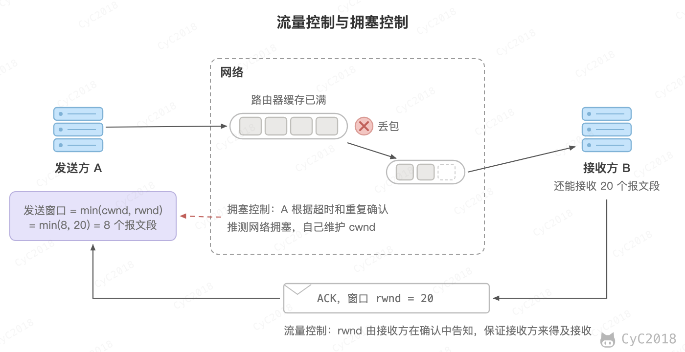 </div><br>

TCP 主要通过四个算法来进行拥塞控制：慢开始、拥塞避免、快重传、快恢复。

发送方需要维护一个叫做拥塞窗口（cwnd）的状态变量，注意拥塞窗口与发送方窗口的区别：拥塞窗口只是一个状态变量，实际决定发送方能发送多少数据的是发送方窗口，它取拥塞窗口和接收方通告的窗口中的较小值。

为了便于讨论，做如下假设：

- 接收方有足够大的接收缓存，因此不会发生流量控制；
- 虽然 TCP 的窗口基于字节，但是这里设窗口的大小单位为报文段。

<div align="center"> 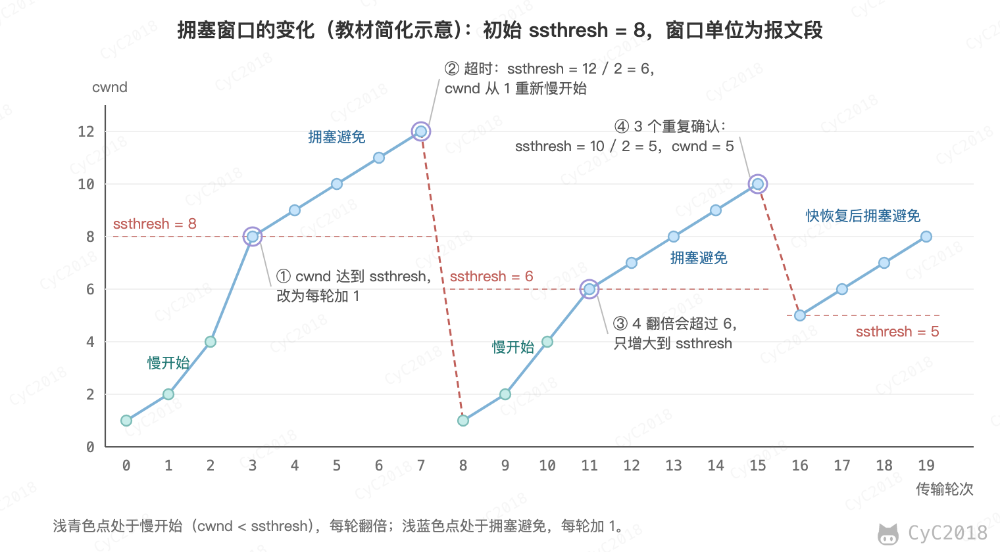 </div><br>

### 1. 慢开始与拥塞避免

发送的最初执行慢开始，令 cwnd = 1，发送方只能发送 1 个报文段；每收到一个对新数据的确认，cwnd 加 1，一个轮次发出的报文段都被确认后 cwnd 就翻了一倍，因此之后每个轮次能够发送的报文段数量为：2、4、8 ...

实际实现中初始拥塞窗口通常更大，RFC 6928 建议初始值为 10 个报文段。

慢开始每个轮次都将 cwnd 加倍，增长很快，很容易造成拥塞。因此设置一个慢开始门限 ssthresh，当 cwnd \>= ssthresh 时，进入拥塞避免，每个轮次只将 cwnd 加 1。

如果出现了超时，则令 ssthresh = cwnd / 2，然后重新执行慢开始。

### 2. 快重传与快恢复

接收方每收到一个失序的报文段，就重复确认最后一个按序到达的报文段；发送方收到 3 个重复确认，就立即重传下一个报文段，过程见[确认与重传](#确认与重传)。例如收到 3 个对 M<sub>2</sub> 的重复确认，说明 M<sub>3</sub> 丢失，立即重传 M<sub>3</sub>。

<div align="center"> 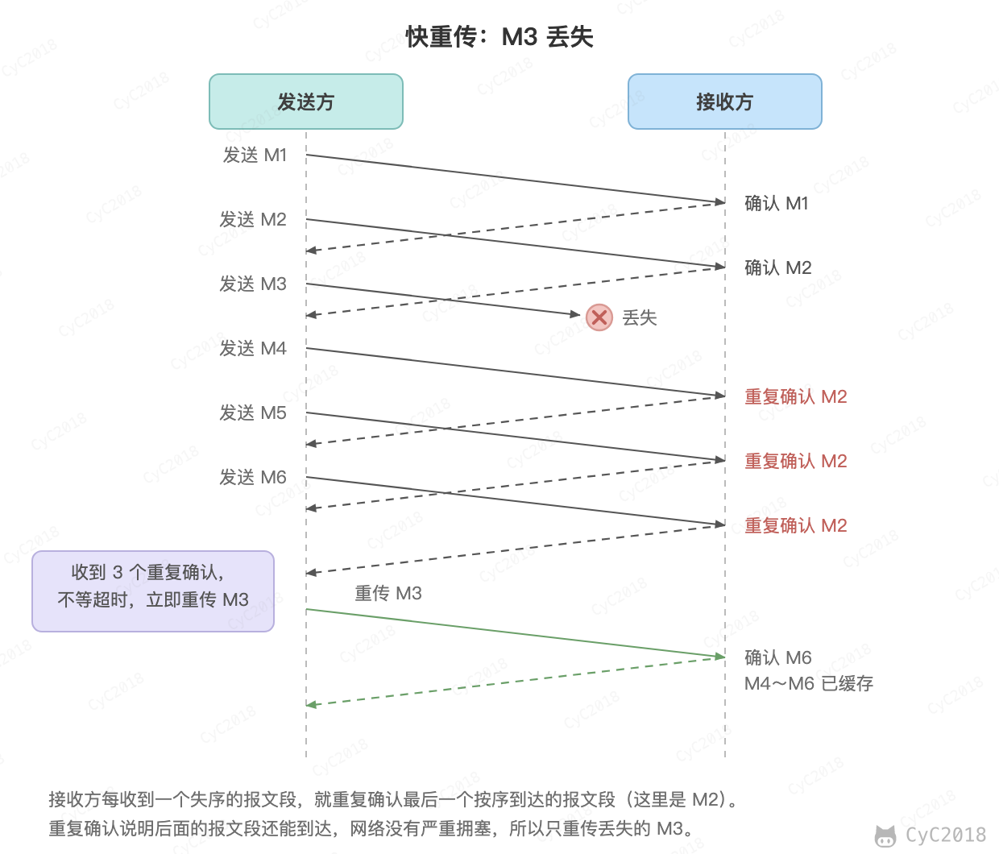 </div><br>

重复确认说明后面的报文段还能到达，网络只是轻度拥塞，不必像超时那样从 1 重新开始。因此执行快恢复，令 ssthresh = cwnd / 2，cwnd = ssthresh，直接进入拥塞避免。

这是教材中的简化。RFC 5681 中重传后先令 cwnd = ssthresh + 3（3 个重复确认说明已有 3 个报文段离开网络），之后每收到一个重复确认 cwnd 再加 1，收到确认新数据的 ACK 后 cwnd 才回到 ssthresh，进入拥塞避免。

慢开始和快恢复的快慢指的是 cwnd 的设定值，而不是 cwnd 的增长速率。慢开始 cwnd 设定为 1，而快恢复 cwnd 设定为 ssthresh。

以上是经典的 Reno 算法（RFC 5681）。Linux、Windows 和 Apple 的协议栈默认使用的是 CUBIC（RFC 9438），它保留了慢开始和快重传，区别在拥塞避免阶段：cwnd 按距离上次丢包的时间的三次函数增长，先快速回到丢包前的大小，在附近放慢，然后再加速探测更大的带宽，在带宽大、延迟高的网络中比每轮加 1 增长得快。Google 的 BBR 则不再把丢包作为主要的拥塞信号，而是根据测得的瓶颈带宽和最小 RTT 来控制发送速率。

## TCP 粘包与拆包

TCP 面向字节流，只保证字节按顺序到达，不保留应用每次写入的边界。发送方写入两次，接收方的一次读取可能读到两条消息拼在一起，称为粘包；也可能只读到一条消息的一部分，称为拆包（也叫半包）。

例如客户端依次写入 hello、world 和一条 200000 字节的消息，服务器等待 200 ms 后，先用 1024 字节的缓冲区读一次，再用 300000 字节的缓冲区读完剩下的数据：

<div align="center"> 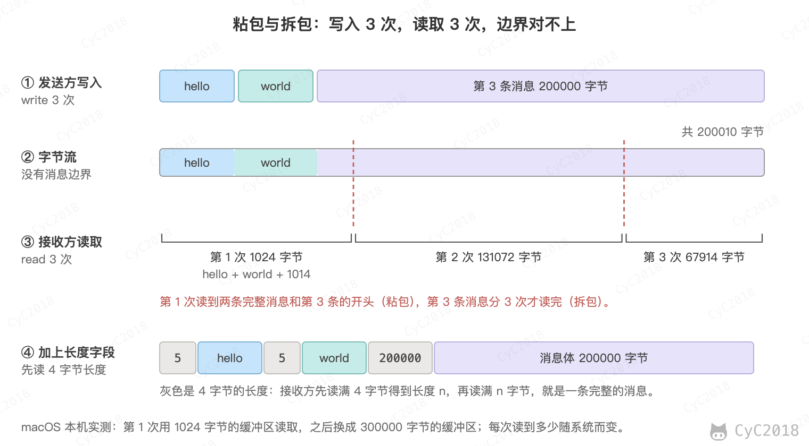 </div><br>

产生的原因主要有以下几种：

- 数据先进入接收缓冲区，应用读取时缓冲区里有多少就读出多少，最多读满自己的缓冲区；
- 发送方的 Nagle 算法会把多次写入的小数据合并成一个报文段发送；
- 超过最大报文段长度（Maximum Segment Size, MSS）的消息会被分成多个报文段，可能分多次读到。

UDP 面向报文，一次读取得到的就是对方一次发送的一个数据报，不存在粘包。需要注意的是，接收缓冲区比数据报小时，多出的部分会被丢弃，不会留到下一次读取。

解决方法是在应用层约定消息的边界，常用以下三种：

- 固定长度：每条消息长度相同，不足的部分补齐，浪费空间；
- 分隔符：用特殊字符标记消息结束，内容中的分隔符要转义或禁止出现，例如 Redis 协议的简单字符串以 `\r\n` 结束，内容中不能有换行；
- 长度字段：在消息头部写明消息体的长度，接收方先读长度，再读够这么多字节。

HTTP/1.1 同时用了后两种：首部以一个空行结束，消息体的长度由 Content-Length 给出，或者用 [分块传输编码](HTTP.md#分块传输编码) 在每一块前写明长度。Netty 提供了对应的解码器 FixedLengthFrameDecoder、DelimiterBasedFrameDecoder 和 LengthFieldBasedFrameDecoder。

用长度字段收发消息的最小实现如下，按这种格式重复上面的例子，接收方依次得到 hello、world 和 200000 字节的消息：

```java
static final int MAX = 1 << 20;

static void send(DataOutputStream out, String msg) throws IOException {
    byte[] body = msg.getBytes(StandardCharsets.UTF_8);
    out.writeInt(body.length);   // 4 字节的长度
    out.write(body);
    out.flush();
}

static String receive(DataInputStream in) throws IOException {
    int len = in.readInt();      // 读满 4 字节
    if (len < 0 || len > MAX) {
        throw new IOException("bad length " + len);
    }
    byte[] body = new byte[len];
    in.readFully(body);          // 读满 len 字节，不够就继续等待
    return new String(body, StandardCharsets.UTF_8);
}
```

需要注意的是，长度字段来自网络，必须限制上限，否则对方发来一个 2 GB 的长度，服务器就会为它分配 2 GB 内存。

## 在 UDP 上实现可靠传输

游戏中的位置可以丢，购买道具、释放技能这类消息却必须送达。既要 UDP 的低延迟、又有一部分数据必须可靠时，就要在应用层按 TCP 的思路自己实现：

- 序号：给每个数据包编号，接收方据此去重和排序；
- 确认和重传：接收方回复确认，发送方超时没有收到确认就重传，超时时间根据测得的 RTT 计算；
- 流量控制和拥塞控制：限制已发送但未确认的数据量，避免压垮接收方和网络。

与直接使用 TCP 相比，好处在于可以按需取舍：只对需要的消息重传，不相关的消息互不阻塞，重传和拥塞控制的参数也可以按业务调整。

HTTP/3 使用的 QUIC 就是在 UDP 上实现的可靠传输，并改进了 TCP 的几处设计：

- 包号只增不减，丢失的数据放进一个新编号的包中重传。收到确认时能分清确认的是哪一次发送，RTT 测得更准；TCP 重传时沿用原来的序号，无法区分；
- 数据按流（Stream）组织，每个流按帧中的偏移量单独排序，一个流丢包不影响其它流；
- 一个确认帧可以携带很多个已收到的区间，TCP 的选择确认（SACK）受首部长度限制，通常最多携带 3 个区间。

QUIC 选择在 UDP 上重新实现，而不是改进 TCP，是因为 TCP 实现在操作系统内核中，改动要等操作系统升级才能普及；防火墙、NAT 等中间设备还会检查甚至改写 TCP 首部，不认识的新选项可能被丢弃。QUIC 运行在用户态，随浏览器和 App 一起更新，并且加密了大部分首部，中间设备无法干预。QUIC 的握手和连接迁移见 [HTTP/3](HTTP.md#http3)。

## 附录：实测

以下实验都在 Docker Desktop（Apple M1 Pro）中的 Ubuntu 24.04 容器里进行，内核为 6.10.14-linuxkit，客户端和服务器都在 127.0.0.1 上，用 iptables 丢弃指定的报文，用 tc netem 模拟时延和丢包，tcpdump 的时间换算为相对第一个报文的秒数。容器中的默认参数：

```text
net.ipv4.tcp_syn_retries = 6
net.ipv4.tcp_synack_retries = 5
net.ipv4.tcp_syn_linear_timeouts = 4
net.ipv4.tcp_fin_timeout = 60
```

### A1 TCP 与 UDP 发送位置更新

在回环网卡上加入 25 ms 的单向时延（RTT 50 ms）和 5% 的丢包，发送方每 50 ms 发送一条 12 字节的更新（序号和发送时间），TCP 关闭 Nagle 算法，接收方用收到的时间减去发送时间得到延迟：

```bash
tc qdisc add dev lo root netem delay 25ms loss 5%
```

```python
# TCP：长度固定为 12 字节，接收方按 12 字节切分
s = socket.create_connection(("127.0.0.1", 9100))
s.setsockopt(socket.IPPROTO_TCP, socket.TCP_NODELAY, 1)
for i in range(600):
    s.sendall(struct.pack("!Id", i, time.time())); time.sleep(0.05)

# UDP：每条更新一个数据报
for i in range(600):
    s.sendto(struct.pack("!Id", i, time.time()), ("127.0.0.1", 9101)); time.sleep(0.05)
```

连续运行 5 次，配图使用第 3 次的数据：

```text
TCP: 到达 600/600，延迟 p50 32 ms，p99 654 ms，最大 939 ms，超过 100 ms 的 52 条
UDP: 到达 572/600，延迟 p50 33 ms，p99 37 ms，最大 40 ms，超过 100 ms 的 0 条
TCP: 到达 600/600，延迟 p50 30 ms，p99 152 ms，最大 307 ms，超过 100 ms 的 24 条
UDP: 到达 570/600，延迟 p50 33 ms，p99 37 ms，最大 37 ms，超过 100 ms 的 0 条
TCP: 到达 600/600，延迟 p50 32 ms，p99 253 ms，最大 416 ms，超过 100 ms 的 43 条
UDP: 到达 577/600，延迟 p50 33 ms，p99 37 ms，最大 44 ms，超过 100 ms 的 0 条
TCP: 到达 600/600，延迟 p50 30 ms，p99 363 ms，最大 466 ms，超过 100 ms 的 53 条
UDP: 到达 570/600，延迟 p50 33 ms，p99 37 ms，最大 39 ms，超过 100 ms 的 0 条
TCP: 到达 600/600，延迟 p50 32 ms，p99 191 ms，最大 363 ms，超过 100 ms 的 35 条
UDP: 到达 571/600，延迟 p50 33 ms，p99 37 ms，最大 42 ms，超过 100 ms 的 0 条
```

### A2 握手报文丢失

第一次握手的 SYN 丢失：丢弃所有发往 9000 端口的 SYN，客户端调用 connect()：

```text
$ iptables -A INPUT -p tcp --dport 9000 --tcp-flags SYN,ACK SYN -j DROP
  0.000  127.0.0.1.53094 > 127.0.0.1.9000: Flags [S], seq 3381671799
  1.038  127.0.0.1.53094 > 127.0.0.1.9000: Flags [S], seq 3381671799
  2.065  127.0.0.1.53094 > 127.0.0.1.9000: Flags [S], seq 3381671799
  3.085  127.0.0.1.53094 > 127.0.0.1.9000: Flags [S], seq 3381671799
  4.112  127.0.0.1.53094 > 127.0.0.1.9000: Flags [S], seq 3381671799
  5.140  127.0.0.1.53094 > 127.0.0.1.9000: Flags [S], seq 3381671799
  7.182  127.0.0.1.53094 > 127.0.0.1.9000: Flags [S], seq 3381671799
 11.220  127.0.0.1.53094 > 127.0.0.1.9000: Flags [S], seq 3381671799
 19.726  127.0.0.1.53094 > 127.0.0.1.9000: Flags [S], seq 3381671799
 36.110  127.0.0.1.53094 > 127.0.0.1.9000: Flags [S], seq 3381671799
 68.369  127.0.0.1.53094 > 127.0.0.1.9000: Flags [S], seq 3381671799
connect 失败: TimeoutError(110, 'Connection timed out')，耗时 134.4 秒
```

第二次握手的 SYN+ACK 丢失：前 4 秒丢弃服务器发出的 SYN+ACK（tcpdump 在丢弃之前抓包，所以被丢弃的报文也会显示）：

```text
$ iptables -A INPUT -p tcp --sport 9000 --tcp-flags SYN,ACK SYN,ACK -j DROP
  0.000  127.0.0.1.56260 > 127.0.0.1.9000: Flags [S]      客户端的 SYN
  0.000  127.0.0.1.9000 > 127.0.0.1.56260: Flags [S.]     被丢弃
  1.062  127.0.0.1.9000 > 127.0.0.1.56260: Flags [S.]     服务器重传 SYN+ACK，被丢弃
  1.062  127.0.0.1.56260 > 127.0.0.1.9000: Flags [S]      客户端重传 SYN
  1.062  127.0.0.1.9000 > 127.0.0.1.56260: Flags [S.]     被丢弃
  ...
  4.135  127.0.0.1.56260 > 127.0.0.1.9000: Flags [S]      4 秒时删除规则后，客户端再次重传 SYN
  4.135  127.0.0.1.9000 > 127.0.0.1.56260: Flags [S.]
  4.135  127.0.0.1.56260 > 127.0.0.1.9000: Flags [.], ack 1
client: connect() 返回，4.1 秒
```

第三次握手的 ACK 丢失：丢弃客户端发往 9000 端口的、不带数据的纯 ACK（长度不超过 52 字节），客户端连接成功后 5 秒发送 hello：

```text
$ iptables -A INPUT -p tcp --dport 9000 --tcp-flags SYN,ACK,FIN,RST,PSH ACK -m length --length 0:52 -j DROP
  0.000  127.0.0.1.53690 > 127.0.0.1.9000: Flags [S]
  0.000  127.0.0.1.9000 > 127.0.0.1.53690: Flags [S.]
  0.000  127.0.0.1.53690 > 127.0.0.1.9000: Flags [.], ack 1             被丢弃
  1.044  127.0.0.1.9000 > 127.0.0.1.53690: Flags [S.]                   服务器重传 SYN+ACK
  1.044  127.0.0.1.53690 > 127.0.0.1.9000: Flags [.], ack 1             被丢弃
  3.093  127.0.0.1.9000 > 127.0.0.1.53690: Flags [S.]
  3.093  127.0.0.1.53690 > 127.0.0.1.9000: Flags [.], ack 1             被丢弃
  5.003  127.0.0.1.53690 > 127.0.0.1.9000: Flags [P.], seq 1:6, ack 1, length 5
  5.003  127.0.0.1.9000 > 127.0.0.1.53690: Flags [.], ack 6

--- 3 秒时的连接状态（ss -tan）
ESTAB    0      0          127.0.0.1:53690    127.0.0.1:9000
SYN-RECV 0      0          127.0.0.1:9000     127.0.0.1:53690
client: 5 秒后发送 hello
server: accept() 返回
server: 收到 b'hello'
```

同样丢弃纯 ACK，但客户端 70 秒后才发送数据：服务器在 1、3、7、15、31 秒重传 SYN+ACK 后放弃，客户端的数据收到 RST：

```text
 31.822  127.0.0.1.9000 > 127.0.0.1.42608: Flags [S.]
 31.822  127.0.0.1.42608 > 127.0.0.1.9000: Flags [.], ack 1
 70.009  127.0.0.1.42608 > 127.0.0.1.9000: Flags [P.], seq 1:6, ack 1, length 5
 70.009  127.0.0.1.9000 > 127.0.0.1.42608: Flags [R], seq 4123133762, win 0, length 0
client: ConnectionResetError(104, 'Connection reset by peer')
```

### A3 三次挥手

客户端发送 bye 后 0.2 秒调用 close()，服务器循环读取直到读到 EOF，然后立即或 1 秒后调用 close()：

```text
=== 服务器读到 EOF 后立即 close()
  0.203  127.0.0.1.44056 > 127.0.0.1.9000: Flags [F.], seq 4, ack 1
  0.204  127.0.0.1.9000 > 127.0.0.1.44056: Flags [F.], seq 1, ack 5
  0.204  127.0.0.1.44056 > 127.0.0.1.9000: Flags [.], ack 2
=== 服务器读到 EOF 后 1 秒再 close()
  0.210  127.0.0.1.44058 > 127.0.0.1.9000: Flags [F.], seq 4, ack 1
  0.257  127.0.0.1.9000 > 127.0.0.1.44058: Flags [.], ack 5
  1.220  127.0.0.1.9000 > 127.0.0.1.44058: Flags [F.], seq 1, ack 5
  1.220  127.0.0.1.44058 > 127.0.0.1.9000: Flags [.], ack 2
```

### A4 最后的 ACK 丢失

连接建立后丢弃客户端发往 9000 端口的纯 ACK，客户端主动关闭，服务器读到 EOF 后立即关闭，3.5 秒后删除规则。ss -tano 的 timer 一列显示 TIME_WAIT 剩余的时间：

```text
  0.002  127.0.0.1.50966 > 127.0.0.1.9000: Flags [F.], seq 1, ack 1
  0.002  127.0.0.1.9000 > 127.0.0.1.50966: Flags [F.], seq 1, ack 2
  0.002  127.0.0.1.50966 > 127.0.0.1.9000: Flags [.], ack 2              被丢弃
  0.210  127.0.0.1.9000 > 127.0.0.1.50966: Flags [F.], seq 1, ack 2      服务器重传 FIN
  0.210  127.0.0.1.50966 > 127.0.0.1.9000: Flags [.], ack 2              被丢弃
  0.418  ...  0.826  ...  1.650  ...  3.314                              重传间隔翻倍
  6.578  127.0.0.1.9000 > 127.0.0.1.50966: Flags [F.], seq 1, ack 2
  6.578  127.0.0.1.50966 > 127.0.0.1.9000: Flags [.], ack 2              规则已删除，到达

--- 2 秒时的连接状态
LAST-ACK  0      1          127.0.0.1:9000     127.0.0.1:50966 timer:(on,1.254ms,3)
TIME-WAIT 0      0          127.0.0.1:50966    127.0.0.1:9000  timer:(timewait,59sec,0)
--- 8.5 秒时的连接状态
TIME-WAIT 0      0          127.0.0.1:50966    127.0.0.1:9000  timer:(timewait,58sec,0)
```

8.5 秒时 TIME_WAIT 还剩 58 秒，说明 6.578 秒收到重传的 FIN 时重新开始了计时，否则只剩约 51 秒。

### A5 DNS 改用 TCP

同一个容器，dig 9.18.39，向公共 DNS 223.5.5.5 查询，+noedns 表示不带 EDNS 扩展，+ignore 表示收到截断的响应后不改用 TCP（节选）：

```text
$ dig @223.5.5.5 www.baidu.com A
;; flags: qr rd ra; QUERY: 1, ANSWER: 2, AUTHORITY: 0, ADDITIONAL: 1
;; SERVER: 223.5.5.5#53(223.5.5.5) (UDP)
;; MSG SIZE  rcvd: 88

$ dig +ignore +noedns @223.5.5.5 google.com TXT
;; flags: qr tc rd ra; QUERY: 1, ANSWER: 8, AUTHORITY: 0, ADDITIONAL: 0
;; SERVER: 223.5.5.5#53(223.5.5.5) (UDP)
;; MSG SIZE  rcvd: 493

$ dig +noedns @223.5.5.5 google.com TXT
;; Truncated, retrying in TCP mode.
;; flags: qr rd ra; QUERY: 1, ANSWER: 17, AUTHORITY: 0, ADDITIONAL: 0
;; SERVER: 223.5.5.5#53(223.5.5.5) (TCP)
;; MSG SIZE  rcvd: 1176
```

UDP 响应只放得下 17 条记录中的 8 条，并设置了 tc 标志。默认带 EDNS 时，dig 声明可以接收 1232 字节的 UDP 响应，这条 1176 字节的响应不会被截断。

### A6 快重传与 SACK

回环网卡的 MTU 设为 1500，加入 10 ms 的时延，用 iptables 丢弃发往 9000 端口的第 2 个数据报文段。客户端关闭 Nagle 算法，连续写入 8 次，每次 1000 字节：

```bash
ip link set lo mtu 1500
tc qdisc add dev lo root netem delay 10ms
iptables -A INPUT -p tcp --dport 9000 -m length --length 100: -m statistic --mode nth --every 1000 --packet 1 -j DROP
```

```python
cl = socket.create_connection(("127.0.0.1", 9000))
cl.setsockopt(socket.IPPROTO_TCP, socket.TCP_NODELAY, 1)
for i in range(8):
    cl.send(bytes([65 + i]) * 1000)
```

tcpdump 的结果（时间为毫秒，省略了部分字段）：

```text
  130.5  52904 > 9000: Flags [P.], seq 1:1001, length 1000
  130.6  52904 > 9000: Flags [P.], seq 1001:2001, length 1000        被丢弃
  130.6  52904 > 9000: Flags [P.], seq 2001:3001, length 1000
  ...
  130.6  52904 > 9000: Flags [P.], seq 7001:8001, length 1000
  143.2  9000 > 52904: Flags [.], ack 1001
  143.2  9000 > 52904: Flags [.], ack 1001, sack 1 {2001:3001}
  143.2  9000 > 52904: Flags [.], ack 1001, sack 1 {2001:4001}
  143.2  9000 > 52904: Flags [.], ack 1001, sack 1 {2001:5001}
  143.3  9000 > 52904: Flags [.], ack 1001, sack 1 {2001:6001}
  143.3  9000 > 52904: Flags [.], ack 1001, sack 1 {2001:7001}
  143.3  9000 > 52904: Flags [.], ack 1001, sack 1 {2001:8001}
  158.1  52904 > 9000: Flags [P.], seq 1001:2001, length 1000        重传
  169.3  9000 > 52904: Flags [.], ack 8001
server 收到 8000 字节
```

tcpdump 中的区间左闭右开，{2001:3001} 即 2001～3000。容器中 net.ipv4.tcp_recovery 为 1，Linux 除了重复确认的个数，还按时间判断丢失（RACK，RFC 8985）。

### A7 零窗口与窗口探测

为了让 tcpdump 显示的窗口值就是字节数，启动容器时关闭窗口扩大选项（docker run --sysctl net.ipv4.tcp_window_scaling=0）。服务器在 listen 之前把接收缓冲区设为 16 KB，accept 之后 3 秒不读取；客户端把发送缓冲区设为 16 KB，以非阻塞方式循环写入 1 秒：

```python
srv.setsockopt(socket.SOL_SOCKET, socket.SO_RCVBUF, 16384)
...
c, _ = srv.accept()
time.sleep(3)                      # 3 秒后才开始读取
while True:
    d = c.recv(65536)
```

服务器发出的报文段和客户端的探测（时间为秒，省略了部分字段）：

```text
0.000  9000 > 39616: Flags [S.], seq 1554460745, ack 3376993815, win 15928, length 0
0.000  9000 > 39616: Flags [.], ack 1001, win 15928, length 0
0.000  9000 > 39616: Flags [.], ack 3001, win 15000, length 0
0.000  9000 > 39616: Flags [.], ack 5001, win 14000, length 0
0.000  9000 > 39616: Flags [.], ack 7001, win 13000, length 0
0.042  9000 > 39616: Flags [.], ack 22449, win 5792, length 0
0.083  9000 > 39616: Flags [.], ack 28241, win 1448, length 0
0.124  9000 > 39616: Flags [.], ack 29689, win 0, length 0
0.341  39616 > 9000: Flags [.], ack 1, win 64240, length 0           客户端的零窗口探测
0.341  9000 > 39616: Flags [.], ack 29689, win 0, length 0
0.774  39616 > 9000: Flags [.], ack 1, win 64240, length 0
1.689  39616 > 9000: Flags [.], ack 1, win 64240, length 0
1.689  9000 > 39616: Flags [.], ack 29689, win 0, length 0
3.002  9000 > 39616: Flags [.], ack 29689, win 15928, length 0       服务器开始读取，客户端随即继续发送
```

连续运行 3 次，窗口变为 0 的时间为 0.124～0.127 秒，3 次探测的时间分别为 0.34、0.77～0.79、1.65～1.69 秒，间隔约 0.2、0.4、0.9 秒。

### A8 全连接队列已满

同一个容器，服务器 listen(2) 之后不调用 accept()，客户端每隔 0.3 秒发起一个非阻塞连接，共 6 个，1.5 秒后用 ss 查看：

```python
srv.bind(("127.0.0.1", 9300)); srv.listen(2)
cs = []                                  # 保留所有客户端套接字，否则被回收时连接会关闭
for i in range(6):
    c = socket.socket(); c.setblocking(False)
    try: c.connect(("127.0.0.1", 9300))
    except BlockingIOError: pass
    cs.append(c); time.sleep(0.3)
```

```text
$ ss -lnt sport = :9300
State  Recv-Q Send-Q Local Address:Port Peer Address:Port
LISTEN 3      2          127.0.0.1:9300      0.0.0.0:*

$ ss -tan '( sport = :9300 or dport = :9300 )'（节选）
ESTAB    0      0          127.0.0.1:9300     127.0.0.1:40364
ESTAB    0      0          127.0.0.1:40364    127.0.0.1:9300
SYN-SENT 0      1          127.0.0.1:40394    127.0.0.1:9300
SYN-SENT 0      1          127.0.0.1:40392    127.0.0.1:9300
SYN-SENT 0      1          127.0.0.1:40408    127.0.0.1:9300

net.core.somaxconn = 4096
net.ipv4.tcp_max_syn_backlog = 512
net.ipv4.tcp_abort_on_overflow = 0
net.ipv4.tcp_syncookies = 1
```

连续运行 3 次，结果相同：3 个连接建立（服务器和客户端两端共 6 行 ESTAB），3 个停在 SYN-SENT。队列中的连接数比 backlog 多 1 个，是 Linux 判断队列已满时用的是“大于”。

## 参考资料

- 谢希仁. 计算机网络（第 7 版）[M]. 电子工业出版社, 2017.
- [RFC 768: User Datagram Protocol](https://www.rfc-editor.org/rfc/rfc768)
- [RFC 9293: Transmission Control Protocol (TCP)](https://www.rfc-editor.org/rfc/rfc9293)
- [RFC 5681: TCP Congestion Control](https://www.rfc-editor.org/rfc/rfc5681)
- [RFC 6298: Computing TCP's Retransmission Timer](https://www.rfc-editor.org/rfc/rfc6298)
- [RFC 6928: Increasing TCP's Initial Window](https://www.rfc-editor.org/rfc/rfc6928)
- [RFC 9438: CUBIC for Fast and Long-Distance Networks](https://www.rfc-editor.org/rfc/rfc9438)
- [BBR: Congestion-Based Congestion Control](https://queue.acm.org/detail.cfm?id=3022184)
- [Linux ip-sysctl: tcp_tw_reuse、ip_local_port_range、tcp_syn_retries、tcp_synack_retries、tcp_fin_timeout](https://www.kernel.org/doc/html/latest/networking/ip-sysctl.html)
- [RFC 9000: QUIC: A UDP-Based Multiplexed and Secure Transport](https://www.rfc-editor.org/rfc/rfc9000)
- [RFC 9002: QUIC Loss Detection and Congestion Control](https://www.rfc-editor.org/rfc/rfc9002)
- [Langley A, et al. The QUIC Transport Protocol: Design and Internet-Scale Deployment. SIGCOMM 2017](https://dl.acm.org/doi/10.1145/3098822.3098842)
- [RFC 8835: Transports for WebRTC](https://www.rfc-editor.org/rfc/rfc8835)
- [RFC 8216: HTTP Live Streaming](https://www.rfc-editor.org/rfc/rfc8216)
- [RFC 2018: TCP Selective Acknowledgment Options](https://www.rfc-editor.org/rfc/rfc2018)
- [RFC 7323: TCP Extensions for High Performance](https://www.rfc-editor.org/rfc/rfc7323)
- [RFC 8985: The RACK-TLP Loss Detection Algorithm for TCP](https://www.rfc-editor.org/rfc/rfc8985)
- [RFC 1035: Domain Names - Implementation and Specification](https://www.rfc-editor.org/rfc/rfc1035)
- [RFC 7766: DNS Transport over TCP - Implementation Requirements](https://www.rfc-editor.org/rfc/rfc7766)
