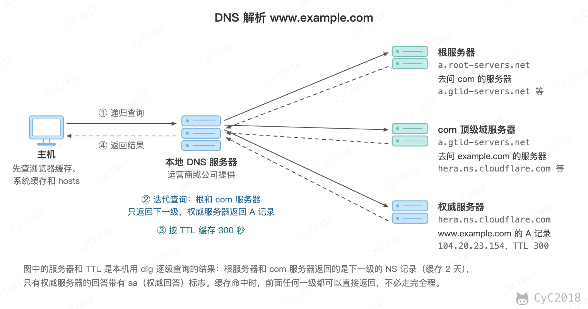
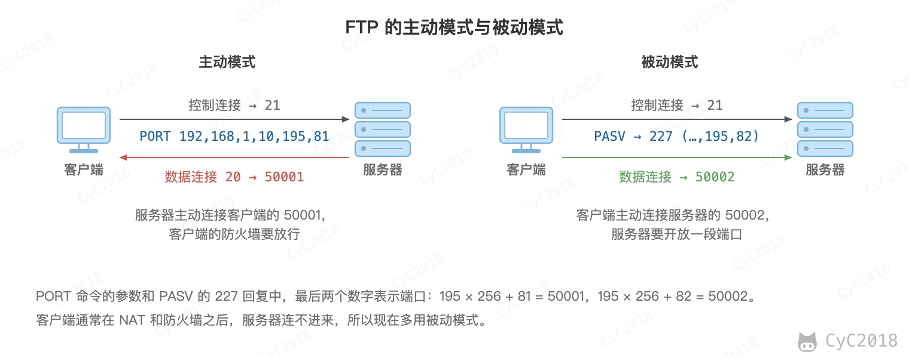
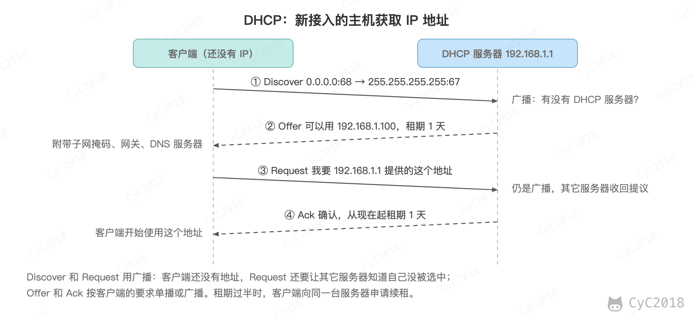
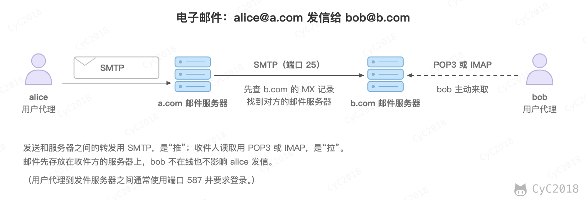
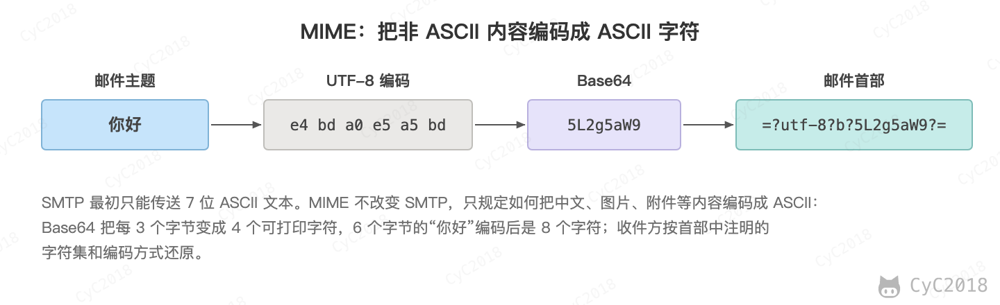
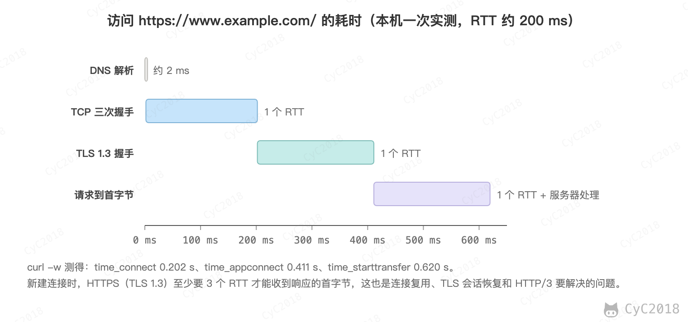
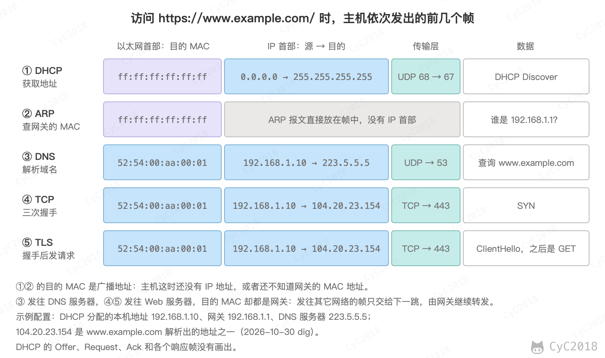

# 计算机网络 - 应用层
<!-- GFM-TOC -->
* [计算机网络 - 应用层](#计算机网络---应用层)
    * [域名系统](#域名系统) 🔥
    * [文件传送协议](#文件传送协议)
    * [动态主机配置协议](#动态主机配置协议)
    * [远程登录协议](#远程登录协议)
    * [电子邮件协议](#电子邮件协议)
        * [1. SMTP](#1-smtp)
        * [2. POP3](#2-pop3)
        * [3. IMAP](#3-imap)
    * [常用端口](#常用端口)
    * [Web 页面请求过程](#web-页面请求过程) 🔥🔥
        * [1. DHCP 配置主机信息](#1-dhcp-配置主机信息)
        * [2. ARP 解析 MAC 地址](#2-arp-解析-mac-地址)
        * [3. DNS 解析域名](#3-dns-解析域名)
        * [4. HTTP 请求页面](#4-http-请求页面)
    * [附录：实测](#附录实测)
        * [A1 访问网页各阶段的耗时](#a1-访问网页各阶段的耗时)
        * [A2 DNS 的 TTL 与 CNAME](#a2-dns-的-ttl-与-cname)
        * [A3 省略协议时的重定向](#a3-省略协议时的重定向)
    * [参考资料](#参考资料)
<!-- GFM-TOC -->


## 域名系统 🔥

DNS 是一个分布式数据库，提供了主机名和 IP 地址之间相互转换的服务。这里的分布式数据库是指，每个站点只保留它自己的那部分数据。

域名具有层次结构，从上到下依次为：根域名、顶级域名、二级域名。例如 com 是顶级域名，example.com 是二级域名，www.example.com 是三级域名；完整的写法是 www.example.com.，最右边的点代表根。

以解析 www.example.com 为例：主机先查浏览器缓存、操作系统缓存和 hosts 文件，没有命中就向本地 DNS 服务器查询。本地 DNS 服务器依次询问根服务器、com 顶级域服务器和 example.com 的权威服务器，前两者只返回下一级服务器的地址，权威服务器返回最终的 IP 地址。

<div align="center">  </div><br>

主机到本地 DNS 服务器是递归查询，主机只等最终结果；本地 DNS 服务器到其它服务器是迭代查询，由它自己一步步问下去。每一级的结果都按 TTL 缓存，所以大多数查询在本地 DNS 服务器甚至主机上就能得到结果。

TTL 是每条记录自带的缓存时间，单位为秒，由权威服务器给出，缓存中的记录每过一秒剩余时间减 1。例如把公共 DNS 223.5.5.5 作为本地 DNS 服务器，查询 www.jd.com（dig 实测，见[附录 A2](#a2-dns-的-ttl-与-cname)）：

```text
www.jd.com.                           74  IN  CNAME  www.jd.com.gslb.qianxun.com.
www.jd.com.gslb.qianxun.com.          11  IN  CNAME  www.jd.com.s.galileo.jcloud-cdn.com.
www.jd.com.s.galileo.jcloud-cdn.com.  20  IN  CNAME  wwwv6.jcloudimg.com.
wwwv6.jcloudimg.com.                  15  IN  A      119.147.159.135
```

每行是一条资源记录：名字、剩余的 TTL、类别 IN（互联网）、类型和值。常见的类型有 A（IPv4 地址）、AAAA（IPv6 地址）、CNAME（别名，指向另一个域名）、NS（该区域的权威服务器）和 MX（邮件服务器）。

第二列是剩余的 TTL，5 秒后再查询，四个值都减少了 5；直接问京东的权威服务器，第一条记录的 TTL 是 120。修改记录后，各级缓存中的旧记录要等 TTL 到期才会失效，所以更换服务器的 IP 地址之前，通常先把 TTL 调小。

这个结果也说明了 CDN 的调度方式：www.jd.com 通过 CNAME（别名记录）把解析交给 CDN 的调度系统，调度系统根据查询来源的位置返回较近的节点地址，TTL 只有几十秒，便于随时切换节点。DNS 负载均衡见 [DNS 域名解析](集群.md#2-dns-域名解析)，CDN 见 [CDN](缓存.md#三cdn)。

DNS 可以使用 UDP 或者 TCP 进行传输，使用的端口号都为 53。大多数情况下 DNS 使用 UDP 进行传输：一次查询只是一问一答，报文通常只有几十到几百字节，用 UDP 一个往返就能得到结果，TCP 还要先三次握手，服务器也要为每个连接保存状态。代价是域名解析器和域名服务器都必须自己处理超时和重传从而保证可靠性。在两种情况下会使用 TCP 进行传输：

- 响应超过 UDP 报文的长度上限：DNS 规定通过 UDP 传输的报文不超过 512 字节（使用 EDNS 扩展后可以更大），超出时服务器返回截断的响应并置 TC 标志，客户端改用 TCP 重新查询；
- 区域传送：主域名服务器把整个区域的数据传送给辅助域名服务器，称为 AXFR，使用 TCP；只传送变化部分的增量传送称为 IXFR，可以用 UDP，放不进一个 UDP 报文时同样改用 TCP。

DNS 报文默认不加密，也不验证来源，常见的攻击有两种：DNS 劫持指的是攻击者控制了用户使用的 DNS 服务器或路由器，把域名解析到自己的地址；DNS 污染指的是在查询途中抢先返回伪造的响应，解析器会接受先到达的那个。防范的方法：

- DNSSEC：权威服务器对记录签名，解析器验证签名后就能发现伪造的记录；
- DNS over HTTPS（DoH）和 DNS over TLS（DoT）：加密主机与解析器之间的查询，途中无法查看和篡改；
- HTTPS：即使域名被解析到攻击者的地址，攻击者也拿不到这个域名的证书，浏览器会报错。

## 文件传送协议

FTP 使用 TCP 进行连接，它需要两个连接来传送一个文件：

- 控制连接：服务器打开端口号 21 等待客户端的连接，客户端主动建立连接后，使用这个连接将客户端的命令传送给服务器，并传回服务器的应答；
- 数据连接：用来传送一个文件数据。

根据数据连接是否是服务器端主动建立，FTP 有主动和被动两种模式：

- 主动模式：服务器端主动建立数据连接，其中服务器端的端口号为 20，客户端的端口号随机，通常大于 1023（0\~1023 是熟知端口号）；
- 被动模式：客户端主动建立数据连接，其中客户端的端口号由客户端自己指定，服务器端的端口号随机。

<div align="center">  </div><br>

主动模式要求客户端开放端口号给服务器端，需要去配置客户端的防火墙。被动模式只需要服务器端开放端口号即可，无需客户端配置防火墙。但是被动模式会导致服务器端的安全性减弱，因为开放了过多的端口号。

## 动态主机配置协议

动态主机配置协议（Dynamic Host Configuration Protocol, DHCP）提供了即插即用的连网方式，用户不再需要手动配置 IP 地址等信息。

DHCP 配置的内容不仅是 IP 地址，还包括子网掩码、网关 IP 地址和 DNS 服务器的地址。

分配的地址有租期，客户端在租期过半时向原服务器续租，到期没有续上就要停止使用这个地址。

DHCP 工作过程如下：

1. 客户端发送 Discover 报文，该报文的目的地址为 255.255.255.255:67，源地址为 0.0.0.0:68，被放入 UDP 中，该报文被广播到同一个子网的所有主机上。如果客户端和 DHCP 服务器不在同一个子网，就需要使用中继代理。
2. DHCP 服务器收到 Discover 报文之后，发送 Offer 报文给客户端，该报文包含了客户端所需要的信息。因为客户端可能收到多个 DHCP 服务器提供的信息，因此客户端需要进行选择。
3. 如果客户端选择了某个 DHCP 服务器提供的信息，那么就广播 Request 报文，在其中用服务器标识选项指明选中的是哪个 DHCP 服务器，其它服务器收到后就知道自己的 Offer 没有被选中。
4. DHCP 服务器发送 Ack 报文，表示客户端此时可以使用提供给它的信息。

<div align="center">  </div><br>

## 远程登录协议

TELNET 用于登录到远程主机上，并且远程主机上的输出也会返回。

TELNET 可以适应许多计算机和操作系统的差异，例如不同操作系统的换行符定义。TELNET 以明文传输，包括密码，现在远程登录一般使用加密的 SSH。

## 电子邮件协议

一个电子邮件系统由三部分组成：用户代理、邮件服务器以及邮件协议。

邮件协议包含发送协议和读取协议，发送协议常用 SMTP，读取协议常用 POP3 和 IMAP。

<div align="center">  </div><br>

### 1. SMTP

SMTP 只能发送 ASCII 码，而互联网邮件扩充 MIME 可以发送二进制文件。MIME 并没有改动或者取代 SMTP，而是增加邮件主体的结构，定义了非 ASCII 码的编码规则。

<div align="center">  </div><br>

### 2. POP3

POP3 通常用“下载并删除”的方式使用：客户端下载邮件后发送 DELE 命令把服务器上的邮件删除；客户端也可以不发 DELE，选择在服务器上保留邮件。邮件的已读状态、文件夹等不会在多个设备之间同步。

### 3. IMAP

IMAP 协议中客户端和服务器上的邮件保持同步，如果不手动删除邮件，那么服务器上的邮件也不会被删除。IMAP 这种做法可以让用户随时随地去访问服务器上的邮件。

## 常用端口

|应用| 应用层协议 | 端口号 | 传输层协议 | 备注 |
| :---: | :--: | :--: | :--: | :--: |
| 域名解析 | DNS | 53 | UDP/TCP | 响应被截断或 AXFR 时使用 TCP |
| 动态主机配置协议 | DHCP | 67/68 | UDP | |
| 简单网络管理协议 | SNMP | 161/162 | UDP | |
| 文件传送协议 | FTP | 20/21 | TCP | 控制连接 21，数据连接 20 |
| 安全外壳协议 | SSH | 22 | TCP | |
| 远程终端协议 | TELNET | 23 | TCP | |
| 超文本传送协议 | HTTP | 80 | TCP | |
| 超文本传送安全协议 | HTTPS | 443 | TCP | HTTP/3 使用 UDP |
| 简单邮件传送协议 | SMTP | 25 | TCP | |
| 邮件读取协议 | POP3 | 110 | TCP | |
| 网际报文存取协议 | IMAP | 143 | TCP | |

## Web 页面请求过程 🔥🔥

在浏览器中输入 https://www.example.com/ 并回车后，主要经过以下步骤：

1. 浏览器解析 URL，得到协议 https、主机名 www.example.com、端口（省略时 https 为 443）和路径 /，各部分的含义见 [URL](HTTP.md#url)，然后检查缓存，有未过期的缓存时直接使用，见 [缓存](HTTP.md#缓存)；
2. DNS 解析主机名 www.example.com，得到 IP 地址，路径和参数不参与解析；
3. 与服务器进行 TCP 三次握手，HTTPS 还要进行 TLS 握手；
4. 发送 HTTP 请求。请求通常先到达负载均衡或[反向代理](集群.md#3-反向代理服务器)（例如 Nginx），再转发给某台应用服务器，应用服务器查询缓存或数据库后生成响应。如果响应是重定向，例如只输入 baidu.com 时浏览器补上协议后访问，得到 301 和 Location: https://www.baidu.com/（见[附录 A3](#a3-省略协议时的重定向)），浏览器对新地址重新走一遍前面的步骤；
5. 浏览器解析 HTML 构建 DOM 树，解析 CSS 构建 CSSOM，两者合成渲染树，再计算每个元素的位置和大小（布局），最后绘制到屏幕上。解析中遇到 CSS、JavaScript、图片等外部资源时另发请求，不带 async 或 defer 的普通脚本（type 不是 module）会暂停 HTML 的解析，直到脚本下载并执行完；
6. 连接保持一段时间供后续请求复用，空闲后关闭，见 [短连接与长连接](HTTP.md#1-短连接与长连接)。

以下是访问该网址时各阶段的耗时（curl 实测，见[附录 A1](#a1-访问网页各阶段的耗时)）：

<div align="center">  </div><br>

从网络各层看，一台刚接入局域网的主机要发出这个请求，先后要用到 DHCP、ARP、DNS、TCP 和 TLS。下图是它依次发出的前几个帧，下面逐步说明：

<div align="center">  </div><br>

### 1. DHCP 配置主机信息

- 主机最开始没有 IP 地址，要先用 DHCP 获取：它把 Discover 报文放入源端口 68、目的端口 67 的 UDP 报文段，再放入源地址 0.0.0.0、目的地址 255.255.255.255 的 IP 数据报，最后放入目的 MAC 为 FF:FF:FF:FF:FF:FF 的广播帧，交换机把它转发给所有设备；
- DHCP 服务器经过 Offer、Request、Ack 的交互（见[动态主机配置协议](#动态主机配置协议)），在 Ack 中给出 IP 地址、子网掩码、默认网关和 DNS 服务器的地址；
- 交换机在转发主机的广播帧时已经记下了主机的 MAC 地址在哪个接口（自学习），所以服务器单播给主机的帧只从这一个接口转发出去（客户端要求广播回复时，Offer 和 Ack 仍会发给所有设备）；
- 主机按 Ack 配置自己的 IP 地址、子网掩码和 DNS 服务器，并把网关设为默认路由。

### 2. ARP 解析 MAC 地址

- 浏览器要和 www.example.com 建立连接，先要知道它的 IP 地址，因此主机生成 DNS 查询报文，放入目的端口 53 的 UDP 报文段，再放入目的地址为 DNS 服务器的 IP 数据报；
- DNS 服务器不在本网络，数据报要先交给网关路由器。DHCP 只给出了网关的 IP 地址，而以太网帧需要的是它的 MAC 地址，所以主机先用 ARP 查询；
- ARP 请求放在广播帧中，网关路由器发现查询的 IP 地址是自己接口的地址，回复包含自己 MAC 地址的 ARP 响应；
- 主机把这个映射记入 ARP 缓存，之后发往其它网络的帧，目的 MAC 都是网关的地址，见 [地址解析协议 ARP](计算机网络%20-%20网络层.md#地址解析协议-arp)。

### 3. DNS 解析域名

- 主机把装有 DNS 查询的帧发给网关路由器，路由器按转发表把 IP 数据报逐跳转发到 DNS 服务器。转发表由 RIP、OSPF、BGP 等路由选择协议事先建立，见[路由选择协议](计算机网络%20-%20网络层.md#路由选择协议)；
- DNS 服务器的缓存中有这条记录时直接回答，否则按[域名系统](#域名系统)中的过程依次询问根服务器、顶级域服务器和权威服务器；
- DNS 回答报文沿相反的方向回到主机，主机得到 www.example.com 的 IP 地址。

### 4. HTTP 请求页面

- 主机向服务器 IP 地址的 443 端口（HTTP 为 80）发送 TCP SYN 报文段，经过[三次握手](计算机网络%20-%20传输层.md#tcp-的三次握手)建立连接，这些帧同样先交给网关；
- HTTPS 接着进行 TLS 握手，协商出会话密钥并验证服务器的证书，见 [TLS 握手](HTTP.md#tls-握手)；
- 浏览器发送 HTTP GET 报文，服务器读取请求，把页面内容放入响应报文的主体发回；
- 浏览器解析 HTML，再请求其中引用的资源，最后渲染出页面。

## 附录：实测

### A1 访问网页各阶段的耗时

macOS 自带的 curl，网络的 RTT 约 200 ms，连续访问 3 次。各字段都是从开始到该阶段结束的累计时间：time_connect 为 TCP 连接建立，time_appconnect 为 TLS 握手完成，time_starttransfer 为收到响应的第一个字节。第 3 次的 TLS 握手明显变慢，属于网络波动，配图使用第 1 次的结果：

```text
$ curl -s -o /dev/null -w 'namelookup %{time_namelookup}  connect %{time_connect}  appconnect %{time_appconnect}  starttransfer %{time_starttransfer}  total %{time_total}  http %{http_version}\n' https://www.example.com/
namelookup 0.001929  connect 0.202011  appconnect 0.411088  starttransfer 0.619656  total 0.620218  http 2
namelookup 0.004086  connect 0.209781  appconnect 0.432419  starttransfer 0.650939  total 0.651432  http 2
namelookup 0.001873  connect 0.216569  appconnect 1.441755  starttransfer 1.667668  total 1.668500  http 2
```

### A2 DNS 的 TTL 与 CNAME

macOS 自带的 dig 9.10.6，先向公共 DNS 223.5.5.5 查询两次，间隔 5 秒，再不经递归直接询问京东的权威服务器 ns1.jd.com：

```text
$ dig @223.5.5.5 www.jd.com +noall +answer
www.jd.com.		74	IN	CNAME	www.jd.com.gslb.qianxun.com.
www.jd.com.gslb.qianxun.com. 11	IN	CNAME	www.jd.com.s.galileo.jcloud-cdn.com.
www.jd.com.s.galileo.jcloud-cdn.com. 20	IN CNAME wwwv6.jcloudimg.com.
wwwv6.jcloudimg.com.	15	IN	A	119.147.159.135

$ （5 秒后）dig @223.5.5.5 www.jd.com +noall +answer
www.jd.com.		69	IN	CNAME	www.jd.com.gslb.qianxun.com.
www.jd.com.gslb.qianxun.com. 6	IN	CNAME	www.jd.com.s.galileo.jcloud-cdn.com.
www.jd.com.s.galileo.jcloud-cdn.com. 15	IN CNAME wwwv6.jcloudimg.com.
wwwv6.jcloudimg.com.	10	IN	A	119.147.159.135

$ dig @ns1.jd.com www.jd.com +noall +answer +norecurse
www.jd.com.		120	IN	CNAME	www.jd.com.gslb.qianxun.com.
www.jd.com.gslb.qianxun.com. 60	IN	CNAME	www.jd.com.s.galileo.jcloud-cdn.com.
```

### A3 省略协议时的重定向

macOS 自带的 curl 8.7.1，2026-10-30 分别以 http 和 https 访问 baidu.com，只显示状态行和 Location 首部：

```text
$ curl -s -D - -o /dev/null http://baidu.com | grep -iE '^HTTP|^location'
HTTP/1.1 301 Moved Permanently
Location: https://www.baidu.com/

$ curl -s -D - -o /dev/null https://baidu.com | grep -iE '^HTTP|^location'
HTTP/1.1 301 Moved Permanently
Location: https://www.baidu.com/
```

## 参考资料

- [RFC 1035: Domain Names - Implementation and Specification](https://www.rfc-editor.org/rfc/rfc1035)
- [RFC 2131: Dynamic Host Configuration Protocol](https://www.rfc-editor.org/rfc/rfc2131)
- Kurose J F, Ross K W. 计算机网络：自顶向下方法 [M]. 机械工业出版社, 2018.
- [RFC 959: File Transfer Protocol](https://www.rfc-editor.org/rfc/rfc959)
- [RFC 5321: Simple Mail Transfer Protocol](https://www.rfc-editor.org/rfc/rfc5321)
- [RFC 1939: Post Office Protocol - Version 3](https://www.rfc-editor.org/rfc/rfc1939)
- [RFC 9051: Internet Message Access Protocol (IMAP) - Version 4rev2](https://www.rfc-editor.org/rfc/rfc9051)
- [RFC 6891: Extension Mechanisms for DNS (EDNS(0))](https://www.rfc-editor.org/rfc/rfc6891)
- [RFC 7871: Client Subnet in DNS Queries](https://www.rfc-editor.org/rfc/rfc7871)
- [RFC 4033: DNS Security Introduction and Requirements](https://www.rfc-editor.org/rfc/rfc4033)
- [RFC 8484: DNS Queries over HTTPS (DoH)](https://www.rfc-editor.org/rfc/rfc8484)
- [RFC 7858: Specification for DNS over Transport Layer Security (TLS)](https://www.rfc-editor.org/rfc/rfc7858)
