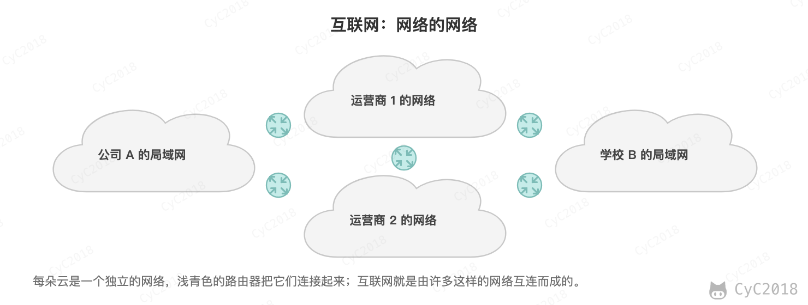
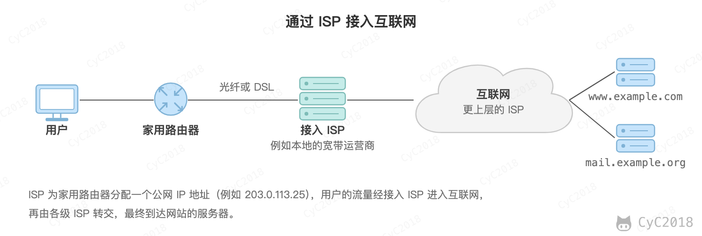
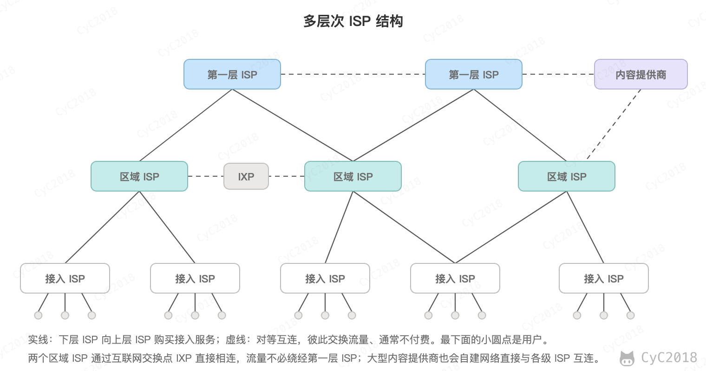
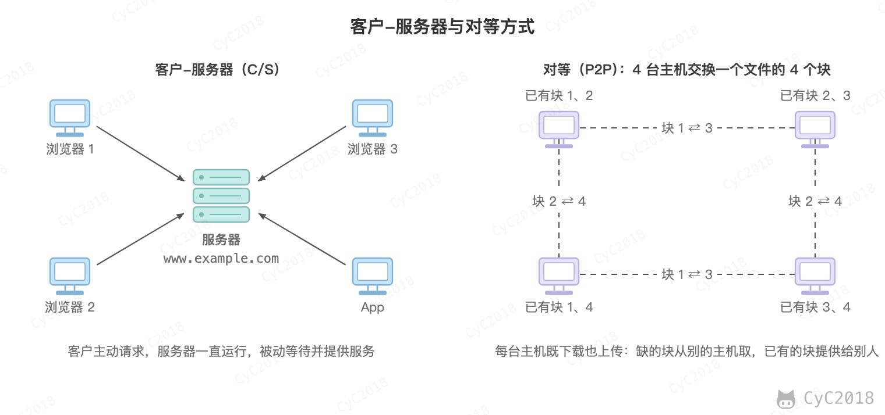
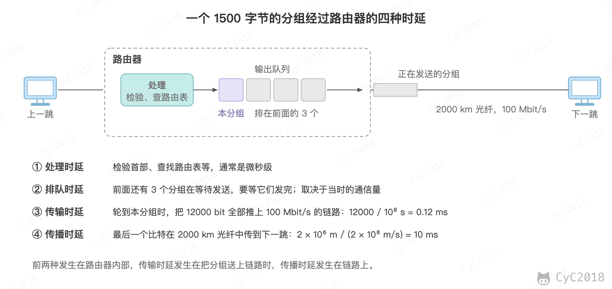
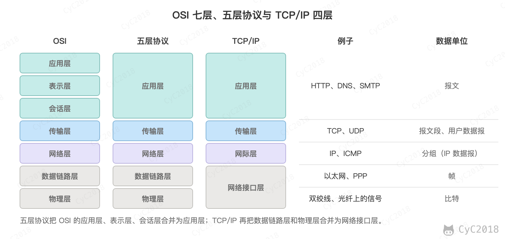
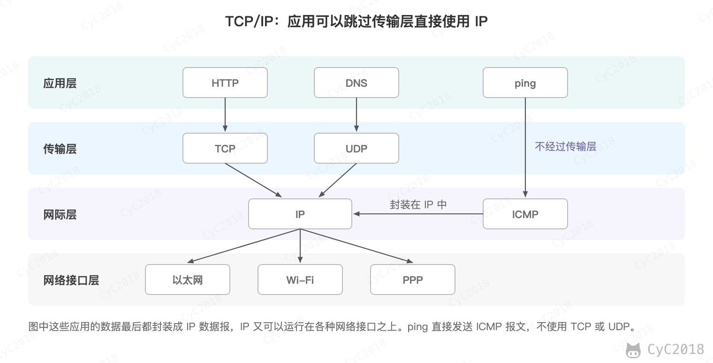
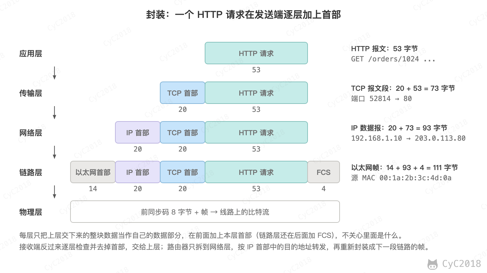

# 计算机网络 - 概述
<!-- GFM-TOC -->
* [计算机网络 - 概述](#计算机网络---概述)
    * [网络的网络](#网络的网络)
    * [ISP](#isp)
    * [主机之间的通信方式](#主机之间的通信方式)
    * [电路交换与分组交换](#电路交换与分组交换)
        * [1. 电路交换](#1-电路交换)
        * [2. 分组交换](#2-分组交换)
    * [时延](#时延)
        * [1. 排队时延](#1-排队时延)
        * [2. 处理时延](#2-处理时延)
        * [3. 传输时延](#3-传输时延)
        * [4. 传播时延](#4-传播时延)
    * [计算机网络体系结构](#计算机网络体系结构) 🔥
        * [1. 五层协议](#1-五层协议)
        * [2. OSI](#2-osi)
        * [3. TCP/IP](#3-tcpip)
        * [4. 数据在各层之间的传递过程](#4-数据在各层之间的传递过程)
    * [参考资料](#参考资料)
<!-- GFM-TOC -->


## 网络的网络

网络把主机连接起来，而互连网（internet）是把多种不同的网络连接起来，因此互连网是网络的网络。而互联网（Internet）是全球范围的互连网。

<div align="center">  </div><br>

## ISP

互联网服务提供商（Internet Service Provider, ISP）可以从互联网管理机构获得许多 IP 地址，同时拥有通信线路以及路由器等联网设备，个人或机构向 ISP 缴纳一定的费用就可以接入互联网。

<div align="center">  </div><br>

目前的互联网是一种多层次 ISP 结构，ISP 根据覆盖面积的大小分为第一层 ISP、区域 ISP 和接入 ISP。互联网交换点（Internet Exchange Point, IXP）允许两个 ISP 直接相连而不用经过第三个 ISP。

<div align="center">  </div><br>

## 主机之间的通信方式

- 客户-服务器（C/S）：客户是服务的请求方，服务器是服务的提供方；
- 对等（P2P）：不区分客户和服务器。

<div align="center">  </div><br>

## 电路交换与分组交换

### 1. 电路交换

电路交换用于电话通信系统，两个用户要通信之前需要建立一条专用的通路，沿途为它预留固定的带宽（例如一个频段或周期性的时隙），在整个通信过程中始终占用。由于通信的过程中不可能一直在使用传输线路，因此电路交换对线路的利用率很低，往往不到 10%。

### 2. 分组交换

分组交换把要发送的数据切成一个个分组，每个分组都有首部，包含源地址和目的地址等控制信息。路由器根据首部就能把分组送往目的地，因此不同通信的分组可以交替使用同一条线路，不需要事先建立连接、独占线路。

路由器收到一个分组后先存储下来，查找转发表后再从合适的接口发出，这个过程称为存储转发，类似邮局收到邮件后先分拣再发往下一站。代价是分组可能要在路由器中排队，产生下文的排队时延。

## 时延

总时延 = 排队时延 + 处理时延 + 传输时延 + 传播时延

<div align="center">  </div><br>

### 1. 排队时延

分组在路由器的输入队列和输出队列中排队等待的时间，取决于网络当前的通信量。

### 2. 处理时延

主机或路由器收到分组时进行处理所需要的时间，例如分析首部、从分组中提取数据、进行差错检验或查找适当的路由等。

### 3. 传输时延

主机或路由器传输数据帧所需要的时间。

```text
传输时延 = 数据帧长度 l（bit）/ 传输速率 v（bit/s）
```

### 4. 传播时延

电磁波在信道中传播所需要花费的时间，电磁波传播的速度接近光速。

```text
传播时延 = 信道长度 l（m）/ 电磁波在信道上的传播速度 v（m/s）
```

例如发送一个 1500 字节（12000 bit）的帧：100 Mbit/s 的链路上传输时延为 12000 / 10<sup>8</sup> = 0.12 ms；光纤中信号的传播速度约为 2 × 10<sup>8</sup> m/s，北京到广州约 2000 km 的线路传播时延约为 10 ms。传输时延取决于数据量和带宽，传播时延只取决于距离，提高带宽不能缩短传播时延。

## 计算机网络体系结构 🔥

<div align="center">  </div><br>

### 1. 五层协议

- 应用层：为特定应用程序提供数据传输服务，例如 HTTP、DNS 等协议。数据单位为报文；
- 传输层：为进程提供通用数据传输服务。由于应用层协议很多，定义通用的传输层协议就可以支持不断增多的应用层协议。传输层包括两种协议：传输控制协议 TCP，提供面向连接、可靠的数据传输服务，数据单位为报文段；用户数据报协议 UDP，提供无连接、尽最大努力的数据传输服务，数据单位为用户数据报。TCP 主要提供完整性服务，UDP 主要提供及时性服务；
- 网络层：为主机提供数据传输服务，传输层则是为主机中的进程提供数据传输服务。网络层把传输层传递下来的报文段或者用户数据报封装成分组；
- 数据链路层：两台主机之间通常要经过多段链路，网络层负责选择路径，链路层负责在一段链路上相邻的两个节点之间传输数据。数据链路层把网络层传下来的分组封装成帧；
- 物理层：考虑的是怎样在传输媒体上传输数据比特流，而不是指具体的传输媒体。物理层的作用是尽可能屏蔽传输媒体和通信手段的差异，使数据链路层感觉不到这些差异。

### 2. OSI

OSI 七层模型比五层协议多了表示层和会话层，用途如下：

- 表示层：数据压缩、加密以及数据描述，这使得应用程序不必关心在各台主机中数据内部格式不同的问题；
- 会话层：建立及管理会话。

五层协议没有表示层和会话层，而是将这些功能留给应用程序开发者处理。

### 3. TCP/IP

TCP/IP 只有四层，相当于把五层协议中的数据链路层和物理层合并为网络接口层。

TCP/IP 体系结构不严格遵循 OSI 分层概念，应用层可能会直接使用 IP 层或者网络接口层。

<div align="center">  </div><br>

### 4. 数据在各层之间的传递过程

在向下的过程中，需要添加下层协议所需要的首部或者尾部，而在向上的过程中不断拆开首部和尾部。例如浏览器发出一个 53 字节的 HTTP 请求，到链路层变成了 111 字节的以太网帧：

<div align="center">  </div><br>

路由器转发分组时只用到下面三层协议，因为路由器位于网络核心中，转发时不需要为进程或者应用程序提供服务，因此也就不需要传输层和应用层；路由器运行的路由协议另当别论，例如 BGP 使用 TCP 传输。

## 参考资料

- 谢希仁. 计算机网络（第 7 版）[M]. 电子工业出版社, 2017.
- Kurose J F, Ross K W. 计算机网络：自顶向下方法（第 7 版）[M]. 机械工业出版社, 2018.
- [RFC 1122: Requirements for Internet Hosts -- Communication Layers](https://www.rfc-editor.org/rfc/rfc1122)
