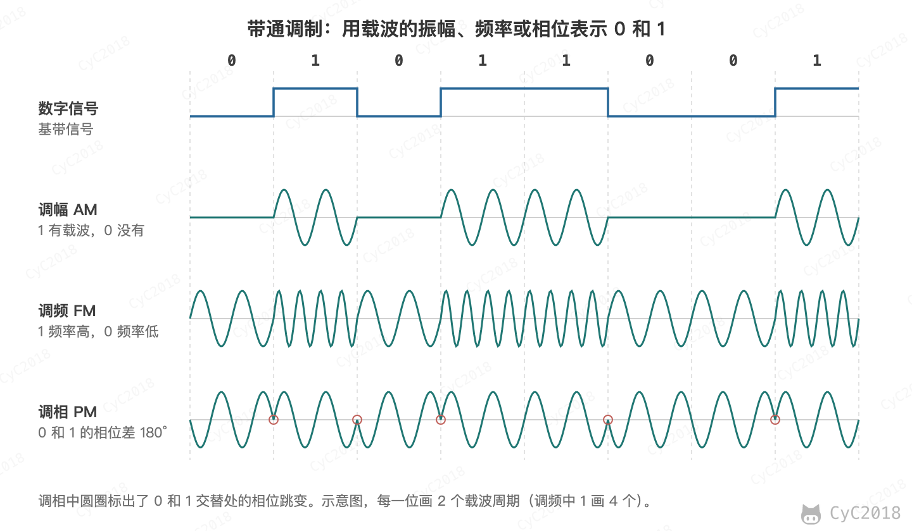

# 计算机网络 - 物理层
<!-- GFM-TOC -->
* [计算机网络 - 物理层](#计算机网络---物理层)
    * [通信方式](#通信方式)
    * [带通调制](#带通调制)
    * [参考资料](#参考资料)
<!-- GFM-TOC -->

## 通信方式

根据信息在传输线上的传送方向，分为以下三种通信方式：

- 单工通信：单向传输
- 半双工通信：双向交替传输
- 全双工通信：双向同时传输

## 带通调制

模拟信号是连续的信号，数字信号是离散的信号。带通调制把数字信号转换为模拟信号。

基本的调制方法有调幅、调频和调相三种，分别用载波的振幅、频率和相位的变化来表示 0 和 1：

  
 

实际的系统中还会把振幅和相位组合起来使用，例如正交振幅调制（Quadrature Amplitude Modulation, QAM）中的 16-QAM 用 16 种不同的振幅和相位组合表示 4 个比特，一个码元就能传输更多的数据。

## 参考资料

- 谢希仁. 计算机网络（第 7 版）[M]. 电子工业出版社, 2017.
- Kurose J F, Ross K W. 计算机网络：自顶向下方法（第 7 版）[M]. 机械工业出版社, 2018.
