# 计算机网络 - 链路层
<!-- GFM-TOC -->
* [计算机网络 - 链路层](#计算机网络---链路层)
    * [基本问题](#基本问题)
        * [1. 封装成帧](#1-封装成帧)
        * [2. 透明传输](#2-透明传输)
        * [3. 差错检测](#3-差错检测)
    * [信道分类](#信道分类)
        * [1. 广播信道](#1-广播信道)
        * [2. 点对点信道](#2-点对点信道)
    * [信道复用技术](#信道复用技术)
        * [1. 频分复用](#1-频分复用)
        * [2. 时分复用](#2-时分复用)
        * [3. 统计时分复用](#3-统计时分复用)
        * [4. 波分复用](#4-波分复用)
        * [5. 码分复用](#5-码分复用)
    * [CSMA/CD 协议](#csmacd-协议)
    * [PPP 协议](#ppp-协议)
    * [MAC 地址](#mac-地址)
    * [局域网](#局域网)
    * [以太网](#以太网)
    * [交换机](#交换机)
    * [虚拟局域网](#虚拟局域网)
    * [参考资料](#参考资料)
<!-- GFM-TOC -->


## 基本问题

### 1. 封装成帧

将网络层传下来的分组添加首部和尾部，用于标记帧的开始和结束。

<div align="center"> 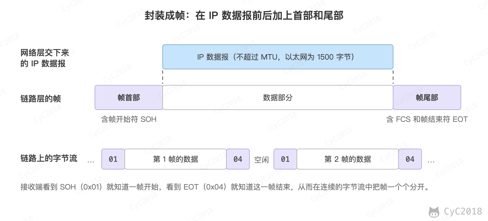 </div><br>

### 2. 透明传输

透明表示一个实际存在的事物看起来好像不存在一样。

帧用首部和尾部中的控制字符定界，如果数据部分恰好含有相同的字节，接收端就会把帧的结束位置判断错。解决方法是字节填充：发送端在数据中的控制字符前面插入转义字符 ESC，数据中本来就有的 ESC 前面也再插入一个 ESC；接收端删去这些转义用的 ESC，还原出原始数据。

填充和删除都由链路层完成，上层交下来什么数据都能原样传过去，察觉不到 ESC 的存在，因此称为透明传输。

<div align="center"> 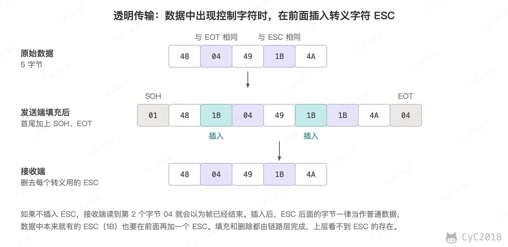 </div><br>

### 3. 差错检测

目前数据链路层广泛使用循环冗余检验（Cyclic Redundancy Check, CRC）来检查比特差错：发送端根据帧的内容算出检验序列放在帧尾，接收端重新计算，结果不一致就丢弃该帧。以太网只丢弃出错的帧、不重传，可靠传输由上层的 TCP 负责。

## 信道分类

### 1. 广播信道

一对多通信，一个节点发送的数据能够被广播信道上所有的节点接收到。

所有的节点都在同一个广播信道上发送数据，因此需要有专门的控制方法进行协调，避免发生冲突（冲突也叫碰撞）。

主要有两种控制方法进行协调：一是使用信道复用技术，二是使用 CSMA/CD 协议。

### 2. 点对点信道

一对一通信。

因为不会发生碰撞，因此也比较简单，使用 PPP 协议进行控制。

## 信道复用技术

### 1. 频分复用

频分复用的所有主机在相同的时间占用不同的频率带宽资源。

<div align="center"> 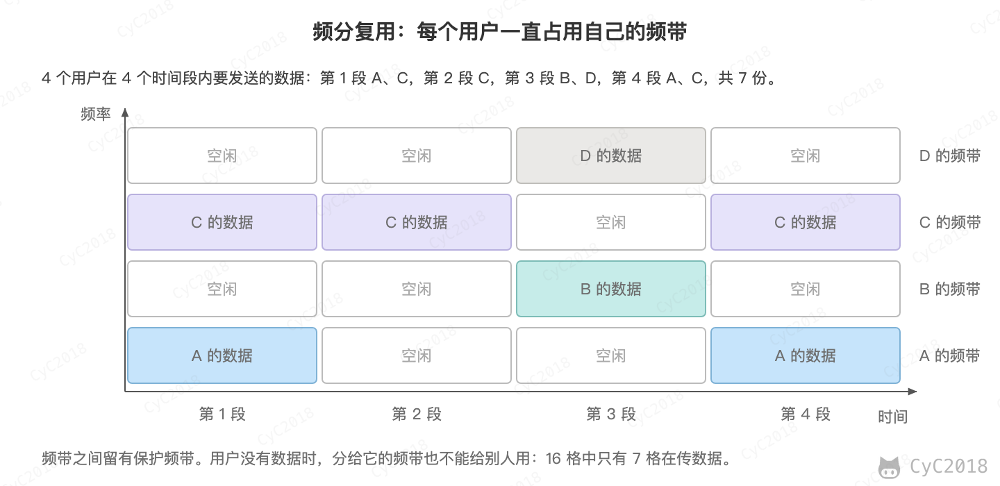 </div><br>

### 2. 时分复用

时分复用的所有主机在不同的时间占用相同的频率带宽资源。

<div align="center"> 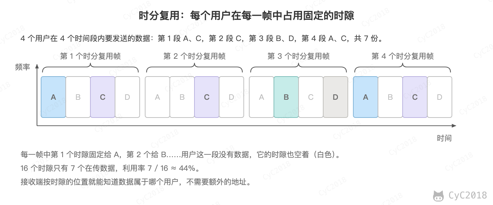 </div><br>

使用频分复用和时分复用进行通信，在通信的过程中主机会一直占用一部分信道资源。但是由于计算机数据的突发性质，通信过程没必要一直占用信道资源而不让出给其它用户使用，因此这两种方式对信道的利用率都不高。

### 3. 统计时分复用

统计时分复用是对时分复用的一种改进，不固定每个用户在时分复用帧中的位置，只要有数据就集中起来组成统计时分复用帧然后发送。

<div align="center"> 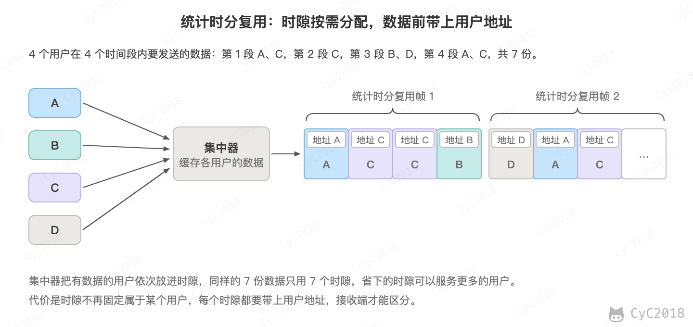 </div><br>

### 4. 波分复用

光的频分复用。由于光的频率很高，因此习惯上用波长而不是频率来表示所使用的光载波。

### 5. 码分复用

为每个用户分配 m bit 的码片，并且所有的码片正交，对于任意两个码片 S 和 T 有

```text
(1/m) S·T = 0
```

为了讨论方便，取 m=8，设码片 S 为 00011011。在拥有该码片的用户发送比特 1 时就发送该码片，发送比特 0 时就发送该码片的反码 11100100。

在计算时将 00011011 记作 (-1 -1 -1 +1 +1 -1 +1 +1)，可以得到

```text
(1/m) S·S  = 1
(1/m) S·S' = -1
```

其中 S' 为 S 的反码。

由上面的式子可知，当接收端使用码片 S 对接收到的数据进行内积运算时，结果为 0 的是其它用户发送的数据，结果为 1 的是拥有码片 S 的用户发送的比特 1，结果为 -1 的是该用户发送的比特 0。

码分复用需要发送的数据量为原先的 m 倍。

<div align="center"> 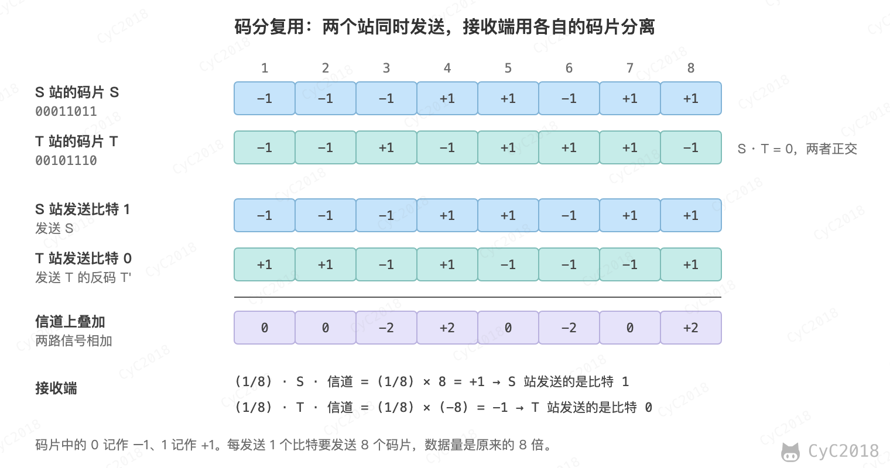 </div><br>


## CSMA/CD 协议

CSMA/CD（Carrier Sense Multiple Access with Collision Detection）表示载波监听多点接入 / 碰撞检测，用于总线型或使用集线器的以太网。

- 多点接入：说明这是总线型网络，许多主机以多点的方式连接到总线上；
- 载波监听：每个主机都必须不停地监听信道。在发送前，如果监听到信道正在使用，就必须等待；
- 碰撞检测：在发送中，如果监听到信道已有其它主机正在发送数据，就表示发生了碰撞。虽然每个主机在发送数据之前都已经监听到信道为空闲，但是由于电磁波的传播时延的存在，还是有可能会发生碰撞。

记端到端的传播时延为 τ，最先发送的站点最多经过 2τ 就可以知道是否发生了碰撞，称 2τ 为 **争用期**。只有经过争用期之后还没有检测到碰撞，才能肯定这次发送不会发生碰撞。

当发生碰撞时，站点要停止发送，等待一段时间再发送。这个时间采用 **截断二进制指数退避算法** 来确定。从离散的整数集合 {0, 1, .., (2<sup>k</sup>-1)} 中随机取出一个数，记作 r，然后取 r 倍的争用期作为重传等待时间。其中 k = min(重传次数, 10)，重传 16 次仍不成功就丢弃该帧。

<div align="center"> 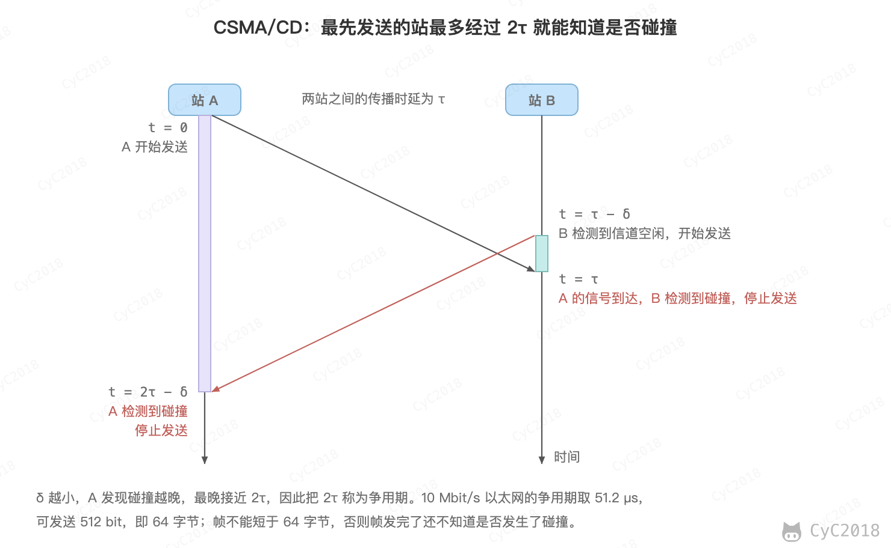 </div><br>

需要注意的是，现在的以太网用交换机连接、以全双工方式工作，每条链路只连接主机和交换机的一个接口，收发可以同时进行，不会发生碰撞，也就不再使用 CSMA/CD。

## PPP 协议

互联网用户通常需要连接到某个 ISP 之后才能接入到互联网，PPP 协议是用户计算机和 ISP 进行通信时所使用的数据链路层协议。

<div align="center"> 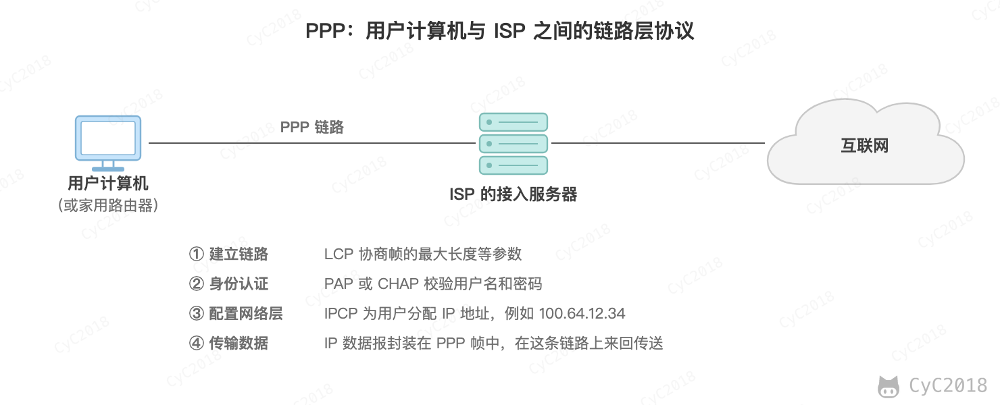 </div><br>

PPP 的帧格式：

- F 字段为帧的定界符，值为 0x7E；
- A 和 C 字段的值是固定的，分别为 0xFF 和 0x03，不携带信息；
- 协议字段指明信息部分是哪种协议的数据，例如 0x0021 表示 IP 数据报；
- FCS 字段是使用 CRC 的检验序列；
- 信息部分的长度默认不超过 1500 字节，即最大接收单元（Maximum Receive Unit, MRU），双方可以协商更大的值。

<div align="center"> 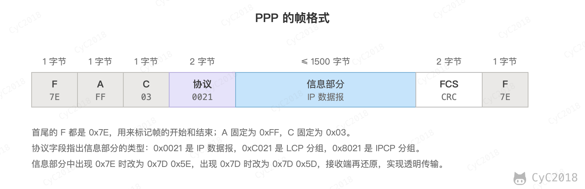 </div><br>

## MAC 地址

MAC 地址是链路层地址，长度为 6 字节（48 位），用于唯一标识网络适配器（网卡）。

一台主机拥有多少个网络适配器就有多少个 MAC 地址。例如笔记本电脑普遍存在无线网络适配器和有线网络适配器，因此就有两个 MAC 地址。

## 局域网

局域网是一种典型的广播信道，主要特点是网络为一个单位所拥有，且地理范围和站点数目均有限。

主要有以太网、令牌环网、FDDI 和 ATM 等局域网技术，目前以太网占领着有线局域网市场。

可以按照网络拓扑结构对局域网进行分类：

<div align="center"> 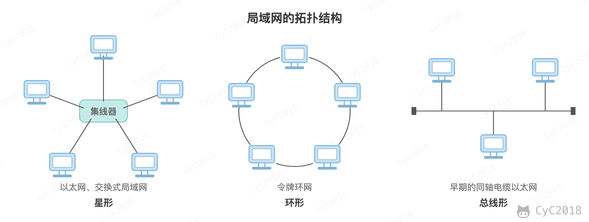 </div><br>

## 以太网

早期的以太网是总线型拓扑，目前的以太网使用星型拓扑。

早期使用集线器进行连接，集线器是一种物理层设备，作用于比特而不是帧，当一个比特到达接口时，集线器重新生成这个比特，并将其能量强度放大，从而扩大网络的传输距离，之后再将这个比特发送到其它所有接口。如果集线器同时收到两个不同接口的帧，那么就发生了碰撞。

目前以太网使用交换机替代了集线器，交换机是一种链路层设备，能根据 MAC 地址进行存储转发，每个接口独立工作，全双工时不会发生碰撞。

以太网帧格式：

- 目的地址、源地址：各 6 字节的 MAC 地址；
- 类型：标记上层使用的协议；
- 数据：长度在 46～1500 字节之间，如果太小则需要填充；
- FCS：帧检验序列，使用的是 CRC 检验方法。

<div align="center"> 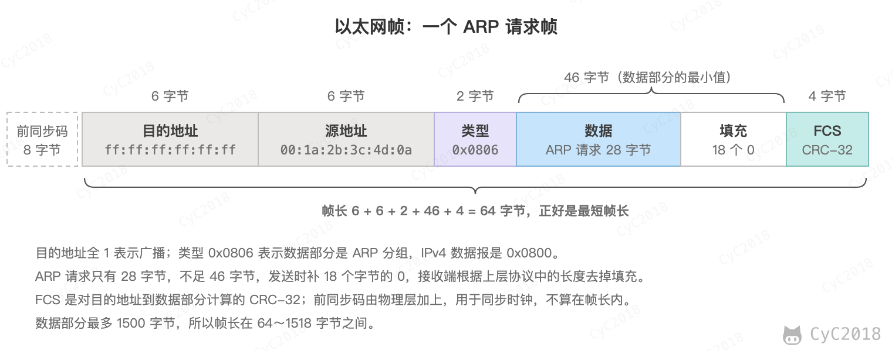 </div><br>

## 交换机

交换机具有自学习能力，学习的是交换表的内容，交换表中存储着 MAC 地址到接口的映射。

正是由于这种自学习能力，因此交换机是一种即插即用设备，不需要网络管理员手动配置交换表内容。

交换机每收到一个帧，先把源 MAC 地址和收到帧的接口记入交换表，再按目的 MAC 地址查表：查到就只从对应的接口转发，查不到就从其它所有接口转发。例如下图中交换机有 4 个接口：

- A 向 B 发送：交换机记下 A 在接口 1，表中没有 B，于是从接口 2、3、4 转发，C 和 D 发现目的地址不是自己，丢弃该帧；
- B 回复 A：交换机记下 B 在接口 2，表中查到 A 在接口 1，只从接口 1 转发。

<div align="center"> 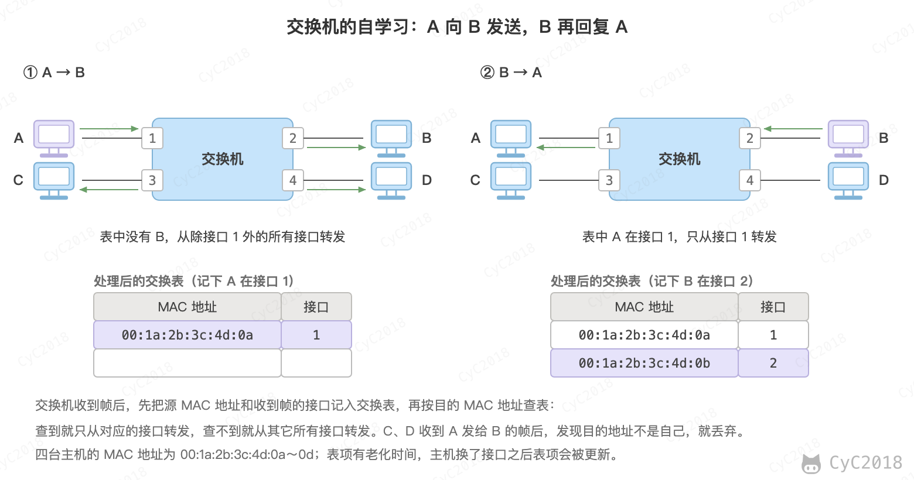 </div><br>

## 虚拟局域网

虚拟局域网可以建立与物理位置无关的逻辑组，只有在同一个虚拟局域网中的成员才会收到链路层广播信息。

例如下图中 (A1, A2, A3, A4) 属于一个虚拟局域网，A1 发送的广播会被 A2、A3、A4 收到，而其它站点收不到。

<div align="center"> 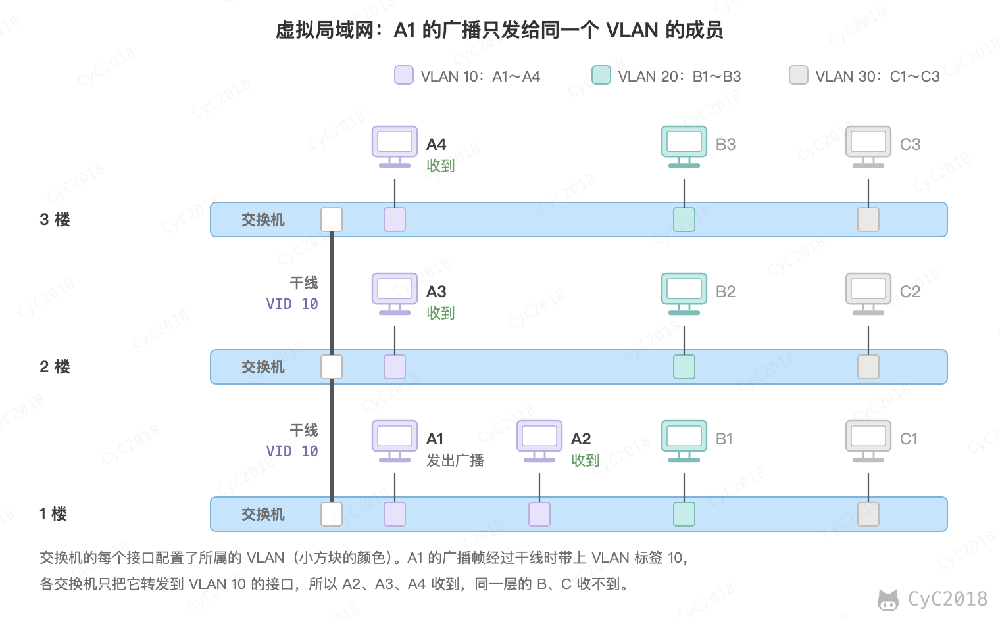 </div><br>

使用 VLAN 干线连接来建立虚拟局域网，每台交换机上的一个特殊接口被设置为干线接口，以互连 VLAN 交换机。IEEE 定义了一种扩展的以太网帧格式 802.1Q，它在标准以太网帧的源地址和类型字段之间插入了 4 字节的 VLAN 标签，用于表示该帧属于哪一个虚拟局域网。

<div align="center"> 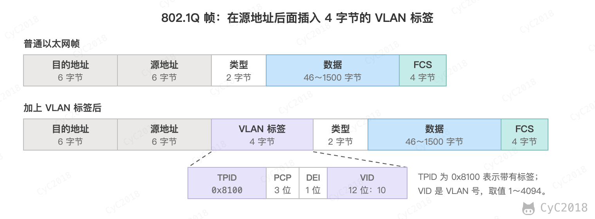 </div><br>

## 参考资料

- 谢希仁. 计算机网络（第 7 版）[M]. 电子工业出版社, 2017.
- Kurose J F, Ross K W. 计算机网络：自顶向下方法（第 7 版）[M]. 机械工业出版社, 2018.
- [RFC 1661: The Point-to-Point Protocol (PPP)](https://www.rfc-editor.org/rfc/rfc1661)
- [RFC 1662: PPP in HDLC-like Framing](https://www.rfc-editor.org/rfc/rfc1662)
- [IEEE 802.3 Ethernet Working Group](https://www.ieee802.org/3/)
- [IEEE 802.1Q: Bridges and Bridged Networks](https://www.ieee802.org/1/pages/802.1Q.html)
