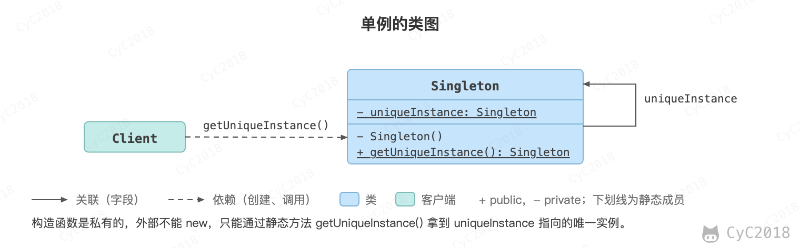
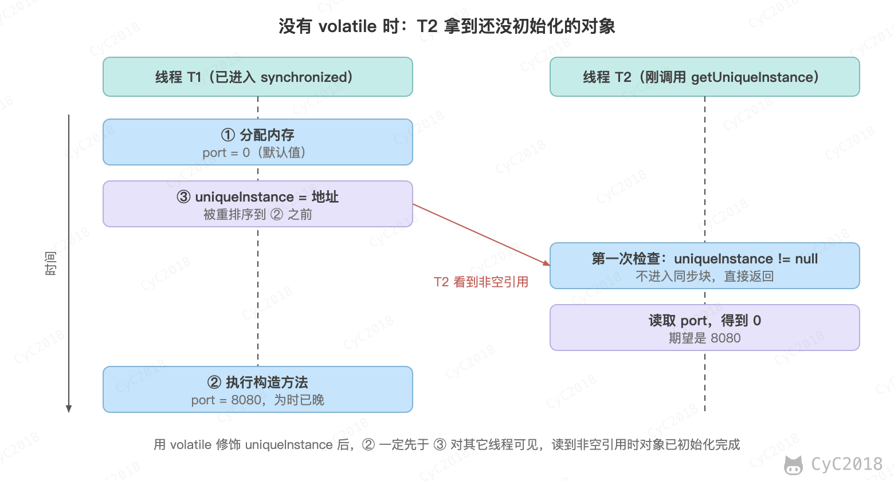

## 单例（Singleton） 🔥

### 意图
确保一个类只有一个实例，并提供该实例的全局访问点。

### 类图
使用一个私有构造函数、一个私有静态变量以及一个公有静态函数来实现。

私有构造函数保证了不能通过构造函数来创建对象实例，只能通过公有静态函数返回唯一的私有静态变量。

<div align="center">  </div><br>

### 实现
#### 1. 懒汉式-线程不安全

以下实现中，私有静态变量 uniqueInstance 被延迟实例化，这样做的好处是，如果没有用到该类，那么就不会实例化 uniqueInstance，从而节约资源。

这个实现在多线程环境下是不安全的，如果多个线程能够同时进入 `if (uniqueInstance == null)` ，并且此时 uniqueInstance 为 null，那么会有多个线程执行 `uniqueInstance = new Singleton();` 语句，这将导致实例化多次 uniqueInstance。

```java
public class Singleton {

    private static Singleton uniqueInstance;

    private Singleton() {
    }

    public static Singleton getUniqueInstance() {
        if (uniqueInstance == null) {
            uniqueInstance = new Singleton();
        }
        return uniqueInstance;
    }
}
```

#### 2. 饿汉式-线程安全

线程不安全问题主要是由于 uniqueInstance 被实例化多次，采取直接实例化 uniqueInstance 的方式就不会产生线程不安全问题：静态变量在类初始化时赋值，类的初始化由 JVM 加锁且只执行一次。

但是直接实例化的方式也丢失了延迟实例化带来的节约资源的好处。

```java
private static Singleton uniqueInstance = new Singleton();
```

#### 3. 懒汉式-线程安全

只需要对 getUniqueInstance() 方法加锁，那么在一个时间点只能有一个线程能够进入该方法，从而避免了实例化多次 uniqueInstance。

但是当一个线程进入该方法之后，其它试图进入该方法的线程都必须等待，即使 uniqueInstance 已经被实例化了。这会让线程阻塞时间过长，因此该方法有性能问题，不推荐使用。

```java
public static synchronized Singleton getUniqueInstance() {
    if (uniqueInstance == null) {
        uniqueInstance = new Singleton();
    }
    return uniqueInstance;
}
```

#### 4. 双重校验锁-线程安全

uniqueInstance 只需要被实例化一次，之后就可以直接使用了。加锁操作只需要对实例化那部分的代码进行，只有当 uniqueInstance 没有被实例化时，才需要进行加锁。

双重校验锁先判断 uniqueInstance 是否已经被实例化，如果没有被实例化，那么才对实例化语句进行加锁。

```java
public class Singleton {

    private volatile static Singleton uniqueInstance;

    private Singleton() {
    }

    public static Singleton getUniqueInstance() {
        if (uniqueInstance == null) {
            synchronized (Singleton.class) {
                if (uniqueInstance == null) {
                    uniqueInstance = new Singleton();
                }
            }
        }
        return uniqueInstance;
    }
}
```

两个 if 各有用处。第一个 if 让实例创建之后的调用不再加锁；第二个 if 在锁内再判断一次，防止重复创建。如果去掉第二个 if，写成下面这样，两个线程同时通过第一个 if 后，会先后进入同步块，各执行一次 `new Singleton()`：

```java
if (uniqueInstance == null) {
    synchronized (Singleton.class) {
        uniqueInstance = new Singleton();
    }
}
```

uniqueInstance 还必须用 volatile 修饰。`uniqueInstance = new Singleton();` 分为三步：

1. 为对象分配内存空间；
2. 执行构造方法，初始化对象；
3. 将 uniqueInstance 指向分配的内存地址。

编译器和处理器可能把它重排序为 1→3→2。单线程下结果不变，多线程下另一个线程可能拿到还没初始化的对象。例如构造方法把 port 设为 8080，T<sub>1</sub> 执行完 1 和 3 时，T<sub>2</sub> 在第一个 if 处看到 uniqueInstance 不为空，不加锁直接返回，读到的 port 还是 0：

<div align="center">  </div><br>

volatile 禁止了这种重排序：读到 uniqueInstance 不为空的线程，一定也能看到构造方法中的写入。

#### 5. 静态内部类实现

Singleton 类初始化时，静态内部类 SingletonHolder 不会随之初始化。第一次调用 `getUniqueInstance()` 访问 `SingletonHolder.INSTANCE` 时，JVM 才初始化 SingletonHolder 并创建 INSTANCE；类的初始化由 JVM 加锁执行且只执行一次，因此 INSTANCE 只会被创建一次。

这种方式不仅具有延迟初始化的好处，而且由 JVM 提供了对线程安全的支持。

```java
public class Singleton {

    private Singleton() {
    }

    private static class SingletonHolder {
        private static final Singleton INSTANCE = new Singleton();
    }

    public static Singleton getUniqueInstance() {
        return SingletonHolder.INSTANCE;
    }
}
```

#### 6. 枚举实现

```java
import java.lang.reflect.Constructor;

public enum Singleton {

    INSTANCE;

    private String objName;


    public String getObjName() {
        return objName;
    }


    public void setObjName(String objName) {
        this.objName = objName;
    }


    public static void main(String[] args) {

        // 单例测试
        Singleton firstSingleton = Singleton.INSTANCE;
        firstSingleton.setObjName("firstName");
        System.out.println(firstSingleton.getObjName());
        Singleton secondSingleton = Singleton.INSTANCE;
        secondSingleton.setObjName("secondName");
        System.out.println(firstSingleton.getObjName());
        System.out.println(secondSingleton.getObjName());

        // 通过反射调用构造函数创建新的实例会失败
        try {
            Constructor<Singleton> constructor = Singleton.class.getDeclaredConstructor(String.class, int.class);
            constructor.setAccessible(true);
            constructor.newInstance("INSTANCE2", 1);
        } catch (Exception e) {
            System.out.println(e);
        }
    }
}
```

```text
firstName
secondName
secondName
java.lang.IllegalArgumentException: Cannot reflectively create enum objects
```

该实现可以防止反射攻击。在其它实现中，调用私有构造函数的 setAccessible(true) 可以绕过访问检查，再调用 newInstance() 创建新的实例；要防止这种攻击，可以在构造函数中检查实例是否已经存在并抛出异常，但这只能挡住实例创建之后的反射调用：懒汉式在第一次调用 getUniqueInstance() 之前被反射创建时，检查不出来。对于枚举类型，Constructor.newInstance() 直接抛出 IllegalArgumentException，因此不会出现上述的反射攻击。

该实现在多次序列化和反序列化之后，不会得到多个实例。而其它实现要实现 Serializable，反序列化时每次都会创建一个新对象，需要提供 readResolve() 方法返回已有的实例来替换它；transient 只决定字段是否参与序列化，不能保证实例唯一。

### 示例
- 日志类；
- 配置类；
- 以共享方式访问的资源，例如连接池；
- 以单例实现的工厂。

这些对象创建代价高或持有共享资源，多个实例只会浪费资源。例如 OkHttp 的每个 OkHttpClient 都自带连接池和线程池，官方建议整个应用共用一个；每次请求都 new 一个，请求量大时会同时留下大量空闲的连接和线程，可能导致 OOM。

需要注意的是，上面线程安全的实现只保证创建过程是线程安全的：实例只创建一次，其它线程拿到的实例已经初始化完成。单例对象被所有线程共享，如果它有可变的字段（例如计数器、缓存的 Map），之后读写这些字段时仍要自己加锁或使用并发容器。

### JDK 中的应用
- [java.lang.Runtime#getRuntime()](https://docs.oracle.com/en/java/javase/21/docs/api/java.base/java/lang/Runtime.html#getRuntime())
- [java.awt.Desktop#getDesktop()](https://docs.oracle.com/en/java/javase/21/docs/api/java.desktop/java/awt/Desktop.html#getDesktop())

Spring 默认的单例 Bean 与这里的单例不同：它指的是一个容器中每个 Bean 定义只创建一个对象，由容器缓存后返回；类本身仍可以被 new 出多个实例，同一个类定义成两个 Bean 也会有两个对象，见[Bean 的作用域与线程安全](Spring.md#bean-的作用域与线程安全)。

## 参考资料

- 弗里曼. Head First 设计模式 [M]. 中国电力出版社, 2007.
- Gamma E. 设计模式：可复用面向对象软件的基础 [M]. 机械工业出版社, 2007.
