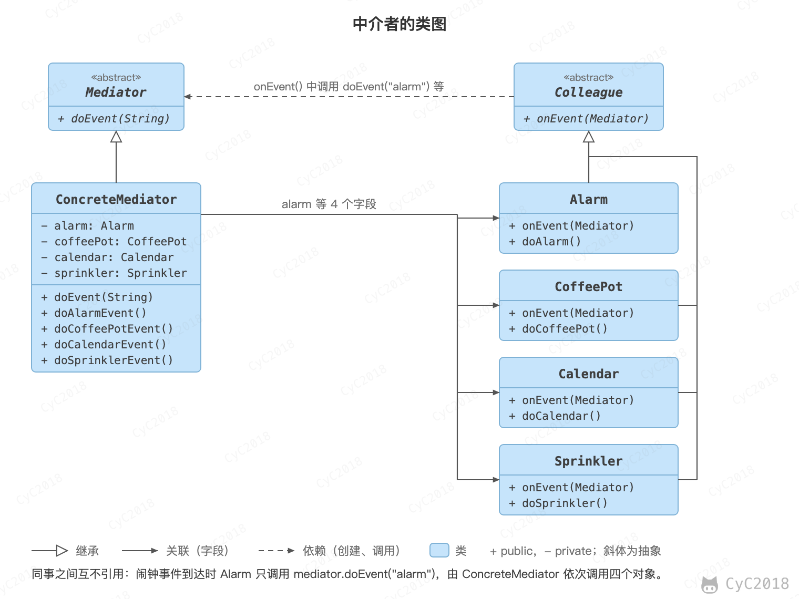
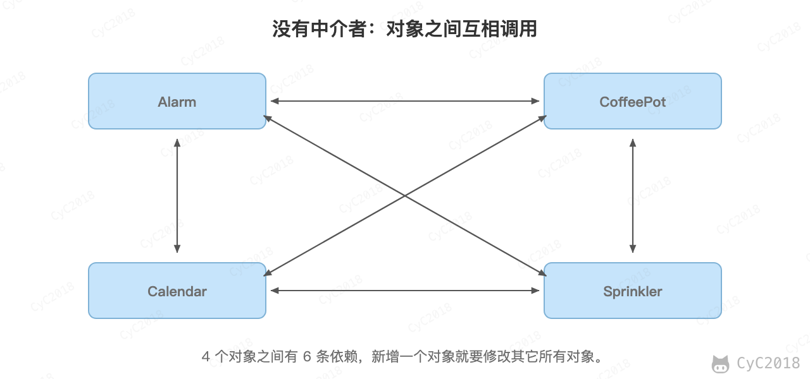
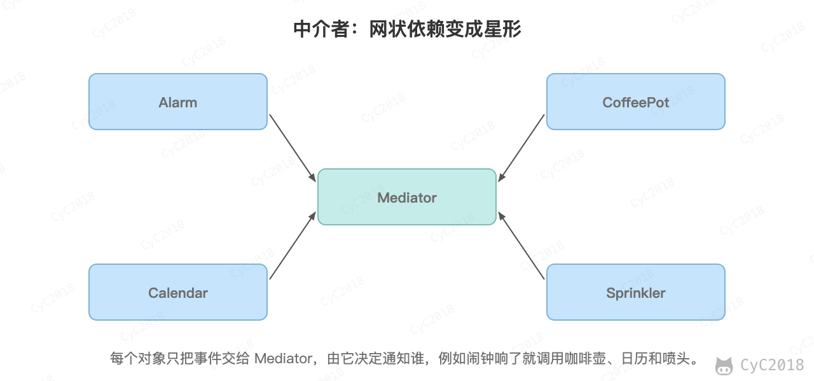

## 5. 中介者（Mediator）

### 意图
集中相关对象之间复杂的沟通和控制方式。

### 类图
- Mediator：中介者，定义一个接口用于与各同事（Colleague）对象通信；
- Colleague：同事，需要互相协作的相关对象。

<div align="center">  </div><br>

### 实现
Alarm（闹钟）、CoffeePot（咖啡壶）、Calendar（日历）、Sprinkler（喷头）是一组相关的对象，在某个对象的事件产生时需要去操作其它对象，形成了下面这种依赖结构：

<div align="center">  </div><br>

使用中介者模式可以将复杂的依赖结构变成星形结构：

<div align="center">  </div><br>

```java
public abstract class Colleague {
    public abstract void onEvent(Mediator mediator);
}
```

```java
public class Alarm extends Colleague {

    @Override
    public void onEvent(Mediator mediator) {
        mediator.doEvent("alarm");
    }

    public void doAlarm() {
        System.out.println("doAlarm()");
    }
}
```

```java
public class CoffeePot extends Colleague {
    @Override
    public void onEvent(Mediator mediator) {
        mediator.doEvent("coffeePot");
    }

    public void doCoffeePot() {
        System.out.println("doCoffeePot()");
    }
}
```

```java
public class Calendar extends Colleague {
    @Override
    public void onEvent(Mediator mediator) {
        mediator.doEvent("calendar");
    }

    public void doCalendar() {
        System.out.println("doCalendar()");
    }
}
```

```java
public class Sprinkler extends Colleague {
    @Override
    public void onEvent(Mediator mediator) {
        mediator.doEvent("sprinkler");
    }

    public void doSprinkler() {
        System.out.println("doSprinkler()");
    }
}
```

```java
public abstract class Mediator {
    public abstract void doEvent(String eventType);
}
```

```java
public class ConcreteMediator extends Mediator {
    private Alarm alarm;
    private CoffeePot coffeePot;
    private Calendar calendar;
    private Sprinkler sprinkler;

    public ConcreteMediator(Alarm alarm, CoffeePot coffeePot, Calendar calendar, Sprinkler sprinkler) {
        this.alarm = alarm;
        this.coffeePot = coffeePot;
        this.calendar = calendar;
        this.sprinkler = sprinkler;
    }

    @Override
    public void doEvent(String eventType) {
        switch (eventType) {
            case "alarm":
                doAlarmEvent();
                break;
            case "coffeePot":
                doCoffeePotEvent();
                break;
            case "calendar":
                doCalendarEvent();
                break;
            default:
                doSprinklerEvent();
        }
    }

    public void doAlarmEvent() {
        alarm.doAlarm();
        coffeePot.doCoffeePot();
        calendar.doCalendar();
        sprinkler.doSprinkler();
    }

    public void doCoffeePotEvent() {
        // ...
    }

    public void doCalendarEvent() {
        // ...
    }

    public void doSprinklerEvent() {
        // ...
    }
}
```

```java
public class Client {
    public static void main(String[] args) {
        Alarm alarm = new Alarm();
        CoffeePot coffeePot = new CoffeePot();
        Calendar calendar = new Calendar();
        Sprinkler sprinkler = new Sprinkler();
        Mediator mediator = new ConcreteMediator(alarm, coffeePot, calendar, sprinkler);
        // 闹钟事件到达，调用中介者就可以操作相关对象
        alarm.onEvent(mediator);
    }
}
```

```text
doAlarm()
doCoffeePot()
doCalendar()
doSprinkler()
```

闹钟不知道还有咖啡壶和喷头，新增一个设备只需要修改 ConcreteMediator。需要注意的是，对象之间的交互逻辑都集中到了中介者中，设备多了以后中介者本身会变得庞大、难以维护。

### JDK 中的应用
- [java.util.Timer](http://docs.oracle.com/javase/8/docs/api/java/util/Timer.html) 的 scheduleXXX() 方法；
- [java.util.concurrent.Executor#execute()](http://docs.oracle.com/javase/8/docs/api/java/util/concurrent/Executor.html#execute-java.lang.Runnable-)；
- [java.util.concurrent.ExecutorService](http://docs.oracle.com/javase/8/docs/api/java/util/concurrent/ExecutorService.html) 的 submit() 和 invokeXXX() 方法；
- [java.util.concurrent.ScheduledExecutorService](http://docs.oracle.com/javase/8/docs/api/java/util/concurrent/ScheduledExecutorService.html) 的 scheduleXXX() 方法。

## 参考资料

- 弗里曼. Head First 设计模式 [M]. 中国电力出版社, 2007.
- Gamma E. 设计模式：可复用面向对象软件的基础 [M]. 机械工业出版社, 2007.
