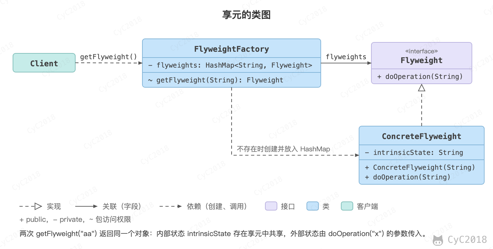

## 享元（Flyweight）

### 意图
利用共享的方式来支持大量细粒度的对象，这些对象一部分内部状态是相同的。

### 类图
- Flyweight：享元对象；
- IntrinsicState：内部状态，保存在享元对象中，可以被共享；
- ExtrinsicState：外部状态，随使用场景变化、不能共享，由调用方在调用时传入。

<div align="center">  </div><br>

### 实现
```java
public interface Flyweight {
    void doOperation(String extrinsicState);
}
```

```java
public class ConcreteFlyweight implements Flyweight {

    private String intrinsicState;

    public ConcreteFlyweight(String intrinsicState) {
        this.intrinsicState = intrinsicState;
    }

    @Override
    public void doOperation(String extrinsicState) {
        System.out.println("IntrinsicState: " + intrinsicState);
        System.out.println("ExtrinsicState: " + extrinsicState);
    }
}
```

```java
public class FlyweightFactory {

    private HashMap<String, Flyweight> flyweights = new HashMap<>();

    Flyweight getFlyweight(String intrinsicState) {
        if (!flyweights.containsKey(intrinsicState)) {
            Flyweight flyweight = new ConcreteFlyweight(intrinsicState);
            flyweights.put(intrinsicState, flyweight);
        }
        return flyweights.get(intrinsicState);
    }
}
```

```java
public class Client {

    public static void main(String[] args) {
        FlyweightFactory factory = new FlyweightFactory();
        Flyweight flyweight1 = factory.getFlyweight("aa");
        Flyweight flyweight2 = factory.getFlyweight("aa");
        flyweight1.doOperation("x");
        flyweight2.doOperation("y");
        System.out.println(flyweight1 == flyweight2);
    }
}
```

```text
IntrinsicState: aa
ExtrinsicState: x
IntrinsicState: aa
ExtrinsicState: y
true
```

两次 getFlyweight("aa") 拿到的是同一个对象（== 为 true），x、y 这样的外部状态不保存在对象里，所以一个对象可以服务所有调用方。

### JDK 中的应用
Java 利用缓存复用大量的小对象，减少对象的创建和内存占用。例如 Integer.valueOf() 一定缓存 -128～127，Integer.valueOf(127) == Integer.valueOf(127) 为 true，换成 128 为 false；上限可以用 -XX:AutoBoxCacheMax 调大（JDK 21 实测，见附录 A1）。自动装箱调用的就是 valueOf()，所以比较两个 Integer 要用 equals()。

- java.lang.Integer#valueOf(int)
- java.lang.Boolean#valueOf(boolean)
- java.lang.Byte#valueOf(byte)
- java.lang.Character#valueOf(char)

## 附录：实测

### A1 Integer 缓存

环境：JDK 21.0.13（Adoptium），macOS。

```java
System.out.println(Integer.valueOf(127) == Integer.valueOf(127));
System.out.println(Integer.valueOf(128) == Integer.valueOf(128));
```

```text
$ java Facts.java
true
false
$ java -XX:AutoBoxCacheMax=1000 Facts.java
true
true
```

## 参考资料

- 弗里曼. Head First 设计模式 [M]. 中国电力出版社, 2007.
- Gamma E. 设计模式：可复用面向对象软件的基础 [M]. 机械工业出版社, 2007.
- [Integer (Java SE 21 & JDK 21)](https://docs.oracle.com/en/java/javase/21/docs/api/java.base/java/lang/Integer.html#valueOf(int))
