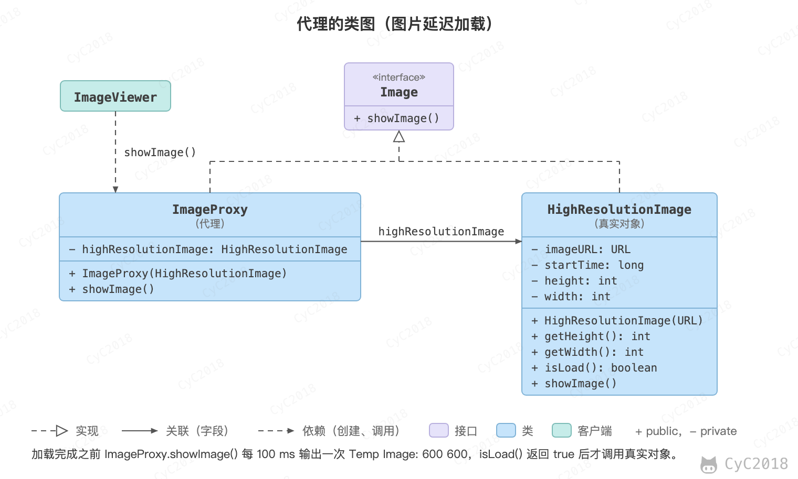

## 代理（Proxy）

### 意图
控制对其它对象的访问。

### 类图
代理有以下四类：

- 远程代理（Remote Proxy）：控制对远程对象（不同地址空间）的访问，它负责将请求及其参数进行编码，并向不同地址空间中的对象发送已经编码的请求；
- 虚拟代理（Virtual Proxy）：根据需要创建开销很大的对象，它可以缓存实体的附加信息，以便延迟对它的访问，例如在网站加载一个很大图片时，不能马上完成，可以用虚拟代理缓存图片的大小信息，然后生成一张临时图片代替原始图片；
- 保护代理（Protection Proxy）：按权限控制对象的访问，它负责检查调用者是否具有实现一个请求所必须的访问权限；
- 智能代理（Smart Reference）：取代了简单的指针，它在访问对象时执行一些附加操作，例如记录对象的引用次数、第一次引用对象时将它装入内存、访问实际对象前检查是否已经锁定了它。

<div align="center">  </div><br>

### 实现
以下是一个虚拟代理的实现，模拟了图片延迟加载的情况下使用与图片大小相等的临时内容去替换原始图片，直到图片加载完成才将图片显示出来。

```java
public interface Image {
    void showImage();
}
```

```java
public class HighResolutionImage implements Image {

    private URL imageURL;
    private long startTime;
    private int height;
    private int width;

    public int getHeight() {
        return height;
    }

    public int getWidth() {
        return width;
    }

    public HighResolutionImage(URL imageURL) {
        this.imageURL = imageURL;
        this.startTime = System.currentTimeMillis();
        this.width = 600;
        this.height = 600;
    }

    public boolean isLoad() {
        // 模拟图片加载，延迟 3s 加载完成
        long endTime = System.currentTimeMillis();
        return endTime - startTime > 3000;
    }

    @Override
    public void showImage() {
        System.out.println("Real Image: " + imageURL);
    }
}
```

```java
public class ImageProxy implements Image {

    private HighResolutionImage highResolutionImage;

    public ImageProxy(HighResolutionImage highResolutionImage) {
        this.highResolutionImage = highResolutionImage;
    }

    @Override
    public void showImage() {
        while (!highResolutionImage.isLoad()) {
            try {
                System.out.println("Temp Image: " + highResolutionImage.getWidth() + " " + highResolutionImage.getHeight());
                Thread.sleep(100);
            } catch (InterruptedException e) {
                e.printStackTrace();
            }
        }
        highResolutionImage.showImage();
    }
}
```

```java
public class ImageViewer {

    public static void main(String[] args) throws Exception {
        String image = "http://image.jpg";
        URL url = URI.create(image).toURL();
        HighResolutionImage highResolutionImage = new HighResolutionImage(url);
        ImageProxy imageProxy = new ImageProxy(highResolutionImage);
        imageProxy.showImage();
    }
}
```

```text
Temp Image: 600 600
Temp Image: 600 600
...
Real Image: http://image.jpg
```

调用 showImage() 的一方只看到 Image 接口，分不出拿到的是代理还是真实图片。代理和[装饰](设计模式%20-%20装饰.md)的结构相似，都与被包装的对象实现同一个接口并持有它的引用，区别在于目的：代理控制对真实对象的访问，例如延迟加载、权限检查、远程调用；装饰为对象叠加功能，通常由客户端一层层套上去。

### JDK 中的应用
- java.lang.reflect.Proxy：动态代理，不必像 ImageProxy 那样为每个接口手写代理类（静态代理），而是在运行时生成实现指定接口的代理类，方法调用统一转给 InvocationHandler 处理，原理和与 CGLIB 的区别见[动态代理](Spring.md#动态代理)；
- RMI。

## 参考资料

- 弗里曼. Head First 设计模式 [M]. 中国电力出版社, 2007.
- Gamma E. 设计模式：可复用面向对象软件的基础 [M]. 机械工业出版社, 2007.
