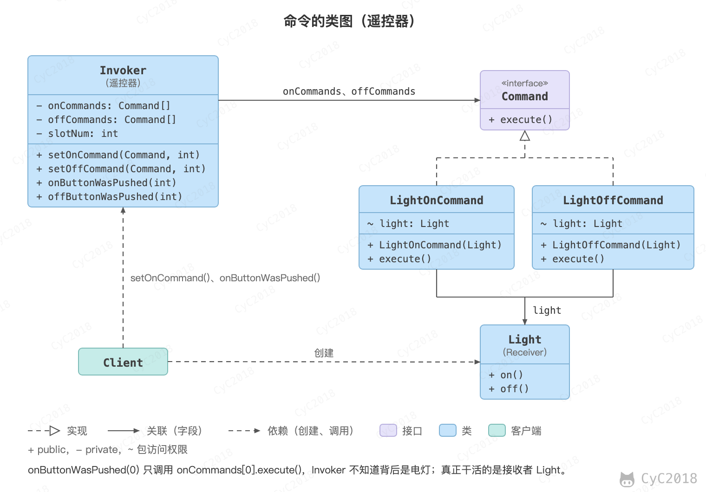
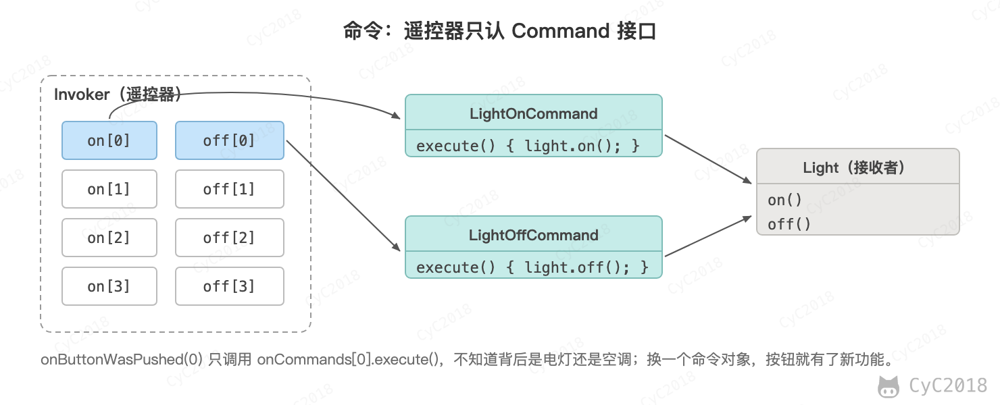

## 2. 命令（Command）

### 意图
将命令封装成对象，具有以下作用：

- 使用命令来参数化其它对象；
- 将命令放入队列中进行排队；
- 将命令的操作记录到日志中；
- 支持可撤销的操作。

### 类图
- Command：命令；
- Receiver：命令接收者，也就是命令真正的执行者；
- Invoker：通过它来调用命令；
- Client：可以设置命令与命令的接收者。

<div align="center">  </div><br>

### 实现
设计一个遥控器，可以控制电灯开关。

<div align="center">  </div><br>

```java
public interface Command {
    void execute();
}
```

```java
public class LightOnCommand implements Command {
    Light light;

    public LightOnCommand(Light light) {
        this.light = light;
    }

    @Override
    public void execute() {
        light.on();
    }
}
```

```java
public class LightOffCommand implements Command {
    Light light;

    public LightOffCommand(Light light) {
        this.light = light;
    }

    @Override
    public void execute() {
        light.off();
    }
}
```

```java
public class Light {

    public void on() {
        System.out.println("Light is on!");
    }

    public void off() {
        System.out.println("Light is off!");
    }
}
```

```java
/**
 * 遥控器
 */
public class Invoker {
    private Command[] onCommands;
    private Command[] offCommands;
    private final int slotNum = 7;

    public Invoker() {
        this.onCommands = new Command[slotNum];
        this.offCommands = new Command[slotNum];
    }

    public void setOnCommand(Command command, int slot) {
        onCommands[slot] = command;
    }

    public void setOffCommand(Command command, int slot) {
        offCommands[slot] = command;
    }

    public void onButtonWasPushed(int slot) {
        onCommands[slot].execute();
    }

    public void offButtonWasPushed(int slot) {
        offCommands[slot].execute();
    }
}
```

```java
public class Client {
    public static void main(String[] args) {
        Invoker invoker = new Invoker();
        Light light = new Light();
        Command lightOnCommand = new LightOnCommand(light);
        Command lightOffCommand = new LightOffCommand(light);
        invoker.setOnCommand(lightOnCommand, 0);
        invoker.setOffCommand(lightOffCommand, 0);
        invoker.onButtonWasPushed(0);
        invoker.offButtonWasPushed(0);
    }
}
```

```text
Light is on!
Light is off!
```

请求变成对象以后，就可以像数据一样保存和传递：把执行过的命令压入栈，给 Command 加一个 undo() 方法恢复执行前的状态，就能实现撤销；把命令放进队列，交给线程池执行，就是 Runnable 的用法。

### JDK 中的应用
- [java.lang.Runnable](http://docs.oracle.com/javase/8/docs/api/java/lang/Runnable.html)
- [Netflix Hystrix](https://github.com/Netflix/Hystrix/wiki)（开源库，不属于 JDK）
- [javax.swing.Action](http://docs.oracle.com/javase/8/docs/api/javax/swing/Action.html)

## 参考资料

- 弗里曼. Head First 设计模式 [M]. 中国电力出版社, 2007.
- Gamma E. 设计模式：可复用面向对象软件的基础 [M]. 机械工业出版社, 2007.
